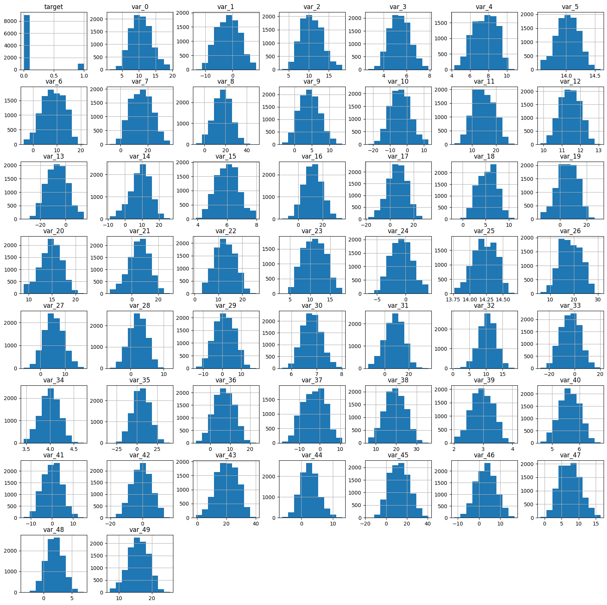
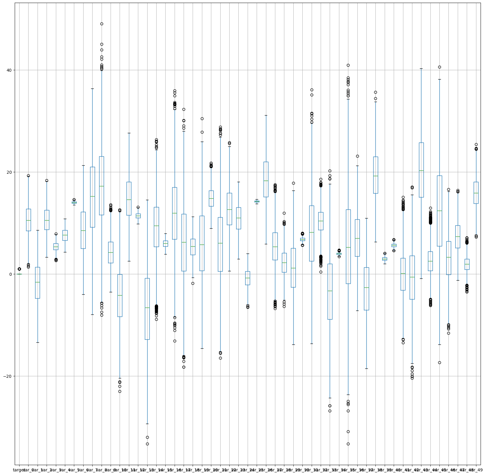
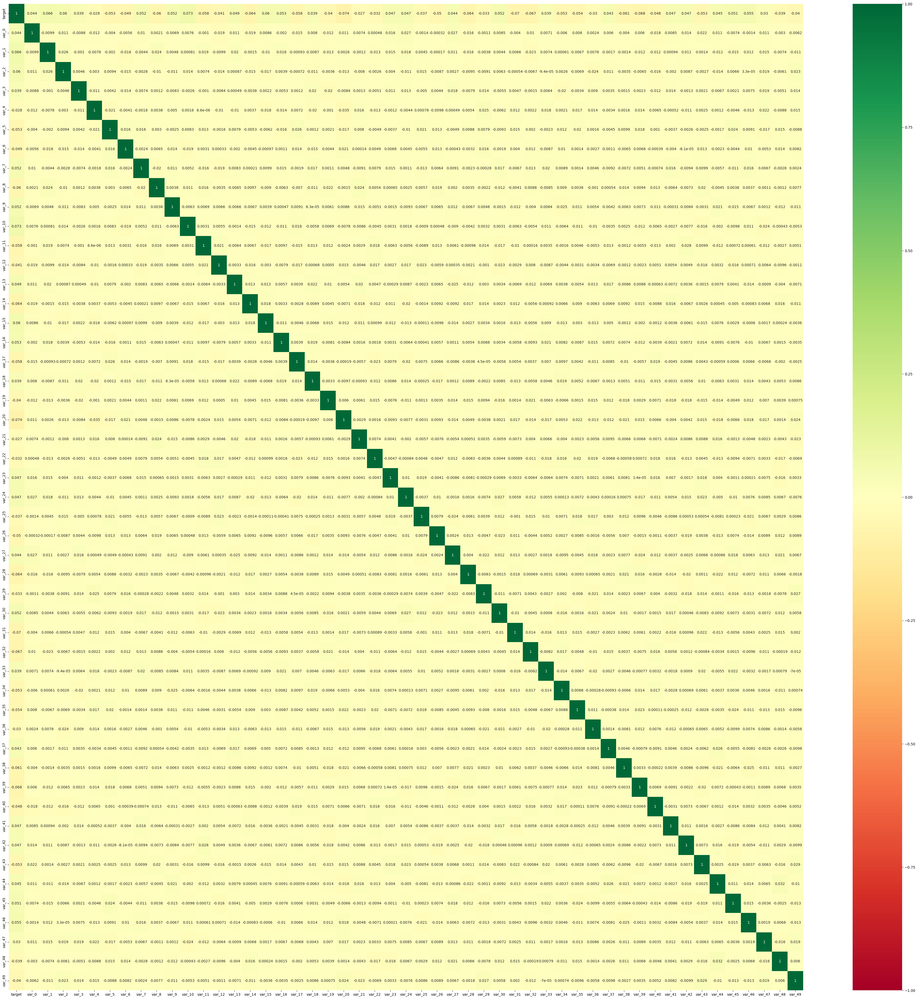
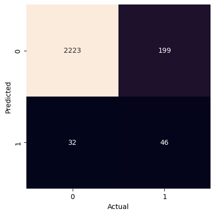

# Project 1: Transactions – Pass 03


## Problem Definition


#### 1. State the business problem.

Translate the business problem into a Data Science problem by stating what kind of problem it is ( supervised vs unsupervised ) and whether it is a classification, regression, or clustering problem.  Mention which model will be used, if known.


> We want to predict whether or not a future customer will complete a transaction (e.g., a product purchase, loan or bill payment, or subscription retention) based on prior transaction data. Such predictions can help determine higher-risk customers and present incentives to drive future transaction completions and increase sales.

> This is a supervised, categorical binary classification problem, where the target data is whether a customer transaction was successful (true or false). To achieve this, it uses a Gaussian Naive Bayes model to make predictions about transaction success.


## Data Collection


#### 2. Load Pandas, Numpy, and Matplotlib modules


```python
# imports
import pandas as pd
import numpy as np
import matplotlib.pyplot as plt
import seaborn as sns

from sklearn import datasets, metrics
from sklearn.naive_bayes import GaussianNB
from sklearn.model_selection import train_test_split
```

#### 3. Load data Train.csv from AWS S3.


```python
# url
url = 'https://ddc-datascience.s3.amazonaws.com/Projects/Project.1-Transactions/Data/Transaction.train.csv'
```

- Set number of columns and rows for this pass:


```python
# set cols and rows for pass
num_rows = 10_000
num_rows
```


    10000


- Read in the data from .csv using pandas:


```python
# make dataframe
df = pd.read_csv(
    url,
    nrows=num_rows,
)
```

- Check the dataframe:


```python
# check dataframe
df
```


  <div id="df-2fbfb014-0bbf-4e02-ba73-6406e2d25731" class="colab-df-container">
    <div>
<style scoped>
    .dataframe tbody tr th:only-of-type {
        vertical-align: middle;
    }

    .dataframe tbody tr th {
        vertical-align: top;
    }

    .dataframe thead th {
        text-align: right;
    }
</style>
<table border="1" class="dataframe">
  <thead>
    <tr style="text-align: right;">
      <th></th>
      <th>Unnamed: 0</th>
      <th>ID_code</th>
      <th>target</th>
      <th>var_0</th>
      <th>var_1</th>
      <th>var_2</th>
      <th>var_3</th>
      <th>var_4</th>
      <th>var_5</th>
      <th>var_6</th>
      <th>...</th>
      <th>var_40</th>
      <th>var_41</th>
      <th>var_42</th>
      <th>var_43</th>
      <th>var_44</th>
      <th>var_45</th>
      <th>var_46</th>
      <th>var_47</th>
      <th>var_48</th>
      <th>var_49</th>
    </tr>
  </thead>
  <tbody>
    <tr>
      <th>0</th>
      <td>0</td>
      <td>train_0</td>
      <td>0</td>
      <td>8.9255</td>
      <td>-6.7863</td>
      <td>11.9081</td>
      <td>5.1187</td>
      <td>5.7470</td>
      <td>14.0137</td>
      <td>0.5745</td>
      <td>...</td>
      <td>5.4879</td>
      <td>-4.7645</td>
      <td>3.1531</td>
      <td>18.5618</td>
      <td>1.7202</td>
      <td>25.8398</td>
      <td>4.4354</td>
      <td>3.9642</td>
      <td>3.1364</td>
      <td>12.7803</td>
    </tr>
    <tr>
      <th>1</th>
      <td>1</td>
      <td>train_1</td>
      <td>0</td>
      <td>11.5006</td>
      <td>-4.1473</td>
      <td>13.8588</td>
      <td>5.6208</td>
      <td>8.0851</td>
      <td>14.0239</td>
      <td>8.4135</td>
      <td>...</td>
      <td>5.7999</td>
      <td>5.5378</td>
      <td>5.5134</td>
      <td>30.2645</td>
      <td>11.0752</td>
      <td>22.5441</td>
      <td>7.6421</td>
      <td>7.7214</td>
      <td>2.5837</td>
      <td>18.3560</td>
    </tr>
    <tr>
      <th>2</th>
      <td>2</td>
      <td>train_2</td>
      <td>0</td>
      <td>8.6093</td>
      <td>-2.7457</td>
      <td>12.0805</td>
      <td>6.9427</td>
      <td>5.9525</td>
      <td>14.1929</td>
      <td>7.3124</td>
      <td>...</td>
      <td>5.7690</td>
      <td>-7.0927</td>
      <td>-5.8234</td>
      <td>25.6820</td>
      <td>2.4013</td>
      <td>23.0866</td>
      <td>2.9057</td>
      <td>9.7905</td>
      <td>1.6704</td>
      <td>14.7222</td>
    </tr>
    <tr>
      <th>3</th>
      <td>3</td>
      <td>train_3</td>
      <td>0</td>
      <td>11.0604</td>
      <td>-2.1518</td>
      <td>8.9522</td>
      <td>5.8428</td>
      <td>8.2450</td>
      <td>13.8463</td>
      <td>11.9704</td>
      <td>...</td>
      <td>5.3430</td>
      <td>-7.1541</td>
      <td>11.7134</td>
      <td>14.7483</td>
      <td>5.6961</td>
      <td>-0.4639</td>
      <td>4.4666</td>
      <td>4.7433</td>
      <td>0.7178</td>
      <td>17.9697</td>
    </tr>
    <tr>
      <th>4</th>
      <td>4</td>
      <td>train_4</td>
      <td>0</td>
      <td>9.8369</td>
      <td>-1.4834</td>
      <td>12.8746</td>
      <td>5.9405</td>
      <td>7.6784</td>
      <td>13.8481</td>
      <td>7.8895</td>
      <td>...</td>
      <td>5.5518</td>
      <td>1.4493</td>
      <td>2.3705</td>
      <td>18.4685</td>
      <td>5.1743</td>
      <td>11.8503</td>
      <td>-1.4905</td>
      <td>9.5214</td>
      <td>-0.1508</td>
      <td>17.9974</td>
    </tr>
    <tr>
      <th>...</th>
      <td>...</td>
      <td>...</td>
      <td>...</td>
      <td>...</td>
      <td>...</td>
      <td>...</td>
      <td>...</td>
      <td>...</td>
      <td>...</td>
      <td>...</td>
      <td>...</td>
      <td>...</td>
      <td>...</td>
      <td>...</td>
      <td>...</td>
      <td>...</td>
      <td>...</td>
      <td>...</td>
      <td>...</td>
      <td>...</td>
      <td>...</td>
    </tr>
    <tr>
      <th>9995</th>
      <td>9995</td>
      <td>train_9995</td>
      <td>0</td>
      <td>16.0253</td>
      <td>-2.7417</td>
      <td>13.0579</td>
      <td>4.6907</td>
      <td>7.6733</td>
      <td>14.4044</td>
      <td>4.4485</td>
      <td>...</td>
      <td>5.4078</td>
      <td>-6.0609</td>
      <td>5.3959</td>
      <td>14.3071</td>
      <td>0.7175</td>
      <td>0.8099</td>
      <td>3.0246</td>
      <td>6.3355</td>
      <td>1.2195</td>
      <td>15.0416</td>
    </tr>
    <tr>
      <th>9996</th>
      <td>9996</td>
      <td>train_9996</td>
      <td>0</td>
      <td>8.2377</td>
      <td>5.8972</td>
      <td>11.4494</td>
      <td>6.0994</td>
      <td>5.8279</td>
      <td>14.2108</td>
      <td>10.4431</td>
      <td>...</td>
      <td>6.5495</td>
      <td>-3.7137</td>
      <td>-2.4108</td>
      <td>22.0010</td>
      <td>6.6314</td>
      <td>7.7139</td>
      <td>2.1874</td>
      <td>11.9021</td>
      <td>3.3370</td>
      <td>15.4100</td>
    </tr>
    <tr>
      <th>9997</th>
      <td>9997</td>
      <td>train_9997</td>
      <td>0</td>
      <td>7.4000</td>
      <td>-0.5939</td>
      <td>5.4020</td>
      <td>5.4715</td>
      <td>8.9772</td>
      <td>13.7754</td>
      <td>0.5061</td>
      <td>...</td>
      <td>5.7283</td>
      <td>-3.6798</td>
      <td>1.2850</td>
      <td>11.7876</td>
      <td>0.3499</td>
      <td>23.6263</td>
      <td>2.4554</td>
      <td>7.4933</td>
      <td>1.0810</td>
      <td>19.3749</td>
    </tr>
    <tr>
      <th>9998</th>
      <td>9998</td>
      <td>train_9998</td>
      <td>0</td>
      <td>7.7726</td>
      <td>-4.0555</td>
      <td>8.6391</td>
      <td>6.4168</td>
      <td>8.1651</td>
      <td>13.8262</td>
      <td>8.7265</td>
      <td>...</td>
      <td>5.5500</td>
      <td>3.6771</td>
      <td>7.1521</td>
      <td>13.3076</td>
      <td>2.2369</td>
      <td>19.4285</td>
      <td>7.5065</td>
      <td>6.9602</td>
      <td>3.7997</td>
      <td>19.1259</td>
    </tr>
    <tr>
      <th>9999</th>
      <td>9999</td>
      <td>train_9999</td>
      <td>0</td>
      <td>6.1476</td>
      <td>3.8616</td>
      <td>15.0005</td>
      <td>5.3341</td>
      <td>6.0115</td>
      <td>13.8576</td>
      <td>5.5113</td>
      <td>...</td>
      <td>6.0071</td>
      <td>4.5697</td>
      <td>-10.4171</td>
      <td>24.7558</td>
      <td>3.1771</td>
      <td>24.9902</td>
      <td>-2.6686</td>
      <td>5.7259</td>
      <td>-0.0793</td>
      <td>17.0559</td>
    </tr>
  </tbody>
</table>
<p>10000 rows × 53 columns</p>
</div>
    <div class="colab-df-buttons">

  <div class="colab-df-container">
    <button class="colab-df-convert" onclick="convertToInteractive('df-2fbfb014-0bbf-4e02-ba73-6406e2d25731')"
            title="Convert this dataframe to an interactive table."
            style="display:none;">

  <svg xmlns="http://www.w3.org/2000/svg" height="24px" viewBox="0 -960 960 960">
    <path d="M120-120v-720h720v720H120Zm60-500h600v-160H180v160Zm220 220h160v-160H400v160Zm0 220h160v-160H400v160ZM180-400h160v-160H180v160Zm440 0h160v-160H620v160ZM180-180h160v-160H180v160Zm440 0h160v-160H620v160Z"/>
  </svg>
    </button>

  <style>
    .colab-df-container {
      display:flex;
      gap: 12px;
    }

    .colab-df-convert {
      background-color: #E8F0FE;
      border: none;
      border-radius: 50%;
      cursor: pointer;
      display: none;
      fill: #1967D2;
      height: 32px;
      padding: 0 0 0 0;
      width: 32px;
    }

    .colab-df-convert:hover {
      background-color: #E2EBFA;
      box-shadow: 0px 1px 2px rgba(60, 64, 67, 0.3), 0px 1px 3px 1px rgba(60, 64, 67, 0.15);
      fill: #174EA6;
    }

    .colab-df-buttons div {
      margin-bottom: 4px;
    }

    [theme=dark] .colab-df-convert {
      background-color: #3B4455;
      fill: #D2E3FC;
    }

    [theme=dark] .colab-df-convert:hover {
      background-color: #434B5C;
      box-shadow: 0px 1px 3px 1px rgba(0, 0, 0, 0.15);
      filter: drop-shadow(0px 1px 2px rgba(0, 0, 0, 0.3));
      fill: #FFFFFF;
    }
  </style>

    <script>
      const buttonEl =
        document.querySelector('#df-2fbfb014-0bbf-4e02-ba73-6406e2d25731 button.colab-df-convert');
      buttonEl.style.display =
        google.colab.kernel.accessAllowed ? 'block' : 'none';

      async function convertToInteractive(key) {
        const element = document.querySelector('#df-2fbfb014-0bbf-4e02-ba73-6406e2d25731');
        const dataTable =
          await google.colab.kernel.invokeFunction('convertToInteractive',
                                                    [key], {});
        if (!dataTable) return;

        const docLinkHtml = 'Like what you see? Visit the ' +
          '<a target="_blank" href=https://colab.research.google.com/notebooks/data_table.ipynb>data table notebook</a>'
          + ' to learn more about interactive tables.';
        element.innerHTML = '';
        dataTable['output_type'] = 'display_data';
        await google.colab.output.renderOutput(dataTable, element);
        const docLink = document.createElement('div');
        docLink.innerHTML = docLinkHtml;
        element.appendChild(docLink);
      }
    </script>
  </div>


  <div id="id_65fc2814-08c8-4f24-bede-fac43ce4fbd8">
    <style>
      .colab-df-generate {
        background-color: #E8F0FE;
        border: none;
        border-radius: 50%;
        cursor: pointer;
        display: none;
        fill: #1967D2;
        height: 32px;
        padding: 0 0 0 0;
        width: 32px;
      }

      .colab-df-generate:hover {
        background-color: #E2EBFA;
        box-shadow: 0px 1px 2px rgba(60, 64, 67, 0.3), 0px 1px 3px 1px rgba(60, 64, 67, 0.15);
        fill: #174EA6;
      }

      [theme=dark] .colab-df-generate {
        background-color: #3B4455;
        fill: #D2E3FC;
      }

      [theme=dark] .colab-df-generate:hover {
        background-color: #434B5C;
        box-shadow: 0px 1px 3px 1px rgba(0, 0, 0, 0.15);
        filter: drop-shadow(0px 1px 2px rgba(0, 0, 0, 0.3));
        fill: #FFFFFF;
      }
    </style>
    <button class="colab-df-generate" onclick="generateWithVariable('df')"
            title="Generate code using this dataframe."
            style="display:none;">

  <svg xmlns="http://www.w3.org/2000/svg" height="24px"viewBox="0 0 24 24"
       width="24px">
    <path d="M7,19H8.4L18.45,9,17,7.55,7,17.6ZM5,21V16.75L18.45,3.32a2,2,0,0,1,2.83,0l1.4,1.43a1.91,1.91,0,0,1,.58,1.4,1.91,1.91,0,0,1-.58,1.4L9.25,21ZM18.45,9,17,7.55Zm-12,3A5.31,5.31,0,0,0,4.9,8.1,5.31,5.31,0,0,0,1,6.5,5.31,5.31,0,0,0,4.9,4.9,5.31,5.31,0,0,0,6.5,1,5.31,5.31,0,0,0,8.1,4.9,5.31,5.31,0,0,0,12,6.5,5.46,5.46,0,0,0,6.5,12Z"/>
  </svg>
    </button>
    <script>
      (() => {
      const buttonEl =
        document.querySelector('#id_65fc2814-08c8-4f24-bede-fac43ce4fbd8 button.colab-df-generate');
      buttonEl.style.display =
        google.colab.kernel.accessAllowed ? 'block' : 'none';

      buttonEl.onclick = () => {
        google.colab.notebook.generateWithVariable('df');
      }
      })();
    </script>
  </div>

    </div>
  </div>


So our data set has 53 total columns, 50 of these (var_0 - var_49) being feature columns.

## Data Cleaning


#### 4. Examine the data using tools we have used in class. You should be identifying the various columns such as ...

    - target column
    - feature columns
    - identifier columns
    - null columns
    - null rows

    Tools you should be using include, but are not limited to:

    - head
    - tail
    - shape
    - size
    - info
    - describe
    - nunique
    - unique
    - isnull/isna


```python
# define target_col
target_col = 'target'
target_col
```


    'target'


- head


```python
# head
df.head()
```


  <div id="df-071ba7e6-7532-4c7d-9184-391c6b34e551" class="colab-df-container">
    <div>
<style scoped>
    .dataframe tbody tr th:only-of-type {
        vertical-align: middle;
    }

    .dataframe tbody tr th {
        vertical-align: top;
    }

    .dataframe thead th {
        text-align: right;
    }
</style>
<table border="1" class="dataframe">
  <thead>
    <tr style="text-align: right;">
      <th></th>
      <th>Unnamed: 0</th>
      <th>ID_code</th>
      <th>target</th>
      <th>var_0</th>
      <th>var_1</th>
      <th>var_2</th>
      <th>var_3</th>
      <th>var_4</th>
      <th>var_5</th>
      <th>var_6</th>
      <th>...</th>
      <th>var_40</th>
      <th>var_41</th>
      <th>var_42</th>
      <th>var_43</th>
      <th>var_44</th>
      <th>var_45</th>
      <th>var_46</th>
      <th>var_47</th>
      <th>var_48</th>
      <th>var_49</th>
    </tr>
  </thead>
  <tbody>
    <tr>
      <th>0</th>
      <td>0</td>
      <td>train_0</td>
      <td>0</td>
      <td>8.9255</td>
      <td>-6.7863</td>
      <td>11.9081</td>
      <td>5.1187</td>
      <td>5.7470</td>
      <td>14.0137</td>
      <td>0.5745</td>
      <td>...</td>
      <td>5.4879</td>
      <td>-4.7645</td>
      <td>3.1531</td>
      <td>18.5618</td>
      <td>1.7202</td>
      <td>25.8398</td>
      <td>4.4354</td>
      <td>3.9642</td>
      <td>3.1364</td>
      <td>12.7803</td>
    </tr>
    <tr>
      <th>1</th>
      <td>1</td>
      <td>train_1</td>
      <td>0</td>
      <td>11.5006</td>
      <td>-4.1473</td>
      <td>13.8588</td>
      <td>5.6208</td>
      <td>8.0851</td>
      <td>14.0239</td>
      <td>8.4135</td>
      <td>...</td>
      <td>5.7999</td>
      <td>5.5378</td>
      <td>5.5134</td>
      <td>30.2645</td>
      <td>11.0752</td>
      <td>22.5441</td>
      <td>7.6421</td>
      <td>7.7214</td>
      <td>2.5837</td>
      <td>18.3560</td>
    </tr>
    <tr>
      <th>2</th>
      <td>2</td>
      <td>train_2</td>
      <td>0</td>
      <td>8.6093</td>
      <td>-2.7457</td>
      <td>12.0805</td>
      <td>6.9427</td>
      <td>5.9525</td>
      <td>14.1929</td>
      <td>7.3124</td>
      <td>...</td>
      <td>5.7690</td>
      <td>-7.0927</td>
      <td>-5.8234</td>
      <td>25.6820</td>
      <td>2.4013</td>
      <td>23.0866</td>
      <td>2.9057</td>
      <td>9.7905</td>
      <td>1.6704</td>
      <td>14.7222</td>
    </tr>
    <tr>
      <th>3</th>
      <td>3</td>
      <td>train_3</td>
      <td>0</td>
      <td>11.0604</td>
      <td>-2.1518</td>
      <td>8.9522</td>
      <td>5.8428</td>
      <td>8.2450</td>
      <td>13.8463</td>
      <td>11.9704</td>
      <td>...</td>
      <td>5.3430</td>
      <td>-7.1541</td>
      <td>11.7134</td>
      <td>14.7483</td>
      <td>5.6961</td>
      <td>-0.4639</td>
      <td>4.4666</td>
      <td>4.7433</td>
      <td>0.7178</td>
      <td>17.9697</td>
    </tr>
    <tr>
      <th>4</th>
      <td>4</td>
      <td>train_4</td>
      <td>0</td>
      <td>9.8369</td>
      <td>-1.4834</td>
      <td>12.8746</td>
      <td>5.9405</td>
      <td>7.6784</td>
      <td>13.8481</td>
      <td>7.8895</td>
      <td>...</td>
      <td>5.5518</td>
      <td>1.4493</td>
      <td>2.3705</td>
      <td>18.4685</td>
      <td>5.1743</td>
      <td>11.8503</td>
      <td>-1.4905</td>
      <td>9.5214</td>
      <td>-0.1508</td>
      <td>17.9974</td>
    </tr>
  </tbody>
</table>
<p>5 rows × 53 columns</p>
</div>
    <div class="colab-df-buttons">

  <div class="colab-df-container">
    <button class="colab-df-convert" onclick="convertToInteractive('df-071ba7e6-7532-4c7d-9184-391c6b34e551')"
            title="Convert this dataframe to an interactive table."
            style="display:none;">

  <svg xmlns="http://www.w3.org/2000/svg" height="24px" viewBox="0 -960 960 960">
    <path d="M120-120v-720h720v720H120Zm60-500h600v-160H180v160Zm220 220h160v-160H400v160Zm0 220h160v-160H400v160ZM180-400h160v-160H180v160Zm440 0h160v-160H620v160ZM180-180h160v-160H180v160Zm440 0h160v-160H620v160Z"/>
  </svg>
    </button>

  <style>
    .colab-df-container {
      display:flex;
      gap: 12px;
    }

    .colab-df-convert {
      background-color: #E8F0FE;
      border: none;
      border-radius: 50%;
      cursor: pointer;
      display: none;
      fill: #1967D2;
      height: 32px;
      padding: 0 0 0 0;
      width: 32px;
    }

    .colab-df-convert:hover {
      background-color: #E2EBFA;
      box-shadow: 0px 1px 2px rgba(60, 64, 67, 0.3), 0px 1px 3px 1px rgba(60, 64, 67, 0.15);
      fill: #174EA6;
    }

    .colab-df-buttons div {
      margin-bottom: 4px;
    }

    [theme=dark] .colab-df-convert {
      background-color: #3B4455;
      fill: #D2E3FC;
    }

    [theme=dark] .colab-df-convert:hover {
      background-color: #434B5C;
      box-shadow: 0px 1px 3px 1px rgba(0, 0, 0, 0.15);
      filter: drop-shadow(0px 1px 2px rgba(0, 0, 0, 0.3));
      fill: #FFFFFF;
    }
  </style>

    <script>
      const buttonEl =
        document.querySelector('#df-071ba7e6-7532-4c7d-9184-391c6b34e551 button.colab-df-convert');
      buttonEl.style.display =
        google.colab.kernel.accessAllowed ? 'block' : 'none';

      async function convertToInteractive(key) {
        const element = document.querySelector('#df-071ba7e6-7532-4c7d-9184-391c6b34e551');
        const dataTable =
          await google.colab.kernel.invokeFunction('convertToInteractive',
                                                    [key], {});
        if (!dataTable) return;

        const docLinkHtml = 'Like what you see? Visit the ' +
          '<a target="_blank" href=https://colab.research.google.com/notebooks/data_table.ipynb>data table notebook</a>'
          + ' to learn more about interactive tables.';
        element.innerHTML = '';
        dataTable['output_type'] = 'display_data';
        await google.colab.output.renderOutput(dataTable, element);
        const docLink = document.createElement('div');
        docLink.innerHTML = docLinkHtml;
        element.appendChild(docLink);
      }
    </script>
  </div>


    </div>
  </div>


- tail


```python
# tail
df.tail()
```


  <div id="df-e6ac2237-cc49-430e-95a8-93b8e8c4e170" class="colab-df-container">
    <div>
<style scoped>
    .dataframe tbody tr th:only-of-type {
        vertical-align: middle;
    }

    .dataframe tbody tr th {
        vertical-align: top;
    }

    .dataframe thead th {
        text-align: right;
    }
</style>
<table border="1" class="dataframe">
  <thead>
    <tr style="text-align: right;">
      <th></th>
      <th>Unnamed: 0</th>
      <th>ID_code</th>
      <th>target</th>
      <th>var_0</th>
      <th>var_1</th>
      <th>var_2</th>
      <th>var_3</th>
      <th>var_4</th>
      <th>var_5</th>
      <th>var_6</th>
      <th>...</th>
      <th>var_40</th>
      <th>var_41</th>
      <th>var_42</th>
      <th>var_43</th>
      <th>var_44</th>
      <th>var_45</th>
      <th>var_46</th>
      <th>var_47</th>
      <th>var_48</th>
      <th>var_49</th>
    </tr>
  </thead>
  <tbody>
    <tr>
      <th>9995</th>
      <td>9995</td>
      <td>train_9995</td>
      <td>0</td>
      <td>16.0253</td>
      <td>-2.7417</td>
      <td>13.0579</td>
      <td>4.6907</td>
      <td>7.6733</td>
      <td>14.4044</td>
      <td>4.4485</td>
      <td>...</td>
      <td>5.4078</td>
      <td>-6.0609</td>
      <td>5.3959</td>
      <td>14.3071</td>
      <td>0.7175</td>
      <td>0.8099</td>
      <td>3.0246</td>
      <td>6.3355</td>
      <td>1.2195</td>
      <td>15.0416</td>
    </tr>
    <tr>
      <th>9996</th>
      <td>9996</td>
      <td>train_9996</td>
      <td>0</td>
      <td>8.2377</td>
      <td>5.8972</td>
      <td>11.4494</td>
      <td>6.0994</td>
      <td>5.8279</td>
      <td>14.2108</td>
      <td>10.4431</td>
      <td>...</td>
      <td>6.5495</td>
      <td>-3.7137</td>
      <td>-2.4108</td>
      <td>22.0010</td>
      <td>6.6314</td>
      <td>7.7139</td>
      <td>2.1874</td>
      <td>11.9021</td>
      <td>3.3370</td>
      <td>15.4100</td>
    </tr>
    <tr>
      <th>9997</th>
      <td>9997</td>
      <td>train_9997</td>
      <td>0</td>
      <td>7.4000</td>
      <td>-0.5939</td>
      <td>5.4020</td>
      <td>5.4715</td>
      <td>8.9772</td>
      <td>13.7754</td>
      <td>0.5061</td>
      <td>...</td>
      <td>5.7283</td>
      <td>-3.6798</td>
      <td>1.2850</td>
      <td>11.7876</td>
      <td>0.3499</td>
      <td>23.6263</td>
      <td>2.4554</td>
      <td>7.4933</td>
      <td>1.0810</td>
      <td>19.3749</td>
    </tr>
    <tr>
      <th>9998</th>
      <td>9998</td>
      <td>train_9998</td>
      <td>0</td>
      <td>7.7726</td>
      <td>-4.0555</td>
      <td>8.6391</td>
      <td>6.4168</td>
      <td>8.1651</td>
      <td>13.8262</td>
      <td>8.7265</td>
      <td>...</td>
      <td>5.5500</td>
      <td>3.6771</td>
      <td>7.1521</td>
      <td>13.3076</td>
      <td>2.2369</td>
      <td>19.4285</td>
      <td>7.5065</td>
      <td>6.9602</td>
      <td>3.7997</td>
      <td>19.1259</td>
    </tr>
    <tr>
      <th>9999</th>
      <td>9999</td>
      <td>train_9999</td>
      <td>0</td>
      <td>6.1476</td>
      <td>3.8616</td>
      <td>15.0005</td>
      <td>5.3341</td>
      <td>6.0115</td>
      <td>13.8576</td>
      <td>5.5113</td>
      <td>...</td>
      <td>6.0071</td>
      <td>4.5697</td>
      <td>-10.4171</td>
      <td>24.7558</td>
      <td>3.1771</td>
      <td>24.9902</td>
      <td>-2.6686</td>
      <td>5.7259</td>
      <td>-0.0793</td>
      <td>17.0559</td>
    </tr>
  </tbody>
</table>
<p>5 rows × 53 columns</p>
</div>
    <div class="colab-df-buttons">

  <div class="colab-df-container">
    <button class="colab-df-convert" onclick="convertToInteractive('df-e6ac2237-cc49-430e-95a8-93b8e8c4e170')"
            title="Convert this dataframe to an interactive table."
            style="display:none;">

  <svg xmlns="http://www.w3.org/2000/svg" height="24px" viewBox="0 -960 960 960">
    <path d="M120-120v-720h720v720H120Zm60-500h600v-160H180v160Zm220 220h160v-160H400v160Zm0 220h160v-160H400v160ZM180-400h160v-160H180v160Zm440 0h160v-160H620v160ZM180-180h160v-160H180v160Zm440 0h160v-160H620v160Z"/>
  </svg>
    </button>

  <style>
    .colab-df-container {
      display:flex;
      gap: 12px;
    }

    .colab-df-convert {
      background-color: #E8F0FE;
      border: none;
      border-radius: 50%;
      cursor: pointer;
      display: none;
      fill: #1967D2;
      height: 32px;
      padding: 0 0 0 0;
      width: 32px;
    }

    .colab-df-convert:hover {
      background-color: #E2EBFA;
      box-shadow: 0px 1px 2px rgba(60, 64, 67, 0.3), 0px 1px 3px 1px rgba(60, 64, 67, 0.15);
      fill: #174EA6;
    }

    .colab-df-buttons div {
      margin-bottom: 4px;
    }

    [theme=dark] .colab-df-convert {
      background-color: #3B4455;
      fill: #D2E3FC;
    }

    [theme=dark] .colab-df-convert:hover {
      background-color: #434B5C;
      box-shadow: 0px 1px 3px 1px rgba(0, 0, 0, 0.15);
      filter: drop-shadow(0px 1px 2px rgba(0, 0, 0, 0.3));
      fill: #FFFFFF;
    }
  </style>

    <script>
      const buttonEl =
        document.querySelector('#df-e6ac2237-cc49-430e-95a8-93b8e8c4e170 button.colab-df-convert');
      buttonEl.style.display =
        google.colab.kernel.accessAllowed ? 'block' : 'none';

      async function convertToInteractive(key) {
        const element = document.querySelector('#df-e6ac2237-cc49-430e-95a8-93b8e8c4e170');
        const dataTable =
          await google.colab.kernel.invokeFunction('convertToInteractive',
                                                    [key], {});
        if (!dataTable) return;

        const docLinkHtml = 'Like what you see? Visit the ' +
          '<a target="_blank" href=https://colab.research.google.com/notebooks/data_table.ipynb>data table notebook</a>'
          + ' to learn more about interactive tables.';
        element.innerHTML = '';
        dataTable['output_type'] = 'display_data';
        await google.colab.output.renderOutput(dataTable, element);
        const docLink = document.createElement('div');
        docLink.innerHTML = docLinkHtml;
        element.appendChild(docLink);
      }
    </script>
  </div>


    </div>
  </div>


- shape


```python
# shape
df.shape
```


    (10000, 53)


- size


```python
# size
df.size
```


    530000


- info


```python
# info
df.info()
```

    <class 'pandas.core.frame.DataFrame'>
    RangeIndex: 10000 entries, 0 to 9999
    Data columns (total 53 columns):
     #   Column      Non-Null Count  Dtype  
    ---  ------      --------------  -----  
     0   Unnamed: 0  10000 non-null  int64  
     1   ID_code     10000 non-null  object 
     2   target      10000 non-null  int64  
     3   var_0       10000 non-null  float64
     4   var_1       10000 non-null  float64
     5   var_2       10000 non-null  float64
     6   var_3       10000 non-null  float64
     7   var_4       10000 non-null  float64
     8   var_5       10000 non-null  float64
     9   var_6       10000 non-null  float64
     10  var_7       10000 non-null  float64
     11  var_8       10000 non-null  float64
     12  var_9       10000 non-null  float64
     13  var_10      10000 non-null  float64
     14  var_11      10000 non-null  float64
     15  var_12      10000 non-null  float64
     16  var_13      10000 non-null  float64
     17  var_14      10000 non-null  float64
     18  var_15      10000 non-null  float64
     19  var_16      10000 non-null  float64
     20  var_17      10000 non-null  float64
     21  var_18      10000 non-null  float64
     22  var_19      10000 non-null  float64
     23  var_20      10000 non-null  float64
     24  var_21      10000 non-null  float64
     25  var_22      10000 non-null  float64
     26  var_23      10000 non-null  float64
     27  var_24      10000 non-null  float64
     28  var_25      10000 non-null  float64
     29  var_26      10000 non-null  float64
     30  var_27      10000 non-null  float64
     31  var_28      10000 non-null  float64
     32  var_29      10000 non-null  float64
     33  var_30      10000 non-null  float64
     34  var_31      10000 non-null  float64
     35  var_32      10000 non-null  float64
     36  var_33      10000 non-null  float64
     37  var_34      10000 non-null  float64
     38  var_35      10000 non-null  float64
     39  var_36      10000 non-null  float64
     40  var_37      10000 non-null  float64
     41  var_38      10000 non-null  float64
     42  var_39      10000 non-null  float64
     43  var_40      10000 non-null  float64
     44  var_41      10000 non-null  float64
     45  var_42      10000 non-null  float64
     46  var_43      10000 non-null  float64
     47  var_44      10000 non-null  float64
     48  var_45      10000 non-null  float64
     49  var_46      10000 non-null  float64
     50  var_47      10000 non-null  float64
     51  var_48      10000 non-null  float64
     52  var_49      10000 non-null  float64
    dtypes: float64(50), int64(2), object(1)
    memory usage: 4.0+ MB


- describe


```python
# describe
df.describe()
```


  <div id="df-cc3e0d54-b434-4a73-a681-ebb7ac0a5123" class="colab-df-container">
    <div>
<style scoped>
    .dataframe tbody tr th:only-of-type {
        vertical-align: middle;
    }

    .dataframe tbody tr th {
        vertical-align: top;
    }

    .dataframe thead th {
        text-align: right;
    }
</style>
<table border="1" class="dataframe">
  <thead>
    <tr style="text-align: right;">
      <th></th>
      <th>Unnamed: 0</th>
      <th>target</th>
      <th>var_0</th>
      <th>var_1</th>
      <th>var_2</th>
      <th>var_3</th>
      <th>var_4</th>
      <th>var_5</th>
      <th>var_6</th>
      <th>var_7</th>
      <th>...</th>
      <th>var_40</th>
      <th>var_41</th>
      <th>var_42</th>
      <th>var_43</th>
      <th>var_44</th>
      <th>var_45</th>
      <th>var_46</th>
      <th>var_47</th>
      <th>var_48</th>
      <th>var_49</th>
    </tr>
  </thead>
  <tbody>
    <tr>
      <th>count</th>
      <td>10000.00000</td>
      <td>10000.000000</td>
      <td>10000.000000</td>
      <td>10000.000000</td>
      <td>10000.000000</td>
      <td>10000.000000</td>
      <td>10000.000000</td>
      <td>10000.000000</td>
      <td>10000.000000</td>
      <td>10000.000000</td>
      <td>...</td>
      <td>10000.000000</td>
      <td>10000.000000</td>
      <td>10000.000000</td>
      <td>10000.000000</td>
      <td>10000.000000</td>
      <td>10000.000000</td>
      <td>10000.000000</td>
      <td>10000.000000</td>
      <td>10000.000000</td>
      <td>10000.000000</td>
    </tr>
    <tr>
      <th>mean</th>
      <td>4999.50000</td>
      <td>0.099400</td>
      <td>10.672717</td>
      <td>-1.621588</td>
      <td>10.709760</td>
      <td>5.403145</td>
      <td>7.578393</td>
      <td>14.023742</td>
      <td>8.450948</td>
      <td>15.241111</td>
      <td>...</td>
      <td>5.640239</td>
      <td>0.064045</td>
      <td>-0.645431</td>
      <td>20.288756</td>
      <td>2.622496</td>
      <td>12.633719</td>
      <td>3.245790</td>
      <td>7.457053</td>
      <td>1.944307</td>
      <td>15.882229</td>
    </tr>
    <tr>
      <th>std</th>
      <td>2886.89568</td>
      <td>0.299213</td>
      <td>3.041680</td>
      <td>4.077271</td>
      <td>2.638402</td>
      <td>0.870482</td>
      <td>1.244798</td>
      <td>0.189263</td>
      <td>4.610527</td>
      <td>7.811549</td>
      <td>...</td>
      <td>0.369266</td>
      <td>4.383463</td>
      <td>5.979894</td>
      <td>7.174538</td>
      <td>2.806740</td>
      <td>9.319561</td>
      <td>4.585233</td>
      <td>3.039712</td>
      <td>1.476938</td>
      <td>3.008292</td>
    </tr>
    <tr>
      <th>min</th>
      <td>0.00000</td>
      <td>0.000000</td>
      <td>1.335000</td>
      <td>-13.422700</td>
      <td>3.309000</td>
      <td>2.673300</td>
      <td>4.287700</td>
      <td>13.553100</td>
      <td>-3.964100</td>
      <td>-7.903300</td>
      <td>...</td>
      <td>4.569700</td>
      <td>-13.472700</td>
      <td>-20.410900</td>
      <td>-0.852500</td>
      <td>-6.143000</td>
      <td>-17.356000</td>
      <td>-11.593900</td>
      <td>-1.215800</td>
      <td>-3.515900</td>
      <td>7.233700</td>
    </tr>
    <tr>
      <th>25%</th>
      <td>2499.75000</td>
      <td>0.000000</td>
      <td>8.452675</td>
      <td>-4.779075</td>
      <td>8.723700</td>
      <td>4.766850</td>
      <td>6.606650</td>
      <td>13.893000</td>
      <td>4.983600</td>
      <td>9.169025</td>
      <td>...</td>
      <td>5.377900</td>
      <td>-3.170225</td>
      <td>-4.931850</td>
      <td>15.048850</td>
      <td>0.682275</td>
      <td>5.485875</td>
      <td>-0.106575</td>
      <td>5.151700</td>
      <td>0.919650</td>
      <td>13.855300</td>
    </tr>
    <tr>
      <th>50%</th>
      <td>4999.50000</td>
      <td>0.000000</td>
      <td>10.515750</td>
      <td>-1.600700</td>
      <td>10.543200</td>
      <td>5.387700</td>
      <td>7.647950</td>
      <td>14.025250</td>
      <td>8.518100</td>
      <td>15.250950</td>
      <td>...</td>
      <td>5.637100</td>
      <td>0.123300</td>
      <td>-0.564750</td>
      <td>20.287350</td>
      <td>2.542650</td>
      <td>12.403650</td>
      <td>3.290200</td>
      <td>7.356400</td>
      <td>1.933300</td>
      <td>15.915950</td>
    </tr>
    <tr>
      <th>75%</th>
      <td>7499.25000</td>
      <td>0.000000</td>
      <td>12.759675</td>
      <td>1.360375</td>
      <td>12.517650</td>
      <td>5.998100</td>
      <td>8.613200</td>
      <td>14.162900</td>
      <td>12.164025</td>
      <td>21.033200</td>
      <td>...</td>
      <td>5.911500</td>
      <td>3.131175</td>
      <td>3.599450</td>
      <td>25.777150</td>
      <td>4.402950</td>
      <td>19.286650</td>
      <td>6.420875</td>
      <td>9.532025</td>
      <td>2.966875</td>
      <td>18.088900</td>
    </tr>
    <tr>
      <th>max</th>
      <td>9999.00000</td>
      <td>1.000000</td>
      <td>19.289300</td>
      <td>8.584900</td>
      <td>18.347700</td>
      <td>7.875500</td>
      <td>10.827400</td>
      <td>14.595400</td>
      <td>21.311900</td>
      <td>36.341300</td>
      <td>...</td>
      <td>6.775900</td>
      <td>15.091800</td>
      <td>17.086200</td>
      <td>40.289100</td>
      <td>12.968400</td>
      <td>40.586600</td>
      <td>16.614400</td>
      <td>16.398500</td>
      <td>7.139000</td>
      <td>25.442200</td>
    </tr>
  </tbody>
</table>
<p>8 rows × 52 columns</p>
</div>
    <div class="colab-df-buttons">

  <div class="colab-df-container">
    <button class="colab-df-convert" onclick="convertToInteractive('df-cc3e0d54-b434-4a73-a681-ebb7ac0a5123')"
            title="Convert this dataframe to an interactive table."
            style="display:none;">

  <svg xmlns="http://www.w3.org/2000/svg" height="24px" viewBox="0 -960 960 960">
    <path d="M120-120v-720h720v720H120Zm60-500h600v-160H180v160Zm220 220h160v-160H400v160Zm0 220h160v-160H400v160ZM180-400h160v-160H180v160Zm440 0h160v-160H620v160ZM180-180h160v-160H180v160Zm440 0h160v-160H620v160Z"/>
  </svg>
    </button>

  <style>
    .colab-df-container {
      display:flex;
      gap: 12px;
    }

    .colab-df-convert {
      background-color: #E8F0FE;
      border: none;
      border-radius: 50%;
      cursor: pointer;
      display: none;
      fill: #1967D2;
      height: 32px;
      padding: 0 0 0 0;
      width: 32px;
    }

    .colab-df-convert:hover {
      background-color: #E2EBFA;
      box-shadow: 0px 1px 2px rgba(60, 64, 67, 0.3), 0px 1px 3px 1px rgba(60, 64, 67, 0.15);
      fill: #174EA6;
    }

    .colab-df-buttons div {
      margin-bottom: 4px;
    }

    [theme=dark] .colab-df-convert {
      background-color: #3B4455;
      fill: #D2E3FC;
    }

    [theme=dark] .colab-df-convert:hover {
      background-color: #434B5C;
      box-shadow: 0px 1px 3px 1px rgba(0, 0, 0, 0.15);
      filter: drop-shadow(0px 1px 2px rgba(0, 0, 0, 0.3));
      fill: #FFFFFF;
    }
  </style>

    <script>
      const buttonEl =
        document.querySelector('#df-cc3e0d54-b434-4a73-a681-ebb7ac0a5123 button.colab-df-convert');
      buttonEl.style.display =
        google.colab.kernel.accessAllowed ? 'block' : 'none';

      async function convertToInteractive(key) {
        const element = document.querySelector('#df-cc3e0d54-b434-4a73-a681-ebb7ac0a5123');
        const dataTable =
          await google.colab.kernel.invokeFunction('convertToInteractive',
                                                    [key], {});
        if (!dataTable) return;

        const docLinkHtml = 'Like what you see? Visit the ' +
          '<a target="_blank" href=https://colab.research.google.com/notebooks/data_table.ipynb>data table notebook</a>'
          + ' to learn more about interactive tables.';
        element.innerHTML = '';
        dataTable['output_type'] = 'display_data';
        await google.colab.output.renderOutput(dataTable, element);
        const docLink = document.createElement('div');
        docLink.innerHTML = docLinkHtml;
        element.appendChild(docLink);
      }
    </script>
  </div>


    </div>
  </div>


- nunique


```python
# nunique
df.nunique()
```


<div>
<style scoped>
    .dataframe tbody tr th:only-of-type {
        vertical-align: middle;
    }

    .dataframe tbody tr th {
        vertical-align: top;
    }

    .dataframe thead th {
        text-align: right;
    }
</style>
<table border="1" class="dataframe">
  <thead>
    <tr style="text-align: right;">
      <th></th>
      <th>0</th>
    </tr>
  </thead>
  <tbody>
    <tr>
      <th>Unnamed: 0</th>
      <td>10000</td>
    </tr>
    <tr>
      <th>ID_code</th>
      <td>10000</td>
    </tr>
    <tr>
      <th>target</th>
      <td>2</td>
    </tr>
    <tr>
      <th>var_0</th>
      <td>9557</td>
    </tr>
    <tr>
      <th>var_1</th>
      <td>9641</td>
    </tr>
    <tr>
      <th>var_2</th>
      <td>9467</td>
    </tr>
    <tr>
      <th>var_3</th>
      <td>8520</td>
    </tr>
    <tr>
      <th>var_4</th>
      <td>8983</td>
    </tr>
    <tr>
      <th>var_5</th>
      <td>5311</td>
    </tr>
    <tr>
      <th>var_6</th>
      <td>9674</td>
    </tr>
    <tr>
      <th>var_7</th>
      <td>9825</td>
    </tr>
    <tr>
      <th>var_8</th>
      <td>9807</td>
    </tr>
    <tr>
      <th>var_9</th>
      <td>9519</td>
    </tr>
    <tr>
      <th>var_10</th>
      <td>9777</td>
    </tr>
    <tr>
      <th>var_11</th>
      <td>9653</td>
    </tr>
    <tr>
      <th>var_12</th>
      <td>7857</td>
    </tr>
    <tr>
      <th>var_13</th>
      <td>9824</td>
    </tr>
    <tr>
      <th>var_14</th>
      <td>9728</td>
    </tr>
    <tr>
      <th>var_15</th>
      <td>8380</td>
    </tr>
    <tr>
      <th>var_16</th>
      <td>9791</td>
    </tr>
    <tr>
      <th>var_17</th>
      <td>9814</td>
    </tr>
    <tr>
      <th>var_18</th>
      <td>9339</td>
    </tr>
    <tr>
      <th>var_19</th>
      <td>9790</td>
    </tr>
    <tr>
      <th>var_20</th>
      <td>9346</td>
    </tr>
    <tr>
      <th>var_21</th>
      <td>9818</td>
    </tr>
    <tr>
      <th>var_22</th>
      <td>9660</td>
    </tr>
    <tr>
      <th>var_23</th>
      <td>9483</td>
    </tr>
    <tr>
      <th>var_24</th>
      <td>9313</td>
    </tr>
    <tr>
      <th>var_25</th>
      <td>5074</td>
    </tr>
    <tr>
      <th>var_26</th>
      <td>9682</td>
    </tr>
    <tr>
      <th>var_27</th>
      <td>9594</td>
    </tr>
    <tr>
      <th>var_28</th>
      <td>9468</td>
    </tr>
    <tr>
      <th>var_29</th>
      <td>9716</td>
    </tr>
    <tr>
      <th>var_30</th>
      <td>7132</td>
    </tr>
    <tr>
      <th>var_31</th>
      <td>9801</td>
    </tr>
    <tr>
      <th>var_32</th>
      <td>9401</td>
    </tr>
    <tr>
      <th>var_33</th>
      <td>9811</td>
    </tr>
    <tr>
      <th>var_34</th>
      <td>5557</td>
    </tr>
    <tr>
      <th>var_35</th>
      <td>9848</td>
    </tr>
    <tr>
      <th>var_36</th>
      <td>9695</td>
    </tr>
    <tr>
      <th>var_37</th>
      <td>9753</td>
    </tr>
    <tr>
      <th>var_38</th>
      <td>9709</td>
    </tr>
    <tr>
      <th>var_39</th>
      <td>7149</td>
    </tr>
    <tr>
      <th>var_40</th>
      <td>7108</td>
    </tr>
    <tr>
      <th>var_41</th>
      <td>9698</td>
    </tr>
    <tr>
      <th>var_42</th>
      <td>9761</td>
    </tr>
    <tr>
      <th>var_43</th>
      <td>9787</td>
    </tr>
    <tr>
      <th>var_44</th>
      <td>9502</td>
    </tr>
    <tr>
      <th>var_45</th>
      <td>9850</td>
    </tr>
    <tr>
      <th>var_46</th>
      <td>9656</td>
    </tr>
    <tr>
      <th>var_47</th>
      <td>9542</td>
    </tr>
    <tr>
      <th>var_48</th>
      <td>9126</td>
    </tr>
    <tr>
      <th>var_49</th>
      <td>9502</td>
    </tr>
  </tbody>
</table>
</div><br><label><b>dtype:</b> int64</label>


- unique


```python
# unique
df[target_col].unique()
```


    array([0, 1])


- isnull


```python
# isnull
df.isnull().sum().sort_values( ascending = False )
```


<div>
<style scoped>
    .dataframe tbody tr th:only-of-type {
        vertical-align: middle;
    }

    .dataframe tbody tr th {
        vertical-align: top;
    }

    .dataframe thead th {
        text-align: right;
    }
</style>
<table border="1" class="dataframe">
  <thead>
    <tr style="text-align: right;">
      <th></th>
      <th>0</th>
    </tr>
  </thead>
  <tbody>
    <tr>
      <th>Unnamed: 0</th>
      <td>0</td>
    </tr>
    <tr>
      <th>ID_code</th>
      <td>0</td>
    </tr>
    <tr>
      <th>target</th>
      <td>0</td>
    </tr>
    <tr>
      <th>var_0</th>
      <td>0</td>
    </tr>
    <tr>
      <th>var_1</th>
      <td>0</td>
    </tr>
    <tr>
      <th>var_2</th>
      <td>0</td>
    </tr>
    <tr>
      <th>var_3</th>
      <td>0</td>
    </tr>
    <tr>
      <th>var_4</th>
      <td>0</td>
    </tr>
    <tr>
      <th>var_5</th>
      <td>0</td>
    </tr>
    <tr>
      <th>var_6</th>
      <td>0</td>
    </tr>
    <tr>
      <th>var_7</th>
      <td>0</td>
    </tr>
    <tr>
      <th>var_8</th>
      <td>0</td>
    </tr>
    <tr>
      <th>var_9</th>
      <td>0</td>
    </tr>
    <tr>
      <th>var_10</th>
      <td>0</td>
    </tr>
    <tr>
      <th>var_11</th>
      <td>0</td>
    </tr>
    <tr>
      <th>var_12</th>
      <td>0</td>
    </tr>
    <tr>
      <th>var_13</th>
      <td>0</td>
    </tr>
    <tr>
      <th>var_14</th>
      <td>0</td>
    </tr>
    <tr>
      <th>var_15</th>
      <td>0</td>
    </tr>
    <tr>
      <th>var_16</th>
      <td>0</td>
    </tr>
    <tr>
      <th>var_17</th>
      <td>0</td>
    </tr>
    <tr>
      <th>var_18</th>
      <td>0</td>
    </tr>
    <tr>
      <th>var_19</th>
      <td>0</td>
    </tr>
    <tr>
      <th>var_20</th>
      <td>0</td>
    </tr>
    <tr>
      <th>var_21</th>
      <td>0</td>
    </tr>
    <tr>
      <th>var_22</th>
      <td>0</td>
    </tr>
    <tr>
      <th>var_23</th>
      <td>0</td>
    </tr>
    <tr>
      <th>var_24</th>
      <td>0</td>
    </tr>
    <tr>
      <th>var_25</th>
      <td>0</td>
    </tr>
    <tr>
      <th>var_26</th>
      <td>0</td>
    </tr>
    <tr>
      <th>var_27</th>
      <td>0</td>
    </tr>
    <tr>
      <th>var_28</th>
      <td>0</td>
    </tr>
    <tr>
      <th>var_29</th>
      <td>0</td>
    </tr>
    <tr>
      <th>var_30</th>
      <td>0</td>
    </tr>
    <tr>
      <th>var_31</th>
      <td>0</td>
    </tr>
    <tr>
      <th>var_32</th>
      <td>0</td>
    </tr>
    <tr>
      <th>var_33</th>
      <td>0</td>
    </tr>
    <tr>
      <th>var_34</th>
      <td>0</td>
    </tr>
    <tr>
      <th>var_35</th>
      <td>0</td>
    </tr>
    <tr>
      <th>var_36</th>
      <td>0</td>
    </tr>
    <tr>
      <th>var_37</th>
      <td>0</td>
    </tr>
    <tr>
      <th>var_38</th>
      <td>0</td>
    </tr>
    <tr>
      <th>var_39</th>
      <td>0</td>
    </tr>
    <tr>
      <th>var_40</th>
      <td>0</td>
    </tr>
    <tr>
      <th>var_41</th>
      <td>0</td>
    </tr>
    <tr>
      <th>var_42</th>
      <td>0</td>
    </tr>
    <tr>
      <th>var_43</th>
      <td>0</td>
    </tr>
    <tr>
      <th>var_44</th>
      <td>0</td>
    </tr>
    <tr>
      <th>var_45</th>
      <td>0</td>
    </tr>
    <tr>
      <th>var_46</th>
      <td>0</td>
    </tr>
    <tr>
      <th>var_47</th>
      <td>0</td>
    </tr>
    <tr>
      <th>var_48</th>
      <td>0</td>
    </tr>
    <tr>
      <th>var_49</th>
      <td>0</td>
    </tr>
  </tbody>
</table>
</div><br><label><b>dtype:</b> int64</label>


```python
# isnull frequencies
(df.isnull().sum() / df.shape[0]).sort_values( ascending = False ) * 100
```


<div>
<style scoped>
    .dataframe tbody tr th:only-of-type {
        vertical-align: middle;
    }

    .dataframe tbody tr th {
        vertical-align: top;
    }

    .dataframe thead th {
        text-align: right;
    }
</style>
<table border="1" class="dataframe">
  <thead>
    <tr style="text-align: right;">
      <th></th>
      <th>0</th>
    </tr>
  </thead>
  <tbody>
    <tr>
      <th>Unnamed: 0</th>
      <td>0.0</td>
    </tr>
    <tr>
      <th>ID_code</th>
      <td>0.0</td>
    </tr>
    <tr>
      <th>target</th>
      <td>0.0</td>
    </tr>
    <tr>
      <th>var_0</th>
      <td>0.0</td>
    </tr>
    <tr>
      <th>var_1</th>
      <td>0.0</td>
    </tr>
    <tr>
      <th>var_2</th>
      <td>0.0</td>
    </tr>
    <tr>
      <th>var_3</th>
      <td>0.0</td>
    </tr>
    <tr>
      <th>var_4</th>
      <td>0.0</td>
    </tr>
    <tr>
      <th>var_5</th>
      <td>0.0</td>
    </tr>
    <tr>
      <th>var_6</th>
      <td>0.0</td>
    </tr>
    <tr>
      <th>var_7</th>
      <td>0.0</td>
    </tr>
    <tr>
      <th>var_8</th>
      <td>0.0</td>
    </tr>
    <tr>
      <th>var_9</th>
      <td>0.0</td>
    </tr>
    <tr>
      <th>var_10</th>
      <td>0.0</td>
    </tr>
    <tr>
      <th>var_11</th>
      <td>0.0</td>
    </tr>
    <tr>
      <th>var_12</th>
      <td>0.0</td>
    </tr>
    <tr>
      <th>var_13</th>
      <td>0.0</td>
    </tr>
    <tr>
      <th>var_14</th>
      <td>0.0</td>
    </tr>
    <tr>
      <th>var_15</th>
      <td>0.0</td>
    </tr>
    <tr>
      <th>var_16</th>
      <td>0.0</td>
    </tr>
    <tr>
      <th>var_17</th>
      <td>0.0</td>
    </tr>
    <tr>
      <th>var_18</th>
      <td>0.0</td>
    </tr>
    <tr>
      <th>var_19</th>
      <td>0.0</td>
    </tr>
    <tr>
      <th>var_20</th>
      <td>0.0</td>
    </tr>
    <tr>
      <th>var_21</th>
      <td>0.0</td>
    </tr>
    <tr>
      <th>var_22</th>
      <td>0.0</td>
    </tr>
    <tr>
      <th>var_23</th>
      <td>0.0</td>
    </tr>
    <tr>
      <th>var_24</th>
      <td>0.0</td>
    </tr>
    <tr>
      <th>var_25</th>
      <td>0.0</td>
    </tr>
    <tr>
      <th>var_26</th>
      <td>0.0</td>
    </tr>
    <tr>
      <th>var_27</th>
      <td>0.0</td>
    </tr>
    <tr>
      <th>var_28</th>
      <td>0.0</td>
    </tr>
    <tr>
      <th>var_29</th>
      <td>0.0</td>
    </tr>
    <tr>
      <th>var_30</th>
      <td>0.0</td>
    </tr>
    <tr>
      <th>var_31</th>
      <td>0.0</td>
    </tr>
    <tr>
      <th>var_32</th>
      <td>0.0</td>
    </tr>
    <tr>
      <th>var_33</th>
      <td>0.0</td>
    </tr>
    <tr>
      <th>var_34</th>
      <td>0.0</td>
    </tr>
    <tr>
      <th>var_35</th>
      <td>0.0</td>
    </tr>
    <tr>
      <th>var_36</th>
      <td>0.0</td>
    </tr>
    <tr>
      <th>var_37</th>
      <td>0.0</td>
    </tr>
    <tr>
      <th>var_38</th>
      <td>0.0</td>
    </tr>
    <tr>
      <th>var_39</th>
      <td>0.0</td>
    </tr>
    <tr>
      <th>var_40</th>
      <td>0.0</td>
    </tr>
    <tr>
      <th>var_41</th>
      <td>0.0</td>
    </tr>
    <tr>
      <th>var_42</th>
      <td>0.0</td>
    </tr>
    <tr>
      <th>var_43</th>
      <td>0.0</td>
    </tr>
    <tr>
      <th>var_44</th>
      <td>0.0</td>
    </tr>
    <tr>
      <th>var_45</th>
      <td>0.0</td>
    </tr>
    <tr>
      <th>var_46</th>
      <td>0.0</td>
    </tr>
    <tr>
      <th>var_47</th>
      <td>0.0</td>
    </tr>
    <tr>
      <th>var_48</th>
      <td>0.0</td>
    </tr>
    <tr>
      <th>var_49</th>
      <td>0.0</td>
    </tr>
  </tbody>
</table>
</div><br><label><b>dtype:</b> float64</label>


- dtypes


```python
# dtypes
df.dtypes
```


<div>
<style scoped>
    .dataframe tbody tr th:only-of-type {
        vertical-align: middle;
    }

    .dataframe tbody tr th {
        vertical-align: top;
    }

    .dataframe thead th {
        text-align: right;
    }
</style>
<table border="1" class="dataframe">
  <thead>
    <tr style="text-align: right;">
      <th></th>
      <th>0</th>
    </tr>
  </thead>
  <tbody>
    <tr>
      <th>Unnamed: 0</th>
      <td>int64</td>
    </tr>
    <tr>
      <th>ID_code</th>
      <td>object</td>
    </tr>
    <tr>
      <th>target</th>
      <td>int64</td>
    </tr>
    <tr>
      <th>var_0</th>
      <td>float64</td>
    </tr>
    <tr>
      <th>var_1</th>
      <td>float64</td>
    </tr>
    <tr>
      <th>var_2</th>
      <td>float64</td>
    </tr>
    <tr>
      <th>var_3</th>
      <td>float64</td>
    </tr>
    <tr>
      <th>var_4</th>
      <td>float64</td>
    </tr>
    <tr>
      <th>var_5</th>
      <td>float64</td>
    </tr>
    <tr>
      <th>var_6</th>
      <td>float64</td>
    </tr>
    <tr>
      <th>var_7</th>
      <td>float64</td>
    </tr>
    <tr>
      <th>var_8</th>
      <td>float64</td>
    </tr>
    <tr>
      <th>var_9</th>
      <td>float64</td>
    </tr>
    <tr>
      <th>var_10</th>
      <td>float64</td>
    </tr>
    <tr>
      <th>var_11</th>
      <td>float64</td>
    </tr>
    <tr>
      <th>var_12</th>
      <td>float64</td>
    </tr>
    <tr>
      <th>var_13</th>
      <td>float64</td>
    </tr>
    <tr>
      <th>var_14</th>
      <td>float64</td>
    </tr>
    <tr>
      <th>var_15</th>
      <td>float64</td>
    </tr>
    <tr>
      <th>var_16</th>
      <td>float64</td>
    </tr>
    <tr>
      <th>var_17</th>
      <td>float64</td>
    </tr>
    <tr>
      <th>var_18</th>
      <td>float64</td>
    </tr>
    <tr>
      <th>var_19</th>
      <td>float64</td>
    </tr>
    <tr>
      <th>var_20</th>
      <td>float64</td>
    </tr>
    <tr>
      <th>var_21</th>
      <td>float64</td>
    </tr>
    <tr>
      <th>var_22</th>
      <td>float64</td>
    </tr>
    <tr>
      <th>var_23</th>
      <td>float64</td>
    </tr>
    <tr>
      <th>var_24</th>
      <td>float64</td>
    </tr>
    <tr>
      <th>var_25</th>
      <td>float64</td>
    </tr>
    <tr>
      <th>var_26</th>
      <td>float64</td>
    </tr>
    <tr>
      <th>var_27</th>
      <td>float64</td>
    </tr>
    <tr>
      <th>var_28</th>
      <td>float64</td>
    </tr>
    <tr>
      <th>var_29</th>
      <td>float64</td>
    </tr>
    <tr>
      <th>var_30</th>
      <td>float64</td>
    </tr>
    <tr>
      <th>var_31</th>
      <td>float64</td>
    </tr>
    <tr>
      <th>var_32</th>
      <td>float64</td>
    </tr>
    <tr>
      <th>var_33</th>
      <td>float64</td>
    </tr>
    <tr>
      <th>var_34</th>
      <td>float64</td>
    </tr>
    <tr>
      <th>var_35</th>
      <td>float64</td>
    </tr>
    <tr>
      <th>var_36</th>
      <td>float64</td>
    </tr>
    <tr>
      <th>var_37</th>
      <td>float64</td>
    </tr>
    <tr>
      <th>var_38</th>
      <td>float64</td>
    </tr>
    <tr>
      <th>var_39</th>
      <td>float64</td>
    </tr>
    <tr>
      <th>var_40</th>
      <td>float64</td>
    </tr>
    <tr>
      <th>var_41</th>
      <td>float64</td>
    </tr>
    <tr>
      <th>var_42</th>
      <td>float64</td>
    </tr>
    <tr>
      <th>var_43</th>
      <td>float64</td>
    </tr>
    <tr>
      <th>var_44</th>
      <td>float64</td>
    </tr>
    <tr>
      <th>var_45</th>
      <td>float64</td>
    </tr>
    <tr>
      <th>var_46</th>
      <td>float64</td>
    </tr>
    <tr>
      <th>var_47</th>
      <td>float64</td>
    </tr>
    <tr>
      <th>var_48</th>
      <td>float64</td>
    </tr>
    <tr>
      <th>var_49</th>
      <td>float64</td>
    </tr>
  </tbody>
</table>
</div><br><label><b>dtype:</b> object</label>


#### 5. NOTE: the ‘target’ column indicates a successful transaction (‘1’) or a no-transaction (‘0’). Verify these are the only values in that column, and that there are no nulls.


```python
# value counts on target
df[target_col].value_counts( dropna = False )
```


<div>
<style scoped>
    .dataframe tbody tr th:only-of-type {
        vertical-align: middle;
    }

    .dataframe tbody tr th {
        vertical-align: top;
    }

    .dataframe thead th {
        text-align: right;
    }
</style>
<table border="1" class="dataframe">
  <thead>
    <tr style="text-align: right;">
      <th></th>
      <th>count</th>
    </tr>
    <tr>
      <th>target</th>
      <th></th>
    </tr>
  </thead>
  <tbody>
    <tr>
      <th>0</th>
      <td>9006</td>
    </tr>
    <tr>
      <th>1</th>
      <td>994</td>
    </tr>
  </tbody>
</table>
</div><br><label><b>dtype:</b> int64</label>


```python
# value counts normalized
df[target_col].value_counts( dropna = False, normalize = True )
```


<div>
<style scoped>
    .dataframe tbody tr th:only-of-type {
        vertical-align: middle;
    }

    .dataframe tbody tr th {
        vertical-align: top;
    }

    .dataframe thead th {
        text-align: right;
    }
</style>
<table border="1" class="dataframe">
  <thead>
    <tr style="text-align: right;">
      <th></th>
      <th>proportion</th>
    </tr>
    <tr>
      <th>target</th>
      <th></th>
    </tr>
  </thead>
  <tbody>
    <tr>
      <th>0</th>
      <td>0.9006</td>
    </tr>
    <tr>
      <th>1</th>
      <td>0.0994</td>
    </tr>
  </tbody>
</table>
</div><br><label><b>dtype:</b> float64</label>


```python
# target col size/shape
df[[target_col]].shape[0]
```


    10000


```python
# sum of nulls in target
df[[target_col]].isnull().sum()
```


<div>
<style scoped>
    .dataframe tbody tr th:only-of-type {
        vertical-align: middle;
    }

    .dataframe tbody tr th {
        vertical-align: top;
    }

    .dataframe thead th {
        text-align: right;
    }
</style>
<table border="1" class="dataframe">
  <thead>
    <tr style="text-align: right;">
      <th></th>
      <th>0</th>
    </tr>
  </thead>
  <tbody>
    <tr>
      <th>target</th>
      <td>0</td>
    </tr>
  </tbody>
</table>
</div><br><label><b>dtype:</b> int64</label>


- Summary:

  - target column: 'target'
  - feature columns: 'var_0' - 'var_49'
  - identifier columns (likely): 'Unnamed', 'ID_code'
  - null columns: n/a
  - null rows: n/a

  Still no null values this pass.

#### 6. If there are data cleaning issues, develop recommendations for how to deal with them.  Specifically, handle these common issues:

    - identifer columns
    - target column with null counts
    - feature columns with high null counts
    - feature columns with low null counts
    - feature columns with medium null counts


```python
# head again to double-check
df.head()
```


  <div id="df-cd78b911-5d45-48e8-8005-90364b96539b" class="colab-df-container">
    <div>
<style scoped>
    .dataframe tbody tr th:only-of-type {
        vertical-align: middle;
    }

    .dataframe tbody tr th {
        vertical-align: top;
    }

    .dataframe thead th {
        text-align: right;
    }
</style>
<table border="1" class="dataframe">
  <thead>
    <tr style="text-align: right;">
      <th></th>
      <th>Unnamed: 0</th>
      <th>ID_code</th>
      <th>target</th>
      <th>var_0</th>
      <th>var_1</th>
      <th>var_2</th>
      <th>var_3</th>
      <th>var_4</th>
      <th>var_5</th>
      <th>var_6</th>
      <th>...</th>
      <th>var_40</th>
      <th>var_41</th>
      <th>var_42</th>
      <th>var_43</th>
      <th>var_44</th>
      <th>var_45</th>
      <th>var_46</th>
      <th>var_47</th>
      <th>var_48</th>
      <th>var_49</th>
    </tr>
  </thead>
  <tbody>
    <tr>
      <th>0</th>
      <td>0</td>
      <td>train_0</td>
      <td>0</td>
      <td>8.9255</td>
      <td>-6.7863</td>
      <td>11.9081</td>
      <td>5.1187</td>
      <td>5.7470</td>
      <td>14.0137</td>
      <td>0.5745</td>
      <td>...</td>
      <td>5.4879</td>
      <td>-4.7645</td>
      <td>3.1531</td>
      <td>18.5618</td>
      <td>1.7202</td>
      <td>25.8398</td>
      <td>4.4354</td>
      <td>3.9642</td>
      <td>3.1364</td>
      <td>12.7803</td>
    </tr>
    <tr>
      <th>1</th>
      <td>1</td>
      <td>train_1</td>
      <td>0</td>
      <td>11.5006</td>
      <td>-4.1473</td>
      <td>13.8588</td>
      <td>5.6208</td>
      <td>8.0851</td>
      <td>14.0239</td>
      <td>8.4135</td>
      <td>...</td>
      <td>5.7999</td>
      <td>5.5378</td>
      <td>5.5134</td>
      <td>30.2645</td>
      <td>11.0752</td>
      <td>22.5441</td>
      <td>7.6421</td>
      <td>7.7214</td>
      <td>2.5837</td>
      <td>18.3560</td>
    </tr>
    <tr>
      <th>2</th>
      <td>2</td>
      <td>train_2</td>
      <td>0</td>
      <td>8.6093</td>
      <td>-2.7457</td>
      <td>12.0805</td>
      <td>6.9427</td>
      <td>5.9525</td>
      <td>14.1929</td>
      <td>7.3124</td>
      <td>...</td>
      <td>5.7690</td>
      <td>-7.0927</td>
      <td>-5.8234</td>
      <td>25.6820</td>
      <td>2.4013</td>
      <td>23.0866</td>
      <td>2.9057</td>
      <td>9.7905</td>
      <td>1.6704</td>
      <td>14.7222</td>
    </tr>
    <tr>
      <th>3</th>
      <td>3</td>
      <td>train_3</td>
      <td>0</td>
      <td>11.0604</td>
      <td>-2.1518</td>
      <td>8.9522</td>
      <td>5.8428</td>
      <td>8.2450</td>
      <td>13.8463</td>
      <td>11.9704</td>
      <td>...</td>
      <td>5.3430</td>
      <td>-7.1541</td>
      <td>11.7134</td>
      <td>14.7483</td>
      <td>5.6961</td>
      <td>-0.4639</td>
      <td>4.4666</td>
      <td>4.7433</td>
      <td>0.7178</td>
      <td>17.9697</td>
    </tr>
    <tr>
      <th>4</th>
      <td>4</td>
      <td>train_4</td>
      <td>0</td>
      <td>9.8369</td>
      <td>-1.4834</td>
      <td>12.8746</td>
      <td>5.9405</td>
      <td>7.6784</td>
      <td>13.8481</td>
      <td>7.8895</td>
      <td>...</td>
      <td>5.5518</td>
      <td>1.4493</td>
      <td>2.3705</td>
      <td>18.4685</td>
      <td>5.1743</td>
      <td>11.8503</td>
      <td>-1.4905</td>
      <td>9.5214</td>
      <td>-0.1508</td>
      <td>17.9974</td>
    </tr>
  </tbody>
</table>
<p>5 rows × 53 columns</p>
</div>
    <div class="colab-df-buttons">

  <div class="colab-df-container">
    <button class="colab-df-convert" onclick="convertToInteractive('df-cd78b911-5d45-48e8-8005-90364b96539b')"
            title="Convert this dataframe to an interactive table."
            style="display:none;">

  <svg xmlns="http://www.w3.org/2000/svg" height="24px" viewBox="0 -960 960 960">
    <path d="M120-120v-720h720v720H120Zm60-500h600v-160H180v160Zm220 220h160v-160H400v160Zm0 220h160v-160H400v160ZM180-400h160v-160H180v160Zm440 0h160v-160H620v160ZM180-180h160v-160H180v160Zm440 0h160v-160H620v160Z"/>
  </svg>
    </button>

  <style>
    .colab-df-container {
      display:flex;
      gap: 12px;
    }

    .colab-df-convert {
      background-color: #E8F0FE;
      border: none;
      border-radius: 50%;
      cursor: pointer;
      display: none;
      fill: #1967D2;
      height: 32px;
      padding: 0 0 0 0;
      width: 32px;
    }

    .colab-df-convert:hover {
      background-color: #E2EBFA;
      box-shadow: 0px 1px 2px rgba(60, 64, 67, 0.3), 0px 1px 3px 1px rgba(60, 64, 67, 0.15);
      fill: #174EA6;
    }

    .colab-df-buttons div {
      margin-bottom: 4px;
    }

    [theme=dark] .colab-df-convert {
      background-color: #3B4455;
      fill: #D2E3FC;
    }

    [theme=dark] .colab-df-convert:hover {
      background-color: #434B5C;
      box-shadow: 0px 1px 3px 1px rgba(0, 0, 0, 0.15);
      filter: drop-shadow(0px 1px 2px rgba(0, 0, 0, 0.3));
      fill: #FFFFFF;
    }
  </style>

    <script>
      const buttonEl =
        document.querySelector('#df-cd78b911-5d45-48e8-8005-90364b96539b button.colab-df-convert');
      buttonEl.style.display =
        google.colab.kernel.accessAllowed ? 'block' : 'none';

      async function convertToInteractive(key) {
        const element = document.querySelector('#df-cd78b911-5d45-48e8-8005-90364b96539b');
        const dataTable =
          await google.colab.kernel.invokeFunction('convertToInteractive',
                                                    [key], {});
        if (!dataTable) return;

        const docLinkHtml = 'Like what you see? Visit the ' +
          '<a target="_blank" href=https://colab.research.google.com/notebooks/data_table.ipynb>data table notebook</a>'
          + ' to learn more about interactive tables.';
        element.innerHTML = '';
        dataTable['output_type'] = 'display_data';
        await google.colab.output.renderOutput(dataTable, element);
        const docLink = document.createElement('div');
        docLink.innerHTML = docLinkHtml;
        element.appendChild(docLink);
      }
    </script>
  </div>


    </div>
  </div>


```python
# 'Unnamed' and 'ID_code are very likely identifier columns, and should be dropped

# target and var_0 - var_49 are meaningful data columns and will be kept
```

- backup 1


```python
# make backup
df_bak = df.copy()
df_bak
```


  <div id="df-7bc46777-1391-4e72-9b58-b77e8375f4e2" class="colab-df-container">
    <div>
<style scoped>
    .dataframe tbody tr th:only-of-type {
        vertical-align: middle;
    }

    .dataframe tbody tr th {
        vertical-align: top;
    }

    .dataframe thead th {
        text-align: right;
    }
</style>
<table border="1" class="dataframe">
  <thead>
    <tr style="text-align: right;">
      <th></th>
      <th>Unnamed: 0</th>
      <th>ID_code</th>
      <th>target</th>
      <th>var_0</th>
      <th>var_1</th>
      <th>var_2</th>
      <th>var_3</th>
      <th>var_4</th>
      <th>var_5</th>
      <th>var_6</th>
      <th>...</th>
      <th>var_40</th>
      <th>var_41</th>
      <th>var_42</th>
      <th>var_43</th>
      <th>var_44</th>
      <th>var_45</th>
      <th>var_46</th>
      <th>var_47</th>
      <th>var_48</th>
      <th>var_49</th>
    </tr>
  </thead>
  <tbody>
    <tr>
      <th>0</th>
      <td>0</td>
      <td>train_0</td>
      <td>0</td>
      <td>8.9255</td>
      <td>-6.7863</td>
      <td>11.9081</td>
      <td>5.1187</td>
      <td>5.7470</td>
      <td>14.0137</td>
      <td>0.5745</td>
      <td>...</td>
      <td>5.4879</td>
      <td>-4.7645</td>
      <td>3.1531</td>
      <td>18.5618</td>
      <td>1.7202</td>
      <td>25.8398</td>
      <td>4.4354</td>
      <td>3.9642</td>
      <td>3.1364</td>
      <td>12.7803</td>
    </tr>
    <tr>
      <th>1</th>
      <td>1</td>
      <td>train_1</td>
      <td>0</td>
      <td>11.5006</td>
      <td>-4.1473</td>
      <td>13.8588</td>
      <td>5.6208</td>
      <td>8.0851</td>
      <td>14.0239</td>
      <td>8.4135</td>
      <td>...</td>
      <td>5.7999</td>
      <td>5.5378</td>
      <td>5.5134</td>
      <td>30.2645</td>
      <td>11.0752</td>
      <td>22.5441</td>
      <td>7.6421</td>
      <td>7.7214</td>
      <td>2.5837</td>
      <td>18.3560</td>
    </tr>
    <tr>
      <th>2</th>
      <td>2</td>
      <td>train_2</td>
      <td>0</td>
      <td>8.6093</td>
      <td>-2.7457</td>
      <td>12.0805</td>
      <td>6.9427</td>
      <td>5.9525</td>
      <td>14.1929</td>
      <td>7.3124</td>
      <td>...</td>
      <td>5.7690</td>
      <td>-7.0927</td>
      <td>-5.8234</td>
      <td>25.6820</td>
      <td>2.4013</td>
      <td>23.0866</td>
      <td>2.9057</td>
      <td>9.7905</td>
      <td>1.6704</td>
      <td>14.7222</td>
    </tr>
    <tr>
      <th>3</th>
      <td>3</td>
      <td>train_3</td>
      <td>0</td>
      <td>11.0604</td>
      <td>-2.1518</td>
      <td>8.9522</td>
      <td>5.8428</td>
      <td>8.2450</td>
      <td>13.8463</td>
      <td>11.9704</td>
      <td>...</td>
      <td>5.3430</td>
      <td>-7.1541</td>
      <td>11.7134</td>
      <td>14.7483</td>
      <td>5.6961</td>
      <td>-0.4639</td>
      <td>4.4666</td>
      <td>4.7433</td>
      <td>0.7178</td>
      <td>17.9697</td>
    </tr>
    <tr>
      <th>4</th>
      <td>4</td>
      <td>train_4</td>
      <td>0</td>
      <td>9.8369</td>
      <td>-1.4834</td>
      <td>12.8746</td>
      <td>5.9405</td>
      <td>7.6784</td>
      <td>13.8481</td>
      <td>7.8895</td>
      <td>...</td>
      <td>5.5518</td>
      <td>1.4493</td>
      <td>2.3705</td>
      <td>18.4685</td>
      <td>5.1743</td>
      <td>11.8503</td>
      <td>-1.4905</td>
      <td>9.5214</td>
      <td>-0.1508</td>
      <td>17.9974</td>
    </tr>
    <tr>
      <th>...</th>
      <td>...</td>
      <td>...</td>
      <td>...</td>
      <td>...</td>
      <td>...</td>
      <td>...</td>
      <td>...</td>
      <td>...</td>
      <td>...</td>
      <td>...</td>
      <td>...</td>
      <td>...</td>
      <td>...</td>
      <td>...</td>
      <td>...</td>
      <td>...</td>
      <td>...</td>
      <td>...</td>
      <td>...</td>
      <td>...</td>
      <td>...</td>
    </tr>
    <tr>
      <th>9995</th>
      <td>9995</td>
      <td>train_9995</td>
      <td>0</td>
      <td>16.0253</td>
      <td>-2.7417</td>
      <td>13.0579</td>
      <td>4.6907</td>
      <td>7.6733</td>
      <td>14.4044</td>
      <td>4.4485</td>
      <td>...</td>
      <td>5.4078</td>
      <td>-6.0609</td>
      <td>5.3959</td>
      <td>14.3071</td>
      <td>0.7175</td>
      <td>0.8099</td>
      <td>3.0246</td>
      <td>6.3355</td>
      <td>1.2195</td>
      <td>15.0416</td>
    </tr>
    <tr>
      <th>9996</th>
      <td>9996</td>
      <td>train_9996</td>
      <td>0</td>
      <td>8.2377</td>
      <td>5.8972</td>
      <td>11.4494</td>
      <td>6.0994</td>
      <td>5.8279</td>
      <td>14.2108</td>
      <td>10.4431</td>
      <td>...</td>
      <td>6.5495</td>
      <td>-3.7137</td>
      <td>-2.4108</td>
      <td>22.0010</td>
      <td>6.6314</td>
      <td>7.7139</td>
      <td>2.1874</td>
      <td>11.9021</td>
      <td>3.3370</td>
      <td>15.4100</td>
    </tr>
    <tr>
      <th>9997</th>
      <td>9997</td>
      <td>train_9997</td>
      <td>0</td>
      <td>7.4000</td>
      <td>-0.5939</td>
      <td>5.4020</td>
      <td>5.4715</td>
      <td>8.9772</td>
      <td>13.7754</td>
      <td>0.5061</td>
      <td>...</td>
      <td>5.7283</td>
      <td>-3.6798</td>
      <td>1.2850</td>
      <td>11.7876</td>
      <td>0.3499</td>
      <td>23.6263</td>
      <td>2.4554</td>
      <td>7.4933</td>
      <td>1.0810</td>
      <td>19.3749</td>
    </tr>
    <tr>
      <th>9998</th>
      <td>9998</td>
      <td>train_9998</td>
      <td>0</td>
      <td>7.7726</td>
      <td>-4.0555</td>
      <td>8.6391</td>
      <td>6.4168</td>
      <td>8.1651</td>
      <td>13.8262</td>
      <td>8.7265</td>
      <td>...</td>
      <td>5.5500</td>
      <td>3.6771</td>
      <td>7.1521</td>
      <td>13.3076</td>
      <td>2.2369</td>
      <td>19.4285</td>
      <td>7.5065</td>
      <td>6.9602</td>
      <td>3.7997</td>
      <td>19.1259</td>
    </tr>
    <tr>
      <th>9999</th>
      <td>9999</td>
      <td>train_9999</td>
      <td>0</td>
      <td>6.1476</td>
      <td>3.8616</td>
      <td>15.0005</td>
      <td>5.3341</td>
      <td>6.0115</td>
      <td>13.8576</td>
      <td>5.5113</td>
      <td>...</td>
      <td>6.0071</td>
      <td>4.5697</td>
      <td>-10.4171</td>
      <td>24.7558</td>
      <td>3.1771</td>
      <td>24.9902</td>
      <td>-2.6686</td>
      <td>5.7259</td>
      <td>-0.0793</td>
      <td>17.0559</td>
    </tr>
  </tbody>
</table>
<p>10000 rows × 53 columns</p>
</div>
    <div class="colab-df-buttons">

  <div class="colab-df-container">
    <button class="colab-df-convert" onclick="convertToInteractive('df-7bc46777-1391-4e72-9b58-b77e8375f4e2')"
            title="Convert this dataframe to an interactive table."
            style="display:none;">

  <svg xmlns="http://www.w3.org/2000/svg" height="24px" viewBox="0 -960 960 960">
    <path d="M120-120v-720h720v720H120Zm60-500h600v-160H180v160Zm220 220h160v-160H400v160Zm0 220h160v-160H400v160ZM180-400h160v-160H180v160Zm440 0h160v-160H620v160ZM180-180h160v-160H180v160Zm440 0h160v-160H620v160Z"/>
  </svg>
    </button>

  <style>
    .colab-df-container {
      display:flex;
      gap: 12px;
    }

    .colab-df-convert {
      background-color: #E8F0FE;
      border: none;
      border-radius: 50%;
      cursor: pointer;
      display: none;
      fill: #1967D2;
      height: 32px;
      padding: 0 0 0 0;
      width: 32px;
    }

    .colab-df-convert:hover {
      background-color: #E2EBFA;
      box-shadow: 0px 1px 2px rgba(60, 64, 67, 0.3), 0px 1px 3px 1px rgba(60, 64, 67, 0.15);
      fill: #174EA6;
    }

    .colab-df-buttons div {
      margin-bottom: 4px;
    }

    [theme=dark] .colab-df-convert {
      background-color: #3B4455;
      fill: #D2E3FC;
    }

    [theme=dark] .colab-df-convert:hover {
      background-color: #434B5C;
      box-shadow: 0px 1px 3px 1px rgba(0, 0, 0, 0.15);
      filter: drop-shadow(0px 1px 2px rgba(0, 0, 0, 0.3));
      fill: #FFFFFF;
    }
  </style>

    <script>
      const buttonEl =
        document.querySelector('#df-7bc46777-1391-4e72-9b58-b77e8375f4e2 button.colab-df-convert');
      buttonEl.style.display =
        google.colab.kernel.accessAllowed ? 'block' : 'none';

      async function convertToInteractive(key) {
        const element = document.querySelector('#df-7bc46777-1391-4e72-9b58-b77e8375f4e2');
        const dataTable =
          await google.colab.kernel.invokeFunction('convertToInteractive',
                                                    [key], {});
        if (!dataTable) return;

        const docLinkHtml = 'Like what you see? Visit the ' +
          '<a target="_blank" href=https://colab.research.google.com/notebooks/data_table.ipynb>data table notebook</a>'
          + ' to learn more about interactive tables.';
        element.innerHTML = '';
        dataTable['output_type'] = 'display_data';
        await google.colab.output.renderOutput(dataTable, element);
        const docLink = document.createElement('div');
        docLink.innerHTML = docLinkHtml;
        element.appendChild(docLink);
      }
    </script>
  </div>


  <div id="id_97a096f8-73df-43f7-8ae9-ede1599fd77b">
    <style>
      .colab-df-generate {
        background-color: #E8F0FE;
        border: none;
        border-radius: 50%;
        cursor: pointer;
        display: none;
        fill: #1967D2;
        height: 32px;
        padding: 0 0 0 0;
        width: 32px;
      }

      .colab-df-generate:hover {
        background-color: #E2EBFA;
        box-shadow: 0px 1px 2px rgba(60, 64, 67, 0.3), 0px 1px 3px 1px rgba(60, 64, 67, 0.15);
        fill: #174EA6;
      }

      [theme=dark] .colab-df-generate {
        background-color: #3B4455;
        fill: #D2E3FC;
      }

      [theme=dark] .colab-df-generate:hover {
        background-color: #434B5C;
        box-shadow: 0px 1px 3px 1px rgba(0, 0, 0, 0.15);
        filter: drop-shadow(0px 1px 2px rgba(0, 0, 0, 0.3));
        fill: #FFFFFF;
      }
    </style>
    <button class="colab-df-generate" onclick="generateWithVariable('df_bak')"
            title="Generate code using this dataframe."
            style="display:none;">

  <svg xmlns="http://www.w3.org/2000/svg" height="24px"viewBox="0 0 24 24"
       width="24px">
    <path d="M7,19H8.4L18.45,9,17,7.55,7,17.6ZM5,21V16.75L18.45,3.32a2,2,0,0,1,2.83,0l1.4,1.43a1.91,1.91,0,0,1,.58,1.4,1.91,1.91,0,0,1-.58,1.4L9.25,21ZM18.45,9,17,7.55Zm-12,3A5.31,5.31,0,0,0,4.9,8.1,5.31,5.31,0,0,0,1,6.5,5.31,5.31,0,0,0,4.9,4.9,5.31,5.31,0,0,0,6.5,1,5.31,5.31,0,0,0,8.1,4.9,5.31,5.31,0,0,0,12,6.5,5.46,5.46,0,0,0,6.5,12Z"/>
  </svg>
    </button>
    <script>
      (() => {
      const buttonEl =
        document.querySelector('#id_97a096f8-73df-43f7-8ae9-ede1599fd77b button.colab-df-generate');
      buttonEl.style.display =
        google.colab.kernel.accessAllowed ? 'block' : 'none';

      buttonEl.onclick = () => {
        google.colab.notebook.generateWithVariable('df_bak');
      }
      })();
    </script>
  </div>

    </div>
  </div>


```python
# restore from backup
df = df_bak.copy()
df
```


  <div id="df-c7a6f319-5f01-49e3-a1f7-e58fb4e47b98" class="colab-df-container">
    <div>
<style scoped>
    .dataframe tbody tr th:only-of-type {
        vertical-align: middle;
    }

    .dataframe tbody tr th {
        vertical-align: top;
    }

    .dataframe thead th {
        text-align: right;
    }
</style>
<table border="1" class="dataframe">
  <thead>
    <tr style="text-align: right;">
      <th></th>
      <th>Unnamed: 0</th>
      <th>ID_code</th>
      <th>target</th>
      <th>var_0</th>
      <th>var_1</th>
      <th>var_2</th>
      <th>var_3</th>
      <th>var_4</th>
      <th>var_5</th>
      <th>var_6</th>
      <th>...</th>
      <th>var_40</th>
      <th>var_41</th>
      <th>var_42</th>
      <th>var_43</th>
      <th>var_44</th>
      <th>var_45</th>
      <th>var_46</th>
      <th>var_47</th>
      <th>var_48</th>
      <th>var_49</th>
    </tr>
  </thead>
  <tbody>
    <tr>
      <th>0</th>
      <td>0</td>
      <td>train_0</td>
      <td>0</td>
      <td>8.9255</td>
      <td>-6.7863</td>
      <td>11.9081</td>
      <td>5.1187</td>
      <td>5.7470</td>
      <td>14.0137</td>
      <td>0.5745</td>
      <td>...</td>
      <td>5.4879</td>
      <td>-4.7645</td>
      <td>3.1531</td>
      <td>18.5618</td>
      <td>1.7202</td>
      <td>25.8398</td>
      <td>4.4354</td>
      <td>3.9642</td>
      <td>3.1364</td>
      <td>12.7803</td>
    </tr>
    <tr>
      <th>1</th>
      <td>1</td>
      <td>train_1</td>
      <td>0</td>
      <td>11.5006</td>
      <td>-4.1473</td>
      <td>13.8588</td>
      <td>5.6208</td>
      <td>8.0851</td>
      <td>14.0239</td>
      <td>8.4135</td>
      <td>...</td>
      <td>5.7999</td>
      <td>5.5378</td>
      <td>5.5134</td>
      <td>30.2645</td>
      <td>11.0752</td>
      <td>22.5441</td>
      <td>7.6421</td>
      <td>7.7214</td>
      <td>2.5837</td>
      <td>18.3560</td>
    </tr>
    <tr>
      <th>2</th>
      <td>2</td>
      <td>train_2</td>
      <td>0</td>
      <td>8.6093</td>
      <td>-2.7457</td>
      <td>12.0805</td>
      <td>6.9427</td>
      <td>5.9525</td>
      <td>14.1929</td>
      <td>7.3124</td>
      <td>...</td>
      <td>5.7690</td>
      <td>-7.0927</td>
      <td>-5.8234</td>
      <td>25.6820</td>
      <td>2.4013</td>
      <td>23.0866</td>
      <td>2.9057</td>
      <td>9.7905</td>
      <td>1.6704</td>
      <td>14.7222</td>
    </tr>
    <tr>
      <th>3</th>
      <td>3</td>
      <td>train_3</td>
      <td>0</td>
      <td>11.0604</td>
      <td>-2.1518</td>
      <td>8.9522</td>
      <td>5.8428</td>
      <td>8.2450</td>
      <td>13.8463</td>
      <td>11.9704</td>
      <td>...</td>
      <td>5.3430</td>
      <td>-7.1541</td>
      <td>11.7134</td>
      <td>14.7483</td>
      <td>5.6961</td>
      <td>-0.4639</td>
      <td>4.4666</td>
      <td>4.7433</td>
      <td>0.7178</td>
      <td>17.9697</td>
    </tr>
    <tr>
      <th>4</th>
      <td>4</td>
      <td>train_4</td>
      <td>0</td>
      <td>9.8369</td>
      <td>-1.4834</td>
      <td>12.8746</td>
      <td>5.9405</td>
      <td>7.6784</td>
      <td>13.8481</td>
      <td>7.8895</td>
      <td>...</td>
      <td>5.5518</td>
      <td>1.4493</td>
      <td>2.3705</td>
      <td>18.4685</td>
      <td>5.1743</td>
      <td>11.8503</td>
      <td>-1.4905</td>
      <td>9.5214</td>
      <td>-0.1508</td>
      <td>17.9974</td>
    </tr>
    <tr>
      <th>...</th>
      <td>...</td>
      <td>...</td>
      <td>...</td>
      <td>...</td>
      <td>...</td>
      <td>...</td>
      <td>...</td>
      <td>...</td>
      <td>...</td>
      <td>...</td>
      <td>...</td>
      <td>...</td>
      <td>...</td>
      <td>...</td>
      <td>...</td>
      <td>...</td>
      <td>...</td>
      <td>...</td>
      <td>...</td>
      <td>...</td>
      <td>...</td>
    </tr>
    <tr>
      <th>9995</th>
      <td>9995</td>
      <td>train_9995</td>
      <td>0</td>
      <td>16.0253</td>
      <td>-2.7417</td>
      <td>13.0579</td>
      <td>4.6907</td>
      <td>7.6733</td>
      <td>14.4044</td>
      <td>4.4485</td>
      <td>...</td>
      <td>5.4078</td>
      <td>-6.0609</td>
      <td>5.3959</td>
      <td>14.3071</td>
      <td>0.7175</td>
      <td>0.8099</td>
      <td>3.0246</td>
      <td>6.3355</td>
      <td>1.2195</td>
      <td>15.0416</td>
    </tr>
    <tr>
      <th>9996</th>
      <td>9996</td>
      <td>train_9996</td>
      <td>0</td>
      <td>8.2377</td>
      <td>5.8972</td>
      <td>11.4494</td>
      <td>6.0994</td>
      <td>5.8279</td>
      <td>14.2108</td>
      <td>10.4431</td>
      <td>...</td>
      <td>6.5495</td>
      <td>-3.7137</td>
      <td>-2.4108</td>
      <td>22.0010</td>
      <td>6.6314</td>
      <td>7.7139</td>
      <td>2.1874</td>
      <td>11.9021</td>
      <td>3.3370</td>
      <td>15.4100</td>
    </tr>
    <tr>
      <th>9997</th>
      <td>9997</td>
      <td>train_9997</td>
      <td>0</td>
      <td>7.4000</td>
      <td>-0.5939</td>
      <td>5.4020</td>
      <td>5.4715</td>
      <td>8.9772</td>
      <td>13.7754</td>
      <td>0.5061</td>
      <td>...</td>
      <td>5.7283</td>
      <td>-3.6798</td>
      <td>1.2850</td>
      <td>11.7876</td>
      <td>0.3499</td>
      <td>23.6263</td>
      <td>2.4554</td>
      <td>7.4933</td>
      <td>1.0810</td>
      <td>19.3749</td>
    </tr>
    <tr>
      <th>9998</th>
      <td>9998</td>
      <td>train_9998</td>
      <td>0</td>
      <td>7.7726</td>
      <td>-4.0555</td>
      <td>8.6391</td>
      <td>6.4168</td>
      <td>8.1651</td>
      <td>13.8262</td>
      <td>8.7265</td>
      <td>...</td>
      <td>5.5500</td>
      <td>3.6771</td>
      <td>7.1521</td>
      <td>13.3076</td>
      <td>2.2369</td>
      <td>19.4285</td>
      <td>7.5065</td>
      <td>6.9602</td>
      <td>3.7997</td>
      <td>19.1259</td>
    </tr>
    <tr>
      <th>9999</th>
      <td>9999</td>
      <td>train_9999</td>
      <td>0</td>
      <td>6.1476</td>
      <td>3.8616</td>
      <td>15.0005</td>
      <td>5.3341</td>
      <td>6.0115</td>
      <td>13.8576</td>
      <td>5.5113</td>
      <td>...</td>
      <td>6.0071</td>
      <td>4.5697</td>
      <td>-10.4171</td>
      <td>24.7558</td>
      <td>3.1771</td>
      <td>24.9902</td>
      <td>-2.6686</td>
      <td>5.7259</td>
      <td>-0.0793</td>
      <td>17.0559</td>
    </tr>
  </tbody>
</table>
<p>10000 rows × 53 columns</p>
</div>
    <div class="colab-df-buttons">

  <div class="colab-df-container">
    <button class="colab-df-convert" onclick="convertToInteractive('df-c7a6f319-5f01-49e3-a1f7-e58fb4e47b98')"
            title="Convert this dataframe to an interactive table."
            style="display:none;">

  <svg xmlns="http://www.w3.org/2000/svg" height="24px" viewBox="0 -960 960 960">
    <path d="M120-120v-720h720v720H120Zm60-500h600v-160H180v160Zm220 220h160v-160H400v160Zm0 220h160v-160H400v160ZM180-400h160v-160H180v160Zm440 0h160v-160H620v160ZM180-180h160v-160H180v160Zm440 0h160v-160H620v160Z"/>
  </svg>
    </button>

  <style>
    .colab-df-container {
      display:flex;
      gap: 12px;
    }

    .colab-df-convert {
      background-color: #E8F0FE;
      border: none;
      border-radius: 50%;
      cursor: pointer;
      display: none;
      fill: #1967D2;
      height: 32px;
      padding: 0 0 0 0;
      width: 32px;
    }

    .colab-df-convert:hover {
      background-color: #E2EBFA;
      box-shadow: 0px 1px 2px rgba(60, 64, 67, 0.3), 0px 1px 3px 1px rgba(60, 64, 67, 0.15);
      fill: #174EA6;
    }

    .colab-df-buttons div {
      margin-bottom: 4px;
    }

    [theme=dark] .colab-df-convert {
      background-color: #3B4455;
      fill: #D2E3FC;
    }

    [theme=dark] .colab-df-convert:hover {
      background-color: #434B5C;
      box-shadow: 0px 1px 3px 1px rgba(0, 0, 0, 0.15);
      filter: drop-shadow(0px 1px 2px rgba(0, 0, 0, 0.3));
      fill: #FFFFFF;
    }
  </style>

    <script>
      const buttonEl =
        document.querySelector('#df-c7a6f319-5f01-49e3-a1f7-e58fb4e47b98 button.colab-df-convert');
      buttonEl.style.display =
        google.colab.kernel.accessAllowed ? 'block' : 'none';

      async function convertToInteractive(key) {
        const element = document.querySelector('#df-c7a6f319-5f01-49e3-a1f7-e58fb4e47b98');
        const dataTable =
          await google.colab.kernel.invokeFunction('convertToInteractive',
                                                    [key], {});
        if (!dataTable) return;

        const docLinkHtml = 'Like what you see? Visit the ' +
          '<a target="_blank" href=https://colab.research.google.com/notebooks/data_table.ipynb>data table notebook</a>'
          + ' to learn more about interactive tables.';
        element.innerHTML = '';
        dataTable['output_type'] = 'display_data';
        await google.colab.output.renderOutput(dataTable, element);
        const docLink = document.createElement('div');
        docLink.innerHTML = docLinkHtml;
        element.appendChild(docLink);
      }
    </script>
  </div>


  <div id="id_8f92853e-a127-4ec2-80ce-2f05178e7db6">
    <style>
      .colab-df-generate {
        background-color: #E8F0FE;
        border: none;
        border-radius: 50%;
        cursor: pointer;
        display: none;
        fill: #1967D2;
        height: 32px;
        padding: 0 0 0 0;
        width: 32px;
      }

      .colab-df-generate:hover {
        background-color: #E2EBFA;
        box-shadow: 0px 1px 2px rgba(60, 64, 67, 0.3), 0px 1px 3px 1px rgba(60, 64, 67, 0.15);
        fill: #174EA6;
      }

      [theme=dark] .colab-df-generate {
        background-color: #3B4455;
        fill: #D2E3FC;
      }

      [theme=dark] .colab-df-generate:hover {
        background-color: #434B5C;
        box-shadow: 0px 1px 3px 1px rgba(0, 0, 0, 0.15);
        filter: drop-shadow(0px 1px 2px rgba(0, 0, 0, 0.3));
        fill: #FFFFFF;
      }
    </style>
    <button class="colab-df-generate" onclick="generateWithVariable('df')"
            title="Generate code using this dataframe."
            style="display:none;">

  <svg xmlns="http://www.w3.org/2000/svg" height="24px"viewBox="0 0 24 24"
       width="24px">
    <path d="M7,19H8.4L18.45,9,17,7.55,7,17.6ZM5,21V16.75L18.45,3.32a2,2,0,0,1,2.83,0l1.4,1.43a1.91,1.91,0,0,1,.58,1.4,1.91,1.91,0,0,1-.58,1.4L9.25,21ZM18.45,9,17,7.55Zm-12,3A5.31,5.31,0,0,0,4.9,8.1,5.31,5.31,0,0,0,1,6.5,5.31,5.31,0,0,0,4.9,4.9,5.31,5.31,0,0,0,6.5,1,5.31,5.31,0,0,0,8.1,4.9,5.31,5.31,0,0,0,12,6.5,5.46,5.46,0,0,0,6.5,12Z"/>
  </svg>
    </button>
    <script>
      (() => {
      const buttonEl =
        document.querySelector('#id_8f92853e-a127-4ec2-80ce-2f05178e7db6 button.colab-df-generate');
      buttonEl.style.display =
        google.colab.kernel.accessAllowed ? 'block' : 'none';

      buttonEl.onclick = () => {
        google.colab.notebook.generateWithVariable('df');
      }
      })();
    </script>
  </div>

    </div>
  </div>


- This pass, keep the target and all 50 features:


```python
# keep the target and all features
df = df.drop( columns = ['Unnamed: 0', 'ID_code'] )
```


```python
# check our dataframe (display transformed df)
df
```


  <div id="df-2dfcded5-3ec3-4636-a713-67496a018ce9" class="colab-df-container">
    <div>
<style scoped>
    .dataframe tbody tr th:only-of-type {
        vertical-align: middle;
    }

    .dataframe tbody tr th {
        vertical-align: top;
    }

    .dataframe thead th {
        text-align: right;
    }
</style>
<table border="1" class="dataframe">
  <thead>
    <tr style="text-align: right;">
      <th></th>
      <th>target</th>
      <th>var_0</th>
      <th>var_1</th>
      <th>var_2</th>
      <th>var_3</th>
      <th>var_4</th>
      <th>var_5</th>
      <th>var_6</th>
      <th>var_7</th>
      <th>var_8</th>
      <th>...</th>
      <th>var_40</th>
      <th>var_41</th>
      <th>var_42</th>
      <th>var_43</th>
      <th>var_44</th>
      <th>var_45</th>
      <th>var_46</th>
      <th>var_47</th>
      <th>var_48</th>
      <th>var_49</th>
    </tr>
  </thead>
  <tbody>
    <tr>
      <th>0</th>
      <td>0</td>
      <td>8.9255</td>
      <td>-6.7863</td>
      <td>11.9081</td>
      <td>5.1187</td>
      <td>5.7470</td>
      <td>14.0137</td>
      <td>0.5745</td>
      <td>4.2840</td>
      <td>16.2191</td>
      <td>...</td>
      <td>5.4879</td>
      <td>-4.7645</td>
      <td>3.1531</td>
      <td>18.5618</td>
      <td>1.7202</td>
      <td>25.8398</td>
      <td>4.4354</td>
      <td>3.9642</td>
      <td>3.1364</td>
      <td>12.7803</td>
    </tr>
    <tr>
      <th>1</th>
      <td>0</td>
      <td>11.5006</td>
      <td>-4.1473</td>
      <td>13.8588</td>
      <td>5.6208</td>
      <td>8.0851</td>
      <td>14.0239</td>
      <td>8.4135</td>
      <td>7.8000</td>
      <td>2.7407</td>
      <td>...</td>
      <td>5.7999</td>
      <td>5.5378</td>
      <td>5.5134</td>
      <td>30.2645</td>
      <td>11.0752</td>
      <td>22.5441</td>
      <td>7.6421</td>
      <td>7.7214</td>
      <td>2.5837</td>
      <td>18.3560</td>
    </tr>
    <tr>
      <th>2</th>
      <td>0</td>
      <td>8.6093</td>
      <td>-2.7457</td>
      <td>12.0805</td>
      <td>6.9427</td>
      <td>5.9525</td>
      <td>14.1929</td>
      <td>7.3124</td>
      <td>4.7011</td>
      <td>18.1377</td>
      <td>...</td>
      <td>5.7690</td>
      <td>-7.0927</td>
      <td>-5.8234</td>
      <td>25.6820</td>
      <td>2.4013</td>
      <td>23.0866</td>
      <td>2.9057</td>
      <td>9.7905</td>
      <td>1.6704</td>
      <td>14.7222</td>
    </tr>
    <tr>
      <th>3</th>
      <td>0</td>
      <td>11.0604</td>
      <td>-2.1518</td>
      <td>8.9522</td>
      <td>5.8428</td>
      <td>8.2450</td>
      <td>13.8463</td>
      <td>11.9704</td>
      <td>15.9426</td>
      <td>12.5579</td>
      <td>...</td>
      <td>5.3430</td>
      <td>-7.1541</td>
      <td>11.7134</td>
      <td>14.7483</td>
      <td>5.6961</td>
      <td>-0.4639</td>
      <td>4.4666</td>
      <td>4.7433</td>
      <td>0.7178</td>
      <td>17.9697</td>
    </tr>
    <tr>
      <th>4</th>
      <td>0</td>
      <td>9.8369</td>
      <td>-1.4834</td>
      <td>12.8746</td>
      <td>5.9405</td>
      <td>7.6784</td>
      <td>13.8481</td>
      <td>7.8895</td>
      <td>6.5263</td>
      <td>18.9608</td>
      <td>...</td>
      <td>5.5518</td>
      <td>1.4493</td>
      <td>2.3705</td>
      <td>18.4685</td>
      <td>5.1743</td>
      <td>11.8503</td>
      <td>-1.4905</td>
      <td>9.5214</td>
      <td>-0.1508</td>
      <td>17.9974</td>
    </tr>
    <tr>
      <th>...</th>
      <td>...</td>
      <td>...</td>
      <td>...</td>
      <td>...</td>
      <td>...</td>
      <td>...</td>
      <td>...</td>
      <td>...</td>
      <td>...</td>
      <td>...</td>
      <td>...</td>
      <td>...</td>
      <td>...</td>
      <td>...</td>
      <td>...</td>
      <td>...</td>
      <td>...</td>
      <td>...</td>
      <td>...</td>
      <td>...</td>
      <td>...</td>
    </tr>
    <tr>
      <th>9995</th>
      <td>0</td>
      <td>16.0253</td>
      <td>-2.7417</td>
      <td>13.0579</td>
      <td>4.6907</td>
      <td>7.6733</td>
      <td>14.4044</td>
      <td>4.4485</td>
      <td>15.6440</td>
      <td>28.7052</td>
      <td>...</td>
      <td>5.4078</td>
      <td>-6.0609</td>
      <td>5.3959</td>
      <td>14.3071</td>
      <td>0.7175</td>
      <td>0.8099</td>
      <td>3.0246</td>
      <td>6.3355</td>
      <td>1.2195</td>
      <td>15.0416</td>
    </tr>
    <tr>
      <th>9996</th>
      <td>0</td>
      <td>8.2377</td>
      <td>5.8972</td>
      <td>11.4494</td>
      <td>6.0994</td>
      <td>5.8279</td>
      <td>14.2108</td>
      <td>10.4431</td>
      <td>16.1281</td>
      <td>24.1290</td>
      <td>...</td>
      <td>6.5495</td>
      <td>-3.7137</td>
      <td>-2.4108</td>
      <td>22.0010</td>
      <td>6.6314</td>
      <td>7.7139</td>
      <td>2.1874</td>
      <td>11.9021</td>
      <td>3.3370</td>
      <td>15.4100</td>
    </tr>
    <tr>
      <th>9997</th>
      <td>0</td>
      <td>7.4000</td>
      <td>-0.5939</td>
      <td>5.4020</td>
      <td>5.4715</td>
      <td>8.9772</td>
      <td>13.7754</td>
      <td>0.5061</td>
      <td>31.4915</td>
      <td>19.9258</td>
      <td>...</td>
      <td>5.7283</td>
      <td>-3.6798</td>
      <td>1.2850</td>
      <td>11.7876</td>
      <td>0.3499</td>
      <td>23.6263</td>
      <td>2.4554</td>
      <td>7.4933</td>
      <td>1.0810</td>
      <td>19.3749</td>
    </tr>
    <tr>
      <th>9998</th>
      <td>0</td>
      <td>7.7726</td>
      <td>-4.0555</td>
      <td>8.6391</td>
      <td>6.4168</td>
      <td>8.1651</td>
      <td>13.8262</td>
      <td>8.7265</td>
      <td>27.7635</td>
      <td>20.2590</td>
      <td>...</td>
      <td>5.5500</td>
      <td>3.6771</td>
      <td>7.1521</td>
      <td>13.3076</td>
      <td>2.2369</td>
      <td>19.4285</td>
      <td>7.5065</td>
      <td>6.9602</td>
      <td>3.7997</td>
      <td>19.1259</td>
    </tr>
    <tr>
      <th>9999</th>
      <td>0</td>
      <td>6.1476</td>
      <td>3.8616</td>
      <td>15.0005</td>
      <td>5.3341</td>
      <td>6.0115</td>
      <td>13.8576</td>
      <td>5.5113</td>
      <td>16.5293</td>
      <td>21.7882</td>
      <td>...</td>
      <td>6.0071</td>
      <td>4.5697</td>
      <td>-10.4171</td>
      <td>24.7558</td>
      <td>3.1771</td>
      <td>24.9902</td>
      <td>-2.6686</td>
      <td>5.7259</td>
      <td>-0.0793</td>
      <td>17.0559</td>
    </tr>
  </tbody>
</table>
<p>10000 rows × 51 columns</p>
</div>
    <div class="colab-df-buttons">

  <div class="colab-df-container">
    <button class="colab-df-convert" onclick="convertToInteractive('df-2dfcded5-3ec3-4636-a713-67496a018ce9')"
            title="Convert this dataframe to an interactive table."
            style="display:none;">

  <svg xmlns="http://www.w3.org/2000/svg" height="24px" viewBox="0 -960 960 960">
    <path d="M120-120v-720h720v720H120Zm60-500h600v-160H180v160Zm220 220h160v-160H400v160Zm0 220h160v-160H400v160ZM180-400h160v-160H180v160Zm440 0h160v-160H620v160ZM180-180h160v-160H180v160Zm440 0h160v-160H620v160Z"/>
  </svg>
    </button>

  <style>
    .colab-df-container {
      display:flex;
      gap: 12px;
    }

    .colab-df-convert {
      background-color: #E8F0FE;
      border: none;
      border-radius: 50%;
      cursor: pointer;
      display: none;
      fill: #1967D2;
      height: 32px;
      padding: 0 0 0 0;
      width: 32px;
    }

    .colab-df-convert:hover {
      background-color: #E2EBFA;
      box-shadow: 0px 1px 2px rgba(60, 64, 67, 0.3), 0px 1px 3px 1px rgba(60, 64, 67, 0.15);
      fill: #174EA6;
    }

    .colab-df-buttons div {
      margin-bottom: 4px;
    }

    [theme=dark] .colab-df-convert {
      background-color: #3B4455;
      fill: #D2E3FC;
    }

    [theme=dark] .colab-df-convert:hover {
      background-color: #434B5C;
      box-shadow: 0px 1px 3px 1px rgba(0, 0, 0, 0.15);
      filter: drop-shadow(0px 1px 2px rgba(0, 0, 0, 0.3));
      fill: #FFFFFF;
    }
  </style>

    <script>
      const buttonEl =
        document.querySelector('#df-2dfcded5-3ec3-4636-a713-67496a018ce9 button.colab-df-convert');
      buttonEl.style.display =
        google.colab.kernel.accessAllowed ? 'block' : 'none';

      async function convertToInteractive(key) {
        const element = document.querySelector('#df-2dfcded5-3ec3-4636-a713-67496a018ce9');
        const dataTable =
          await google.colab.kernel.invokeFunction('convertToInteractive',
                                                    [key], {});
        if (!dataTable) return;

        const docLinkHtml = 'Like what you see? Visit the ' +
          '<a target="_blank" href=https://colab.research.google.com/notebooks/data_table.ipynb>data table notebook</a>'
          + ' to learn more about interactive tables.';
        element.innerHTML = '';
        dataTable['output_type'] = 'display_data';
        await google.colab.output.renderOutput(dataTable, element);
        const docLink = document.createElement('div');
        docLink.innerHTML = docLinkHtml;
        element.appendChild(docLink);
      }
    </script>
  </div>


  <div id="id_aa5016c8-efe8-4522-8b8b-09cbd3b3d426">
    <style>
      .colab-df-generate {
        background-color: #E8F0FE;
        border: none;
        border-radius: 50%;
        cursor: pointer;
        display: none;
        fill: #1967D2;
        height: 32px;
        padding: 0 0 0 0;
        width: 32px;
      }

      .colab-df-generate:hover {
        background-color: #E2EBFA;
        box-shadow: 0px 1px 2px rgba(60, 64, 67, 0.3), 0px 1px 3px 1px rgba(60, 64, 67, 0.15);
        fill: #174EA6;
      }

      [theme=dark] .colab-df-generate {
        background-color: #3B4455;
        fill: #D2E3FC;
      }

      [theme=dark] .colab-df-generate:hover {
        background-color: #434B5C;
        box-shadow: 0px 1px 3px 1px rgba(0, 0, 0, 0.15);
        filter: drop-shadow(0px 1px 2px rgba(0, 0, 0, 0.3));
        fill: #FFFFFF;
      }
    </style>
    <button class="colab-df-generate" onclick="generateWithVariable('df')"
            title="Generate code using this dataframe."
            style="display:none;">

  <svg xmlns="http://www.w3.org/2000/svg" height="24px"viewBox="0 0 24 24"
       width="24px">
    <path d="M7,19H8.4L18.45,9,17,7.55,7,17.6ZM5,21V16.75L18.45,3.32a2,2,0,0,1,2.83,0l1.4,1.43a1.91,1.91,0,0,1,.58,1.4,1.91,1.91,0,0,1-.58,1.4L9.25,21ZM18.45,9,17,7.55Zm-12,3A5.31,5.31,0,0,0,4.9,8.1,5.31,5.31,0,0,0,1,6.5,5.31,5.31,0,0,0,4.9,4.9,5.31,5.31,0,0,0,6.5,1,5.31,5.31,0,0,0,8.1,4.9,5.31,5.31,0,0,0,12,6.5,5.46,5.46,0,0,0,6.5,12Z"/>
  </svg>
    </button>
    <script>
      (() => {
      const buttonEl =
        document.querySelector('#id_aa5016c8-efe8-4522-8b8b-09cbd3b3d426 button.colab-df-generate');
      buttonEl.style.display =
        google.colab.kernel.accessAllowed ? 'block' : 'none';

      buttonEl.onclick = () => {
        google.colab.notebook.generateWithVariable('df');
      }
      })();
    </script>
  </div>

    </div>
  </div>


- backup 2


```python
# backup 2
df_bak2 = df.copy()
df_bak2
```


  <div id="df-f135179b-8170-42a9-b265-8b3fbdf7b1d9" class="colab-df-container">
    <div>
<style scoped>
    .dataframe tbody tr th:only-of-type {
        vertical-align: middle;
    }

    .dataframe tbody tr th {
        vertical-align: top;
    }

    .dataframe thead th {
        text-align: right;
    }
</style>
<table border="1" class="dataframe">
  <thead>
    <tr style="text-align: right;">
      <th></th>
      <th>target</th>
      <th>var_0</th>
      <th>var_1</th>
      <th>var_2</th>
      <th>var_3</th>
      <th>var_4</th>
      <th>var_5</th>
      <th>var_6</th>
      <th>var_7</th>
      <th>var_8</th>
      <th>...</th>
      <th>var_40</th>
      <th>var_41</th>
      <th>var_42</th>
      <th>var_43</th>
      <th>var_44</th>
      <th>var_45</th>
      <th>var_46</th>
      <th>var_47</th>
      <th>var_48</th>
      <th>var_49</th>
    </tr>
  </thead>
  <tbody>
    <tr>
      <th>0</th>
      <td>0</td>
      <td>8.9255</td>
      <td>-6.7863</td>
      <td>11.9081</td>
      <td>5.1187</td>
      <td>5.7470</td>
      <td>14.0137</td>
      <td>0.5745</td>
      <td>4.2840</td>
      <td>16.2191</td>
      <td>...</td>
      <td>5.4879</td>
      <td>-4.7645</td>
      <td>3.1531</td>
      <td>18.5618</td>
      <td>1.7202</td>
      <td>25.8398</td>
      <td>4.4354</td>
      <td>3.9642</td>
      <td>3.1364</td>
      <td>12.7803</td>
    </tr>
    <tr>
      <th>1</th>
      <td>0</td>
      <td>11.5006</td>
      <td>-4.1473</td>
      <td>13.8588</td>
      <td>5.6208</td>
      <td>8.0851</td>
      <td>14.0239</td>
      <td>8.4135</td>
      <td>7.8000</td>
      <td>2.7407</td>
      <td>...</td>
      <td>5.7999</td>
      <td>5.5378</td>
      <td>5.5134</td>
      <td>30.2645</td>
      <td>11.0752</td>
      <td>22.5441</td>
      <td>7.6421</td>
      <td>7.7214</td>
      <td>2.5837</td>
      <td>18.3560</td>
    </tr>
    <tr>
      <th>2</th>
      <td>0</td>
      <td>8.6093</td>
      <td>-2.7457</td>
      <td>12.0805</td>
      <td>6.9427</td>
      <td>5.9525</td>
      <td>14.1929</td>
      <td>7.3124</td>
      <td>4.7011</td>
      <td>18.1377</td>
      <td>...</td>
      <td>5.7690</td>
      <td>-7.0927</td>
      <td>-5.8234</td>
      <td>25.6820</td>
      <td>2.4013</td>
      <td>23.0866</td>
      <td>2.9057</td>
      <td>9.7905</td>
      <td>1.6704</td>
      <td>14.7222</td>
    </tr>
    <tr>
      <th>3</th>
      <td>0</td>
      <td>11.0604</td>
      <td>-2.1518</td>
      <td>8.9522</td>
      <td>5.8428</td>
      <td>8.2450</td>
      <td>13.8463</td>
      <td>11.9704</td>
      <td>15.9426</td>
      <td>12.5579</td>
      <td>...</td>
      <td>5.3430</td>
      <td>-7.1541</td>
      <td>11.7134</td>
      <td>14.7483</td>
      <td>5.6961</td>
      <td>-0.4639</td>
      <td>4.4666</td>
      <td>4.7433</td>
      <td>0.7178</td>
      <td>17.9697</td>
    </tr>
    <tr>
      <th>4</th>
      <td>0</td>
      <td>9.8369</td>
      <td>-1.4834</td>
      <td>12.8746</td>
      <td>5.9405</td>
      <td>7.6784</td>
      <td>13.8481</td>
      <td>7.8895</td>
      <td>6.5263</td>
      <td>18.9608</td>
      <td>...</td>
      <td>5.5518</td>
      <td>1.4493</td>
      <td>2.3705</td>
      <td>18.4685</td>
      <td>5.1743</td>
      <td>11.8503</td>
      <td>-1.4905</td>
      <td>9.5214</td>
      <td>-0.1508</td>
      <td>17.9974</td>
    </tr>
    <tr>
      <th>...</th>
      <td>...</td>
      <td>...</td>
      <td>...</td>
      <td>...</td>
      <td>...</td>
      <td>...</td>
      <td>...</td>
      <td>...</td>
      <td>...</td>
      <td>...</td>
      <td>...</td>
      <td>...</td>
      <td>...</td>
      <td>...</td>
      <td>...</td>
      <td>...</td>
      <td>...</td>
      <td>...</td>
      <td>...</td>
      <td>...</td>
      <td>...</td>
    </tr>
    <tr>
      <th>9995</th>
      <td>0</td>
      <td>16.0253</td>
      <td>-2.7417</td>
      <td>13.0579</td>
      <td>4.6907</td>
      <td>7.6733</td>
      <td>14.4044</td>
      <td>4.4485</td>
      <td>15.6440</td>
      <td>28.7052</td>
      <td>...</td>
      <td>5.4078</td>
      <td>-6.0609</td>
      <td>5.3959</td>
      <td>14.3071</td>
      <td>0.7175</td>
      <td>0.8099</td>
      <td>3.0246</td>
      <td>6.3355</td>
      <td>1.2195</td>
      <td>15.0416</td>
    </tr>
    <tr>
      <th>9996</th>
      <td>0</td>
      <td>8.2377</td>
      <td>5.8972</td>
      <td>11.4494</td>
      <td>6.0994</td>
      <td>5.8279</td>
      <td>14.2108</td>
      <td>10.4431</td>
      <td>16.1281</td>
      <td>24.1290</td>
      <td>...</td>
      <td>6.5495</td>
      <td>-3.7137</td>
      <td>-2.4108</td>
      <td>22.0010</td>
      <td>6.6314</td>
      <td>7.7139</td>
      <td>2.1874</td>
      <td>11.9021</td>
      <td>3.3370</td>
      <td>15.4100</td>
    </tr>
    <tr>
      <th>9997</th>
      <td>0</td>
      <td>7.4000</td>
      <td>-0.5939</td>
      <td>5.4020</td>
      <td>5.4715</td>
      <td>8.9772</td>
      <td>13.7754</td>
      <td>0.5061</td>
      <td>31.4915</td>
      <td>19.9258</td>
      <td>...</td>
      <td>5.7283</td>
      <td>-3.6798</td>
      <td>1.2850</td>
      <td>11.7876</td>
      <td>0.3499</td>
      <td>23.6263</td>
      <td>2.4554</td>
      <td>7.4933</td>
      <td>1.0810</td>
      <td>19.3749</td>
    </tr>
    <tr>
      <th>9998</th>
      <td>0</td>
      <td>7.7726</td>
      <td>-4.0555</td>
      <td>8.6391</td>
      <td>6.4168</td>
      <td>8.1651</td>
      <td>13.8262</td>
      <td>8.7265</td>
      <td>27.7635</td>
      <td>20.2590</td>
      <td>...</td>
      <td>5.5500</td>
      <td>3.6771</td>
      <td>7.1521</td>
      <td>13.3076</td>
      <td>2.2369</td>
      <td>19.4285</td>
      <td>7.5065</td>
      <td>6.9602</td>
      <td>3.7997</td>
      <td>19.1259</td>
    </tr>
    <tr>
      <th>9999</th>
      <td>0</td>
      <td>6.1476</td>
      <td>3.8616</td>
      <td>15.0005</td>
      <td>5.3341</td>
      <td>6.0115</td>
      <td>13.8576</td>
      <td>5.5113</td>
      <td>16.5293</td>
      <td>21.7882</td>
      <td>...</td>
      <td>6.0071</td>
      <td>4.5697</td>
      <td>-10.4171</td>
      <td>24.7558</td>
      <td>3.1771</td>
      <td>24.9902</td>
      <td>-2.6686</td>
      <td>5.7259</td>
      <td>-0.0793</td>
      <td>17.0559</td>
    </tr>
  </tbody>
</table>
<p>10000 rows × 51 columns</p>
</div>
    <div class="colab-df-buttons">

  <div class="colab-df-container">
    <button class="colab-df-convert" onclick="convertToInteractive('df-f135179b-8170-42a9-b265-8b3fbdf7b1d9')"
            title="Convert this dataframe to an interactive table."
            style="display:none;">

  <svg xmlns="http://www.w3.org/2000/svg" height="24px" viewBox="0 -960 960 960">
    <path d="M120-120v-720h720v720H120Zm60-500h600v-160H180v160Zm220 220h160v-160H400v160Zm0 220h160v-160H400v160ZM180-400h160v-160H180v160Zm440 0h160v-160H620v160ZM180-180h160v-160H180v160Zm440 0h160v-160H620v160Z"/>
  </svg>
    </button>

  <style>
    .colab-df-container {
      display:flex;
      gap: 12px;
    }

    .colab-df-convert {
      background-color: #E8F0FE;
      border: none;
      border-radius: 50%;
      cursor: pointer;
      display: none;
      fill: #1967D2;
      height: 32px;
      padding: 0 0 0 0;
      width: 32px;
    }

    .colab-df-convert:hover {
      background-color: #E2EBFA;
      box-shadow: 0px 1px 2px rgba(60, 64, 67, 0.3), 0px 1px 3px 1px rgba(60, 64, 67, 0.15);
      fill: #174EA6;
    }

    .colab-df-buttons div {
      margin-bottom: 4px;
    }

    [theme=dark] .colab-df-convert {
      background-color: #3B4455;
      fill: #D2E3FC;
    }

    [theme=dark] .colab-df-convert:hover {
      background-color: #434B5C;
      box-shadow: 0px 1px 3px 1px rgba(0, 0, 0, 0.15);
      filter: drop-shadow(0px 1px 2px rgba(0, 0, 0, 0.3));
      fill: #FFFFFF;
    }
  </style>

    <script>
      const buttonEl =
        document.querySelector('#df-f135179b-8170-42a9-b265-8b3fbdf7b1d9 button.colab-df-convert');
      buttonEl.style.display =
        google.colab.kernel.accessAllowed ? 'block' : 'none';

      async function convertToInteractive(key) {
        const element = document.querySelector('#df-f135179b-8170-42a9-b265-8b3fbdf7b1d9');
        const dataTable =
          await google.colab.kernel.invokeFunction('convertToInteractive',
                                                    [key], {});
        if (!dataTable) return;

        const docLinkHtml = 'Like what you see? Visit the ' +
          '<a target="_blank" href=https://colab.research.google.com/notebooks/data_table.ipynb>data table notebook</a>'
          + ' to learn more about interactive tables.';
        element.innerHTML = '';
        dataTable['output_type'] = 'display_data';
        await google.colab.output.renderOutput(dataTable, element);
        const docLink = document.createElement('div');
        docLink.innerHTML = docLinkHtml;
        element.appendChild(docLink);
      }
    </script>
  </div>


  <div id="id_e71b2626-ca4d-4f94-8cca-e3d1b275bb4c">
    <style>
      .colab-df-generate {
        background-color: #E8F0FE;
        border: none;
        border-radius: 50%;
        cursor: pointer;
        display: none;
        fill: #1967D2;
        height: 32px;
        padding: 0 0 0 0;
        width: 32px;
      }

      .colab-df-generate:hover {
        background-color: #E2EBFA;
        box-shadow: 0px 1px 2px rgba(60, 64, 67, 0.3), 0px 1px 3px 1px rgba(60, 64, 67, 0.15);
        fill: #174EA6;
      }

      [theme=dark] .colab-df-generate {
        background-color: #3B4455;
        fill: #D2E3FC;
      }

      [theme=dark] .colab-df-generate:hover {
        background-color: #434B5C;
        box-shadow: 0px 1px 3px 1px rgba(0, 0, 0, 0.15);
        filter: drop-shadow(0px 1px 2px rgba(0, 0, 0, 0.3));
        fill: #FFFFFF;
      }
    </style>
    <button class="colab-df-generate" onclick="generateWithVariable('df_bak2')"
            title="Generate code using this dataframe."
            style="display:none;">

  <svg xmlns="http://www.w3.org/2000/svg" height="24px"viewBox="0 0 24 24"
       width="24px">
    <path d="M7,19H8.4L18.45,9,17,7.55,7,17.6ZM5,21V16.75L18.45,3.32a2,2,0,0,1,2.83,0l1.4,1.43a1.91,1.91,0,0,1,.58,1.4,1.91,1.91,0,0,1-.58,1.4L9.25,21ZM18.45,9,17,7.55Zm-12,3A5.31,5.31,0,0,0,4.9,8.1,5.31,5.31,0,0,0,1,6.5,5.31,5.31,0,0,0,4.9,4.9,5.31,5.31,0,0,0,6.5,1,5.31,5.31,0,0,0,8.1,4.9,5.31,5.31,0,0,0,12,6.5,5.46,5.46,0,0,0,6.5,12Z"/>
  </svg>
    </button>
    <script>
      (() => {
      const buttonEl =
        document.querySelector('#id_e71b2626-ca4d-4f94-8cca-e3d1b275bb4c button.colab-df-generate');
      buttonEl.style.display =
        google.colab.kernel.accessAllowed ? 'block' : 'none';

      buttonEl.onclick = () => {
        google.colab.notebook.generateWithVariable('df_bak2');
      }
      })();
    </script>
  </div>

    </div>
  </div>


```python
# restore from backup 2
df = df_bak2.copy()
df
```


  <div id="df-a1da6af0-87dc-427a-a472-842049d8c117" class="colab-df-container">
    <div>
<style scoped>
    .dataframe tbody tr th:only-of-type {
        vertical-align: middle;
    }

    .dataframe tbody tr th {
        vertical-align: top;
    }

    .dataframe thead th {
        text-align: right;
    }
</style>
<table border="1" class="dataframe">
  <thead>
    <tr style="text-align: right;">
      <th></th>
      <th>target</th>
      <th>var_0</th>
      <th>var_1</th>
      <th>var_2</th>
      <th>var_3</th>
      <th>var_4</th>
      <th>var_5</th>
      <th>var_6</th>
      <th>var_7</th>
      <th>var_8</th>
      <th>...</th>
      <th>var_40</th>
      <th>var_41</th>
      <th>var_42</th>
      <th>var_43</th>
      <th>var_44</th>
      <th>var_45</th>
      <th>var_46</th>
      <th>var_47</th>
      <th>var_48</th>
      <th>var_49</th>
    </tr>
  </thead>
  <tbody>
    <tr>
      <th>0</th>
      <td>0</td>
      <td>8.9255</td>
      <td>-6.7863</td>
      <td>11.9081</td>
      <td>5.1187</td>
      <td>5.7470</td>
      <td>14.0137</td>
      <td>0.5745</td>
      <td>4.2840</td>
      <td>16.2191</td>
      <td>...</td>
      <td>5.4879</td>
      <td>-4.7645</td>
      <td>3.1531</td>
      <td>18.5618</td>
      <td>1.7202</td>
      <td>25.8398</td>
      <td>4.4354</td>
      <td>3.9642</td>
      <td>3.1364</td>
      <td>12.7803</td>
    </tr>
    <tr>
      <th>1</th>
      <td>0</td>
      <td>11.5006</td>
      <td>-4.1473</td>
      <td>13.8588</td>
      <td>5.6208</td>
      <td>8.0851</td>
      <td>14.0239</td>
      <td>8.4135</td>
      <td>7.8000</td>
      <td>2.7407</td>
      <td>...</td>
      <td>5.7999</td>
      <td>5.5378</td>
      <td>5.5134</td>
      <td>30.2645</td>
      <td>11.0752</td>
      <td>22.5441</td>
      <td>7.6421</td>
      <td>7.7214</td>
      <td>2.5837</td>
      <td>18.3560</td>
    </tr>
    <tr>
      <th>2</th>
      <td>0</td>
      <td>8.6093</td>
      <td>-2.7457</td>
      <td>12.0805</td>
      <td>6.9427</td>
      <td>5.9525</td>
      <td>14.1929</td>
      <td>7.3124</td>
      <td>4.7011</td>
      <td>18.1377</td>
      <td>...</td>
      <td>5.7690</td>
      <td>-7.0927</td>
      <td>-5.8234</td>
      <td>25.6820</td>
      <td>2.4013</td>
      <td>23.0866</td>
      <td>2.9057</td>
      <td>9.7905</td>
      <td>1.6704</td>
      <td>14.7222</td>
    </tr>
    <tr>
      <th>3</th>
      <td>0</td>
      <td>11.0604</td>
      <td>-2.1518</td>
      <td>8.9522</td>
      <td>5.8428</td>
      <td>8.2450</td>
      <td>13.8463</td>
      <td>11.9704</td>
      <td>15.9426</td>
      <td>12.5579</td>
      <td>...</td>
      <td>5.3430</td>
      <td>-7.1541</td>
      <td>11.7134</td>
      <td>14.7483</td>
      <td>5.6961</td>
      <td>-0.4639</td>
      <td>4.4666</td>
      <td>4.7433</td>
      <td>0.7178</td>
      <td>17.9697</td>
    </tr>
    <tr>
      <th>4</th>
      <td>0</td>
      <td>9.8369</td>
      <td>-1.4834</td>
      <td>12.8746</td>
      <td>5.9405</td>
      <td>7.6784</td>
      <td>13.8481</td>
      <td>7.8895</td>
      <td>6.5263</td>
      <td>18.9608</td>
      <td>...</td>
      <td>5.5518</td>
      <td>1.4493</td>
      <td>2.3705</td>
      <td>18.4685</td>
      <td>5.1743</td>
      <td>11.8503</td>
      <td>-1.4905</td>
      <td>9.5214</td>
      <td>-0.1508</td>
      <td>17.9974</td>
    </tr>
    <tr>
      <th>...</th>
      <td>...</td>
      <td>...</td>
      <td>...</td>
      <td>...</td>
      <td>...</td>
      <td>...</td>
      <td>...</td>
      <td>...</td>
      <td>...</td>
      <td>...</td>
      <td>...</td>
      <td>...</td>
      <td>...</td>
      <td>...</td>
      <td>...</td>
      <td>...</td>
      <td>...</td>
      <td>...</td>
      <td>...</td>
      <td>...</td>
      <td>...</td>
    </tr>
    <tr>
      <th>9995</th>
      <td>0</td>
      <td>16.0253</td>
      <td>-2.7417</td>
      <td>13.0579</td>
      <td>4.6907</td>
      <td>7.6733</td>
      <td>14.4044</td>
      <td>4.4485</td>
      <td>15.6440</td>
      <td>28.7052</td>
      <td>...</td>
      <td>5.4078</td>
      <td>-6.0609</td>
      <td>5.3959</td>
      <td>14.3071</td>
      <td>0.7175</td>
      <td>0.8099</td>
      <td>3.0246</td>
      <td>6.3355</td>
      <td>1.2195</td>
      <td>15.0416</td>
    </tr>
    <tr>
      <th>9996</th>
      <td>0</td>
      <td>8.2377</td>
      <td>5.8972</td>
      <td>11.4494</td>
      <td>6.0994</td>
      <td>5.8279</td>
      <td>14.2108</td>
      <td>10.4431</td>
      <td>16.1281</td>
      <td>24.1290</td>
      <td>...</td>
      <td>6.5495</td>
      <td>-3.7137</td>
      <td>-2.4108</td>
      <td>22.0010</td>
      <td>6.6314</td>
      <td>7.7139</td>
      <td>2.1874</td>
      <td>11.9021</td>
      <td>3.3370</td>
      <td>15.4100</td>
    </tr>
    <tr>
      <th>9997</th>
      <td>0</td>
      <td>7.4000</td>
      <td>-0.5939</td>
      <td>5.4020</td>
      <td>5.4715</td>
      <td>8.9772</td>
      <td>13.7754</td>
      <td>0.5061</td>
      <td>31.4915</td>
      <td>19.9258</td>
      <td>...</td>
      <td>5.7283</td>
      <td>-3.6798</td>
      <td>1.2850</td>
      <td>11.7876</td>
      <td>0.3499</td>
      <td>23.6263</td>
      <td>2.4554</td>
      <td>7.4933</td>
      <td>1.0810</td>
      <td>19.3749</td>
    </tr>
    <tr>
      <th>9998</th>
      <td>0</td>
      <td>7.7726</td>
      <td>-4.0555</td>
      <td>8.6391</td>
      <td>6.4168</td>
      <td>8.1651</td>
      <td>13.8262</td>
      <td>8.7265</td>
      <td>27.7635</td>
      <td>20.2590</td>
      <td>...</td>
      <td>5.5500</td>
      <td>3.6771</td>
      <td>7.1521</td>
      <td>13.3076</td>
      <td>2.2369</td>
      <td>19.4285</td>
      <td>7.5065</td>
      <td>6.9602</td>
      <td>3.7997</td>
      <td>19.1259</td>
    </tr>
    <tr>
      <th>9999</th>
      <td>0</td>
      <td>6.1476</td>
      <td>3.8616</td>
      <td>15.0005</td>
      <td>5.3341</td>
      <td>6.0115</td>
      <td>13.8576</td>
      <td>5.5113</td>
      <td>16.5293</td>
      <td>21.7882</td>
      <td>...</td>
      <td>6.0071</td>
      <td>4.5697</td>
      <td>-10.4171</td>
      <td>24.7558</td>
      <td>3.1771</td>
      <td>24.9902</td>
      <td>-2.6686</td>
      <td>5.7259</td>
      <td>-0.0793</td>
      <td>17.0559</td>
    </tr>
  </tbody>
</table>
<p>10000 rows × 51 columns</p>
</div>
    <div class="colab-df-buttons">

  <div class="colab-df-container">
    <button class="colab-df-convert" onclick="convertToInteractive('df-a1da6af0-87dc-427a-a472-842049d8c117')"
            title="Convert this dataframe to an interactive table."
            style="display:none;">

  <svg xmlns="http://www.w3.org/2000/svg" height="24px" viewBox="0 -960 960 960">
    <path d="M120-120v-720h720v720H120Zm60-500h600v-160H180v160Zm220 220h160v-160H400v160Zm0 220h160v-160H400v160ZM180-400h160v-160H180v160Zm440 0h160v-160H620v160ZM180-180h160v-160H180v160Zm440 0h160v-160H620v160Z"/>
  </svg>
    </button>

  <style>
    .colab-df-container {
      display:flex;
      gap: 12px;
    }

    .colab-df-convert {
      background-color: #E8F0FE;
      border: none;
      border-radius: 50%;
      cursor: pointer;
      display: none;
      fill: #1967D2;
      height: 32px;
      padding: 0 0 0 0;
      width: 32px;
    }

    .colab-df-convert:hover {
      background-color: #E2EBFA;
      box-shadow: 0px 1px 2px rgba(60, 64, 67, 0.3), 0px 1px 3px 1px rgba(60, 64, 67, 0.15);
      fill: #174EA6;
    }

    .colab-df-buttons div {
      margin-bottom: 4px;
    }

    [theme=dark] .colab-df-convert {
      background-color: #3B4455;
      fill: #D2E3FC;
    }

    [theme=dark] .colab-df-convert:hover {
      background-color: #434B5C;
      box-shadow: 0px 1px 3px 1px rgba(0, 0, 0, 0.15);
      filter: drop-shadow(0px 1px 2px rgba(0, 0, 0, 0.3));
      fill: #FFFFFF;
    }
  </style>

    <script>
      const buttonEl =
        document.querySelector('#df-a1da6af0-87dc-427a-a472-842049d8c117 button.colab-df-convert');
      buttonEl.style.display =
        google.colab.kernel.accessAllowed ? 'block' : 'none';

      async function convertToInteractive(key) {
        const element = document.querySelector('#df-a1da6af0-87dc-427a-a472-842049d8c117');
        const dataTable =
          await google.colab.kernel.invokeFunction('convertToInteractive',
                                                    [key], {});
        if (!dataTable) return;

        const docLinkHtml = 'Like what you see? Visit the ' +
          '<a target="_blank" href=https://colab.research.google.com/notebooks/data_table.ipynb>data table notebook</a>'
          + ' to learn more about interactive tables.';
        element.innerHTML = '';
        dataTable['output_type'] = 'display_data';
        await google.colab.output.renderOutput(dataTable, element);
        const docLink = document.createElement('div');
        docLink.innerHTML = docLinkHtml;
        element.appendChild(docLink);
      }
    </script>
  </div>


  <div id="id_6178ccd3-b371-4b2e-aba0-dd74fe9d592f">
    <style>
      .colab-df-generate {
        background-color: #E8F0FE;
        border: none;
        border-radius: 50%;
        cursor: pointer;
        display: none;
        fill: #1967D2;
        height: 32px;
        padding: 0 0 0 0;
        width: 32px;
      }

      .colab-df-generate:hover {
        background-color: #E2EBFA;
        box-shadow: 0px 1px 2px rgba(60, 64, 67, 0.3), 0px 1px 3px 1px rgba(60, 64, 67, 0.15);
        fill: #174EA6;
      }

      [theme=dark] .colab-df-generate {
        background-color: #3B4455;
        fill: #D2E3FC;
      }

      [theme=dark] .colab-df-generate:hover {
        background-color: #434B5C;
        box-shadow: 0px 1px 3px 1px rgba(0, 0, 0, 0.15);
        filter: drop-shadow(0px 1px 2px rgba(0, 0, 0, 0.3));
        fill: #FFFFFF;
      }
    </style>
    <button class="colab-df-generate" onclick="generateWithVariable('df')"
            title="Generate code using this dataframe."
            style="display:none;">

  <svg xmlns="http://www.w3.org/2000/svg" height="24px"viewBox="0 0 24 24"
       width="24px">
    <path d="M7,19H8.4L18.45,9,17,7.55,7,17.6ZM5,21V16.75L18.45,3.32a2,2,0,0,1,2.83,0l1.4,1.43a1.91,1.91,0,0,1,.58,1.4,1.91,1.91,0,0,1-.58,1.4L9.25,21ZM18.45,9,17,7.55Zm-12,3A5.31,5.31,0,0,0,4.9,8.1,5.31,5.31,0,0,0,1,6.5,5.31,5.31,0,0,0,4.9,4.9,5.31,5.31,0,0,0,6.5,1,5.31,5.31,0,0,0,8.1,4.9,5.31,5.31,0,0,0,12,6.5,5.46,5.46,0,0,0,6.5,12Z"/>
  </svg>
    </button>
    <script>
      (() => {
      const buttonEl =
        document.querySelector('#id_6178ccd3-b371-4b2e-aba0-dd74fe9d592f button.colab-df-generate');
      buttonEl.style.display =
        google.colab.kernel.accessAllowed ? 'block' : 'none';

      buttonEl.onclick = () => {
        google.colab.notebook.generateWithVariable('df');
      }
      })();
    </script>
  </div>

    </div>
  </div>


```python
# No rows have nulls, so we can skip imputing with fillna() and/or dropping rows
```

## Exploratory Data Analysis

Produce some visual analysis of the data.  Recall that Gaussian Naive Bayes assumes the features are normally distributed and independent. Note: you might have to do multiple plots in groups.


#### 7. Check the distributions of all variables by plotting.


```python
# Display a histogram
df.hist(figsize=(20, 20))
```


    array([[<Axes: title={'center': 'target'}>,
            <Axes: title={'center': 'var_0'}>,
            <Axes: title={'center': 'var_1'}>,
            <Axes: title={'center': 'var_2'}>,
            <Axes: title={'center': 'var_3'}>,
            <Axes: title={'center': 'var_4'}>,
            <Axes: title={'center': 'var_5'}>],
           [<Axes: title={'center': 'var_6'}>,
            <Axes: title={'center': 'var_7'}>,
            <Axes: title={'center': 'var_8'}>,
            <Axes: title={'center': 'var_9'}>,
            <Axes: title={'center': 'var_10'}>,
            <Axes: title={'center': 'var_11'}>,
            <Axes: title={'center': 'var_12'}>],
           [<Axes: title={'center': 'var_13'}>,
            <Axes: title={'center': 'var_14'}>,
            <Axes: title={'center': 'var_15'}>,
            <Axes: title={'center': 'var_16'}>,
            <Axes: title={'center': 'var_17'}>,
            <Axes: title={'center': 'var_18'}>,
            <Axes: title={'center': 'var_19'}>],
           [<Axes: title={'center': 'var_20'}>,
            <Axes: title={'center': 'var_21'}>,
            <Axes: title={'center': 'var_22'}>,
            <Axes: title={'center': 'var_23'}>,
            <Axes: title={'center': 'var_24'}>,
            <Axes: title={'center': 'var_25'}>,
            <Axes: title={'center': 'var_26'}>],
           [<Axes: title={'center': 'var_27'}>,
            <Axes: title={'center': 'var_28'}>,
            <Axes: title={'center': 'var_29'}>,
            <Axes: title={'center': 'var_30'}>,
            <Axes: title={'center': 'var_31'}>,
            <Axes: title={'center': 'var_32'}>,
            <Axes: title={'center': 'var_33'}>],
           [<Axes: title={'center': 'var_34'}>,
            <Axes: title={'center': 'var_35'}>,
            <Axes: title={'center': 'var_36'}>,
            <Axes: title={'center': 'var_37'}>,
            <Axes: title={'center': 'var_38'}>,
            <Axes: title={'center': 'var_39'}>,
            <Axes: title={'center': 'var_40'}>],
           [<Axes: title={'center': 'var_41'}>,
            <Axes: title={'center': 'var_42'}>,
            <Axes: title={'center': 'var_43'}>,
            <Axes: title={'center': 'var_44'}>,
            <Axes: title={'center': 'var_45'}>,
            <Axes: title={'center': 'var_46'}>,
            <Axes: title={'center': 'var_47'}>],
           [<Axes: title={'center': 'var_48'}>,
            <Axes: title={'center': 'var_49'}>, <Axes: >, <Axes: >, <Axes: >,
            <Axes: >, <Axes: >]], dtype=object)


    

    


```python
# display a boxplot
df.boxplot(figsize=(20, 20))
```


    <Axes: >


    

    


#### 8. Check the correlation values between all **feature columns** to ensure there are no substantial correlations between features. This is important to support the decision to classify the ‘target’ using Naïve Bayes.


```python
# column correlations
column_correlations = df.corr()
column_correlations
```


  <div id="df-edfb1fe1-9f9f-49de-9159-e03db4166ec5" class="colab-df-container">
    <div>
<style scoped>
    .dataframe tbody tr th:only-of-type {
        vertical-align: middle;
    }

    .dataframe tbody tr th {
        vertical-align: top;
    }

    .dataframe thead th {
        text-align: right;
    }
</style>
<table border="1" class="dataframe">
  <thead>
    <tr style="text-align: right;">
      <th></th>
      <th>target</th>
      <th>var_0</th>
      <th>var_1</th>
      <th>var_2</th>
      <th>var_3</th>
      <th>var_4</th>
      <th>var_5</th>
      <th>var_6</th>
      <th>var_7</th>
      <th>var_8</th>
      <th>...</th>
      <th>var_40</th>
      <th>var_41</th>
      <th>var_42</th>
      <th>var_43</th>
      <th>var_44</th>
      <th>var_45</th>
      <th>var_46</th>
      <th>var_47</th>
      <th>var_48</th>
      <th>var_49</th>
    </tr>
  </thead>
  <tbody>
    <tr>
      <th>target</th>
      <td>1.000000</td>
      <td>0.043574</td>
      <td>0.066114</td>
      <td>0.059939</td>
      <td>0.038732</td>
      <td>-0.028126</td>
      <td>-0.052735</td>
      <td>-0.049049</td>
      <td>0.052472</td>
      <td>-0.060138</td>
      <td>...</td>
      <td>-0.048415</td>
      <td>0.046831</td>
      <td>0.046523</td>
      <td>-0.052515</td>
      <td>0.045255</td>
      <td>0.050636</td>
      <td>0.055105</td>
      <td>0.029874</td>
      <td>-0.038527</td>
      <td>-0.039557</td>
    </tr>
    <tr>
      <th>var_0</th>
      <td>0.043574</td>
      <td>1.000000</td>
      <td>-0.009854</td>
      <td>0.011217</td>
      <td>-0.008830</td>
      <td>-0.011991</td>
      <td>-0.004008</td>
      <td>-0.005610</td>
      <td>0.010324</td>
      <td>0.002143</td>
      <td>...</td>
      <td>-0.017735</td>
      <td>0.008473</td>
      <td>0.013734</td>
      <td>0.021657</td>
      <td>0.011481</td>
      <td>-0.007350</td>
      <td>-0.001388</td>
      <td>0.010983</td>
      <td>-0.003014</td>
      <td>-0.006168</td>
    </tr>
    <tr>
      <th>var_1</th>
      <td>0.066114</td>
      <td>-0.009854</td>
      <td>1.000000</td>
      <td>0.025620</td>
      <td>-0.001012</td>
      <td>-0.007787</td>
      <td>-0.002027</td>
      <td>-0.018065</td>
      <td>-0.004419</td>
      <td>0.024228</td>
      <td>...</td>
      <td>-0.012141</td>
      <td>0.000944</td>
      <td>0.010871</td>
      <td>0.001363</td>
      <td>-0.010561</td>
      <td>-0.014996</td>
      <td>0.011586</td>
      <td>0.015015</td>
      <td>-0.007402</td>
      <td>-0.010730</td>
    </tr>
    <tr>
      <th>var_2</th>
      <td>0.059939</td>
      <td>0.011217</td>
      <td>0.025620</td>
      <td>1.000000</td>
      <td>0.004626</td>
      <td>0.003042</td>
      <td>0.009377</td>
      <td>-0.014958</td>
      <td>-0.002831</td>
      <td>-0.010006</td>
      <td>...</td>
      <td>-0.015676</td>
      <td>-0.001984</td>
      <td>0.008702</td>
      <td>-0.002698</td>
      <td>-0.014033</td>
      <td>0.006582</td>
      <td>0.000033</td>
      <td>0.019182</td>
      <td>-0.006128</td>
      <td>0.023475</td>
    </tr>
    <tr>
      <th>var_3</th>
      <td>0.038732</td>
      <td>-0.008830</td>
      <td>-0.001012</td>
      <td>0.004626</td>
      <td>1.000000</td>
      <td>-0.011308</td>
      <td>0.004225</td>
      <td>-0.014157</td>
      <td>-0.007376</td>
      <td>0.001228</td>
      <td>...</td>
      <td>-0.012295</td>
      <td>0.013620</td>
      <td>-0.001306</td>
      <td>0.002114</td>
      <td>-0.006729</td>
      <td>0.002133</td>
      <td>0.007527</td>
      <td>0.018795</td>
      <td>-0.005085</td>
      <td>0.013717</td>
    </tr>
    <tr>
      <th>var_4</th>
      <td>-0.028126</td>
      <td>-0.011991</td>
      <td>-0.007787</td>
      <td>0.003042</td>
      <td>-0.011308</td>
      <td>1.000000</td>
      <td>-0.020643</td>
      <td>-0.004096</td>
      <td>-0.001834</td>
      <td>0.003835</td>
      <td>...</td>
      <td>0.006545</td>
      <td>-0.000525</td>
      <td>-0.011105</td>
      <td>0.002464</td>
      <td>0.001220</td>
      <td>-0.004567</td>
      <td>-0.013192</td>
      <td>0.022225</td>
      <td>-0.008804</td>
      <td>0.014925</td>
    </tr>
    <tr>
      <th>var_5</th>
      <td>-0.052735</td>
      <td>-0.004008</td>
      <td>-0.002027</td>
      <td>0.009377</td>
      <td>0.004225</td>
      <td>-0.020643</td>
      <td>1.000000</td>
      <td>0.015994</td>
      <td>0.016200</td>
      <td>0.002981</td>
      <td>...</td>
      <td>0.000999</td>
      <td>-0.003686</td>
      <td>-0.002560</td>
      <td>-0.002469</td>
      <td>-0.001667</td>
      <td>0.023947</td>
      <td>0.009096</td>
      <td>-0.016727</td>
      <td>0.014813</td>
      <td>-0.008814</td>
    </tr>
    <tr>
      <th>var_6</th>
      <td>-0.049049</td>
      <td>-0.005610</td>
      <td>-0.018065</td>
      <td>-0.014958</td>
      <td>-0.014157</td>
      <td>-0.004096</td>
      <td>0.015994</td>
      <td>1.000000</td>
      <td>-0.002434</td>
      <td>0.006529</td>
      <td>...</td>
      <td>-0.000391</td>
      <td>-0.003957</td>
      <td>-0.000081</td>
      <td>0.013318</td>
      <td>-0.002290</td>
      <td>-0.004444</td>
      <td>0.010051</td>
      <td>-0.005251</td>
      <td>0.014332</td>
      <td>0.008234</td>
    </tr>
    <tr>
      <th>var_7</th>
      <td>0.052472</td>
      <td>0.010324</td>
      <td>-0.004419</td>
      <td>-0.002831</td>
      <td>-0.007376</td>
      <td>-0.001834</td>
      <td>0.016200</td>
      <td>-0.002434</td>
      <td>1.000000</td>
      <td>-0.019602</td>
      <td>...</td>
      <td>-0.000739</td>
      <td>0.016092</td>
      <td>-0.009378</td>
      <td>0.009921</td>
      <td>-0.005740</td>
      <td>-0.011136</td>
      <td>0.016135</td>
      <td>0.006741</td>
      <td>-0.002834</td>
      <td>0.002422</td>
    </tr>
    <tr>
      <th>var_8</th>
      <td>-0.060138</td>
      <td>0.002143</td>
      <td>0.024228</td>
      <td>-0.010006</td>
      <td>0.001228</td>
      <td>0.003835</td>
      <td>0.002981</td>
      <td>0.006529</td>
      <td>-0.019602</td>
      <td>1.000000</td>
      <td>...</td>
      <td>0.013479</td>
      <td>-0.006359</td>
      <td>-0.007322</td>
      <td>0.020018</td>
      <td>-0.004483</td>
      <td>0.003823</td>
      <td>0.003681</td>
      <td>-0.001141</td>
      <td>-0.001220</td>
      <td>0.007712</td>
    </tr>
    <tr>
      <th>var_9</th>
      <td>0.052482</td>
      <td>-0.006890</td>
      <td>0.004811</td>
      <td>-0.010873</td>
      <td>-0.008344</td>
      <td>0.004965</td>
      <td>-0.002489</td>
      <td>0.013899</td>
      <td>0.010614</td>
      <td>0.003837</td>
      <td>...</td>
      <td>-0.010790</td>
      <td>-0.000306</td>
      <td>-0.008425</td>
      <td>-0.003149</td>
      <td>0.020996</td>
      <td>-0.015085</td>
      <td>-0.006736</td>
      <td>0.001209</td>
      <td>-0.011799</td>
      <td>-0.010723</td>
    </tr>
    <tr>
      <th>var_10</th>
      <td>0.072818</td>
      <td>0.007635</td>
      <td>0.000810</td>
      <td>0.014336</td>
      <td>-0.002561</td>
      <td>0.001558</td>
      <td>0.008302</td>
      <td>-0.018892</td>
      <td>0.005182</td>
      <td>0.011207</td>
      <td>...</td>
      <td>-0.006518</td>
      <td>-0.002745</td>
      <td>-0.007739</td>
      <td>-0.015877</td>
      <td>-0.002011</td>
      <td>-0.009826</td>
      <td>0.011132</td>
      <td>-0.024430</td>
      <td>-0.000433</td>
      <td>-0.005253</td>
    </tr>
    <tr>
      <th>var_11</th>
      <td>-0.057739</td>
      <td>-0.001042</td>
      <td>0.019208</td>
      <td>0.007383</td>
      <td>-0.001027</td>
      <td>0.000009</td>
      <td>0.012545</td>
      <td>0.003077</td>
      <td>-0.015522</td>
      <td>0.016068</td>
      <td>...</td>
      <td>-0.013496</td>
      <td>0.001965</td>
      <td>0.028365</td>
      <td>0.009908</td>
      <td>-0.011504</td>
      <td>0.000717</td>
      <td>0.000610</td>
      <td>-0.011514</td>
      <td>-0.002679</td>
      <td>0.005111</td>
    </tr>
    <tr>
      <th>var_12</th>
      <td>-0.041051</td>
      <td>-0.019303</td>
      <td>-0.009939</td>
      <td>-0.013939</td>
      <td>-0.008409</td>
      <td>-0.010377</td>
      <td>-0.001584</td>
      <td>0.000333</td>
      <td>-0.019419</td>
      <td>-0.003473</td>
      <td>...</td>
      <td>0.005124</td>
      <td>0.005371</td>
      <td>0.004890</td>
      <td>-0.015537</td>
      <td>0.003190</td>
      <td>-0.016154</td>
      <td>0.000709</td>
      <td>-0.006365</td>
      <td>-0.009560</td>
      <td>-0.001136</td>
    </tr>
    <tr>
      <th>var_13</th>
      <td>0.048825</td>
      <td>0.011239</td>
      <td>0.019822</td>
      <td>0.000867</td>
      <td>0.000490</td>
      <td>-0.010110</td>
      <td>0.007865</td>
      <td>-0.002027</td>
      <td>0.008338</td>
      <td>-0.006528</td>
      <td>...</td>
      <td>-0.000629</td>
      <td>-0.007216</td>
      <td>0.003582</td>
      <td>-0.001484</td>
      <td>0.007851</td>
      <td>0.004147</td>
      <td>-0.013712</td>
      <td>-0.000904</td>
      <td>-0.003957</td>
      <td>-0.007131</td>
    </tr>
    <tr>
      <th>var_14</th>
      <td>-0.064304</td>
      <td>-0.019103</td>
      <td>-0.001457</td>
      <td>-0.015014</td>
      <td>-0.003805</td>
      <td>0.003685</td>
      <td>-0.005346</td>
      <td>-0.004539</td>
      <td>0.000207</td>
      <td>0.009717</td>
      <td>...</td>
      <td>-0.008753</td>
      <td>0.015946</td>
      <td>-0.006675</td>
      <td>0.002626</td>
      <td>0.000453</td>
      <td>-0.005017</td>
      <td>-0.000829</td>
      <td>0.006827</td>
      <td>0.016055</td>
      <td>-0.011238</td>
    </tr>
    <tr>
      <th>var_15</th>
      <td>0.060374</td>
      <td>0.008630</td>
      <td>-0.010212</td>
      <td>-0.017016</td>
      <td>0.002171</td>
      <td>-0.018101</td>
      <td>-0.006207</td>
      <td>-0.000970</td>
      <td>0.009932</td>
      <td>-0.008967</td>
      <td>...</td>
      <td>-0.001215</td>
      <td>-0.003550</td>
      <td>-0.006144</td>
      <td>-0.015077</td>
      <td>0.007560</td>
      <td>0.002911</td>
      <td>-0.000600</td>
      <td>0.001711</td>
      <td>0.000244</td>
      <td>-0.003592</td>
    </tr>
    <tr>
      <th>var_16</th>
      <td>0.052662</td>
      <td>-0.001965</td>
      <td>0.018160</td>
      <td>0.003904</td>
      <td>-0.005275</td>
      <td>-0.013510</td>
      <td>-0.015768</td>
      <td>0.001106</td>
      <td>0.015374</td>
      <td>-0.006285</td>
      <td>...</td>
      <td>-0.003938</td>
      <td>-0.002080</td>
      <td>0.007154</td>
      <td>0.013839</td>
      <td>-0.009064</td>
      <td>-0.007555</td>
      <td>-0.010460</td>
      <td>0.006672</td>
      <td>0.001470</td>
      <td>-0.003476</td>
    </tr>
    <tr>
      <th>var_17</th>
      <td>-0.058330</td>
      <td>-0.015048</td>
      <td>-0.000933</td>
      <td>-0.000721</td>
      <td>0.001172</td>
      <td>0.007196</td>
      <td>0.025536</td>
      <td>0.014418</td>
      <td>-0.001887</td>
      <td>-0.006994</td>
      <td>...</td>
      <td>0.019374</td>
      <td>-0.004528</td>
      <td>0.008571</td>
      <td>0.004325</td>
      <td>-0.000592</td>
      <td>0.000603</td>
      <td>0.006576</td>
      <td>-0.006752</td>
      <td>-0.002013</td>
      <td>-0.002533</td>
    </tr>
    <tr>
      <th>var_18</th>
      <td>0.038726</td>
      <td>0.007967</td>
      <td>-0.008669</td>
      <td>-0.010551</td>
      <td>0.019514</td>
      <td>-0.020450</td>
      <td>0.001221</td>
      <td>-0.014567</td>
      <td>0.016855</td>
      <td>-0.010960</td>
      <td>...</td>
      <td>-0.015011</td>
      <td>-0.003140</td>
      <td>-0.005606</td>
      <td>0.010385</td>
      <td>-0.006284</td>
      <td>0.003115</td>
      <td>0.014475</td>
      <td>0.004250</td>
      <td>0.005332</td>
      <td>0.008630</td>
    </tr>
    <tr>
      <th>var_19</th>
      <td>-0.040273</td>
      <td>-0.011575</td>
      <td>-0.012844</td>
      <td>-0.003632</td>
      <td>-0.020365</td>
      <td>-0.001033</td>
      <td>0.002137</td>
      <td>0.004440</td>
      <td>0.001084</td>
      <td>0.022485</td>
      <td>...</td>
      <td>0.007100</td>
      <td>-0.017837</td>
      <td>-0.017958</td>
      <td>-0.015071</td>
      <td>-0.013821</td>
      <td>-0.004901</td>
      <td>0.012293</td>
      <td>0.006980</td>
      <td>0.003869</td>
      <td>0.000749</td>
    </tr>
    <tr>
      <th>var_20</th>
      <td>-0.074006</td>
      <td>0.010872</td>
      <td>0.002557</td>
      <td>-0.013328</td>
      <td>-0.008385</td>
      <td>-0.034944</td>
      <td>-0.016680</td>
      <td>0.021015</td>
      <td>0.004831</td>
      <td>-0.001458</td>
      <td>...</td>
      <td>0.006572</td>
      <td>-0.004037</td>
      <td>0.004247</td>
      <td>0.014581</td>
      <td>-0.017509</td>
      <td>-0.006561</td>
      <td>0.017626</td>
      <td>0.016578</td>
      <td>0.001395</td>
      <td>0.023752</td>
    </tr>
    <tr>
      <th>var_21</th>
      <td>-0.026867</td>
      <td>0.007410</td>
      <td>-0.001175</td>
      <td>-0.007993</td>
      <td>0.001347</td>
      <td>0.016075</td>
      <td>0.007972</td>
      <td>0.000145</td>
      <td>-0.009074</td>
      <td>0.024382</td>
      <td>...</td>
      <td>-0.007082</td>
      <td>-0.002410</td>
      <td>0.008641</td>
      <td>0.008806</td>
      <td>0.015725</td>
      <td>-0.001290</td>
      <td>-0.004759</td>
      <td>0.002293</td>
      <td>-0.004268</td>
      <td>-0.023343</td>
    </tr>
    <tr>
      <th>var_22</th>
      <td>-0.032480</td>
      <td>0.000480</td>
      <td>-0.013053</td>
      <td>-0.002634</td>
      <td>-0.005118</td>
      <td>-0.013305</td>
      <td>-0.004942</td>
      <td>0.004922</td>
      <td>0.007869</td>
      <td>0.005449</td>
      <td>...</td>
      <td>0.017852</td>
      <td>0.015706</td>
      <td>-0.013121</td>
      <td>0.004476</td>
      <td>-0.012643</td>
      <td>-0.009382</td>
      <td>-0.007090</td>
      <td>0.003310</td>
      <td>-0.017213</td>
      <td>-0.006870</td>
    </tr>
    <tr>
      <th>var_23</th>
      <td>0.046930</td>
      <td>0.015726</td>
      <td>0.015320</td>
      <td>0.003995</td>
      <td>0.010834</td>
      <td>-0.001171</td>
      <td>-0.003716</td>
      <td>0.006813</td>
      <td>0.014501</td>
      <td>0.000648</td>
      <td>...</td>
      <td>0.016195</td>
      <td>0.006977</td>
      <td>-0.001652</td>
      <td>0.018029</td>
      <td>0.004036</td>
      <td>-0.001114</td>
      <td>0.000213</td>
      <td>0.007466</td>
      <td>-0.016198</td>
      <td>0.003279</td>
    </tr>
    <tr>
      <th>var_24</th>
      <td>0.047117</td>
      <td>0.027466</td>
      <td>0.017973</td>
      <td>-0.011378</td>
      <td>0.013057</td>
      <td>-0.004368</td>
      <td>-0.010270</td>
      <td>0.004484</td>
      <td>0.001088</td>
      <td>0.002545</td>
      <td>...</td>
      <td>-0.011464</td>
      <td>0.005378</td>
      <td>0.015266</td>
      <td>0.023126</td>
      <td>-0.005047</td>
      <td>-0.010128</td>
      <td>0.007629</td>
      <td>0.008518</td>
      <td>0.006674</td>
      <td>-0.007634</td>
    </tr>
    <tr>
      <th>var_25</th>
      <td>-0.036665</td>
      <td>-0.001354</td>
      <td>0.004492</td>
      <td>0.015023</td>
      <td>-0.004970</td>
      <td>0.000777</td>
      <td>0.020883</td>
      <td>0.005505</td>
      <td>-0.013254</td>
      <td>0.005719</td>
      <td>...</td>
      <td>-0.004555</td>
      <td>-0.008631</td>
      <td>0.000526</td>
      <td>0.000536</td>
      <td>-0.008113</td>
      <td>0.000225</td>
      <td>-0.020881</td>
      <td>0.006674</td>
      <td>0.002887</td>
      <td>0.008606</td>
    </tr>
    <tr>
      <th>var_26</th>
      <td>-0.050313</td>
      <td>-0.000321</td>
      <td>-0.000175</td>
      <td>-0.008746</td>
      <td>0.004400</td>
      <td>-0.009763</td>
      <td>0.013429</td>
      <td>0.013268</td>
      <td>0.006424</td>
      <td>0.018993</td>
      <td>...</td>
      <td>-0.001054</td>
      <td>-0.003686</td>
      <td>-0.018710</td>
      <td>0.003779</td>
      <td>-0.012719</td>
      <td>0.007396</td>
      <td>-0.013959</td>
      <td>0.008851</td>
      <td>0.012429</td>
      <td>0.008945</td>
    </tr>
    <tr>
      <th>var_27</th>
      <td>0.043650</td>
      <td>0.027445</td>
      <td>0.010565</td>
      <td>0.002710</td>
      <td>0.018343</td>
      <td>0.000485</td>
      <td>-0.004897</td>
      <td>-0.000435</td>
      <td>0.009088</td>
      <td>0.001975</td>
      <td>...</td>
      <td>-0.011901</td>
      <td>-0.003741</td>
      <td>-0.002528</td>
      <td>0.006788</td>
      <td>-0.000862</td>
      <td>0.018011</td>
      <td>0.006250</td>
      <td>0.012516</td>
      <td>0.021075</td>
      <td>0.006672</td>
    </tr>
    <tr>
      <th>var_28</th>
      <td>-0.063661</td>
      <td>-0.015636</td>
      <td>-0.015612</td>
      <td>-0.009481</td>
      <td>-0.007902</td>
      <td>0.005374</td>
      <td>0.008804</td>
      <td>-0.003159</td>
      <td>-0.002258</td>
      <td>0.003499</td>
      <td>...</td>
      <td>-0.002838</td>
      <td>-0.014283</td>
      <td>-0.019672</td>
      <td>0.001102</td>
      <td>-0.022309</td>
      <td>0.012033</td>
      <td>-0.007233</td>
      <td>0.010641</td>
      <td>0.006563</td>
      <td>-0.001816</td>
    </tr>
    <tr>
      <th>var_29</th>
      <td>-0.032631</td>
      <td>-0.001067</td>
      <td>-0.003787</td>
      <td>-0.009093</td>
      <td>0.014144</td>
      <td>0.024529</td>
      <td>0.007876</td>
      <td>0.016113</td>
      <td>-0.000280</td>
      <td>-0.002200</td>
      <td>...</td>
      <td>0.004028</td>
      <td>-0.003185</td>
      <td>-0.017806</td>
      <td>0.013684</td>
      <td>-0.001115</td>
      <td>-0.016074</td>
      <td>-0.013487</td>
      <td>-0.001754</td>
      <td>-0.007767</td>
      <td>0.027282</td>
    </tr>
    <tr>
      <th>var_30</th>
      <td>0.052187</td>
      <td>0.008524</td>
      <td>0.004384</td>
      <td>0.006350</td>
      <td>-0.005517</td>
      <td>-0.006227</td>
      <td>-0.009271</td>
      <td>-0.001900</td>
      <td>0.017339</td>
      <td>-0.011871</td>
      <td>...</td>
      <td>0.001488</td>
      <td>0.016930</td>
      <td>0.000459</td>
      <td>-0.008348</td>
      <td>-0.009207</td>
      <td>0.007309</td>
      <td>-0.003072</td>
      <td>-0.007214</td>
      <td>0.012234</td>
      <td>0.005795</td>
    </tr>
    <tr>
      <th>var_31</th>
      <td>-0.070217</td>
      <td>-0.003975</td>
      <td>0.006617</td>
      <td>-0.000544</td>
      <td>0.004745</td>
      <td>0.011660</td>
      <td>0.015306</td>
      <td>0.004037</td>
      <td>-0.006747</td>
      <td>-0.004075</td>
      <td>...</td>
      <td>0.002167</td>
      <td>-0.015897</td>
      <td>0.000962</td>
      <td>0.022497</td>
      <td>-0.012788</td>
      <td>-0.005637</td>
      <td>0.004314</td>
      <td>0.002506</td>
      <td>0.014711</td>
      <td>0.002045</td>
    </tr>
    <tr>
      <th>var_32</th>
      <td>-0.067126</td>
      <td>0.010426</td>
      <td>-0.022645</td>
      <td>-0.006660</td>
      <td>-0.001532</td>
      <td>0.002197</td>
      <td>0.002023</td>
      <td>0.012291</td>
      <td>0.012696</td>
      <td>0.008822</td>
      <td>...</td>
      <td>0.016007</td>
      <td>0.005828</td>
      <td>0.001246</td>
      <td>-0.000841</td>
      <td>-0.003443</td>
      <td>0.001504</td>
      <td>-0.009596</td>
      <td>0.011367</td>
      <td>-0.000187</td>
      <td>-0.011570</td>
    </tr>
    <tr>
      <th>var_33</th>
      <td>0.038809</td>
      <td>0.007130</td>
      <td>0.007394</td>
      <td>-0.000094</td>
      <td>0.006394</td>
      <td>0.017764</td>
      <td>-0.002342</td>
      <td>-0.008718</td>
      <td>0.019513</td>
      <td>-0.008492</td>
      <td>...</td>
      <td>0.003203</td>
      <td>-0.001804</td>
      <td>0.000902</td>
      <td>0.019691</td>
      <td>-0.005531</td>
      <td>0.021666</td>
      <td>-0.003242</td>
      <td>-0.001737</td>
      <td>0.000788</td>
      <td>-0.000070</td>
    </tr>
    <tr>
      <th>var_34</th>
      <td>-0.052779</td>
      <td>-0.005965</td>
      <td>0.000612</td>
      <td>0.002646</td>
      <td>-0.020363</td>
      <td>0.002129</td>
      <td>0.011557</td>
      <td>0.010258</td>
      <td>0.008908</td>
      <td>0.008982</td>
      <td>...</td>
      <td>0.016905</td>
      <td>-0.002845</td>
      <td>0.000688</td>
      <td>0.006076</td>
      <td>-0.003663</td>
      <td>0.003607</td>
      <td>0.004630</td>
      <td>0.001611</td>
      <td>-0.011220</td>
      <td>0.000737</td>
    </tr>
    <tr>
      <th>var_35</th>
      <td>-0.054475</td>
      <td>0.008021</td>
      <td>-0.006697</td>
      <td>-0.006858</td>
      <td>-0.003434</td>
      <td>0.017498</td>
      <td>0.020020</td>
      <td>0.001424</td>
      <td>0.001425</td>
      <td>0.003829</td>
      <td>...</td>
      <td>0.000107</td>
      <td>-0.000255</td>
      <td>-0.011823</td>
      <td>-0.002832</td>
      <td>-0.003526</td>
      <td>-0.023612</td>
      <td>-0.010973</td>
      <td>-0.012745</td>
      <td>0.014640</td>
      <td>-0.009576</td>
    </tr>
    <tr>
      <th>var_36</th>
      <td>-0.030009</td>
      <td>0.002352</td>
      <td>0.007778</td>
      <td>-0.023849</td>
      <td>0.008951</td>
      <td>0.014461</td>
      <td>0.001565</td>
      <td>-0.002657</td>
      <td>0.004606</td>
      <td>-0.001028</td>
      <td>...</td>
      <td>0.007577</td>
      <td>-0.012315</td>
      <td>-0.000654</td>
      <td>0.006462</td>
      <td>-0.005153</td>
      <td>-0.009871</td>
      <td>0.007367</td>
      <td>0.008551</td>
      <td>-0.001437</td>
      <td>-0.005778</td>
    </tr>
    <tr>
      <th>var_37</th>
      <td>0.042777</td>
      <td>0.005984</td>
      <td>-0.001745</td>
      <td>0.011058</td>
      <td>0.003491</td>
      <td>-0.003375</td>
      <td>-0.004457</td>
      <td>-0.001063</td>
      <td>-0.009177</td>
      <td>0.000538</td>
      <td>...</td>
      <td>-0.009095</td>
      <td>0.004628</td>
      <td>0.002373</td>
      <td>-0.006247</td>
      <td>0.026133</td>
      <td>-0.005502</td>
      <td>-0.008128</td>
      <td>-0.002556</td>
      <td>-0.002573</td>
      <td>-0.009768</td>
    </tr>
    <tr>
      <th>var_38</th>
      <td>-0.061217</td>
      <td>-0.003962</td>
      <td>-0.001417</td>
      <td>-0.003476</td>
      <td>0.001454</td>
      <td>0.001648</td>
      <td>0.009885</td>
      <td>-0.006507</td>
      <td>-0.007234</td>
      <td>0.013575</td>
      <td>...</td>
      <td>-0.000223</td>
      <td>0.003893</td>
      <td>-0.008641</td>
      <td>-0.009571</td>
      <td>-0.021029</td>
      <td>-0.006443</td>
      <td>-0.024716</td>
      <td>-0.010822</td>
      <td>0.010712</td>
      <td>-0.002650</td>
    </tr>
    <tr>
      <th>var_39</th>
      <td>-0.067634</td>
      <td>0.006038</td>
      <td>-0.012043</td>
      <td>-0.006472</td>
      <td>0.002269</td>
      <td>0.013773</td>
      <td>0.018095</td>
      <td>0.006826</td>
      <td>0.005117</td>
      <td>0.009424</td>
      <td>...</td>
      <td>0.006926</td>
      <td>-0.009140</td>
      <td>-0.002249</td>
      <td>-0.019732</td>
      <td>0.007178</td>
      <td>-0.000430</td>
      <td>-0.001078</td>
      <td>0.008891</td>
      <td>0.006817</td>
      <td>0.003535</td>
    </tr>
    <tr>
      <th>var_40</th>
      <td>-0.048415</td>
      <td>-0.017735</td>
      <td>-0.012141</td>
      <td>-0.015676</td>
      <td>-0.012295</td>
      <td>0.006545</td>
      <td>0.000999</td>
      <td>-0.000391</td>
      <td>-0.000739</td>
      <td>0.013479</td>
      <td>...</td>
      <td>1.000000</td>
      <td>-0.003082</td>
      <td>0.007259</td>
      <td>-0.006695</td>
      <td>0.001198</td>
      <td>-0.013506</td>
      <td>0.003206</td>
      <td>0.003515</td>
      <td>-0.004605</td>
      <td>0.005172</td>
    </tr>
    <tr>
      <th>var_41</th>
      <td>0.046831</td>
      <td>0.008473</td>
      <td>0.000944</td>
      <td>-0.001984</td>
      <td>0.013620</td>
      <td>-0.000525</td>
      <td>-0.003686</td>
      <td>-0.003957</td>
      <td>0.016092</td>
      <td>-0.006359</td>
      <td>...</td>
      <td>-0.003082</td>
      <td>1.000000</td>
      <td>0.011133</td>
      <td>0.001623</td>
      <td>-0.002710</td>
      <td>-0.008556</td>
      <td>-0.008406</td>
      <td>0.011523</td>
      <td>0.004102</td>
      <td>0.008180</td>
    </tr>
    <tr>
      <th>var_42</th>
      <td>0.046523</td>
      <td>0.013734</td>
      <td>0.010871</td>
      <td>0.008702</td>
      <td>-0.001306</td>
      <td>-0.011105</td>
      <td>-0.002560</td>
      <td>-0.000081</td>
      <td>-0.009378</td>
      <td>-0.007322</td>
      <td>...</td>
      <td>0.007259</td>
      <td>0.011133</td>
      <td>1.000000</td>
      <td>0.007338</td>
      <td>0.015566</td>
      <td>-0.019005</td>
      <td>-0.005352</td>
      <td>-0.010800</td>
      <td>0.002892</td>
      <td>-0.009896</td>
    </tr>
    <tr>
      <th>var_43</th>
      <td>-0.052515</td>
      <td>0.021657</td>
      <td>0.001363</td>
      <td>-0.002698</td>
      <td>0.002114</td>
      <td>0.002464</td>
      <td>-0.002469</td>
      <td>0.013318</td>
      <td>0.009921</td>
      <td>0.020018</td>
      <td>...</td>
      <td>-0.006695</td>
      <td>0.001623</td>
      <td>0.007338</td>
      <td>1.000000</td>
      <td>0.002508</td>
      <td>-0.018774</td>
      <td>0.003730</td>
      <td>-0.006266</td>
      <td>-0.015576</td>
      <td>0.029090</td>
    </tr>
    <tr>
      <th>var_44</th>
      <td>0.045255</td>
      <td>0.011481</td>
      <td>-0.010561</td>
      <td>-0.014033</td>
      <td>-0.006729</td>
      <td>0.001220</td>
      <td>-0.001667</td>
      <td>-0.002290</td>
      <td>-0.005740</td>
      <td>-0.004483</td>
      <td>...</td>
      <td>0.001198</td>
      <td>-0.002710</td>
      <td>0.015566</td>
      <td>0.002508</td>
      <td>1.000000</td>
      <td>0.010899</td>
      <td>0.013947</td>
      <td>0.006545</td>
      <td>0.032336</td>
      <td>-0.010412</td>
    </tr>
    <tr>
      <th>var_45</th>
      <td>0.050636</td>
      <td>-0.007350</td>
      <td>-0.014996</td>
      <td>0.006582</td>
      <td>0.002133</td>
      <td>-0.004567</td>
      <td>0.023947</td>
      <td>-0.004444</td>
      <td>-0.011136</td>
      <td>0.003823</td>
      <td>...</td>
      <td>-0.013506</td>
      <td>-0.008556</td>
      <td>-0.019005</td>
      <td>-0.018774</td>
      <td>0.010899</td>
      <td>1.000000</td>
      <td>0.015332</td>
      <td>-0.003618</td>
      <td>-0.002526</td>
      <td>-0.013228</td>
    </tr>
    <tr>
      <th>var_46</th>
      <td>0.055105</td>
      <td>-0.001388</td>
      <td>0.011586</td>
      <td>0.000033</td>
      <td>0.007527</td>
      <td>-0.013192</td>
      <td>0.009096</td>
      <td>0.010051</td>
      <td>0.016135</td>
      <td>0.003681</td>
      <td>...</td>
      <td>0.003206</td>
      <td>-0.008406</td>
      <td>-0.005352</td>
      <td>0.003730</td>
      <td>0.013947</td>
      <td>0.015332</td>
      <td>1.000000</td>
      <td>0.001863</td>
      <td>0.006782</td>
      <td>-0.013118</td>
    </tr>
    <tr>
      <th>var_47</th>
      <td>0.029874</td>
      <td>0.010983</td>
      <td>0.015015</td>
      <td>0.019182</td>
      <td>0.018795</td>
      <td>0.022225</td>
      <td>-0.016727</td>
      <td>-0.005251</td>
      <td>0.006741</td>
      <td>-0.001141</td>
      <td>...</td>
      <td>0.003515</td>
      <td>0.011523</td>
      <td>-0.010800</td>
      <td>-0.006266</td>
      <td>0.006545</td>
      <td>-0.003618</td>
      <td>0.001863</td>
      <td>1.000000</td>
      <td>-0.015693</td>
      <td>0.019301</td>
    </tr>
    <tr>
      <th>var_48</th>
      <td>-0.038527</td>
      <td>-0.003014</td>
      <td>-0.007402</td>
      <td>-0.006128</td>
      <td>-0.005085</td>
      <td>-0.008804</td>
      <td>0.014813</td>
      <td>0.014332</td>
      <td>-0.002834</td>
      <td>-0.001220</td>
      <td>...</td>
      <td>-0.004605</td>
      <td>0.004102</td>
      <td>0.002892</td>
      <td>-0.015576</td>
      <td>0.032336</td>
      <td>-0.002526</td>
      <td>0.006782</td>
      <td>-0.015693</td>
      <td>1.000000</td>
      <td>0.005990</td>
    </tr>
    <tr>
      <th>var_49</th>
      <td>-0.039557</td>
      <td>-0.006168</td>
      <td>-0.010730</td>
      <td>0.023475</td>
      <td>0.013717</td>
      <td>0.014925</td>
      <td>-0.008814</td>
      <td>0.008234</td>
      <td>0.002422</td>
      <td>0.007712</td>
      <td>...</td>
      <td>0.005172</td>
      <td>0.008180</td>
      <td>-0.009896</td>
      <td>0.029090</td>
      <td>-0.010412</td>
      <td>-0.013228</td>
      <td>-0.013118</td>
      <td>0.019301</td>
      <td>0.005990</td>
      <td>1.000000</td>
    </tr>
  </tbody>
</table>
<p>51 rows × 51 columns</p>
</div>
    <div class="colab-df-buttons">

  <div class="colab-df-container">
    <button class="colab-df-convert" onclick="convertToInteractive('df-edfb1fe1-9f9f-49de-9159-e03db4166ec5')"
            title="Convert this dataframe to an interactive table."
            style="display:none;">

  <svg xmlns="http://www.w3.org/2000/svg" height="24px" viewBox="0 -960 960 960">
    <path d="M120-120v-720h720v720H120Zm60-500h600v-160H180v160Zm220 220h160v-160H400v160Zm0 220h160v-160H400v160ZM180-400h160v-160H180v160Zm440 0h160v-160H620v160ZM180-180h160v-160H180v160Zm440 0h160v-160H620v160Z"/>
  </svg>
    </button>

  <style>
    .colab-df-container {
      display:flex;
      gap: 12px;
    }

    .colab-df-convert {
      background-color: #E8F0FE;
      border: none;
      border-radius: 50%;
      cursor: pointer;
      display: none;
      fill: #1967D2;
      height: 32px;
      padding: 0 0 0 0;
      width: 32px;
    }

    .colab-df-convert:hover {
      background-color: #E2EBFA;
      box-shadow: 0px 1px 2px rgba(60, 64, 67, 0.3), 0px 1px 3px 1px rgba(60, 64, 67, 0.15);
      fill: #174EA6;
    }

    .colab-df-buttons div {
      margin-bottom: 4px;
    }

    [theme=dark] .colab-df-convert {
      background-color: #3B4455;
      fill: #D2E3FC;
    }

    [theme=dark] .colab-df-convert:hover {
      background-color: #434B5C;
      box-shadow: 0px 1px 3px 1px rgba(0, 0, 0, 0.15);
      filter: drop-shadow(0px 1px 2px rgba(0, 0, 0, 0.3));
      fill: #FFFFFF;
    }
  </style>

    <script>
      const buttonEl =
        document.querySelector('#df-edfb1fe1-9f9f-49de-9159-e03db4166ec5 button.colab-df-convert');
      buttonEl.style.display =
        google.colab.kernel.accessAllowed ? 'block' : 'none';

      async function convertToInteractive(key) {
        const element = document.querySelector('#df-edfb1fe1-9f9f-49de-9159-e03db4166ec5');
        const dataTable =
          await google.colab.kernel.invokeFunction('convertToInteractive',
                                                    [key], {});
        if (!dataTable) return;

        const docLinkHtml = 'Like what you see? Visit the ' +
          '<a target="_blank" href=https://colab.research.google.com/notebooks/data_table.ipynb>data table notebook</a>'
          + ' to learn more about interactive tables.';
        element.innerHTML = '';
        dataTable['output_type'] = 'display_data';
        await google.colab.output.renderOutput(dataTable, element);
        const docLink = document.createElement('div');
        docLink.innerHTML = docLinkHtml;
        element.appendChild(docLink);
      }
    </script>
  </div>


  <div id="id_22c67140-5ec3-4670-b127-0c5f5576929d">
    <style>
      .colab-df-generate {
        background-color: #E8F0FE;
        border: none;
        border-radius: 50%;
        cursor: pointer;
        display: none;
        fill: #1967D2;
        height: 32px;
        padding: 0 0 0 0;
        width: 32px;
      }

      .colab-df-generate:hover {
        background-color: #E2EBFA;
        box-shadow: 0px 1px 2px rgba(60, 64, 67, 0.3), 0px 1px 3px 1px rgba(60, 64, 67, 0.15);
        fill: #174EA6;
      }

      [theme=dark] .colab-df-generate {
        background-color: #3B4455;
        fill: #D2E3FC;
      }

      [theme=dark] .colab-df-generate:hover {
        background-color: #434B5C;
        box-shadow: 0px 1px 3px 1px rgba(0, 0, 0, 0.15);
        filter: drop-shadow(0px 1px 2px rgba(0, 0, 0, 0.3));
        fill: #FFFFFF;
      }
    </style>
    <button class="colab-df-generate" onclick="generateWithVariable('column_correlations')"
            title="Generate code using this dataframe."
            style="display:none;">

  <svg xmlns="http://www.w3.org/2000/svg" height="24px"viewBox="0 0 24 24"
       width="24px">
    <path d="M7,19H8.4L18.45,9,17,7.55,7,17.6ZM5,21V16.75L18.45,3.32a2,2,0,0,1,2.83,0l1.4,1.43a1.91,1.91,0,0,1,.58,1.4,1.91,1.91,0,0,1-.58,1.4L9.25,21ZM18.45,9,17,7.55Zm-12,3A5.31,5.31,0,0,0,4.9,8.1,5.31,5.31,0,0,0,1,6.5,5.31,5.31,0,0,0,4.9,4.9,5.31,5.31,0,0,0,6.5,1,5.31,5.31,0,0,0,8.1,4.9,5.31,5.31,0,0,0,12,6.5,5.46,5.46,0,0,0,6.5,12Z"/>
  </svg>
    </button>
    <script>
      (() => {
      const buttonEl =
        document.querySelector('#id_22c67140-5ec3-4670-b127-0c5f5576929d button.colab-df-generate');
      buttonEl.style.display =
        google.colab.kernel.accessAllowed ? 'block' : 'none';

      buttonEl.onclick = () => {
        google.colab.notebook.generateWithVariable('column_correlations');
      }
      })();
    </script>
  </div>

    </div>
  </div>


```python
# Display correlation matrix
plt.figure(figsize = (50, 50))
sns.heatmap(
    column_correlations,
    annot = True,
    vmin = -1,
    vmax = 1,
    cmap = 'RdYlGn'
)
```


    <Axes: >


    

    


#### 9. Create two data frames: one with all successful transactions, one with all unsuccessful transactions. **Make sure they are copies and not slices**.


```python
# make successful (copy)
df_successful   = df[ df[target_col] == 1 ].copy()
df_successful
```


  <div id="df-45ed7d6e-b2e9-4657-ad1d-47ba741cd812" class="colab-df-container">
    <div>
<style scoped>
    .dataframe tbody tr th:only-of-type {
        vertical-align: middle;
    }

    .dataframe tbody tr th {
        vertical-align: top;
    }

    .dataframe thead th {
        text-align: right;
    }
</style>
<table border="1" class="dataframe">
  <thead>
    <tr style="text-align: right;">
      <th></th>
      <th>target</th>
      <th>var_0</th>
      <th>var_1</th>
      <th>var_2</th>
      <th>var_3</th>
      <th>var_4</th>
      <th>var_5</th>
      <th>var_6</th>
      <th>var_7</th>
      <th>var_8</th>
      <th>...</th>
      <th>var_40</th>
      <th>var_41</th>
      <th>var_42</th>
      <th>var_43</th>
      <th>var_44</th>
      <th>var_45</th>
      <th>var_46</th>
      <th>var_47</th>
      <th>var_48</th>
      <th>var_49</th>
    </tr>
  </thead>
  <tbody>
    <tr>
      <th>13</th>
      <td>1</td>
      <td>16.3699</td>
      <td>1.5934</td>
      <td>16.7395</td>
      <td>4.8222</td>
      <td>8.6978</td>
      <td>13.7999</td>
      <td>2.7925</td>
      <td>14.3984</td>
      <td>19.4258</td>
      <td>...</td>
      <td>5.6656</td>
      <td>3.5750</td>
      <td>-2.2723</td>
      <td>15.7383</td>
      <td>8.5618</td>
      <td>11.8982</td>
      <td>7.4002</td>
      <td>7.4031</td>
      <td>4.3989</td>
      <td>15.6064</td>
    </tr>
    <tr>
      <th>29</th>
      <td>1</td>
      <td>5.3301</td>
      <td>-2.6064</td>
      <td>13.1913</td>
      <td>5.9064</td>
      <td>9.1168</td>
      <td>14.0957</td>
      <td>12.3335</td>
      <td>1.6610</td>
      <td>13.0446</td>
      <td>...</td>
      <td>5.4183</td>
      <td>8.6643</td>
      <td>4.1428</td>
      <td>4.7056</td>
      <td>4.3694</td>
      <td>16.4554</td>
      <td>5.9215</td>
      <td>7.9676</td>
      <td>2.3405</td>
      <td>17.4105</td>
    </tr>
    <tr>
      <th>63</th>
      <td>1</td>
      <td>7.7072</td>
      <td>0.0183</td>
      <td>9.9974</td>
      <td>6.0425</td>
      <td>6.6710</td>
      <td>14.0503</td>
      <td>9.0144</td>
      <td>-2.3445</td>
      <td>23.5101</td>
      <td>...</td>
      <td>6.0669</td>
      <td>2.5841</td>
      <td>2.2445</td>
      <td>23.1283</td>
      <td>2.9384</td>
      <td>27.6213</td>
      <td>1.5832</td>
      <td>5.0039</td>
      <td>3.8814</td>
      <td>15.7685</td>
    </tr>
    <tr>
      <th>65</th>
      <td>1</td>
      <td>10.5358</td>
      <td>-2.5439</td>
      <td>8.7394</td>
      <td>5.1584</td>
      <td>9.0358</td>
      <td>13.6021</td>
      <td>4.2864</td>
      <td>13.8723</td>
      <td>2.2106</td>
      <td>...</td>
      <td>6.1149</td>
      <td>2.2550</td>
      <td>-7.2104</td>
      <td>19.7545</td>
      <td>6.3190</td>
      <td>11.9410</td>
      <td>4.6648</td>
      <td>6.4227</td>
      <td>3.4025</td>
      <td>15.1340</td>
    </tr>
    <tr>
      <th>71</th>
      <td>1</td>
      <td>6.7547</td>
      <td>2.5973</td>
      <td>14.2141</td>
      <td>4.2336</td>
      <td>9.1282</td>
      <td>13.9394</td>
      <td>3.6480</td>
      <td>24.2658</td>
      <td>33.3687</td>
      <td>...</td>
      <td>5.0565</td>
      <td>11.9429</td>
      <td>0.3140</td>
      <td>20.4828</td>
      <td>7.9488</td>
      <td>11.2587</td>
      <td>1.4677</td>
      <td>3.5935</td>
      <td>2.0013</td>
      <td>18.9013</td>
    </tr>
    <tr>
      <th>...</th>
      <td>...</td>
      <td>...</td>
      <td>...</td>
      <td>...</td>
      <td>...</td>
      <td>...</td>
      <td>...</td>
      <td>...</td>
      <td>...</td>
      <td>...</td>
      <td>...</td>
      <td>...</td>
      <td>...</td>
      <td>...</td>
      <td>...</td>
      <td>...</td>
      <td>...</td>
      <td>...</td>
      <td>...</td>
      <td>...</td>
      <td>...</td>
    </tr>
    <tr>
      <th>9966</th>
      <td>1</td>
      <td>13.0909</td>
      <td>-0.3547</td>
      <td>9.9865</td>
      <td>2.8296</td>
      <td>7.6476</td>
      <td>13.5542</td>
      <td>5.4715</td>
      <td>14.5697</td>
      <td>7.5045</td>
      <td>...</td>
      <td>5.3519</td>
      <td>-3.0546</td>
      <td>-7.5908</td>
      <td>27.5548</td>
      <td>6.2159</td>
      <td>28.0740</td>
      <td>14.6078</td>
      <td>6.1989</td>
      <td>1.1384</td>
      <td>15.2719</td>
    </tr>
    <tr>
      <th>9981</th>
      <td>1</td>
      <td>10.3928</td>
      <td>3.5668</td>
      <td>14.5281</td>
      <td>6.3760</td>
      <td>6.8565</td>
      <td>14.2682</td>
      <td>-2.0743</td>
      <td>8.8639</td>
      <td>22.1958</td>
      <td>...</td>
      <td>5.7767</td>
      <td>-0.7331</td>
      <td>-4.5036</td>
      <td>23.6651</td>
      <td>0.2738</td>
      <td>18.9954</td>
      <td>4.3423</td>
      <td>11.5738</td>
      <td>2.3484</td>
      <td>14.2065</td>
    </tr>
    <tr>
      <th>9983</th>
      <td>1</td>
      <td>9.4085</td>
      <td>-5.8620</td>
      <td>9.6223</td>
      <td>4.9577</td>
      <td>7.1987</td>
      <td>13.9489</td>
      <td>3.8536</td>
      <td>32.2719</td>
      <td>22.5744</td>
      <td>...</td>
      <td>5.7814</td>
      <td>-1.1527</td>
      <td>-5.9737</td>
      <td>26.3907</td>
      <td>2.6979</td>
      <td>-5.0480</td>
      <td>12.3421</td>
      <td>3.0314</td>
      <td>-0.6105</td>
      <td>13.0199</td>
    </tr>
    <tr>
      <th>9988</th>
      <td>1</td>
      <td>11.1396</td>
      <td>-5.7085</td>
      <td>7.9560</td>
      <td>5.5590</td>
      <td>7.9828</td>
      <td>14.1399</td>
      <td>16.7437</td>
      <td>24.6136</td>
      <td>16.1721</td>
      <td>...</td>
      <td>5.4543</td>
      <td>0.8765</td>
      <td>-7.1041</td>
      <td>17.4430</td>
      <td>6.3916</td>
      <td>36.5531</td>
      <td>-2.9489</td>
      <td>11.7000</td>
      <td>1.7016</td>
      <td>19.4084</td>
    </tr>
    <tr>
      <th>9990</th>
      <td>1</td>
      <td>10.5909</td>
      <td>-1.1742</td>
      <td>15.8047</td>
      <td>5.2767</td>
      <td>9.4318</td>
      <td>13.9085</td>
      <td>18.3663</td>
      <td>27.5550</td>
      <td>25.9150</td>
      <td>...</td>
      <td>5.6634</td>
      <td>8.2075</td>
      <td>-5.8666</td>
      <td>24.4661</td>
      <td>4.5221</td>
      <td>0.6529</td>
      <td>4.8056</td>
      <td>8.4654</td>
      <td>-0.3006</td>
      <td>14.7367</td>
    </tr>
  </tbody>
</table>
<p>994 rows × 51 columns</p>
</div>
    <div class="colab-df-buttons">

  <div class="colab-df-container">
    <button class="colab-df-convert" onclick="convertToInteractive('df-45ed7d6e-b2e9-4657-ad1d-47ba741cd812')"
            title="Convert this dataframe to an interactive table."
            style="display:none;">

  <svg xmlns="http://www.w3.org/2000/svg" height="24px" viewBox="0 -960 960 960">
    <path d="M120-120v-720h720v720H120Zm60-500h600v-160H180v160Zm220 220h160v-160H400v160Zm0 220h160v-160H400v160ZM180-400h160v-160H180v160Zm440 0h160v-160H620v160ZM180-180h160v-160H180v160Zm440 0h160v-160H620v160Z"/>
  </svg>
    </button>

  <style>
    .colab-df-container {
      display:flex;
      gap: 12px;
    }

    .colab-df-convert {
      background-color: #E8F0FE;
      border: none;
      border-radius: 50%;
      cursor: pointer;
      display: none;
      fill: #1967D2;
      height: 32px;
      padding: 0 0 0 0;
      width: 32px;
    }

    .colab-df-convert:hover {
      background-color: #E2EBFA;
      box-shadow: 0px 1px 2px rgba(60, 64, 67, 0.3), 0px 1px 3px 1px rgba(60, 64, 67, 0.15);
      fill: #174EA6;
    }

    .colab-df-buttons div {
      margin-bottom: 4px;
    }

    [theme=dark] .colab-df-convert {
      background-color: #3B4455;
      fill: #D2E3FC;
    }

    [theme=dark] .colab-df-convert:hover {
      background-color: #434B5C;
      box-shadow: 0px 1px 3px 1px rgba(0, 0, 0, 0.15);
      filter: drop-shadow(0px 1px 2px rgba(0, 0, 0, 0.3));
      fill: #FFFFFF;
    }
  </style>

    <script>
      const buttonEl =
        document.querySelector('#df-45ed7d6e-b2e9-4657-ad1d-47ba741cd812 button.colab-df-convert');
      buttonEl.style.display =
        google.colab.kernel.accessAllowed ? 'block' : 'none';

      async function convertToInteractive(key) {
        const element = document.querySelector('#df-45ed7d6e-b2e9-4657-ad1d-47ba741cd812');
        const dataTable =
          await google.colab.kernel.invokeFunction('convertToInteractive',
                                                    [key], {});
        if (!dataTable) return;

        const docLinkHtml = 'Like what you see? Visit the ' +
          '<a target="_blank" href=https://colab.research.google.com/notebooks/data_table.ipynb>data table notebook</a>'
          + ' to learn more about interactive tables.';
        element.innerHTML = '';
        dataTable['output_type'] = 'display_data';
        await google.colab.output.renderOutput(dataTable, element);
        const docLink = document.createElement('div');
        docLink.innerHTML = docLinkHtml;
        element.appendChild(docLink);
      }
    </script>
  </div>


  <div id="id_d4df92be-ce4f-439e-8684-304b125f7365">
    <style>
      .colab-df-generate {
        background-color: #E8F0FE;
        border: none;
        border-radius: 50%;
        cursor: pointer;
        display: none;
        fill: #1967D2;
        height: 32px;
        padding: 0 0 0 0;
        width: 32px;
      }

      .colab-df-generate:hover {
        background-color: #E2EBFA;
        box-shadow: 0px 1px 2px rgba(60, 64, 67, 0.3), 0px 1px 3px 1px rgba(60, 64, 67, 0.15);
        fill: #174EA6;
      }

      [theme=dark] .colab-df-generate {
        background-color: #3B4455;
        fill: #D2E3FC;
      }

      [theme=dark] .colab-df-generate:hover {
        background-color: #434B5C;
        box-shadow: 0px 1px 3px 1px rgba(0, 0, 0, 0.15);
        filter: drop-shadow(0px 1px 2px rgba(0, 0, 0, 0.3));
        fill: #FFFFFF;
      }
    </style>
    <button class="colab-df-generate" onclick="generateWithVariable('df_successful')"
            title="Generate code using this dataframe."
            style="display:none;">

  <svg xmlns="http://www.w3.org/2000/svg" height="24px"viewBox="0 0 24 24"
       width="24px">
    <path d="M7,19H8.4L18.45,9,17,7.55,7,17.6ZM5,21V16.75L18.45,3.32a2,2,0,0,1,2.83,0l1.4,1.43a1.91,1.91,0,0,1,.58,1.4,1.91,1.91,0,0,1-.58,1.4L9.25,21ZM18.45,9,17,7.55Zm-12,3A5.31,5.31,0,0,0,4.9,8.1,5.31,5.31,0,0,0,1,6.5,5.31,5.31,0,0,0,4.9,4.9,5.31,5.31,0,0,0,6.5,1,5.31,5.31,0,0,0,8.1,4.9,5.31,5.31,0,0,0,12,6.5,5.46,5.46,0,0,0,6.5,12Z"/>
  </svg>
    </button>
    <script>
      (() => {
      const buttonEl =
        document.querySelector('#id_d4df92be-ce4f-439e-8684-304b125f7365 button.colab-df-generate');
      buttonEl.style.display =
        google.colab.kernel.accessAllowed ? 'block' : 'none';

      buttonEl.onclick = () => {
        google.colab.notebook.generateWithVariable('df_successful');
      }
      })();
    </script>
  </div>

    </div>
  </div>


```python
# make unsuccessful (copy)
df_unsuccessful = df[ df[target_col] == 0 ].copy()
df_unsuccessful
```


  <div id="df-9ae03199-c1ef-4f7d-8f1c-8e3dc1a64b78" class="colab-df-container">
    <div>
<style scoped>
    .dataframe tbody tr th:only-of-type {
        vertical-align: middle;
    }

    .dataframe tbody tr th {
        vertical-align: top;
    }

    .dataframe thead th {
        text-align: right;
    }
</style>
<table border="1" class="dataframe">
  <thead>
    <tr style="text-align: right;">
      <th></th>
      <th>target</th>
      <th>var_0</th>
      <th>var_1</th>
      <th>var_2</th>
      <th>var_3</th>
      <th>var_4</th>
      <th>var_5</th>
      <th>var_6</th>
      <th>var_7</th>
      <th>var_8</th>
      <th>...</th>
      <th>var_40</th>
      <th>var_41</th>
      <th>var_42</th>
      <th>var_43</th>
      <th>var_44</th>
      <th>var_45</th>
      <th>var_46</th>
      <th>var_47</th>
      <th>var_48</th>
      <th>var_49</th>
    </tr>
  </thead>
  <tbody>
    <tr>
      <th>0</th>
      <td>0</td>
      <td>8.9255</td>
      <td>-6.7863</td>
      <td>11.9081</td>
      <td>5.1187</td>
      <td>5.7470</td>
      <td>14.0137</td>
      <td>0.5745</td>
      <td>4.2840</td>
      <td>16.2191</td>
      <td>...</td>
      <td>5.4879</td>
      <td>-4.7645</td>
      <td>3.1531</td>
      <td>18.5618</td>
      <td>1.7202</td>
      <td>25.8398</td>
      <td>4.4354</td>
      <td>3.9642</td>
      <td>3.1364</td>
      <td>12.7803</td>
    </tr>
    <tr>
      <th>1</th>
      <td>0</td>
      <td>11.5006</td>
      <td>-4.1473</td>
      <td>13.8588</td>
      <td>5.6208</td>
      <td>8.0851</td>
      <td>14.0239</td>
      <td>8.4135</td>
      <td>7.8000</td>
      <td>2.7407</td>
      <td>...</td>
      <td>5.7999</td>
      <td>5.5378</td>
      <td>5.5134</td>
      <td>30.2645</td>
      <td>11.0752</td>
      <td>22.5441</td>
      <td>7.6421</td>
      <td>7.7214</td>
      <td>2.5837</td>
      <td>18.3560</td>
    </tr>
    <tr>
      <th>2</th>
      <td>0</td>
      <td>8.6093</td>
      <td>-2.7457</td>
      <td>12.0805</td>
      <td>6.9427</td>
      <td>5.9525</td>
      <td>14.1929</td>
      <td>7.3124</td>
      <td>4.7011</td>
      <td>18.1377</td>
      <td>...</td>
      <td>5.7690</td>
      <td>-7.0927</td>
      <td>-5.8234</td>
      <td>25.6820</td>
      <td>2.4013</td>
      <td>23.0866</td>
      <td>2.9057</td>
      <td>9.7905</td>
      <td>1.6704</td>
      <td>14.7222</td>
    </tr>
    <tr>
      <th>3</th>
      <td>0</td>
      <td>11.0604</td>
      <td>-2.1518</td>
      <td>8.9522</td>
      <td>5.8428</td>
      <td>8.2450</td>
      <td>13.8463</td>
      <td>11.9704</td>
      <td>15.9426</td>
      <td>12.5579</td>
      <td>...</td>
      <td>5.3430</td>
      <td>-7.1541</td>
      <td>11.7134</td>
      <td>14.7483</td>
      <td>5.6961</td>
      <td>-0.4639</td>
      <td>4.4666</td>
      <td>4.7433</td>
      <td>0.7178</td>
      <td>17.9697</td>
    </tr>
    <tr>
      <th>4</th>
      <td>0</td>
      <td>9.8369</td>
      <td>-1.4834</td>
      <td>12.8746</td>
      <td>5.9405</td>
      <td>7.6784</td>
      <td>13.8481</td>
      <td>7.8895</td>
      <td>6.5263</td>
      <td>18.9608</td>
      <td>...</td>
      <td>5.5518</td>
      <td>1.4493</td>
      <td>2.3705</td>
      <td>18.4685</td>
      <td>5.1743</td>
      <td>11.8503</td>
      <td>-1.4905</td>
      <td>9.5214</td>
      <td>-0.1508</td>
      <td>17.9974</td>
    </tr>
    <tr>
      <th>...</th>
      <td>...</td>
      <td>...</td>
      <td>...</td>
      <td>...</td>
      <td>...</td>
      <td>...</td>
      <td>...</td>
      <td>...</td>
      <td>...</td>
      <td>...</td>
      <td>...</td>
      <td>...</td>
      <td>...</td>
      <td>...</td>
      <td>...</td>
      <td>...</td>
      <td>...</td>
      <td>...</td>
      <td>...</td>
      <td>...</td>
      <td>...</td>
    </tr>
    <tr>
      <th>9995</th>
      <td>0</td>
      <td>16.0253</td>
      <td>-2.7417</td>
      <td>13.0579</td>
      <td>4.6907</td>
      <td>7.6733</td>
      <td>14.4044</td>
      <td>4.4485</td>
      <td>15.6440</td>
      <td>28.7052</td>
      <td>...</td>
      <td>5.4078</td>
      <td>-6.0609</td>
      <td>5.3959</td>
      <td>14.3071</td>
      <td>0.7175</td>
      <td>0.8099</td>
      <td>3.0246</td>
      <td>6.3355</td>
      <td>1.2195</td>
      <td>15.0416</td>
    </tr>
    <tr>
      <th>9996</th>
      <td>0</td>
      <td>8.2377</td>
      <td>5.8972</td>
      <td>11.4494</td>
      <td>6.0994</td>
      <td>5.8279</td>
      <td>14.2108</td>
      <td>10.4431</td>
      <td>16.1281</td>
      <td>24.1290</td>
      <td>...</td>
      <td>6.5495</td>
      <td>-3.7137</td>
      <td>-2.4108</td>
      <td>22.0010</td>
      <td>6.6314</td>
      <td>7.7139</td>
      <td>2.1874</td>
      <td>11.9021</td>
      <td>3.3370</td>
      <td>15.4100</td>
    </tr>
    <tr>
      <th>9997</th>
      <td>0</td>
      <td>7.4000</td>
      <td>-0.5939</td>
      <td>5.4020</td>
      <td>5.4715</td>
      <td>8.9772</td>
      <td>13.7754</td>
      <td>0.5061</td>
      <td>31.4915</td>
      <td>19.9258</td>
      <td>...</td>
      <td>5.7283</td>
      <td>-3.6798</td>
      <td>1.2850</td>
      <td>11.7876</td>
      <td>0.3499</td>
      <td>23.6263</td>
      <td>2.4554</td>
      <td>7.4933</td>
      <td>1.0810</td>
      <td>19.3749</td>
    </tr>
    <tr>
      <th>9998</th>
      <td>0</td>
      <td>7.7726</td>
      <td>-4.0555</td>
      <td>8.6391</td>
      <td>6.4168</td>
      <td>8.1651</td>
      <td>13.8262</td>
      <td>8.7265</td>
      <td>27.7635</td>
      <td>20.2590</td>
      <td>...</td>
      <td>5.5500</td>
      <td>3.6771</td>
      <td>7.1521</td>
      <td>13.3076</td>
      <td>2.2369</td>
      <td>19.4285</td>
      <td>7.5065</td>
      <td>6.9602</td>
      <td>3.7997</td>
      <td>19.1259</td>
    </tr>
    <tr>
      <th>9999</th>
      <td>0</td>
      <td>6.1476</td>
      <td>3.8616</td>
      <td>15.0005</td>
      <td>5.3341</td>
      <td>6.0115</td>
      <td>13.8576</td>
      <td>5.5113</td>
      <td>16.5293</td>
      <td>21.7882</td>
      <td>...</td>
      <td>6.0071</td>
      <td>4.5697</td>
      <td>-10.4171</td>
      <td>24.7558</td>
      <td>3.1771</td>
      <td>24.9902</td>
      <td>-2.6686</td>
      <td>5.7259</td>
      <td>-0.0793</td>
      <td>17.0559</td>
    </tr>
  </tbody>
</table>
<p>9006 rows × 51 columns</p>
</div>
    <div class="colab-df-buttons">

  <div class="colab-df-container">
    <button class="colab-df-convert" onclick="convertToInteractive('df-9ae03199-c1ef-4f7d-8f1c-8e3dc1a64b78')"
            title="Convert this dataframe to an interactive table."
            style="display:none;">

  <svg xmlns="http://www.w3.org/2000/svg" height="24px" viewBox="0 -960 960 960">
    <path d="M120-120v-720h720v720H120Zm60-500h600v-160H180v160Zm220 220h160v-160H400v160Zm0 220h160v-160H400v160ZM180-400h160v-160H180v160Zm440 0h160v-160H620v160ZM180-180h160v-160H180v160Zm440 0h160v-160H620v160Z"/>
  </svg>
    </button>

  <style>
    .colab-df-container {
      display:flex;
      gap: 12px;
    }

    .colab-df-convert {
      background-color: #E8F0FE;
      border: none;
      border-radius: 50%;
      cursor: pointer;
      display: none;
      fill: #1967D2;
      height: 32px;
      padding: 0 0 0 0;
      width: 32px;
    }

    .colab-df-convert:hover {
      background-color: #E2EBFA;
      box-shadow: 0px 1px 2px rgba(60, 64, 67, 0.3), 0px 1px 3px 1px rgba(60, 64, 67, 0.15);
      fill: #174EA6;
    }

    .colab-df-buttons div {
      margin-bottom: 4px;
    }

    [theme=dark] .colab-df-convert {
      background-color: #3B4455;
      fill: #D2E3FC;
    }

    [theme=dark] .colab-df-convert:hover {
      background-color: #434B5C;
      box-shadow: 0px 1px 3px 1px rgba(0, 0, 0, 0.15);
      filter: drop-shadow(0px 1px 2px rgba(0, 0, 0, 0.3));
      fill: #FFFFFF;
    }
  </style>

    <script>
      const buttonEl =
        document.querySelector('#df-9ae03199-c1ef-4f7d-8f1c-8e3dc1a64b78 button.colab-df-convert');
      buttonEl.style.display =
        google.colab.kernel.accessAllowed ? 'block' : 'none';

      async function convertToInteractive(key) {
        const element = document.querySelector('#df-9ae03199-c1ef-4f7d-8f1c-8e3dc1a64b78');
        const dataTable =
          await google.colab.kernel.invokeFunction('convertToInteractive',
                                                    [key], {});
        if (!dataTable) return;

        const docLinkHtml = 'Like what you see? Visit the ' +
          '<a target="_blank" href=https://colab.research.google.com/notebooks/data_table.ipynb>data table notebook</a>'
          + ' to learn more about interactive tables.';
        element.innerHTML = '';
        dataTable['output_type'] = 'display_data';
        await google.colab.output.renderOutput(dataTable, element);
        const docLink = document.createElement('div');
        docLink.innerHTML = docLinkHtml;
        element.appendChild(docLink);
      }
    </script>
  </div>


  <div id="id_c724eaa1-97cf-46f6-bd75-0b2f05790fc3">
    <style>
      .colab-df-generate {
        background-color: #E8F0FE;
        border: none;
        border-radius: 50%;
        cursor: pointer;
        display: none;
        fill: #1967D2;
        height: 32px;
        padding: 0 0 0 0;
        width: 32px;
      }

      .colab-df-generate:hover {
        background-color: #E2EBFA;
        box-shadow: 0px 1px 2px rgba(60, 64, 67, 0.3), 0px 1px 3px 1px rgba(60, 64, 67, 0.15);
        fill: #174EA6;
      }

      [theme=dark] .colab-df-generate {
        background-color: #3B4455;
        fill: #D2E3FC;
      }

      [theme=dark] .colab-df-generate:hover {
        background-color: #434B5C;
        box-shadow: 0px 1px 3px 1px rgba(0, 0, 0, 0.15);
        filter: drop-shadow(0px 1px 2px rgba(0, 0, 0, 0.3));
        fill: #FFFFFF;
      }
    </style>
    <button class="colab-df-generate" onclick="generateWithVariable('df_unsuccessful')"
            title="Generate code using this dataframe."
            style="display:none;">

  <svg xmlns="http://www.w3.org/2000/svg" height="24px"viewBox="0 0 24 24"
       width="24px">
    <path d="M7,19H8.4L18.45,9,17,7.55,7,17.6ZM5,21V16.75L18.45,3.32a2,2,0,0,1,2.83,0l1.4,1.43a1.91,1.91,0,0,1,.58,1.4,1.91,1.91,0,0,1-.58,1.4L9.25,21ZM18.45,9,17,7.55Zm-12,3A5.31,5.31,0,0,0,4.9,8.1,5.31,5.31,0,0,0,1,6.5,5.31,5.31,0,0,0,4.9,4.9,5.31,5.31,0,0,0,6.5,1,5.31,5.31,0,0,0,8.1,4.9,5.31,5.31,0,0,0,12,6.5,5.46,5.46,0,0,0,6.5,12Z"/>
  </svg>
    </button>
    <script>
      (() => {
      const buttonEl =
        document.querySelector('#id_c724eaa1-97cf-46f6-bd75-0b2f05790fc3 button.colab-df-generate');
      buttonEl.style.display =
        google.colab.kernel.accessAllowed ? 'block' : 'none';

      buttonEl.onclick = () => {
        google.colab.notebook.generateWithVariable('df_unsuccessful');
      }
      })();
    </script>
  </div>

    </div>
  </div>


## Data Processing


### Single Cross-validation ( CV )


#### 10. Create two data sets: one with all the feature columns (everything except for Unnamed: 0, ID_code and target) and one with just the target. Make sure they are copies and not slices.  And make sure they are the correct dimensions.


```python
# make target and features
target   = df[ target_col ].copy()
features = df.drop( columns = [target_col] ).copy()
```


```python
# check target
target
```


<div>
<style scoped>
    .dataframe tbody tr th:only-of-type {
        vertical-align: middle;
    }

    .dataframe tbody tr th {
        vertical-align: top;
    }

    .dataframe thead th {
        text-align: right;
    }
</style>
<table border="1" class="dataframe">
  <thead>
    <tr style="text-align: right;">
      <th></th>
      <th>target</th>
    </tr>
  </thead>
  <tbody>
    <tr>
      <th>0</th>
      <td>0</td>
    </tr>
    <tr>
      <th>1</th>
      <td>0</td>
    </tr>
    <tr>
      <th>2</th>
      <td>0</td>
    </tr>
    <tr>
      <th>3</th>
      <td>0</td>
    </tr>
    <tr>
      <th>4</th>
      <td>0</td>
    </tr>
    <tr>
      <th>...</th>
      <td>...</td>
    </tr>
    <tr>
      <th>9995</th>
      <td>0</td>
    </tr>
    <tr>
      <th>9996</th>
      <td>0</td>
    </tr>
    <tr>
      <th>9997</th>
      <td>0</td>
    </tr>
    <tr>
      <th>9998</th>
      <td>0</td>
    </tr>
    <tr>
      <th>9999</th>
      <td>0</td>
    </tr>
  </tbody>
</table>
<p>10000 rows × 1 columns</p>
</div><br><label><b>dtype:</b> int64</label>


```python
# check target value counts
target.value_counts()
```


<div>
<style scoped>
    .dataframe tbody tr th:only-of-type {
        vertical-align: middle;
    }

    .dataframe tbody tr th {
        vertical-align: top;
    }

    .dataframe thead th {
        text-align: right;
    }
</style>
<table border="1" class="dataframe">
  <thead>
    <tr style="text-align: right;">
      <th></th>
      <th>count</th>
    </tr>
    <tr>
      <th>target</th>
      <th></th>
    </tr>
  </thead>
  <tbody>
    <tr>
      <th>0</th>
      <td>9006</td>
    </tr>
    <tr>
      <th>1</th>
      <td>994</td>
    </tr>
  </tbody>
</table>
</div><br><label><b>dtype:</b> int64</label>


```python
# check target dimensions and type
type(target), target.shape, target.ndim
```


    (pandas.core.series.Series, (10000,), 1)


```python
# check features
features
```


  <div id="df-8fbe086f-5cd8-4c63-baf3-1e4ae5d6cd1a" class="colab-df-container">
    <div>
<style scoped>
    .dataframe tbody tr th:only-of-type {
        vertical-align: middle;
    }

    .dataframe tbody tr th {
        vertical-align: top;
    }

    .dataframe thead th {
        text-align: right;
    }
</style>
<table border="1" class="dataframe">
  <thead>
    <tr style="text-align: right;">
      <th></th>
      <th>var_0</th>
      <th>var_1</th>
      <th>var_2</th>
      <th>var_3</th>
      <th>var_4</th>
      <th>var_5</th>
      <th>var_6</th>
      <th>var_7</th>
      <th>var_8</th>
      <th>var_9</th>
      <th>...</th>
      <th>var_40</th>
      <th>var_41</th>
      <th>var_42</th>
      <th>var_43</th>
      <th>var_44</th>
      <th>var_45</th>
      <th>var_46</th>
      <th>var_47</th>
      <th>var_48</th>
      <th>var_49</th>
    </tr>
  </thead>
  <tbody>
    <tr>
      <th>0</th>
      <td>8.9255</td>
      <td>-6.7863</td>
      <td>11.9081</td>
      <td>5.1187</td>
      <td>5.7470</td>
      <td>14.0137</td>
      <td>0.5745</td>
      <td>4.2840</td>
      <td>16.2191</td>
      <td>2.5791</td>
      <td>...</td>
      <td>5.4879</td>
      <td>-4.7645</td>
      <td>3.1531</td>
      <td>18.5618</td>
      <td>1.7202</td>
      <td>25.8398</td>
      <td>4.4354</td>
      <td>3.9642</td>
      <td>3.1364</td>
      <td>12.7803</td>
    </tr>
    <tr>
      <th>1</th>
      <td>11.5006</td>
      <td>-4.1473</td>
      <td>13.8588</td>
      <td>5.6208</td>
      <td>8.0851</td>
      <td>14.0239</td>
      <td>8.4135</td>
      <td>7.8000</td>
      <td>2.7407</td>
      <td>8.5524</td>
      <td>...</td>
      <td>5.7999</td>
      <td>5.5378</td>
      <td>5.5134</td>
      <td>30.2645</td>
      <td>11.0752</td>
      <td>22.5441</td>
      <td>7.6421</td>
      <td>7.7214</td>
      <td>2.5837</td>
      <td>18.3560</td>
    </tr>
    <tr>
      <th>2</th>
      <td>8.6093</td>
      <td>-2.7457</td>
      <td>12.0805</td>
      <td>6.9427</td>
      <td>5.9525</td>
      <td>14.1929</td>
      <td>7.3124</td>
      <td>4.7011</td>
      <td>18.1377</td>
      <td>1.2145</td>
      <td>...</td>
      <td>5.7690</td>
      <td>-7.0927</td>
      <td>-5.8234</td>
      <td>25.6820</td>
      <td>2.4013</td>
      <td>23.0866</td>
      <td>2.9057</td>
      <td>9.7905</td>
      <td>1.6704</td>
      <td>14.7222</td>
    </tr>
    <tr>
      <th>3</th>
      <td>11.0604</td>
      <td>-2.1518</td>
      <td>8.9522</td>
      <td>5.8428</td>
      <td>8.2450</td>
      <td>13.8463</td>
      <td>11.9704</td>
      <td>15.9426</td>
      <td>12.5579</td>
      <td>6.8202</td>
      <td>...</td>
      <td>5.3430</td>
      <td>-7.1541</td>
      <td>11.7134</td>
      <td>14.7483</td>
      <td>5.6961</td>
      <td>-0.4639</td>
      <td>4.4666</td>
      <td>4.7433</td>
      <td>0.7178</td>
      <td>17.9697</td>
    </tr>
    <tr>
      <th>4</th>
      <td>9.8369</td>
      <td>-1.4834</td>
      <td>12.8746</td>
      <td>5.9405</td>
      <td>7.6784</td>
      <td>13.8481</td>
      <td>7.8895</td>
      <td>6.5263</td>
      <td>18.9608</td>
      <td>10.1102</td>
      <td>...</td>
      <td>5.5518</td>
      <td>1.4493</td>
      <td>2.3705</td>
      <td>18.4685</td>
      <td>5.1743</td>
      <td>11.8503</td>
      <td>-1.4905</td>
      <td>9.5214</td>
      <td>-0.1508</td>
      <td>17.9974</td>
    </tr>
    <tr>
      <th>...</th>
      <td>...</td>
      <td>...</td>
      <td>...</td>
      <td>...</td>
      <td>...</td>
      <td>...</td>
      <td>...</td>
      <td>...</td>
      <td>...</td>
      <td>...</td>
      <td>...</td>
      <td>...</td>
      <td>...</td>
      <td>...</td>
      <td>...</td>
      <td>...</td>
      <td>...</td>
      <td>...</td>
      <td>...</td>
      <td>...</td>
      <td>...</td>
    </tr>
    <tr>
      <th>9995</th>
      <td>16.0253</td>
      <td>-2.7417</td>
      <td>13.0579</td>
      <td>4.6907</td>
      <td>7.6733</td>
      <td>14.4044</td>
      <td>4.4485</td>
      <td>15.6440</td>
      <td>28.7052</td>
      <td>4.5230</td>
      <td>...</td>
      <td>5.4078</td>
      <td>-6.0609</td>
      <td>5.3959</td>
      <td>14.3071</td>
      <td>0.7175</td>
      <td>0.8099</td>
      <td>3.0246</td>
      <td>6.3355</td>
      <td>1.2195</td>
      <td>15.0416</td>
    </tr>
    <tr>
      <th>9996</th>
      <td>8.2377</td>
      <td>5.8972</td>
      <td>11.4494</td>
      <td>6.0994</td>
      <td>5.8279</td>
      <td>14.2108</td>
      <td>10.4431</td>
      <td>16.1281</td>
      <td>24.1290</td>
      <td>4.1572</td>
      <td>...</td>
      <td>6.5495</td>
      <td>-3.7137</td>
      <td>-2.4108</td>
      <td>22.0010</td>
      <td>6.6314</td>
      <td>7.7139</td>
      <td>2.1874</td>
      <td>11.9021</td>
      <td>3.3370</td>
      <td>15.4100</td>
    </tr>
    <tr>
      <th>9997</th>
      <td>7.4000</td>
      <td>-0.5939</td>
      <td>5.4020</td>
      <td>5.4715</td>
      <td>8.9772</td>
      <td>13.7754</td>
      <td>0.5061</td>
      <td>31.4915</td>
      <td>19.9258</td>
      <td>1.0844</td>
      <td>...</td>
      <td>5.7283</td>
      <td>-3.6798</td>
      <td>1.2850</td>
      <td>11.7876</td>
      <td>0.3499</td>
      <td>23.6263</td>
      <td>2.4554</td>
      <td>7.4933</td>
      <td>1.0810</td>
      <td>19.3749</td>
    </tr>
    <tr>
      <th>9998</th>
      <td>7.7726</td>
      <td>-4.0555</td>
      <td>8.6391</td>
      <td>6.4168</td>
      <td>8.1651</td>
      <td>13.8262</td>
      <td>8.7265</td>
      <td>27.7635</td>
      <td>20.2590</td>
      <td>8.4112</td>
      <td>...</td>
      <td>5.5500</td>
      <td>3.6771</td>
      <td>7.1521</td>
      <td>13.3076</td>
      <td>2.2369</td>
      <td>19.4285</td>
      <td>7.5065</td>
      <td>6.9602</td>
      <td>3.7997</td>
      <td>19.1259</td>
    </tr>
    <tr>
      <th>9999</th>
      <td>6.1476</td>
      <td>3.8616</td>
      <td>15.0005</td>
      <td>5.3341</td>
      <td>6.0115</td>
      <td>13.8576</td>
      <td>5.5113</td>
      <td>16.5293</td>
      <td>21.7882</td>
      <td>6.3261</td>
      <td>...</td>
      <td>6.0071</td>
      <td>4.5697</td>
      <td>-10.4171</td>
      <td>24.7558</td>
      <td>3.1771</td>
      <td>24.9902</td>
      <td>-2.6686</td>
      <td>5.7259</td>
      <td>-0.0793</td>
      <td>17.0559</td>
    </tr>
  </tbody>
</table>
<p>10000 rows × 50 columns</p>
</div>
    <div class="colab-df-buttons">

  <div class="colab-df-container">
    <button class="colab-df-convert" onclick="convertToInteractive('df-8fbe086f-5cd8-4c63-baf3-1e4ae5d6cd1a')"
            title="Convert this dataframe to an interactive table."
            style="display:none;">

  <svg xmlns="http://www.w3.org/2000/svg" height="24px" viewBox="0 -960 960 960">
    <path d="M120-120v-720h720v720H120Zm60-500h600v-160H180v160Zm220 220h160v-160H400v160Zm0 220h160v-160H400v160ZM180-400h160v-160H180v160Zm440 0h160v-160H620v160ZM180-180h160v-160H180v160Zm440 0h160v-160H620v160Z"/>
  </svg>
    </button>

  <style>
    .colab-df-container {
      display:flex;
      gap: 12px;
    }

    .colab-df-convert {
      background-color: #E8F0FE;
      border: none;
      border-radius: 50%;
      cursor: pointer;
      display: none;
      fill: #1967D2;
      height: 32px;
      padding: 0 0 0 0;
      width: 32px;
    }

    .colab-df-convert:hover {
      background-color: #E2EBFA;
      box-shadow: 0px 1px 2px rgba(60, 64, 67, 0.3), 0px 1px 3px 1px rgba(60, 64, 67, 0.15);
      fill: #174EA6;
    }

    .colab-df-buttons div {
      margin-bottom: 4px;
    }

    [theme=dark] .colab-df-convert {
      background-color: #3B4455;
      fill: #D2E3FC;
    }

    [theme=dark] .colab-df-convert:hover {
      background-color: #434B5C;
      box-shadow: 0px 1px 3px 1px rgba(0, 0, 0, 0.15);
      filter: drop-shadow(0px 1px 2px rgba(0, 0, 0, 0.3));
      fill: #FFFFFF;
    }
  </style>

    <script>
      const buttonEl =
        document.querySelector('#df-8fbe086f-5cd8-4c63-baf3-1e4ae5d6cd1a button.colab-df-convert');
      buttonEl.style.display =
        google.colab.kernel.accessAllowed ? 'block' : 'none';

      async function convertToInteractive(key) {
        const element = document.querySelector('#df-8fbe086f-5cd8-4c63-baf3-1e4ae5d6cd1a');
        const dataTable =
          await google.colab.kernel.invokeFunction('convertToInteractive',
                                                    [key], {});
        if (!dataTable) return;

        const docLinkHtml = 'Like what you see? Visit the ' +
          '<a target="_blank" href=https://colab.research.google.com/notebooks/data_table.ipynb>data table notebook</a>'
          + ' to learn more about interactive tables.';
        element.innerHTML = '';
        dataTable['output_type'] = 'display_data';
        await google.colab.output.renderOutput(dataTable, element);
        const docLink = document.createElement('div');
        docLink.innerHTML = docLinkHtml;
        element.appendChild(docLink);
      }
    </script>
  </div>


  <div id="id_701cac16-9cf7-4fa0-b5f0-e05fa8c808e0">
    <style>
      .colab-df-generate {
        background-color: #E8F0FE;
        border: none;
        border-radius: 50%;
        cursor: pointer;
        display: none;
        fill: #1967D2;
        height: 32px;
        padding: 0 0 0 0;
        width: 32px;
      }

      .colab-df-generate:hover {
        background-color: #E2EBFA;
        box-shadow: 0px 1px 2px rgba(60, 64, 67, 0.3), 0px 1px 3px 1px rgba(60, 64, 67, 0.15);
        fill: #174EA6;
      }

      [theme=dark] .colab-df-generate {
        background-color: #3B4455;
        fill: #D2E3FC;
      }

      [theme=dark] .colab-df-generate:hover {
        background-color: #434B5C;
        box-shadow: 0px 1px 3px 1px rgba(0, 0, 0, 0.15);
        filter: drop-shadow(0px 1px 2px rgba(0, 0, 0, 0.3));
        fill: #FFFFFF;
      }
    </style>
    <button class="colab-df-generate" onclick="generateWithVariable('features')"
            title="Generate code using this dataframe."
            style="display:none;">

  <svg xmlns="http://www.w3.org/2000/svg" height="24px"viewBox="0 0 24 24"
       width="24px">
    <path d="M7,19H8.4L18.45,9,17,7.55,7,17.6ZM5,21V16.75L18.45,3.32a2,2,0,0,1,2.83,0l1.4,1.43a1.91,1.91,0,0,1,.58,1.4,1.91,1.91,0,0,1-.58,1.4L9.25,21ZM18.45,9,17,7.55Zm-12,3A5.31,5.31,0,0,0,4.9,8.1,5.31,5.31,0,0,0,1,6.5,5.31,5.31,0,0,0,4.9,4.9,5.31,5.31,0,0,0,6.5,1,5.31,5.31,0,0,0,8.1,4.9,5.31,5.31,0,0,0,12,6.5,5.46,5.46,0,0,0,6.5,12Z"/>
  </svg>
    </button>
    <script>
      (() => {
      const buttonEl =
        document.querySelector('#id_701cac16-9cf7-4fa0-b5f0-e05fa8c808e0 button.colab-df-generate');
      buttonEl.style.display =
        google.colab.kernel.accessAllowed ? 'block' : 'none';

      buttonEl.onclick = () => {
        google.colab.notebook.generateWithVariable('features');
      }
      })();
    </script>
  </div>

    </div>
  </div>


```python
# check features dimensions and type
type(features), features.shape, features.ndim
```


    (pandas.core.frame.DataFrame, (10000, 50), 2)


#### 11. Define an empty Gaussian Naïve Bayes model using Sklearn.


```python
# Create an empty GNB model
modelGNB = GaussianNB()
```

#### 12. Divide the two data sets you created in step #10 into training and testing subsets, i.e. train-test split.


```python
# Train Test Split
X_train, X_test, y_train, y_test = train_test_split( features, target, test_size = 0.25 )
```

#### 13. Train ( fit ) the model using the training subset of the dataset.


```python
# Train ( fit ) the model
modelGNB.fit(X_train, y_train)
```


<style>#sk-container-id-1 {
  /* Definition of color scheme common for light and dark mode */
  --sklearn-color-text: #000;
  --sklearn-color-text-muted: #666;
  --sklearn-color-line: gray;
  /* Definition of color scheme for unfitted estimators */
  --sklearn-color-unfitted-level-0: #fff5e6;
  --sklearn-color-unfitted-level-1: #f6e4d2;
  --sklearn-color-unfitted-level-2: #ffe0b3;
  --sklearn-color-unfitted-level-3: chocolate;
  /* Definition of color scheme for fitted estimators */
  --sklearn-color-fitted-level-0: #f0f8ff;
  --sklearn-color-fitted-level-1: #d4ebff;
  --sklearn-color-fitted-level-2: #b3dbfd;
  --sklearn-color-fitted-level-3: cornflowerblue;

  /* Specific color for light theme */
  --sklearn-color-text-on-default-background: var(--sg-text-color, var(--theme-code-foreground, var(--jp-content-font-color1, black)));
  --sklearn-color-background: var(--sg-background-color, var(--theme-background, var(--jp-layout-color0, white)));
  --sklearn-color-border-box: var(--sg-text-color, var(--theme-code-foreground, var(--jp-content-font-color1, black)));
  --sklearn-color-icon: #696969;

  @media (prefers-color-scheme: dark) {
    /* Redefinition of color scheme for dark theme */
    --sklearn-color-text-on-default-background: var(--sg-text-color, var(--theme-code-foreground, var(--jp-content-font-color1, white)));
    --sklearn-color-background: var(--sg-background-color, var(--theme-background, var(--jp-layout-color0, #111)));
    --sklearn-color-border-box: var(--sg-text-color, var(--theme-code-foreground, var(--jp-content-font-color1, white)));
    --sklearn-color-icon: #878787;
  }
}

#sk-container-id-1 {
  color: var(--sklearn-color-text);
}

#sk-container-id-1 pre {
  padding: 0;
}

#sk-container-id-1 input.sk-hidden--visually {
  border: 0;
  clip: rect(1px 1px 1px 1px);
  clip: rect(1px, 1px, 1px, 1px);
  height: 1px;
  margin: -1px;
  overflow: hidden;
  padding: 0;
  position: absolute;
  width: 1px;
}

#sk-container-id-1 div.sk-dashed-wrapped {
  border: 1px dashed var(--sklearn-color-line);
  margin: 0 0.4em 0.5em 0.4em;
  box-sizing: border-box;
  padding-bottom: 0.4em;
  background-color: var(--sklearn-color-background);
}

#sk-container-id-1 div.sk-container {
  /* jupyter's `normalize.less` sets `[hidden] { display: none; }`
     but bootstrap.min.css set `[hidden] { display: none !important; }`
     so we also need the `!important` here to be able to override the
     default hidden behavior on the sphinx rendered scikit-learn.org.
     See: https://github.com/scikit-learn/scikit-learn/issues/21755 */
  display: inline-block !important;
  position: relative;
}

#sk-container-id-1 div.sk-text-repr-fallback {
  display: none;
}

div.sk-parallel-item,
div.sk-serial,
div.sk-item {
  /* draw centered vertical line to link estimators */
  background-image: linear-gradient(var(--sklearn-color-text-on-default-background), var(--sklearn-color-text-on-default-background));
  background-size: 2px 100%;
  background-repeat: no-repeat;
  background-position: center center;
}

/* Parallel-specific style estimator block */

#sk-container-id-1 div.sk-parallel-item::after {
  content: "";
  width: 100%;
  border-bottom: 2px solid var(--sklearn-color-text-on-default-background);
  flex-grow: 1;
}

#sk-container-id-1 div.sk-parallel {
  display: flex;
  align-items: stretch;
  justify-content: center;
  background-color: var(--sklearn-color-background);
  position: relative;
}

#sk-container-id-1 div.sk-parallel-item {
  display: flex;
  flex-direction: column;
}

#sk-container-id-1 div.sk-parallel-item:first-child::after {
  align-self: flex-end;
  width: 50%;
}

#sk-container-id-1 div.sk-parallel-item:last-child::after {
  align-self: flex-start;
  width: 50%;
}

#sk-container-id-1 div.sk-parallel-item:only-child::after {
  width: 0;
}

/* Serial-specific style estimator block */

#sk-container-id-1 div.sk-serial {
  display: flex;
  flex-direction: column;
  align-items: center;
  background-color: var(--sklearn-color-background);
  padding-right: 1em;
  padding-left: 1em;
}


/* Toggleable style: style used for estimator/Pipeline/ColumnTransformer box that is
clickable and can be expanded/collapsed.
- Pipeline and ColumnTransformer use this feature and define the default style
- Estimators will overwrite some part of the style using the `sk-estimator` class
*/

/* Pipeline and ColumnTransformer style (default) */

#sk-container-id-1 div.sk-toggleable {
  /* Default theme specific background. It is overwritten whether we have a
  specific estimator or a Pipeline/ColumnTransformer */
  background-color: var(--sklearn-color-background);
}

/* Toggleable label */
#sk-container-id-1 label.sk-toggleable__label {
  cursor: pointer;
  display: flex;
  width: 100%;
  margin-bottom: 0;
  padding: 0.5em;
  box-sizing: border-box;
  text-align: center;
  align-items: start;
  justify-content: space-between;
  gap: 0.5em;
}

#sk-container-id-1 label.sk-toggleable__label .caption {
  font-size: 0.6rem;
  font-weight: lighter;
  color: var(--sklearn-color-text-muted);
}

#sk-container-id-1 label.sk-toggleable__label-arrow:before {
  /* Arrow on the left of the label */
  content: "▸";
  float: left;
  margin-right: 0.25em;
  color: var(--sklearn-color-icon);
}

#sk-container-id-1 label.sk-toggleable__label-arrow:hover:before {
  color: var(--sklearn-color-text);
}

/* Toggleable content - dropdown */

#sk-container-id-1 div.sk-toggleable__content {
  max-height: 0;
  max-width: 0;
  overflow: hidden;
  text-align: left;
  /* unfitted */
  background-color: var(--sklearn-color-unfitted-level-0);
}

#sk-container-id-1 div.sk-toggleable__content.fitted {
  /* fitted */
  background-color: var(--sklearn-color-fitted-level-0);
}

#sk-container-id-1 div.sk-toggleable__content pre {
  margin: 0.2em;
  border-radius: 0.25em;
  color: var(--sklearn-color-text);
  /* unfitted */
  background-color: var(--sklearn-color-unfitted-level-0);
}

#sk-container-id-1 div.sk-toggleable__content.fitted pre {
  /* unfitted */
  background-color: var(--sklearn-color-fitted-level-0);
}

#sk-container-id-1 input.sk-toggleable__control:checked~div.sk-toggleable__content {
  /* Expand drop-down */
  max-height: 200px;
  max-width: 100%;
  overflow: auto;
}

#sk-container-id-1 input.sk-toggleable__control:checked~label.sk-toggleable__label-arrow:before {
  content: "▾";
}

/* Pipeline/ColumnTransformer-specific style */

#sk-container-id-1 div.sk-label input.sk-toggleable__control:checked~label.sk-toggleable__label {
  color: var(--sklearn-color-text);
  background-color: var(--sklearn-color-unfitted-level-2);
}

#sk-container-id-1 div.sk-label.fitted input.sk-toggleable__control:checked~label.sk-toggleable__label {
  background-color: var(--sklearn-color-fitted-level-2);
}

/* Estimator-specific style */

/* Colorize estimator box */
#sk-container-id-1 div.sk-estimator input.sk-toggleable__control:checked~label.sk-toggleable__label {
  /* unfitted */
  background-color: var(--sklearn-color-unfitted-level-2);
}

#sk-container-id-1 div.sk-estimator.fitted input.sk-toggleable__control:checked~label.sk-toggleable__label {
  /* fitted */
  background-color: var(--sklearn-color-fitted-level-2);
}

#sk-container-id-1 div.sk-label label.sk-toggleable__label,
#sk-container-id-1 div.sk-label label {
  /* The background is the default theme color */
  color: var(--sklearn-color-text-on-default-background);
}

/* On hover, darken the color of the background */
#sk-container-id-1 div.sk-label:hover label.sk-toggleable__label {
  color: var(--sklearn-color-text);
  background-color: var(--sklearn-color-unfitted-level-2);
}

/* Label box, darken color on hover, fitted */
#sk-container-id-1 div.sk-label.fitted:hover label.sk-toggleable__label.fitted {
  color: var(--sklearn-color-text);
  background-color: var(--sklearn-color-fitted-level-2);
}

/* Estimator label */

#sk-container-id-1 div.sk-label label {
  font-family: monospace;
  font-weight: bold;
  display: inline-block;
  line-height: 1.2em;
}

#sk-container-id-1 div.sk-label-container {
  text-align: center;
}

/* Estimator-specific */
#sk-container-id-1 div.sk-estimator {
  font-family: monospace;
  border: 1px dotted var(--sklearn-color-border-box);
  border-radius: 0.25em;
  box-sizing: border-box;
  margin-bottom: 0.5em;
  /* unfitted */
  background-color: var(--sklearn-color-unfitted-level-0);
}

#sk-container-id-1 div.sk-estimator.fitted {
  /* fitted */
  background-color: var(--sklearn-color-fitted-level-0);
}

/* on hover */
#sk-container-id-1 div.sk-estimator:hover {
  /* unfitted */
  background-color: var(--sklearn-color-unfitted-level-2);
}

#sk-container-id-1 div.sk-estimator.fitted:hover {
  /* fitted */
  background-color: var(--sklearn-color-fitted-level-2);
}

/* Specification for estimator info (e.g. "i" and "?") */

/* Common style for "i" and "?" */

.sk-estimator-doc-link,
a:link.sk-estimator-doc-link,
a:visited.sk-estimator-doc-link {
  float: right;
  font-size: smaller;
  line-height: 1em;
  font-family: monospace;
  background-color: var(--sklearn-color-background);
  border-radius: 1em;
  height: 1em;
  width: 1em;
  text-decoration: none !important;
  margin-left: 0.5em;
  text-align: center;
  /* unfitted */
  border: var(--sklearn-color-unfitted-level-1) 1pt solid;
  color: var(--sklearn-color-unfitted-level-1);
}

.sk-estimator-doc-link.fitted,
a:link.sk-estimator-doc-link.fitted,
a:visited.sk-estimator-doc-link.fitted {
  /* fitted */
  border: var(--sklearn-color-fitted-level-1) 1pt solid;
  color: var(--sklearn-color-fitted-level-1);
}

/* On hover */
div.sk-estimator:hover .sk-estimator-doc-link:hover,
.sk-estimator-doc-link:hover,
div.sk-label-container:hover .sk-estimator-doc-link:hover,
.sk-estimator-doc-link:hover {
  /* unfitted */
  background-color: var(--sklearn-color-unfitted-level-3);
  color: var(--sklearn-color-background);
  text-decoration: none;
}

div.sk-estimator.fitted:hover .sk-estimator-doc-link.fitted:hover,
.sk-estimator-doc-link.fitted:hover,
div.sk-label-container:hover .sk-estimator-doc-link.fitted:hover,
.sk-estimator-doc-link.fitted:hover {
  /* fitted */
  background-color: var(--sklearn-color-fitted-level-3);
  color: var(--sklearn-color-background);
  text-decoration: none;
}

/* Span, style for the box shown on hovering the info icon */
.sk-estimator-doc-link span {
  display: none;
  z-index: 9999;
  position: relative;
  font-weight: normal;
  right: .2ex;
  padding: .5ex;
  margin: .5ex;
  width: min-content;
  min-width: 20ex;
  max-width: 50ex;
  color: var(--sklearn-color-text);
  box-shadow: 2pt 2pt 4pt #999;
  /* unfitted */
  background: var(--sklearn-color-unfitted-level-0);
  border: .5pt solid var(--sklearn-color-unfitted-level-3);
}

.sk-estimator-doc-link.fitted span {
  /* fitted */
  background: var(--sklearn-color-fitted-level-0);
  border: var(--sklearn-color-fitted-level-3);
}

.sk-estimator-doc-link:hover span {
  display: block;
}

/* "?"-specific style due to the `<a>` HTML tag */

#sk-container-id-1 a.estimator_doc_link {
  float: right;
  font-size: 1rem;
  line-height: 1em;
  font-family: monospace;
  background-color: var(--sklearn-color-background);
  border-radius: 1rem;
  height: 1rem;
  width: 1rem;
  text-decoration: none;
  /* unfitted */
  color: var(--sklearn-color-unfitted-level-1);
  border: var(--sklearn-color-unfitted-level-1) 1pt solid;
}

#sk-container-id-1 a.estimator_doc_link.fitted {
  /* fitted */
  border: var(--sklearn-color-fitted-level-1) 1pt solid;
  color: var(--sklearn-color-fitted-level-1);
}

/* On hover */
#sk-container-id-1 a.estimator_doc_link:hover {
  /* unfitted */
  background-color: var(--sklearn-color-unfitted-level-3);
  color: var(--sklearn-color-background);
  text-decoration: none;
}

#sk-container-id-1 a.estimator_doc_link.fitted:hover {
  /* fitted */
  background-color: var(--sklearn-color-fitted-level-3);
}
</style><div id="sk-container-id-1" class="sk-top-container"><div class="sk-text-repr-fallback"><pre>GaussianNB()</pre><b>In a Jupyter environment, please rerun this cell to show the HTML representation or trust the notebook. <br />On GitHub, the HTML representation is unable to render, please try loading this page with nbviewer.org.</b></div><div class="sk-container" hidden><div class="sk-item"><div class="sk-estimator fitted sk-toggleable"><input class="sk-toggleable__control sk-hidden--visually" id="sk-estimator-id-1" type="checkbox" checked><label for="sk-estimator-id-1" class="sk-toggleable__label fitted sk-toggleable__label-arrow"><div><div>GaussianNB</div></div><div><a class="sk-estimator-doc-link fitted" rel="noreferrer" target="_blank" href="https://scikit-learn.org/1.6/modules/generated/sklearn.naive_bayes.GaussianNB.html">?<span>Documentation for GaussianNB</span></a><span class="sk-estimator-doc-link fitted">i<span>Fitted</span></span></div></label><div class="sk-toggleable__content fitted"><pre>GaussianNB()</pre></div> </div></div></div></div>


#### 14. Test the model ( predict ) using the testing subset of the dataset.


```python
# Make predictions using the model
y_pred = modelGNB.predict(X_test)
```

#### 15. Calculate and report the accuracy.


```python
# Calculate the accuracy
accuracy = metrics.accuracy_score(y_test, y_pred)
accuracy
```


    0.9076


#### 16. Present a confusion matrix and heatmap


```python
# Display confusion matrix
matrix = metrics.confusion_matrix(y_test, y_pred)
sns.heatmap(
    matrix.T,
    square = True,
    annot = True,
    fmt = 'd',
    cbar = False
)
plt.xlabel('Actual')
plt.ylabel('Predicted')
```


    Text(113.9222222222222, 0.5, 'Predicted')


    

    


#### 17. Present the results of a Classification Report (sklearn.metrics.classification_report).


```python
# 1. Generate the report (as a dictionary, for formatting)
report = metrics.classification_report(y_test, y_pred, output_dict = True)

# 2. Convert to DataFrame and transpose
df_report = pd.DataFrame(report).T
df_report
```


  <div id="df-de92af53-d8ec-426e-89bb-b4c387e722bb" class="colab-df-container">
    <div>
<style scoped>
    .dataframe tbody tr th:only-of-type {
        vertical-align: middle;
    }

    .dataframe tbody tr th {
        vertical-align: top;
    }

    .dataframe thead th {
        text-align: right;
    }
</style>
<table border="1" class="dataframe">
  <thead>
    <tr style="text-align: right;">
      <th></th>
      <th>precision</th>
      <th>recall</th>
      <th>f1-score</th>
      <th>support</th>
    </tr>
  </thead>
  <tbody>
    <tr>
      <th>0</th>
      <td>0.917836</td>
      <td>0.985809</td>
      <td>0.950609</td>
      <td>2255.0000</td>
    </tr>
    <tr>
      <th>1</th>
      <td>0.589744</td>
      <td>0.187755</td>
      <td>0.284830</td>
      <td>245.0000</td>
    </tr>
    <tr>
      <th>accuracy</th>
      <td>0.907600</td>
      <td>0.907600</td>
      <td>0.907600</td>
      <td>0.9076</td>
    </tr>
    <tr>
      <th>macro avg</th>
      <td>0.753790</td>
      <td>0.586782</td>
      <td>0.617720</td>
      <td>2500.0000</td>
    </tr>
    <tr>
      <th>weighted avg</th>
      <td>0.885683</td>
      <td>0.907600</td>
      <td>0.885363</td>
      <td>2500.0000</td>
    </tr>
  </tbody>
</table>
</div>
    <div class="colab-df-buttons">

  <div class="colab-df-container">
    <button class="colab-df-convert" onclick="convertToInteractive('df-de92af53-d8ec-426e-89bb-b4c387e722bb')"
            title="Convert this dataframe to an interactive table."
            style="display:none;">

  <svg xmlns="http://www.w3.org/2000/svg" height="24px" viewBox="0 -960 960 960">
    <path d="M120-120v-720h720v720H120Zm60-500h600v-160H180v160Zm220 220h160v-160H400v160Zm0 220h160v-160H400v160ZM180-400h160v-160H180v160Zm440 0h160v-160H620v160ZM180-180h160v-160H180v160Zm440 0h160v-160H620v160Z"/>
  </svg>
    </button>

  <style>
    .colab-df-container {
      display:flex;
      gap: 12px;
    }

    .colab-df-convert {
      background-color: #E8F0FE;
      border: none;
      border-radius: 50%;
      cursor: pointer;
      display: none;
      fill: #1967D2;
      height: 32px;
      padding: 0 0 0 0;
      width: 32px;
    }

    .colab-df-convert:hover {
      background-color: #E2EBFA;
      box-shadow: 0px 1px 2px rgba(60, 64, 67, 0.3), 0px 1px 3px 1px rgba(60, 64, 67, 0.15);
      fill: #174EA6;
    }

    .colab-df-buttons div {
      margin-bottom: 4px;
    }

    [theme=dark] .colab-df-convert {
      background-color: #3B4455;
      fill: #D2E3FC;
    }

    [theme=dark] .colab-df-convert:hover {
      background-color: #434B5C;
      box-shadow: 0px 1px 3px 1px rgba(0, 0, 0, 0.15);
      filter: drop-shadow(0px 1px 2px rgba(0, 0, 0, 0.3));
      fill: #FFFFFF;
    }
  </style>

    <script>
      const buttonEl =
        document.querySelector('#df-de92af53-d8ec-426e-89bb-b4c387e722bb button.colab-df-convert');
      buttonEl.style.display =
        google.colab.kernel.accessAllowed ? 'block' : 'none';

      async function convertToInteractive(key) {
        const element = document.querySelector('#df-de92af53-d8ec-426e-89bb-b4c387e722bb');
        const dataTable =
          await google.colab.kernel.invokeFunction('convertToInteractive',
                                                    [key], {});
        if (!dataTable) return;

        const docLinkHtml = 'Like what you see? Visit the ' +
          '<a target="_blank" href=https://colab.research.google.com/notebooks/data_table.ipynb>data table notebook</a>'
          + ' to learn more about interactive tables.';
        element.innerHTML = '';
        dataTable['output_type'] = 'display_data';
        await google.colab.output.renderOutput(dataTable, element);
        const docLink = document.createElement('div');
        docLink.innerHTML = docLinkHtml;
        element.appendChild(docLink);
      }
    </script>
  </div>


  <div id="id_eae5f39e-84b6-4b31-9623-164cdb7442ce">
    <style>
      .colab-df-generate {
        background-color: #E8F0FE;
        border: none;
        border-radius: 50%;
        cursor: pointer;
        display: none;
        fill: #1967D2;
        height: 32px;
        padding: 0 0 0 0;
        width: 32px;
      }

      .colab-df-generate:hover {
        background-color: #E2EBFA;
        box-shadow: 0px 1px 2px rgba(60, 64, 67, 0.3), 0px 1px 3px 1px rgba(60, 64, 67, 0.15);
        fill: #174EA6;
      }

      [theme=dark] .colab-df-generate {
        background-color: #3B4455;
        fill: #D2E3FC;
      }

      [theme=dark] .colab-df-generate:hover {
        background-color: #434B5C;
        box-shadow: 0px 1px 3px 1px rgba(0, 0, 0, 0.15);
        filter: drop-shadow(0px 1px 2px rgba(0, 0, 0, 0.3));
        fill: #FFFFFF;
      }
    </style>
    <button class="colab-df-generate" onclick="generateWithVariable('df_report')"
            title="Generate code using this dataframe."
            style="display:none;">

  <svg xmlns="http://www.w3.org/2000/svg" height="24px"viewBox="0 0 24 24"
       width="24px">
    <path d="M7,19H8.4L18.45,9,17,7.55,7,17.6ZM5,21V16.75L18.45,3.32a2,2,0,0,1,2.83,0l1.4,1.43a1.91,1.91,0,0,1,.58,1.4,1.91,1.91,0,0,1-.58,1.4L9.25,21ZM18.45,9,17,7.55Zm-12,3A5.31,5.31,0,0,0,4.9,8.1,5.31,5.31,0,0,0,1,6.5,5.31,5.31,0,0,0,4.9,4.9,5.31,5.31,0,0,0,6.5,1,5.31,5.31,0,0,0,8.1,4.9,5.31,5.31,0,0,0,12,6.5,5.46,5.46,0,0,0,6.5,12Z"/>
  </svg>
    </button>
    <script>
      (() => {
      const buttonEl =
        document.querySelector('#id_eae5f39e-84b6-4b31-9623-164cdb7442ce button.colab-df-generate');
      buttonEl.style.display =
        google.colab.kernel.accessAllowed ? 'block' : 'none';

      buttonEl.onclick = () => {
        google.colab.notebook.generateWithVariable('df_report');
      }
      })();
    </script>
  </div>

    </div>
  </div>


Conclusions (Brief):

- accuracy was about the same (still 90% -- equal to the percent of total negative transaction values)
- percentage of false positives much lower relative to total data set size
- number of false negatives higher but proportionally around the same, if a bit lower
- number of true positives higher (and precision much higher -- now ~60%)

Future Work:
- more records (rows)
- bigger data set?
- more balanced data set
- different model
