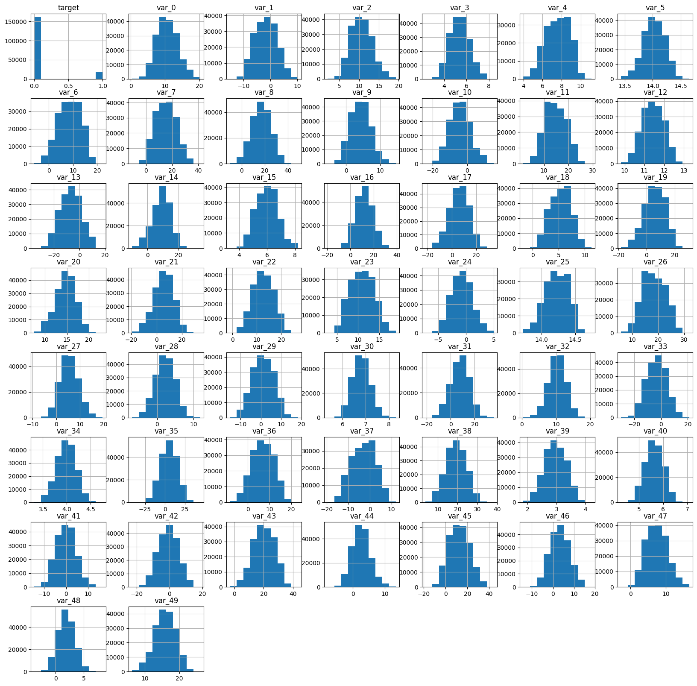
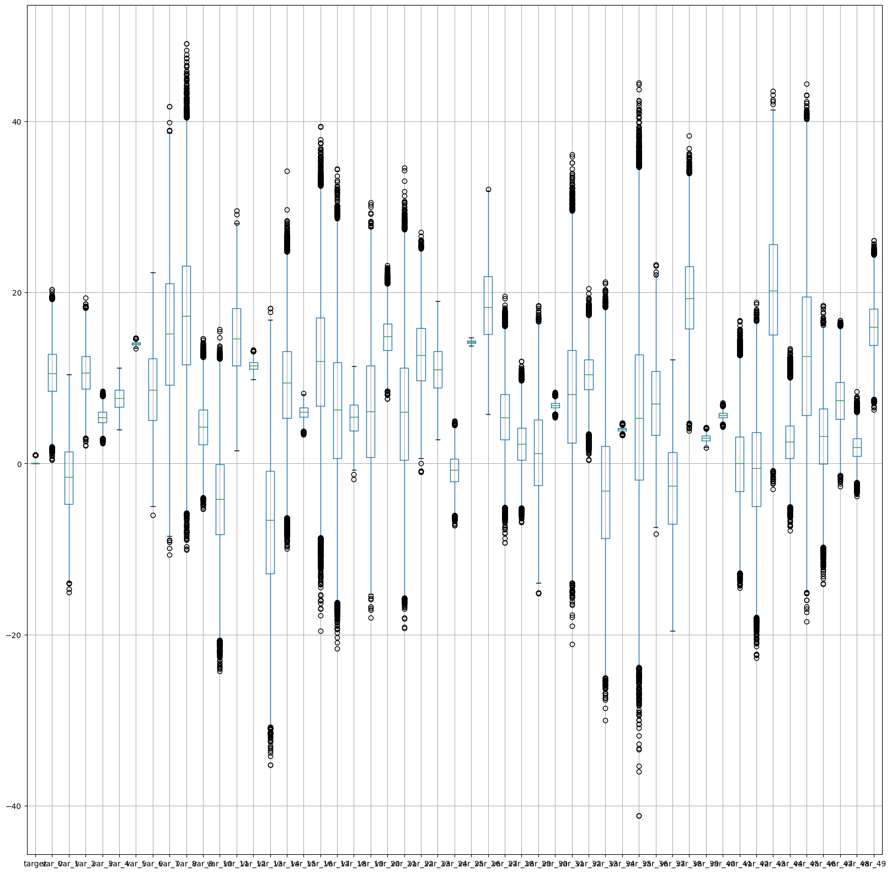
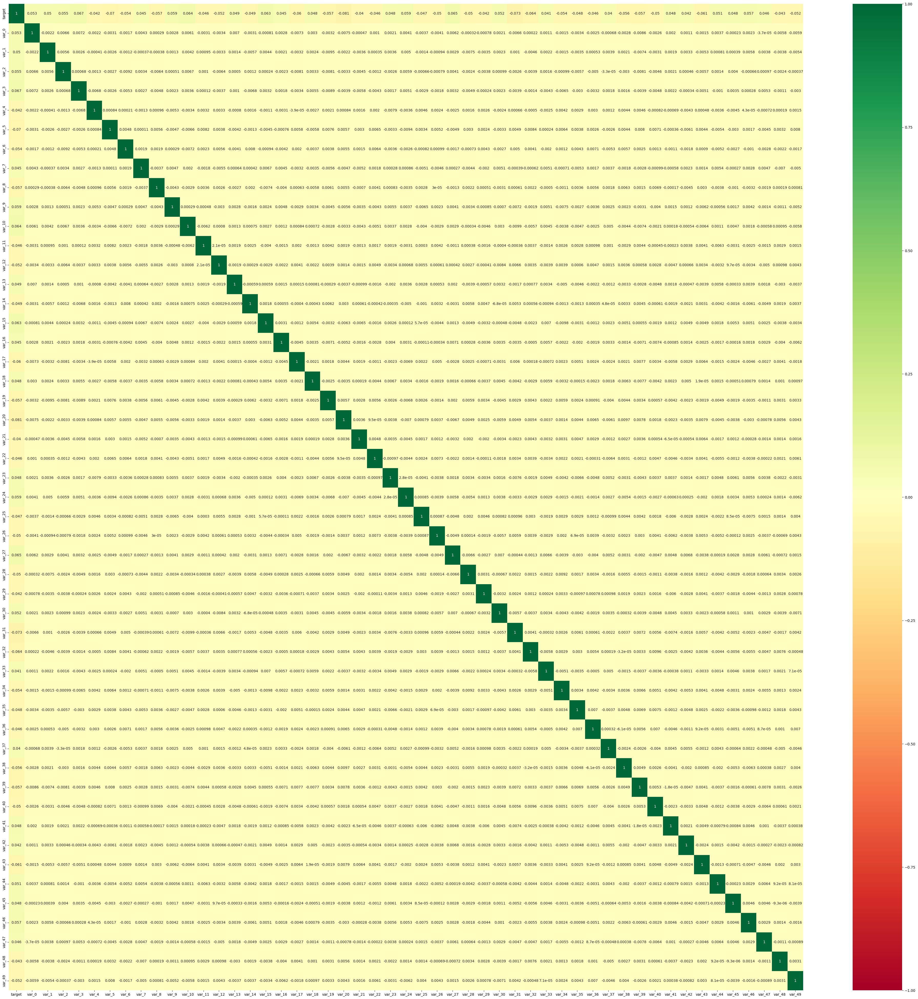
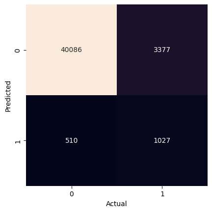

# Project 1: Transactions – Pass 04


## Problem Definition


#### 1. State the business problem.

Translate the business problem into a Data Science problem by stating what kind of problem it is ( supervised vs unsupervised ) and whether it is a classification, regression, or clustering problem.  Mention which model will be used, if known.


> We want to predict whether or not a future customer will complete a transaction (e.g., a product purchase, loan or bill payment, or subscription retention) based on prior transaction data. Such predictions can help determine higher-risk customers and present incentives to drive future transaction completions and increase sales.

> This is a supervised, categorical binary classification problem, where the target data is whether a customer transaction was successful (true or false). To achieve this, it uses a Gaussian Naive Bayes model to make predictions about transaction success.


## Data Collection


#### 2. Load Pandas, Numpy, and Matplotlib modules


```python
# imports
import pandas as pd
import numpy as np
import matplotlib.pyplot as plt
import seaborn as sns

from sklearn import datasets, metrics
from sklearn.naive_bayes import GaussianNB
from sklearn.model_selection import train_test_split
```

#### 3. Load data Train.csv from AWS S3.


```python
# url
url = 'https://ddc-datascience.s3.amazonaws.com/Projects/Project.1-Transactions/Data/Transaction.train.csv'
```

- Set number of columns and rows for this pass:


```python
# set cols and rows for pass
```

- Read in the data from .csv using pandas:


```python
# make dataframe
df = pd.read_csv(
    url,
)
```

- Check the dataframe:


```python
# check dataframe
df
```


  <div id="df-f1bc08b1-86f2-4497-be4f-c654598758d5" class="colab-df-container">
    <div>
<style scoped>
    .dataframe tbody tr th:only-of-type {
        vertical-align: middle;
    }

    .dataframe tbody tr th {
        vertical-align: top;
    }

    .dataframe thead th {
        text-align: right;
    }
</style>
<table border="1" class="dataframe">
  <thead>
    <tr style="text-align: right;">
      <th></th>
      <th>Unnamed: 0</th>
      <th>ID_code</th>
      <th>target</th>
      <th>var_0</th>
      <th>var_1</th>
      <th>var_2</th>
      <th>var_3</th>
      <th>var_4</th>
      <th>var_5</th>
      <th>var_6</th>
      <th>...</th>
      <th>var_40</th>
      <th>var_41</th>
      <th>var_42</th>
      <th>var_43</th>
      <th>var_44</th>
      <th>var_45</th>
      <th>var_46</th>
      <th>var_47</th>
      <th>var_48</th>
      <th>var_49</th>
    </tr>
  </thead>
  <tbody>
    <tr>
      <th>0</th>
      <td>0</td>
      <td>train_0</td>
      <td>0</td>
      <td>8.9255</td>
      <td>-6.7863</td>
      <td>11.9081</td>
      <td>5.1187</td>
      <td>5.7470</td>
      <td>14.0137</td>
      <td>0.5745</td>
      <td>...</td>
      <td>5.4879</td>
      <td>-4.7645</td>
      <td>3.1531</td>
      <td>18.5618</td>
      <td>1.7202</td>
      <td>25.8398</td>
      <td>4.4354</td>
      <td>3.9642</td>
      <td>3.1364</td>
      <td>12.7803</td>
    </tr>
    <tr>
      <th>1</th>
      <td>1</td>
      <td>train_1</td>
      <td>0</td>
      <td>11.5006</td>
      <td>-4.1473</td>
      <td>13.8588</td>
      <td>5.6208</td>
      <td>8.0851</td>
      <td>14.0239</td>
      <td>8.4135</td>
      <td>...</td>
      <td>5.7999</td>
      <td>5.5378</td>
      <td>5.5134</td>
      <td>30.2645</td>
      <td>11.0752</td>
      <td>22.5441</td>
      <td>7.6421</td>
      <td>7.7214</td>
      <td>2.5837</td>
      <td>18.3560</td>
    </tr>
    <tr>
      <th>2</th>
      <td>2</td>
      <td>train_2</td>
      <td>0</td>
      <td>8.6093</td>
      <td>-2.7457</td>
      <td>12.0805</td>
      <td>6.9427</td>
      <td>5.9525</td>
      <td>14.1929</td>
      <td>7.3124</td>
      <td>...</td>
      <td>5.7690</td>
      <td>-7.0927</td>
      <td>-5.8234</td>
      <td>25.6820</td>
      <td>2.4013</td>
      <td>23.0866</td>
      <td>2.9057</td>
      <td>9.7905</td>
      <td>1.6704</td>
      <td>14.7222</td>
    </tr>
    <tr>
      <th>3</th>
      <td>3</td>
      <td>train_3</td>
      <td>0</td>
      <td>11.0604</td>
      <td>-2.1518</td>
      <td>8.9522</td>
      <td>5.8428</td>
      <td>8.2450</td>
      <td>13.8463</td>
      <td>11.9704</td>
      <td>...</td>
      <td>5.3430</td>
      <td>-7.1541</td>
      <td>11.7134</td>
      <td>14.7483</td>
      <td>5.6961</td>
      <td>-0.4639</td>
      <td>4.4666</td>
      <td>4.7433</td>
      <td>0.7178</td>
      <td>17.9697</td>
    </tr>
    <tr>
      <th>4</th>
      <td>4</td>
      <td>train_4</td>
      <td>0</td>
      <td>9.8369</td>
      <td>-1.4834</td>
      <td>12.8746</td>
      <td>5.9405</td>
      <td>7.6784</td>
      <td>13.8481</td>
      <td>7.8895</td>
      <td>...</td>
      <td>5.5518</td>
      <td>1.4493</td>
      <td>2.3705</td>
      <td>18.4685</td>
      <td>5.1743</td>
      <td>11.8503</td>
      <td>-1.4905</td>
      <td>9.5214</td>
      <td>-0.1508</td>
      <td>17.9974</td>
    </tr>
    <tr>
      <th>...</th>
      <td>...</td>
      <td>...</td>
      <td>...</td>
      <td>...</td>
      <td>...</td>
      <td>...</td>
      <td>...</td>
      <td>...</td>
      <td>...</td>
      <td>...</td>
      <td>...</td>
      <td>...</td>
      <td>...</td>
      <td>...</td>
      <td>...</td>
      <td>...</td>
      <td>...</td>
      <td>...</td>
      <td>...</td>
      <td>...</td>
      <td>...</td>
    </tr>
    <tr>
      <th>179995</th>
      <td>179995</td>
      <td>train_179995</td>
      <td>0</td>
      <td>8.9112</td>
      <td>-4.4900</td>
      <td>11.3795</td>
      <td>5.4164</td>
      <td>8.3309</td>
      <td>14.1869</td>
      <td>12.8219</td>
      <td>...</td>
      <td>5.9355</td>
      <td>5.1764</td>
      <td>-5.4817</td>
      <td>20.7390</td>
      <td>-0.8043</td>
      <td>31.3663</td>
      <td>8.7194</td>
      <td>4.7839</td>
      <td>0.9673</td>
      <td>14.9529</td>
    </tr>
    <tr>
      <th>179996</th>
      <td>179996</td>
      <td>train_179996</td>
      <td>0</td>
      <td>8.2722</td>
      <td>7.1923</td>
      <td>16.7300</td>
      <td>4.9698</td>
      <td>5.4907</td>
      <td>14.0238</td>
      <td>11.9933</td>
      <td>...</td>
      <td>5.3550</td>
      <td>-1.5556</td>
      <td>7.3839</td>
      <td>9.9193</td>
      <td>5.0860</td>
      <td>28.0185</td>
      <td>7.4145</td>
      <td>4.2814</td>
      <td>2.5575</td>
      <td>15.3969</td>
    </tr>
    <tr>
      <th>179997</th>
      <td>179997</td>
      <td>train_179997</td>
      <td>0</td>
      <td>12.4902</td>
      <td>-2.9379</td>
      <td>6.5901</td>
      <td>4.7242</td>
      <td>9.1423</td>
      <td>13.9133</td>
      <td>12.2314</td>
      <td>...</td>
      <td>6.0708</td>
      <td>-0.3463</td>
      <td>-5.0098</td>
      <td>20.4807</td>
      <td>5.9814</td>
      <td>20.2668</td>
      <td>3.1006</td>
      <td>3.7701</td>
      <td>0.1299</td>
      <td>16.1256</td>
    </tr>
    <tr>
      <th>179998</th>
      <td>179998</td>
      <td>train_179998</td>
      <td>0</td>
      <td>8.4894</td>
      <td>0.7048</td>
      <td>11.1518</td>
      <td>4.6370</td>
      <td>8.1321</td>
      <td>14.2921</td>
      <td>6.9582</td>
      <td>...</td>
      <td>5.5161</td>
      <td>3.1774</td>
      <td>-4.9374</td>
      <td>23.6365</td>
      <td>1.0432</td>
      <td>29.9365</td>
      <td>9.6381</td>
      <td>6.9649</td>
      <td>2.5546</td>
      <td>15.6760</td>
    </tr>
    <tr>
      <th>179999</th>
      <td>179999</td>
      <td>train_179999</td>
      <td>0</td>
      <td>11.6252</td>
      <td>3.3959</td>
      <td>11.5558</td>
      <td>4.2003</td>
      <td>7.4666</td>
      <td>13.7381</td>
      <td>12.9590</td>
      <td>...</td>
      <td>5.0415</td>
      <td>-2.4210</td>
      <td>-3.6829</td>
      <td>14.2422</td>
      <td>1.0741</td>
      <td>26.3943</td>
      <td>4.1482</td>
      <td>11.9539</td>
      <td>2.9846</td>
      <td>15.6002</td>
    </tr>
  </tbody>
</table>
<p>180000 rows × 53 columns</p>
</div>
    <div class="colab-df-buttons">

  <div class="colab-df-container">
    <button class="colab-df-convert" onclick="convertToInteractive('df-f1bc08b1-86f2-4497-be4f-c654598758d5')"
            title="Convert this dataframe to an interactive table."
            style="display:none;">

  <svg xmlns="http://www.w3.org/2000/svg" height="24px" viewBox="0 -960 960 960">
    <path d="M120-120v-720h720v720H120Zm60-500h600v-160H180v160Zm220 220h160v-160H400v160Zm0 220h160v-160H400v160ZM180-400h160v-160H180v160Zm440 0h160v-160H620v160ZM180-180h160v-160H180v160Zm440 0h160v-160H620v160Z"/>
  </svg>
    </button>

  <style>
    .colab-df-container {
      display:flex;
      gap: 12px;
    }

    .colab-df-convert {
      background-color: #E8F0FE;
      border: none;
      border-radius: 50%;
      cursor: pointer;
      display: none;
      fill: #1967D2;
      height: 32px;
      padding: 0 0 0 0;
      width: 32px;
    }

    .colab-df-convert:hover {
      background-color: #E2EBFA;
      box-shadow: 0px 1px 2px rgba(60, 64, 67, 0.3), 0px 1px 3px 1px rgba(60, 64, 67, 0.15);
      fill: #174EA6;
    }

    .colab-df-buttons div {
      margin-bottom: 4px;
    }

    [theme=dark] .colab-df-convert {
      background-color: #3B4455;
      fill: #D2E3FC;
    }

    [theme=dark] .colab-df-convert:hover {
      background-color: #434B5C;
      box-shadow: 0px 1px 3px 1px rgba(0, 0, 0, 0.15);
      filter: drop-shadow(0px 1px 2px rgba(0, 0, 0, 0.3));
      fill: #FFFFFF;
    }
  </style>

    <script>
      const buttonEl =
        document.querySelector('#df-f1bc08b1-86f2-4497-be4f-c654598758d5 button.colab-df-convert');
      buttonEl.style.display =
        google.colab.kernel.accessAllowed ? 'block' : 'none';

      async function convertToInteractive(key) {
        const element = document.querySelector('#df-f1bc08b1-86f2-4497-be4f-c654598758d5');
        const dataTable =
          await google.colab.kernel.invokeFunction('convertToInteractive',
                                                    [key], {});
        if (!dataTable) return;

        const docLinkHtml = 'Like what you see? Visit the ' +
          '<a target="_blank" href=https://colab.research.google.com/notebooks/data_table.ipynb>data table notebook</a>'
          + ' to learn more about interactive tables.';
        element.innerHTML = '';
        dataTable['output_type'] = 'display_data';
        await google.colab.output.renderOutput(dataTable, element);
        const docLink = document.createElement('div');
        docLink.innerHTML = docLinkHtml;
        element.appendChild(docLink);
      }
    </script>
  </div>


  <div id="id_500f81c5-9fe2-4470-b13a-2a15f51d7408">
    <style>
      .colab-df-generate {
        background-color: #E8F0FE;
        border: none;
        border-radius: 50%;
        cursor: pointer;
        display: none;
        fill: #1967D2;
        height: 32px;
        padding: 0 0 0 0;
        width: 32px;
      }

      .colab-df-generate:hover {
        background-color: #E2EBFA;
        box-shadow: 0px 1px 2px rgba(60, 64, 67, 0.3), 0px 1px 3px 1px rgba(60, 64, 67, 0.15);
        fill: #174EA6;
      }

      [theme=dark] .colab-df-generate {
        background-color: #3B4455;
        fill: #D2E3FC;
      }

      [theme=dark] .colab-df-generate:hover {
        background-color: #434B5C;
        box-shadow: 0px 1px 3px 1px rgba(0, 0, 0, 0.15);
        filter: drop-shadow(0px 1px 2px rgba(0, 0, 0, 0.3));
        fill: #FFFFFF;
      }
    </style>
    <button class="colab-df-generate" onclick="generateWithVariable('df')"
            title="Generate code using this dataframe."
            style="display:none;">

  <svg xmlns="http://www.w3.org/2000/svg" height="24px"viewBox="0 0 24 24"
       width="24px">
    <path d="M7,19H8.4L18.45,9,17,7.55,7,17.6ZM5,21V16.75L18.45,3.32a2,2,0,0,1,2.83,0l1.4,1.43a1.91,1.91,0,0,1,.58,1.4,1.91,1.91,0,0,1-.58,1.4L9.25,21ZM18.45,9,17,7.55Zm-12,3A5.31,5.31,0,0,0,4.9,8.1,5.31,5.31,0,0,0,1,6.5,5.31,5.31,0,0,0,4.9,4.9,5.31,5.31,0,0,0,6.5,1,5.31,5.31,0,0,0,8.1,4.9,5.31,5.31,0,0,0,12,6.5,5.46,5.46,0,0,0,6.5,12Z"/>
  </svg>
    </button>
    <script>
      (() => {
      const buttonEl =
        document.querySelector('#id_500f81c5-9fe2-4470-b13a-2a15f51d7408 button.colab-df-generate');
      buttonEl.style.display =
        google.colab.kernel.accessAllowed ? 'block' : 'none';

      buttonEl.onclick = () => {
        google.colab.notebook.generateWithVariable('df');
      }
      })();
    </script>
  </div>

    </div>
  </div>


So our data set has 180000 total rows, 18 times what we've seen to this point, and 53 total columns, 50 of which (var_0 - var_49) are feature columns.

## Data Cleaning


#### 4. Examine the data using tools we have used in class. You should be identifying the various columns such as ...

    - target column
    - feature columns
    - identifier columns
    - null columns
    - null rows

    Tools you should be using include, but are not limited to:

    - head
    - tail
    - shape
    - size
    - info
    - describe
    - nunique
    - unique
    - isnull/isna


```python
# define target_col
target_col = 'target'
target_col
```


    'target'


- head


```python
# head
df.head()
```


  <div id="df-fd0ffa2a-273b-429f-9a22-3257d3891f96" class="colab-df-container">
    <div>
<style scoped>
    .dataframe tbody tr th:only-of-type {
        vertical-align: middle;
    }

    .dataframe tbody tr th {
        vertical-align: top;
    }

    .dataframe thead th {
        text-align: right;
    }
</style>
<table border="1" class="dataframe">
  <thead>
    <tr style="text-align: right;">
      <th></th>
      <th>Unnamed: 0</th>
      <th>ID_code</th>
      <th>target</th>
      <th>var_0</th>
      <th>var_1</th>
      <th>var_2</th>
      <th>var_3</th>
      <th>var_4</th>
      <th>var_5</th>
      <th>var_6</th>
      <th>...</th>
      <th>var_40</th>
      <th>var_41</th>
      <th>var_42</th>
      <th>var_43</th>
      <th>var_44</th>
      <th>var_45</th>
      <th>var_46</th>
      <th>var_47</th>
      <th>var_48</th>
      <th>var_49</th>
    </tr>
  </thead>
  <tbody>
    <tr>
      <th>0</th>
      <td>0</td>
      <td>train_0</td>
      <td>0</td>
      <td>8.9255</td>
      <td>-6.7863</td>
      <td>11.9081</td>
      <td>5.1187</td>
      <td>5.7470</td>
      <td>14.0137</td>
      <td>0.5745</td>
      <td>...</td>
      <td>5.4879</td>
      <td>-4.7645</td>
      <td>3.1531</td>
      <td>18.5618</td>
      <td>1.7202</td>
      <td>25.8398</td>
      <td>4.4354</td>
      <td>3.9642</td>
      <td>3.1364</td>
      <td>12.7803</td>
    </tr>
    <tr>
      <th>1</th>
      <td>1</td>
      <td>train_1</td>
      <td>0</td>
      <td>11.5006</td>
      <td>-4.1473</td>
      <td>13.8588</td>
      <td>5.6208</td>
      <td>8.0851</td>
      <td>14.0239</td>
      <td>8.4135</td>
      <td>...</td>
      <td>5.7999</td>
      <td>5.5378</td>
      <td>5.5134</td>
      <td>30.2645</td>
      <td>11.0752</td>
      <td>22.5441</td>
      <td>7.6421</td>
      <td>7.7214</td>
      <td>2.5837</td>
      <td>18.3560</td>
    </tr>
    <tr>
      <th>2</th>
      <td>2</td>
      <td>train_2</td>
      <td>0</td>
      <td>8.6093</td>
      <td>-2.7457</td>
      <td>12.0805</td>
      <td>6.9427</td>
      <td>5.9525</td>
      <td>14.1929</td>
      <td>7.3124</td>
      <td>...</td>
      <td>5.7690</td>
      <td>-7.0927</td>
      <td>-5.8234</td>
      <td>25.6820</td>
      <td>2.4013</td>
      <td>23.0866</td>
      <td>2.9057</td>
      <td>9.7905</td>
      <td>1.6704</td>
      <td>14.7222</td>
    </tr>
    <tr>
      <th>3</th>
      <td>3</td>
      <td>train_3</td>
      <td>0</td>
      <td>11.0604</td>
      <td>-2.1518</td>
      <td>8.9522</td>
      <td>5.8428</td>
      <td>8.2450</td>
      <td>13.8463</td>
      <td>11.9704</td>
      <td>...</td>
      <td>5.3430</td>
      <td>-7.1541</td>
      <td>11.7134</td>
      <td>14.7483</td>
      <td>5.6961</td>
      <td>-0.4639</td>
      <td>4.4666</td>
      <td>4.7433</td>
      <td>0.7178</td>
      <td>17.9697</td>
    </tr>
    <tr>
      <th>4</th>
      <td>4</td>
      <td>train_4</td>
      <td>0</td>
      <td>9.8369</td>
      <td>-1.4834</td>
      <td>12.8746</td>
      <td>5.9405</td>
      <td>7.6784</td>
      <td>13.8481</td>
      <td>7.8895</td>
      <td>...</td>
      <td>5.5518</td>
      <td>1.4493</td>
      <td>2.3705</td>
      <td>18.4685</td>
      <td>5.1743</td>
      <td>11.8503</td>
      <td>-1.4905</td>
      <td>9.5214</td>
      <td>-0.1508</td>
      <td>17.9974</td>
    </tr>
  </tbody>
</table>
<p>5 rows × 53 columns</p>
</div>
    <div class="colab-df-buttons">

  <div class="colab-df-container">
    <button class="colab-df-convert" onclick="convertToInteractive('df-fd0ffa2a-273b-429f-9a22-3257d3891f96')"
            title="Convert this dataframe to an interactive table."
            style="display:none;">

  <svg xmlns="http://www.w3.org/2000/svg" height="24px" viewBox="0 -960 960 960">
    <path d="M120-120v-720h720v720H120Zm60-500h600v-160H180v160Zm220 220h160v-160H400v160Zm0 220h160v-160H400v160ZM180-400h160v-160H180v160Zm440 0h160v-160H620v160ZM180-180h160v-160H180v160Zm440 0h160v-160H620v160Z"/>
  </svg>
    </button>

  <style>
    .colab-df-container {
      display:flex;
      gap: 12px;
    }

    .colab-df-convert {
      background-color: #E8F0FE;
      border: none;
      border-radius: 50%;
      cursor: pointer;
      display: none;
      fill: #1967D2;
      height: 32px;
      padding: 0 0 0 0;
      width: 32px;
    }

    .colab-df-convert:hover {
      background-color: #E2EBFA;
      box-shadow: 0px 1px 2px rgba(60, 64, 67, 0.3), 0px 1px 3px 1px rgba(60, 64, 67, 0.15);
      fill: #174EA6;
    }

    .colab-df-buttons div {
      margin-bottom: 4px;
    }

    [theme=dark] .colab-df-convert {
      background-color: #3B4455;
      fill: #D2E3FC;
    }

    [theme=dark] .colab-df-convert:hover {
      background-color: #434B5C;
      box-shadow: 0px 1px 3px 1px rgba(0, 0, 0, 0.15);
      filter: drop-shadow(0px 1px 2px rgba(0, 0, 0, 0.3));
      fill: #FFFFFF;
    }
  </style>

    <script>
      const buttonEl =
        document.querySelector('#df-fd0ffa2a-273b-429f-9a22-3257d3891f96 button.colab-df-convert');
      buttonEl.style.display =
        google.colab.kernel.accessAllowed ? 'block' : 'none';

      async function convertToInteractive(key) {
        const element = document.querySelector('#df-fd0ffa2a-273b-429f-9a22-3257d3891f96');
        const dataTable =
          await google.colab.kernel.invokeFunction('convertToInteractive',
                                                    [key], {});
        if (!dataTable) return;

        const docLinkHtml = 'Like what you see? Visit the ' +
          '<a target="_blank" href=https://colab.research.google.com/notebooks/data_table.ipynb>data table notebook</a>'
          + ' to learn more about interactive tables.';
        element.innerHTML = '';
        dataTable['output_type'] = 'display_data';
        await google.colab.output.renderOutput(dataTable, element);
        const docLink = document.createElement('div');
        docLink.innerHTML = docLinkHtml;
        element.appendChild(docLink);
      }
    </script>
  </div>


    </div>
  </div>


- tail


```python
# tail
df.tail()
```


  <div id="df-93f5678e-43cc-46e0-86d4-9b703805ea6a" class="colab-df-container">
    <div>
<style scoped>
    .dataframe tbody tr th:only-of-type {
        vertical-align: middle;
    }

    .dataframe tbody tr th {
        vertical-align: top;
    }

    .dataframe thead th {
        text-align: right;
    }
</style>
<table border="1" class="dataframe">
  <thead>
    <tr style="text-align: right;">
      <th></th>
      <th>Unnamed: 0</th>
      <th>ID_code</th>
      <th>target</th>
      <th>var_0</th>
      <th>var_1</th>
      <th>var_2</th>
      <th>var_3</th>
      <th>var_4</th>
      <th>var_5</th>
      <th>var_6</th>
      <th>...</th>
      <th>var_40</th>
      <th>var_41</th>
      <th>var_42</th>
      <th>var_43</th>
      <th>var_44</th>
      <th>var_45</th>
      <th>var_46</th>
      <th>var_47</th>
      <th>var_48</th>
      <th>var_49</th>
    </tr>
  </thead>
  <tbody>
    <tr>
      <th>179995</th>
      <td>179995</td>
      <td>train_179995</td>
      <td>0</td>
      <td>8.9112</td>
      <td>-4.4900</td>
      <td>11.3795</td>
      <td>5.4164</td>
      <td>8.3309</td>
      <td>14.1869</td>
      <td>12.8219</td>
      <td>...</td>
      <td>5.9355</td>
      <td>5.1764</td>
      <td>-5.4817</td>
      <td>20.7390</td>
      <td>-0.8043</td>
      <td>31.3663</td>
      <td>8.7194</td>
      <td>4.7839</td>
      <td>0.9673</td>
      <td>14.9529</td>
    </tr>
    <tr>
      <th>179996</th>
      <td>179996</td>
      <td>train_179996</td>
      <td>0</td>
      <td>8.2722</td>
      <td>7.1923</td>
      <td>16.7300</td>
      <td>4.9698</td>
      <td>5.4907</td>
      <td>14.0238</td>
      <td>11.9933</td>
      <td>...</td>
      <td>5.3550</td>
      <td>-1.5556</td>
      <td>7.3839</td>
      <td>9.9193</td>
      <td>5.0860</td>
      <td>28.0185</td>
      <td>7.4145</td>
      <td>4.2814</td>
      <td>2.5575</td>
      <td>15.3969</td>
    </tr>
    <tr>
      <th>179997</th>
      <td>179997</td>
      <td>train_179997</td>
      <td>0</td>
      <td>12.4902</td>
      <td>-2.9379</td>
      <td>6.5901</td>
      <td>4.7242</td>
      <td>9.1423</td>
      <td>13.9133</td>
      <td>12.2314</td>
      <td>...</td>
      <td>6.0708</td>
      <td>-0.3463</td>
      <td>-5.0098</td>
      <td>20.4807</td>
      <td>5.9814</td>
      <td>20.2668</td>
      <td>3.1006</td>
      <td>3.7701</td>
      <td>0.1299</td>
      <td>16.1256</td>
    </tr>
    <tr>
      <th>179998</th>
      <td>179998</td>
      <td>train_179998</td>
      <td>0</td>
      <td>8.4894</td>
      <td>0.7048</td>
      <td>11.1518</td>
      <td>4.6370</td>
      <td>8.1321</td>
      <td>14.2921</td>
      <td>6.9582</td>
      <td>...</td>
      <td>5.5161</td>
      <td>3.1774</td>
      <td>-4.9374</td>
      <td>23.6365</td>
      <td>1.0432</td>
      <td>29.9365</td>
      <td>9.6381</td>
      <td>6.9649</td>
      <td>2.5546</td>
      <td>15.6760</td>
    </tr>
    <tr>
      <th>179999</th>
      <td>179999</td>
      <td>train_179999</td>
      <td>0</td>
      <td>11.6252</td>
      <td>3.3959</td>
      <td>11.5558</td>
      <td>4.2003</td>
      <td>7.4666</td>
      <td>13.7381</td>
      <td>12.9590</td>
      <td>...</td>
      <td>5.0415</td>
      <td>-2.4210</td>
      <td>-3.6829</td>
      <td>14.2422</td>
      <td>1.0741</td>
      <td>26.3943</td>
      <td>4.1482</td>
      <td>11.9539</td>
      <td>2.9846</td>
      <td>15.6002</td>
    </tr>
  </tbody>
</table>
<p>5 rows × 53 columns</p>
</div>
    <div class="colab-df-buttons">

  <div class="colab-df-container">
    <button class="colab-df-convert" onclick="convertToInteractive('df-93f5678e-43cc-46e0-86d4-9b703805ea6a')"
            title="Convert this dataframe to an interactive table."
            style="display:none;">

  <svg xmlns="http://www.w3.org/2000/svg" height="24px" viewBox="0 -960 960 960">
    <path d="M120-120v-720h720v720H120Zm60-500h600v-160H180v160Zm220 220h160v-160H400v160Zm0 220h160v-160H400v160ZM180-400h160v-160H180v160Zm440 0h160v-160H620v160ZM180-180h160v-160H180v160Zm440 0h160v-160H620v160Z"/>
  </svg>
    </button>

  <style>
    .colab-df-container {
      display:flex;
      gap: 12px;
    }

    .colab-df-convert {
      background-color: #E8F0FE;
      border: none;
      border-radius: 50%;
      cursor: pointer;
      display: none;
      fill: #1967D2;
      height: 32px;
      padding: 0 0 0 0;
      width: 32px;
    }

    .colab-df-convert:hover {
      background-color: #E2EBFA;
      box-shadow: 0px 1px 2px rgba(60, 64, 67, 0.3), 0px 1px 3px 1px rgba(60, 64, 67, 0.15);
      fill: #174EA6;
    }

    .colab-df-buttons div {
      margin-bottom: 4px;
    }

    [theme=dark] .colab-df-convert {
      background-color: #3B4455;
      fill: #D2E3FC;
    }

    [theme=dark] .colab-df-convert:hover {
      background-color: #434B5C;
      box-shadow: 0px 1px 3px 1px rgba(0, 0, 0, 0.15);
      filter: drop-shadow(0px 1px 2px rgba(0, 0, 0, 0.3));
      fill: #FFFFFF;
    }
  </style>

    <script>
      const buttonEl =
        document.querySelector('#df-93f5678e-43cc-46e0-86d4-9b703805ea6a button.colab-df-convert');
      buttonEl.style.display =
        google.colab.kernel.accessAllowed ? 'block' : 'none';

      async function convertToInteractive(key) {
        const element = document.querySelector('#df-93f5678e-43cc-46e0-86d4-9b703805ea6a');
        const dataTable =
          await google.colab.kernel.invokeFunction('convertToInteractive',
                                                    [key], {});
        if (!dataTable) return;

        const docLinkHtml = 'Like what you see? Visit the ' +
          '<a target="_blank" href=https://colab.research.google.com/notebooks/data_table.ipynb>data table notebook</a>'
          + ' to learn more about interactive tables.';
        element.innerHTML = '';
        dataTable['output_type'] = 'display_data';
        await google.colab.output.renderOutput(dataTable, element);
        const docLink = document.createElement('div');
        docLink.innerHTML = docLinkHtml;
        element.appendChild(docLink);
      }
    </script>
  </div>


    </div>
  </div>


- shape


```python
# shape
df.shape
```


    (180000, 53)


- size


```python
# size
df.size
```


    9540000


- info


```python
# info
df.info()
```

    <class 'pandas.core.frame.DataFrame'>
    RangeIndex: 180000 entries, 0 to 179999
    Data columns (total 53 columns):
     #   Column      Non-Null Count   Dtype  
    ---  ------      --------------   -----  
     0   Unnamed: 0  180000 non-null  int64  
     1   ID_code     180000 non-null  object 
     2   target      180000 non-null  int64  
     3   var_0       180000 non-null  float64
     4   var_1       180000 non-null  float64
     5   var_2       180000 non-null  float64
     6   var_3       180000 non-null  float64
     7   var_4       180000 non-null  float64
     8   var_5       180000 non-null  float64
     9   var_6       180000 non-null  float64
     10  var_7       180000 non-null  float64
     11  var_8       180000 non-null  float64
     12  var_9       180000 non-null  float64
     13  var_10      180000 non-null  float64
     14  var_11      180000 non-null  float64
     15  var_12      180000 non-null  float64
     16  var_13      180000 non-null  float64
     17  var_14      180000 non-null  float64
     18  var_15      180000 non-null  float64
     19  var_16      180000 non-null  float64
     20  var_17      180000 non-null  float64
     21  var_18      180000 non-null  float64
     22  var_19      180000 non-null  float64
     23  var_20      180000 non-null  float64
     24  var_21      180000 non-null  float64
     25  var_22      180000 non-null  float64
     26  var_23      180000 non-null  float64
     27  var_24      180000 non-null  float64
     28  var_25      180000 non-null  float64
     29  var_26      180000 non-null  float64
     30  var_27      180000 non-null  float64
     31  var_28      180000 non-null  float64
     32  var_29      180000 non-null  float64
     33  var_30      180000 non-null  float64
     34  var_31      180000 non-null  float64
     35  var_32      180000 non-null  float64
     36  var_33      180000 non-null  float64
     37  var_34      180000 non-null  float64
     38  var_35      180000 non-null  float64
     39  var_36      180000 non-null  float64
     40  var_37      180000 non-null  float64
     41  var_38      180000 non-null  float64
     42  var_39      180000 non-null  float64
     43  var_40      180000 non-null  float64
     44  var_41      180000 non-null  float64
     45  var_42      180000 non-null  float64
     46  var_43      180000 non-null  float64
     47  var_44      180000 non-null  float64
     48  var_45      180000 non-null  float64
     49  var_46      180000 non-null  float64
     50  var_47      180000 non-null  float64
     51  var_48      180000 non-null  float64
     52  var_49      180000 non-null  float64
    dtypes: float64(50), int64(2), object(1)
    memory usage: 72.8+ MB


- describe


```python
# describe
df.describe()
```


  <div id="df-8248bdf0-c11b-4dbf-aa12-279752f27e73" class="colab-df-container">
    <div>
<style scoped>
    .dataframe tbody tr th:only-of-type {
        vertical-align: middle;
    }

    .dataframe tbody tr th {
        vertical-align: top;
    }

    .dataframe thead th {
        text-align: right;
    }
</style>
<table border="1" class="dataframe">
  <thead>
    <tr style="text-align: right;">
      <th></th>
      <th>Unnamed: 0</th>
      <th>target</th>
      <th>var_0</th>
      <th>var_1</th>
      <th>var_2</th>
      <th>var_3</th>
      <th>var_4</th>
      <th>var_5</th>
      <th>var_6</th>
      <th>var_7</th>
      <th>...</th>
      <th>var_40</th>
      <th>var_41</th>
      <th>var_42</th>
      <th>var_43</th>
      <th>var_44</th>
      <th>var_45</th>
      <th>var_46</th>
      <th>var_47</th>
      <th>var_48</th>
      <th>var_49</th>
    </tr>
  </thead>
  <tbody>
    <tr>
      <th>count</th>
      <td>180000.000000</td>
      <td>180000.000000</td>
      <td>180000.000000</td>
      <td>180000.000000</td>
      <td>180000.000000</td>
      <td>180000.000000</td>
      <td>180000.000000</td>
      <td>180000.000000</td>
      <td>180000.00000</td>
      <td>180000.000000</td>
      <td>...</td>
      <td>180000.000000</td>
      <td>180000.000000</td>
      <td>180000.000000</td>
      <td>180000.000000</td>
      <td>180000.000000</td>
      <td>180000.000000</td>
      <td>180000.000000</td>
      <td>180000.000000</td>
      <td>180000.000000</td>
      <td>180000.000000</td>
    </tr>
    <tr>
      <th>mean</th>
      <td>89999.500000</td>
      <td>0.100222</td>
      <td>10.678650</td>
      <td>-1.630045</td>
      <td>10.712922</td>
      <td>5.408688</td>
      <td>7.566953</td>
      <td>14.024017</td>
      <td>8.52808</td>
      <td>15.243424</td>
      <td>...</td>
      <td>5.635897</td>
      <td>-0.000418</td>
      <td>-0.668334</td>
      <td>20.208845</td>
      <td>2.595090</td>
      <td>12.756574</td>
      <td>3.236201</td>
      <td>7.440715</td>
      <td>1.927078</td>
      <td>15.870166</td>
    </tr>
    <tr>
      <th>std</th>
      <td>51961.668564</td>
      <td>0.300297</td>
      <td>3.041036</td>
      <td>4.050519</td>
      <td>2.639146</td>
      <td>0.866265</td>
      <td>1.235043</td>
      <td>0.190038</td>
      <td>4.64170</td>
      <td>7.851050</td>
      <td>...</td>
      <td>0.369629</td>
      <td>4.422915</td>
      <td>5.968300</td>
      <td>7.132446</td>
      <td>2.801692</td>
      <td>9.320939</td>
      <td>4.561317</td>
      <td>3.021636</td>
      <td>1.476777</td>
      <td>3.010492</td>
    </tr>
    <tr>
      <th>min</th>
      <td>0.000000</td>
      <td>0.000000</td>
      <td>0.408400</td>
      <td>-15.043400</td>
      <td>2.117100</td>
      <td>2.347300</td>
      <td>3.970500</td>
      <td>13.434600</td>
      <td>-6.01110</td>
      <td>-10.664200</td>
      <td>...</td>
      <td>4.258800</td>
      <td>-14.506000</td>
      <td>-22.748700</td>
      <td>-2.995300</td>
      <td>-7.856100</td>
      <td>-18.489700</td>
      <td>-14.093300</td>
      <td>-2.691700</td>
      <td>-3.814500</td>
      <td>6.299300</td>
    </tr>
    <tr>
      <th>25%</th>
      <td>44999.750000</td>
      <td>0.000000</td>
      <td>8.451675</td>
      <td>-4.745600</td>
      <td>8.720000</td>
      <td>4.768500</td>
      <td>6.618800</td>
      <td>13.893900</td>
      <td>5.06575</td>
      <td>9.170200</td>
      <td>...</td>
      <td>5.374200</td>
      <td>-3.253575</td>
      <td>-4.997500</td>
      <td>15.062900</td>
      <td>0.628600</td>
      <td>5.661300</td>
      <td>-0.062000</td>
      <td>5.160325</td>
      <td>0.890000</td>
      <td>13.830400</td>
    </tr>
    <tr>
      <th>50%</th>
      <td>89999.500000</td>
      <td>0.000000</td>
      <td>10.526750</td>
      <td>-1.611250</td>
      <td>10.579600</td>
      <td>5.385600</td>
      <td>7.628500</td>
      <td>14.025500</td>
      <td>8.59920</td>
      <td>15.198900</td>
      <td>...</td>
      <td>5.634500</td>
      <td>0.008500</td>
      <td>-0.560300</td>
      <td>20.203300</td>
      <td>2.513800</td>
      <td>12.520300</td>
      <td>3.204650</td>
      <td>7.350950</td>
      <td>1.899700</td>
      <td>15.934600</td>
    </tr>
    <tr>
      <th>75%</th>
      <td>134999.250000</td>
      <td>0.000000</td>
      <td>12.756200</td>
      <td>1.360225</td>
      <td>12.514100</td>
      <td>6.003200</td>
      <td>8.583800</td>
      <td>14.164400</td>
      <td>12.27330</td>
      <td>21.010500</td>
      <td>...</td>
      <td>5.905600</td>
      <td>3.098325</td>
      <td>3.632525</td>
      <td>25.639125</td>
      <td>4.396725</td>
      <td>19.461725</td>
      <td>6.409900</td>
      <td>9.511125</td>
      <td>2.947225</td>
      <td>18.061425</td>
    </tr>
    <tr>
      <th>max</th>
      <td>179999.000000</td>
      <td>1.000000</td>
      <td>20.315000</td>
      <td>10.376800</td>
      <td>19.353000</td>
      <td>8.447700</td>
      <td>11.150600</td>
      <td>14.654500</td>
      <td>22.33150</td>
      <td>41.748000</td>
      <td>...</td>
      <td>7.089000</td>
      <td>16.731900</td>
      <td>18.855400</td>
      <td>43.546800</td>
      <td>13.448700</td>
      <td>44.363400</td>
      <td>18.440900</td>
      <td>16.716500</td>
      <td>8.402400</td>
      <td>26.079100</td>
    </tr>
  </tbody>
</table>
<p>8 rows × 52 columns</p>
</div>
    <div class="colab-df-buttons">

  <div class="colab-df-container">
    <button class="colab-df-convert" onclick="convertToInteractive('df-8248bdf0-c11b-4dbf-aa12-279752f27e73')"
            title="Convert this dataframe to an interactive table."
            style="display:none;">

  <svg xmlns="http://www.w3.org/2000/svg" height="24px" viewBox="0 -960 960 960">
    <path d="M120-120v-720h720v720H120Zm60-500h600v-160H180v160Zm220 220h160v-160H400v160Zm0 220h160v-160H400v160ZM180-400h160v-160H180v160Zm440 0h160v-160H620v160ZM180-180h160v-160H180v160Zm440 0h160v-160H620v160Z"/>
  </svg>
    </button>

  <style>
    .colab-df-container {
      display:flex;
      gap: 12px;
    }

    .colab-df-convert {
      background-color: #E8F0FE;
      border: none;
      border-radius: 50%;
      cursor: pointer;
      display: none;
      fill: #1967D2;
      height: 32px;
      padding: 0 0 0 0;
      width: 32px;
    }

    .colab-df-convert:hover {
      background-color: #E2EBFA;
      box-shadow: 0px 1px 2px rgba(60, 64, 67, 0.3), 0px 1px 3px 1px rgba(60, 64, 67, 0.15);
      fill: #174EA6;
    }

    .colab-df-buttons div {
      margin-bottom: 4px;
    }

    [theme=dark] .colab-df-convert {
      background-color: #3B4455;
      fill: #D2E3FC;
    }

    [theme=dark] .colab-df-convert:hover {
      background-color: #434B5C;
      box-shadow: 0px 1px 3px 1px rgba(0, 0, 0, 0.15);
      filter: drop-shadow(0px 1px 2px rgba(0, 0, 0, 0.3));
      fill: #FFFFFF;
    }
  </style>

    <script>
      const buttonEl =
        document.querySelector('#df-8248bdf0-c11b-4dbf-aa12-279752f27e73 button.colab-df-convert');
      buttonEl.style.display =
        google.colab.kernel.accessAllowed ? 'block' : 'none';

      async function convertToInteractive(key) {
        const element = document.querySelector('#df-8248bdf0-c11b-4dbf-aa12-279752f27e73');
        const dataTable =
          await google.colab.kernel.invokeFunction('convertToInteractive',
                                                    [key], {});
        if (!dataTable) return;

        const docLinkHtml = 'Like what you see? Visit the ' +
          '<a target="_blank" href=https://colab.research.google.com/notebooks/data_table.ipynb>data table notebook</a>'
          + ' to learn more about interactive tables.';
        element.innerHTML = '';
        dataTable['output_type'] = 'display_data';
        await google.colab.output.renderOutput(dataTable, element);
        const docLink = document.createElement('div');
        docLink.innerHTML = docLinkHtml;
        element.appendChild(docLink);
      }
    </script>
  </div>


    </div>
  </div>


- nunique


```python
# nunique
df.nunique()
```


<div>
<style scoped>
    .dataframe tbody tr th:only-of-type {
        vertical-align: middle;
    }

    .dataframe tbody tr th {
        vertical-align: top;
    }

    .dataframe thead th {
        text-align: right;
    }
</style>
<table border="1" class="dataframe">
  <thead>
    <tr style="text-align: right;">
      <th></th>
      <th>0</th>
    </tr>
  </thead>
  <tbody>
    <tr>
      <th>Unnamed: 0</th>
      <td>180000</td>
    </tr>
    <tr>
      <th>ID_code</th>
      <td>180000</td>
    </tr>
    <tr>
      <th>target</th>
      <td>2</td>
    </tr>
    <tr>
      <th>var_0</th>
      <td>90443</td>
    </tr>
    <tr>
      <th>var_1</th>
      <td>103081</td>
    </tr>
    <tr>
      <th>var_2</th>
      <td>83041</td>
    </tr>
    <tr>
      <th>var_3</th>
      <td>37907</td>
    </tr>
    <tr>
      <th>var_4</th>
      <td>48476</td>
    </tr>
    <tr>
      <th>var_5</th>
      <td>9500</td>
    </tr>
    <tr>
      <th>var_6</th>
      <td>108599</td>
    </tr>
    <tr>
      <th>var_7</th>
      <td>129702</td>
    </tr>
    <tr>
      <th>var_8</th>
      <td>130208</td>
    </tr>
    <tr>
      <th>var_9</th>
      <td>86773</td>
    </tr>
    <tr>
      <th>var_10</th>
      <td>118977</td>
    </tr>
    <tr>
      <th>var_11</th>
      <td>106142</td>
    </tr>
    <tr>
      <th>var_12</th>
      <td>24845</td>
    </tr>
    <tr>
      <th>var_13</th>
      <td>131746</td>
    </tr>
    <tr>
      <th>var_14</th>
      <td>119476</td>
    </tr>
    <tr>
      <th>var_15</th>
      <td>32995</td>
    </tr>
    <tr>
      <th>var_16</th>
      <td>127809</td>
    </tr>
    <tr>
      <th>var_17</th>
      <td>129453</td>
    </tr>
    <tr>
      <th>var_18</th>
      <td>69951</td>
    </tr>
    <tr>
      <th>var_19</th>
      <td>127006</td>
    </tr>
    <tr>
      <th>var_20</th>
      <td>76198</td>
    </tr>
    <tr>
      <th>var_21</th>
      <td>130573</td>
    </tr>
    <tr>
      <th>var_22</th>
      <td>104710</td>
    </tr>
    <tr>
      <th>var_23</th>
      <td>85501</td>
    </tr>
    <tr>
      <th>var_24</th>
      <td>67117</td>
    </tr>
    <tr>
      <th>var_25</th>
      <td>8479</td>
    </tr>
    <tr>
      <th>var_26</th>
      <td>106000</td>
    </tr>
    <tr>
      <th>var_27</th>
      <td>100528</td>
    </tr>
    <tr>
      <th>var_28</th>
      <td>83117</td>
    </tr>
    <tr>
      <th>var_29</th>
      <td>114505</td>
    </tr>
    <tr>
      <th>var_30</th>
      <td>19006</td>
    </tr>
    <tr>
      <th>var_31</th>
      <td>127689</td>
    </tr>
    <tr>
      <th>var_32</th>
      <td>80967</td>
    </tr>
    <tr>
      <th>var_33</th>
      <td>128142</td>
    </tr>
    <tr>
      <th>var_34</th>
      <td>10512</td>
    </tr>
    <tr>
      <th>var_35</th>
      <td>137280</td>
    </tr>
    <tr>
      <th>var_36</th>
      <td>112328</td>
    </tr>
    <tr>
      <th>var_37</th>
      <td>115230</td>
    </tr>
    <tr>
      <th>var_38</th>
      <td>112124</td>
    </tr>
    <tr>
      <th>var_39</th>
      <td>17760</td>
    </tr>
    <tr>
      <th>var_40</th>
      <td>18053</td>
    </tr>
    <tr>
      <th>var_41</th>
      <td>107417</td>
    </tr>
    <tr>
      <th>var_42</th>
      <td>119849</td>
    </tr>
    <tr>
      <th>var_43</th>
      <td>125668</td>
    </tr>
    <tr>
      <th>var_44</th>
      <td>86228</td>
    </tr>
    <tr>
      <th>var_45</th>
      <td>134537</td>
    </tr>
    <tr>
      <th>var_46</th>
      <td>108401</td>
    </tr>
    <tr>
      <th>var_47</th>
      <td>89982</td>
    </tr>
    <tr>
      <th>var_48</th>
      <td>57444</td>
    </tr>
    <tr>
      <th>var_49</th>
      <td>89845</td>
    </tr>
  </tbody>
</table>
</div><br><label><b>dtype:</b> int64</label>


- unique


```python
# unique
df[target_col].unique()
```


    array([0, 1])


- isnull


```python
# isnull
df.isnull().sum().sort_values( ascending = False )
```


<div>
<style scoped>
    .dataframe tbody tr th:only-of-type {
        vertical-align: middle;
    }

    .dataframe tbody tr th {
        vertical-align: top;
    }

    .dataframe thead th {
        text-align: right;
    }
</style>
<table border="1" class="dataframe">
  <thead>
    <tr style="text-align: right;">
      <th></th>
      <th>0</th>
    </tr>
  </thead>
  <tbody>
    <tr>
      <th>Unnamed: 0</th>
      <td>0</td>
    </tr>
    <tr>
      <th>ID_code</th>
      <td>0</td>
    </tr>
    <tr>
      <th>target</th>
      <td>0</td>
    </tr>
    <tr>
      <th>var_0</th>
      <td>0</td>
    </tr>
    <tr>
      <th>var_1</th>
      <td>0</td>
    </tr>
    <tr>
      <th>var_2</th>
      <td>0</td>
    </tr>
    <tr>
      <th>var_3</th>
      <td>0</td>
    </tr>
    <tr>
      <th>var_4</th>
      <td>0</td>
    </tr>
    <tr>
      <th>var_5</th>
      <td>0</td>
    </tr>
    <tr>
      <th>var_6</th>
      <td>0</td>
    </tr>
    <tr>
      <th>var_7</th>
      <td>0</td>
    </tr>
    <tr>
      <th>var_8</th>
      <td>0</td>
    </tr>
    <tr>
      <th>var_9</th>
      <td>0</td>
    </tr>
    <tr>
      <th>var_10</th>
      <td>0</td>
    </tr>
    <tr>
      <th>var_11</th>
      <td>0</td>
    </tr>
    <tr>
      <th>var_12</th>
      <td>0</td>
    </tr>
    <tr>
      <th>var_13</th>
      <td>0</td>
    </tr>
    <tr>
      <th>var_14</th>
      <td>0</td>
    </tr>
    <tr>
      <th>var_15</th>
      <td>0</td>
    </tr>
    <tr>
      <th>var_16</th>
      <td>0</td>
    </tr>
    <tr>
      <th>var_17</th>
      <td>0</td>
    </tr>
    <tr>
      <th>var_18</th>
      <td>0</td>
    </tr>
    <tr>
      <th>var_19</th>
      <td>0</td>
    </tr>
    <tr>
      <th>var_20</th>
      <td>0</td>
    </tr>
    <tr>
      <th>var_21</th>
      <td>0</td>
    </tr>
    <tr>
      <th>var_22</th>
      <td>0</td>
    </tr>
    <tr>
      <th>var_23</th>
      <td>0</td>
    </tr>
    <tr>
      <th>var_24</th>
      <td>0</td>
    </tr>
    <tr>
      <th>var_25</th>
      <td>0</td>
    </tr>
    <tr>
      <th>var_26</th>
      <td>0</td>
    </tr>
    <tr>
      <th>var_27</th>
      <td>0</td>
    </tr>
    <tr>
      <th>var_28</th>
      <td>0</td>
    </tr>
    <tr>
      <th>var_29</th>
      <td>0</td>
    </tr>
    <tr>
      <th>var_30</th>
      <td>0</td>
    </tr>
    <tr>
      <th>var_31</th>
      <td>0</td>
    </tr>
    <tr>
      <th>var_32</th>
      <td>0</td>
    </tr>
    <tr>
      <th>var_33</th>
      <td>0</td>
    </tr>
    <tr>
      <th>var_34</th>
      <td>0</td>
    </tr>
    <tr>
      <th>var_35</th>
      <td>0</td>
    </tr>
    <tr>
      <th>var_36</th>
      <td>0</td>
    </tr>
    <tr>
      <th>var_37</th>
      <td>0</td>
    </tr>
    <tr>
      <th>var_38</th>
      <td>0</td>
    </tr>
    <tr>
      <th>var_39</th>
      <td>0</td>
    </tr>
    <tr>
      <th>var_40</th>
      <td>0</td>
    </tr>
    <tr>
      <th>var_41</th>
      <td>0</td>
    </tr>
    <tr>
      <th>var_42</th>
      <td>0</td>
    </tr>
    <tr>
      <th>var_43</th>
      <td>0</td>
    </tr>
    <tr>
      <th>var_44</th>
      <td>0</td>
    </tr>
    <tr>
      <th>var_45</th>
      <td>0</td>
    </tr>
    <tr>
      <th>var_46</th>
      <td>0</td>
    </tr>
    <tr>
      <th>var_47</th>
      <td>0</td>
    </tr>
    <tr>
      <th>var_48</th>
      <td>0</td>
    </tr>
    <tr>
      <th>var_49</th>
      <td>0</td>
    </tr>
  </tbody>
</table>
</div><br><label><b>dtype:</b> int64</label>


```python
# isnull frequencies
(df.isnull().sum() / df.shape[0]).sort_values( ascending = False ) * 100
```


<div>
<style scoped>
    .dataframe tbody tr th:only-of-type {
        vertical-align: middle;
    }

    .dataframe tbody tr th {
        vertical-align: top;
    }

    .dataframe thead th {
        text-align: right;
    }
</style>
<table border="1" class="dataframe">
  <thead>
    <tr style="text-align: right;">
      <th></th>
      <th>0</th>
    </tr>
  </thead>
  <tbody>
    <tr>
      <th>Unnamed: 0</th>
      <td>0.0</td>
    </tr>
    <tr>
      <th>ID_code</th>
      <td>0.0</td>
    </tr>
    <tr>
      <th>target</th>
      <td>0.0</td>
    </tr>
    <tr>
      <th>var_0</th>
      <td>0.0</td>
    </tr>
    <tr>
      <th>var_1</th>
      <td>0.0</td>
    </tr>
    <tr>
      <th>var_2</th>
      <td>0.0</td>
    </tr>
    <tr>
      <th>var_3</th>
      <td>0.0</td>
    </tr>
    <tr>
      <th>var_4</th>
      <td>0.0</td>
    </tr>
    <tr>
      <th>var_5</th>
      <td>0.0</td>
    </tr>
    <tr>
      <th>var_6</th>
      <td>0.0</td>
    </tr>
    <tr>
      <th>var_7</th>
      <td>0.0</td>
    </tr>
    <tr>
      <th>var_8</th>
      <td>0.0</td>
    </tr>
    <tr>
      <th>var_9</th>
      <td>0.0</td>
    </tr>
    <tr>
      <th>var_10</th>
      <td>0.0</td>
    </tr>
    <tr>
      <th>var_11</th>
      <td>0.0</td>
    </tr>
    <tr>
      <th>var_12</th>
      <td>0.0</td>
    </tr>
    <tr>
      <th>var_13</th>
      <td>0.0</td>
    </tr>
    <tr>
      <th>var_14</th>
      <td>0.0</td>
    </tr>
    <tr>
      <th>var_15</th>
      <td>0.0</td>
    </tr>
    <tr>
      <th>var_16</th>
      <td>0.0</td>
    </tr>
    <tr>
      <th>var_17</th>
      <td>0.0</td>
    </tr>
    <tr>
      <th>var_18</th>
      <td>0.0</td>
    </tr>
    <tr>
      <th>var_19</th>
      <td>0.0</td>
    </tr>
    <tr>
      <th>var_20</th>
      <td>0.0</td>
    </tr>
    <tr>
      <th>var_21</th>
      <td>0.0</td>
    </tr>
    <tr>
      <th>var_22</th>
      <td>0.0</td>
    </tr>
    <tr>
      <th>var_23</th>
      <td>0.0</td>
    </tr>
    <tr>
      <th>var_24</th>
      <td>0.0</td>
    </tr>
    <tr>
      <th>var_25</th>
      <td>0.0</td>
    </tr>
    <tr>
      <th>var_26</th>
      <td>0.0</td>
    </tr>
    <tr>
      <th>var_27</th>
      <td>0.0</td>
    </tr>
    <tr>
      <th>var_28</th>
      <td>0.0</td>
    </tr>
    <tr>
      <th>var_29</th>
      <td>0.0</td>
    </tr>
    <tr>
      <th>var_30</th>
      <td>0.0</td>
    </tr>
    <tr>
      <th>var_31</th>
      <td>0.0</td>
    </tr>
    <tr>
      <th>var_32</th>
      <td>0.0</td>
    </tr>
    <tr>
      <th>var_33</th>
      <td>0.0</td>
    </tr>
    <tr>
      <th>var_34</th>
      <td>0.0</td>
    </tr>
    <tr>
      <th>var_35</th>
      <td>0.0</td>
    </tr>
    <tr>
      <th>var_36</th>
      <td>0.0</td>
    </tr>
    <tr>
      <th>var_37</th>
      <td>0.0</td>
    </tr>
    <tr>
      <th>var_38</th>
      <td>0.0</td>
    </tr>
    <tr>
      <th>var_39</th>
      <td>0.0</td>
    </tr>
    <tr>
      <th>var_40</th>
      <td>0.0</td>
    </tr>
    <tr>
      <th>var_41</th>
      <td>0.0</td>
    </tr>
    <tr>
      <th>var_42</th>
      <td>0.0</td>
    </tr>
    <tr>
      <th>var_43</th>
      <td>0.0</td>
    </tr>
    <tr>
      <th>var_44</th>
      <td>0.0</td>
    </tr>
    <tr>
      <th>var_45</th>
      <td>0.0</td>
    </tr>
    <tr>
      <th>var_46</th>
      <td>0.0</td>
    </tr>
    <tr>
      <th>var_47</th>
      <td>0.0</td>
    </tr>
    <tr>
      <th>var_48</th>
      <td>0.0</td>
    </tr>
    <tr>
      <th>var_49</th>
      <td>0.0</td>
    </tr>
  </tbody>
</table>
</div><br><label><b>dtype:</b> float64</label>


- dtypes


```python
# dtypes
df.dtypes
```


<div>
<style scoped>
    .dataframe tbody tr th:only-of-type {
        vertical-align: middle;
    }

    .dataframe tbody tr th {
        vertical-align: top;
    }

    .dataframe thead th {
        text-align: right;
    }
</style>
<table border="1" class="dataframe">
  <thead>
    <tr style="text-align: right;">
      <th></th>
      <th>0</th>
    </tr>
  </thead>
  <tbody>
    <tr>
      <th>Unnamed: 0</th>
      <td>int64</td>
    </tr>
    <tr>
      <th>ID_code</th>
      <td>object</td>
    </tr>
    <tr>
      <th>target</th>
      <td>int64</td>
    </tr>
    <tr>
      <th>var_0</th>
      <td>float64</td>
    </tr>
    <tr>
      <th>var_1</th>
      <td>float64</td>
    </tr>
    <tr>
      <th>var_2</th>
      <td>float64</td>
    </tr>
    <tr>
      <th>var_3</th>
      <td>float64</td>
    </tr>
    <tr>
      <th>var_4</th>
      <td>float64</td>
    </tr>
    <tr>
      <th>var_5</th>
      <td>float64</td>
    </tr>
    <tr>
      <th>var_6</th>
      <td>float64</td>
    </tr>
    <tr>
      <th>var_7</th>
      <td>float64</td>
    </tr>
    <tr>
      <th>var_8</th>
      <td>float64</td>
    </tr>
    <tr>
      <th>var_9</th>
      <td>float64</td>
    </tr>
    <tr>
      <th>var_10</th>
      <td>float64</td>
    </tr>
    <tr>
      <th>var_11</th>
      <td>float64</td>
    </tr>
    <tr>
      <th>var_12</th>
      <td>float64</td>
    </tr>
    <tr>
      <th>var_13</th>
      <td>float64</td>
    </tr>
    <tr>
      <th>var_14</th>
      <td>float64</td>
    </tr>
    <tr>
      <th>var_15</th>
      <td>float64</td>
    </tr>
    <tr>
      <th>var_16</th>
      <td>float64</td>
    </tr>
    <tr>
      <th>var_17</th>
      <td>float64</td>
    </tr>
    <tr>
      <th>var_18</th>
      <td>float64</td>
    </tr>
    <tr>
      <th>var_19</th>
      <td>float64</td>
    </tr>
    <tr>
      <th>var_20</th>
      <td>float64</td>
    </tr>
    <tr>
      <th>var_21</th>
      <td>float64</td>
    </tr>
    <tr>
      <th>var_22</th>
      <td>float64</td>
    </tr>
    <tr>
      <th>var_23</th>
      <td>float64</td>
    </tr>
    <tr>
      <th>var_24</th>
      <td>float64</td>
    </tr>
    <tr>
      <th>var_25</th>
      <td>float64</td>
    </tr>
    <tr>
      <th>var_26</th>
      <td>float64</td>
    </tr>
    <tr>
      <th>var_27</th>
      <td>float64</td>
    </tr>
    <tr>
      <th>var_28</th>
      <td>float64</td>
    </tr>
    <tr>
      <th>var_29</th>
      <td>float64</td>
    </tr>
    <tr>
      <th>var_30</th>
      <td>float64</td>
    </tr>
    <tr>
      <th>var_31</th>
      <td>float64</td>
    </tr>
    <tr>
      <th>var_32</th>
      <td>float64</td>
    </tr>
    <tr>
      <th>var_33</th>
      <td>float64</td>
    </tr>
    <tr>
      <th>var_34</th>
      <td>float64</td>
    </tr>
    <tr>
      <th>var_35</th>
      <td>float64</td>
    </tr>
    <tr>
      <th>var_36</th>
      <td>float64</td>
    </tr>
    <tr>
      <th>var_37</th>
      <td>float64</td>
    </tr>
    <tr>
      <th>var_38</th>
      <td>float64</td>
    </tr>
    <tr>
      <th>var_39</th>
      <td>float64</td>
    </tr>
    <tr>
      <th>var_40</th>
      <td>float64</td>
    </tr>
    <tr>
      <th>var_41</th>
      <td>float64</td>
    </tr>
    <tr>
      <th>var_42</th>
      <td>float64</td>
    </tr>
    <tr>
      <th>var_43</th>
      <td>float64</td>
    </tr>
    <tr>
      <th>var_44</th>
      <td>float64</td>
    </tr>
    <tr>
      <th>var_45</th>
      <td>float64</td>
    </tr>
    <tr>
      <th>var_46</th>
      <td>float64</td>
    </tr>
    <tr>
      <th>var_47</th>
      <td>float64</td>
    </tr>
    <tr>
      <th>var_48</th>
      <td>float64</td>
    </tr>
    <tr>
      <th>var_49</th>
      <td>float64</td>
    </tr>
  </tbody>
</table>
</div><br><label><b>dtype:</b> object</label>


```python
# check to see if anything is not zero -- should return 0 if no nulls
df.isnull().sum().sum()
```


    np.int64(0)


#### 5. NOTE: the ‘target’ column indicates a successful transaction (‘1’) or a no-transaction (‘0’). Verify these are the only values in that column, and that there are no nulls.


```python
# value counts on target
df[target_col].value_counts( dropna = False )
```


<div>
<style scoped>
    .dataframe tbody tr th:only-of-type {
        vertical-align: middle;
    }

    .dataframe tbody tr th {
        vertical-align: top;
    }

    .dataframe thead th {
        text-align: right;
    }
</style>
<table border="1" class="dataframe">
  <thead>
    <tr style="text-align: right;">
      <th></th>
      <th>count</th>
    </tr>
    <tr>
      <th>target</th>
      <th></th>
    </tr>
  </thead>
  <tbody>
    <tr>
      <th>0</th>
      <td>161960</td>
    </tr>
    <tr>
      <th>1</th>
      <td>18040</td>
    </tr>
  </tbody>
</table>
</div><br><label><b>dtype:</b> int64</label>


```python
# value counts normalized
df[target_col].value_counts( dropna = False, normalize = True )
```


<div>
<style scoped>
    .dataframe tbody tr th:only-of-type {
        vertical-align: middle;
    }

    .dataframe tbody tr th {
        vertical-align: top;
    }

    .dataframe thead th {
        text-align: right;
    }
</style>
<table border="1" class="dataframe">
  <thead>
    <tr style="text-align: right;">
      <th></th>
      <th>proportion</th>
    </tr>
    <tr>
      <th>target</th>
      <th></th>
    </tr>
  </thead>
  <tbody>
    <tr>
      <th>0</th>
      <td>0.899778</td>
    </tr>
    <tr>
      <th>1</th>
      <td>0.100222</td>
    </tr>
  </tbody>
</table>
</div><br><label><b>dtype:</b> float64</label>


```python
# target col size/shape
df[[target_col]].shape[0]
```


    180000


```python
# sum of nulls in target
df[[target_col]].isnull().sum()
```


<div>
<style scoped>
    .dataframe tbody tr th:only-of-type {
        vertical-align: middle;
    }

    .dataframe tbody tr th {
        vertical-align: top;
    }

    .dataframe thead th {
        text-align: right;
    }
</style>
<table border="1" class="dataframe">
  <thead>
    <tr style="text-align: right;">
      <th></th>
      <th>0</th>
    </tr>
  </thead>
  <tbody>
    <tr>
      <th>target</th>
      <td>0</td>
    </tr>
  </tbody>
</table>
</div><br><label><b>dtype:</b> int64</label>


- Summary:

  - target column: 'target'
  - feature columns: 'var_0' - 'var_49'
  - identifier columns (likely): 'Unnamed', 'ID_code'
  - null columns: n/a
  - null rows: n/a

  Still no null values this pass.

#### 6. If there are data cleaning issues, develop recommendations for how to deal with them.  Specifically, handle these common issues:

    - identifer columns
    - target column with null counts
    - feature columns with high null counts
    - feature columns with low null counts
    - feature columns with medium null counts


```python
# head again to double-check
df.head()
```


  <div id="df-1c4e3a32-6277-46d5-8aa1-9b79000d0d89" class="colab-df-container">
    <div>
<style scoped>
    .dataframe tbody tr th:only-of-type {
        vertical-align: middle;
    }

    .dataframe tbody tr th {
        vertical-align: top;
    }

    .dataframe thead th {
        text-align: right;
    }
</style>
<table border="1" class="dataframe">
  <thead>
    <tr style="text-align: right;">
      <th></th>
      <th>Unnamed: 0</th>
      <th>ID_code</th>
      <th>target</th>
      <th>var_0</th>
      <th>var_1</th>
      <th>var_2</th>
      <th>var_3</th>
      <th>var_4</th>
      <th>var_5</th>
      <th>var_6</th>
      <th>...</th>
      <th>var_40</th>
      <th>var_41</th>
      <th>var_42</th>
      <th>var_43</th>
      <th>var_44</th>
      <th>var_45</th>
      <th>var_46</th>
      <th>var_47</th>
      <th>var_48</th>
      <th>var_49</th>
    </tr>
  </thead>
  <tbody>
    <tr>
      <th>0</th>
      <td>0</td>
      <td>train_0</td>
      <td>0</td>
      <td>8.9255</td>
      <td>-6.7863</td>
      <td>11.9081</td>
      <td>5.1187</td>
      <td>5.7470</td>
      <td>14.0137</td>
      <td>0.5745</td>
      <td>...</td>
      <td>5.4879</td>
      <td>-4.7645</td>
      <td>3.1531</td>
      <td>18.5618</td>
      <td>1.7202</td>
      <td>25.8398</td>
      <td>4.4354</td>
      <td>3.9642</td>
      <td>3.1364</td>
      <td>12.7803</td>
    </tr>
    <tr>
      <th>1</th>
      <td>1</td>
      <td>train_1</td>
      <td>0</td>
      <td>11.5006</td>
      <td>-4.1473</td>
      <td>13.8588</td>
      <td>5.6208</td>
      <td>8.0851</td>
      <td>14.0239</td>
      <td>8.4135</td>
      <td>...</td>
      <td>5.7999</td>
      <td>5.5378</td>
      <td>5.5134</td>
      <td>30.2645</td>
      <td>11.0752</td>
      <td>22.5441</td>
      <td>7.6421</td>
      <td>7.7214</td>
      <td>2.5837</td>
      <td>18.3560</td>
    </tr>
    <tr>
      <th>2</th>
      <td>2</td>
      <td>train_2</td>
      <td>0</td>
      <td>8.6093</td>
      <td>-2.7457</td>
      <td>12.0805</td>
      <td>6.9427</td>
      <td>5.9525</td>
      <td>14.1929</td>
      <td>7.3124</td>
      <td>...</td>
      <td>5.7690</td>
      <td>-7.0927</td>
      <td>-5.8234</td>
      <td>25.6820</td>
      <td>2.4013</td>
      <td>23.0866</td>
      <td>2.9057</td>
      <td>9.7905</td>
      <td>1.6704</td>
      <td>14.7222</td>
    </tr>
    <tr>
      <th>3</th>
      <td>3</td>
      <td>train_3</td>
      <td>0</td>
      <td>11.0604</td>
      <td>-2.1518</td>
      <td>8.9522</td>
      <td>5.8428</td>
      <td>8.2450</td>
      <td>13.8463</td>
      <td>11.9704</td>
      <td>...</td>
      <td>5.3430</td>
      <td>-7.1541</td>
      <td>11.7134</td>
      <td>14.7483</td>
      <td>5.6961</td>
      <td>-0.4639</td>
      <td>4.4666</td>
      <td>4.7433</td>
      <td>0.7178</td>
      <td>17.9697</td>
    </tr>
    <tr>
      <th>4</th>
      <td>4</td>
      <td>train_4</td>
      <td>0</td>
      <td>9.8369</td>
      <td>-1.4834</td>
      <td>12.8746</td>
      <td>5.9405</td>
      <td>7.6784</td>
      <td>13.8481</td>
      <td>7.8895</td>
      <td>...</td>
      <td>5.5518</td>
      <td>1.4493</td>
      <td>2.3705</td>
      <td>18.4685</td>
      <td>5.1743</td>
      <td>11.8503</td>
      <td>-1.4905</td>
      <td>9.5214</td>
      <td>-0.1508</td>
      <td>17.9974</td>
    </tr>
  </tbody>
</table>
<p>5 rows × 53 columns</p>
</div>
    <div class="colab-df-buttons">

  <div class="colab-df-container">
    <button class="colab-df-convert" onclick="convertToInteractive('df-1c4e3a32-6277-46d5-8aa1-9b79000d0d89')"
            title="Convert this dataframe to an interactive table."
            style="display:none;">

  <svg xmlns="http://www.w3.org/2000/svg" height="24px" viewBox="0 -960 960 960">
    <path d="M120-120v-720h720v720H120Zm60-500h600v-160H180v160Zm220 220h160v-160H400v160Zm0 220h160v-160H400v160ZM180-400h160v-160H180v160Zm440 0h160v-160H620v160ZM180-180h160v-160H180v160Zm440 0h160v-160H620v160Z"/>
  </svg>
    </button>

  <style>
    .colab-df-container {
      display:flex;
      gap: 12px;
    }

    .colab-df-convert {
      background-color: #E8F0FE;
      border: none;
      border-radius: 50%;
      cursor: pointer;
      display: none;
      fill: #1967D2;
      height: 32px;
      padding: 0 0 0 0;
      width: 32px;
    }

    .colab-df-convert:hover {
      background-color: #E2EBFA;
      box-shadow: 0px 1px 2px rgba(60, 64, 67, 0.3), 0px 1px 3px 1px rgba(60, 64, 67, 0.15);
      fill: #174EA6;
    }

    .colab-df-buttons div {
      margin-bottom: 4px;
    }

    [theme=dark] .colab-df-convert {
      background-color: #3B4455;
      fill: #D2E3FC;
    }

    [theme=dark] .colab-df-convert:hover {
      background-color: #434B5C;
      box-shadow: 0px 1px 3px 1px rgba(0, 0, 0, 0.15);
      filter: drop-shadow(0px 1px 2px rgba(0, 0, 0, 0.3));
      fill: #FFFFFF;
    }
  </style>

    <script>
      const buttonEl =
        document.querySelector('#df-1c4e3a32-6277-46d5-8aa1-9b79000d0d89 button.colab-df-convert');
      buttonEl.style.display =
        google.colab.kernel.accessAllowed ? 'block' : 'none';

      async function convertToInteractive(key) {
        const element = document.querySelector('#df-1c4e3a32-6277-46d5-8aa1-9b79000d0d89');
        const dataTable =
          await google.colab.kernel.invokeFunction('convertToInteractive',
                                                    [key], {});
        if (!dataTable) return;

        const docLinkHtml = 'Like what you see? Visit the ' +
          '<a target="_blank" href=https://colab.research.google.com/notebooks/data_table.ipynb>data table notebook</a>'
          + ' to learn more about interactive tables.';
        element.innerHTML = '';
        dataTable['output_type'] = 'display_data';
        await google.colab.output.renderOutput(dataTable, element);
        const docLink = document.createElement('div');
        docLink.innerHTML = docLinkHtml;
        element.appendChild(docLink);
      }
    </script>
  </div>


    </div>
  </div>


```python
# 'Unnamed' and 'ID_code are very likely identifier columns, and should be dropped

# target and var_0 - var_49 are meaningful data columns and will be kept
```

- backup 1


```python
# make backup
df_bak = df.copy()
df_bak
```


  <div id="df-4e67585c-c8cf-42dd-9c82-46921f402aac" class="colab-df-container">
    <div>
<style scoped>
    .dataframe tbody tr th:only-of-type {
        vertical-align: middle;
    }

    .dataframe tbody tr th {
        vertical-align: top;
    }

    .dataframe thead th {
        text-align: right;
    }
</style>
<table border="1" class="dataframe">
  <thead>
    <tr style="text-align: right;">
      <th></th>
      <th>Unnamed: 0</th>
      <th>ID_code</th>
      <th>target</th>
      <th>var_0</th>
      <th>var_1</th>
      <th>var_2</th>
      <th>var_3</th>
      <th>var_4</th>
      <th>var_5</th>
      <th>var_6</th>
      <th>...</th>
      <th>var_40</th>
      <th>var_41</th>
      <th>var_42</th>
      <th>var_43</th>
      <th>var_44</th>
      <th>var_45</th>
      <th>var_46</th>
      <th>var_47</th>
      <th>var_48</th>
      <th>var_49</th>
    </tr>
  </thead>
  <tbody>
    <tr>
      <th>0</th>
      <td>0</td>
      <td>train_0</td>
      <td>0</td>
      <td>8.9255</td>
      <td>-6.7863</td>
      <td>11.9081</td>
      <td>5.1187</td>
      <td>5.7470</td>
      <td>14.0137</td>
      <td>0.5745</td>
      <td>...</td>
      <td>5.4879</td>
      <td>-4.7645</td>
      <td>3.1531</td>
      <td>18.5618</td>
      <td>1.7202</td>
      <td>25.8398</td>
      <td>4.4354</td>
      <td>3.9642</td>
      <td>3.1364</td>
      <td>12.7803</td>
    </tr>
    <tr>
      <th>1</th>
      <td>1</td>
      <td>train_1</td>
      <td>0</td>
      <td>11.5006</td>
      <td>-4.1473</td>
      <td>13.8588</td>
      <td>5.6208</td>
      <td>8.0851</td>
      <td>14.0239</td>
      <td>8.4135</td>
      <td>...</td>
      <td>5.7999</td>
      <td>5.5378</td>
      <td>5.5134</td>
      <td>30.2645</td>
      <td>11.0752</td>
      <td>22.5441</td>
      <td>7.6421</td>
      <td>7.7214</td>
      <td>2.5837</td>
      <td>18.3560</td>
    </tr>
    <tr>
      <th>2</th>
      <td>2</td>
      <td>train_2</td>
      <td>0</td>
      <td>8.6093</td>
      <td>-2.7457</td>
      <td>12.0805</td>
      <td>6.9427</td>
      <td>5.9525</td>
      <td>14.1929</td>
      <td>7.3124</td>
      <td>...</td>
      <td>5.7690</td>
      <td>-7.0927</td>
      <td>-5.8234</td>
      <td>25.6820</td>
      <td>2.4013</td>
      <td>23.0866</td>
      <td>2.9057</td>
      <td>9.7905</td>
      <td>1.6704</td>
      <td>14.7222</td>
    </tr>
    <tr>
      <th>3</th>
      <td>3</td>
      <td>train_3</td>
      <td>0</td>
      <td>11.0604</td>
      <td>-2.1518</td>
      <td>8.9522</td>
      <td>5.8428</td>
      <td>8.2450</td>
      <td>13.8463</td>
      <td>11.9704</td>
      <td>...</td>
      <td>5.3430</td>
      <td>-7.1541</td>
      <td>11.7134</td>
      <td>14.7483</td>
      <td>5.6961</td>
      <td>-0.4639</td>
      <td>4.4666</td>
      <td>4.7433</td>
      <td>0.7178</td>
      <td>17.9697</td>
    </tr>
    <tr>
      <th>4</th>
      <td>4</td>
      <td>train_4</td>
      <td>0</td>
      <td>9.8369</td>
      <td>-1.4834</td>
      <td>12.8746</td>
      <td>5.9405</td>
      <td>7.6784</td>
      <td>13.8481</td>
      <td>7.8895</td>
      <td>...</td>
      <td>5.5518</td>
      <td>1.4493</td>
      <td>2.3705</td>
      <td>18.4685</td>
      <td>5.1743</td>
      <td>11.8503</td>
      <td>-1.4905</td>
      <td>9.5214</td>
      <td>-0.1508</td>
      <td>17.9974</td>
    </tr>
    <tr>
      <th>...</th>
      <td>...</td>
      <td>...</td>
      <td>...</td>
      <td>...</td>
      <td>...</td>
      <td>...</td>
      <td>...</td>
      <td>...</td>
      <td>...</td>
      <td>...</td>
      <td>...</td>
      <td>...</td>
      <td>...</td>
      <td>...</td>
      <td>...</td>
      <td>...</td>
      <td>...</td>
      <td>...</td>
      <td>...</td>
      <td>...</td>
      <td>...</td>
    </tr>
    <tr>
      <th>179995</th>
      <td>179995</td>
      <td>train_179995</td>
      <td>0</td>
      <td>8.9112</td>
      <td>-4.4900</td>
      <td>11.3795</td>
      <td>5.4164</td>
      <td>8.3309</td>
      <td>14.1869</td>
      <td>12.8219</td>
      <td>...</td>
      <td>5.9355</td>
      <td>5.1764</td>
      <td>-5.4817</td>
      <td>20.7390</td>
      <td>-0.8043</td>
      <td>31.3663</td>
      <td>8.7194</td>
      <td>4.7839</td>
      <td>0.9673</td>
      <td>14.9529</td>
    </tr>
    <tr>
      <th>179996</th>
      <td>179996</td>
      <td>train_179996</td>
      <td>0</td>
      <td>8.2722</td>
      <td>7.1923</td>
      <td>16.7300</td>
      <td>4.9698</td>
      <td>5.4907</td>
      <td>14.0238</td>
      <td>11.9933</td>
      <td>...</td>
      <td>5.3550</td>
      <td>-1.5556</td>
      <td>7.3839</td>
      <td>9.9193</td>
      <td>5.0860</td>
      <td>28.0185</td>
      <td>7.4145</td>
      <td>4.2814</td>
      <td>2.5575</td>
      <td>15.3969</td>
    </tr>
    <tr>
      <th>179997</th>
      <td>179997</td>
      <td>train_179997</td>
      <td>0</td>
      <td>12.4902</td>
      <td>-2.9379</td>
      <td>6.5901</td>
      <td>4.7242</td>
      <td>9.1423</td>
      <td>13.9133</td>
      <td>12.2314</td>
      <td>...</td>
      <td>6.0708</td>
      <td>-0.3463</td>
      <td>-5.0098</td>
      <td>20.4807</td>
      <td>5.9814</td>
      <td>20.2668</td>
      <td>3.1006</td>
      <td>3.7701</td>
      <td>0.1299</td>
      <td>16.1256</td>
    </tr>
    <tr>
      <th>179998</th>
      <td>179998</td>
      <td>train_179998</td>
      <td>0</td>
      <td>8.4894</td>
      <td>0.7048</td>
      <td>11.1518</td>
      <td>4.6370</td>
      <td>8.1321</td>
      <td>14.2921</td>
      <td>6.9582</td>
      <td>...</td>
      <td>5.5161</td>
      <td>3.1774</td>
      <td>-4.9374</td>
      <td>23.6365</td>
      <td>1.0432</td>
      <td>29.9365</td>
      <td>9.6381</td>
      <td>6.9649</td>
      <td>2.5546</td>
      <td>15.6760</td>
    </tr>
    <tr>
      <th>179999</th>
      <td>179999</td>
      <td>train_179999</td>
      <td>0</td>
      <td>11.6252</td>
      <td>3.3959</td>
      <td>11.5558</td>
      <td>4.2003</td>
      <td>7.4666</td>
      <td>13.7381</td>
      <td>12.9590</td>
      <td>...</td>
      <td>5.0415</td>
      <td>-2.4210</td>
      <td>-3.6829</td>
      <td>14.2422</td>
      <td>1.0741</td>
      <td>26.3943</td>
      <td>4.1482</td>
      <td>11.9539</td>
      <td>2.9846</td>
      <td>15.6002</td>
    </tr>
  </tbody>
</table>
<p>180000 rows × 53 columns</p>
</div>
    <div class="colab-df-buttons">

  <div class="colab-df-container">
    <button class="colab-df-convert" onclick="convertToInteractive('df-4e67585c-c8cf-42dd-9c82-46921f402aac')"
            title="Convert this dataframe to an interactive table."
            style="display:none;">

  <svg xmlns="http://www.w3.org/2000/svg" height="24px" viewBox="0 -960 960 960">
    <path d="M120-120v-720h720v720H120Zm60-500h600v-160H180v160Zm220 220h160v-160H400v160Zm0 220h160v-160H400v160ZM180-400h160v-160H180v160Zm440 0h160v-160H620v160ZM180-180h160v-160H180v160Zm440 0h160v-160H620v160Z"/>
  </svg>
    </button>

  <style>
    .colab-df-container {
      display:flex;
      gap: 12px;
    }

    .colab-df-convert {
      background-color: #E8F0FE;
      border: none;
      border-radius: 50%;
      cursor: pointer;
      display: none;
      fill: #1967D2;
      height: 32px;
      padding: 0 0 0 0;
      width: 32px;
    }

    .colab-df-convert:hover {
      background-color: #E2EBFA;
      box-shadow: 0px 1px 2px rgba(60, 64, 67, 0.3), 0px 1px 3px 1px rgba(60, 64, 67, 0.15);
      fill: #174EA6;
    }

    .colab-df-buttons div {
      margin-bottom: 4px;
    }

    [theme=dark] .colab-df-convert {
      background-color: #3B4455;
      fill: #D2E3FC;
    }

    [theme=dark] .colab-df-convert:hover {
      background-color: #434B5C;
      box-shadow: 0px 1px 3px 1px rgba(0, 0, 0, 0.15);
      filter: drop-shadow(0px 1px 2px rgba(0, 0, 0, 0.3));
      fill: #FFFFFF;
    }
  </style>

    <script>
      const buttonEl =
        document.querySelector('#df-4e67585c-c8cf-42dd-9c82-46921f402aac button.colab-df-convert');
      buttonEl.style.display =
        google.colab.kernel.accessAllowed ? 'block' : 'none';

      async function convertToInteractive(key) {
        const element = document.querySelector('#df-4e67585c-c8cf-42dd-9c82-46921f402aac');
        const dataTable =
          await google.colab.kernel.invokeFunction('convertToInteractive',
                                                    [key], {});
        if (!dataTable) return;

        const docLinkHtml = 'Like what you see? Visit the ' +
          '<a target="_blank" href=https://colab.research.google.com/notebooks/data_table.ipynb>data table notebook</a>'
          + ' to learn more about interactive tables.';
        element.innerHTML = '';
        dataTable['output_type'] = 'display_data';
        await google.colab.output.renderOutput(dataTable, element);
        const docLink = document.createElement('div');
        docLink.innerHTML = docLinkHtml;
        element.appendChild(docLink);
      }
    </script>
  </div>


  <div id="id_1adb31db-5bc7-42ad-bb13-269ac2f00209">
    <style>
      .colab-df-generate {
        background-color: #E8F0FE;
        border: none;
        border-radius: 50%;
        cursor: pointer;
        display: none;
        fill: #1967D2;
        height: 32px;
        padding: 0 0 0 0;
        width: 32px;
      }

      .colab-df-generate:hover {
        background-color: #E2EBFA;
        box-shadow: 0px 1px 2px rgba(60, 64, 67, 0.3), 0px 1px 3px 1px rgba(60, 64, 67, 0.15);
        fill: #174EA6;
      }

      [theme=dark] .colab-df-generate {
        background-color: #3B4455;
        fill: #D2E3FC;
      }

      [theme=dark] .colab-df-generate:hover {
        background-color: #434B5C;
        box-shadow: 0px 1px 3px 1px rgba(0, 0, 0, 0.15);
        filter: drop-shadow(0px 1px 2px rgba(0, 0, 0, 0.3));
        fill: #FFFFFF;
      }
    </style>
    <button class="colab-df-generate" onclick="generateWithVariable('df_bak')"
            title="Generate code using this dataframe."
            style="display:none;">

  <svg xmlns="http://www.w3.org/2000/svg" height="24px"viewBox="0 0 24 24"
       width="24px">
    <path d="M7,19H8.4L18.45,9,17,7.55,7,17.6ZM5,21V16.75L18.45,3.32a2,2,0,0,1,2.83,0l1.4,1.43a1.91,1.91,0,0,1,.58,1.4,1.91,1.91,0,0,1-.58,1.4L9.25,21ZM18.45,9,17,7.55Zm-12,3A5.31,5.31,0,0,0,4.9,8.1,5.31,5.31,0,0,0,1,6.5,5.31,5.31,0,0,0,4.9,4.9,5.31,5.31,0,0,0,6.5,1,5.31,5.31,0,0,0,8.1,4.9,5.31,5.31,0,0,0,12,6.5,5.46,5.46,0,0,0,6.5,12Z"/>
  </svg>
    </button>
    <script>
      (() => {
      const buttonEl =
        document.querySelector('#id_1adb31db-5bc7-42ad-bb13-269ac2f00209 button.colab-df-generate');
      buttonEl.style.display =
        google.colab.kernel.accessAllowed ? 'block' : 'none';

      buttonEl.onclick = () => {
        google.colab.notebook.generateWithVariable('df_bak');
      }
      })();
    </script>
  </div>

    </div>
  </div>


```python
# restore from backup
df = df_bak.copy()
df
```


  <div id="df-e6712bf2-3f4c-45e2-9798-af66b878a4ca" class="colab-df-container">
    <div>
<style scoped>
    .dataframe tbody tr th:only-of-type {
        vertical-align: middle;
    }

    .dataframe tbody tr th {
        vertical-align: top;
    }

    .dataframe thead th {
        text-align: right;
    }
</style>
<table border="1" class="dataframe">
  <thead>
    <tr style="text-align: right;">
      <th></th>
      <th>Unnamed: 0</th>
      <th>ID_code</th>
      <th>target</th>
      <th>var_0</th>
      <th>var_1</th>
      <th>var_2</th>
      <th>var_3</th>
      <th>var_4</th>
      <th>var_5</th>
      <th>var_6</th>
      <th>...</th>
      <th>var_40</th>
      <th>var_41</th>
      <th>var_42</th>
      <th>var_43</th>
      <th>var_44</th>
      <th>var_45</th>
      <th>var_46</th>
      <th>var_47</th>
      <th>var_48</th>
      <th>var_49</th>
    </tr>
  </thead>
  <tbody>
    <tr>
      <th>0</th>
      <td>0</td>
      <td>train_0</td>
      <td>0</td>
      <td>8.9255</td>
      <td>-6.7863</td>
      <td>11.9081</td>
      <td>5.1187</td>
      <td>5.7470</td>
      <td>14.0137</td>
      <td>0.5745</td>
      <td>...</td>
      <td>5.4879</td>
      <td>-4.7645</td>
      <td>3.1531</td>
      <td>18.5618</td>
      <td>1.7202</td>
      <td>25.8398</td>
      <td>4.4354</td>
      <td>3.9642</td>
      <td>3.1364</td>
      <td>12.7803</td>
    </tr>
    <tr>
      <th>1</th>
      <td>1</td>
      <td>train_1</td>
      <td>0</td>
      <td>11.5006</td>
      <td>-4.1473</td>
      <td>13.8588</td>
      <td>5.6208</td>
      <td>8.0851</td>
      <td>14.0239</td>
      <td>8.4135</td>
      <td>...</td>
      <td>5.7999</td>
      <td>5.5378</td>
      <td>5.5134</td>
      <td>30.2645</td>
      <td>11.0752</td>
      <td>22.5441</td>
      <td>7.6421</td>
      <td>7.7214</td>
      <td>2.5837</td>
      <td>18.3560</td>
    </tr>
    <tr>
      <th>2</th>
      <td>2</td>
      <td>train_2</td>
      <td>0</td>
      <td>8.6093</td>
      <td>-2.7457</td>
      <td>12.0805</td>
      <td>6.9427</td>
      <td>5.9525</td>
      <td>14.1929</td>
      <td>7.3124</td>
      <td>...</td>
      <td>5.7690</td>
      <td>-7.0927</td>
      <td>-5.8234</td>
      <td>25.6820</td>
      <td>2.4013</td>
      <td>23.0866</td>
      <td>2.9057</td>
      <td>9.7905</td>
      <td>1.6704</td>
      <td>14.7222</td>
    </tr>
    <tr>
      <th>3</th>
      <td>3</td>
      <td>train_3</td>
      <td>0</td>
      <td>11.0604</td>
      <td>-2.1518</td>
      <td>8.9522</td>
      <td>5.8428</td>
      <td>8.2450</td>
      <td>13.8463</td>
      <td>11.9704</td>
      <td>...</td>
      <td>5.3430</td>
      <td>-7.1541</td>
      <td>11.7134</td>
      <td>14.7483</td>
      <td>5.6961</td>
      <td>-0.4639</td>
      <td>4.4666</td>
      <td>4.7433</td>
      <td>0.7178</td>
      <td>17.9697</td>
    </tr>
    <tr>
      <th>4</th>
      <td>4</td>
      <td>train_4</td>
      <td>0</td>
      <td>9.8369</td>
      <td>-1.4834</td>
      <td>12.8746</td>
      <td>5.9405</td>
      <td>7.6784</td>
      <td>13.8481</td>
      <td>7.8895</td>
      <td>...</td>
      <td>5.5518</td>
      <td>1.4493</td>
      <td>2.3705</td>
      <td>18.4685</td>
      <td>5.1743</td>
      <td>11.8503</td>
      <td>-1.4905</td>
      <td>9.5214</td>
      <td>-0.1508</td>
      <td>17.9974</td>
    </tr>
    <tr>
      <th>...</th>
      <td>...</td>
      <td>...</td>
      <td>...</td>
      <td>...</td>
      <td>...</td>
      <td>...</td>
      <td>...</td>
      <td>...</td>
      <td>...</td>
      <td>...</td>
      <td>...</td>
      <td>...</td>
      <td>...</td>
      <td>...</td>
      <td>...</td>
      <td>...</td>
      <td>...</td>
      <td>...</td>
      <td>...</td>
      <td>...</td>
      <td>...</td>
    </tr>
    <tr>
      <th>179995</th>
      <td>179995</td>
      <td>train_179995</td>
      <td>0</td>
      <td>8.9112</td>
      <td>-4.4900</td>
      <td>11.3795</td>
      <td>5.4164</td>
      <td>8.3309</td>
      <td>14.1869</td>
      <td>12.8219</td>
      <td>...</td>
      <td>5.9355</td>
      <td>5.1764</td>
      <td>-5.4817</td>
      <td>20.7390</td>
      <td>-0.8043</td>
      <td>31.3663</td>
      <td>8.7194</td>
      <td>4.7839</td>
      <td>0.9673</td>
      <td>14.9529</td>
    </tr>
    <tr>
      <th>179996</th>
      <td>179996</td>
      <td>train_179996</td>
      <td>0</td>
      <td>8.2722</td>
      <td>7.1923</td>
      <td>16.7300</td>
      <td>4.9698</td>
      <td>5.4907</td>
      <td>14.0238</td>
      <td>11.9933</td>
      <td>...</td>
      <td>5.3550</td>
      <td>-1.5556</td>
      <td>7.3839</td>
      <td>9.9193</td>
      <td>5.0860</td>
      <td>28.0185</td>
      <td>7.4145</td>
      <td>4.2814</td>
      <td>2.5575</td>
      <td>15.3969</td>
    </tr>
    <tr>
      <th>179997</th>
      <td>179997</td>
      <td>train_179997</td>
      <td>0</td>
      <td>12.4902</td>
      <td>-2.9379</td>
      <td>6.5901</td>
      <td>4.7242</td>
      <td>9.1423</td>
      <td>13.9133</td>
      <td>12.2314</td>
      <td>...</td>
      <td>6.0708</td>
      <td>-0.3463</td>
      <td>-5.0098</td>
      <td>20.4807</td>
      <td>5.9814</td>
      <td>20.2668</td>
      <td>3.1006</td>
      <td>3.7701</td>
      <td>0.1299</td>
      <td>16.1256</td>
    </tr>
    <tr>
      <th>179998</th>
      <td>179998</td>
      <td>train_179998</td>
      <td>0</td>
      <td>8.4894</td>
      <td>0.7048</td>
      <td>11.1518</td>
      <td>4.6370</td>
      <td>8.1321</td>
      <td>14.2921</td>
      <td>6.9582</td>
      <td>...</td>
      <td>5.5161</td>
      <td>3.1774</td>
      <td>-4.9374</td>
      <td>23.6365</td>
      <td>1.0432</td>
      <td>29.9365</td>
      <td>9.6381</td>
      <td>6.9649</td>
      <td>2.5546</td>
      <td>15.6760</td>
    </tr>
    <tr>
      <th>179999</th>
      <td>179999</td>
      <td>train_179999</td>
      <td>0</td>
      <td>11.6252</td>
      <td>3.3959</td>
      <td>11.5558</td>
      <td>4.2003</td>
      <td>7.4666</td>
      <td>13.7381</td>
      <td>12.9590</td>
      <td>...</td>
      <td>5.0415</td>
      <td>-2.4210</td>
      <td>-3.6829</td>
      <td>14.2422</td>
      <td>1.0741</td>
      <td>26.3943</td>
      <td>4.1482</td>
      <td>11.9539</td>
      <td>2.9846</td>
      <td>15.6002</td>
    </tr>
  </tbody>
</table>
<p>180000 rows × 53 columns</p>
</div>
    <div class="colab-df-buttons">

  <div class="colab-df-container">
    <button class="colab-df-convert" onclick="convertToInteractive('df-e6712bf2-3f4c-45e2-9798-af66b878a4ca')"
            title="Convert this dataframe to an interactive table."
            style="display:none;">

  <svg xmlns="http://www.w3.org/2000/svg" height="24px" viewBox="0 -960 960 960">
    <path d="M120-120v-720h720v720H120Zm60-500h600v-160H180v160Zm220 220h160v-160H400v160Zm0 220h160v-160H400v160ZM180-400h160v-160H180v160Zm440 0h160v-160H620v160ZM180-180h160v-160H180v160Zm440 0h160v-160H620v160Z"/>
  </svg>
    </button>

  <style>
    .colab-df-container {
      display:flex;
      gap: 12px;
    }

    .colab-df-convert {
      background-color: #E8F0FE;
      border: none;
      border-radius: 50%;
      cursor: pointer;
      display: none;
      fill: #1967D2;
      height: 32px;
      padding: 0 0 0 0;
      width: 32px;
    }

    .colab-df-convert:hover {
      background-color: #E2EBFA;
      box-shadow: 0px 1px 2px rgba(60, 64, 67, 0.3), 0px 1px 3px 1px rgba(60, 64, 67, 0.15);
      fill: #174EA6;
    }

    .colab-df-buttons div {
      margin-bottom: 4px;
    }

    [theme=dark] .colab-df-convert {
      background-color: #3B4455;
      fill: #D2E3FC;
    }

    [theme=dark] .colab-df-convert:hover {
      background-color: #434B5C;
      box-shadow: 0px 1px 3px 1px rgba(0, 0, 0, 0.15);
      filter: drop-shadow(0px 1px 2px rgba(0, 0, 0, 0.3));
      fill: #FFFFFF;
    }
  </style>

    <script>
      const buttonEl =
        document.querySelector('#df-e6712bf2-3f4c-45e2-9798-af66b878a4ca button.colab-df-convert');
      buttonEl.style.display =
        google.colab.kernel.accessAllowed ? 'block' : 'none';

      async function convertToInteractive(key) {
        const element = document.querySelector('#df-e6712bf2-3f4c-45e2-9798-af66b878a4ca');
        const dataTable =
          await google.colab.kernel.invokeFunction('convertToInteractive',
                                                    [key], {});
        if (!dataTable) return;

        const docLinkHtml = 'Like what you see? Visit the ' +
          '<a target="_blank" href=https://colab.research.google.com/notebooks/data_table.ipynb>data table notebook</a>'
          + ' to learn more about interactive tables.';
        element.innerHTML = '';
        dataTable['output_type'] = 'display_data';
        await google.colab.output.renderOutput(dataTable, element);
        const docLink = document.createElement('div');
        docLink.innerHTML = docLinkHtml;
        element.appendChild(docLink);
      }
    </script>
  </div>


  <div id="id_1731b23b-0d91-4f39-bc6e-678e74a43205">
    <style>
      .colab-df-generate {
        background-color: #E8F0FE;
        border: none;
        border-radius: 50%;
        cursor: pointer;
        display: none;
        fill: #1967D2;
        height: 32px;
        padding: 0 0 0 0;
        width: 32px;
      }

      .colab-df-generate:hover {
        background-color: #E2EBFA;
        box-shadow: 0px 1px 2px rgba(60, 64, 67, 0.3), 0px 1px 3px 1px rgba(60, 64, 67, 0.15);
        fill: #174EA6;
      }

      [theme=dark] .colab-df-generate {
        background-color: #3B4455;
        fill: #D2E3FC;
      }

      [theme=dark] .colab-df-generate:hover {
        background-color: #434B5C;
        box-shadow: 0px 1px 3px 1px rgba(0, 0, 0, 0.15);
        filter: drop-shadow(0px 1px 2px rgba(0, 0, 0, 0.3));
        fill: #FFFFFF;
      }
    </style>
    <button class="colab-df-generate" onclick="generateWithVariable('df')"
            title="Generate code using this dataframe."
            style="display:none;">

  <svg xmlns="http://www.w3.org/2000/svg" height="24px"viewBox="0 0 24 24"
       width="24px">
    <path d="M7,19H8.4L18.45,9,17,7.55,7,17.6ZM5,21V16.75L18.45,3.32a2,2,0,0,1,2.83,0l1.4,1.43a1.91,1.91,0,0,1,.58,1.4,1.91,1.91,0,0,1-.58,1.4L9.25,21ZM18.45,9,17,7.55Zm-12,3A5.31,5.31,0,0,0,4.9,8.1,5.31,5.31,0,0,0,1,6.5,5.31,5.31,0,0,0,4.9,4.9,5.31,5.31,0,0,0,6.5,1,5.31,5.31,0,0,0,8.1,4.9,5.31,5.31,0,0,0,12,6.5,5.46,5.46,0,0,0,6.5,12Z"/>
  </svg>
    </button>
    <script>
      (() => {
      const buttonEl =
        document.querySelector('#id_1731b23b-0d91-4f39-bc6e-678e74a43205 button.colab-df-generate');
      buttonEl.style.display =
        google.colab.kernel.accessAllowed ? 'block' : 'none';

      buttonEl.onclick = () => {
        google.colab.notebook.generateWithVariable('df');
      }
      })();
    </script>
  </div>

    </div>
  </div>


- This pass, keep the target and all 50 features:


```python
# keep the target and all features
df = df.drop( columns = ['Unnamed: 0', 'ID_code'] )
```


```python
# check our dataframe (display transformed df)
df
```


  <div id="df-22df496d-5591-4c95-b447-6f73c5f156dd" class="colab-df-container">
    <div>
<style scoped>
    .dataframe tbody tr th:only-of-type {
        vertical-align: middle;
    }

    .dataframe tbody tr th {
        vertical-align: top;
    }

    .dataframe thead th {
        text-align: right;
    }
</style>
<table border="1" class="dataframe">
  <thead>
    <tr style="text-align: right;">
      <th></th>
      <th>target</th>
      <th>var_0</th>
      <th>var_1</th>
      <th>var_2</th>
      <th>var_3</th>
      <th>var_4</th>
      <th>var_5</th>
      <th>var_6</th>
      <th>var_7</th>
      <th>var_8</th>
      <th>...</th>
      <th>var_40</th>
      <th>var_41</th>
      <th>var_42</th>
      <th>var_43</th>
      <th>var_44</th>
      <th>var_45</th>
      <th>var_46</th>
      <th>var_47</th>
      <th>var_48</th>
      <th>var_49</th>
    </tr>
  </thead>
  <tbody>
    <tr>
      <th>0</th>
      <td>0</td>
      <td>8.9255</td>
      <td>-6.7863</td>
      <td>11.9081</td>
      <td>5.1187</td>
      <td>5.7470</td>
      <td>14.0137</td>
      <td>0.5745</td>
      <td>4.2840</td>
      <td>16.2191</td>
      <td>...</td>
      <td>5.4879</td>
      <td>-4.7645</td>
      <td>3.1531</td>
      <td>18.5618</td>
      <td>1.7202</td>
      <td>25.8398</td>
      <td>4.4354</td>
      <td>3.9642</td>
      <td>3.1364</td>
      <td>12.7803</td>
    </tr>
    <tr>
      <th>1</th>
      <td>0</td>
      <td>11.5006</td>
      <td>-4.1473</td>
      <td>13.8588</td>
      <td>5.6208</td>
      <td>8.0851</td>
      <td>14.0239</td>
      <td>8.4135</td>
      <td>7.8000</td>
      <td>2.7407</td>
      <td>...</td>
      <td>5.7999</td>
      <td>5.5378</td>
      <td>5.5134</td>
      <td>30.2645</td>
      <td>11.0752</td>
      <td>22.5441</td>
      <td>7.6421</td>
      <td>7.7214</td>
      <td>2.5837</td>
      <td>18.3560</td>
    </tr>
    <tr>
      <th>2</th>
      <td>0</td>
      <td>8.6093</td>
      <td>-2.7457</td>
      <td>12.0805</td>
      <td>6.9427</td>
      <td>5.9525</td>
      <td>14.1929</td>
      <td>7.3124</td>
      <td>4.7011</td>
      <td>18.1377</td>
      <td>...</td>
      <td>5.7690</td>
      <td>-7.0927</td>
      <td>-5.8234</td>
      <td>25.6820</td>
      <td>2.4013</td>
      <td>23.0866</td>
      <td>2.9057</td>
      <td>9.7905</td>
      <td>1.6704</td>
      <td>14.7222</td>
    </tr>
    <tr>
      <th>3</th>
      <td>0</td>
      <td>11.0604</td>
      <td>-2.1518</td>
      <td>8.9522</td>
      <td>5.8428</td>
      <td>8.2450</td>
      <td>13.8463</td>
      <td>11.9704</td>
      <td>15.9426</td>
      <td>12.5579</td>
      <td>...</td>
      <td>5.3430</td>
      <td>-7.1541</td>
      <td>11.7134</td>
      <td>14.7483</td>
      <td>5.6961</td>
      <td>-0.4639</td>
      <td>4.4666</td>
      <td>4.7433</td>
      <td>0.7178</td>
      <td>17.9697</td>
    </tr>
    <tr>
      <th>4</th>
      <td>0</td>
      <td>9.8369</td>
      <td>-1.4834</td>
      <td>12.8746</td>
      <td>5.9405</td>
      <td>7.6784</td>
      <td>13.8481</td>
      <td>7.8895</td>
      <td>6.5263</td>
      <td>18.9608</td>
      <td>...</td>
      <td>5.5518</td>
      <td>1.4493</td>
      <td>2.3705</td>
      <td>18.4685</td>
      <td>5.1743</td>
      <td>11.8503</td>
      <td>-1.4905</td>
      <td>9.5214</td>
      <td>-0.1508</td>
      <td>17.9974</td>
    </tr>
    <tr>
      <th>...</th>
      <td>...</td>
      <td>...</td>
      <td>...</td>
      <td>...</td>
      <td>...</td>
      <td>...</td>
      <td>...</td>
      <td>...</td>
      <td>...</td>
      <td>...</td>
      <td>...</td>
      <td>...</td>
      <td>...</td>
      <td>...</td>
      <td>...</td>
      <td>...</td>
      <td>...</td>
      <td>...</td>
      <td>...</td>
      <td>...</td>
      <td>...</td>
    </tr>
    <tr>
      <th>179995</th>
      <td>0</td>
      <td>8.9112</td>
      <td>-4.4900</td>
      <td>11.3795</td>
      <td>5.4164</td>
      <td>8.3309</td>
      <td>14.1869</td>
      <td>12.8219</td>
      <td>22.3368</td>
      <td>11.4176</td>
      <td>...</td>
      <td>5.9355</td>
      <td>5.1764</td>
      <td>-5.4817</td>
      <td>20.7390</td>
      <td>-0.8043</td>
      <td>31.3663</td>
      <td>8.7194</td>
      <td>4.7839</td>
      <td>0.9673</td>
      <td>14.9529</td>
    </tr>
    <tr>
      <th>179996</th>
      <td>0</td>
      <td>8.2722</td>
      <td>7.1923</td>
      <td>16.7300</td>
      <td>4.9698</td>
      <td>5.4907</td>
      <td>14.0238</td>
      <td>11.9933</td>
      <td>16.0279</td>
      <td>15.7685</td>
      <td>...</td>
      <td>5.3550</td>
      <td>-1.5556</td>
      <td>7.3839</td>
      <td>9.9193</td>
      <td>5.0860</td>
      <td>28.0185</td>
      <td>7.4145</td>
      <td>4.2814</td>
      <td>2.5575</td>
      <td>15.3969</td>
    </tr>
    <tr>
      <th>179997</th>
      <td>0</td>
      <td>12.4902</td>
      <td>-2.9379</td>
      <td>6.5901</td>
      <td>4.7242</td>
      <td>9.1423</td>
      <td>13.9133</td>
      <td>12.2314</td>
      <td>15.2717</td>
      <td>7.7995</td>
      <td>...</td>
      <td>6.0708</td>
      <td>-0.3463</td>
      <td>-5.0098</td>
      <td>20.4807</td>
      <td>5.9814</td>
      <td>20.2668</td>
      <td>3.1006</td>
      <td>3.7701</td>
      <td>0.1299</td>
      <td>16.1256</td>
    </tr>
    <tr>
      <th>179998</th>
      <td>0</td>
      <td>8.4894</td>
      <td>0.7048</td>
      <td>11.1518</td>
      <td>4.6370</td>
      <td>8.1321</td>
      <td>14.2921</td>
      <td>6.9582</td>
      <td>20.4504</td>
      <td>29.9869</td>
      <td>...</td>
      <td>5.5161</td>
      <td>3.1774</td>
      <td>-4.9374</td>
      <td>23.6365</td>
      <td>1.0432</td>
      <td>29.9365</td>
      <td>9.6381</td>
      <td>6.9649</td>
      <td>2.5546</td>
      <td>15.6760</td>
    </tr>
    <tr>
      <th>179999</th>
      <td>0</td>
      <td>11.6252</td>
      <td>3.3959</td>
      <td>11.5558</td>
      <td>4.2003</td>
      <td>7.4666</td>
      <td>13.7381</td>
      <td>12.9590</td>
      <td>3.8168</td>
      <td>8.5698</td>
      <td>...</td>
      <td>5.0415</td>
      <td>-2.4210</td>
      <td>-3.6829</td>
      <td>14.2422</td>
      <td>1.0741</td>
      <td>26.3943</td>
      <td>4.1482</td>
      <td>11.9539</td>
      <td>2.9846</td>
      <td>15.6002</td>
    </tr>
  </tbody>
</table>
<p>180000 rows × 51 columns</p>
</div>
    <div class="colab-df-buttons">

  <div class="colab-df-container">
    <button class="colab-df-convert" onclick="convertToInteractive('df-22df496d-5591-4c95-b447-6f73c5f156dd')"
            title="Convert this dataframe to an interactive table."
            style="display:none;">

  <svg xmlns="http://www.w3.org/2000/svg" height="24px" viewBox="0 -960 960 960">
    <path d="M120-120v-720h720v720H120Zm60-500h600v-160H180v160Zm220 220h160v-160H400v160Zm0 220h160v-160H400v160ZM180-400h160v-160H180v160Zm440 0h160v-160H620v160ZM180-180h160v-160H180v160Zm440 0h160v-160H620v160Z"/>
  </svg>
    </button>

  <style>
    .colab-df-container {
      display:flex;
      gap: 12px;
    }

    .colab-df-convert {
      background-color: #E8F0FE;
      border: none;
      border-radius: 50%;
      cursor: pointer;
      display: none;
      fill: #1967D2;
      height: 32px;
      padding: 0 0 0 0;
      width: 32px;
    }

    .colab-df-convert:hover {
      background-color: #E2EBFA;
      box-shadow: 0px 1px 2px rgba(60, 64, 67, 0.3), 0px 1px 3px 1px rgba(60, 64, 67, 0.15);
      fill: #174EA6;
    }

    .colab-df-buttons div {
      margin-bottom: 4px;
    }

    [theme=dark] .colab-df-convert {
      background-color: #3B4455;
      fill: #D2E3FC;
    }

    [theme=dark] .colab-df-convert:hover {
      background-color: #434B5C;
      box-shadow: 0px 1px 3px 1px rgba(0, 0, 0, 0.15);
      filter: drop-shadow(0px 1px 2px rgba(0, 0, 0, 0.3));
      fill: #FFFFFF;
    }
  </style>

    <script>
      const buttonEl =
        document.querySelector('#df-22df496d-5591-4c95-b447-6f73c5f156dd button.colab-df-convert');
      buttonEl.style.display =
        google.colab.kernel.accessAllowed ? 'block' : 'none';

      async function convertToInteractive(key) {
        const element = document.querySelector('#df-22df496d-5591-4c95-b447-6f73c5f156dd');
        const dataTable =
          await google.colab.kernel.invokeFunction('convertToInteractive',
                                                    [key], {});
        if (!dataTable) return;

        const docLinkHtml = 'Like what you see? Visit the ' +
          '<a target="_blank" href=https://colab.research.google.com/notebooks/data_table.ipynb>data table notebook</a>'
          + ' to learn more about interactive tables.';
        element.innerHTML = '';
        dataTable['output_type'] = 'display_data';
        await google.colab.output.renderOutput(dataTable, element);
        const docLink = document.createElement('div');
        docLink.innerHTML = docLinkHtml;
        element.appendChild(docLink);
      }
    </script>
  </div>


  <div id="id_066a4431-f3bb-4d06-a291-c2c3e0fc5384">
    <style>
      .colab-df-generate {
        background-color: #E8F0FE;
        border: none;
        border-radius: 50%;
        cursor: pointer;
        display: none;
        fill: #1967D2;
        height: 32px;
        padding: 0 0 0 0;
        width: 32px;
      }

      .colab-df-generate:hover {
        background-color: #E2EBFA;
        box-shadow: 0px 1px 2px rgba(60, 64, 67, 0.3), 0px 1px 3px 1px rgba(60, 64, 67, 0.15);
        fill: #174EA6;
      }

      [theme=dark] .colab-df-generate {
        background-color: #3B4455;
        fill: #D2E3FC;
      }

      [theme=dark] .colab-df-generate:hover {
        background-color: #434B5C;
        box-shadow: 0px 1px 3px 1px rgba(0, 0, 0, 0.15);
        filter: drop-shadow(0px 1px 2px rgba(0, 0, 0, 0.3));
        fill: #FFFFFF;
      }
    </style>
    <button class="colab-df-generate" onclick="generateWithVariable('df')"
            title="Generate code using this dataframe."
            style="display:none;">

  <svg xmlns="http://www.w3.org/2000/svg" height="24px"viewBox="0 0 24 24"
       width="24px">
    <path d="M7,19H8.4L18.45,9,17,7.55,7,17.6ZM5,21V16.75L18.45,3.32a2,2,0,0,1,2.83,0l1.4,1.43a1.91,1.91,0,0,1,.58,1.4,1.91,1.91,0,0,1-.58,1.4L9.25,21ZM18.45,9,17,7.55Zm-12,3A5.31,5.31,0,0,0,4.9,8.1,5.31,5.31,0,0,0,1,6.5,5.31,5.31,0,0,0,4.9,4.9,5.31,5.31,0,0,0,6.5,1,5.31,5.31,0,0,0,8.1,4.9,5.31,5.31,0,0,0,12,6.5,5.46,5.46,0,0,0,6.5,12Z"/>
  </svg>
    </button>
    <script>
      (() => {
      const buttonEl =
        document.querySelector('#id_066a4431-f3bb-4d06-a291-c2c3e0fc5384 button.colab-df-generate');
      buttonEl.style.display =
        google.colab.kernel.accessAllowed ? 'block' : 'none';

      buttonEl.onclick = () => {
        google.colab.notebook.generateWithVariable('df');
      }
      })();
    </script>
  </div>

    </div>
  </div>


- backup 2


```python
# backup 2
df_bak2 = df.copy()
df_bak2
```


  <div id="df-71e7bd17-b7c4-43a6-90da-2c38b3fa0e78" class="colab-df-container">
    <div>
<style scoped>
    .dataframe tbody tr th:only-of-type {
        vertical-align: middle;
    }

    .dataframe tbody tr th {
        vertical-align: top;
    }

    .dataframe thead th {
        text-align: right;
    }
</style>
<table border="1" class="dataframe">
  <thead>
    <tr style="text-align: right;">
      <th></th>
      <th>target</th>
      <th>var_0</th>
      <th>var_1</th>
      <th>var_2</th>
      <th>var_3</th>
      <th>var_4</th>
      <th>var_5</th>
      <th>var_6</th>
      <th>var_7</th>
      <th>var_8</th>
      <th>...</th>
      <th>var_40</th>
      <th>var_41</th>
      <th>var_42</th>
      <th>var_43</th>
      <th>var_44</th>
      <th>var_45</th>
      <th>var_46</th>
      <th>var_47</th>
      <th>var_48</th>
      <th>var_49</th>
    </tr>
  </thead>
  <tbody>
    <tr>
      <th>0</th>
      <td>0</td>
      <td>8.9255</td>
      <td>-6.7863</td>
      <td>11.9081</td>
      <td>5.1187</td>
      <td>5.7470</td>
      <td>14.0137</td>
      <td>0.5745</td>
      <td>4.2840</td>
      <td>16.2191</td>
      <td>...</td>
      <td>5.4879</td>
      <td>-4.7645</td>
      <td>3.1531</td>
      <td>18.5618</td>
      <td>1.7202</td>
      <td>25.8398</td>
      <td>4.4354</td>
      <td>3.9642</td>
      <td>3.1364</td>
      <td>12.7803</td>
    </tr>
    <tr>
      <th>1</th>
      <td>0</td>
      <td>11.5006</td>
      <td>-4.1473</td>
      <td>13.8588</td>
      <td>5.6208</td>
      <td>8.0851</td>
      <td>14.0239</td>
      <td>8.4135</td>
      <td>7.8000</td>
      <td>2.7407</td>
      <td>...</td>
      <td>5.7999</td>
      <td>5.5378</td>
      <td>5.5134</td>
      <td>30.2645</td>
      <td>11.0752</td>
      <td>22.5441</td>
      <td>7.6421</td>
      <td>7.7214</td>
      <td>2.5837</td>
      <td>18.3560</td>
    </tr>
    <tr>
      <th>2</th>
      <td>0</td>
      <td>8.6093</td>
      <td>-2.7457</td>
      <td>12.0805</td>
      <td>6.9427</td>
      <td>5.9525</td>
      <td>14.1929</td>
      <td>7.3124</td>
      <td>4.7011</td>
      <td>18.1377</td>
      <td>...</td>
      <td>5.7690</td>
      <td>-7.0927</td>
      <td>-5.8234</td>
      <td>25.6820</td>
      <td>2.4013</td>
      <td>23.0866</td>
      <td>2.9057</td>
      <td>9.7905</td>
      <td>1.6704</td>
      <td>14.7222</td>
    </tr>
    <tr>
      <th>3</th>
      <td>0</td>
      <td>11.0604</td>
      <td>-2.1518</td>
      <td>8.9522</td>
      <td>5.8428</td>
      <td>8.2450</td>
      <td>13.8463</td>
      <td>11.9704</td>
      <td>15.9426</td>
      <td>12.5579</td>
      <td>...</td>
      <td>5.3430</td>
      <td>-7.1541</td>
      <td>11.7134</td>
      <td>14.7483</td>
      <td>5.6961</td>
      <td>-0.4639</td>
      <td>4.4666</td>
      <td>4.7433</td>
      <td>0.7178</td>
      <td>17.9697</td>
    </tr>
    <tr>
      <th>4</th>
      <td>0</td>
      <td>9.8369</td>
      <td>-1.4834</td>
      <td>12.8746</td>
      <td>5.9405</td>
      <td>7.6784</td>
      <td>13.8481</td>
      <td>7.8895</td>
      <td>6.5263</td>
      <td>18.9608</td>
      <td>...</td>
      <td>5.5518</td>
      <td>1.4493</td>
      <td>2.3705</td>
      <td>18.4685</td>
      <td>5.1743</td>
      <td>11.8503</td>
      <td>-1.4905</td>
      <td>9.5214</td>
      <td>-0.1508</td>
      <td>17.9974</td>
    </tr>
    <tr>
      <th>...</th>
      <td>...</td>
      <td>...</td>
      <td>...</td>
      <td>...</td>
      <td>...</td>
      <td>...</td>
      <td>...</td>
      <td>...</td>
      <td>...</td>
      <td>...</td>
      <td>...</td>
      <td>...</td>
      <td>...</td>
      <td>...</td>
      <td>...</td>
      <td>...</td>
      <td>...</td>
      <td>...</td>
      <td>...</td>
      <td>...</td>
      <td>...</td>
    </tr>
    <tr>
      <th>179995</th>
      <td>0</td>
      <td>8.9112</td>
      <td>-4.4900</td>
      <td>11.3795</td>
      <td>5.4164</td>
      <td>8.3309</td>
      <td>14.1869</td>
      <td>12.8219</td>
      <td>22.3368</td>
      <td>11.4176</td>
      <td>...</td>
      <td>5.9355</td>
      <td>5.1764</td>
      <td>-5.4817</td>
      <td>20.7390</td>
      <td>-0.8043</td>
      <td>31.3663</td>
      <td>8.7194</td>
      <td>4.7839</td>
      <td>0.9673</td>
      <td>14.9529</td>
    </tr>
    <tr>
      <th>179996</th>
      <td>0</td>
      <td>8.2722</td>
      <td>7.1923</td>
      <td>16.7300</td>
      <td>4.9698</td>
      <td>5.4907</td>
      <td>14.0238</td>
      <td>11.9933</td>
      <td>16.0279</td>
      <td>15.7685</td>
      <td>...</td>
      <td>5.3550</td>
      <td>-1.5556</td>
      <td>7.3839</td>
      <td>9.9193</td>
      <td>5.0860</td>
      <td>28.0185</td>
      <td>7.4145</td>
      <td>4.2814</td>
      <td>2.5575</td>
      <td>15.3969</td>
    </tr>
    <tr>
      <th>179997</th>
      <td>0</td>
      <td>12.4902</td>
      <td>-2.9379</td>
      <td>6.5901</td>
      <td>4.7242</td>
      <td>9.1423</td>
      <td>13.9133</td>
      <td>12.2314</td>
      <td>15.2717</td>
      <td>7.7995</td>
      <td>...</td>
      <td>6.0708</td>
      <td>-0.3463</td>
      <td>-5.0098</td>
      <td>20.4807</td>
      <td>5.9814</td>
      <td>20.2668</td>
      <td>3.1006</td>
      <td>3.7701</td>
      <td>0.1299</td>
      <td>16.1256</td>
    </tr>
    <tr>
      <th>179998</th>
      <td>0</td>
      <td>8.4894</td>
      <td>0.7048</td>
      <td>11.1518</td>
      <td>4.6370</td>
      <td>8.1321</td>
      <td>14.2921</td>
      <td>6.9582</td>
      <td>20.4504</td>
      <td>29.9869</td>
      <td>...</td>
      <td>5.5161</td>
      <td>3.1774</td>
      <td>-4.9374</td>
      <td>23.6365</td>
      <td>1.0432</td>
      <td>29.9365</td>
      <td>9.6381</td>
      <td>6.9649</td>
      <td>2.5546</td>
      <td>15.6760</td>
    </tr>
    <tr>
      <th>179999</th>
      <td>0</td>
      <td>11.6252</td>
      <td>3.3959</td>
      <td>11.5558</td>
      <td>4.2003</td>
      <td>7.4666</td>
      <td>13.7381</td>
      <td>12.9590</td>
      <td>3.8168</td>
      <td>8.5698</td>
      <td>...</td>
      <td>5.0415</td>
      <td>-2.4210</td>
      <td>-3.6829</td>
      <td>14.2422</td>
      <td>1.0741</td>
      <td>26.3943</td>
      <td>4.1482</td>
      <td>11.9539</td>
      <td>2.9846</td>
      <td>15.6002</td>
    </tr>
  </tbody>
</table>
<p>180000 rows × 51 columns</p>
</div>
    <div class="colab-df-buttons">

  <div class="colab-df-container">
    <button class="colab-df-convert" onclick="convertToInteractive('df-71e7bd17-b7c4-43a6-90da-2c38b3fa0e78')"
            title="Convert this dataframe to an interactive table."
            style="display:none;">

  <svg xmlns="http://www.w3.org/2000/svg" height="24px" viewBox="0 -960 960 960">
    <path d="M120-120v-720h720v720H120Zm60-500h600v-160H180v160Zm220 220h160v-160H400v160Zm0 220h160v-160H400v160ZM180-400h160v-160H180v160Zm440 0h160v-160H620v160ZM180-180h160v-160H180v160Zm440 0h160v-160H620v160Z"/>
  </svg>
    </button>

  <style>
    .colab-df-container {
      display:flex;
      gap: 12px;
    }

    .colab-df-convert {
      background-color: #E8F0FE;
      border: none;
      border-radius: 50%;
      cursor: pointer;
      display: none;
      fill: #1967D2;
      height: 32px;
      padding: 0 0 0 0;
      width: 32px;
    }

    .colab-df-convert:hover {
      background-color: #E2EBFA;
      box-shadow: 0px 1px 2px rgba(60, 64, 67, 0.3), 0px 1px 3px 1px rgba(60, 64, 67, 0.15);
      fill: #174EA6;
    }

    .colab-df-buttons div {
      margin-bottom: 4px;
    }

    [theme=dark] .colab-df-convert {
      background-color: #3B4455;
      fill: #D2E3FC;
    }

    [theme=dark] .colab-df-convert:hover {
      background-color: #434B5C;
      box-shadow: 0px 1px 3px 1px rgba(0, 0, 0, 0.15);
      filter: drop-shadow(0px 1px 2px rgba(0, 0, 0, 0.3));
      fill: #FFFFFF;
    }
  </style>

    <script>
      const buttonEl =
        document.querySelector('#df-71e7bd17-b7c4-43a6-90da-2c38b3fa0e78 button.colab-df-convert');
      buttonEl.style.display =
        google.colab.kernel.accessAllowed ? 'block' : 'none';

      async function convertToInteractive(key) {
        const element = document.querySelector('#df-71e7bd17-b7c4-43a6-90da-2c38b3fa0e78');
        const dataTable =
          await google.colab.kernel.invokeFunction('convertToInteractive',
                                                    [key], {});
        if (!dataTable) return;

        const docLinkHtml = 'Like what you see? Visit the ' +
          '<a target="_blank" href=https://colab.research.google.com/notebooks/data_table.ipynb>data table notebook</a>'
          + ' to learn more about interactive tables.';
        element.innerHTML = '';
        dataTable['output_type'] = 'display_data';
        await google.colab.output.renderOutput(dataTable, element);
        const docLink = document.createElement('div');
        docLink.innerHTML = docLinkHtml;
        element.appendChild(docLink);
      }
    </script>
  </div>


  <div id="id_9dc12593-4ea5-434c-bd0f-00683d6e5c43">
    <style>
      .colab-df-generate {
        background-color: #E8F0FE;
        border: none;
        border-radius: 50%;
        cursor: pointer;
        display: none;
        fill: #1967D2;
        height: 32px;
        padding: 0 0 0 0;
        width: 32px;
      }

      .colab-df-generate:hover {
        background-color: #E2EBFA;
        box-shadow: 0px 1px 2px rgba(60, 64, 67, 0.3), 0px 1px 3px 1px rgba(60, 64, 67, 0.15);
        fill: #174EA6;
      }

      [theme=dark] .colab-df-generate {
        background-color: #3B4455;
        fill: #D2E3FC;
      }

      [theme=dark] .colab-df-generate:hover {
        background-color: #434B5C;
        box-shadow: 0px 1px 3px 1px rgba(0, 0, 0, 0.15);
        filter: drop-shadow(0px 1px 2px rgba(0, 0, 0, 0.3));
        fill: #FFFFFF;
      }
    </style>
    <button class="colab-df-generate" onclick="generateWithVariable('df_bak2')"
            title="Generate code using this dataframe."
            style="display:none;">

  <svg xmlns="http://www.w3.org/2000/svg" height="24px"viewBox="0 0 24 24"
       width="24px">
    <path d="M7,19H8.4L18.45,9,17,7.55,7,17.6ZM5,21V16.75L18.45,3.32a2,2,0,0,1,2.83,0l1.4,1.43a1.91,1.91,0,0,1,.58,1.4,1.91,1.91,0,0,1-.58,1.4L9.25,21ZM18.45,9,17,7.55Zm-12,3A5.31,5.31,0,0,0,4.9,8.1,5.31,5.31,0,0,0,1,6.5,5.31,5.31,0,0,0,4.9,4.9,5.31,5.31,0,0,0,6.5,1,5.31,5.31,0,0,0,8.1,4.9,5.31,5.31,0,0,0,12,6.5,5.46,5.46,0,0,0,6.5,12Z"/>
  </svg>
    </button>
    <script>
      (() => {
      const buttonEl =
        document.querySelector('#id_9dc12593-4ea5-434c-bd0f-00683d6e5c43 button.colab-df-generate');
      buttonEl.style.display =
        google.colab.kernel.accessAllowed ? 'block' : 'none';

      buttonEl.onclick = () => {
        google.colab.notebook.generateWithVariable('df_bak2');
      }
      })();
    </script>
  </div>

    </div>
  </div>


```python
# restore from backup 2
df = df_bak2.copy()
df
```


  <div id="df-92142a63-4842-46df-b675-9402aafce5ca" class="colab-df-container">
    <div>
<style scoped>
    .dataframe tbody tr th:only-of-type {
        vertical-align: middle;
    }

    .dataframe tbody tr th {
        vertical-align: top;
    }

    .dataframe thead th {
        text-align: right;
    }
</style>
<table border="1" class="dataframe">
  <thead>
    <tr style="text-align: right;">
      <th></th>
      <th>target</th>
      <th>var_0</th>
      <th>var_1</th>
      <th>var_2</th>
      <th>var_3</th>
      <th>var_4</th>
      <th>var_5</th>
      <th>var_6</th>
      <th>var_7</th>
      <th>var_8</th>
      <th>...</th>
      <th>var_40</th>
      <th>var_41</th>
      <th>var_42</th>
      <th>var_43</th>
      <th>var_44</th>
      <th>var_45</th>
      <th>var_46</th>
      <th>var_47</th>
      <th>var_48</th>
      <th>var_49</th>
    </tr>
  </thead>
  <tbody>
    <tr>
      <th>0</th>
      <td>0</td>
      <td>8.9255</td>
      <td>-6.7863</td>
      <td>11.9081</td>
      <td>5.1187</td>
      <td>5.7470</td>
      <td>14.0137</td>
      <td>0.5745</td>
      <td>4.2840</td>
      <td>16.2191</td>
      <td>...</td>
      <td>5.4879</td>
      <td>-4.7645</td>
      <td>3.1531</td>
      <td>18.5618</td>
      <td>1.7202</td>
      <td>25.8398</td>
      <td>4.4354</td>
      <td>3.9642</td>
      <td>3.1364</td>
      <td>12.7803</td>
    </tr>
    <tr>
      <th>1</th>
      <td>0</td>
      <td>11.5006</td>
      <td>-4.1473</td>
      <td>13.8588</td>
      <td>5.6208</td>
      <td>8.0851</td>
      <td>14.0239</td>
      <td>8.4135</td>
      <td>7.8000</td>
      <td>2.7407</td>
      <td>...</td>
      <td>5.7999</td>
      <td>5.5378</td>
      <td>5.5134</td>
      <td>30.2645</td>
      <td>11.0752</td>
      <td>22.5441</td>
      <td>7.6421</td>
      <td>7.7214</td>
      <td>2.5837</td>
      <td>18.3560</td>
    </tr>
    <tr>
      <th>2</th>
      <td>0</td>
      <td>8.6093</td>
      <td>-2.7457</td>
      <td>12.0805</td>
      <td>6.9427</td>
      <td>5.9525</td>
      <td>14.1929</td>
      <td>7.3124</td>
      <td>4.7011</td>
      <td>18.1377</td>
      <td>...</td>
      <td>5.7690</td>
      <td>-7.0927</td>
      <td>-5.8234</td>
      <td>25.6820</td>
      <td>2.4013</td>
      <td>23.0866</td>
      <td>2.9057</td>
      <td>9.7905</td>
      <td>1.6704</td>
      <td>14.7222</td>
    </tr>
    <tr>
      <th>3</th>
      <td>0</td>
      <td>11.0604</td>
      <td>-2.1518</td>
      <td>8.9522</td>
      <td>5.8428</td>
      <td>8.2450</td>
      <td>13.8463</td>
      <td>11.9704</td>
      <td>15.9426</td>
      <td>12.5579</td>
      <td>...</td>
      <td>5.3430</td>
      <td>-7.1541</td>
      <td>11.7134</td>
      <td>14.7483</td>
      <td>5.6961</td>
      <td>-0.4639</td>
      <td>4.4666</td>
      <td>4.7433</td>
      <td>0.7178</td>
      <td>17.9697</td>
    </tr>
    <tr>
      <th>4</th>
      <td>0</td>
      <td>9.8369</td>
      <td>-1.4834</td>
      <td>12.8746</td>
      <td>5.9405</td>
      <td>7.6784</td>
      <td>13.8481</td>
      <td>7.8895</td>
      <td>6.5263</td>
      <td>18.9608</td>
      <td>...</td>
      <td>5.5518</td>
      <td>1.4493</td>
      <td>2.3705</td>
      <td>18.4685</td>
      <td>5.1743</td>
      <td>11.8503</td>
      <td>-1.4905</td>
      <td>9.5214</td>
      <td>-0.1508</td>
      <td>17.9974</td>
    </tr>
    <tr>
      <th>...</th>
      <td>...</td>
      <td>...</td>
      <td>...</td>
      <td>...</td>
      <td>...</td>
      <td>...</td>
      <td>...</td>
      <td>...</td>
      <td>...</td>
      <td>...</td>
      <td>...</td>
      <td>...</td>
      <td>...</td>
      <td>...</td>
      <td>...</td>
      <td>...</td>
      <td>...</td>
      <td>...</td>
      <td>...</td>
      <td>...</td>
      <td>...</td>
    </tr>
    <tr>
      <th>179995</th>
      <td>0</td>
      <td>8.9112</td>
      <td>-4.4900</td>
      <td>11.3795</td>
      <td>5.4164</td>
      <td>8.3309</td>
      <td>14.1869</td>
      <td>12.8219</td>
      <td>22.3368</td>
      <td>11.4176</td>
      <td>...</td>
      <td>5.9355</td>
      <td>5.1764</td>
      <td>-5.4817</td>
      <td>20.7390</td>
      <td>-0.8043</td>
      <td>31.3663</td>
      <td>8.7194</td>
      <td>4.7839</td>
      <td>0.9673</td>
      <td>14.9529</td>
    </tr>
    <tr>
      <th>179996</th>
      <td>0</td>
      <td>8.2722</td>
      <td>7.1923</td>
      <td>16.7300</td>
      <td>4.9698</td>
      <td>5.4907</td>
      <td>14.0238</td>
      <td>11.9933</td>
      <td>16.0279</td>
      <td>15.7685</td>
      <td>...</td>
      <td>5.3550</td>
      <td>-1.5556</td>
      <td>7.3839</td>
      <td>9.9193</td>
      <td>5.0860</td>
      <td>28.0185</td>
      <td>7.4145</td>
      <td>4.2814</td>
      <td>2.5575</td>
      <td>15.3969</td>
    </tr>
    <tr>
      <th>179997</th>
      <td>0</td>
      <td>12.4902</td>
      <td>-2.9379</td>
      <td>6.5901</td>
      <td>4.7242</td>
      <td>9.1423</td>
      <td>13.9133</td>
      <td>12.2314</td>
      <td>15.2717</td>
      <td>7.7995</td>
      <td>...</td>
      <td>6.0708</td>
      <td>-0.3463</td>
      <td>-5.0098</td>
      <td>20.4807</td>
      <td>5.9814</td>
      <td>20.2668</td>
      <td>3.1006</td>
      <td>3.7701</td>
      <td>0.1299</td>
      <td>16.1256</td>
    </tr>
    <tr>
      <th>179998</th>
      <td>0</td>
      <td>8.4894</td>
      <td>0.7048</td>
      <td>11.1518</td>
      <td>4.6370</td>
      <td>8.1321</td>
      <td>14.2921</td>
      <td>6.9582</td>
      <td>20.4504</td>
      <td>29.9869</td>
      <td>...</td>
      <td>5.5161</td>
      <td>3.1774</td>
      <td>-4.9374</td>
      <td>23.6365</td>
      <td>1.0432</td>
      <td>29.9365</td>
      <td>9.6381</td>
      <td>6.9649</td>
      <td>2.5546</td>
      <td>15.6760</td>
    </tr>
    <tr>
      <th>179999</th>
      <td>0</td>
      <td>11.6252</td>
      <td>3.3959</td>
      <td>11.5558</td>
      <td>4.2003</td>
      <td>7.4666</td>
      <td>13.7381</td>
      <td>12.9590</td>
      <td>3.8168</td>
      <td>8.5698</td>
      <td>...</td>
      <td>5.0415</td>
      <td>-2.4210</td>
      <td>-3.6829</td>
      <td>14.2422</td>
      <td>1.0741</td>
      <td>26.3943</td>
      <td>4.1482</td>
      <td>11.9539</td>
      <td>2.9846</td>
      <td>15.6002</td>
    </tr>
  </tbody>
</table>
<p>180000 rows × 51 columns</p>
</div>
    <div class="colab-df-buttons">

  <div class="colab-df-container">
    <button class="colab-df-convert" onclick="convertToInteractive('df-92142a63-4842-46df-b675-9402aafce5ca')"
            title="Convert this dataframe to an interactive table."
            style="display:none;">

  <svg xmlns="http://www.w3.org/2000/svg" height="24px" viewBox="0 -960 960 960">
    <path d="M120-120v-720h720v720H120Zm60-500h600v-160H180v160Zm220 220h160v-160H400v160Zm0 220h160v-160H400v160ZM180-400h160v-160H180v160Zm440 0h160v-160H620v160ZM180-180h160v-160H180v160Zm440 0h160v-160H620v160Z"/>
  </svg>
    </button>

  <style>
    .colab-df-container {
      display:flex;
      gap: 12px;
    }

    .colab-df-convert {
      background-color: #E8F0FE;
      border: none;
      border-radius: 50%;
      cursor: pointer;
      display: none;
      fill: #1967D2;
      height: 32px;
      padding: 0 0 0 0;
      width: 32px;
    }

    .colab-df-convert:hover {
      background-color: #E2EBFA;
      box-shadow: 0px 1px 2px rgba(60, 64, 67, 0.3), 0px 1px 3px 1px rgba(60, 64, 67, 0.15);
      fill: #174EA6;
    }

    .colab-df-buttons div {
      margin-bottom: 4px;
    }

    [theme=dark] .colab-df-convert {
      background-color: #3B4455;
      fill: #D2E3FC;
    }

    [theme=dark] .colab-df-convert:hover {
      background-color: #434B5C;
      box-shadow: 0px 1px 3px 1px rgba(0, 0, 0, 0.15);
      filter: drop-shadow(0px 1px 2px rgba(0, 0, 0, 0.3));
      fill: #FFFFFF;
    }
  </style>

    <script>
      const buttonEl =
        document.querySelector('#df-92142a63-4842-46df-b675-9402aafce5ca button.colab-df-convert');
      buttonEl.style.display =
        google.colab.kernel.accessAllowed ? 'block' : 'none';

      async function convertToInteractive(key) {
        const element = document.querySelector('#df-92142a63-4842-46df-b675-9402aafce5ca');
        const dataTable =
          await google.colab.kernel.invokeFunction('convertToInteractive',
                                                    [key], {});
        if (!dataTable) return;

        const docLinkHtml = 'Like what you see? Visit the ' +
          '<a target="_blank" href=https://colab.research.google.com/notebooks/data_table.ipynb>data table notebook</a>'
          + ' to learn more about interactive tables.';
        element.innerHTML = '';
        dataTable['output_type'] = 'display_data';
        await google.colab.output.renderOutput(dataTable, element);
        const docLink = document.createElement('div');
        docLink.innerHTML = docLinkHtml;
        element.appendChild(docLink);
      }
    </script>
  </div>


  <div id="id_a4c2a4cb-d307-49f8-a232-fd98baefe408">
    <style>
      .colab-df-generate {
        background-color: #E8F0FE;
        border: none;
        border-radius: 50%;
        cursor: pointer;
        display: none;
        fill: #1967D2;
        height: 32px;
        padding: 0 0 0 0;
        width: 32px;
      }

      .colab-df-generate:hover {
        background-color: #E2EBFA;
        box-shadow: 0px 1px 2px rgba(60, 64, 67, 0.3), 0px 1px 3px 1px rgba(60, 64, 67, 0.15);
        fill: #174EA6;
      }

      [theme=dark] .colab-df-generate {
        background-color: #3B4455;
        fill: #D2E3FC;
      }

      [theme=dark] .colab-df-generate:hover {
        background-color: #434B5C;
        box-shadow: 0px 1px 3px 1px rgba(0, 0, 0, 0.15);
        filter: drop-shadow(0px 1px 2px rgba(0, 0, 0, 0.3));
        fill: #FFFFFF;
      }
    </style>
    <button class="colab-df-generate" onclick="generateWithVariable('df')"
            title="Generate code using this dataframe."
            style="display:none;">

  <svg xmlns="http://www.w3.org/2000/svg" height="24px"viewBox="0 0 24 24"
       width="24px">
    <path d="M7,19H8.4L18.45,9,17,7.55,7,17.6ZM5,21V16.75L18.45,3.32a2,2,0,0,1,2.83,0l1.4,1.43a1.91,1.91,0,0,1,.58,1.4,1.91,1.91,0,0,1-.58,1.4L9.25,21ZM18.45,9,17,7.55Zm-12,3A5.31,5.31,0,0,0,4.9,8.1,5.31,5.31,0,0,0,1,6.5,5.31,5.31,0,0,0,4.9,4.9,5.31,5.31,0,0,0,6.5,1,5.31,5.31,0,0,0,8.1,4.9,5.31,5.31,0,0,0,12,6.5,5.46,5.46,0,0,0,6.5,12Z"/>
  </svg>
    </button>
    <script>
      (() => {
      const buttonEl =
        document.querySelector('#id_a4c2a4cb-d307-49f8-a232-fd98baefe408 button.colab-df-generate');
      buttonEl.style.display =
        google.colab.kernel.accessAllowed ? 'block' : 'none';

      buttonEl.onclick = () => {
        google.colab.notebook.generateWithVariable('df');
      }
      })();
    </script>
  </div>

    </div>
  </div>


```python
# No rows have nulls, so we can skip imputing with fillna() and/or dropping rows
```

## Exploratory Data Analysis

Produce some visual analysis of the data.  Recall that Gaussian Naive Bayes assumes the features are normally distributed and independent. Note: you might have to do multiple plots in groups.


#### 7. Check the distributions of all variables by plotting.


```python
# Display a histogram
df.hist(figsize=(20, 20))
```


    array([[<Axes: title={'center': 'target'}>,
            <Axes: title={'center': 'var_0'}>,
            <Axes: title={'center': 'var_1'}>,
            <Axes: title={'center': 'var_2'}>,
            <Axes: title={'center': 'var_3'}>,
            <Axes: title={'center': 'var_4'}>,
            <Axes: title={'center': 'var_5'}>],
           [<Axes: title={'center': 'var_6'}>,
            <Axes: title={'center': 'var_7'}>,
            <Axes: title={'center': 'var_8'}>,
            <Axes: title={'center': 'var_9'}>,
            <Axes: title={'center': 'var_10'}>,
            <Axes: title={'center': 'var_11'}>,
            <Axes: title={'center': 'var_12'}>],
           [<Axes: title={'center': 'var_13'}>,
            <Axes: title={'center': 'var_14'}>,
            <Axes: title={'center': 'var_15'}>,
            <Axes: title={'center': 'var_16'}>,
            <Axes: title={'center': 'var_17'}>,
            <Axes: title={'center': 'var_18'}>,
            <Axes: title={'center': 'var_19'}>],
           [<Axes: title={'center': 'var_20'}>,
            <Axes: title={'center': 'var_21'}>,
            <Axes: title={'center': 'var_22'}>,
            <Axes: title={'center': 'var_23'}>,
            <Axes: title={'center': 'var_24'}>,
            <Axes: title={'center': 'var_25'}>,
            <Axes: title={'center': 'var_26'}>],
           [<Axes: title={'center': 'var_27'}>,
            <Axes: title={'center': 'var_28'}>,
            <Axes: title={'center': 'var_29'}>,
            <Axes: title={'center': 'var_30'}>,
            <Axes: title={'center': 'var_31'}>,
            <Axes: title={'center': 'var_32'}>,
            <Axes: title={'center': 'var_33'}>],
           [<Axes: title={'center': 'var_34'}>,
            <Axes: title={'center': 'var_35'}>,
            <Axes: title={'center': 'var_36'}>,
            <Axes: title={'center': 'var_37'}>,
            <Axes: title={'center': 'var_38'}>,
            <Axes: title={'center': 'var_39'}>,
            <Axes: title={'center': 'var_40'}>],
           [<Axes: title={'center': 'var_41'}>,
            <Axes: title={'center': 'var_42'}>,
            <Axes: title={'center': 'var_43'}>,
            <Axes: title={'center': 'var_44'}>,
            <Axes: title={'center': 'var_45'}>,
            <Axes: title={'center': 'var_46'}>,
            <Axes: title={'center': 'var_47'}>],
           [<Axes: title={'center': 'var_48'}>,
            <Axes: title={'center': 'var_49'}>, <Axes: >, <Axes: >, <Axes: >,
            <Axes: >, <Axes: >]], dtype=object)


    

    


```python
# display a boxplot
df.boxplot(figsize=(20, 20))
```


    <Axes: >


    

    


#### 8. Check the correlation values between all **feature columns** to ensure there are no substantial correlations between features. This is important to support the decision to classify the ‘target’ using Naïve Bayes.


```python
# column correlations
column_correlations = df.corr()
column_correlations
```


  <div id="df-0c63f11e-ff7e-40b1-a9ed-b5611f3592c0" class="colab-df-container">
    <div>
<style scoped>
    .dataframe tbody tr th:only-of-type {
        vertical-align: middle;
    }

    .dataframe tbody tr th {
        vertical-align: top;
    }

    .dataframe thead th {
        text-align: right;
    }
</style>
<table border="1" class="dataframe">
  <thead>
    <tr style="text-align: right;">
      <th></th>
      <th>target</th>
      <th>var_0</th>
      <th>var_1</th>
      <th>var_2</th>
      <th>var_3</th>
      <th>var_4</th>
      <th>var_5</th>
      <th>var_6</th>
      <th>var_7</th>
      <th>var_8</th>
      <th>...</th>
      <th>var_40</th>
      <th>var_41</th>
      <th>var_42</th>
      <th>var_43</th>
      <th>var_44</th>
      <th>var_45</th>
      <th>var_46</th>
      <th>var_47</th>
      <th>var_48</th>
      <th>var_49</th>
    </tr>
  </thead>
  <tbody>
    <tr>
      <th>target</th>
      <td>1.000000</td>
      <td>0.052904</td>
      <td>0.049916</td>
      <td>0.055450</td>
      <td>0.066924</td>
      <td>-0.042073</td>
      <td>-0.070015</td>
      <td>-0.054375</td>
      <td>0.044769</td>
      <td>-0.057378</td>
      <td>...</td>
      <td>-0.050049</td>
      <td>0.047948</td>
      <td>0.041593</td>
      <td>-0.061291</td>
      <td>0.051110</td>
      <td>0.047543</td>
      <td>0.056902</td>
      <td>0.045506</td>
      <td>-0.042765</td>
      <td>-0.051718</td>
    </tr>
    <tr>
      <th>var_0</th>
      <td>0.052904</td>
      <td>1.000000</td>
      <td>-0.002155</td>
      <td>0.006632</td>
      <td>0.007155</td>
      <td>-0.002247</td>
      <td>-0.003147</td>
      <td>-0.001717</td>
      <td>0.004266</td>
      <td>0.000289</td>
      <td>...</td>
      <td>-0.002602</td>
      <td>0.002043</td>
      <td>0.001072</td>
      <td>-0.001493</td>
      <td>0.003662</td>
      <td>-0.000227</td>
      <td>0.002330</td>
      <td>-0.000037</td>
      <td>-0.005759</td>
      <td>-0.005945</td>
    </tr>
    <tr>
      <th>var_1</th>
      <td>0.049916</td>
      <td>-0.002155</td>
      <td>1.000000</td>
      <td>0.005644</td>
      <td>0.002640</td>
      <td>-0.000408</td>
      <td>-0.002629</td>
      <td>-0.001234</td>
      <td>-0.000374</td>
      <td>-0.000378</td>
      <td>...</td>
      <td>-0.003109</td>
      <td>0.001891</td>
      <td>0.003331</td>
      <td>-0.005291</td>
      <td>0.000805</td>
      <td>0.000387</td>
      <td>0.005835</td>
      <td>0.003845</td>
      <td>-0.003810</td>
      <td>-0.005352</td>
    </tr>
    <tr>
      <th>var_2</th>
      <td>0.055450</td>
      <td>0.006632</td>
      <td>0.005644</td>
      <td>1.000000</td>
      <td>0.000679</td>
      <td>-0.001293</td>
      <td>-0.002718</td>
      <td>-0.009171</td>
      <td>0.003436</td>
      <td>-0.006433</td>
      <td>...</td>
      <td>-0.004639</td>
      <td>0.002059</td>
      <td>0.000459</td>
      <td>-0.005709</td>
      <td>0.001388</td>
      <td>0.004021</td>
      <td>-0.000657</td>
      <td>0.000968</td>
      <td>-0.002388</td>
      <td>-0.000372</td>
    </tr>
    <tr>
      <th>var_3</th>
      <td>0.066924</td>
      <td>0.007155</td>
      <td>0.002640</td>
      <td>0.000679</td>
      <td>1.000000</td>
      <td>-0.006768</td>
      <td>-0.002568</td>
      <td>-0.005282</td>
      <td>0.002685</td>
      <td>-0.004835</td>
      <td>...</td>
      <td>-0.004825</td>
      <td>0.002188</td>
      <td>-0.000344</td>
      <td>-0.005121</td>
      <td>-0.000999</td>
      <td>0.003463</td>
      <td>0.000276</td>
      <td>0.005311</td>
      <td>-0.001109</td>
      <td>-0.002987</td>
    </tr>
    <tr>
      <th>var_4</th>
      <td>-0.042073</td>
      <td>-0.002247</td>
      <td>-0.000408</td>
      <td>-0.001293</td>
      <td>-0.006768</td>
      <td>1.000000</td>
      <td>0.000845</td>
      <td>0.000210</td>
      <td>-0.001267</td>
      <td>0.000962</td>
      <td>...</td>
      <td>-0.000824</td>
      <td>-0.000685</td>
      <td>-0.004266</td>
      <td>0.000483</td>
      <td>-0.003563</td>
      <td>-0.004458</td>
      <td>0.000043</td>
      <td>-0.000716</td>
      <td>0.000190</td>
      <td>0.001484</td>
    </tr>
    <tr>
      <th>var_5</th>
      <td>-0.070015</td>
      <td>-0.003147</td>
      <td>-0.002629</td>
      <td>-0.002718</td>
      <td>-0.002568</td>
      <td>0.000845</td>
      <td>1.000000</td>
      <td>0.004778</td>
      <td>0.000110</td>
      <td>0.005587</td>
      <td>...</td>
      <td>0.007054</td>
      <td>-0.000356</td>
      <td>-0.006139</td>
      <td>0.004441</td>
      <td>-0.005371</td>
      <td>-0.002999</td>
      <td>0.001721</td>
      <td>-0.004525</td>
      <td>0.003204</td>
      <td>0.008009</td>
    </tr>
    <tr>
      <th>var_6</th>
      <td>-0.054375</td>
      <td>-0.001717</td>
      <td>-0.001234</td>
      <td>-0.009171</td>
      <td>-0.005282</td>
      <td>0.000210</td>
      <td>0.004778</td>
      <td>1.000000</td>
      <td>0.001922</td>
      <td>0.001879</td>
      <td>...</td>
      <td>0.001306</td>
      <td>-0.001122</td>
      <td>-0.001814</td>
      <td>0.000897</td>
      <td>-0.005164</td>
      <td>-0.002714</td>
      <td>-0.001001</td>
      <td>-0.002799</td>
      <td>-0.002182</td>
      <td>-0.001663</td>
    </tr>
    <tr>
      <th>var_7</th>
      <td>0.044769</td>
      <td>0.004266</td>
      <td>-0.000374</td>
      <td>0.003436</td>
      <td>0.002685</td>
      <td>-0.001267</td>
      <td>0.000110</td>
      <td>0.001922</td>
      <td>1.000000</td>
      <td>-0.003654</td>
      <td>...</td>
      <td>-0.000989</td>
      <td>-0.000584</td>
      <td>0.002339</td>
      <td>0.001428</td>
      <td>0.005357</td>
      <td>-0.000275</td>
      <td>0.002816</td>
      <td>0.004656</td>
      <td>-0.006991</td>
      <td>-0.004983</td>
    </tr>
    <tr>
      <th>var_8</th>
      <td>-0.057378</td>
      <td>0.000289</td>
      <td>-0.000378</td>
      <td>-0.006433</td>
      <td>-0.004835</td>
      <td>0.000962</td>
      <td>0.005587</td>
      <td>0.001879</td>
      <td>-0.003654</td>
      <td>1.000000</td>
      <td>...</td>
      <td>0.006917</td>
      <td>-0.000172</td>
      <td>-0.004523</td>
      <td>0.003021</td>
      <td>-0.003809</td>
      <td>-0.001034</td>
      <td>-0.003210</td>
      <td>-0.001933</td>
      <td>0.000192</td>
      <td>0.000810</td>
    </tr>
    <tr>
      <th>var_9</th>
      <td>0.059227</td>
      <td>0.002817</td>
      <td>0.001282</td>
      <td>0.000511</td>
      <td>0.002293</td>
      <td>-0.005332</td>
      <td>-0.004708</td>
      <td>0.000293</td>
      <td>0.004690</td>
      <td>-0.004270</td>
      <td>...</td>
      <td>-0.003959</td>
      <td>0.001460</td>
      <td>0.001234</td>
      <td>-0.006182</td>
      <td>-0.000563</td>
      <td>0.001718</td>
      <td>0.004172</td>
      <td>-0.001395</td>
      <td>-0.001118</td>
      <td>-0.005218</td>
    </tr>
    <tr>
      <th>var_10</th>
      <td>0.063565</td>
      <td>0.006102</td>
      <td>0.004161</td>
      <td>0.006676</td>
      <td>0.003590</td>
      <td>-0.003446</td>
      <td>-0.006633</td>
      <td>-0.007201</td>
      <td>0.001987</td>
      <td>-0.002853</td>
      <td>...</td>
      <td>-0.002125</td>
      <td>0.000180</td>
      <td>-0.000539</td>
      <td>-0.006401</td>
      <td>0.001067</td>
      <td>0.004700</td>
      <td>0.001844</td>
      <td>-0.000582</td>
      <td>0.000946</td>
      <td>-0.005822</td>
    </tr>
    <tr>
      <th>var_11</th>
      <td>-0.045516</td>
      <td>-0.003080</td>
      <td>0.000955</td>
      <td>0.001006</td>
      <td>0.000116</td>
      <td>0.003206</td>
      <td>0.008232</td>
      <td>0.002331</td>
      <td>-0.001832</td>
      <td>0.003557</td>
      <td>...</td>
      <td>-0.000445</td>
      <td>-0.000227</td>
      <td>0.003816</td>
      <td>0.004107</td>
      <td>-0.006338</td>
      <td>-0.003121</td>
      <td>-0.002500</td>
      <td>-0.001531</td>
      <td>0.002908</td>
      <td>0.001471</td>
    </tr>
    <tr>
      <th>var_12</th>
      <td>-0.052324</td>
      <td>-0.003419</td>
      <td>-0.003251</td>
      <td>-0.006361</td>
      <td>-0.003659</td>
      <td>0.003278</td>
      <td>0.003767</td>
      <td>0.005578</td>
      <td>-0.005472</td>
      <td>0.002605</td>
      <td>...</td>
      <td>0.002819</td>
      <td>-0.004693</td>
      <td>0.000657</td>
      <td>0.003434</td>
      <td>-0.003245</td>
      <td>0.000097</td>
      <td>-0.003375</td>
      <td>-0.004960</td>
      <td>0.000980</td>
      <td>0.004265</td>
    </tr>
    <tr>
      <th>var_13</th>
      <td>0.049072</td>
      <td>0.006984</td>
      <td>0.001400</td>
      <td>0.000502</td>
      <td>0.000999</td>
      <td>-0.000803</td>
      <td>-0.004156</td>
      <td>-0.004100</td>
      <td>0.000639</td>
      <td>-0.002722</td>
      <td>...</td>
      <td>-0.004848</td>
      <td>0.001784</td>
      <td>-0.000468</td>
      <td>-0.003950</td>
      <td>0.005755</td>
      <td>-0.000328</td>
      <td>0.003868</td>
      <td>0.001837</td>
      <td>-0.003036</td>
      <td>-0.003682</td>
    </tr>
    <tr>
      <th>var_14</th>
      <td>-0.048623</td>
      <td>-0.003111</td>
      <td>-0.005702</td>
      <td>0.001173</td>
      <td>-0.006827</td>
      <td>0.001561</td>
      <td>-0.001322</td>
      <td>0.007995</td>
      <td>0.000424</td>
      <td>0.001981</td>
      <td>...</td>
      <td>-0.000613</td>
      <td>-0.001888</td>
      <td>-0.002119</td>
      <td>0.003086</td>
      <td>-0.004185</td>
      <td>-0.001590</td>
      <td>-0.006136</td>
      <td>-0.004908</td>
      <td>0.001897</td>
      <td>0.003660</td>
    </tr>
    <tr>
      <th>var_15</th>
      <td>0.062887</td>
      <td>-0.000807</td>
      <td>0.004442</td>
      <td>0.000238</td>
      <td>0.003167</td>
      <td>-0.001129</td>
      <td>-0.004501</td>
      <td>-0.000941</td>
      <td>0.006694</td>
      <td>-0.007377</td>
      <td>...</td>
      <td>-0.001949</td>
      <td>0.001232</td>
      <td>0.004893</td>
      <td>-0.004943</td>
      <td>0.001798</td>
      <td>0.005322</td>
      <td>0.005114</td>
      <td>0.002503</td>
      <td>-0.003845</td>
      <td>-0.003435</td>
    </tr>
    <tr>
      <th>var_16</th>
      <td>0.045281</td>
      <td>0.002762</td>
      <td>0.002061</td>
      <td>-0.002321</td>
      <td>0.001771</td>
      <td>-0.003054</td>
      <td>-0.000761</td>
      <td>-0.004249</td>
      <td>0.004549</td>
      <td>-0.003999</td>
      <td>...</td>
      <td>-0.007425</td>
      <td>-0.000849</td>
      <td>0.001377</td>
      <td>-0.002490</td>
      <td>-0.001727</td>
      <td>-0.000160</td>
      <td>0.001755</td>
      <td>0.002901</td>
      <td>-0.004046</td>
      <td>-0.006180</td>
    </tr>
    <tr>
      <th>var_17</th>
      <td>-0.059906</td>
      <td>-0.007308</td>
      <td>-0.003249</td>
      <td>-0.008054</td>
      <td>-0.003353</td>
      <td>-0.000039</td>
      <td>0.005801</td>
      <td>0.001999</td>
      <td>-0.003245</td>
      <td>0.000628</td>
      <td>...</td>
      <td>0.003433</td>
      <td>-0.005842</td>
      <td>0.002917</td>
      <td>0.006450</td>
      <td>-0.001501</td>
      <td>-0.002355</td>
      <td>-0.004609</td>
      <td>-0.002737</td>
      <td>0.004096</td>
      <td>-0.001818</td>
    </tr>
    <tr>
      <th>var_18</th>
      <td>0.048392</td>
      <td>0.003033</td>
      <td>0.002386</td>
      <td>0.003295</td>
      <td>0.005542</td>
      <td>-0.002726</td>
      <td>-0.005806</td>
      <td>-0.003728</td>
      <td>-0.003520</td>
      <td>-0.005804</td>
      <td>...</td>
      <td>-0.004201</td>
      <td>0.002280</td>
      <td>0.004985</td>
      <td>0.000019</td>
      <td>0.001497</td>
      <td>-0.000511</td>
      <td>0.000786</td>
      <td>0.001374</td>
      <td>0.000999</td>
      <td>0.000974</td>
    </tr>
    <tr>
      <th>var_19</th>
      <td>-0.057320</td>
      <td>-0.003159</td>
      <td>-0.009469</td>
      <td>-0.008065</td>
      <td>-0.008879</td>
      <td>0.002086</td>
      <td>0.007575</td>
      <td>0.003756</td>
      <td>-0.005636</td>
      <td>0.006147</td>
      <td>...</td>
      <td>0.000572</td>
      <td>-0.004176</td>
      <td>-0.002271</td>
      <td>-0.001866</td>
      <td>-0.004877</td>
      <td>-0.001920</td>
      <td>-0.003538</td>
      <td>-0.001149</td>
      <td>0.003110</td>
      <td>0.003272</td>
    </tr>
    <tr>
      <th>var_20</th>
      <td>-0.080689</td>
      <td>-0.007543</td>
      <td>-0.002229</td>
      <td>-0.003277</td>
      <td>-0.003882</td>
      <td>0.000842</td>
      <td>0.005668</td>
      <td>0.005505</td>
      <td>-0.004657</td>
      <td>0.005497</td>
      <td>...</td>
      <td>0.001826</td>
      <td>-0.002335</td>
      <td>-0.003469</td>
      <td>0.007864</td>
      <td>-0.004475</td>
      <td>-0.003804</td>
      <td>-0.003004</td>
      <td>-0.000780</td>
      <td>0.005639</td>
      <td>0.004288</td>
    </tr>
    <tr>
      <th>var_21</th>
      <td>-0.040311</td>
      <td>-0.000473</td>
      <td>-0.003555</td>
      <td>-0.004516</td>
      <td>-0.005799</td>
      <td>0.001610</td>
      <td>0.002973</td>
      <td>0.001476</td>
      <td>-0.005194</td>
      <td>-0.000699</td>
      <td>...</td>
      <td>0.000535</td>
      <td>-0.000065</td>
      <td>-0.000539</td>
      <td>0.006382</td>
      <td>-0.001717</td>
      <td>0.001186</td>
      <td>-0.000281</td>
      <td>-0.001353</td>
      <td>0.001449</td>
      <td>0.001590</td>
    </tr>
    <tr>
      <th>var_22</th>
      <td>-0.046433</td>
      <td>0.000999</td>
      <td>0.000353</td>
      <td>-0.001183</td>
      <td>-0.004269</td>
      <td>0.001980</td>
      <td>0.006521</td>
      <td>0.006360</td>
      <td>0.001788</td>
      <td>0.004102</td>
      <td>...</td>
      <td>0.004728</td>
      <td>-0.004615</td>
      <td>-0.003427</td>
      <td>0.004096</td>
      <td>-0.005454</td>
      <td>-0.001161</td>
      <td>-0.003808</td>
      <td>-0.000225</td>
      <td>0.002087</td>
      <td>0.006064</td>
    </tr>
    <tr>
      <th>var_23</th>
      <td>0.047569</td>
      <td>0.002101</td>
      <td>0.003639</td>
      <td>-0.002632</td>
      <td>0.001711</td>
      <td>-0.007927</td>
      <td>-0.003263</td>
      <td>-0.003612</td>
      <td>0.000279</td>
      <td>0.000833</td>
      <td>...</td>
      <td>0.003721</td>
      <td>0.003747</td>
      <td>0.001406</td>
      <td>-0.001695</td>
      <td>0.004777</td>
      <td>0.006113</td>
      <td>0.005556</td>
      <td>0.003831</td>
      <td>-0.002168</td>
      <td>-0.003101</td>
    </tr>
    <tr>
      <th>var_24</th>
      <td>0.059306</td>
      <td>0.004061</td>
      <td>0.004988</td>
      <td>0.005903</td>
      <td>0.005080</td>
      <td>-0.003609</td>
      <td>-0.009386</td>
      <td>-0.002642</td>
      <td>0.000857</td>
      <td>-0.003458</td>
      <td>...</td>
      <td>-0.002736</td>
      <td>-0.000634</td>
      <td>0.000254</td>
      <td>-0.002020</td>
      <td>0.001817</td>
      <td>0.003375</td>
      <td>0.005298</td>
      <td>0.000236</td>
      <td>0.001352</td>
      <td>-0.006188</td>
    </tr>
    <tr>
      <th>var_25</th>
      <td>-0.047005</td>
      <td>-0.003717</td>
      <td>-0.001364</td>
      <td>-0.000660</td>
      <td>-0.002887</td>
      <td>0.004553</td>
      <td>0.003363</td>
      <td>-0.000822</td>
      <td>-0.005090</td>
      <td>0.002765</td>
      <td>...</td>
      <td>0.001780</td>
      <td>-0.005980</td>
      <td>-0.002807</td>
      <td>0.002351</td>
      <td>-0.002234</td>
      <td>0.000085</td>
      <td>-0.007496</td>
      <td>0.001475</td>
      <td>0.001439</td>
      <td>0.003964</td>
    </tr>
    <tr>
      <th>var_26</th>
      <td>-0.050278</td>
      <td>-0.004076</td>
      <td>-0.000936</td>
      <td>-0.000789</td>
      <td>-0.001757</td>
      <td>0.002389</td>
      <td>0.005223</td>
      <td>0.000993</td>
      <td>-0.004584</td>
      <td>0.000030</td>
      <td>...</td>
      <td>0.004112</td>
      <td>-0.006242</td>
      <td>-0.003807</td>
      <td>0.005348</td>
      <td>-0.005194</td>
      <td>-0.000124</td>
      <td>0.002478</td>
      <td>-0.003738</td>
      <td>-0.000693</td>
      <td>0.004289</td>
    </tr>
    <tr>
      <th>var_27</th>
      <td>0.064868</td>
      <td>0.006209</td>
      <td>0.002923</td>
      <td>0.004149</td>
      <td>0.003192</td>
      <td>-0.002513</td>
      <td>-0.004910</td>
      <td>-0.001736</td>
      <td>0.000274</td>
      <td>-0.001332</td>
      <td>...</td>
      <td>-0.004676</td>
      <td>0.004848</td>
      <td>0.006782</td>
      <td>-0.003821</td>
      <td>-0.000188</td>
      <td>0.002833</td>
      <td>0.002766</td>
      <td>0.006135</td>
      <td>-0.000717</td>
      <td>0.001540</td>
    </tr>
    <tr>
      <th>var_28</th>
      <td>-0.049551</td>
      <td>-0.000320</td>
      <td>-0.007531</td>
      <td>-0.002385</td>
      <td>-0.004857</td>
      <td>0.001646</td>
      <td>0.002953</td>
      <td>-0.000732</td>
      <td>-0.004421</td>
      <td>0.002168</td>
      <td>...</td>
      <td>-0.001076</td>
      <td>-0.003796</td>
      <td>-0.001616</td>
      <td>0.001203</td>
      <td>-0.004178</td>
      <td>-0.002877</td>
      <td>-0.001766</td>
      <td>0.000636</td>
      <td>0.003358</td>
      <td>0.002573</td>
    </tr>
    <tr>
      <th>var_29</th>
      <td>-0.041987</td>
      <td>-0.000785</td>
      <td>-0.003454</td>
      <td>-0.003774</td>
      <td>-0.000245</td>
      <td>0.002574</td>
      <td>0.002366</td>
      <td>0.004282</td>
      <td>-0.001980</td>
      <td>0.000514</td>
      <td>...</td>
      <td>0.001570</td>
      <td>-0.005960</td>
      <td>-0.002750</td>
      <td>0.004144</td>
      <td>-0.003721</td>
      <td>-0.001824</td>
      <td>-0.004441</td>
      <td>-0.001320</td>
      <td>0.002811</td>
      <td>0.000783</td>
    </tr>
    <tr>
      <th>var_30</th>
      <td>0.052457</td>
      <td>0.002141</td>
      <td>0.002295</td>
      <td>0.000987</td>
      <td>0.002256</td>
      <td>-0.002446</td>
      <td>-0.003349</td>
      <td>-0.002727</td>
      <td>0.005089</td>
      <td>-0.003145</td>
      <td>...</td>
      <td>-0.004834</td>
      <td>0.004496</td>
      <td>0.003347</td>
      <td>-0.002294</td>
      <td>-0.000577</td>
      <td>0.001117</td>
      <td>0.001007</td>
      <td>0.002949</td>
      <td>-0.003929</td>
      <td>-0.007127</td>
    </tr>
    <tr>
      <th>var_31</th>
      <td>-0.073296</td>
      <td>-0.006605</td>
      <td>0.001009</td>
      <td>-0.002583</td>
      <td>-0.003911</td>
      <td>0.000657</td>
      <td>0.004910</td>
      <td>0.005050</td>
      <td>-0.000393</td>
      <td>0.000611</td>
      <td>...</td>
      <td>0.005624</td>
      <td>-0.007350</td>
      <td>-0.001621</td>
      <td>0.005679</td>
      <td>-0.004172</td>
      <td>-0.005207</td>
      <td>-0.002300</td>
      <td>-0.004745</td>
      <td>-0.001672</td>
      <td>0.004164</td>
    </tr>
    <tr>
      <th>var_32</th>
      <td>-0.063871</td>
      <td>0.000216</td>
      <td>-0.004563</td>
      <td>-0.003880</td>
      <td>-0.001359</td>
      <td>-0.000499</td>
      <td>0.008401</td>
      <td>0.004149</td>
      <td>-0.000616</td>
      <td>0.002166</td>
      <td>...</td>
      <td>0.009601</td>
      <td>-0.002546</td>
      <td>-0.004211</td>
      <td>0.003646</td>
      <td>-0.004382</td>
      <td>-0.005613</td>
      <td>-0.005490</td>
      <td>-0.004664</td>
      <td>0.007556</td>
      <td>-0.000485</td>
    </tr>
    <tr>
      <th>var_33</th>
      <td>0.040520</td>
      <td>0.001071</td>
      <td>0.002160</td>
      <td>0.001614</td>
      <td>-0.004274</td>
      <td>-0.002492</td>
      <td>0.000237</td>
      <td>-0.001968</td>
      <td>0.005070</td>
      <td>-0.000502</td>
      <td>...</td>
      <td>-0.003602</td>
      <td>-0.000380</td>
      <td>0.001090</td>
      <td>-0.003304</td>
      <td>0.001407</td>
      <td>0.004643</td>
      <td>0.003803</td>
      <td>0.001668</td>
      <td>0.002127</td>
      <td>0.000071</td>
    </tr>
    <tr>
      <th>var_34</th>
      <td>-0.053733</td>
      <td>-0.001549</td>
      <td>-0.001535</td>
      <td>-0.000990</td>
      <td>-0.006517</td>
      <td>0.004187</td>
      <td>0.006401</td>
      <td>0.001237</td>
      <td>-0.000707</td>
      <td>-0.001145</td>
      <td>...</td>
      <td>0.005144</td>
      <td>-0.004184</td>
      <td>-0.005267</td>
      <td>0.004082</td>
      <td>-0.004755</td>
      <td>-0.003125</td>
      <td>0.002361</td>
      <td>-0.005451</td>
      <td>0.001290</td>
      <td>0.002411</td>
    </tr>
    <tr>
      <th>var_35</th>
      <td>-0.048198</td>
      <td>-0.003448</td>
      <td>-0.003538</td>
      <td>-0.005730</td>
      <td>-0.002966</td>
      <td>0.002901</td>
      <td>0.003790</td>
      <td>0.004320</td>
      <td>-0.005347</td>
      <td>0.003576</td>
      <td>...</td>
      <td>0.007536</td>
      <td>-0.001162</td>
      <td>-0.004803</td>
      <td>0.002481</td>
      <td>-0.002155</td>
      <td>-0.003571</td>
      <td>-0.000975</td>
      <td>-0.001241</td>
      <td>0.001802</td>
      <td>0.004302</td>
    </tr>
    <tr>
      <th>var_36</th>
      <td>-0.045513</td>
      <td>-0.002529</td>
      <td>0.000531</td>
      <td>-0.005019</td>
      <td>-0.003190</td>
      <td>0.002981</td>
      <td>0.002574</td>
      <td>0.007089</td>
      <td>0.001718</td>
      <td>0.005592</td>
      <td>...</td>
      <td>0.006974</td>
      <td>-0.004606</td>
      <td>-0.001116</td>
      <td>0.000092</td>
      <td>-0.003130</td>
      <td>-0.005077</td>
      <td>-0.005069</td>
      <td>0.000087</td>
      <td>0.001005</td>
      <td>0.007019</td>
    </tr>
    <tr>
      <th>var_37</th>
      <td>0.040147</td>
      <td>-0.000680</td>
      <td>0.003900</td>
      <td>-0.000033</td>
      <td>0.001802</td>
      <td>0.001161</td>
      <td>-0.002633</td>
      <td>-0.005349</td>
      <td>0.003749</td>
      <td>0.001829</td>
      <td>...</td>
      <td>-0.004036</td>
      <td>0.004512</td>
      <td>0.005514</td>
      <td>-0.001162</td>
      <td>0.004344</td>
      <td>-0.000635</td>
      <td>0.002209</td>
      <td>-0.000477</td>
      <td>-0.005028</td>
      <td>-0.004615</td>
    </tr>
    <tr>
      <th>var_38</th>
      <td>-0.055704</td>
      <td>-0.002785</td>
      <td>0.002074</td>
      <td>-0.003032</td>
      <td>0.001561</td>
      <td>0.004357</td>
      <td>0.004442</td>
      <td>0.005744</td>
      <td>-0.001795</td>
      <td>0.006263</td>
      <td>...</td>
      <td>0.002589</td>
      <td>-0.004132</td>
      <td>-0.002000</td>
      <td>0.000845</td>
      <td>-0.002044</td>
      <td>-0.005268</td>
      <td>-0.006343</td>
      <td>0.000383</td>
      <td>0.002691</td>
      <td>0.003957</td>
    </tr>
    <tr>
      <th>var_39</th>
      <td>-0.057373</td>
      <td>-0.008580</td>
      <td>-0.007379</td>
      <td>-0.008062</td>
      <td>-0.003894</td>
      <td>0.004569</td>
      <td>0.007981</td>
      <td>0.002467</td>
      <td>-0.002751</td>
      <td>0.001496</td>
      <td>...</td>
      <td>0.005273</td>
      <td>-0.000018</td>
      <td>-0.004732</td>
      <td>0.004092</td>
      <td>-0.003692</td>
      <td>-0.001573</td>
      <td>-0.000609</td>
      <td>-0.007758</td>
      <td>0.003066</td>
      <td>-0.002585</td>
    </tr>
    <tr>
      <th>var_40</th>
      <td>-0.050049</td>
      <td>-0.002602</td>
      <td>-0.003109</td>
      <td>-0.004639</td>
      <td>-0.004825</td>
      <td>-0.000824</td>
      <td>0.007054</td>
      <td>0.001306</td>
      <td>-0.000989</td>
      <td>0.006917</td>
      <td>...</td>
      <td>1.000000</td>
      <td>-0.002300</td>
      <td>-0.003330</td>
      <td>0.004815</td>
      <td>-0.001172</td>
      <td>-0.003808</td>
      <td>-0.002916</td>
      <td>-0.006360</td>
      <td>0.000607</td>
      <td>0.002123</td>
    </tr>
    <tr>
      <th>var_41</th>
      <td>0.047948</td>
      <td>0.002043</td>
      <td>0.001891</td>
      <td>0.002059</td>
      <td>0.002188</td>
      <td>-0.000685</td>
      <td>-0.000356</td>
      <td>-0.001122</td>
      <td>-0.000584</td>
      <td>-0.000172</td>
      <td>...</td>
      <td>-0.002300</td>
      <td>1.000000</td>
      <td>0.002092</td>
      <td>-0.004860</td>
      <td>-0.000794</td>
      <td>-0.000843</td>
      <td>0.004609</td>
      <td>0.001009</td>
      <td>-0.003694</td>
      <td>0.000379</td>
    </tr>
    <tr>
      <th>var_42</th>
      <td>0.041593</td>
      <td>0.001072</td>
      <td>0.003331</td>
      <td>0.000459</td>
      <td>-0.000344</td>
      <td>-0.004266</td>
      <td>-0.006139</td>
      <td>-0.001814</td>
      <td>0.002339</td>
      <td>-0.004523</td>
      <td>...</td>
      <td>-0.003330</td>
      <td>0.002092</td>
      <td>1.000000</td>
      <td>-0.002379</td>
      <td>0.001463</td>
      <td>-0.004179</td>
      <td>-0.001474</td>
      <td>-0.000269</td>
      <td>-0.002330</td>
      <td>-0.000821</td>
    </tr>
    <tr>
      <th>var_43</th>
      <td>-0.061291</td>
      <td>-0.001493</td>
      <td>-0.005291</td>
      <td>-0.005709</td>
      <td>-0.005121</td>
      <td>0.000483</td>
      <td>0.004441</td>
      <td>0.000897</td>
      <td>0.001428</td>
      <td>0.003021</td>
      <td>...</td>
      <td>0.004815</td>
      <td>-0.004860</td>
      <td>-0.002379</td>
      <td>1.000000</td>
      <td>-0.001271</td>
      <td>-0.000705</td>
      <td>-0.004706</td>
      <td>-0.004553</td>
      <td>0.002030</td>
      <td>0.002975</td>
    </tr>
    <tr>
      <th>var_44</th>
      <td>0.051110</td>
      <td>0.003662</td>
      <td>0.000805</td>
      <td>0.001388</td>
      <td>-0.000999</td>
      <td>-0.003563</td>
      <td>-0.005371</td>
      <td>-0.005164</td>
      <td>0.005357</td>
      <td>-0.003809</td>
      <td>...</td>
      <td>-0.001172</td>
      <td>-0.000794</td>
      <td>0.001463</td>
      <td>-0.001271</td>
      <td>1.000000</td>
      <td>-0.000230</td>
      <td>0.002904</td>
      <td>0.006413</td>
      <td>0.000092</td>
      <td>0.000081</td>
    </tr>
    <tr>
      <th>var_45</th>
      <td>0.047543</td>
      <td>-0.000227</td>
      <td>0.000387</td>
      <td>0.004021</td>
      <td>0.003463</td>
      <td>-0.004458</td>
      <td>-0.002999</td>
      <td>-0.002714</td>
      <td>-0.000275</td>
      <td>-0.001034</td>
      <td>...</td>
      <td>-0.003808</td>
      <td>-0.000843</td>
      <td>-0.004179</td>
      <td>-0.000705</td>
      <td>-0.000230</td>
      <td>1.000000</td>
      <td>0.004576</td>
      <td>0.004577</td>
      <td>-0.000009</td>
      <td>-0.003859</td>
    </tr>
    <tr>
      <th>var_46</th>
      <td>0.056902</td>
      <td>0.002330</td>
      <td>0.005835</td>
      <td>-0.000657</td>
      <td>0.000276</td>
      <td>0.000043</td>
      <td>0.001721</td>
      <td>-0.001001</td>
      <td>0.002816</td>
      <td>-0.003210</td>
      <td>...</td>
      <td>-0.002916</td>
      <td>0.004609</td>
      <td>-0.001474</td>
      <td>-0.004706</td>
      <td>0.002904</td>
      <td>0.004576</td>
      <td>1.000000</td>
      <td>0.002885</td>
      <td>0.001399</td>
      <td>-0.001607</td>
    </tr>
    <tr>
      <th>var_47</th>
      <td>0.045506</td>
      <td>-0.000037</td>
      <td>0.003845</td>
      <td>0.000968</td>
      <td>0.005311</td>
      <td>-0.000716</td>
      <td>-0.004525</td>
      <td>-0.002799</td>
      <td>0.004656</td>
      <td>-0.001933</td>
      <td>...</td>
      <td>-0.006360</td>
      <td>0.001009</td>
      <td>-0.000269</td>
      <td>-0.004553</td>
      <td>0.006413</td>
      <td>0.004577</td>
      <td>0.002885</td>
      <td>1.000000</td>
      <td>-0.001088</td>
      <td>-0.000892</td>
    </tr>
    <tr>
      <th>var_48</th>
      <td>-0.042765</td>
      <td>-0.005759</td>
      <td>-0.003810</td>
      <td>-0.002388</td>
      <td>-0.001109</td>
      <td>0.000190</td>
      <td>0.003204</td>
      <td>-0.002182</td>
      <td>-0.006991</td>
      <td>0.000192</td>
      <td>...</td>
      <td>0.000607</td>
      <td>-0.003694</td>
      <td>-0.002330</td>
      <td>0.002030</td>
      <td>0.000092</td>
      <td>-0.000009</td>
      <td>0.001399</td>
      <td>-0.001088</td>
      <td>1.000000</td>
      <td>0.003141</td>
    </tr>
    <tr>
      <th>var_49</th>
      <td>-0.051718</td>
      <td>-0.005945</td>
      <td>-0.005352</td>
      <td>-0.000372</td>
      <td>-0.002987</td>
      <td>0.001484</td>
      <td>0.008009</td>
      <td>-0.001663</td>
      <td>-0.004983</td>
      <td>0.000810</td>
      <td>...</td>
      <td>0.002123</td>
      <td>0.000379</td>
      <td>-0.000821</td>
      <td>0.002975</td>
      <td>0.000081</td>
      <td>-0.003859</td>
      <td>-0.001607</td>
      <td>-0.000892</td>
      <td>0.003141</td>
      <td>1.000000</td>
    </tr>
  </tbody>
</table>
<p>51 rows × 51 columns</p>
</div>
    <div class="colab-df-buttons">

  <div class="colab-df-container">
    <button class="colab-df-convert" onclick="convertToInteractive('df-0c63f11e-ff7e-40b1-a9ed-b5611f3592c0')"
            title="Convert this dataframe to an interactive table."
            style="display:none;">

  <svg xmlns="http://www.w3.org/2000/svg" height="24px" viewBox="0 -960 960 960">
    <path d="M120-120v-720h720v720H120Zm60-500h600v-160H180v160Zm220 220h160v-160H400v160Zm0 220h160v-160H400v160ZM180-400h160v-160H180v160Zm440 0h160v-160H620v160ZM180-180h160v-160H180v160Zm440 0h160v-160H620v160Z"/>
  </svg>
    </button>

  <style>
    .colab-df-container {
      display:flex;
      gap: 12px;
    }

    .colab-df-convert {
      background-color: #E8F0FE;
      border: none;
      border-radius: 50%;
      cursor: pointer;
      display: none;
      fill: #1967D2;
      height: 32px;
      padding: 0 0 0 0;
      width: 32px;
    }

    .colab-df-convert:hover {
      background-color: #E2EBFA;
      box-shadow: 0px 1px 2px rgba(60, 64, 67, 0.3), 0px 1px 3px 1px rgba(60, 64, 67, 0.15);
      fill: #174EA6;
    }

    .colab-df-buttons div {
      margin-bottom: 4px;
    }

    [theme=dark] .colab-df-convert {
      background-color: #3B4455;
      fill: #D2E3FC;
    }

    [theme=dark] .colab-df-convert:hover {
      background-color: #434B5C;
      box-shadow: 0px 1px 3px 1px rgba(0, 0, 0, 0.15);
      filter: drop-shadow(0px 1px 2px rgba(0, 0, 0, 0.3));
      fill: #FFFFFF;
    }
  </style>

    <script>
      const buttonEl =
        document.querySelector('#df-0c63f11e-ff7e-40b1-a9ed-b5611f3592c0 button.colab-df-convert');
      buttonEl.style.display =
        google.colab.kernel.accessAllowed ? 'block' : 'none';

      async function convertToInteractive(key) {
        const element = document.querySelector('#df-0c63f11e-ff7e-40b1-a9ed-b5611f3592c0');
        const dataTable =
          await google.colab.kernel.invokeFunction('convertToInteractive',
                                                    [key], {});
        if (!dataTable) return;

        const docLinkHtml = 'Like what you see? Visit the ' +
          '<a target="_blank" href=https://colab.research.google.com/notebooks/data_table.ipynb>data table notebook</a>'
          + ' to learn more about interactive tables.';
        element.innerHTML = '';
        dataTable['output_type'] = 'display_data';
        await google.colab.output.renderOutput(dataTable, element);
        const docLink = document.createElement('div');
        docLink.innerHTML = docLinkHtml;
        element.appendChild(docLink);
      }
    </script>
  </div>


  <div id="id_0847b6d1-48ec-4bc8-aaf7-212ab72710c3">
    <style>
      .colab-df-generate {
        background-color: #E8F0FE;
        border: none;
        border-radius: 50%;
        cursor: pointer;
        display: none;
        fill: #1967D2;
        height: 32px;
        padding: 0 0 0 0;
        width: 32px;
      }

      .colab-df-generate:hover {
        background-color: #E2EBFA;
        box-shadow: 0px 1px 2px rgba(60, 64, 67, 0.3), 0px 1px 3px 1px rgba(60, 64, 67, 0.15);
        fill: #174EA6;
      }

      [theme=dark] .colab-df-generate {
        background-color: #3B4455;
        fill: #D2E3FC;
      }

      [theme=dark] .colab-df-generate:hover {
        background-color: #434B5C;
        box-shadow: 0px 1px 3px 1px rgba(0, 0, 0, 0.15);
        filter: drop-shadow(0px 1px 2px rgba(0, 0, 0, 0.3));
        fill: #FFFFFF;
      }
    </style>
    <button class="colab-df-generate" onclick="generateWithVariable('column_correlations')"
            title="Generate code using this dataframe."
            style="display:none;">

  <svg xmlns="http://www.w3.org/2000/svg" height="24px"viewBox="0 0 24 24"
       width="24px">
    <path d="M7,19H8.4L18.45,9,17,7.55,7,17.6ZM5,21V16.75L18.45,3.32a2,2,0,0,1,2.83,0l1.4,1.43a1.91,1.91,0,0,1,.58,1.4,1.91,1.91,0,0,1-.58,1.4L9.25,21ZM18.45,9,17,7.55Zm-12,3A5.31,5.31,0,0,0,4.9,8.1,5.31,5.31,0,0,0,1,6.5,5.31,5.31,0,0,0,4.9,4.9,5.31,5.31,0,0,0,6.5,1,5.31,5.31,0,0,0,8.1,4.9,5.31,5.31,0,0,0,12,6.5,5.46,5.46,0,0,0,6.5,12Z"/>
  </svg>
    </button>
    <script>
      (() => {
      const buttonEl =
        document.querySelector('#id_0847b6d1-48ec-4bc8-aaf7-212ab72710c3 button.colab-df-generate');
      buttonEl.style.display =
        google.colab.kernel.accessAllowed ? 'block' : 'none';

      buttonEl.onclick = () => {
        google.colab.notebook.generateWithVariable('column_correlations');
      }
      })();
    </script>
  </div>

    </div>
  </div>


```python
# Display correlation matrix
plt.figure(figsize = (50, 50))
sns.heatmap(
    column_correlations,
    annot = True,
    vmin = -1,
    vmax = 1,
    cmap = 'RdYlGn'
)
```


    <Axes: >


    

    


#### 9. Create two data frames: one with all successful transactions, one with all unsuccessful transactions. **Make sure they are copies and not slices**.


```python
# make successful (copy)
df_successful   = df[ df[target_col] == 1 ].copy()
df_successful
```


  <div id="df-679fd716-4592-4019-a998-1aba6412823d" class="colab-df-container">
    <div>
<style scoped>
    .dataframe tbody tr th:only-of-type {
        vertical-align: middle;
    }

    .dataframe tbody tr th {
        vertical-align: top;
    }

    .dataframe thead th {
        text-align: right;
    }
</style>
<table border="1" class="dataframe">
  <thead>
    <tr style="text-align: right;">
      <th></th>
      <th>target</th>
      <th>var_0</th>
      <th>var_1</th>
      <th>var_2</th>
      <th>var_3</th>
      <th>var_4</th>
      <th>var_5</th>
      <th>var_6</th>
      <th>var_7</th>
      <th>var_8</th>
      <th>...</th>
      <th>var_40</th>
      <th>var_41</th>
      <th>var_42</th>
      <th>var_43</th>
      <th>var_44</th>
      <th>var_45</th>
      <th>var_46</th>
      <th>var_47</th>
      <th>var_48</th>
      <th>var_49</th>
    </tr>
  </thead>
  <tbody>
    <tr>
      <th>13</th>
      <td>1</td>
      <td>16.3699</td>
      <td>1.5934</td>
      <td>16.7395</td>
      <td>4.8222</td>
      <td>8.6978</td>
      <td>13.7999</td>
      <td>2.7925</td>
      <td>14.3984</td>
      <td>19.4258</td>
      <td>...</td>
      <td>5.6656</td>
      <td>3.5750</td>
      <td>-2.2723</td>
      <td>15.7383</td>
      <td>8.5618</td>
      <td>11.8982</td>
      <td>7.4002</td>
      <td>7.4031</td>
      <td>4.3989</td>
      <td>15.6064</td>
    </tr>
    <tr>
      <th>29</th>
      <td>1</td>
      <td>5.3301</td>
      <td>-2.6064</td>
      <td>13.1913</td>
      <td>5.9064</td>
      <td>9.1168</td>
      <td>14.0957</td>
      <td>12.3335</td>
      <td>1.6610</td>
      <td>13.0446</td>
      <td>...</td>
      <td>5.4183</td>
      <td>8.6643</td>
      <td>4.1428</td>
      <td>4.7056</td>
      <td>4.3694</td>
      <td>16.4554</td>
      <td>5.9215</td>
      <td>7.9676</td>
      <td>2.3405</td>
      <td>17.4105</td>
    </tr>
    <tr>
      <th>63</th>
      <td>1</td>
      <td>7.7072</td>
      <td>0.0183</td>
      <td>9.9974</td>
      <td>6.0425</td>
      <td>6.6710</td>
      <td>14.0503</td>
      <td>9.0144</td>
      <td>-2.3445</td>
      <td>23.5101</td>
      <td>...</td>
      <td>6.0669</td>
      <td>2.5841</td>
      <td>2.2445</td>
      <td>23.1283</td>
      <td>2.9384</td>
      <td>27.6213</td>
      <td>1.5832</td>
      <td>5.0039</td>
      <td>3.8814</td>
      <td>15.7685</td>
    </tr>
    <tr>
      <th>65</th>
      <td>1</td>
      <td>10.5358</td>
      <td>-2.5439</td>
      <td>8.7394</td>
      <td>5.1584</td>
      <td>9.0358</td>
      <td>13.6021</td>
      <td>4.2864</td>
      <td>13.8723</td>
      <td>2.2106</td>
      <td>...</td>
      <td>6.1149</td>
      <td>2.2550</td>
      <td>-7.2104</td>
      <td>19.7545</td>
      <td>6.3190</td>
      <td>11.9410</td>
      <td>4.6648</td>
      <td>6.4227</td>
      <td>3.4025</td>
      <td>15.1340</td>
    </tr>
    <tr>
      <th>71</th>
      <td>1</td>
      <td>6.7547</td>
      <td>2.5973</td>
      <td>14.2141</td>
      <td>4.2336</td>
      <td>9.1282</td>
      <td>13.9394</td>
      <td>3.6480</td>
      <td>24.2658</td>
      <td>33.3687</td>
      <td>...</td>
      <td>5.0565</td>
      <td>11.9429</td>
      <td>0.3140</td>
      <td>20.4828</td>
      <td>7.9488</td>
      <td>11.2587</td>
      <td>1.4677</td>
      <td>3.5935</td>
      <td>2.0013</td>
      <td>18.9013</td>
    </tr>
    <tr>
      <th>...</th>
      <td>...</td>
      <td>...</td>
      <td>...</td>
      <td>...</td>
      <td>...</td>
      <td>...</td>
      <td>...</td>
      <td>...</td>
      <td>...</td>
      <td>...</td>
      <td>...</td>
      <td>...</td>
      <td>...</td>
      <td>...</td>
      <td>...</td>
      <td>...</td>
      <td>...</td>
      <td>...</td>
      <td>...</td>
      <td>...</td>
      <td>...</td>
    </tr>
    <tr>
      <th>179949</th>
      <td>1</td>
      <td>8.0020</td>
      <td>-0.6347</td>
      <td>10.4115</td>
      <td>6.6628</td>
      <td>7.4319</td>
      <td>14.1266</td>
      <td>3.2978</td>
      <td>23.4884</td>
      <td>18.9512</td>
      <td>...</td>
      <td>5.0568</td>
      <td>1.4224</td>
      <td>-6.1050</td>
      <td>32.4652</td>
      <td>6.0889</td>
      <td>16.3210</td>
      <td>7.9024</td>
      <td>10.2831</td>
      <td>2.3823</td>
      <td>13.7123</td>
    </tr>
    <tr>
      <th>179956</th>
      <td>1</td>
      <td>12.8143</td>
      <td>1.7022</td>
      <td>12.5143</td>
      <td>5.1252</td>
      <td>5.9459</td>
      <td>14.0384</td>
      <td>1.9840</td>
      <td>16.6534</td>
      <td>21.4191</td>
      <td>...</td>
      <td>5.5592</td>
      <td>6.6583</td>
      <td>-3.3179</td>
      <td>18.3914</td>
      <td>5.4363</td>
      <td>12.9044</td>
      <td>1.3307</td>
      <td>9.1192</td>
      <td>0.8223</td>
      <td>16.8015</td>
    </tr>
    <tr>
      <th>179964</th>
      <td>1</td>
      <td>10.7885</td>
      <td>-2.7318</td>
      <td>9.9486</td>
      <td>5.4815</td>
      <td>5.8853</td>
      <td>13.6646</td>
      <td>0.6277</td>
      <td>12.3875</td>
      <td>-0.1087</td>
      <td>...</td>
      <td>5.0744</td>
      <td>0.9305</td>
      <td>4.2118</td>
      <td>10.3895</td>
      <td>6.5844</td>
      <td>33.9682</td>
      <td>0.9674</td>
      <td>8.2839</td>
      <td>1.4019</td>
      <td>15.1976</td>
    </tr>
    <tr>
      <th>179968</th>
      <td>1</td>
      <td>7.1795</td>
      <td>-1.8935</td>
      <td>13.6706</td>
      <td>4.5245</td>
      <td>5.2765</td>
      <td>13.9576</td>
      <td>8.4353</td>
      <td>26.0088</td>
      <td>25.4347</td>
      <td>...</td>
      <td>4.9769</td>
      <td>-6.4637</td>
      <td>1.2472</td>
      <td>27.3877</td>
      <td>2.7317</td>
      <td>-7.4564</td>
      <td>2.5978</td>
      <td>9.9902</td>
      <td>0.9539</td>
      <td>17.1436</td>
    </tr>
    <tr>
      <th>179970</th>
      <td>1</td>
      <td>17.5818</td>
      <td>-1.3393</td>
      <td>15.3123</td>
      <td>6.6506</td>
      <td>6.6792</td>
      <td>13.8550</td>
      <td>4.5367</td>
      <td>11.6246</td>
      <td>21.1560</td>
      <td>...</td>
      <td>6.0796</td>
      <td>-0.3480</td>
      <td>11.5689</td>
      <td>3.8518</td>
      <td>2.8814</td>
      <td>3.9331</td>
      <td>-0.0082</td>
      <td>6.4707</td>
      <td>1.8034</td>
      <td>16.9780</td>
    </tr>
  </tbody>
</table>
<p>18040 rows × 51 columns</p>
</div>
    <div class="colab-df-buttons">

  <div class="colab-df-container">
    <button class="colab-df-convert" onclick="convertToInteractive('df-679fd716-4592-4019-a998-1aba6412823d')"
            title="Convert this dataframe to an interactive table."
            style="display:none;">

  <svg xmlns="http://www.w3.org/2000/svg" height="24px" viewBox="0 -960 960 960">
    <path d="M120-120v-720h720v720H120Zm60-500h600v-160H180v160Zm220 220h160v-160H400v160Zm0 220h160v-160H400v160ZM180-400h160v-160H180v160Zm440 0h160v-160H620v160ZM180-180h160v-160H180v160Zm440 0h160v-160H620v160Z"/>
  </svg>
    </button>

  <style>
    .colab-df-container {
      display:flex;
      gap: 12px;
    }

    .colab-df-convert {
      background-color: #E8F0FE;
      border: none;
      border-radius: 50%;
      cursor: pointer;
      display: none;
      fill: #1967D2;
      height: 32px;
      padding: 0 0 0 0;
      width: 32px;
    }

    .colab-df-convert:hover {
      background-color: #E2EBFA;
      box-shadow: 0px 1px 2px rgba(60, 64, 67, 0.3), 0px 1px 3px 1px rgba(60, 64, 67, 0.15);
      fill: #174EA6;
    }

    .colab-df-buttons div {
      margin-bottom: 4px;
    }

    [theme=dark] .colab-df-convert {
      background-color: #3B4455;
      fill: #D2E3FC;
    }

    [theme=dark] .colab-df-convert:hover {
      background-color: #434B5C;
      box-shadow: 0px 1px 3px 1px rgba(0, 0, 0, 0.15);
      filter: drop-shadow(0px 1px 2px rgba(0, 0, 0, 0.3));
      fill: #FFFFFF;
    }
  </style>

    <script>
      const buttonEl =
        document.querySelector('#df-679fd716-4592-4019-a998-1aba6412823d button.colab-df-convert');
      buttonEl.style.display =
        google.colab.kernel.accessAllowed ? 'block' : 'none';

      async function convertToInteractive(key) {
        const element = document.querySelector('#df-679fd716-4592-4019-a998-1aba6412823d');
        const dataTable =
          await google.colab.kernel.invokeFunction('convertToInteractive',
                                                    [key], {});
        if (!dataTable) return;

        const docLinkHtml = 'Like what you see? Visit the ' +
          '<a target="_blank" href=https://colab.research.google.com/notebooks/data_table.ipynb>data table notebook</a>'
          + ' to learn more about interactive tables.';
        element.innerHTML = '';
        dataTable['output_type'] = 'display_data';
        await google.colab.output.renderOutput(dataTable, element);
        const docLink = document.createElement('div');
        docLink.innerHTML = docLinkHtml;
        element.appendChild(docLink);
      }
    </script>
  </div>


  <div id="id_61bd56c2-634f-44e9-ac64-4573f2ad0a47">
    <style>
      .colab-df-generate {
        background-color: #E8F0FE;
        border: none;
        border-radius: 50%;
        cursor: pointer;
        display: none;
        fill: #1967D2;
        height: 32px;
        padding: 0 0 0 0;
        width: 32px;
      }

      .colab-df-generate:hover {
        background-color: #E2EBFA;
        box-shadow: 0px 1px 2px rgba(60, 64, 67, 0.3), 0px 1px 3px 1px rgba(60, 64, 67, 0.15);
        fill: #174EA6;
      }

      [theme=dark] .colab-df-generate {
        background-color: #3B4455;
        fill: #D2E3FC;
      }

      [theme=dark] .colab-df-generate:hover {
        background-color: #434B5C;
        box-shadow: 0px 1px 3px 1px rgba(0, 0, 0, 0.15);
        filter: drop-shadow(0px 1px 2px rgba(0, 0, 0, 0.3));
        fill: #FFFFFF;
      }
    </style>
    <button class="colab-df-generate" onclick="generateWithVariable('df_successful')"
            title="Generate code using this dataframe."
            style="display:none;">

  <svg xmlns="http://www.w3.org/2000/svg" height="24px"viewBox="0 0 24 24"
       width="24px">
    <path d="M7,19H8.4L18.45,9,17,7.55,7,17.6ZM5,21V16.75L18.45,3.32a2,2,0,0,1,2.83,0l1.4,1.43a1.91,1.91,0,0,1,.58,1.4,1.91,1.91,0,0,1-.58,1.4L9.25,21ZM18.45,9,17,7.55Zm-12,3A5.31,5.31,0,0,0,4.9,8.1,5.31,5.31,0,0,0,1,6.5,5.31,5.31,0,0,0,4.9,4.9,5.31,5.31,0,0,0,6.5,1,5.31,5.31,0,0,0,8.1,4.9,5.31,5.31,0,0,0,12,6.5,5.46,5.46,0,0,0,6.5,12Z"/>
  </svg>
    </button>
    <script>
      (() => {
      const buttonEl =
        document.querySelector('#id_61bd56c2-634f-44e9-ac64-4573f2ad0a47 button.colab-df-generate');
      buttonEl.style.display =
        google.colab.kernel.accessAllowed ? 'block' : 'none';

      buttonEl.onclick = () => {
        google.colab.notebook.generateWithVariable('df_successful');
      }
      })();
    </script>
  </div>

    </div>
  </div>


```python
# make unsuccessful (copy)
df_unsuccessful = df[ df[target_col] == 0 ].copy()
df_unsuccessful
```


  <div id="df-4bfe2a4a-8fa1-458c-9c3b-8df86866bbf9" class="colab-df-container">
    <div>
<style scoped>
    .dataframe tbody tr th:only-of-type {
        vertical-align: middle;
    }

    .dataframe tbody tr th {
        vertical-align: top;
    }

    .dataframe thead th {
        text-align: right;
    }
</style>
<table border="1" class="dataframe">
  <thead>
    <tr style="text-align: right;">
      <th></th>
      <th>target</th>
      <th>var_0</th>
      <th>var_1</th>
      <th>var_2</th>
      <th>var_3</th>
      <th>var_4</th>
      <th>var_5</th>
      <th>var_6</th>
      <th>var_7</th>
      <th>var_8</th>
      <th>...</th>
      <th>var_40</th>
      <th>var_41</th>
      <th>var_42</th>
      <th>var_43</th>
      <th>var_44</th>
      <th>var_45</th>
      <th>var_46</th>
      <th>var_47</th>
      <th>var_48</th>
      <th>var_49</th>
    </tr>
  </thead>
  <tbody>
    <tr>
      <th>0</th>
      <td>0</td>
      <td>8.9255</td>
      <td>-6.7863</td>
      <td>11.9081</td>
      <td>5.1187</td>
      <td>5.7470</td>
      <td>14.0137</td>
      <td>0.5745</td>
      <td>4.2840</td>
      <td>16.2191</td>
      <td>...</td>
      <td>5.4879</td>
      <td>-4.7645</td>
      <td>3.1531</td>
      <td>18.5618</td>
      <td>1.7202</td>
      <td>25.8398</td>
      <td>4.4354</td>
      <td>3.9642</td>
      <td>3.1364</td>
      <td>12.7803</td>
    </tr>
    <tr>
      <th>1</th>
      <td>0</td>
      <td>11.5006</td>
      <td>-4.1473</td>
      <td>13.8588</td>
      <td>5.6208</td>
      <td>8.0851</td>
      <td>14.0239</td>
      <td>8.4135</td>
      <td>7.8000</td>
      <td>2.7407</td>
      <td>...</td>
      <td>5.7999</td>
      <td>5.5378</td>
      <td>5.5134</td>
      <td>30.2645</td>
      <td>11.0752</td>
      <td>22.5441</td>
      <td>7.6421</td>
      <td>7.7214</td>
      <td>2.5837</td>
      <td>18.3560</td>
    </tr>
    <tr>
      <th>2</th>
      <td>0</td>
      <td>8.6093</td>
      <td>-2.7457</td>
      <td>12.0805</td>
      <td>6.9427</td>
      <td>5.9525</td>
      <td>14.1929</td>
      <td>7.3124</td>
      <td>4.7011</td>
      <td>18.1377</td>
      <td>...</td>
      <td>5.7690</td>
      <td>-7.0927</td>
      <td>-5.8234</td>
      <td>25.6820</td>
      <td>2.4013</td>
      <td>23.0866</td>
      <td>2.9057</td>
      <td>9.7905</td>
      <td>1.6704</td>
      <td>14.7222</td>
    </tr>
    <tr>
      <th>3</th>
      <td>0</td>
      <td>11.0604</td>
      <td>-2.1518</td>
      <td>8.9522</td>
      <td>5.8428</td>
      <td>8.2450</td>
      <td>13.8463</td>
      <td>11.9704</td>
      <td>15.9426</td>
      <td>12.5579</td>
      <td>...</td>
      <td>5.3430</td>
      <td>-7.1541</td>
      <td>11.7134</td>
      <td>14.7483</td>
      <td>5.6961</td>
      <td>-0.4639</td>
      <td>4.4666</td>
      <td>4.7433</td>
      <td>0.7178</td>
      <td>17.9697</td>
    </tr>
    <tr>
      <th>4</th>
      <td>0</td>
      <td>9.8369</td>
      <td>-1.4834</td>
      <td>12.8746</td>
      <td>5.9405</td>
      <td>7.6784</td>
      <td>13.8481</td>
      <td>7.8895</td>
      <td>6.5263</td>
      <td>18.9608</td>
      <td>...</td>
      <td>5.5518</td>
      <td>1.4493</td>
      <td>2.3705</td>
      <td>18.4685</td>
      <td>5.1743</td>
      <td>11.8503</td>
      <td>-1.4905</td>
      <td>9.5214</td>
      <td>-0.1508</td>
      <td>17.9974</td>
    </tr>
    <tr>
      <th>...</th>
      <td>...</td>
      <td>...</td>
      <td>...</td>
      <td>...</td>
      <td>...</td>
      <td>...</td>
      <td>...</td>
      <td>...</td>
      <td>...</td>
      <td>...</td>
      <td>...</td>
      <td>...</td>
      <td>...</td>
      <td>...</td>
      <td>...</td>
      <td>...</td>
      <td>...</td>
      <td>...</td>
      <td>...</td>
      <td>...</td>
      <td>...</td>
    </tr>
    <tr>
      <th>179995</th>
      <td>0</td>
      <td>8.9112</td>
      <td>-4.4900</td>
      <td>11.3795</td>
      <td>5.4164</td>
      <td>8.3309</td>
      <td>14.1869</td>
      <td>12.8219</td>
      <td>22.3368</td>
      <td>11.4176</td>
      <td>...</td>
      <td>5.9355</td>
      <td>5.1764</td>
      <td>-5.4817</td>
      <td>20.7390</td>
      <td>-0.8043</td>
      <td>31.3663</td>
      <td>8.7194</td>
      <td>4.7839</td>
      <td>0.9673</td>
      <td>14.9529</td>
    </tr>
    <tr>
      <th>179996</th>
      <td>0</td>
      <td>8.2722</td>
      <td>7.1923</td>
      <td>16.7300</td>
      <td>4.9698</td>
      <td>5.4907</td>
      <td>14.0238</td>
      <td>11.9933</td>
      <td>16.0279</td>
      <td>15.7685</td>
      <td>...</td>
      <td>5.3550</td>
      <td>-1.5556</td>
      <td>7.3839</td>
      <td>9.9193</td>
      <td>5.0860</td>
      <td>28.0185</td>
      <td>7.4145</td>
      <td>4.2814</td>
      <td>2.5575</td>
      <td>15.3969</td>
    </tr>
    <tr>
      <th>179997</th>
      <td>0</td>
      <td>12.4902</td>
      <td>-2.9379</td>
      <td>6.5901</td>
      <td>4.7242</td>
      <td>9.1423</td>
      <td>13.9133</td>
      <td>12.2314</td>
      <td>15.2717</td>
      <td>7.7995</td>
      <td>...</td>
      <td>6.0708</td>
      <td>-0.3463</td>
      <td>-5.0098</td>
      <td>20.4807</td>
      <td>5.9814</td>
      <td>20.2668</td>
      <td>3.1006</td>
      <td>3.7701</td>
      <td>0.1299</td>
      <td>16.1256</td>
    </tr>
    <tr>
      <th>179998</th>
      <td>0</td>
      <td>8.4894</td>
      <td>0.7048</td>
      <td>11.1518</td>
      <td>4.6370</td>
      <td>8.1321</td>
      <td>14.2921</td>
      <td>6.9582</td>
      <td>20.4504</td>
      <td>29.9869</td>
      <td>...</td>
      <td>5.5161</td>
      <td>3.1774</td>
      <td>-4.9374</td>
      <td>23.6365</td>
      <td>1.0432</td>
      <td>29.9365</td>
      <td>9.6381</td>
      <td>6.9649</td>
      <td>2.5546</td>
      <td>15.6760</td>
    </tr>
    <tr>
      <th>179999</th>
      <td>0</td>
      <td>11.6252</td>
      <td>3.3959</td>
      <td>11.5558</td>
      <td>4.2003</td>
      <td>7.4666</td>
      <td>13.7381</td>
      <td>12.9590</td>
      <td>3.8168</td>
      <td>8.5698</td>
      <td>...</td>
      <td>5.0415</td>
      <td>-2.4210</td>
      <td>-3.6829</td>
      <td>14.2422</td>
      <td>1.0741</td>
      <td>26.3943</td>
      <td>4.1482</td>
      <td>11.9539</td>
      <td>2.9846</td>
      <td>15.6002</td>
    </tr>
  </tbody>
</table>
<p>161960 rows × 51 columns</p>
</div>
    <div class="colab-df-buttons">

  <div class="colab-df-container">
    <button class="colab-df-convert" onclick="convertToInteractive('df-4bfe2a4a-8fa1-458c-9c3b-8df86866bbf9')"
            title="Convert this dataframe to an interactive table."
            style="display:none;">

  <svg xmlns="http://www.w3.org/2000/svg" height="24px" viewBox="0 -960 960 960">
    <path d="M120-120v-720h720v720H120Zm60-500h600v-160H180v160Zm220 220h160v-160H400v160Zm0 220h160v-160H400v160ZM180-400h160v-160H180v160Zm440 0h160v-160H620v160ZM180-180h160v-160H180v160Zm440 0h160v-160H620v160Z"/>
  </svg>
    </button>

  <style>
    .colab-df-container {
      display:flex;
      gap: 12px;
    }

    .colab-df-convert {
      background-color: #E8F0FE;
      border: none;
      border-radius: 50%;
      cursor: pointer;
      display: none;
      fill: #1967D2;
      height: 32px;
      padding: 0 0 0 0;
      width: 32px;
    }

    .colab-df-convert:hover {
      background-color: #E2EBFA;
      box-shadow: 0px 1px 2px rgba(60, 64, 67, 0.3), 0px 1px 3px 1px rgba(60, 64, 67, 0.15);
      fill: #174EA6;
    }

    .colab-df-buttons div {
      margin-bottom: 4px;
    }

    [theme=dark] .colab-df-convert {
      background-color: #3B4455;
      fill: #D2E3FC;
    }

    [theme=dark] .colab-df-convert:hover {
      background-color: #434B5C;
      box-shadow: 0px 1px 3px 1px rgba(0, 0, 0, 0.15);
      filter: drop-shadow(0px 1px 2px rgba(0, 0, 0, 0.3));
      fill: #FFFFFF;
    }
  </style>

    <script>
      const buttonEl =
        document.querySelector('#df-4bfe2a4a-8fa1-458c-9c3b-8df86866bbf9 button.colab-df-convert');
      buttonEl.style.display =
        google.colab.kernel.accessAllowed ? 'block' : 'none';

      async function convertToInteractive(key) {
        const element = document.querySelector('#df-4bfe2a4a-8fa1-458c-9c3b-8df86866bbf9');
        const dataTable =
          await google.colab.kernel.invokeFunction('convertToInteractive',
                                                    [key], {});
        if (!dataTable) return;

        const docLinkHtml = 'Like what you see? Visit the ' +
          '<a target="_blank" href=https://colab.research.google.com/notebooks/data_table.ipynb>data table notebook</a>'
          + ' to learn more about interactive tables.';
        element.innerHTML = '';
        dataTable['output_type'] = 'display_data';
        await google.colab.output.renderOutput(dataTable, element);
        const docLink = document.createElement('div');
        docLink.innerHTML = docLinkHtml;
        element.appendChild(docLink);
      }
    </script>
  </div>


  <div id="id_0898ff99-be9d-4770-9526-8759d3844897">
    <style>
      .colab-df-generate {
        background-color: #E8F0FE;
        border: none;
        border-radius: 50%;
        cursor: pointer;
        display: none;
        fill: #1967D2;
        height: 32px;
        padding: 0 0 0 0;
        width: 32px;
      }

      .colab-df-generate:hover {
        background-color: #E2EBFA;
        box-shadow: 0px 1px 2px rgba(60, 64, 67, 0.3), 0px 1px 3px 1px rgba(60, 64, 67, 0.15);
        fill: #174EA6;
      }

      [theme=dark] .colab-df-generate {
        background-color: #3B4455;
        fill: #D2E3FC;
      }

      [theme=dark] .colab-df-generate:hover {
        background-color: #434B5C;
        box-shadow: 0px 1px 3px 1px rgba(0, 0, 0, 0.15);
        filter: drop-shadow(0px 1px 2px rgba(0, 0, 0, 0.3));
        fill: #FFFFFF;
      }
    </style>
    <button class="colab-df-generate" onclick="generateWithVariable('df_unsuccessful')"
            title="Generate code using this dataframe."
            style="display:none;">

  <svg xmlns="http://www.w3.org/2000/svg" height="24px"viewBox="0 0 24 24"
       width="24px">
    <path d="M7,19H8.4L18.45,9,17,7.55,7,17.6ZM5,21V16.75L18.45,3.32a2,2,0,0,1,2.83,0l1.4,1.43a1.91,1.91,0,0,1,.58,1.4,1.91,1.91,0,0,1-.58,1.4L9.25,21ZM18.45,9,17,7.55Zm-12,3A5.31,5.31,0,0,0,4.9,8.1,5.31,5.31,0,0,0,1,6.5,5.31,5.31,0,0,0,4.9,4.9,5.31,5.31,0,0,0,6.5,1,5.31,5.31,0,0,0,8.1,4.9,5.31,5.31,0,0,0,12,6.5,5.46,5.46,0,0,0,6.5,12Z"/>
  </svg>
    </button>
    <script>
      (() => {
      const buttonEl =
        document.querySelector('#id_0898ff99-be9d-4770-9526-8759d3844897 button.colab-df-generate');
      buttonEl.style.display =
        google.colab.kernel.accessAllowed ? 'block' : 'none';

      buttonEl.onclick = () => {
        google.colab.notebook.generateWithVariable('df_unsuccessful');
      }
      })();
    </script>
  </div>

    </div>
  </div>


## Data Processing


### Single Cross-validation ( CV )


#### 10. Create two data sets: one with all the feature columns (everything except for Unnamed: 0, ID_code and target) and one with just the target. Make sure they are copies and not slices.  And make sure they are the correct dimensions.


```python
# make target and features
target   = df[ target_col ].copy()
features = df.drop( columns = [target_col] ).copy()
```


```python
# check target
target
```


<div>
<style scoped>
    .dataframe tbody tr th:only-of-type {
        vertical-align: middle;
    }

    .dataframe tbody tr th {
        vertical-align: top;
    }

    .dataframe thead th {
        text-align: right;
    }
</style>
<table border="1" class="dataframe">
  <thead>
    <tr style="text-align: right;">
      <th></th>
      <th>target</th>
    </tr>
  </thead>
  <tbody>
    <tr>
      <th>0</th>
      <td>0</td>
    </tr>
    <tr>
      <th>1</th>
      <td>0</td>
    </tr>
    <tr>
      <th>2</th>
      <td>0</td>
    </tr>
    <tr>
      <th>3</th>
      <td>0</td>
    </tr>
    <tr>
      <th>4</th>
      <td>0</td>
    </tr>
    <tr>
      <th>...</th>
      <td>...</td>
    </tr>
    <tr>
      <th>179995</th>
      <td>0</td>
    </tr>
    <tr>
      <th>179996</th>
      <td>0</td>
    </tr>
    <tr>
      <th>179997</th>
      <td>0</td>
    </tr>
    <tr>
      <th>179998</th>
      <td>0</td>
    </tr>
    <tr>
      <th>179999</th>
      <td>0</td>
    </tr>
  </tbody>
</table>
<p>180000 rows × 1 columns</p>
</div><br><label><b>dtype:</b> int64</label>


```python
# check target value counts
target.value_counts()
```


<div>
<style scoped>
    .dataframe tbody tr th:only-of-type {
        vertical-align: middle;
    }

    .dataframe tbody tr th {
        vertical-align: top;
    }

    .dataframe thead th {
        text-align: right;
    }
</style>
<table border="1" class="dataframe">
  <thead>
    <tr style="text-align: right;">
      <th></th>
      <th>count</th>
    </tr>
    <tr>
      <th>target</th>
      <th></th>
    </tr>
  </thead>
  <tbody>
    <tr>
      <th>0</th>
      <td>161960</td>
    </tr>
    <tr>
      <th>1</th>
      <td>18040</td>
    </tr>
  </tbody>
</table>
</div><br><label><b>dtype:</b> int64</label>


```python
# check target dimensions and type
type(target), target.shape, target.ndim
```


    (pandas.core.series.Series, (180000,), 1)


```python
# check features
features
```


  <div id="df-700f3ab0-7901-4bbf-9e34-6aa11423e902" class="colab-df-container">
    <div>
<style scoped>
    .dataframe tbody tr th:only-of-type {
        vertical-align: middle;
    }

    .dataframe tbody tr th {
        vertical-align: top;
    }

    .dataframe thead th {
        text-align: right;
    }
</style>
<table border="1" class="dataframe">
  <thead>
    <tr style="text-align: right;">
      <th></th>
      <th>var_0</th>
      <th>var_1</th>
      <th>var_2</th>
      <th>var_3</th>
      <th>var_4</th>
      <th>var_5</th>
      <th>var_6</th>
      <th>var_7</th>
      <th>var_8</th>
      <th>var_9</th>
      <th>...</th>
      <th>var_40</th>
      <th>var_41</th>
      <th>var_42</th>
      <th>var_43</th>
      <th>var_44</th>
      <th>var_45</th>
      <th>var_46</th>
      <th>var_47</th>
      <th>var_48</th>
      <th>var_49</th>
    </tr>
  </thead>
  <tbody>
    <tr>
      <th>0</th>
      <td>8.9255</td>
      <td>-6.7863</td>
      <td>11.9081</td>
      <td>5.1187</td>
      <td>5.7470</td>
      <td>14.0137</td>
      <td>0.5745</td>
      <td>4.2840</td>
      <td>16.2191</td>
      <td>2.5791</td>
      <td>...</td>
      <td>5.4879</td>
      <td>-4.7645</td>
      <td>3.1531</td>
      <td>18.5618</td>
      <td>1.7202</td>
      <td>25.8398</td>
      <td>4.4354</td>
      <td>3.9642</td>
      <td>3.1364</td>
      <td>12.7803</td>
    </tr>
    <tr>
      <th>1</th>
      <td>11.5006</td>
      <td>-4.1473</td>
      <td>13.8588</td>
      <td>5.6208</td>
      <td>8.0851</td>
      <td>14.0239</td>
      <td>8.4135</td>
      <td>7.8000</td>
      <td>2.7407</td>
      <td>8.5524</td>
      <td>...</td>
      <td>5.7999</td>
      <td>5.5378</td>
      <td>5.5134</td>
      <td>30.2645</td>
      <td>11.0752</td>
      <td>22.5441</td>
      <td>7.6421</td>
      <td>7.7214</td>
      <td>2.5837</td>
      <td>18.3560</td>
    </tr>
    <tr>
      <th>2</th>
      <td>8.6093</td>
      <td>-2.7457</td>
      <td>12.0805</td>
      <td>6.9427</td>
      <td>5.9525</td>
      <td>14.1929</td>
      <td>7.3124</td>
      <td>4.7011</td>
      <td>18.1377</td>
      <td>1.2145</td>
      <td>...</td>
      <td>5.7690</td>
      <td>-7.0927</td>
      <td>-5.8234</td>
      <td>25.6820</td>
      <td>2.4013</td>
      <td>23.0866</td>
      <td>2.9057</td>
      <td>9.7905</td>
      <td>1.6704</td>
      <td>14.7222</td>
    </tr>
    <tr>
      <th>3</th>
      <td>11.0604</td>
      <td>-2.1518</td>
      <td>8.9522</td>
      <td>5.8428</td>
      <td>8.2450</td>
      <td>13.8463</td>
      <td>11.9704</td>
      <td>15.9426</td>
      <td>12.5579</td>
      <td>6.8202</td>
      <td>...</td>
      <td>5.3430</td>
      <td>-7.1541</td>
      <td>11.7134</td>
      <td>14.7483</td>
      <td>5.6961</td>
      <td>-0.4639</td>
      <td>4.4666</td>
      <td>4.7433</td>
      <td>0.7178</td>
      <td>17.9697</td>
    </tr>
    <tr>
      <th>4</th>
      <td>9.8369</td>
      <td>-1.4834</td>
      <td>12.8746</td>
      <td>5.9405</td>
      <td>7.6784</td>
      <td>13.8481</td>
      <td>7.8895</td>
      <td>6.5263</td>
      <td>18.9608</td>
      <td>10.1102</td>
      <td>...</td>
      <td>5.5518</td>
      <td>1.4493</td>
      <td>2.3705</td>
      <td>18.4685</td>
      <td>5.1743</td>
      <td>11.8503</td>
      <td>-1.4905</td>
      <td>9.5214</td>
      <td>-0.1508</td>
      <td>17.9974</td>
    </tr>
    <tr>
      <th>...</th>
      <td>...</td>
      <td>...</td>
      <td>...</td>
      <td>...</td>
      <td>...</td>
      <td>...</td>
      <td>...</td>
      <td>...</td>
      <td>...</td>
      <td>...</td>
      <td>...</td>
      <td>...</td>
      <td>...</td>
      <td>...</td>
      <td>...</td>
      <td>...</td>
      <td>...</td>
      <td>...</td>
      <td>...</td>
      <td>...</td>
      <td>...</td>
    </tr>
    <tr>
      <th>179995</th>
      <td>8.9112</td>
      <td>-4.4900</td>
      <td>11.3795</td>
      <td>5.4164</td>
      <td>8.3309</td>
      <td>14.1869</td>
      <td>12.8219</td>
      <td>22.3368</td>
      <td>11.4176</td>
      <td>3.6973</td>
      <td>...</td>
      <td>5.9355</td>
      <td>5.1764</td>
      <td>-5.4817</td>
      <td>20.7390</td>
      <td>-0.8043</td>
      <td>31.3663</td>
      <td>8.7194</td>
      <td>4.7839</td>
      <td>0.9673</td>
      <td>14.9529</td>
    </tr>
    <tr>
      <th>179996</th>
      <td>8.2722</td>
      <td>7.1923</td>
      <td>16.7300</td>
      <td>4.9698</td>
      <td>5.4907</td>
      <td>14.0238</td>
      <td>11.9933</td>
      <td>16.0279</td>
      <td>15.7685</td>
      <td>3.2069</td>
      <td>...</td>
      <td>5.3550</td>
      <td>-1.5556</td>
      <td>7.3839</td>
      <td>9.9193</td>
      <td>5.0860</td>
      <td>28.0185</td>
      <td>7.4145</td>
      <td>4.2814</td>
      <td>2.5575</td>
      <td>15.3969</td>
    </tr>
    <tr>
      <th>179997</th>
      <td>12.4902</td>
      <td>-2.9379</td>
      <td>6.5901</td>
      <td>4.7242</td>
      <td>9.1423</td>
      <td>13.9133</td>
      <td>12.2314</td>
      <td>15.2717</td>
      <td>7.7995</td>
      <td>3.3400</td>
      <td>...</td>
      <td>6.0708</td>
      <td>-0.3463</td>
      <td>-5.0098</td>
      <td>20.4807</td>
      <td>5.9814</td>
      <td>20.2668</td>
      <td>3.1006</td>
      <td>3.7701</td>
      <td>0.1299</td>
      <td>16.1256</td>
    </tr>
    <tr>
      <th>179998</th>
      <td>8.4894</td>
      <td>0.7048</td>
      <td>11.1518</td>
      <td>4.6370</td>
      <td>8.1321</td>
      <td>14.2921</td>
      <td>6.9582</td>
      <td>20.4504</td>
      <td>29.9869</td>
      <td>3.7526</td>
      <td>...</td>
      <td>5.5161</td>
      <td>3.1774</td>
      <td>-4.9374</td>
      <td>23.6365</td>
      <td>1.0432</td>
      <td>29.9365</td>
      <td>9.6381</td>
      <td>6.9649</td>
      <td>2.5546</td>
      <td>15.6760</td>
    </tr>
    <tr>
      <th>179999</th>
      <td>11.6252</td>
      <td>3.3959</td>
      <td>11.5558</td>
      <td>4.2003</td>
      <td>7.4666</td>
      <td>13.7381</td>
      <td>12.9590</td>
      <td>3.8168</td>
      <td>8.5698</td>
      <td>10.1279</td>
      <td>...</td>
      <td>5.0415</td>
      <td>-2.4210</td>
      <td>-3.6829</td>
      <td>14.2422</td>
      <td>1.0741</td>
      <td>26.3943</td>
      <td>4.1482</td>
      <td>11.9539</td>
      <td>2.9846</td>
      <td>15.6002</td>
    </tr>
  </tbody>
</table>
<p>180000 rows × 50 columns</p>
</div>
    <div class="colab-df-buttons">

  <div class="colab-df-container">
    <button class="colab-df-convert" onclick="convertToInteractive('df-700f3ab0-7901-4bbf-9e34-6aa11423e902')"
            title="Convert this dataframe to an interactive table."
            style="display:none;">

  <svg xmlns="http://www.w3.org/2000/svg" height="24px" viewBox="0 -960 960 960">
    <path d="M120-120v-720h720v720H120Zm60-500h600v-160H180v160Zm220 220h160v-160H400v160Zm0 220h160v-160H400v160ZM180-400h160v-160H180v160Zm440 0h160v-160H620v160ZM180-180h160v-160H180v160Zm440 0h160v-160H620v160Z"/>
  </svg>
    </button>

  <style>
    .colab-df-container {
      display:flex;
      gap: 12px;
    }

    .colab-df-convert {
      background-color: #E8F0FE;
      border: none;
      border-radius: 50%;
      cursor: pointer;
      display: none;
      fill: #1967D2;
      height: 32px;
      padding: 0 0 0 0;
      width: 32px;
    }

    .colab-df-convert:hover {
      background-color: #E2EBFA;
      box-shadow: 0px 1px 2px rgba(60, 64, 67, 0.3), 0px 1px 3px 1px rgba(60, 64, 67, 0.15);
      fill: #174EA6;
    }

    .colab-df-buttons div {
      margin-bottom: 4px;
    }

    [theme=dark] .colab-df-convert {
      background-color: #3B4455;
      fill: #D2E3FC;
    }

    [theme=dark] .colab-df-convert:hover {
      background-color: #434B5C;
      box-shadow: 0px 1px 3px 1px rgba(0, 0, 0, 0.15);
      filter: drop-shadow(0px 1px 2px rgba(0, 0, 0, 0.3));
      fill: #FFFFFF;
    }
  </style>

    <script>
      const buttonEl =
        document.querySelector('#df-700f3ab0-7901-4bbf-9e34-6aa11423e902 button.colab-df-convert');
      buttonEl.style.display =
        google.colab.kernel.accessAllowed ? 'block' : 'none';

      async function convertToInteractive(key) {
        const element = document.querySelector('#df-700f3ab0-7901-4bbf-9e34-6aa11423e902');
        const dataTable =
          await google.colab.kernel.invokeFunction('convertToInteractive',
                                                    [key], {});
        if (!dataTable) return;

        const docLinkHtml = 'Like what you see? Visit the ' +
          '<a target="_blank" href=https://colab.research.google.com/notebooks/data_table.ipynb>data table notebook</a>'
          + ' to learn more about interactive tables.';
        element.innerHTML = '';
        dataTable['output_type'] = 'display_data';
        await google.colab.output.renderOutput(dataTable, element);
        const docLink = document.createElement('div');
        docLink.innerHTML = docLinkHtml;
        element.appendChild(docLink);
      }
    </script>
  </div>


  <div id="id_9eb9355f-7f37-4d0f-9f6f-79318315b2fd">
    <style>
      .colab-df-generate {
        background-color: #E8F0FE;
        border: none;
        border-radius: 50%;
        cursor: pointer;
        display: none;
        fill: #1967D2;
        height: 32px;
        padding: 0 0 0 0;
        width: 32px;
      }

      .colab-df-generate:hover {
        background-color: #E2EBFA;
        box-shadow: 0px 1px 2px rgba(60, 64, 67, 0.3), 0px 1px 3px 1px rgba(60, 64, 67, 0.15);
        fill: #174EA6;
      }

      [theme=dark] .colab-df-generate {
        background-color: #3B4455;
        fill: #D2E3FC;
      }

      [theme=dark] .colab-df-generate:hover {
        background-color: #434B5C;
        box-shadow: 0px 1px 3px 1px rgba(0, 0, 0, 0.15);
        filter: drop-shadow(0px 1px 2px rgba(0, 0, 0, 0.3));
        fill: #FFFFFF;
      }
    </style>
    <button class="colab-df-generate" onclick="generateWithVariable('features')"
            title="Generate code using this dataframe."
            style="display:none;">

  <svg xmlns="http://www.w3.org/2000/svg" height="24px"viewBox="0 0 24 24"
       width="24px">
    <path d="M7,19H8.4L18.45,9,17,7.55,7,17.6ZM5,21V16.75L18.45,3.32a2,2,0,0,1,2.83,0l1.4,1.43a1.91,1.91,0,0,1,.58,1.4,1.91,1.91,0,0,1-.58,1.4L9.25,21ZM18.45,9,17,7.55Zm-12,3A5.31,5.31,0,0,0,4.9,8.1,5.31,5.31,0,0,0,1,6.5,5.31,5.31,0,0,0,4.9,4.9,5.31,5.31,0,0,0,6.5,1,5.31,5.31,0,0,0,8.1,4.9,5.31,5.31,0,0,0,12,6.5,5.46,5.46,0,0,0,6.5,12Z"/>
  </svg>
    </button>
    <script>
      (() => {
      const buttonEl =
        document.querySelector('#id_9eb9355f-7f37-4d0f-9f6f-79318315b2fd button.colab-df-generate');
      buttonEl.style.display =
        google.colab.kernel.accessAllowed ? 'block' : 'none';

      buttonEl.onclick = () => {
        google.colab.notebook.generateWithVariable('features');
      }
      })();
    </script>
  </div>

    </div>
  </div>


```python
# check features dimensions and type
type(features), features.shape, features.ndim
```


    (pandas.core.frame.DataFrame, (180000, 50), 2)


#### 11. Define an empty Gaussian Naïve Bayes model using Sklearn.


```python
# Create an empty GNB model
modelGNB = GaussianNB()
```

#### 12. Divide the two data sets you created in step #10 into training and testing subsets, i.e. train-test split.


```python
# Train Test Split
X_train, X_test, y_train, y_test = train_test_split( features, target, test_size = 0.25 )
```

#### 13. Train ( fit ) the model using the training subset of the dataset.


```python
# Train ( fit ) the model
modelGNB.fit(X_train, y_train)
```


<style>#sk-container-id-1 {
  /* Definition of color scheme common for light and dark mode */
  --sklearn-color-text: #000;
  --sklearn-color-text-muted: #666;
  --sklearn-color-line: gray;
  /* Definition of color scheme for unfitted estimators */
  --sklearn-color-unfitted-level-0: #fff5e6;
  --sklearn-color-unfitted-level-1: #f6e4d2;
  --sklearn-color-unfitted-level-2: #ffe0b3;
  --sklearn-color-unfitted-level-3: chocolate;
  /* Definition of color scheme for fitted estimators */
  --sklearn-color-fitted-level-0: #f0f8ff;
  --sklearn-color-fitted-level-1: #d4ebff;
  --sklearn-color-fitted-level-2: #b3dbfd;
  --sklearn-color-fitted-level-3: cornflowerblue;

  /* Specific color for light theme */
  --sklearn-color-text-on-default-background: var(--sg-text-color, var(--theme-code-foreground, var(--jp-content-font-color1, black)));
  --sklearn-color-background: var(--sg-background-color, var(--theme-background, var(--jp-layout-color0, white)));
  --sklearn-color-border-box: var(--sg-text-color, var(--theme-code-foreground, var(--jp-content-font-color1, black)));
  --sklearn-color-icon: #696969;

  @media (prefers-color-scheme: dark) {
    /* Redefinition of color scheme for dark theme */
    --sklearn-color-text-on-default-background: var(--sg-text-color, var(--theme-code-foreground, var(--jp-content-font-color1, white)));
    --sklearn-color-background: var(--sg-background-color, var(--theme-background, var(--jp-layout-color0, #111)));
    --sklearn-color-border-box: var(--sg-text-color, var(--theme-code-foreground, var(--jp-content-font-color1, white)));
    --sklearn-color-icon: #878787;
  }
}

#sk-container-id-1 {
  color: var(--sklearn-color-text);
}

#sk-container-id-1 pre {
  padding: 0;
}

#sk-container-id-1 input.sk-hidden--visually {
  border: 0;
  clip: rect(1px 1px 1px 1px);
  clip: rect(1px, 1px, 1px, 1px);
  height: 1px;
  margin: -1px;
  overflow: hidden;
  padding: 0;
  position: absolute;
  width: 1px;
}

#sk-container-id-1 div.sk-dashed-wrapped {
  border: 1px dashed var(--sklearn-color-line);
  margin: 0 0.4em 0.5em 0.4em;
  box-sizing: border-box;
  padding-bottom: 0.4em;
  background-color: var(--sklearn-color-background);
}

#sk-container-id-1 div.sk-container {
  /* jupyter's `normalize.less` sets `[hidden] { display: none; }`
     but bootstrap.min.css set `[hidden] { display: none !important; }`
     so we also need the `!important` here to be able to override the
     default hidden behavior on the sphinx rendered scikit-learn.org.
     See: https://github.com/scikit-learn/scikit-learn/issues/21755 */
  display: inline-block !important;
  position: relative;
}

#sk-container-id-1 div.sk-text-repr-fallback {
  display: none;
}

div.sk-parallel-item,
div.sk-serial,
div.sk-item {
  /* draw centered vertical line to link estimators */
  background-image: linear-gradient(var(--sklearn-color-text-on-default-background), var(--sklearn-color-text-on-default-background));
  background-size: 2px 100%;
  background-repeat: no-repeat;
  background-position: center center;
}

/* Parallel-specific style estimator block */

#sk-container-id-1 div.sk-parallel-item::after {
  content: "";
  width: 100%;
  border-bottom: 2px solid var(--sklearn-color-text-on-default-background);
  flex-grow: 1;
}

#sk-container-id-1 div.sk-parallel {
  display: flex;
  align-items: stretch;
  justify-content: center;
  background-color: var(--sklearn-color-background);
  position: relative;
}

#sk-container-id-1 div.sk-parallel-item {
  display: flex;
  flex-direction: column;
}

#sk-container-id-1 div.sk-parallel-item:first-child::after {
  align-self: flex-end;
  width: 50%;
}

#sk-container-id-1 div.sk-parallel-item:last-child::after {
  align-self: flex-start;
  width: 50%;
}

#sk-container-id-1 div.sk-parallel-item:only-child::after {
  width: 0;
}

/* Serial-specific style estimator block */

#sk-container-id-1 div.sk-serial {
  display: flex;
  flex-direction: column;
  align-items: center;
  background-color: var(--sklearn-color-background);
  padding-right: 1em;
  padding-left: 1em;
}


/* Toggleable style: style used for estimator/Pipeline/ColumnTransformer box that is
clickable and can be expanded/collapsed.
- Pipeline and ColumnTransformer use this feature and define the default style
- Estimators will overwrite some part of the style using the `sk-estimator` class
*/

/* Pipeline and ColumnTransformer style (default) */

#sk-container-id-1 div.sk-toggleable {
  /* Default theme specific background. It is overwritten whether we have a
  specific estimator or a Pipeline/ColumnTransformer */
  background-color: var(--sklearn-color-background);
}

/* Toggleable label */
#sk-container-id-1 label.sk-toggleable__label {
  cursor: pointer;
  display: flex;
  width: 100%;
  margin-bottom: 0;
  padding: 0.5em;
  box-sizing: border-box;
  text-align: center;
  align-items: start;
  justify-content: space-between;
  gap: 0.5em;
}

#sk-container-id-1 label.sk-toggleable__label .caption {
  font-size: 0.6rem;
  font-weight: lighter;
  color: var(--sklearn-color-text-muted);
}

#sk-container-id-1 label.sk-toggleable__label-arrow:before {
  /* Arrow on the left of the label */
  content: "▸";
  float: left;
  margin-right: 0.25em;
  color: var(--sklearn-color-icon);
}

#sk-container-id-1 label.sk-toggleable__label-arrow:hover:before {
  color: var(--sklearn-color-text);
}

/* Toggleable content - dropdown */

#sk-container-id-1 div.sk-toggleable__content {
  max-height: 0;
  max-width: 0;
  overflow: hidden;
  text-align: left;
  /* unfitted */
  background-color: var(--sklearn-color-unfitted-level-0);
}

#sk-container-id-1 div.sk-toggleable__content.fitted {
  /* fitted */
  background-color: var(--sklearn-color-fitted-level-0);
}

#sk-container-id-1 div.sk-toggleable__content pre {
  margin: 0.2em;
  border-radius: 0.25em;
  color: var(--sklearn-color-text);
  /* unfitted */
  background-color: var(--sklearn-color-unfitted-level-0);
}

#sk-container-id-1 div.sk-toggleable__content.fitted pre {
  /* unfitted */
  background-color: var(--sklearn-color-fitted-level-0);
}

#sk-container-id-1 input.sk-toggleable__control:checked~div.sk-toggleable__content {
  /* Expand drop-down */
  max-height: 200px;
  max-width: 100%;
  overflow: auto;
}

#sk-container-id-1 input.sk-toggleable__control:checked~label.sk-toggleable__label-arrow:before {
  content: "▾";
}

/* Pipeline/ColumnTransformer-specific style */

#sk-container-id-1 div.sk-label input.sk-toggleable__control:checked~label.sk-toggleable__label {
  color: var(--sklearn-color-text);
  background-color: var(--sklearn-color-unfitted-level-2);
}

#sk-container-id-1 div.sk-label.fitted input.sk-toggleable__control:checked~label.sk-toggleable__label {
  background-color: var(--sklearn-color-fitted-level-2);
}

/* Estimator-specific style */

/* Colorize estimator box */
#sk-container-id-1 div.sk-estimator input.sk-toggleable__control:checked~label.sk-toggleable__label {
  /* unfitted */
  background-color: var(--sklearn-color-unfitted-level-2);
}

#sk-container-id-1 div.sk-estimator.fitted input.sk-toggleable__control:checked~label.sk-toggleable__label {
  /* fitted */
  background-color: var(--sklearn-color-fitted-level-2);
}

#sk-container-id-1 div.sk-label label.sk-toggleable__label,
#sk-container-id-1 div.sk-label label {
  /* The background is the default theme color */
  color: var(--sklearn-color-text-on-default-background);
}

/* On hover, darken the color of the background */
#sk-container-id-1 div.sk-label:hover label.sk-toggleable__label {
  color: var(--sklearn-color-text);
  background-color: var(--sklearn-color-unfitted-level-2);
}

/* Label box, darken color on hover, fitted */
#sk-container-id-1 div.sk-label.fitted:hover label.sk-toggleable__label.fitted {
  color: var(--sklearn-color-text);
  background-color: var(--sklearn-color-fitted-level-2);
}

/* Estimator label */

#sk-container-id-1 div.sk-label label {
  font-family: monospace;
  font-weight: bold;
  display: inline-block;
  line-height: 1.2em;
}

#sk-container-id-1 div.sk-label-container {
  text-align: center;
}

/* Estimator-specific */
#sk-container-id-1 div.sk-estimator {
  font-family: monospace;
  border: 1px dotted var(--sklearn-color-border-box);
  border-radius: 0.25em;
  box-sizing: border-box;
  margin-bottom: 0.5em;
  /* unfitted */
  background-color: var(--sklearn-color-unfitted-level-0);
}

#sk-container-id-1 div.sk-estimator.fitted {
  /* fitted */
  background-color: var(--sklearn-color-fitted-level-0);
}

/* on hover */
#sk-container-id-1 div.sk-estimator:hover {
  /* unfitted */
  background-color: var(--sklearn-color-unfitted-level-2);
}

#sk-container-id-1 div.sk-estimator.fitted:hover {
  /* fitted */
  background-color: var(--sklearn-color-fitted-level-2);
}

/* Specification for estimator info (e.g. "i" and "?") */

/* Common style for "i" and "?" */

.sk-estimator-doc-link,
a:link.sk-estimator-doc-link,
a:visited.sk-estimator-doc-link {
  float: right;
  font-size: smaller;
  line-height: 1em;
  font-family: monospace;
  background-color: var(--sklearn-color-background);
  border-radius: 1em;
  height: 1em;
  width: 1em;
  text-decoration: none !important;
  margin-left: 0.5em;
  text-align: center;
  /* unfitted */
  border: var(--sklearn-color-unfitted-level-1) 1pt solid;
  color: var(--sklearn-color-unfitted-level-1);
}

.sk-estimator-doc-link.fitted,
a:link.sk-estimator-doc-link.fitted,
a:visited.sk-estimator-doc-link.fitted {
  /* fitted */
  border: var(--sklearn-color-fitted-level-1) 1pt solid;
  color: var(--sklearn-color-fitted-level-1);
}

/* On hover */
div.sk-estimator:hover .sk-estimator-doc-link:hover,
.sk-estimator-doc-link:hover,
div.sk-label-container:hover .sk-estimator-doc-link:hover,
.sk-estimator-doc-link:hover {
  /* unfitted */
  background-color: var(--sklearn-color-unfitted-level-3);
  color: var(--sklearn-color-background);
  text-decoration: none;
}

div.sk-estimator.fitted:hover .sk-estimator-doc-link.fitted:hover,
.sk-estimator-doc-link.fitted:hover,
div.sk-label-container:hover .sk-estimator-doc-link.fitted:hover,
.sk-estimator-doc-link.fitted:hover {
  /* fitted */
  background-color: var(--sklearn-color-fitted-level-3);
  color: var(--sklearn-color-background);
  text-decoration: none;
}

/* Span, style for the box shown on hovering the info icon */
.sk-estimator-doc-link span {
  display: none;
  z-index: 9999;
  position: relative;
  font-weight: normal;
  right: .2ex;
  padding: .5ex;
  margin: .5ex;
  width: min-content;
  min-width: 20ex;
  max-width: 50ex;
  color: var(--sklearn-color-text);
  box-shadow: 2pt 2pt 4pt #999;
  /* unfitted */
  background: var(--sklearn-color-unfitted-level-0);
  border: .5pt solid var(--sklearn-color-unfitted-level-3);
}

.sk-estimator-doc-link.fitted span {
  /* fitted */
  background: var(--sklearn-color-fitted-level-0);
  border: var(--sklearn-color-fitted-level-3);
}

.sk-estimator-doc-link:hover span {
  display: block;
}

/* "?"-specific style due to the `<a>` HTML tag */

#sk-container-id-1 a.estimator_doc_link {
  float: right;
  font-size: 1rem;
  line-height: 1em;
  font-family: monospace;
  background-color: var(--sklearn-color-background);
  border-radius: 1rem;
  height: 1rem;
  width: 1rem;
  text-decoration: none;
  /* unfitted */
  color: var(--sklearn-color-unfitted-level-1);
  border: var(--sklearn-color-unfitted-level-1) 1pt solid;
}

#sk-container-id-1 a.estimator_doc_link.fitted {
  /* fitted */
  border: var(--sklearn-color-fitted-level-1) 1pt solid;
  color: var(--sklearn-color-fitted-level-1);
}

/* On hover */
#sk-container-id-1 a.estimator_doc_link:hover {
  /* unfitted */
  background-color: var(--sklearn-color-unfitted-level-3);
  color: var(--sklearn-color-background);
  text-decoration: none;
}

#sk-container-id-1 a.estimator_doc_link.fitted:hover {
  /* fitted */
  background-color: var(--sklearn-color-fitted-level-3);
}
</style><div id="sk-container-id-1" class="sk-top-container"><div class="sk-text-repr-fallback"><pre>GaussianNB()</pre><b>In a Jupyter environment, please rerun this cell to show the HTML representation or trust the notebook. <br />On GitHub, the HTML representation is unable to render, please try loading this page with nbviewer.org.</b></div><div class="sk-container" hidden><div class="sk-item"><div class="sk-estimator fitted sk-toggleable"><input class="sk-toggleable__control sk-hidden--visually" id="sk-estimator-id-1" type="checkbox" checked><label for="sk-estimator-id-1" class="sk-toggleable__label fitted sk-toggleable__label-arrow"><div><div>GaussianNB</div></div><div><a class="sk-estimator-doc-link fitted" rel="noreferrer" target="_blank" href="https://scikit-learn.org/1.6/modules/generated/sklearn.naive_bayes.GaussianNB.html">?<span>Documentation for GaussianNB</span></a><span class="sk-estimator-doc-link fitted">i<span>Fitted</span></span></div></label><div class="sk-toggleable__content fitted"><pre>GaussianNB()</pre></div> </div></div></div></div>


#### 14. Test the model ( predict ) using the testing subset of the dataset.


```python
# Make predictions using the model
y_pred = modelGNB.predict(X_test)
```

#### 15. Calculate and report the accuracy.


```python
# Calculate the accuracy
accuracy = metrics.accuracy_score(y_test, y_pred)
accuracy
```


    0.9136222222222222


#### 16. Present a confusion matrix and heatmap


```python
# Display confusion matrix
matrix = metrics.confusion_matrix(y_test, y_pred)
sns.heatmap(
    matrix.T,
    square = True,
    annot = True,
    fmt = 'd',
    cbar = False
)
plt.xlabel('Actual')
plt.ylabel('Predicted')
```


    Text(113.9222222222222, 0.5, 'Predicted')


    

    


#### 17. Present the results of a Classification Report (sklearn.metrics.classification_report).


```python
# 1. Generate the report (as a dictionary, for formatting)
report = metrics.classification_report(y_test, y_pred, output_dict = True)

# 2. Convert to DataFrame and transpose
df_report = pd.DataFrame(report).T
df_report
```


  <div id="df-f514b626-bf39-4214-9e95-39444099e8a8" class="colab-df-container">
    <div>
<style scoped>
    .dataframe tbody tr th:only-of-type {
        vertical-align: middle;
    }

    .dataframe tbody tr th {
        vertical-align: top;
    }

    .dataframe thead th {
        text-align: right;
    }
</style>
<table border="1" class="dataframe">
  <thead>
    <tr style="text-align: right;">
      <th></th>
      <th>precision</th>
      <th>recall</th>
      <th>f1-score</th>
      <th>support</th>
    </tr>
  </thead>
  <tbody>
    <tr>
      <th>0</th>
      <td>0.922302</td>
      <td>0.987437</td>
      <td>0.953759</td>
      <td>40596.000000</td>
    </tr>
    <tr>
      <th>1</th>
      <td>0.668185</td>
      <td>0.233197</td>
      <td>0.345733</td>
      <td>4404.000000</td>
    </tr>
    <tr>
      <th>accuracy</th>
      <td>0.913622</td>
      <td>0.913622</td>
      <td>0.913622</td>
      <td>0.913622</td>
    </tr>
    <tr>
      <th>macro avg</th>
      <td>0.795243</td>
      <td>0.610317</td>
      <td>0.649746</td>
      <td>45000.000000</td>
    </tr>
    <tr>
      <th>weighted avg</th>
      <td>0.897432</td>
      <td>0.913622</td>
      <td>0.894253</td>
      <td>45000.000000</td>
    </tr>
  </tbody>
</table>
</div>
    <div class="colab-df-buttons">

  <div class="colab-df-container">
    <button class="colab-df-convert" onclick="convertToInteractive('df-f514b626-bf39-4214-9e95-39444099e8a8')"
            title="Convert this dataframe to an interactive table."
            style="display:none;">

  <svg xmlns="http://www.w3.org/2000/svg" height="24px" viewBox="0 -960 960 960">
    <path d="M120-120v-720h720v720H120Zm60-500h600v-160H180v160Zm220 220h160v-160H400v160Zm0 220h160v-160H400v160ZM180-400h160v-160H180v160Zm440 0h160v-160H620v160ZM180-180h160v-160H180v160Zm440 0h160v-160H620v160Z"/>
  </svg>
    </button>

  <style>
    .colab-df-container {
      display:flex;
      gap: 12px;
    }

    .colab-df-convert {
      background-color: #E8F0FE;
      border: none;
      border-radius: 50%;
      cursor: pointer;
      display: none;
      fill: #1967D2;
      height: 32px;
      padding: 0 0 0 0;
      width: 32px;
    }

    .colab-df-convert:hover {
      background-color: #E2EBFA;
      box-shadow: 0px 1px 2px rgba(60, 64, 67, 0.3), 0px 1px 3px 1px rgba(60, 64, 67, 0.15);
      fill: #174EA6;
    }

    .colab-df-buttons div {
      margin-bottom: 4px;
    }

    [theme=dark] .colab-df-convert {
      background-color: #3B4455;
      fill: #D2E3FC;
    }

    [theme=dark] .colab-df-convert:hover {
      background-color: #434B5C;
      box-shadow: 0px 1px 3px 1px rgba(0, 0, 0, 0.15);
      filter: drop-shadow(0px 1px 2px rgba(0, 0, 0, 0.3));
      fill: #FFFFFF;
    }
  </style>

    <script>
      const buttonEl =
        document.querySelector('#df-f514b626-bf39-4214-9e95-39444099e8a8 button.colab-df-convert');
      buttonEl.style.display =
        google.colab.kernel.accessAllowed ? 'block' : 'none';

      async function convertToInteractive(key) {
        const element = document.querySelector('#df-f514b626-bf39-4214-9e95-39444099e8a8');
        const dataTable =
          await google.colab.kernel.invokeFunction('convertToInteractive',
                                                    [key], {});
        if (!dataTable) return;

        const docLinkHtml = 'Like what you see? Visit the ' +
          '<a target="_blank" href=https://colab.research.google.com/notebooks/data_table.ipynb>data table notebook</a>'
          + ' to learn more about interactive tables.';
        element.innerHTML = '';
        dataTable['output_type'] = 'display_data';
        await google.colab.output.renderOutput(dataTable, element);
        const docLink = document.createElement('div');
        docLink.innerHTML = docLinkHtml;
        element.appendChild(docLink);
      }
    </script>
  </div>


  <div id="id_9bf3183d-6658-4fe2-b271-1b125711ea18">
    <style>
      .colab-df-generate {
        background-color: #E8F0FE;
        border: none;
        border-radius: 50%;
        cursor: pointer;
        display: none;
        fill: #1967D2;
        height: 32px;
        padding: 0 0 0 0;
        width: 32px;
      }

      .colab-df-generate:hover {
        background-color: #E2EBFA;
        box-shadow: 0px 1px 2px rgba(60, 64, 67, 0.3), 0px 1px 3px 1px rgba(60, 64, 67, 0.15);
        fill: #174EA6;
      }

      [theme=dark] .colab-df-generate {
        background-color: #3B4455;
        fill: #D2E3FC;
      }

      [theme=dark] .colab-df-generate:hover {
        background-color: #434B5C;
        box-shadow: 0px 1px 3px 1px rgba(0, 0, 0, 0.15);
        filter: drop-shadow(0px 1px 2px rgba(0, 0, 0, 0.3));
        fill: #FFFFFF;
      }
    </style>
    <button class="colab-df-generate" onclick="generateWithVariable('df_report')"
            title="Generate code using this dataframe."
            style="display:none;">

  <svg xmlns="http://www.w3.org/2000/svg" height="24px"viewBox="0 0 24 24"
       width="24px">
    <path d="M7,19H8.4L18.45,9,17,7.55,7,17.6ZM5,21V16.75L18.45,3.32a2,2,0,0,1,2.83,0l1.4,1.43a1.91,1.91,0,0,1,.58,1.4,1.91,1.91,0,0,1-.58,1.4L9.25,21ZM18.45,9,17,7.55Zm-12,3A5.31,5.31,0,0,0,4.9,8.1,5.31,5.31,0,0,0,1,6.5,5.31,5.31,0,0,0,4.9,4.9,5.31,5.31,0,0,0,6.5,1,5.31,5.31,0,0,0,8.1,4.9,5.31,5.31,0,0,0,12,6.5,5.46,5.46,0,0,0,6.5,12Z"/>
  </svg>
    </button>
    <script>
      (() => {
      const buttonEl =
        document.querySelector('#id_9bf3183d-6658-4fe2-b271-1b125711ea18 button.colab-df-generate');
      buttonEl.style.display =
        google.colab.kernel.accessAllowed ? 'block' : 'none';

      buttonEl.onclick = () => {
        google.colab.notebook.generateWithVariable('df_report');
      }
      })();
    </script>
  </div>

    </div>
  </div>


Conclusions (Brief):

- accuracy was a little higher (still around 90% -- equal to the percent of total negative transaction values)
- percentage of false positives still much lower relative to total data set size
- number of false negatives higher (again by about an order of magnitude), but proportionally around the same, if a bit higher
-proportion of true positives higher (and precision still higher -- now ~66%)

Future Work:
- bigger data set
- multiple cross-validation iterations
- other types of validation?
- more balanced data set
- different model
