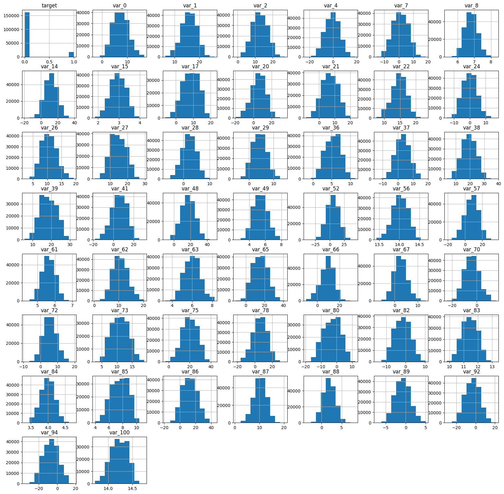
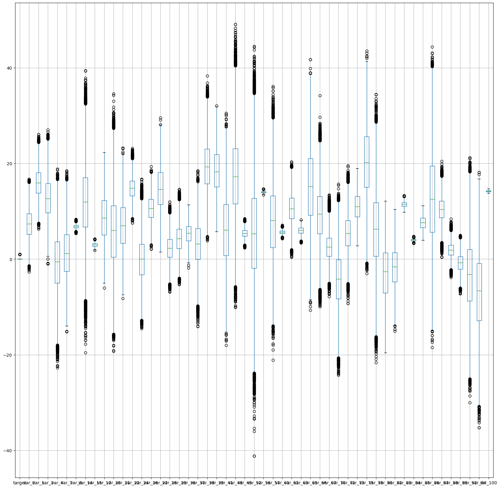
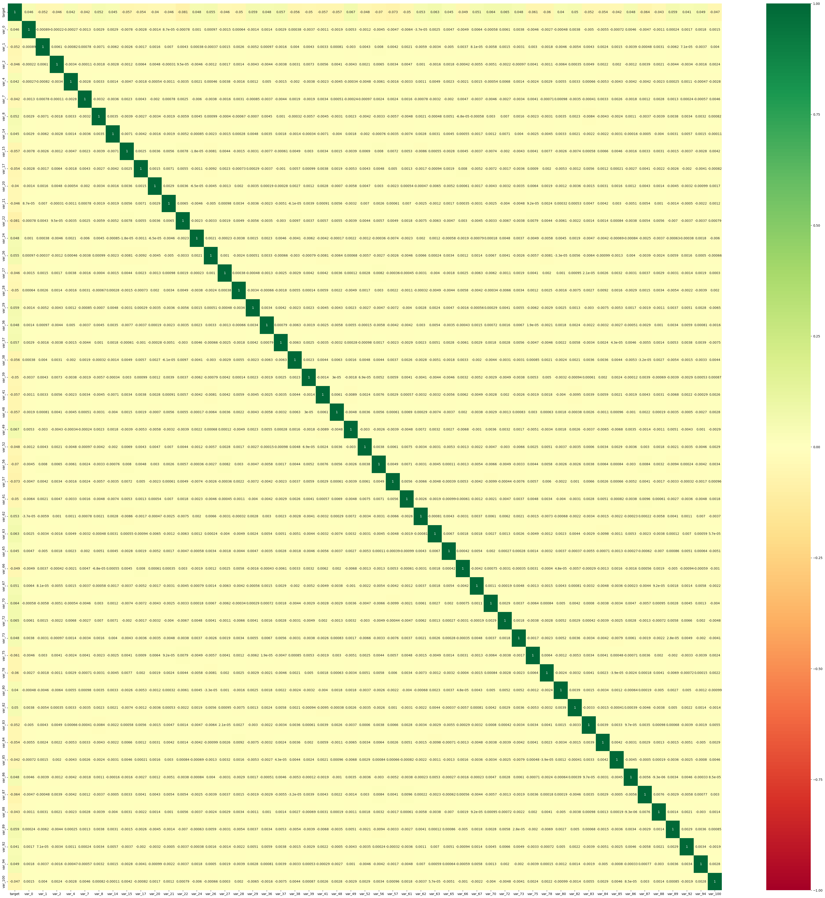
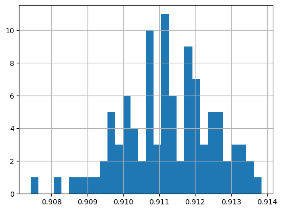
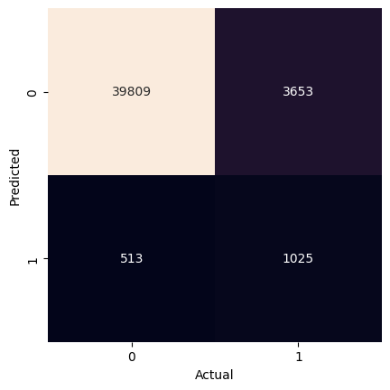
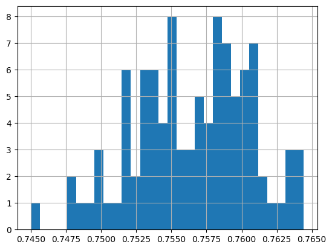
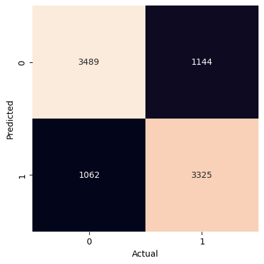

# Project 1: Transactions – Pass 11


## Problem Definition


#### 1. State the business problem.

Translate the business problem into a Data Science problem by stating what kind of problem it is ( supervised vs unsupervised ) and whether it is a classification, regression, or clustering problem.  Mention which model will be used, if known.


> We want to predict whether or not a future customer will complete a transaction (e.g., a product purchase, loan or bill payment, or subscription retention) based on prior transaction data. Such predictions can help determine higher-risk customers and present incentives to drive future transaction completions and increase sales.

> This is a supervised, categorical binary classification problem, where the target data is whether a customer transaction was successful (true or false). To achieve this, it uses a Gaussian Naive Bayes model to make predictions about transaction success.


## Data Collection


#### 2. Load Pandas, Numpy, and Matplotlib modules


```python
# imports
import pandas as pd
import numpy as np
import matplotlib.pyplot as plt
import seaborn as sns

from sklearn import datasets, metrics
from sklearn.naive_bayes import GaussianNB
from sklearn.model_selection import train_test_split
```

#### 3. Load data Train.csv from AWS S3.


```python
# url
url = 'https://ddc-datascience.s3.amazonaws.com/Projects/Project.1-Transactions/Data/Transaction.train.big.csv'
```

- Set number of columns and rows for this pass:


```python
# Commented out — now using all rows and columns!

# set cols and rows for pass
# num_cols = 50
# num_rows = 50_000

# num_cols, num_rows
```

- Read in the data from .csv using pandas:


```python
# make dataframe
df = pd.read_csv(
    url,
    # usecols=range(num_cols),
    # nrows=num_rows,
)
```

- Check the dataframe:


```python
# check dataframe
df
```


  <div id="df-6ff22d4e-c30d-4dc5-8cf3-8b1e0efee664" class="colab-df-container">
    <div>
<style scoped>
    .dataframe tbody tr th:only-of-type {
        vertical-align: middle;
    }

    .dataframe tbody tr th {
        vertical-align: top;
    }

    .dataframe thead th {
        text-align: right;
    }
</style>
<table border="1" class="dataframe">
  <thead>
    <tr style="text-align: right;">
      <th></th>
      <th>Unnamed: 0</th>
      <th>ID_code</th>
      <th>target</th>
      <th>var_0</th>
      <th>var_1</th>
      <th>var_2</th>
      <th>var_3</th>
      <th>var_4</th>
      <th>var_5</th>
      <th>var_6</th>
      <th>...</th>
      <th>var_91</th>
      <th>var_92</th>
      <th>var_93</th>
      <th>var_94</th>
      <th>var_95</th>
      <th>var_96</th>
      <th>var_97</th>
      <th>var_98</th>
      <th>var_99</th>
      <th>var_100</th>
    </tr>
  </thead>
  <tbody>
    <tr>
      <th>0</th>
      <td>0</td>
      <td>train_0</td>
      <td>NaN</td>
      <td>NaN</td>
      <td>NaN</td>
      <td>NaN</td>
      <td>NaN</td>
      <td>NaN</td>
      <td>NaN</td>
      <td>NaN</td>
      <td>...</td>
      <td>NaN</td>
      <td>NaN</td>
      <td>NaN</td>
      <td>NaN</td>
      <td>NaN</td>
      <td>NaN</td>
      <td>NaN</td>
      <td>NaN</td>
      <td>NaN</td>
      <td>NaN</td>
    </tr>
    <tr>
      <th>1</th>
      <td>1</td>
      <td>train_1</td>
      <td>NaN</td>
      <td>NaN</td>
      <td>NaN</td>
      <td>NaN</td>
      <td>NaN</td>
      <td>NaN</td>
      <td>NaN</td>
      <td>NaN</td>
      <td>...</td>
      <td>NaN</td>
      <td>NaN</td>
      <td>NaN</td>
      <td>NaN</td>
      <td>NaN</td>
      <td>NaN</td>
      <td>NaN</td>
      <td>NaN</td>
      <td>NaN</td>
      <td>NaN</td>
    </tr>
    <tr>
      <th>2</th>
      <td>2</td>
      <td>train_2</td>
      <td>NaN</td>
      <td>NaN</td>
      <td>NaN</td>
      <td>NaN</td>
      <td>NaN</td>
      <td>NaN</td>
      <td>NaN</td>
      <td>NaN</td>
      <td>...</td>
      <td>NaN</td>
      <td>NaN</td>
      <td>NaN</td>
      <td>NaN</td>
      <td>NaN</td>
      <td>NaN</td>
      <td>NaN</td>
      <td>NaN</td>
      <td>NaN</td>
      <td>NaN</td>
    </tr>
    <tr>
      <th>3</th>
      <td>3</td>
      <td>train_3</td>
      <td>0.0</td>
      <td>4.6739</td>
      <td>22.3915</td>
      <td>15.6015</td>
      <td>NaN</td>
      <td>0.0464</td>
      <td>NaN</td>
      <td>NaN</td>
      <td>...</td>
      <td>NaN</td>
      <td>11.1077</td>
      <td>NaN</td>
      <td>-12.6465</td>
      <td>NaN</td>
      <td>NaN</td>
      <td>NaN</td>
      <td>NaN</td>
      <td>NaN</td>
      <td>14.0618</td>
    </tr>
    <tr>
      <th>4</th>
      <td>4</td>
      <td>train_4</td>
      <td>NaN</td>
      <td>NaN</td>
      <td>NaN</td>
      <td>NaN</td>
      <td>NaN</td>
      <td>NaN</td>
      <td>NaN</td>
      <td>NaN</td>
      <td>...</td>
      <td>NaN</td>
      <td>NaN</td>
      <td>NaN</td>
      <td>NaN</td>
      <td>NaN</td>
      <td>NaN</td>
      <td>NaN</td>
      <td>NaN</td>
      <td>NaN</td>
      <td>NaN</td>
    </tr>
    <tr>
      <th>...</th>
      <td>...</td>
      <td>...</td>
      <td>...</td>
      <td>...</td>
      <td>...</td>
      <td>...</td>
      <td>...</td>
      <td>...</td>
      <td>...</td>
      <td>...</td>
      <td>...</td>
      <td>...</td>
      <td>...</td>
      <td>...</td>
      <td>...</td>
      <td>...</td>
      <td>...</td>
      <td>...</td>
      <td>...</td>
      <td>...</td>
      <td>...</td>
    </tr>
    <tr>
      <th>1049995</th>
      <td>1049995</td>
      <td>train_1049995</td>
      <td>1.0</td>
      <td>11.3251</td>
      <td>16.4148</td>
      <td>20.5955</td>
      <td>NaN</td>
      <td>-6.3011</td>
      <td>NaN</td>
      <td>NaN</td>
      <td>...</td>
      <td>NaN</td>
      <td>1.3921</td>
      <td>NaN</td>
      <td>-16.4925</td>
      <td>NaN</td>
      <td>NaN</td>
      <td>NaN</td>
      <td>NaN</td>
      <td>NaN</td>
      <td>14.4421</td>
    </tr>
    <tr>
      <th>1049996</th>
      <td>1049996</td>
      <td>train_1049996</td>
      <td>NaN</td>
      <td>NaN</td>
      <td>NaN</td>
      <td>NaN</td>
      <td>NaN</td>
      <td>NaN</td>
      <td>NaN</td>
      <td>NaN</td>
      <td>...</td>
      <td>NaN</td>
      <td>NaN</td>
      <td>NaN</td>
      <td>NaN</td>
      <td>NaN</td>
      <td>NaN</td>
      <td>NaN</td>
      <td>NaN</td>
      <td>NaN</td>
      <td>NaN</td>
    </tr>
    <tr>
      <th>1049997</th>
      <td>1049997</td>
      <td>train_1049997</td>
      <td>0.0</td>
      <td>8.9941</td>
      <td>13.4127</td>
      <td>3.9567</td>
      <td>NaN</td>
      <td>3.5744</td>
      <td>NaN</td>
      <td>NaN</td>
      <td>...</td>
      <td>NaN</td>
      <td>2.0836</td>
      <td>NaN</td>
      <td>-18.6168</td>
      <td>NaN</td>
      <td>NaN</td>
      <td>NaN</td>
      <td>NaN</td>
      <td>NaN</td>
      <td>14.0689</td>
    </tr>
    <tr>
      <th>1049998</th>
      <td>1049998</td>
      <td>train_1049998</td>
      <td>NaN</td>
      <td>NaN</td>
      <td>NaN</td>
      <td>NaN</td>
      <td>NaN</td>
      <td>NaN</td>
      <td>NaN</td>
      <td>NaN</td>
      <td>...</td>
      <td>NaN</td>
      <td>NaN</td>
      <td>NaN</td>
      <td>NaN</td>
      <td>NaN</td>
      <td>NaN</td>
      <td>NaN</td>
      <td>NaN</td>
      <td>NaN</td>
      <td>NaN</td>
    </tr>
    <tr>
      <th>1049999</th>
      <td>1049999</td>
      <td>train_1049999</td>
      <td>0.0</td>
      <td>2.1828</td>
      <td>12.3805</td>
      <td>17.5654</td>
      <td>NaN</td>
      <td>8.1795</td>
      <td>NaN</td>
      <td>NaN</td>
      <td>...</td>
      <td>NaN</td>
      <td>-12.1108</td>
      <td>NaN</td>
      <td>10.7608</td>
      <td>NaN</td>
      <td>NaN</td>
      <td>NaN</td>
      <td>NaN</td>
      <td>NaN</td>
      <td>14.1690</td>
    </tr>
  </tbody>
</table>
<p>1050000 rows × 104 columns</p>
</div>
    <div class="colab-df-buttons">

  <div class="colab-df-container">
    <button class="colab-df-convert" onclick="convertToInteractive('df-6ff22d4e-c30d-4dc5-8cf3-8b1e0efee664')"
            title="Convert this dataframe to an interactive table."
            style="display:none;">

  <svg xmlns="http://www.w3.org/2000/svg" height="24px" viewBox="0 -960 960 960">
    <path d="M120-120v-720h720v720H120Zm60-500h600v-160H180v160Zm220 220h160v-160H400v160Zm0 220h160v-160H400v160ZM180-400h160v-160H180v160Zm440 0h160v-160H620v160ZM180-180h160v-160H180v160Zm440 0h160v-160H620v160Z"/>
  </svg>
    </button>

  <style>
    .colab-df-container {
      display:flex;
      gap: 12px;
    }

    .colab-df-convert {
      background-color: #E8F0FE;
      border: none;
      border-radius: 50%;
      cursor: pointer;
      display: none;
      fill: #1967D2;
      height: 32px;
      padding: 0 0 0 0;
      width: 32px;
    }

    .colab-df-convert:hover {
      background-color: #E2EBFA;
      box-shadow: 0px 1px 2px rgba(60, 64, 67, 0.3), 0px 1px 3px 1px rgba(60, 64, 67, 0.15);
      fill: #174EA6;
    }

    .colab-df-buttons div {
      margin-bottom: 4px;
    }

    [theme=dark] .colab-df-convert {
      background-color: #3B4455;
      fill: #D2E3FC;
    }

    [theme=dark] .colab-df-convert:hover {
      background-color: #434B5C;
      box-shadow: 0px 1px 3px 1px rgba(0, 0, 0, 0.15);
      filter: drop-shadow(0px 1px 2px rgba(0, 0, 0, 0.3));
      fill: #FFFFFF;
    }
  </style>

    <script>
      const buttonEl =
        document.querySelector('#df-6ff22d4e-c30d-4dc5-8cf3-8b1e0efee664 button.colab-df-convert');
      buttonEl.style.display =
        google.colab.kernel.accessAllowed ? 'block' : 'none';

      async function convertToInteractive(key) {
        const element = document.querySelector('#df-6ff22d4e-c30d-4dc5-8cf3-8b1e0efee664');
        const dataTable =
          await google.colab.kernel.invokeFunction('convertToInteractive',
                                                    [key], {});
        if (!dataTable) return;

        const docLinkHtml = 'Like what you see? Visit the ' +
          '<a target="_blank" href=https://colab.research.google.com/notebooks/data_table.ipynb>data table notebook</a>'
          + ' to learn more about interactive tables.';
        element.innerHTML = '';
        dataTable['output_type'] = 'display_data';
        await google.colab.output.renderOutput(dataTable, element);
        const docLink = document.createElement('div');
        docLink.innerHTML = docLinkHtml;
        element.appendChild(docLink);
      }
    </script>
  </div>


  <div id="id_1371029f-6c44-43e8-86fd-2e5b4be86c21">
    <style>
      .colab-df-generate {
        background-color: #E8F0FE;
        border: none;
        border-radius: 50%;
        cursor: pointer;
        display: none;
        fill: #1967D2;
        height: 32px;
        padding: 0 0 0 0;
        width: 32px;
      }

      .colab-df-generate:hover {
        background-color: #E2EBFA;
        box-shadow: 0px 1px 2px rgba(60, 64, 67, 0.3), 0px 1px 3px 1px rgba(60, 64, 67, 0.15);
        fill: #174EA6;
      }

      [theme=dark] .colab-df-generate {
        background-color: #3B4455;
        fill: #D2E3FC;
      }

      [theme=dark] .colab-df-generate:hover {
        background-color: #434B5C;
        box-shadow: 0px 1px 3px 1px rgba(0, 0, 0, 0.15);
        filter: drop-shadow(0px 1px 2px rgba(0, 0, 0, 0.3));
        fill: #FFFFFF;
      }
    </style>
    <button class="colab-df-generate" onclick="generateWithVariable('df')"
            title="Generate code using this dataframe."
            style="display:none;">

  <svg xmlns="http://www.w3.org/2000/svg" height="24px"viewBox="0 0 24 24"
       width="24px">
    <path d="M7,19H8.4L18.45,9,17,7.55,7,17.6ZM5,21V16.75L18.45,3.32a2,2,0,0,1,2.83,0l1.4,1.43a1.91,1.91,0,0,1,.58,1.4,1.91,1.91,0,0,1-.58,1.4L9.25,21ZM18.45,9,17,7.55Zm-12,3A5.31,5.31,0,0,0,4.9,8.1,5.31,5.31,0,0,0,1,6.5,5.31,5.31,0,0,0,4.9,4.9,5.31,5.31,0,0,0,6.5,1,5.31,5.31,0,0,0,8.1,4.9,5.31,5.31,0,0,0,12,6.5,5.46,5.46,0,0,0,6.5,12Z"/>
  </svg>
    </button>
    <script>
      (() => {
      const buttonEl =
        document.querySelector('#id_1371029f-6c44-43e8-86fd-2e5b4be86c21 button.colab-df-generate');
      buttonEl.style.display =
        google.colab.kernel.accessAllowed ? 'block' : 'none';

      buttonEl.onclick = () => {
        google.colab.notebook.generateWithVariable('df');
      }
      })();
    </script>
  </div>

    </div>
  </div>


- For the full data set, we have 1,050,000 rows and 101 feature columns, var_0 - var_100.

## Data Cleaning


#### 4. Examine the data using tools we have used in class. You should be identifying the various columns such as ...

    - target column
    - feature columns
    - identifier columns
    - null columns
    - null rows

    Tools you should be using include, but are not limited to:

    - head
    - tail
    - shape
    - size
    - info
    - describe
    - nunique
    - unique
    - isnull/isna


```python
# define target_col
target_col = 'target'
target_col
```


    'target'


- head


```python
# head
df.head()
```


  <div id="df-a70dc323-86d6-4400-aa50-d48a3a8387d8" class="colab-df-container">
    <div>
<style scoped>
    .dataframe tbody tr th:only-of-type {
        vertical-align: middle;
    }

    .dataframe tbody tr th {
        vertical-align: top;
    }

    .dataframe thead th {
        text-align: right;
    }
</style>
<table border="1" class="dataframe">
  <thead>
    <tr style="text-align: right;">
      <th></th>
      <th>Unnamed: 0</th>
      <th>ID_code</th>
      <th>target</th>
      <th>var_0</th>
      <th>var_1</th>
      <th>var_2</th>
      <th>var_3</th>
      <th>var_4</th>
      <th>var_5</th>
      <th>var_6</th>
      <th>...</th>
      <th>var_91</th>
      <th>var_92</th>
      <th>var_93</th>
      <th>var_94</th>
      <th>var_95</th>
      <th>var_96</th>
      <th>var_97</th>
      <th>var_98</th>
      <th>var_99</th>
      <th>var_100</th>
    </tr>
  </thead>
  <tbody>
    <tr>
      <th>0</th>
      <td>0</td>
      <td>train_0</td>
      <td>NaN</td>
      <td>NaN</td>
      <td>NaN</td>
      <td>NaN</td>
      <td>NaN</td>
      <td>NaN</td>
      <td>NaN</td>
      <td>NaN</td>
      <td>...</td>
      <td>NaN</td>
      <td>NaN</td>
      <td>NaN</td>
      <td>NaN</td>
      <td>NaN</td>
      <td>NaN</td>
      <td>NaN</td>
      <td>NaN</td>
      <td>NaN</td>
      <td>NaN</td>
    </tr>
    <tr>
      <th>1</th>
      <td>1</td>
      <td>train_1</td>
      <td>NaN</td>
      <td>NaN</td>
      <td>NaN</td>
      <td>NaN</td>
      <td>NaN</td>
      <td>NaN</td>
      <td>NaN</td>
      <td>NaN</td>
      <td>...</td>
      <td>NaN</td>
      <td>NaN</td>
      <td>NaN</td>
      <td>NaN</td>
      <td>NaN</td>
      <td>NaN</td>
      <td>NaN</td>
      <td>NaN</td>
      <td>NaN</td>
      <td>NaN</td>
    </tr>
    <tr>
      <th>2</th>
      <td>2</td>
      <td>train_2</td>
      <td>NaN</td>
      <td>NaN</td>
      <td>NaN</td>
      <td>NaN</td>
      <td>NaN</td>
      <td>NaN</td>
      <td>NaN</td>
      <td>NaN</td>
      <td>...</td>
      <td>NaN</td>
      <td>NaN</td>
      <td>NaN</td>
      <td>NaN</td>
      <td>NaN</td>
      <td>NaN</td>
      <td>NaN</td>
      <td>NaN</td>
      <td>NaN</td>
      <td>NaN</td>
    </tr>
    <tr>
      <th>3</th>
      <td>3</td>
      <td>train_3</td>
      <td>0.0</td>
      <td>4.6739</td>
      <td>22.3915</td>
      <td>15.6015</td>
      <td>NaN</td>
      <td>0.0464</td>
      <td>NaN</td>
      <td>NaN</td>
      <td>...</td>
      <td>NaN</td>
      <td>11.1077</td>
      <td>NaN</td>
      <td>-12.6465</td>
      <td>NaN</td>
      <td>NaN</td>
      <td>NaN</td>
      <td>NaN</td>
      <td>NaN</td>
      <td>14.0618</td>
    </tr>
    <tr>
      <th>4</th>
      <td>4</td>
      <td>train_4</td>
      <td>NaN</td>
      <td>NaN</td>
      <td>NaN</td>
      <td>NaN</td>
      <td>NaN</td>
      <td>NaN</td>
      <td>NaN</td>
      <td>NaN</td>
      <td>...</td>
      <td>NaN</td>
      <td>NaN</td>
      <td>NaN</td>
      <td>NaN</td>
      <td>NaN</td>
      <td>NaN</td>
      <td>NaN</td>
      <td>NaN</td>
      <td>NaN</td>
      <td>NaN</td>
    </tr>
  </tbody>
</table>
<p>5 rows × 104 columns</p>
</div>
    <div class="colab-df-buttons">

  <div class="colab-df-container">
    <button class="colab-df-convert" onclick="convertToInteractive('df-a70dc323-86d6-4400-aa50-d48a3a8387d8')"
            title="Convert this dataframe to an interactive table."
            style="display:none;">

  <svg xmlns="http://www.w3.org/2000/svg" height="24px" viewBox="0 -960 960 960">
    <path d="M120-120v-720h720v720H120Zm60-500h600v-160H180v160Zm220 220h160v-160H400v160Zm0 220h160v-160H400v160ZM180-400h160v-160H180v160Zm440 0h160v-160H620v160ZM180-180h160v-160H180v160Zm440 0h160v-160H620v160Z"/>
  </svg>
    </button>

  <style>
    .colab-df-container {
      display:flex;
      gap: 12px;
    }

    .colab-df-convert {
      background-color: #E8F0FE;
      border: none;
      border-radius: 50%;
      cursor: pointer;
      display: none;
      fill: #1967D2;
      height: 32px;
      padding: 0 0 0 0;
      width: 32px;
    }

    .colab-df-convert:hover {
      background-color: #E2EBFA;
      box-shadow: 0px 1px 2px rgba(60, 64, 67, 0.3), 0px 1px 3px 1px rgba(60, 64, 67, 0.15);
      fill: #174EA6;
    }

    .colab-df-buttons div {
      margin-bottom: 4px;
    }

    [theme=dark] .colab-df-convert {
      background-color: #3B4455;
      fill: #D2E3FC;
    }

    [theme=dark] .colab-df-convert:hover {
      background-color: #434B5C;
      box-shadow: 0px 1px 3px 1px rgba(0, 0, 0, 0.15);
      filter: drop-shadow(0px 1px 2px rgba(0, 0, 0, 0.3));
      fill: #FFFFFF;
    }
  </style>

    <script>
      const buttonEl =
        document.querySelector('#df-a70dc323-86d6-4400-aa50-d48a3a8387d8 button.colab-df-convert');
      buttonEl.style.display =
        google.colab.kernel.accessAllowed ? 'block' : 'none';

      async function convertToInteractive(key) {
        const element = document.querySelector('#df-a70dc323-86d6-4400-aa50-d48a3a8387d8');
        const dataTable =
          await google.colab.kernel.invokeFunction('convertToInteractive',
                                                    [key], {});
        if (!dataTable) return;

        const docLinkHtml = 'Like what you see? Visit the ' +
          '<a target="_blank" href=https://colab.research.google.com/notebooks/data_table.ipynb>data table notebook</a>'
          + ' to learn more about interactive tables.';
        element.innerHTML = '';
        dataTable['output_type'] = 'display_data';
        await google.colab.output.renderOutput(dataTable, element);
        const docLink = document.createElement('div');
        docLink.innerHTML = docLinkHtml;
        element.appendChild(docLink);
      }
    </script>
  </div>


    </div>
  </div>


- tail


```python
# tail
df.tail()
```


  <div id="df-11d2d341-ae20-487b-8f85-7b885835e248" class="colab-df-container">
    <div>
<style scoped>
    .dataframe tbody tr th:only-of-type {
        vertical-align: middle;
    }

    .dataframe tbody tr th {
        vertical-align: top;
    }

    .dataframe thead th {
        text-align: right;
    }
</style>
<table border="1" class="dataframe">
  <thead>
    <tr style="text-align: right;">
      <th></th>
      <th>Unnamed: 0</th>
      <th>ID_code</th>
      <th>target</th>
      <th>var_0</th>
      <th>var_1</th>
      <th>var_2</th>
      <th>var_3</th>
      <th>var_4</th>
      <th>var_5</th>
      <th>var_6</th>
      <th>...</th>
      <th>var_91</th>
      <th>var_92</th>
      <th>var_93</th>
      <th>var_94</th>
      <th>var_95</th>
      <th>var_96</th>
      <th>var_97</th>
      <th>var_98</th>
      <th>var_99</th>
      <th>var_100</th>
    </tr>
  </thead>
  <tbody>
    <tr>
      <th>1049995</th>
      <td>1049995</td>
      <td>train_1049995</td>
      <td>1.0</td>
      <td>11.3251</td>
      <td>16.4148</td>
      <td>20.5955</td>
      <td>NaN</td>
      <td>-6.3011</td>
      <td>NaN</td>
      <td>NaN</td>
      <td>...</td>
      <td>NaN</td>
      <td>1.3921</td>
      <td>NaN</td>
      <td>-16.4925</td>
      <td>NaN</td>
      <td>NaN</td>
      <td>NaN</td>
      <td>NaN</td>
      <td>NaN</td>
      <td>14.4421</td>
    </tr>
    <tr>
      <th>1049996</th>
      <td>1049996</td>
      <td>train_1049996</td>
      <td>NaN</td>
      <td>NaN</td>
      <td>NaN</td>
      <td>NaN</td>
      <td>NaN</td>
      <td>NaN</td>
      <td>NaN</td>
      <td>NaN</td>
      <td>...</td>
      <td>NaN</td>
      <td>NaN</td>
      <td>NaN</td>
      <td>NaN</td>
      <td>NaN</td>
      <td>NaN</td>
      <td>NaN</td>
      <td>NaN</td>
      <td>NaN</td>
      <td>NaN</td>
    </tr>
    <tr>
      <th>1049997</th>
      <td>1049997</td>
      <td>train_1049997</td>
      <td>0.0</td>
      <td>8.9941</td>
      <td>13.4127</td>
      <td>3.9567</td>
      <td>NaN</td>
      <td>3.5744</td>
      <td>NaN</td>
      <td>NaN</td>
      <td>...</td>
      <td>NaN</td>
      <td>2.0836</td>
      <td>NaN</td>
      <td>-18.6168</td>
      <td>NaN</td>
      <td>NaN</td>
      <td>NaN</td>
      <td>NaN</td>
      <td>NaN</td>
      <td>14.0689</td>
    </tr>
    <tr>
      <th>1049998</th>
      <td>1049998</td>
      <td>train_1049998</td>
      <td>NaN</td>
      <td>NaN</td>
      <td>NaN</td>
      <td>NaN</td>
      <td>NaN</td>
      <td>NaN</td>
      <td>NaN</td>
      <td>NaN</td>
      <td>...</td>
      <td>NaN</td>
      <td>NaN</td>
      <td>NaN</td>
      <td>NaN</td>
      <td>NaN</td>
      <td>NaN</td>
      <td>NaN</td>
      <td>NaN</td>
      <td>NaN</td>
      <td>NaN</td>
    </tr>
    <tr>
      <th>1049999</th>
      <td>1049999</td>
      <td>train_1049999</td>
      <td>0.0</td>
      <td>2.1828</td>
      <td>12.3805</td>
      <td>17.5654</td>
      <td>NaN</td>
      <td>8.1795</td>
      <td>NaN</td>
      <td>NaN</td>
      <td>...</td>
      <td>NaN</td>
      <td>-12.1108</td>
      <td>NaN</td>
      <td>10.7608</td>
      <td>NaN</td>
      <td>NaN</td>
      <td>NaN</td>
      <td>NaN</td>
      <td>NaN</td>
      <td>14.1690</td>
    </tr>
  </tbody>
</table>
<p>5 rows × 104 columns</p>
</div>
    <div class="colab-df-buttons">

  <div class="colab-df-container">
    <button class="colab-df-convert" onclick="convertToInteractive('df-11d2d341-ae20-487b-8f85-7b885835e248')"
            title="Convert this dataframe to an interactive table."
            style="display:none;">

  <svg xmlns="http://www.w3.org/2000/svg" height="24px" viewBox="0 -960 960 960">
    <path d="M120-120v-720h720v720H120Zm60-500h600v-160H180v160Zm220 220h160v-160H400v160Zm0 220h160v-160H400v160ZM180-400h160v-160H180v160Zm440 0h160v-160H620v160ZM180-180h160v-160H180v160Zm440 0h160v-160H620v160Z"/>
  </svg>
    </button>

  <style>
    .colab-df-container {
      display:flex;
      gap: 12px;
    }

    .colab-df-convert {
      background-color: #E8F0FE;
      border: none;
      border-radius: 50%;
      cursor: pointer;
      display: none;
      fill: #1967D2;
      height: 32px;
      padding: 0 0 0 0;
      width: 32px;
    }

    .colab-df-convert:hover {
      background-color: #E2EBFA;
      box-shadow: 0px 1px 2px rgba(60, 64, 67, 0.3), 0px 1px 3px 1px rgba(60, 64, 67, 0.15);
      fill: #174EA6;
    }

    .colab-df-buttons div {
      margin-bottom: 4px;
    }

    [theme=dark] .colab-df-convert {
      background-color: #3B4455;
      fill: #D2E3FC;
    }

    [theme=dark] .colab-df-convert:hover {
      background-color: #434B5C;
      box-shadow: 0px 1px 3px 1px rgba(0, 0, 0, 0.15);
      filter: drop-shadow(0px 1px 2px rgba(0, 0, 0, 0.3));
      fill: #FFFFFF;
    }
  </style>

    <script>
      const buttonEl =
        document.querySelector('#df-11d2d341-ae20-487b-8f85-7b885835e248 button.colab-df-convert');
      buttonEl.style.display =
        google.colab.kernel.accessAllowed ? 'block' : 'none';

      async function convertToInteractive(key) {
        const element = document.querySelector('#df-11d2d341-ae20-487b-8f85-7b885835e248');
        const dataTable =
          await google.colab.kernel.invokeFunction('convertToInteractive',
                                                    [key], {});
        if (!dataTable) return;

        const docLinkHtml = 'Like what you see? Visit the ' +
          '<a target="_blank" href=https://colab.research.google.com/notebooks/data_table.ipynb>data table notebook</a>'
          + ' to learn more about interactive tables.';
        element.innerHTML = '';
        dataTable['output_type'] = 'display_data';
        await google.colab.output.renderOutput(dataTable, element);
        const docLink = document.createElement('div');
        docLink.innerHTML = docLinkHtml;
        element.appendChild(docLink);
      }
    </script>
  </div>


    </div>
  </div>


- shape


```python
# shape
df.shape
```


    (1050000, 104)


- size


```python
# size
df.size
```


    109200000


- info


```python
# info
df.info()
```

    <class 'pandas.core.frame.DataFrame'>
    RangeIndex: 1050000 entries, 0 to 1049999
    Columns: 104 entries, Unnamed: 0 to var_100
    dtypes: float64(102), int64(1), object(1)
    memory usage: 833.1+ MB


- describe


```python
# describe
df.describe()
```


  <div id="df-95d321c4-b163-4abb-bdd5-2dd4cba460d6" class="colab-df-container">
    <div>
<style scoped>
    .dataframe tbody tr th:only-of-type {
        vertical-align: middle;
    }

    .dataframe tbody tr th {
        vertical-align: top;
    }

    .dataframe thead th {
        text-align: right;
    }
</style>
<table border="1" class="dataframe">
  <thead>
    <tr style="text-align: right;">
      <th></th>
      <th>Unnamed: 0</th>
      <th>target</th>
      <th>var_0</th>
      <th>var_1</th>
      <th>var_2</th>
      <th>var_3</th>
      <th>var_4</th>
      <th>var_5</th>
      <th>var_6</th>
      <th>var_7</th>
      <th>...</th>
      <th>var_91</th>
      <th>var_92</th>
      <th>var_93</th>
      <th>var_94</th>
      <th>var_95</th>
      <th>var_96</th>
      <th>var_97</th>
      <th>var_98</th>
      <th>var_99</th>
      <th>var_100</th>
    </tr>
  </thead>
  <tbody>
    <tr>
      <th>count</th>
      <td>1.050000e+06</td>
      <td>180000.000000</td>
      <td>180000.000000</td>
      <td>180000.000000</td>
      <td>180000.000000</td>
      <td>0.0</td>
      <td>180000.000000</td>
      <td>0.0</td>
      <td>0.0</td>
      <td>180000.000000</td>
      <td>...</td>
      <td>0.0</td>
      <td>180000.000000</td>
      <td>0.0</td>
      <td>180000.000000</td>
      <td>0.0</td>
      <td>0.0</td>
      <td>0.0</td>
      <td>0.0</td>
      <td>0.0</td>
      <td>180000.000000</td>
    </tr>
    <tr>
      <th>mean</th>
      <td>5.249995e+05</td>
      <td>0.100222</td>
      <td>7.440715</td>
      <td>15.870166</td>
      <td>12.735619</td>
      <td>NaN</td>
      <td>-0.668334</td>
      <td>NaN</td>
      <td>NaN</td>
      <td>1.190419</td>
      <td>...</td>
      <td>NaN</td>
      <td>-3.294620</td>
      <td>NaN</td>
      <td>-6.727860</td>
      <td>NaN</td>
      <td>NaN</td>
      <td>NaN</td>
      <td>NaN</td>
      <td>NaN</td>
      <td>14.224538</td>
    </tr>
    <tr>
      <th>std</th>
      <td>3.031090e+05</td>
      <td>0.300297</td>
      <td>3.021636</td>
      <td>3.010492</td>
      <td>4.185923</td>
      <td>NaN</td>
      <td>5.968300</td>
      <td>NaN</td>
      <td>NaN</td>
      <td>5.169343</td>
      <td>...</td>
      <td>NaN</td>
      <td>7.418545</td>
      <td>NaN</td>
      <td>8.278554</td>
      <td>NaN</td>
      <td>NaN</td>
      <td>NaN</td>
      <td>NaN</td>
      <td>NaN</td>
      <td>0.171058</td>
    </tr>
    <tr>
      <th>min</th>
      <td>0.000000e+00</td>
      <td>0.000000</td>
      <td>-2.691700</td>
      <td>6.299300</td>
      <td>-1.018500</td>
      <td>NaN</td>
      <td>-22.748700</td>
      <td>NaN</td>
      <td>NaN</td>
      <td>-15.194000</td>
      <td>...</td>
      <td>NaN</td>
      <td>-29.984000</td>
      <td>NaN</td>
      <td>-35.211700</td>
      <td>NaN</td>
      <td>NaN</td>
      <td>NaN</td>
      <td>NaN</td>
      <td>NaN</td>
      <td>13.729000</td>
    </tr>
    <tr>
      <th>25%</th>
      <td>2.624998e+05</td>
      <td>0.000000</td>
      <td>5.160325</td>
      <td>13.830400</td>
      <td>9.664675</td>
      <td>NaN</td>
      <td>-4.997500</td>
      <td>NaN</td>
      <td>NaN</td>
      <td>-2.571400</td>
      <td>...</td>
      <td>NaN</td>
      <td>-8.757925</td>
      <td>NaN</td>
      <td>-12.835875</td>
      <td>NaN</td>
      <td>NaN</td>
      <td>NaN</td>
      <td>NaN</td>
      <td>NaN</td>
      <td>14.098900</td>
    </tr>
    <tr>
      <th>50%</th>
      <td>5.249995e+05</td>
      <td>0.000000</td>
      <td>7.350950</td>
      <td>15.934600</td>
      <td>12.670700</td>
      <td>NaN</td>
      <td>-0.560300</td>
      <td>NaN</td>
      <td>NaN</td>
      <td>1.194600</td>
      <td>...</td>
      <td>NaN</td>
      <td>-3.170950</td>
      <td>NaN</td>
      <td>-6.615100</td>
      <td>NaN</td>
      <td>NaN</td>
      <td>NaN</td>
      <td>NaN</td>
      <td>NaN</td>
      <td>14.226800</td>
    </tr>
    <tr>
      <th>75%</th>
      <td>7.874992e+05</td>
      <td>0.000000</td>
      <td>9.511125</td>
      <td>18.061425</td>
      <td>15.837300</td>
      <td>NaN</td>
      <td>3.632525</td>
      <td>NaN</td>
      <td>NaN</td>
      <td>5.090450</td>
      <td>...</td>
      <td>NaN</td>
      <td>2.043350</td>
      <td>NaN</td>
      <td>-0.885250</td>
      <td>NaN</td>
      <td>NaN</td>
      <td>NaN</td>
      <td>NaN</td>
      <td>NaN</td>
      <td>14.361800</td>
    </tr>
    <tr>
      <th>max</th>
      <td>1.049999e+06</td>
      <td>1.000000</td>
      <td>16.716500</td>
      <td>26.079100</td>
      <td>26.997600</td>
      <td>NaN</td>
      <td>18.855400</td>
      <td>NaN</td>
      <td>NaN</td>
      <td>18.471400</td>
      <td>...</td>
      <td>NaN</td>
      <td>21.236400</td>
      <td>NaN</td>
      <td>18.105600</td>
      <td>NaN</td>
      <td>NaN</td>
      <td>NaN</td>
      <td>NaN</td>
      <td>NaN</td>
      <td>14.743000</td>
    </tr>
  </tbody>
</table>
<p>8 rows × 103 columns</p>
</div>
    <div class="colab-df-buttons">

  <div class="colab-df-container">
    <button class="colab-df-convert" onclick="convertToInteractive('df-95d321c4-b163-4abb-bdd5-2dd4cba460d6')"
            title="Convert this dataframe to an interactive table."
            style="display:none;">

  <svg xmlns="http://www.w3.org/2000/svg" height="24px" viewBox="0 -960 960 960">
    <path d="M120-120v-720h720v720H120Zm60-500h600v-160H180v160Zm220 220h160v-160H400v160Zm0 220h160v-160H400v160ZM180-400h160v-160H180v160Zm440 0h160v-160H620v160ZM180-180h160v-160H180v160Zm440 0h160v-160H620v160Z"/>
  </svg>
    </button>

  <style>
    .colab-df-container {
      display:flex;
      gap: 12px;
    }

    .colab-df-convert {
      background-color: #E8F0FE;
      border: none;
      border-radius: 50%;
      cursor: pointer;
      display: none;
      fill: #1967D2;
      height: 32px;
      padding: 0 0 0 0;
      width: 32px;
    }

    .colab-df-convert:hover {
      background-color: #E2EBFA;
      box-shadow: 0px 1px 2px rgba(60, 64, 67, 0.3), 0px 1px 3px 1px rgba(60, 64, 67, 0.15);
      fill: #174EA6;
    }

    .colab-df-buttons div {
      margin-bottom: 4px;
    }

    [theme=dark] .colab-df-convert {
      background-color: #3B4455;
      fill: #D2E3FC;
    }

    [theme=dark] .colab-df-convert:hover {
      background-color: #434B5C;
      box-shadow: 0px 1px 3px 1px rgba(0, 0, 0, 0.15);
      filter: drop-shadow(0px 1px 2px rgba(0, 0, 0, 0.3));
      fill: #FFFFFF;
    }
  </style>

    <script>
      const buttonEl =
        document.querySelector('#df-95d321c4-b163-4abb-bdd5-2dd4cba460d6 button.colab-df-convert');
      buttonEl.style.display =
        google.colab.kernel.accessAllowed ? 'block' : 'none';

      async function convertToInteractive(key) {
        const element = document.querySelector('#df-95d321c4-b163-4abb-bdd5-2dd4cba460d6');
        const dataTable =
          await google.colab.kernel.invokeFunction('convertToInteractive',
                                                    [key], {});
        if (!dataTable) return;

        const docLinkHtml = 'Like what you see? Visit the ' +
          '<a target="_blank" href=https://colab.research.google.com/notebooks/data_table.ipynb>data table notebook</a>'
          + ' to learn more about interactive tables.';
        element.innerHTML = '';
        dataTable['output_type'] = 'display_data';
        await google.colab.output.renderOutput(dataTable, element);
        const docLink = document.createElement('div');
        docLink.innerHTML = docLinkHtml;
        element.appendChild(docLink);
      }
    </script>
  </div>


    </div>
  </div>


- nunique


```python
# nunique
df.nunique()
```


<div>
<style scoped>
    .dataframe tbody tr th:only-of-type {
        vertical-align: middle;
    }

    .dataframe tbody tr th {
        vertical-align: top;
    }

    .dataframe thead th {
        text-align: right;
    }
</style>
<table border="1" class="dataframe">
  <thead>
    <tr style="text-align: right;">
      <th></th>
      <th>0</th>
    </tr>
  </thead>
  <tbody>
    <tr>
      <th>Unnamed: 0</th>
      <td>1050000</td>
    </tr>
    <tr>
      <th>ID_code</th>
      <td>1050000</td>
    </tr>
    <tr>
      <th>target</th>
      <td>2</td>
    </tr>
    <tr>
      <th>var_0</th>
      <td>89982</td>
    </tr>
    <tr>
      <th>var_1</th>
      <td>89845</td>
    </tr>
    <tr>
      <th>...</th>
      <td>...</td>
    </tr>
    <tr>
      <th>var_96</th>
      <td>0</td>
    </tr>
    <tr>
      <th>var_97</th>
      <td>0</td>
    </tr>
    <tr>
      <th>var_98</th>
      <td>0</td>
    </tr>
    <tr>
      <th>var_99</th>
      <td>0</td>
    </tr>
    <tr>
      <th>var_100</th>
      <td>8479</td>
    </tr>
  </tbody>
</table>
<p>104 rows × 1 columns</p>
</div><br><label><b>dtype:</b> int64</label>


- unique


```python
# unique
df[target_col].unique()
```


    array([nan,  0.,  1.])


- isnull


```python
# isnull
df.isnull().sum().sort_values( ascending = False )
```


<div>
<style scoped>
    .dataframe tbody tr th:only-of-type {
        vertical-align: middle;
    }

    .dataframe tbody tr th {
        vertical-align: top;
    }

    .dataframe thead th {
        text-align: right;
    }
</style>
<table border="1" class="dataframe">
  <thead>
    <tr style="text-align: right;">
      <th></th>
      <th>0</th>
    </tr>
  </thead>
  <tbody>
    <tr>
      <th>var_3</th>
      <td>1050000</td>
    </tr>
    <tr>
      <th>var_16</th>
      <td>1050000</td>
    </tr>
    <tr>
      <th>var_12</th>
      <td>1050000</td>
    </tr>
    <tr>
      <th>var_11</th>
      <td>1050000</td>
    </tr>
    <tr>
      <th>var_9</th>
      <td>1050000</td>
    </tr>
    <tr>
      <th>...</th>
      <td>...</td>
    </tr>
    <tr>
      <th>var_88</th>
      <td>870000</td>
    </tr>
    <tr>
      <th>var_94</th>
      <td>870000</td>
    </tr>
    <tr>
      <th>var_100</th>
      <td>870000</td>
    </tr>
    <tr>
      <th>Unnamed: 0</th>
      <td>0</td>
    </tr>
    <tr>
      <th>ID_code</th>
      <td>0</td>
    </tr>
  </tbody>
</table>
<p>104 rows × 1 columns</p>
</div><br><label><b>dtype:</b> int64</label>


```python
# isnull frequencies
(df.isnull().sum() / df.shape[0]).sort_values( ascending = False ) * 100
```


<div>
<style scoped>
    .dataframe tbody tr th:only-of-type {
        vertical-align: middle;
    }

    .dataframe tbody tr th {
        vertical-align: top;
    }

    .dataframe thead th {
        text-align: right;
    }
</style>
<table border="1" class="dataframe">
  <thead>
    <tr style="text-align: right;">
      <th></th>
      <th>0</th>
    </tr>
  </thead>
  <tbody>
    <tr>
      <th>var_3</th>
      <td>100.000000</td>
    </tr>
    <tr>
      <th>var_16</th>
      <td>100.000000</td>
    </tr>
    <tr>
      <th>var_12</th>
      <td>100.000000</td>
    </tr>
    <tr>
      <th>var_11</th>
      <td>100.000000</td>
    </tr>
    <tr>
      <th>var_9</th>
      <td>100.000000</td>
    </tr>
    <tr>
      <th>...</th>
      <td>...</td>
    </tr>
    <tr>
      <th>var_88</th>
      <td>82.857143</td>
    </tr>
    <tr>
      <th>var_94</th>
      <td>82.857143</td>
    </tr>
    <tr>
      <th>var_100</th>
      <td>82.857143</td>
    </tr>
    <tr>
      <th>Unnamed: 0</th>
      <td>0.000000</td>
    </tr>
    <tr>
      <th>ID_code</th>
      <td>0.000000</td>
    </tr>
  </tbody>
</table>
<p>104 rows × 1 columns</p>
</div><br><label><b>dtype:</b> float64</label>


```python
# look at unique values in the col-by-col null counts to classify cols
((df.isnull().sum() / df.shape[0]).sort_values( ascending = False ) * 100).unique()
```


    array([100.        ,  82.85714286,   0.        ])


```python
# So only these three counts exist in the data, meaning
# we will not have to impute values :D
```

- dtypes


```python
# dtypes
df.dtypes
```


<div>
<style scoped>
    .dataframe tbody tr th:only-of-type {
        vertical-align: middle;
    }

    .dataframe tbody tr th {
        vertical-align: top;
    }

    .dataframe thead th {
        text-align: right;
    }
</style>
<table border="1" class="dataframe">
  <thead>
    <tr style="text-align: right;">
      <th></th>
      <th>0</th>
    </tr>
  </thead>
  <tbody>
    <tr>
      <th>Unnamed: 0</th>
      <td>int64</td>
    </tr>
    <tr>
      <th>ID_code</th>
      <td>object</td>
    </tr>
    <tr>
      <th>target</th>
      <td>float64</td>
    </tr>
    <tr>
      <th>var_0</th>
      <td>float64</td>
    </tr>
    <tr>
      <th>var_1</th>
      <td>float64</td>
    </tr>
    <tr>
      <th>...</th>
      <td>...</td>
    </tr>
    <tr>
      <th>var_96</th>
      <td>float64</td>
    </tr>
    <tr>
      <th>var_97</th>
      <td>float64</td>
    </tr>
    <tr>
      <th>var_98</th>
      <td>float64</td>
    </tr>
    <tr>
      <th>var_99</th>
      <td>float64</td>
    </tr>
    <tr>
      <th>var_100</th>
      <td>float64</td>
    </tr>
  </tbody>
</table>
<p>104 rows × 1 columns</p>
</div><br><label><b>dtype:</b> object</label>


```python
# check to see if anything is not zero -- should return 0 if no nulls
df.isnull().sum().sum()
```


    np.int64(97920000)


#### 5. NOTE: the ‘target’ column indicates a successful transaction (‘1’) or a no-transaction (‘0’). Verify these are the only values in that column, and that there are no nulls.


```python
# value counts on target
df[target_col].value_counts( dropna = False )
```


<div>
<style scoped>
    .dataframe tbody tr th:only-of-type {
        vertical-align: middle;
    }

    .dataframe tbody tr th {
        vertical-align: top;
    }

    .dataframe thead th {
        text-align: right;
    }
</style>
<table border="1" class="dataframe">
  <thead>
    <tr style="text-align: right;">
      <th></th>
      <th>count</th>
    </tr>
    <tr>
      <th>target</th>
      <th></th>
    </tr>
  </thead>
  <tbody>
    <tr>
      <th>NaN</th>
      <td>870000</td>
    </tr>
    <tr>
      <th>0.0</th>
      <td>161960</td>
    </tr>
    <tr>
      <th>1.0</th>
      <td>18040</td>
    </tr>
  </tbody>
</table>
</div><br><label><b>dtype:</b> int64</label>


```python
# value counts normalized
df[target_col].value_counts( dropna = False, normalize = True ) * 100
```


<div>
<style scoped>
    .dataframe tbody tr th:only-of-type {
        vertical-align: middle;
    }

    .dataframe tbody tr th {
        vertical-align: top;
    }

    .dataframe thead th {
        text-align: right;
    }
</style>
<table border="1" class="dataframe">
  <thead>
    <tr style="text-align: right;">
      <th></th>
      <th>proportion</th>
    </tr>
    <tr>
      <th>target</th>
      <th></th>
    </tr>
  </thead>
  <tbody>
    <tr>
      <th>NaN</th>
      <td>82.857143</td>
    </tr>
    <tr>
      <th>0.0</th>
      <td>15.424762</td>
    </tr>
    <tr>
      <th>1.0</th>
      <td>1.718095</td>
    </tr>
  </tbody>
</table>
</div><br><label><b>dtype:</b> float64</label>


```python
# target col size/shape
df[[target_col]].shape[0]
```


    1050000


```python
# sum of nulls in target
int(df[[target_col]].isnull().sum().iloc[0])
```


    870000


```python
# sum of non-nulls in target
df[[target_col]].shape[0] - int(df[[target_col]].isnull().sum().iloc[0])
```


    180000


```python
# view number of null again
df.isnull().sum()
```


<div>
<style scoped>
    .dataframe tbody tr th:only-of-type {
        vertical-align: middle;
    }

    .dataframe tbody tr th {
        vertical-align: top;
    }

    .dataframe thead th {
        text-align: right;
    }
</style>
<table border="1" class="dataframe">
  <thead>
    <tr style="text-align: right;">
      <th></th>
      <th>0</th>
    </tr>
  </thead>
  <tbody>
    <tr>
      <th>Unnamed: 0</th>
      <td>0</td>
    </tr>
    <tr>
      <th>ID_code</th>
      <td>0</td>
    </tr>
    <tr>
      <th>target</th>
      <td>870000</td>
    </tr>
    <tr>
      <th>var_0</th>
      <td>870000</td>
    </tr>
    <tr>
      <th>var_1</th>
      <td>870000</td>
    </tr>
    <tr>
      <th>...</th>
      <td>...</td>
    </tr>
    <tr>
      <th>var_96</th>
      <td>1050000</td>
    </tr>
    <tr>
      <th>var_97</th>
      <td>1050000</td>
    </tr>
    <tr>
      <th>var_98</th>
      <td>1050000</td>
    </tr>
    <tr>
      <th>var_99</th>
      <td>1050000</td>
    </tr>
    <tr>
      <th>var_100</th>
      <td>870000</td>
    </tr>
  </tbody>
</table>
<p>104 rows × 1 columns</p>
</div><br><label><b>dtype:</b> int64</label>


```python
# display columns with all null values
df.isnull().sum()[df.isnull().sum() == 1050000]
```


<div>
<style scoped>
    .dataframe tbody tr th:only-of-type {
        vertical-align: middle;
    }

    .dataframe tbody tr th {
        vertical-align: top;
    }

    .dataframe thead th {
        text-align: right;
    }
</style>
<table border="1" class="dataframe">
  <thead>
    <tr style="text-align: right;">
      <th></th>
      <th>0</th>
    </tr>
  </thead>
  <tbody>
    <tr>
      <th>var_3</th>
      <td>1050000</td>
    </tr>
    <tr>
      <th>var_5</th>
      <td>1050000</td>
    </tr>
    <tr>
      <th>var_6</th>
      <td>1050000</td>
    </tr>
    <tr>
      <th>var_9</th>
      <td>1050000</td>
    </tr>
    <tr>
      <th>var_10</th>
      <td>1050000</td>
    </tr>
    <tr>
      <th>var_11</th>
      <td>1050000</td>
    </tr>
    <tr>
      <th>var_12</th>
      <td>1050000</td>
    </tr>
    <tr>
      <th>var_13</th>
      <td>1050000</td>
    </tr>
    <tr>
      <th>var_16</th>
      <td>1050000</td>
    </tr>
    <tr>
      <th>var_18</th>
      <td>1050000</td>
    </tr>
    <tr>
      <th>var_19</th>
      <td>1050000</td>
    </tr>
    <tr>
      <th>var_23</th>
      <td>1050000</td>
    </tr>
    <tr>
      <th>var_25</th>
      <td>1050000</td>
    </tr>
    <tr>
      <th>var_30</th>
      <td>1050000</td>
    </tr>
    <tr>
      <th>var_31</th>
      <td>1050000</td>
    </tr>
    <tr>
      <th>var_32</th>
      <td>1050000</td>
    </tr>
    <tr>
      <th>var_33</th>
      <td>1050000</td>
    </tr>
    <tr>
      <th>var_34</th>
      <td>1050000</td>
    </tr>
    <tr>
      <th>var_35</th>
      <td>1050000</td>
    </tr>
    <tr>
      <th>var_40</th>
      <td>1050000</td>
    </tr>
    <tr>
      <th>var_42</th>
      <td>1050000</td>
    </tr>
    <tr>
      <th>var_43</th>
      <td>1050000</td>
    </tr>
    <tr>
      <th>var_44</th>
      <td>1050000</td>
    </tr>
    <tr>
      <th>var_45</th>
      <td>1050000</td>
    </tr>
    <tr>
      <th>var_46</th>
      <td>1050000</td>
    </tr>
    <tr>
      <th>var_47</th>
      <td>1050000</td>
    </tr>
    <tr>
      <th>var_50</th>
      <td>1050000</td>
    </tr>
    <tr>
      <th>var_51</th>
      <td>1050000</td>
    </tr>
    <tr>
      <th>var_53</th>
      <td>1050000</td>
    </tr>
    <tr>
      <th>var_54</th>
      <td>1050000</td>
    </tr>
    <tr>
      <th>var_55</th>
      <td>1050000</td>
    </tr>
    <tr>
      <th>var_58</th>
      <td>1050000</td>
    </tr>
    <tr>
      <th>var_59</th>
      <td>1050000</td>
    </tr>
    <tr>
      <th>var_60</th>
      <td>1050000</td>
    </tr>
    <tr>
      <th>var_64</th>
      <td>1050000</td>
    </tr>
    <tr>
      <th>var_68</th>
      <td>1050000</td>
    </tr>
    <tr>
      <th>var_69</th>
      <td>1050000</td>
    </tr>
    <tr>
      <th>var_71</th>
      <td>1050000</td>
    </tr>
    <tr>
      <th>var_74</th>
      <td>1050000</td>
    </tr>
    <tr>
      <th>var_76</th>
      <td>1050000</td>
    </tr>
    <tr>
      <th>var_77</th>
      <td>1050000</td>
    </tr>
    <tr>
      <th>var_79</th>
      <td>1050000</td>
    </tr>
    <tr>
      <th>var_81</th>
      <td>1050000</td>
    </tr>
    <tr>
      <th>var_90</th>
      <td>1050000</td>
    </tr>
    <tr>
      <th>var_91</th>
      <td>1050000</td>
    </tr>
    <tr>
      <th>var_93</th>
      <td>1050000</td>
    </tr>
    <tr>
      <th>var_95</th>
      <td>1050000</td>
    </tr>
    <tr>
      <th>var_96</th>
      <td>1050000</td>
    </tr>
    <tr>
      <th>var_97</th>
      <td>1050000</td>
    </tr>
    <tr>
      <th>var_98</th>
      <td>1050000</td>
    </tr>
    <tr>
      <th>var_99</th>
      <td>1050000</td>
    </tr>
  </tbody>
</table>
</div><br><label><b>dtype:</b> int64</label>


```python
# count these
int(df.isnull().sum()[df.isnull().sum() == 1050000].count())
```


    51


```python
# show columns with non-null values
df.isnull().sum()[df.isnull().sum() != 1050000]
```


<div>
<style scoped>
    .dataframe tbody tr th:only-of-type {
        vertical-align: middle;
    }

    .dataframe tbody tr th {
        vertical-align: top;
    }

    .dataframe thead th {
        text-align: right;
    }
</style>
<table border="1" class="dataframe">
  <thead>
    <tr style="text-align: right;">
      <th></th>
      <th>0</th>
    </tr>
  </thead>
  <tbody>
    <tr>
      <th>Unnamed: 0</th>
      <td>0</td>
    </tr>
    <tr>
      <th>ID_code</th>
      <td>0</td>
    </tr>
    <tr>
      <th>target</th>
      <td>870000</td>
    </tr>
    <tr>
      <th>var_0</th>
      <td>870000</td>
    </tr>
    <tr>
      <th>var_1</th>
      <td>870000</td>
    </tr>
    <tr>
      <th>var_2</th>
      <td>870000</td>
    </tr>
    <tr>
      <th>var_4</th>
      <td>870000</td>
    </tr>
    <tr>
      <th>var_7</th>
      <td>870000</td>
    </tr>
    <tr>
      <th>var_8</th>
      <td>870000</td>
    </tr>
    <tr>
      <th>var_14</th>
      <td>870000</td>
    </tr>
    <tr>
      <th>var_15</th>
      <td>870000</td>
    </tr>
    <tr>
      <th>var_17</th>
      <td>870000</td>
    </tr>
    <tr>
      <th>var_20</th>
      <td>870000</td>
    </tr>
    <tr>
      <th>var_21</th>
      <td>870000</td>
    </tr>
    <tr>
      <th>var_22</th>
      <td>870000</td>
    </tr>
    <tr>
      <th>var_24</th>
      <td>870000</td>
    </tr>
    <tr>
      <th>var_26</th>
      <td>870000</td>
    </tr>
    <tr>
      <th>var_27</th>
      <td>870000</td>
    </tr>
    <tr>
      <th>var_28</th>
      <td>870000</td>
    </tr>
    <tr>
      <th>var_29</th>
      <td>870000</td>
    </tr>
    <tr>
      <th>var_36</th>
      <td>870000</td>
    </tr>
    <tr>
      <th>var_37</th>
      <td>870000</td>
    </tr>
    <tr>
      <th>var_38</th>
      <td>870000</td>
    </tr>
    <tr>
      <th>var_39</th>
      <td>870000</td>
    </tr>
    <tr>
      <th>var_41</th>
      <td>870000</td>
    </tr>
    <tr>
      <th>var_48</th>
      <td>870000</td>
    </tr>
    <tr>
      <th>var_49</th>
      <td>870000</td>
    </tr>
    <tr>
      <th>var_52</th>
      <td>870000</td>
    </tr>
    <tr>
      <th>var_56</th>
      <td>870000</td>
    </tr>
    <tr>
      <th>var_57</th>
      <td>870000</td>
    </tr>
    <tr>
      <th>var_61</th>
      <td>870000</td>
    </tr>
    <tr>
      <th>var_62</th>
      <td>870000</td>
    </tr>
    <tr>
      <th>var_63</th>
      <td>870000</td>
    </tr>
    <tr>
      <th>var_65</th>
      <td>870000</td>
    </tr>
    <tr>
      <th>var_66</th>
      <td>870000</td>
    </tr>
    <tr>
      <th>var_67</th>
      <td>870000</td>
    </tr>
    <tr>
      <th>var_70</th>
      <td>870000</td>
    </tr>
    <tr>
      <th>var_72</th>
      <td>870000</td>
    </tr>
    <tr>
      <th>var_73</th>
      <td>870000</td>
    </tr>
    <tr>
      <th>var_75</th>
      <td>870000</td>
    </tr>
    <tr>
      <th>var_78</th>
      <td>870000</td>
    </tr>
    <tr>
      <th>var_80</th>
      <td>870000</td>
    </tr>
    <tr>
      <th>var_82</th>
      <td>870000</td>
    </tr>
    <tr>
      <th>var_83</th>
      <td>870000</td>
    </tr>
    <tr>
      <th>var_84</th>
      <td>870000</td>
    </tr>
    <tr>
      <th>var_85</th>
      <td>870000</td>
    </tr>
    <tr>
      <th>var_86</th>
      <td>870000</td>
    </tr>
    <tr>
      <th>var_87</th>
      <td>870000</td>
    </tr>
    <tr>
      <th>var_88</th>
      <td>870000</td>
    </tr>
    <tr>
      <th>var_89</th>
      <td>870000</td>
    </tr>
    <tr>
      <th>var_92</th>
      <td>870000</td>
    </tr>
    <tr>
      <th>var_94</th>
      <td>870000</td>
    </tr>
    <tr>
      <th>var_100</th>
      <td>870000</td>
    </tr>
  </tbody>
</table>
</div><br><label><b>dtype:</b> int64</label>


```python
# show only features
df.isnull().sum()[df.isnull().sum() != 50000][3:]
```


<div>
<style scoped>
    .dataframe tbody tr th:only-of-type {
        vertical-align: middle;
    }

    .dataframe tbody tr th {
        vertical-align: top;
    }

    .dataframe thead th {
        text-align: right;
    }
</style>
<table border="1" class="dataframe">
  <thead>
    <tr style="text-align: right;">
      <th></th>
      <th>0</th>
    </tr>
  </thead>
  <tbody>
    <tr>
      <th>var_0</th>
      <td>870000</td>
    </tr>
    <tr>
      <th>var_1</th>
      <td>870000</td>
    </tr>
    <tr>
      <th>var_2</th>
      <td>870000</td>
    </tr>
    <tr>
      <th>var_3</th>
      <td>1050000</td>
    </tr>
    <tr>
      <th>var_4</th>
      <td>870000</td>
    </tr>
    <tr>
      <th>...</th>
      <td>...</td>
    </tr>
    <tr>
      <th>var_96</th>
      <td>1050000</td>
    </tr>
    <tr>
      <th>var_97</th>
      <td>1050000</td>
    </tr>
    <tr>
      <th>var_98</th>
      <td>1050000</td>
    </tr>
    <tr>
      <th>var_99</th>
      <td>1050000</td>
    </tr>
    <tr>
      <th>var_100</th>
      <td>870000</td>
    </tr>
  </tbody>
</table>
<p>101 rows × 1 columns</p>
</div><br><label><b>dtype:</b> int64</label>


```python
# count these
int(df.isnull().sum()[df.isnull().sum() != 1050000][3:].count())
```


    50


```python
# make list of columns with all nulls
list_nulls = list(df.isnull().sum()[df.isnull().sum() == 1050000].keys())
list_nulls
```


    ['var_3',
     'var_5',
     'var_6',
     'var_9',
     'var_10',
     'var_11',
     'var_12',
     'var_13',
     'var_16',
     'var_18',
     'var_19',
     'var_23',
     'var_25',
     'var_30',
     'var_31',
     'var_32',
     'var_33',
     'var_34',
     'var_35',
     'var_40',
     'var_42',
     'var_43',
     'var_44',
     'var_45',
     'var_46',
     'var_47',
     'var_50',
     'var_51',
     'var_53',
     'var_54',
     'var_55',
     'var_58',
     'var_59',
     'var_60',
     'var_64',
     'var_68',
     'var_69',
     'var_71',
     'var_74',
     'var_76',
     'var_77',
     'var_79',
     'var_81',
     'var_90',
     'var_91',
     'var_93',
     'var_95',
     'var_96',
     'var_97',
     'var_98',
     'var_99']


```python
# count the number of list items (should match count of null cols above)
len(list_nulls)
```


    51


- Summary:

  - target column: 'target'
  - feature columns: 'var_0' - 'var_100'
  - identifier columns: 'Unnamed', 'ID_code'
  - null columns: 51 (see above)
  - null rows (target): 870_000

- non-null rows: 180_000

#### 6. If there are data cleaning issues, develop recommendations for how to deal with them.  Specifically, handle these common issues:

    - identifer columns
    - target column with null counts
    - feature columns with high null counts
    - feature columns with low null counts
    - feature columns with medium null counts


```python
# head again to double-check
df.head()
```


  <div id="df-643312ee-334d-45c9-8e15-58bb31a20a5e" class="colab-df-container">
    <div>
<style scoped>
    .dataframe tbody tr th:only-of-type {
        vertical-align: middle;
    }

    .dataframe tbody tr th {
        vertical-align: top;
    }

    .dataframe thead th {
        text-align: right;
    }
</style>
<table border="1" class="dataframe">
  <thead>
    <tr style="text-align: right;">
      <th></th>
      <th>Unnamed: 0</th>
      <th>ID_code</th>
      <th>target</th>
      <th>var_0</th>
      <th>var_1</th>
      <th>var_2</th>
      <th>var_3</th>
      <th>var_4</th>
      <th>var_5</th>
      <th>var_6</th>
      <th>...</th>
      <th>var_91</th>
      <th>var_92</th>
      <th>var_93</th>
      <th>var_94</th>
      <th>var_95</th>
      <th>var_96</th>
      <th>var_97</th>
      <th>var_98</th>
      <th>var_99</th>
      <th>var_100</th>
    </tr>
  </thead>
  <tbody>
    <tr>
      <th>0</th>
      <td>0</td>
      <td>train_0</td>
      <td>NaN</td>
      <td>NaN</td>
      <td>NaN</td>
      <td>NaN</td>
      <td>NaN</td>
      <td>NaN</td>
      <td>NaN</td>
      <td>NaN</td>
      <td>...</td>
      <td>NaN</td>
      <td>NaN</td>
      <td>NaN</td>
      <td>NaN</td>
      <td>NaN</td>
      <td>NaN</td>
      <td>NaN</td>
      <td>NaN</td>
      <td>NaN</td>
      <td>NaN</td>
    </tr>
    <tr>
      <th>1</th>
      <td>1</td>
      <td>train_1</td>
      <td>NaN</td>
      <td>NaN</td>
      <td>NaN</td>
      <td>NaN</td>
      <td>NaN</td>
      <td>NaN</td>
      <td>NaN</td>
      <td>NaN</td>
      <td>...</td>
      <td>NaN</td>
      <td>NaN</td>
      <td>NaN</td>
      <td>NaN</td>
      <td>NaN</td>
      <td>NaN</td>
      <td>NaN</td>
      <td>NaN</td>
      <td>NaN</td>
      <td>NaN</td>
    </tr>
    <tr>
      <th>2</th>
      <td>2</td>
      <td>train_2</td>
      <td>NaN</td>
      <td>NaN</td>
      <td>NaN</td>
      <td>NaN</td>
      <td>NaN</td>
      <td>NaN</td>
      <td>NaN</td>
      <td>NaN</td>
      <td>...</td>
      <td>NaN</td>
      <td>NaN</td>
      <td>NaN</td>
      <td>NaN</td>
      <td>NaN</td>
      <td>NaN</td>
      <td>NaN</td>
      <td>NaN</td>
      <td>NaN</td>
      <td>NaN</td>
    </tr>
    <tr>
      <th>3</th>
      <td>3</td>
      <td>train_3</td>
      <td>0.0</td>
      <td>4.6739</td>
      <td>22.3915</td>
      <td>15.6015</td>
      <td>NaN</td>
      <td>0.0464</td>
      <td>NaN</td>
      <td>NaN</td>
      <td>...</td>
      <td>NaN</td>
      <td>11.1077</td>
      <td>NaN</td>
      <td>-12.6465</td>
      <td>NaN</td>
      <td>NaN</td>
      <td>NaN</td>
      <td>NaN</td>
      <td>NaN</td>
      <td>14.0618</td>
    </tr>
    <tr>
      <th>4</th>
      <td>4</td>
      <td>train_4</td>
      <td>NaN</td>
      <td>NaN</td>
      <td>NaN</td>
      <td>NaN</td>
      <td>NaN</td>
      <td>NaN</td>
      <td>NaN</td>
      <td>NaN</td>
      <td>...</td>
      <td>NaN</td>
      <td>NaN</td>
      <td>NaN</td>
      <td>NaN</td>
      <td>NaN</td>
      <td>NaN</td>
      <td>NaN</td>
      <td>NaN</td>
      <td>NaN</td>
      <td>NaN</td>
    </tr>
  </tbody>
</table>
<p>5 rows × 104 columns</p>
</div>
    <div class="colab-df-buttons">

  <div class="colab-df-container">
    <button class="colab-df-convert" onclick="convertToInteractive('df-643312ee-334d-45c9-8e15-58bb31a20a5e')"
            title="Convert this dataframe to an interactive table."
            style="display:none;">

  <svg xmlns="http://www.w3.org/2000/svg" height="24px" viewBox="0 -960 960 960">
    <path d="M120-120v-720h720v720H120Zm60-500h600v-160H180v160Zm220 220h160v-160H400v160Zm0 220h160v-160H400v160ZM180-400h160v-160H180v160Zm440 0h160v-160H620v160ZM180-180h160v-160H180v160Zm440 0h160v-160H620v160Z"/>
  </svg>
    </button>

  <style>
    .colab-df-container {
      display:flex;
      gap: 12px;
    }

    .colab-df-convert {
      background-color: #E8F0FE;
      border: none;
      border-radius: 50%;
      cursor: pointer;
      display: none;
      fill: #1967D2;
      height: 32px;
      padding: 0 0 0 0;
      width: 32px;
    }

    .colab-df-convert:hover {
      background-color: #E2EBFA;
      box-shadow: 0px 1px 2px rgba(60, 64, 67, 0.3), 0px 1px 3px 1px rgba(60, 64, 67, 0.15);
      fill: #174EA6;
    }

    .colab-df-buttons div {
      margin-bottom: 4px;
    }

    [theme=dark] .colab-df-convert {
      background-color: #3B4455;
      fill: #D2E3FC;
    }

    [theme=dark] .colab-df-convert:hover {
      background-color: #434B5C;
      box-shadow: 0px 1px 3px 1px rgba(0, 0, 0, 0.15);
      filter: drop-shadow(0px 1px 2px rgba(0, 0, 0, 0.3));
      fill: #FFFFFF;
    }
  </style>

    <script>
      const buttonEl =
        document.querySelector('#df-643312ee-334d-45c9-8e15-58bb31a20a5e button.colab-df-convert');
      buttonEl.style.display =
        google.colab.kernel.accessAllowed ? 'block' : 'none';

      async function convertToInteractive(key) {
        const element = document.querySelector('#df-643312ee-334d-45c9-8e15-58bb31a20a5e');
        const dataTable =
          await google.colab.kernel.invokeFunction('convertToInteractive',
                                                    [key], {});
        if (!dataTable) return;

        const docLinkHtml = 'Like what you see? Visit the ' +
          '<a target="_blank" href=https://colab.research.google.com/notebooks/data_table.ipynb>data table notebook</a>'
          + ' to learn more about interactive tables.';
        element.innerHTML = '';
        dataTable['output_type'] = 'display_data';
        await google.colab.output.renderOutput(dataTable, element);
        const docLink = document.createElement('div');
        docLink.innerHTML = docLinkHtml;
        element.appendChild(docLink);
      }
    </script>
  </div>


    </div>
  </div>


```python
# 1. 'Unnamed' and 'ID_code are very likely identifier columns, and should be dropped; target and var_0 - var_11 will be kept
# 2. 8314 null target columns should be dropped
# 3. 6 null feature columns should be dropped
# 4. After this, drop rows for any column with low null count
# 5. Finally, impute remaining nulls with column medians
```

- backup 1


```python
# make backup
df_bak = df.copy()
df_bak
```


  <div id="df-e218408c-f30c-4d02-ba46-a4436898f8ed" class="colab-df-container">
    <div>
<style scoped>
    .dataframe tbody tr th:only-of-type {
        vertical-align: middle;
    }

    .dataframe tbody tr th {
        vertical-align: top;
    }

    .dataframe thead th {
        text-align: right;
    }
</style>
<table border="1" class="dataframe">
  <thead>
    <tr style="text-align: right;">
      <th></th>
      <th>Unnamed: 0</th>
      <th>ID_code</th>
      <th>target</th>
      <th>var_0</th>
      <th>var_1</th>
      <th>var_2</th>
      <th>var_3</th>
      <th>var_4</th>
      <th>var_5</th>
      <th>var_6</th>
      <th>...</th>
      <th>var_91</th>
      <th>var_92</th>
      <th>var_93</th>
      <th>var_94</th>
      <th>var_95</th>
      <th>var_96</th>
      <th>var_97</th>
      <th>var_98</th>
      <th>var_99</th>
      <th>var_100</th>
    </tr>
  </thead>
  <tbody>
    <tr>
      <th>0</th>
      <td>0</td>
      <td>train_0</td>
      <td>NaN</td>
      <td>NaN</td>
      <td>NaN</td>
      <td>NaN</td>
      <td>NaN</td>
      <td>NaN</td>
      <td>NaN</td>
      <td>NaN</td>
      <td>...</td>
      <td>NaN</td>
      <td>NaN</td>
      <td>NaN</td>
      <td>NaN</td>
      <td>NaN</td>
      <td>NaN</td>
      <td>NaN</td>
      <td>NaN</td>
      <td>NaN</td>
      <td>NaN</td>
    </tr>
    <tr>
      <th>1</th>
      <td>1</td>
      <td>train_1</td>
      <td>NaN</td>
      <td>NaN</td>
      <td>NaN</td>
      <td>NaN</td>
      <td>NaN</td>
      <td>NaN</td>
      <td>NaN</td>
      <td>NaN</td>
      <td>...</td>
      <td>NaN</td>
      <td>NaN</td>
      <td>NaN</td>
      <td>NaN</td>
      <td>NaN</td>
      <td>NaN</td>
      <td>NaN</td>
      <td>NaN</td>
      <td>NaN</td>
      <td>NaN</td>
    </tr>
    <tr>
      <th>2</th>
      <td>2</td>
      <td>train_2</td>
      <td>NaN</td>
      <td>NaN</td>
      <td>NaN</td>
      <td>NaN</td>
      <td>NaN</td>
      <td>NaN</td>
      <td>NaN</td>
      <td>NaN</td>
      <td>...</td>
      <td>NaN</td>
      <td>NaN</td>
      <td>NaN</td>
      <td>NaN</td>
      <td>NaN</td>
      <td>NaN</td>
      <td>NaN</td>
      <td>NaN</td>
      <td>NaN</td>
      <td>NaN</td>
    </tr>
    <tr>
      <th>3</th>
      <td>3</td>
      <td>train_3</td>
      <td>0.0</td>
      <td>4.6739</td>
      <td>22.3915</td>
      <td>15.6015</td>
      <td>NaN</td>
      <td>0.0464</td>
      <td>NaN</td>
      <td>NaN</td>
      <td>...</td>
      <td>NaN</td>
      <td>11.1077</td>
      <td>NaN</td>
      <td>-12.6465</td>
      <td>NaN</td>
      <td>NaN</td>
      <td>NaN</td>
      <td>NaN</td>
      <td>NaN</td>
      <td>14.0618</td>
    </tr>
    <tr>
      <th>4</th>
      <td>4</td>
      <td>train_4</td>
      <td>NaN</td>
      <td>NaN</td>
      <td>NaN</td>
      <td>NaN</td>
      <td>NaN</td>
      <td>NaN</td>
      <td>NaN</td>
      <td>NaN</td>
      <td>...</td>
      <td>NaN</td>
      <td>NaN</td>
      <td>NaN</td>
      <td>NaN</td>
      <td>NaN</td>
      <td>NaN</td>
      <td>NaN</td>
      <td>NaN</td>
      <td>NaN</td>
      <td>NaN</td>
    </tr>
    <tr>
      <th>...</th>
      <td>...</td>
      <td>...</td>
      <td>...</td>
      <td>...</td>
      <td>...</td>
      <td>...</td>
      <td>...</td>
      <td>...</td>
      <td>...</td>
      <td>...</td>
      <td>...</td>
      <td>...</td>
      <td>...</td>
      <td>...</td>
      <td>...</td>
      <td>...</td>
      <td>...</td>
      <td>...</td>
      <td>...</td>
      <td>...</td>
      <td>...</td>
    </tr>
    <tr>
      <th>1049995</th>
      <td>1049995</td>
      <td>train_1049995</td>
      <td>1.0</td>
      <td>11.3251</td>
      <td>16.4148</td>
      <td>20.5955</td>
      <td>NaN</td>
      <td>-6.3011</td>
      <td>NaN</td>
      <td>NaN</td>
      <td>...</td>
      <td>NaN</td>
      <td>1.3921</td>
      <td>NaN</td>
      <td>-16.4925</td>
      <td>NaN</td>
      <td>NaN</td>
      <td>NaN</td>
      <td>NaN</td>
      <td>NaN</td>
      <td>14.4421</td>
    </tr>
    <tr>
      <th>1049996</th>
      <td>1049996</td>
      <td>train_1049996</td>
      <td>NaN</td>
      <td>NaN</td>
      <td>NaN</td>
      <td>NaN</td>
      <td>NaN</td>
      <td>NaN</td>
      <td>NaN</td>
      <td>NaN</td>
      <td>...</td>
      <td>NaN</td>
      <td>NaN</td>
      <td>NaN</td>
      <td>NaN</td>
      <td>NaN</td>
      <td>NaN</td>
      <td>NaN</td>
      <td>NaN</td>
      <td>NaN</td>
      <td>NaN</td>
    </tr>
    <tr>
      <th>1049997</th>
      <td>1049997</td>
      <td>train_1049997</td>
      <td>0.0</td>
      <td>8.9941</td>
      <td>13.4127</td>
      <td>3.9567</td>
      <td>NaN</td>
      <td>3.5744</td>
      <td>NaN</td>
      <td>NaN</td>
      <td>...</td>
      <td>NaN</td>
      <td>2.0836</td>
      <td>NaN</td>
      <td>-18.6168</td>
      <td>NaN</td>
      <td>NaN</td>
      <td>NaN</td>
      <td>NaN</td>
      <td>NaN</td>
      <td>14.0689</td>
    </tr>
    <tr>
      <th>1049998</th>
      <td>1049998</td>
      <td>train_1049998</td>
      <td>NaN</td>
      <td>NaN</td>
      <td>NaN</td>
      <td>NaN</td>
      <td>NaN</td>
      <td>NaN</td>
      <td>NaN</td>
      <td>NaN</td>
      <td>...</td>
      <td>NaN</td>
      <td>NaN</td>
      <td>NaN</td>
      <td>NaN</td>
      <td>NaN</td>
      <td>NaN</td>
      <td>NaN</td>
      <td>NaN</td>
      <td>NaN</td>
      <td>NaN</td>
    </tr>
    <tr>
      <th>1049999</th>
      <td>1049999</td>
      <td>train_1049999</td>
      <td>0.0</td>
      <td>2.1828</td>
      <td>12.3805</td>
      <td>17.5654</td>
      <td>NaN</td>
      <td>8.1795</td>
      <td>NaN</td>
      <td>NaN</td>
      <td>...</td>
      <td>NaN</td>
      <td>-12.1108</td>
      <td>NaN</td>
      <td>10.7608</td>
      <td>NaN</td>
      <td>NaN</td>
      <td>NaN</td>
      <td>NaN</td>
      <td>NaN</td>
      <td>14.1690</td>
    </tr>
  </tbody>
</table>
<p>1050000 rows × 104 columns</p>
</div>
    <div class="colab-df-buttons">

  <div class="colab-df-container">
    <button class="colab-df-convert" onclick="convertToInteractive('df-e218408c-f30c-4d02-ba46-a4436898f8ed')"
            title="Convert this dataframe to an interactive table."
            style="display:none;">

  <svg xmlns="http://www.w3.org/2000/svg" height="24px" viewBox="0 -960 960 960">
    <path d="M120-120v-720h720v720H120Zm60-500h600v-160H180v160Zm220 220h160v-160H400v160Zm0 220h160v-160H400v160ZM180-400h160v-160H180v160Zm440 0h160v-160H620v160ZM180-180h160v-160H180v160Zm440 0h160v-160H620v160Z"/>
  </svg>
    </button>

  <style>
    .colab-df-container {
      display:flex;
      gap: 12px;
    }

    .colab-df-convert {
      background-color: #E8F0FE;
      border: none;
      border-radius: 50%;
      cursor: pointer;
      display: none;
      fill: #1967D2;
      height: 32px;
      padding: 0 0 0 0;
      width: 32px;
    }

    .colab-df-convert:hover {
      background-color: #E2EBFA;
      box-shadow: 0px 1px 2px rgba(60, 64, 67, 0.3), 0px 1px 3px 1px rgba(60, 64, 67, 0.15);
      fill: #174EA6;
    }

    .colab-df-buttons div {
      margin-bottom: 4px;
    }

    [theme=dark] .colab-df-convert {
      background-color: #3B4455;
      fill: #D2E3FC;
    }

    [theme=dark] .colab-df-convert:hover {
      background-color: #434B5C;
      box-shadow: 0px 1px 3px 1px rgba(0, 0, 0, 0.15);
      filter: drop-shadow(0px 1px 2px rgba(0, 0, 0, 0.3));
      fill: #FFFFFF;
    }
  </style>

    <script>
      const buttonEl =
        document.querySelector('#df-e218408c-f30c-4d02-ba46-a4436898f8ed button.colab-df-convert');
      buttonEl.style.display =
        google.colab.kernel.accessAllowed ? 'block' : 'none';

      async function convertToInteractive(key) {
        const element = document.querySelector('#df-e218408c-f30c-4d02-ba46-a4436898f8ed');
        const dataTable =
          await google.colab.kernel.invokeFunction('convertToInteractive',
                                                    [key], {});
        if (!dataTable) return;

        const docLinkHtml = 'Like what you see? Visit the ' +
          '<a target="_blank" href=https://colab.research.google.com/notebooks/data_table.ipynb>data table notebook</a>'
          + ' to learn more about interactive tables.';
        element.innerHTML = '';
        dataTable['output_type'] = 'display_data';
        await google.colab.output.renderOutput(dataTable, element);
        const docLink = document.createElement('div');
        docLink.innerHTML = docLinkHtml;
        element.appendChild(docLink);
      }
    </script>
  </div>


  <div id="id_da30fe53-e03e-4348-ba99-16dd8304ab53">
    <style>
      .colab-df-generate {
        background-color: #E8F0FE;
        border: none;
        border-radius: 50%;
        cursor: pointer;
        display: none;
        fill: #1967D2;
        height: 32px;
        padding: 0 0 0 0;
        width: 32px;
      }

      .colab-df-generate:hover {
        background-color: #E2EBFA;
        box-shadow: 0px 1px 2px rgba(60, 64, 67, 0.3), 0px 1px 3px 1px rgba(60, 64, 67, 0.15);
        fill: #174EA6;
      }

      [theme=dark] .colab-df-generate {
        background-color: #3B4455;
        fill: #D2E3FC;
      }

      [theme=dark] .colab-df-generate:hover {
        background-color: #434B5C;
        box-shadow: 0px 1px 3px 1px rgba(0, 0, 0, 0.15);
        filter: drop-shadow(0px 1px 2px rgba(0, 0, 0, 0.3));
        fill: #FFFFFF;
      }
    </style>
    <button class="colab-df-generate" onclick="generateWithVariable('df_bak')"
            title="Generate code using this dataframe."
            style="display:none;">

  <svg xmlns="http://www.w3.org/2000/svg" height="24px"viewBox="0 0 24 24"
       width="24px">
    <path d="M7,19H8.4L18.45,9,17,7.55,7,17.6ZM5,21V16.75L18.45,3.32a2,2,0,0,1,2.83,0l1.4,1.43a1.91,1.91,0,0,1,.58,1.4,1.91,1.91,0,0,1-.58,1.4L9.25,21ZM18.45,9,17,7.55Zm-12,3A5.31,5.31,0,0,0,4.9,8.1,5.31,5.31,0,0,0,1,6.5,5.31,5.31,0,0,0,4.9,4.9,5.31,5.31,0,0,0,6.5,1,5.31,5.31,0,0,0,8.1,4.9,5.31,5.31,0,0,0,12,6.5,5.46,5.46,0,0,0,6.5,12Z"/>
  </svg>
    </button>
    <script>
      (() => {
      const buttonEl =
        document.querySelector('#id_da30fe53-e03e-4348-ba99-16dd8304ab53 button.colab-df-generate');
      buttonEl.style.display =
        google.colab.kernel.accessAllowed ? 'block' : 'none';

      buttonEl.onclick = () => {
        google.colab.notebook.generateWithVariable('df_bak');
      }
      })();
    </script>
  </div>

    </div>
  </div>


```python
# restore from backup
df = df_bak.copy()
df
```


  <div id="df-ae0620e0-f837-4646-a8de-fdecdf91f666" class="colab-df-container">
    <div>
<style scoped>
    .dataframe tbody tr th:only-of-type {
        vertical-align: middle;
    }

    .dataframe tbody tr th {
        vertical-align: top;
    }

    .dataframe thead th {
        text-align: right;
    }
</style>
<table border="1" class="dataframe">
  <thead>
    <tr style="text-align: right;">
      <th></th>
      <th>Unnamed: 0</th>
      <th>ID_code</th>
      <th>target</th>
      <th>var_0</th>
      <th>var_1</th>
      <th>var_2</th>
      <th>var_3</th>
      <th>var_4</th>
      <th>var_5</th>
      <th>var_6</th>
      <th>...</th>
      <th>var_91</th>
      <th>var_92</th>
      <th>var_93</th>
      <th>var_94</th>
      <th>var_95</th>
      <th>var_96</th>
      <th>var_97</th>
      <th>var_98</th>
      <th>var_99</th>
      <th>var_100</th>
    </tr>
  </thead>
  <tbody>
    <tr>
      <th>0</th>
      <td>0</td>
      <td>train_0</td>
      <td>NaN</td>
      <td>NaN</td>
      <td>NaN</td>
      <td>NaN</td>
      <td>NaN</td>
      <td>NaN</td>
      <td>NaN</td>
      <td>NaN</td>
      <td>...</td>
      <td>NaN</td>
      <td>NaN</td>
      <td>NaN</td>
      <td>NaN</td>
      <td>NaN</td>
      <td>NaN</td>
      <td>NaN</td>
      <td>NaN</td>
      <td>NaN</td>
      <td>NaN</td>
    </tr>
    <tr>
      <th>1</th>
      <td>1</td>
      <td>train_1</td>
      <td>NaN</td>
      <td>NaN</td>
      <td>NaN</td>
      <td>NaN</td>
      <td>NaN</td>
      <td>NaN</td>
      <td>NaN</td>
      <td>NaN</td>
      <td>...</td>
      <td>NaN</td>
      <td>NaN</td>
      <td>NaN</td>
      <td>NaN</td>
      <td>NaN</td>
      <td>NaN</td>
      <td>NaN</td>
      <td>NaN</td>
      <td>NaN</td>
      <td>NaN</td>
    </tr>
    <tr>
      <th>2</th>
      <td>2</td>
      <td>train_2</td>
      <td>NaN</td>
      <td>NaN</td>
      <td>NaN</td>
      <td>NaN</td>
      <td>NaN</td>
      <td>NaN</td>
      <td>NaN</td>
      <td>NaN</td>
      <td>...</td>
      <td>NaN</td>
      <td>NaN</td>
      <td>NaN</td>
      <td>NaN</td>
      <td>NaN</td>
      <td>NaN</td>
      <td>NaN</td>
      <td>NaN</td>
      <td>NaN</td>
      <td>NaN</td>
    </tr>
    <tr>
      <th>3</th>
      <td>3</td>
      <td>train_3</td>
      <td>0.0</td>
      <td>4.6739</td>
      <td>22.3915</td>
      <td>15.6015</td>
      <td>NaN</td>
      <td>0.0464</td>
      <td>NaN</td>
      <td>NaN</td>
      <td>...</td>
      <td>NaN</td>
      <td>11.1077</td>
      <td>NaN</td>
      <td>-12.6465</td>
      <td>NaN</td>
      <td>NaN</td>
      <td>NaN</td>
      <td>NaN</td>
      <td>NaN</td>
      <td>14.0618</td>
    </tr>
    <tr>
      <th>4</th>
      <td>4</td>
      <td>train_4</td>
      <td>NaN</td>
      <td>NaN</td>
      <td>NaN</td>
      <td>NaN</td>
      <td>NaN</td>
      <td>NaN</td>
      <td>NaN</td>
      <td>NaN</td>
      <td>...</td>
      <td>NaN</td>
      <td>NaN</td>
      <td>NaN</td>
      <td>NaN</td>
      <td>NaN</td>
      <td>NaN</td>
      <td>NaN</td>
      <td>NaN</td>
      <td>NaN</td>
      <td>NaN</td>
    </tr>
    <tr>
      <th>...</th>
      <td>...</td>
      <td>...</td>
      <td>...</td>
      <td>...</td>
      <td>...</td>
      <td>...</td>
      <td>...</td>
      <td>...</td>
      <td>...</td>
      <td>...</td>
      <td>...</td>
      <td>...</td>
      <td>...</td>
      <td>...</td>
      <td>...</td>
      <td>...</td>
      <td>...</td>
      <td>...</td>
      <td>...</td>
      <td>...</td>
      <td>...</td>
    </tr>
    <tr>
      <th>1049995</th>
      <td>1049995</td>
      <td>train_1049995</td>
      <td>1.0</td>
      <td>11.3251</td>
      <td>16.4148</td>
      <td>20.5955</td>
      <td>NaN</td>
      <td>-6.3011</td>
      <td>NaN</td>
      <td>NaN</td>
      <td>...</td>
      <td>NaN</td>
      <td>1.3921</td>
      <td>NaN</td>
      <td>-16.4925</td>
      <td>NaN</td>
      <td>NaN</td>
      <td>NaN</td>
      <td>NaN</td>
      <td>NaN</td>
      <td>14.4421</td>
    </tr>
    <tr>
      <th>1049996</th>
      <td>1049996</td>
      <td>train_1049996</td>
      <td>NaN</td>
      <td>NaN</td>
      <td>NaN</td>
      <td>NaN</td>
      <td>NaN</td>
      <td>NaN</td>
      <td>NaN</td>
      <td>NaN</td>
      <td>...</td>
      <td>NaN</td>
      <td>NaN</td>
      <td>NaN</td>
      <td>NaN</td>
      <td>NaN</td>
      <td>NaN</td>
      <td>NaN</td>
      <td>NaN</td>
      <td>NaN</td>
      <td>NaN</td>
    </tr>
    <tr>
      <th>1049997</th>
      <td>1049997</td>
      <td>train_1049997</td>
      <td>0.0</td>
      <td>8.9941</td>
      <td>13.4127</td>
      <td>3.9567</td>
      <td>NaN</td>
      <td>3.5744</td>
      <td>NaN</td>
      <td>NaN</td>
      <td>...</td>
      <td>NaN</td>
      <td>2.0836</td>
      <td>NaN</td>
      <td>-18.6168</td>
      <td>NaN</td>
      <td>NaN</td>
      <td>NaN</td>
      <td>NaN</td>
      <td>NaN</td>
      <td>14.0689</td>
    </tr>
    <tr>
      <th>1049998</th>
      <td>1049998</td>
      <td>train_1049998</td>
      <td>NaN</td>
      <td>NaN</td>
      <td>NaN</td>
      <td>NaN</td>
      <td>NaN</td>
      <td>NaN</td>
      <td>NaN</td>
      <td>NaN</td>
      <td>...</td>
      <td>NaN</td>
      <td>NaN</td>
      <td>NaN</td>
      <td>NaN</td>
      <td>NaN</td>
      <td>NaN</td>
      <td>NaN</td>
      <td>NaN</td>
      <td>NaN</td>
      <td>NaN</td>
    </tr>
    <tr>
      <th>1049999</th>
      <td>1049999</td>
      <td>train_1049999</td>
      <td>0.0</td>
      <td>2.1828</td>
      <td>12.3805</td>
      <td>17.5654</td>
      <td>NaN</td>
      <td>8.1795</td>
      <td>NaN</td>
      <td>NaN</td>
      <td>...</td>
      <td>NaN</td>
      <td>-12.1108</td>
      <td>NaN</td>
      <td>10.7608</td>
      <td>NaN</td>
      <td>NaN</td>
      <td>NaN</td>
      <td>NaN</td>
      <td>NaN</td>
      <td>14.1690</td>
    </tr>
  </tbody>
</table>
<p>1050000 rows × 104 columns</p>
</div>
    <div class="colab-df-buttons">

  <div class="colab-df-container">
    <button class="colab-df-convert" onclick="convertToInteractive('df-ae0620e0-f837-4646-a8de-fdecdf91f666')"
            title="Convert this dataframe to an interactive table."
            style="display:none;">

  <svg xmlns="http://www.w3.org/2000/svg" height="24px" viewBox="0 -960 960 960">
    <path d="M120-120v-720h720v720H120Zm60-500h600v-160H180v160Zm220 220h160v-160H400v160Zm0 220h160v-160H400v160ZM180-400h160v-160H180v160Zm440 0h160v-160H620v160ZM180-180h160v-160H180v160Zm440 0h160v-160H620v160Z"/>
  </svg>
    </button>

  <style>
    .colab-df-container {
      display:flex;
      gap: 12px;
    }

    .colab-df-convert {
      background-color: #E8F0FE;
      border: none;
      border-radius: 50%;
      cursor: pointer;
      display: none;
      fill: #1967D2;
      height: 32px;
      padding: 0 0 0 0;
      width: 32px;
    }

    .colab-df-convert:hover {
      background-color: #E2EBFA;
      box-shadow: 0px 1px 2px rgba(60, 64, 67, 0.3), 0px 1px 3px 1px rgba(60, 64, 67, 0.15);
      fill: #174EA6;
    }

    .colab-df-buttons div {
      margin-bottom: 4px;
    }

    [theme=dark] .colab-df-convert {
      background-color: #3B4455;
      fill: #D2E3FC;
    }

    [theme=dark] .colab-df-convert:hover {
      background-color: #434B5C;
      box-shadow: 0px 1px 3px 1px rgba(0, 0, 0, 0.15);
      filter: drop-shadow(0px 1px 2px rgba(0, 0, 0, 0.3));
      fill: #FFFFFF;
    }
  </style>

    <script>
      const buttonEl =
        document.querySelector('#df-ae0620e0-f837-4646-a8de-fdecdf91f666 button.colab-df-convert');
      buttonEl.style.display =
        google.colab.kernel.accessAllowed ? 'block' : 'none';

      async function convertToInteractive(key) {
        const element = document.querySelector('#df-ae0620e0-f837-4646-a8de-fdecdf91f666');
        const dataTable =
          await google.colab.kernel.invokeFunction('convertToInteractive',
                                                    [key], {});
        if (!dataTable) return;

        const docLinkHtml = 'Like what you see? Visit the ' +
          '<a target="_blank" href=https://colab.research.google.com/notebooks/data_table.ipynb>data table notebook</a>'
          + ' to learn more about interactive tables.';
        element.innerHTML = '';
        dataTable['output_type'] = 'display_data';
        await google.colab.output.renderOutput(dataTable, element);
        const docLink = document.createElement('div');
        docLink.innerHTML = docLinkHtml;
        element.appendChild(docLink);
      }
    </script>
  </div>


  <div id="id_29abb439-b585-42a8-9cfc-7b5a0a140050">
    <style>
      .colab-df-generate {
        background-color: #E8F0FE;
        border: none;
        border-radius: 50%;
        cursor: pointer;
        display: none;
        fill: #1967D2;
        height: 32px;
        padding: 0 0 0 0;
        width: 32px;
      }

      .colab-df-generate:hover {
        background-color: #E2EBFA;
        box-shadow: 0px 1px 2px rgba(60, 64, 67, 0.3), 0px 1px 3px 1px rgba(60, 64, 67, 0.15);
        fill: #174EA6;
      }

      [theme=dark] .colab-df-generate {
        background-color: #3B4455;
        fill: #D2E3FC;
      }

      [theme=dark] .colab-df-generate:hover {
        background-color: #434B5C;
        box-shadow: 0px 1px 3px 1px rgba(0, 0, 0, 0.15);
        filter: drop-shadow(0px 1px 2px rgba(0, 0, 0, 0.3));
        fill: #FFFFFF;
      }
    </style>
    <button class="colab-df-generate" onclick="generateWithVariable('df')"
            title="Generate code using this dataframe."
            style="display:none;">

  <svg xmlns="http://www.w3.org/2000/svg" height="24px"viewBox="0 0 24 24"
       width="24px">
    <path d="M7,19H8.4L18.45,9,17,7.55,7,17.6ZM5,21V16.75L18.45,3.32a2,2,0,0,1,2.83,0l1.4,1.43a1.91,1.91,0,0,1,.58,1.4,1.91,1.91,0,0,1-.58,1.4L9.25,21ZM18.45,9,17,7.55Zm-12,3A5.31,5.31,0,0,0,4.9,8.1,5.31,5.31,0,0,0,1,6.5,5.31,5.31,0,0,0,4.9,4.9,5.31,5.31,0,0,0,6.5,1,5.31,5.31,0,0,0,8.1,4.9,5.31,5.31,0,0,0,12,6.5,5.46,5.46,0,0,0,6.5,12Z"/>
  </svg>
    </button>
    <script>
      (() => {
      const buttonEl =
        document.querySelector('#id_29abb439-b585-42a8-9cfc-7b5a0a140050 button.colab-df-generate');
      buttonEl.style.display =
        google.colab.kernel.accessAllowed ? 'block' : 'none';

      buttonEl.onclick = () => {
        google.colab.notebook.generateWithVariable('df');
      }
      })();
    </script>
  </div>

    </div>
  </div>


```python
# keep the target and all features
df = df.drop( columns = ['Unnamed: 0', 'ID_code'] )
```


```python
# check our dataframe (display transformed df)
df
```


  <div id="df-9db8a726-b66e-4f40-86fc-0cc656c60737" class="colab-df-container">
    <div>
<style scoped>
    .dataframe tbody tr th:only-of-type {
        vertical-align: middle;
    }

    .dataframe tbody tr th {
        vertical-align: top;
    }

    .dataframe thead th {
        text-align: right;
    }
</style>
<table border="1" class="dataframe">
  <thead>
    <tr style="text-align: right;">
      <th></th>
      <th>target</th>
      <th>var_0</th>
      <th>var_1</th>
      <th>var_2</th>
      <th>var_3</th>
      <th>var_4</th>
      <th>var_5</th>
      <th>var_6</th>
      <th>var_7</th>
      <th>var_8</th>
      <th>...</th>
      <th>var_91</th>
      <th>var_92</th>
      <th>var_93</th>
      <th>var_94</th>
      <th>var_95</th>
      <th>var_96</th>
      <th>var_97</th>
      <th>var_98</th>
      <th>var_99</th>
      <th>var_100</th>
    </tr>
  </thead>
  <tbody>
    <tr>
      <th>0</th>
      <td>NaN</td>
      <td>NaN</td>
      <td>NaN</td>
      <td>NaN</td>
      <td>NaN</td>
      <td>NaN</td>
      <td>NaN</td>
      <td>NaN</td>
      <td>NaN</td>
      <td>NaN</td>
      <td>...</td>
      <td>NaN</td>
      <td>NaN</td>
      <td>NaN</td>
      <td>NaN</td>
      <td>NaN</td>
      <td>NaN</td>
      <td>NaN</td>
      <td>NaN</td>
      <td>NaN</td>
      <td>NaN</td>
    </tr>
    <tr>
      <th>1</th>
      <td>NaN</td>
      <td>NaN</td>
      <td>NaN</td>
      <td>NaN</td>
      <td>NaN</td>
      <td>NaN</td>
      <td>NaN</td>
      <td>NaN</td>
      <td>NaN</td>
      <td>NaN</td>
      <td>...</td>
      <td>NaN</td>
      <td>NaN</td>
      <td>NaN</td>
      <td>NaN</td>
      <td>NaN</td>
      <td>NaN</td>
      <td>NaN</td>
      <td>NaN</td>
      <td>NaN</td>
      <td>NaN</td>
    </tr>
    <tr>
      <th>2</th>
      <td>NaN</td>
      <td>NaN</td>
      <td>NaN</td>
      <td>NaN</td>
      <td>NaN</td>
      <td>NaN</td>
      <td>NaN</td>
      <td>NaN</td>
      <td>NaN</td>
      <td>NaN</td>
      <td>...</td>
      <td>NaN</td>
      <td>NaN</td>
      <td>NaN</td>
      <td>NaN</td>
      <td>NaN</td>
      <td>NaN</td>
      <td>NaN</td>
      <td>NaN</td>
      <td>NaN</td>
      <td>NaN</td>
    </tr>
    <tr>
      <th>3</th>
      <td>0.0</td>
      <td>4.6739</td>
      <td>22.3915</td>
      <td>15.6015</td>
      <td>NaN</td>
      <td>0.0464</td>
      <td>NaN</td>
      <td>NaN</td>
      <td>-1.9254</td>
      <td>6.4760</td>
      <td>...</td>
      <td>NaN</td>
      <td>11.1077</td>
      <td>NaN</td>
      <td>-12.6465</td>
      <td>NaN</td>
      <td>NaN</td>
      <td>NaN</td>
      <td>NaN</td>
      <td>NaN</td>
      <td>14.0618</td>
    </tr>
    <tr>
      <th>4</th>
      <td>NaN</td>
      <td>NaN</td>
      <td>NaN</td>
      <td>NaN</td>
      <td>NaN</td>
      <td>NaN</td>
      <td>NaN</td>
      <td>NaN</td>
      <td>NaN</td>
      <td>NaN</td>
      <td>...</td>
      <td>NaN</td>
      <td>NaN</td>
      <td>NaN</td>
      <td>NaN</td>
      <td>NaN</td>
      <td>NaN</td>
      <td>NaN</td>
      <td>NaN</td>
      <td>NaN</td>
      <td>NaN</td>
    </tr>
    <tr>
      <th>...</th>
      <td>...</td>
      <td>...</td>
      <td>...</td>
      <td>...</td>
      <td>...</td>
      <td>...</td>
      <td>...</td>
      <td>...</td>
      <td>...</td>
      <td>...</td>
      <td>...</td>
      <td>...</td>
      <td>...</td>
      <td>...</td>
      <td>...</td>
      <td>...</td>
      <td>...</td>
      <td>...</td>
      <td>...</td>
      <td>...</td>
      <td>...</td>
    </tr>
    <tr>
      <th>1049995</th>
      <td>1.0</td>
      <td>11.3251</td>
      <td>16.4148</td>
      <td>20.5955</td>
      <td>NaN</td>
      <td>-6.3011</td>
      <td>NaN</td>
      <td>NaN</td>
      <td>-6.8112</td>
      <td>7.3226</td>
      <td>...</td>
      <td>NaN</td>
      <td>1.3921</td>
      <td>NaN</td>
      <td>-16.4925</td>
      <td>NaN</td>
      <td>NaN</td>
      <td>NaN</td>
      <td>NaN</td>
      <td>NaN</td>
      <td>14.4421</td>
    </tr>
    <tr>
      <th>1049996</th>
      <td>NaN</td>
      <td>NaN</td>
      <td>NaN</td>
      <td>NaN</td>
      <td>NaN</td>
      <td>NaN</td>
      <td>NaN</td>
      <td>NaN</td>
      <td>NaN</td>
      <td>NaN</td>
      <td>...</td>
      <td>NaN</td>
      <td>NaN</td>
      <td>NaN</td>
      <td>NaN</td>
      <td>NaN</td>
      <td>NaN</td>
      <td>NaN</td>
      <td>NaN</td>
      <td>NaN</td>
      <td>NaN</td>
    </tr>
    <tr>
      <th>1049997</th>
      <td>0.0</td>
      <td>8.9941</td>
      <td>13.4127</td>
      <td>3.9567</td>
      <td>NaN</td>
      <td>3.5744</td>
      <td>NaN</td>
      <td>NaN</td>
      <td>1.6614</td>
      <td>6.1486</td>
      <td>...</td>
      <td>NaN</td>
      <td>2.0836</td>
      <td>NaN</td>
      <td>-18.6168</td>
      <td>NaN</td>
      <td>NaN</td>
      <td>NaN</td>
      <td>NaN</td>
      <td>NaN</td>
      <td>14.0689</td>
    </tr>
    <tr>
      <th>1049998</th>
      <td>NaN</td>
      <td>NaN</td>
      <td>NaN</td>
      <td>NaN</td>
      <td>NaN</td>
      <td>NaN</td>
      <td>NaN</td>
      <td>NaN</td>
      <td>NaN</td>
      <td>NaN</td>
      <td>...</td>
      <td>NaN</td>
      <td>NaN</td>
      <td>NaN</td>
      <td>NaN</td>
      <td>NaN</td>
      <td>NaN</td>
      <td>NaN</td>
      <td>NaN</td>
      <td>NaN</td>
      <td>NaN</td>
    </tr>
    <tr>
      <th>1049999</th>
      <td>0.0</td>
      <td>2.1828</td>
      <td>12.3805</td>
      <td>17.5654</td>
      <td>NaN</td>
      <td>8.1795</td>
      <td>NaN</td>
      <td>NaN</td>
      <td>-5.5755</td>
      <td>6.3705</td>
      <td>...</td>
      <td>NaN</td>
      <td>-12.1108</td>
      <td>NaN</td>
      <td>10.7608</td>
      <td>NaN</td>
      <td>NaN</td>
      <td>NaN</td>
      <td>NaN</td>
      <td>NaN</td>
      <td>14.1690</td>
    </tr>
  </tbody>
</table>
<p>1050000 rows × 102 columns</p>
</div>
    <div class="colab-df-buttons">

  <div class="colab-df-container">
    <button class="colab-df-convert" onclick="convertToInteractive('df-9db8a726-b66e-4f40-86fc-0cc656c60737')"
            title="Convert this dataframe to an interactive table."
            style="display:none;">

  <svg xmlns="http://www.w3.org/2000/svg" height="24px" viewBox="0 -960 960 960">
    <path d="M120-120v-720h720v720H120Zm60-500h600v-160H180v160Zm220 220h160v-160H400v160Zm0 220h160v-160H400v160ZM180-400h160v-160H180v160Zm440 0h160v-160H620v160ZM180-180h160v-160H180v160Zm440 0h160v-160H620v160Z"/>
  </svg>
    </button>

  <style>
    .colab-df-container {
      display:flex;
      gap: 12px;
    }

    .colab-df-convert {
      background-color: #E8F0FE;
      border: none;
      border-radius: 50%;
      cursor: pointer;
      display: none;
      fill: #1967D2;
      height: 32px;
      padding: 0 0 0 0;
      width: 32px;
    }

    .colab-df-convert:hover {
      background-color: #E2EBFA;
      box-shadow: 0px 1px 2px rgba(60, 64, 67, 0.3), 0px 1px 3px 1px rgba(60, 64, 67, 0.15);
      fill: #174EA6;
    }

    .colab-df-buttons div {
      margin-bottom: 4px;
    }

    [theme=dark] .colab-df-convert {
      background-color: #3B4455;
      fill: #D2E3FC;
    }

    [theme=dark] .colab-df-convert:hover {
      background-color: #434B5C;
      box-shadow: 0px 1px 3px 1px rgba(0, 0, 0, 0.15);
      filter: drop-shadow(0px 1px 2px rgba(0, 0, 0, 0.3));
      fill: #FFFFFF;
    }
  </style>

    <script>
      const buttonEl =
        document.querySelector('#df-9db8a726-b66e-4f40-86fc-0cc656c60737 button.colab-df-convert');
      buttonEl.style.display =
        google.colab.kernel.accessAllowed ? 'block' : 'none';

      async function convertToInteractive(key) {
        const element = document.querySelector('#df-9db8a726-b66e-4f40-86fc-0cc656c60737');
        const dataTable =
          await google.colab.kernel.invokeFunction('convertToInteractive',
                                                    [key], {});
        if (!dataTable) return;

        const docLinkHtml = 'Like what you see? Visit the ' +
          '<a target="_blank" href=https://colab.research.google.com/notebooks/data_table.ipynb>data table notebook</a>'
          + ' to learn more about interactive tables.';
        element.innerHTML = '';
        dataTable['output_type'] = 'display_data';
        await google.colab.output.renderOutput(dataTable, element);
        const docLink = document.createElement('div');
        docLink.innerHTML = docLinkHtml;
        element.appendChild(docLink);
      }
    </script>
  </div>


  <div id="id_0d222068-45bf-4a1a-9b50-77330d0d2fe5">
    <style>
      .colab-df-generate {
        background-color: #E8F0FE;
        border: none;
        border-radius: 50%;
        cursor: pointer;
        display: none;
        fill: #1967D2;
        height: 32px;
        padding: 0 0 0 0;
        width: 32px;
      }

      .colab-df-generate:hover {
        background-color: #E2EBFA;
        box-shadow: 0px 1px 2px rgba(60, 64, 67, 0.3), 0px 1px 3px 1px rgba(60, 64, 67, 0.15);
        fill: #174EA6;
      }

      [theme=dark] .colab-df-generate {
        background-color: #3B4455;
        fill: #D2E3FC;
      }

      [theme=dark] .colab-df-generate:hover {
        background-color: #434B5C;
        box-shadow: 0px 1px 3px 1px rgba(0, 0, 0, 0.15);
        filter: drop-shadow(0px 1px 2px rgba(0, 0, 0, 0.3));
        fill: #FFFFFF;
      }
    </style>
    <button class="colab-df-generate" onclick="generateWithVariable('df')"
            title="Generate code using this dataframe."
            style="display:none;">

  <svg xmlns="http://www.w3.org/2000/svg" height="24px"viewBox="0 0 24 24"
       width="24px">
    <path d="M7,19H8.4L18.45,9,17,7.55,7,17.6ZM5,21V16.75L18.45,3.32a2,2,0,0,1,2.83,0l1.4,1.43a1.91,1.91,0,0,1,.58,1.4,1.91,1.91,0,0,1-.58,1.4L9.25,21ZM18.45,9,17,7.55Zm-12,3A5.31,5.31,0,0,0,4.9,8.1,5.31,5.31,0,0,0,1,6.5,5.31,5.31,0,0,0,4.9,4.9,5.31,5.31,0,0,0,6.5,1,5.31,5.31,0,0,0,8.1,4.9,5.31,5.31,0,0,0,12,6.5,5.46,5.46,0,0,0,6.5,12Z"/>
  </svg>
    </button>
    <script>
      (() => {
      const buttonEl =
        document.querySelector('#id_0d222068-45bf-4a1a-9b50-77330d0d2fe5 button.colab-df-generate');
      buttonEl.style.display =
        google.colab.kernel.accessAllowed ? 'block' : 'none';

      buttonEl.onclick = () => {
        google.colab.notebook.generateWithVariable('df');
      }
      })();
    </script>
  </div>

    </div>
  </div>


- backup 2


```python
# backup 2
df_bak2 = df.copy()
df_bak2
```


  <div id="df-05fa6738-2e04-4b06-a554-af850be72f40" class="colab-df-container">
    <div>
<style scoped>
    .dataframe tbody tr th:only-of-type {
        vertical-align: middle;
    }

    .dataframe tbody tr th {
        vertical-align: top;
    }

    .dataframe thead th {
        text-align: right;
    }
</style>
<table border="1" class="dataframe">
  <thead>
    <tr style="text-align: right;">
      <th></th>
      <th>target</th>
      <th>var_0</th>
      <th>var_1</th>
      <th>var_2</th>
      <th>var_3</th>
      <th>var_4</th>
      <th>var_5</th>
      <th>var_6</th>
      <th>var_7</th>
      <th>var_8</th>
      <th>...</th>
      <th>var_91</th>
      <th>var_92</th>
      <th>var_93</th>
      <th>var_94</th>
      <th>var_95</th>
      <th>var_96</th>
      <th>var_97</th>
      <th>var_98</th>
      <th>var_99</th>
      <th>var_100</th>
    </tr>
  </thead>
  <tbody>
    <tr>
      <th>0</th>
      <td>NaN</td>
      <td>NaN</td>
      <td>NaN</td>
      <td>NaN</td>
      <td>NaN</td>
      <td>NaN</td>
      <td>NaN</td>
      <td>NaN</td>
      <td>NaN</td>
      <td>NaN</td>
      <td>...</td>
      <td>NaN</td>
      <td>NaN</td>
      <td>NaN</td>
      <td>NaN</td>
      <td>NaN</td>
      <td>NaN</td>
      <td>NaN</td>
      <td>NaN</td>
      <td>NaN</td>
      <td>NaN</td>
    </tr>
    <tr>
      <th>1</th>
      <td>NaN</td>
      <td>NaN</td>
      <td>NaN</td>
      <td>NaN</td>
      <td>NaN</td>
      <td>NaN</td>
      <td>NaN</td>
      <td>NaN</td>
      <td>NaN</td>
      <td>NaN</td>
      <td>...</td>
      <td>NaN</td>
      <td>NaN</td>
      <td>NaN</td>
      <td>NaN</td>
      <td>NaN</td>
      <td>NaN</td>
      <td>NaN</td>
      <td>NaN</td>
      <td>NaN</td>
      <td>NaN</td>
    </tr>
    <tr>
      <th>2</th>
      <td>NaN</td>
      <td>NaN</td>
      <td>NaN</td>
      <td>NaN</td>
      <td>NaN</td>
      <td>NaN</td>
      <td>NaN</td>
      <td>NaN</td>
      <td>NaN</td>
      <td>NaN</td>
      <td>...</td>
      <td>NaN</td>
      <td>NaN</td>
      <td>NaN</td>
      <td>NaN</td>
      <td>NaN</td>
      <td>NaN</td>
      <td>NaN</td>
      <td>NaN</td>
      <td>NaN</td>
      <td>NaN</td>
    </tr>
    <tr>
      <th>3</th>
      <td>0.0</td>
      <td>4.6739</td>
      <td>22.3915</td>
      <td>15.6015</td>
      <td>NaN</td>
      <td>0.0464</td>
      <td>NaN</td>
      <td>NaN</td>
      <td>-1.9254</td>
      <td>6.4760</td>
      <td>...</td>
      <td>NaN</td>
      <td>11.1077</td>
      <td>NaN</td>
      <td>-12.6465</td>
      <td>NaN</td>
      <td>NaN</td>
      <td>NaN</td>
      <td>NaN</td>
      <td>NaN</td>
      <td>14.0618</td>
    </tr>
    <tr>
      <th>4</th>
      <td>NaN</td>
      <td>NaN</td>
      <td>NaN</td>
      <td>NaN</td>
      <td>NaN</td>
      <td>NaN</td>
      <td>NaN</td>
      <td>NaN</td>
      <td>NaN</td>
      <td>NaN</td>
      <td>...</td>
      <td>NaN</td>
      <td>NaN</td>
      <td>NaN</td>
      <td>NaN</td>
      <td>NaN</td>
      <td>NaN</td>
      <td>NaN</td>
      <td>NaN</td>
      <td>NaN</td>
      <td>NaN</td>
    </tr>
    <tr>
      <th>...</th>
      <td>...</td>
      <td>...</td>
      <td>...</td>
      <td>...</td>
      <td>...</td>
      <td>...</td>
      <td>...</td>
      <td>...</td>
      <td>...</td>
      <td>...</td>
      <td>...</td>
      <td>...</td>
      <td>...</td>
      <td>...</td>
      <td>...</td>
      <td>...</td>
      <td>...</td>
      <td>...</td>
      <td>...</td>
      <td>...</td>
      <td>...</td>
    </tr>
    <tr>
      <th>1049995</th>
      <td>1.0</td>
      <td>11.3251</td>
      <td>16.4148</td>
      <td>20.5955</td>
      <td>NaN</td>
      <td>-6.3011</td>
      <td>NaN</td>
      <td>NaN</td>
      <td>-6.8112</td>
      <td>7.3226</td>
      <td>...</td>
      <td>NaN</td>
      <td>1.3921</td>
      <td>NaN</td>
      <td>-16.4925</td>
      <td>NaN</td>
      <td>NaN</td>
      <td>NaN</td>
      <td>NaN</td>
      <td>NaN</td>
      <td>14.4421</td>
    </tr>
    <tr>
      <th>1049996</th>
      <td>NaN</td>
      <td>NaN</td>
      <td>NaN</td>
      <td>NaN</td>
      <td>NaN</td>
      <td>NaN</td>
      <td>NaN</td>
      <td>NaN</td>
      <td>NaN</td>
      <td>NaN</td>
      <td>...</td>
      <td>NaN</td>
      <td>NaN</td>
      <td>NaN</td>
      <td>NaN</td>
      <td>NaN</td>
      <td>NaN</td>
      <td>NaN</td>
      <td>NaN</td>
      <td>NaN</td>
      <td>NaN</td>
    </tr>
    <tr>
      <th>1049997</th>
      <td>0.0</td>
      <td>8.9941</td>
      <td>13.4127</td>
      <td>3.9567</td>
      <td>NaN</td>
      <td>3.5744</td>
      <td>NaN</td>
      <td>NaN</td>
      <td>1.6614</td>
      <td>6.1486</td>
      <td>...</td>
      <td>NaN</td>
      <td>2.0836</td>
      <td>NaN</td>
      <td>-18.6168</td>
      <td>NaN</td>
      <td>NaN</td>
      <td>NaN</td>
      <td>NaN</td>
      <td>NaN</td>
      <td>14.0689</td>
    </tr>
    <tr>
      <th>1049998</th>
      <td>NaN</td>
      <td>NaN</td>
      <td>NaN</td>
      <td>NaN</td>
      <td>NaN</td>
      <td>NaN</td>
      <td>NaN</td>
      <td>NaN</td>
      <td>NaN</td>
      <td>NaN</td>
      <td>...</td>
      <td>NaN</td>
      <td>NaN</td>
      <td>NaN</td>
      <td>NaN</td>
      <td>NaN</td>
      <td>NaN</td>
      <td>NaN</td>
      <td>NaN</td>
      <td>NaN</td>
      <td>NaN</td>
    </tr>
    <tr>
      <th>1049999</th>
      <td>0.0</td>
      <td>2.1828</td>
      <td>12.3805</td>
      <td>17.5654</td>
      <td>NaN</td>
      <td>8.1795</td>
      <td>NaN</td>
      <td>NaN</td>
      <td>-5.5755</td>
      <td>6.3705</td>
      <td>...</td>
      <td>NaN</td>
      <td>-12.1108</td>
      <td>NaN</td>
      <td>10.7608</td>
      <td>NaN</td>
      <td>NaN</td>
      <td>NaN</td>
      <td>NaN</td>
      <td>NaN</td>
      <td>14.1690</td>
    </tr>
  </tbody>
</table>
<p>1050000 rows × 102 columns</p>
</div>
    <div class="colab-df-buttons">

  <div class="colab-df-container">
    <button class="colab-df-convert" onclick="convertToInteractive('df-05fa6738-2e04-4b06-a554-af850be72f40')"
            title="Convert this dataframe to an interactive table."
            style="display:none;">

  <svg xmlns="http://www.w3.org/2000/svg" height="24px" viewBox="0 -960 960 960">
    <path d="M120-120v-720h720v720H120Zm60-500h600v-160H180v160Zm220 220h160v-160H400v160Zm0 220h160v-160H400v160ZM180-400h160v-160H180v160Zm440 0h160v-160H620v160ZM180-180h160v-160H180v160Zm440 0h160v-160H620v160Z"/>
  </svg>
    </button>

  <style>
    .colab-df-container {
      display:flex;
      gap: 12px;
    }

    .colab-df-convert {
      background-color: #E8F0FE;
      border: none;
      border-radius: 50%;
      cursor: pointer;
      display: none;
      fill: #1967D2;
      height: 32px;
      padding: 0 0 0 0;
      width: 32px;
    }

    .colab-df-convert:hover {
      background-color: #E2EBFA;
      box-shadow: 0px 1px 2px rgba(60, 64, 67, 0.3), 0px 1px 3px 1px rgba(60, 64, 67, 0.15);
      fill: #174EA6;
    }

    .colab-df-buttons div {
      margin-bottom: 4px;
    }

    [theme=dark] .colab-df-convert {
      background-color: #3B4455;
      fill: #D2E3FC;
    }

    [theme=dark] .colab-df-convert:hover {
      background-color: #434B5C;
      box-shadow: 0px 1px 3px 1px rgba(0, 0, 0, 0.15);
      filter: drop-shadow(0px 1px 2px rgba(0, 0, 0, 0.3));
      fill: #FFFFFF;
    }
  </style>

    <script>
      const buttonEl =
        document.querySelector('#df-05fa6738-2e04-4b06-a554-af850be72f40 button.colab-df-convert');
      buttonEl.style.display =
        google.colab.kernel.accessAllowed ? 'block' : 'none';

      async function convertToInteractive(key) {
        const element = document.querySelector('#df-05fa6738-2e04-4b06-a554-af850be72f40');
        const dataTable =
          await google.colab.kernel.invokeFunction('convertToInteractive',
                                                    [key], {});
        if (!dataTable) return;

        const docLinkHtml = 'Like what you see? Visit the ' +
          '<a target="_blank" href=https://colab.research.google.com/notebooks/data_table.ipynb>data table notebook</a>'
          + ' to learn more about interactive tables.';
        element.innerHTML = '';
        dataTable['output_type'] = 'display_data';
        await google.colab.output.renderOutput(dataTable, element);
        const docLink = document.createElement('div');
        docLink.innerHTML = docLinkHtml;
        element.appendChild(docLink);
      }
    </script>
  </div>


  <div id="id_c4de540d-e689-4723-b7a1-998389ab0720">
    <style>
      .colab-df-generate {
        background-color: #E8F0FE;
        border: none;
        border-radius: 50%;
        cursor: pointer;
        display: none;
        fill: #1967D2;
        height: 32px;
        padding: 0 0 0 0;
        width: 32px;
      }

      .colab-df-generate:hover {
        background-color: #E2EBFA;
        box-shadow: 0px 1px 2px rgba(60, 64, 67, 0.3), 0px 1px 3px 1px rgba(60, 64, 67, 0.15);
        fill: #174EA6;
      }

      [theme=dark] .colab-df-generate {
        background-color: #3B4455;
        fill: #D2E3FC;
      }

      [theme=dark] .colab-df-generate:hover {
        background-color: #434B5C;
        box-shadow: 0px 1px 3px 1px rgba(0, 0, 0, 0.15);
        filter: drop-shadow(0px 1px 2px rgba(0, 0, 0, 0.3));
        fill: #FFFFFF;
      }
    </style>
    <button class="colab-df-generate" onclick="generateWithVariable('df_bak2')"
            title="Generate code using this dataframe."
            style="display:none;">

  <svg xmlns="http://www.w3.org/2000/svg" height="24px"viewBox="0 0 24 24"
       width="24px">
    <path d="M7,19H8.4L18.45,9,17,7.55,7,17.6ZM5,21V16.75L18.45,3.32a2,2,0,0,1,2.83,0l1.4,1.43a1.91,1.91,0,0,1,.58,1.4,1.91,1.91,0,0,1-.58,1.4L9.25,21ZM18.45,9,17,7.55Zm-12,3A5.31,5.31,0,0,0,4.9,8.1,5.31,5.31,0,0,0,1,6.5,5.31,5.31,0,0,0,4.9,4.9,5.31,5.31,0,0,0,6.5,1,5.31,5.31,0,0,0,8.1,4.9,5.31,5.31,0,0,0,12,6.5,5.46,5.46,0,0,0,6.5,12Z"/>
  </svg>
    </button>
    <script>
      (() => {
      const buttonEl =
        document.querySelector('#id_c4de540d-e689-4723-b7a1-998389ab0720 button.colab-df-generate');
      buttonEl.style.display =
        google.colab.kernel.accessAllowed ? 'block' : 'none';

      buttonEl.onclick = () => {
        google.colab.notebook.generateWithVariable('df_bak2');
      }
      })();
    </script>
  </div>

    </div>
  </div>


```python
# restore from backup 2
df = df_bak2.copy()
df
```


  <div id="df-1dd18288-ffb5-4674-9580-ce770db1241a" class="colab-df-container">
    <div>
<style scoped>
    .dataframe tbody tr th:only-of-type {
        vertical-align: middle;
    }

    .dataframe tbody tr th {
        vertical-align: top;
    }

    .dataframe thead th {
        text-align: right;
    }
</style>
<table border="1" class="dataframe">
  <thead>
    <tr style="text-align: right;">
      <th></th>
      <th>target</th>
      <th>var_0</th>
      <th>var_1</th>
      <th>var_2</th>
      <th>var_3</th>
      <th>var_4</th>
      <th>var_5</th>
      <th>var_6</th>
      <th>var_7</th>
      <th>var_8</th>
      <th>...</th>
      <th>var_91</th>
      <th>var_92</th>
      <th>var_93</th>
      <th>var_94</th>
      <th>var_95</th>
      <th>var_96</th>
      <th>var_97</th>
      <th>var_98</th>
      <th>var_99</th>
      <th>var_100</th>
    </tr>
  </thead>
  <tbody>
    <tr>
      <th>0</th>
      <td>NaN</td>
      <td>NaN</td>
      <td>NaN</td>
      <td>NaN</td>
      <td>NaN</td>
      <td>NaN</td>
      <td>NaN</td>
      <td>NaN</td>
      <td>NaN</td>
      <td>NaN</td>
      <td>...</td>
      <td>NaN</td>
      <td>NaN</td>
      <td>NaN</td>
      <td>NaN</td>
      <td>NaN</td>
      <td>NaN</td>
      <td>NaN</td>
      <td>NaN</td>
      <td>NaN</td>
      <td>NaN</td>
    </tr>
    <tr>
      <th>1</th>
      <td>NaN</td>
      <td>NaN</td>
      <td>NaN</td>
      <td>NaN</td>
      <td>NaN</td>
      <td>NaN</td>
      <td>NaN</td>
      <td>NaN</td>
      <td>NaN</td>
      <td>NaN</td>
      <td>...</td>
      <td>NaN</td>
      <td>NaN</td>
      <td>NaN</td>
      <td>NaN</td>
      <td>NaN</td>
      <td>NaN</td>
      <td>NaN</td>
      <td>NaN</td>
      <td>NaN</td>
      <td>NaN</td>
    </tr>
    <tr>
      <th>2</th>
      <td>NaN</td>
      <td>NaN</td>
      <td>NaN</td>
      <td>NaN</td>
      <td>NaN</td>
      <td>NaN</td>
      <td>NaN</td>
      <td>NaN</td>
      <td>NaN</td>
      <td>NaN</td>
      <td>...</td>
      <td>NaN</td>
      <td>NaN</td>
      <td>NaN</td>
      <td>NaN</td>
      <td>NaN</td>
      <td>NaN</td>
      <td>NaN</td>
      <td>NaN</td>
      <td>NaN</td>
      <td>NaN</td>
    </tr>
    <tr>
      <th>3</th>
      <td>0.0</td>
      <td>4.6739</td>
      <td>22.3915</td>
      <td>15.6015</td>
      <td>NaN</td>
      <td>0.0464</td>
      <td>NaN</td>
      <td>NaN</td>
      <td>-1.9254</td>
      <td>6.4760</td>
      <td>...</td>
      <td>NaN</td>
      <td>11.1077</td>
      <td>NaN</td>
      <td>-12.6465</td>
      <td>NaN</td>
      <td>NaN</td>
      <td>NaN</td>
      <td>NaN</td>
      <td>NaN</td>
      <td>14.0618</td>
    </tr>
    <tr>
      <th>4</th>
      <td>NaN</td>
      <td>NaN</td>
      <td>NaN</td>
      <td>NaN</td>
      <td>NaN</td>
      <td>NaN</td>
      <td>NaN</td>
      <td>NaN</td>
      <td>NaN</td>
      <td>NaN</td>
      <td>...</td>
      <td>NaN</td>
      <td>NaN</td>
      <td>NaN</td>
      <td>NaN</td>
      <td>NaN</td>
      <td>NaN</td>
      <td>NaN</td>
      <td>NaN</td>
      <td>NaN</td>
      <td>NaN</td>
    </tr>
    <tr>
      <th>...</th>
      <td>...</td>
      <td>...</td>
      <td>...</td>
      <td>...</td>
      <td>...</td>
      <td>...</td>
      <td>...</td>
      <td>...</td>
      <td>...</td>
      <td>...</td>
      <td>...</td>
      <td>...</td>
      <td>...</td>
      <td>...</td>
      <td>...</td>
      <td>...</td>
      <td>...</td>
      <td>...</td>
      <td>...</td>
      <td>...</td>
      <td>...</td>
    </tr>
    <tr>
      <th>1049995</th>
      <td>1.0</td>
      <td>11.3251</td>
      <td>16.4148</td>
      <td>20.5955</td>
      <td>NaN</td>
      <td>-6.3011</td>
      <td>NaN</td>
      <td>NaN</td>
      <td>-6.8112</td>
      <td>7.3226</td>
      <td>...</td>
      <td>NaN</td>
      <td>1.3921</td>
      <td>NaN</td>
      <td>-16.4925</td>
      <td>NaN</td>
      <td>NaN</td>
      <td>NaN</td>
      <td>NaN</td>
      <td>NaN</td>
      <td>14.4421</td>
    </tr>
    <tr>
      <th>1049996</th>
      <td>NaN</td>
      <td>NaN</td>
      <td>NaN</td>
      <td>NaN</td>
      <td>NaN</td>
      <td>NaN</td>
      <td>NaN</td>
      <td>NaN</td>
      <td>NaN</td>
      <td>NaN</td>
      <td>...</td>
      <td>NaN</td>
      <td>NaN</td>
      <td>NaN</td>
      <td>NaN</td>
      <td>NaN</td>
      <td>NaN</td>
      <td>NaN</td>
      <td>NaN</td>
      <td>NaN</td>
      <td>NaN</td>
    </tr>
    <tr>
      <th>1049997</th>
      <td>0.0</td>
      <td>8.9941</td>
      <td>13.4127</td>
      <td>3.9567</td>
      <td>NaN</td>
      <td>3.5744</td>
      <td>NaN</td>
      <td>NaN</td>
      <td>1.6614</td>
      <td>6.1486</td>
      <td>...</td>
      <td>NaN</td>
      <td>2.0836</td>
      <td>NaN</td>
      <td>-18.6168</td>
      <td>NaN</td>
      <td>NaN</td>
      <td>NaN</td>
      <td>NaN</td>
      <td>NaN</td>
      <td>14.0689</td>
    </tr>
    <tr>
      <th>1049998</th>
      <td>NaN</td>
      <td>NaN</td>
      <td>NaN</td>
      <td>NaN</td>
      <td>NaN</td>
      <td>NaN</td>
      <td>NaN</td>
      <td>NaN</td>
      <td>NaN</td>
      <td>NaN</td>
      <td>...</td>
      <td>NaN</td>
      <td>NaN</td>
      <td>NaN</td>
      <td>NaN</td>
      <td>NaN</td>
      <td>NaN</td>
      <td>NaN</td>
      <td>NaN</td>
      <td>NaN</td>
      <td>NaN</td>
    </tr>
    <tr>
      <th>1049999</th>
      <td>0.0</td>
      <td>2.1828</td>
      <td>12.3805</td>
      <td>17.5654</td>
      <td>NaN</td>
      <td>8.1795</td>
      <td>NaN</td>
      <td>NaN</td>
      <td>-5.5755</td>
      <td>6.3705</td>
      <td>...</td>
      <td>NaN</td>
      <td>-12.1108</td>
      <td>NaN</td>
      <td>10.7608</td>
      <td>NaN</td>
      <td>NaN</td>
      <td>NaN</td>
      <td>NaN</td>
      <td>NaN</td>
      <td>14.1690</td>
    </tr>
  </tbody>
</table>
<p>1050000 rows × 102 columns</p>
</div>
    <div class="colab-df-buttons">

  <div class="colab-df-container">
    <button class="colab-df-convert" onclick="convertToInteractive('df-1dd18288-ffb5-4674-9580-ce770db1241a')"
            title="Convert this dataframe to an interactive table."
            style="display:none;">

  <svg xmlns="http://www.w3.org/2000/svg" height="24px" viewBox="0 -960 960 960">
    <path d="M120-120v-720h720v720H120Zm60-500h600v-160H180v160Zm220 220h160v-160H400v160Zm0 220h160v-160H400v160ZM180-400h160v-160H180v160Zm440 0h160v-160H620v160ZM180-180h160v-160H180v160Zm440 0h160v-160H620v160Z"/>
  </svg>
    </button>

  <style>
    .colab-df-container {
      display:flex;
      gap: 12px;
    }

    .colab-df-convert {
      background-color: #E8F0FE;
      border: none;
      border-radius: 50%;
      cursor: pointer;
      display: none;
      fill: #1967D2;
      height: 32px;
      padding: 0 0 0 0;
      width: 32px;
    }

    .colab-df-convert:hover {
      background-color: #E2EBFA;
      box-shadow: 0px 1px 2px rgba(60, 64, 67, 0.3), 0px 1px 3px 1px rgba(60, 64, 67, 0.15);
      fill: #174EA6;
    }

    .colab-df-buttons div {
      margin-bottom: 4px;
    }

    [theme=dark] .colab-df-convert {
      background-color: #3B4455;
      fill: #D2E3FC;
    }

    [theme=dark] .colab-df-convert:hover {
      background-color: #434B5C;
      box-shadow: 0px 1px 3px 1px rgba(0, 0, 0, 0.15);
      filter: drop-shadow(0px 1px 2px rgba(0, 0, 0, 0.3));
      fill: #FFFFFF;
    }
  </style>

    <script>
      const buttonEl =
        document.querySelector('#df-1dd18288-ffb5-4674-9580-ce770db1241a button.colab-df-convert');
      buttonEl.style.display =
        google.colab.kernel.accessAllowed ? 'block' : 'none';

      async function convertToInteractive(key) {
        const element = document.querySelector('#df-1dd18288-ffb5-4674-9580-ce770db1241a');
        const dataTable =
          await google.colab.kernel.invokeFunction('convertToInteractive',
                                                    [key], {});
        if (!dataTable) return;

        const docLinkHtml = 'Like what you see? Visit the ' +
          '<a target="_blank" href=https://colab.research.google.com/notebooks/data_table.ipynb>data table notebook</a>'
          + ' to learn more about interactive tables.';
        element.innerHTML = '';
        dataTable['output_type'] = 'display_data';
        await google.colab.output.renderOutput(dataTable, element);
        const docLink = document.createElement('div');
        docLink.innerHTML = docLinkHtml;
        element.appendChild(docLink);
      }
    </script>
  </div>


  <div id="id_3478ec66-c8e8-4078-8075-a9318b3dd64a">
    <style>
      .colab-df-generate {
        background-color: #E8F0FE;
        border: none;
        border-radius: 50%;
        cursor: pointer;
        display: none;
        fill: #1967D2;
        height: 32px;
        padding: 0 0 0 0;
        width: 32px;
      }

      .colab-df-generate:hover {
        background-color: #E2EBFA;
        box-shadow: 0px 1px 2px rgba(60, 64, 67, 0.3), 0px 1px 3px 1px rgba(60, 64, 67, 0.15);
        fill: #174EA6;
      }

      [theme=dark] .colab-df-generate {
        background-color: #3B4455;
        fill: #D2E3FC;
      }

      [theme=dark] .colab-df-generate:hover {
        background-color: #434B5C;
        box-shadow: 0px 1px 3px 1px rgba(0, 0, 0, 0.15);
        filter: drop-shadow(0px 1px 2px rgba(0, 0, 0, 0.3));
        fill: #FFFFFF;
      }
    </style>
    <button class="colab-df-generate" onclick="generateWithVariable('df')"
            title="Generate code using this dataframe."
            style="display:none;">

  <svg xmlns="http://www.w3.org/2000/svg" height="24px"viewBox="0 0 24 24"
       width="24px">
    <path d="M7,19H8.4L18.45,9,17,7.55,7,17.6ZM5,21V16.75L18.45,3.32a2,2,0,0,1,2.83,0l1.4,1.43a1.91,1.91,0,0,1,.58,1.4,1.91,1.91,0,0,1-.58,1.4L9.25,21ZM18.45,9,17,7.55Zm-12,3A5.31,5.31,0,0,0,4.9,8.1,5.31,5.31,0,0,0,1,6.5,5.31,5.31,0,0,0,4.9,4.9,5.31,5.31,0,0,0,6.5,1,5.31,5.31,0,0,0,8.1,4.9,5.31,5.31,0,0,0,12,6.5,5.46,5.46,0,0,0,6.5,12Z"/>
  </svg>
    </button>
    <script>
      (() => {
      const buttonEl =
        document.querySelector('#id_3478ec66-c8e8-4078-8075-a9318b3dd64a button.colab-df-generate');
      buttonEl.style.display =
        google.colab.kernel.accessAllowed ? 'block' : 'none';

      buttonEl.onclick = () => {
        google.colab.notebook.generateWithVariable('df');
      }
      })();
    </script>
  </div>

    </div>
  </div>


```python
# preview filtering rows for where target is not null
df.loc[df[target_col].isnull() == False]
```


  <div id="df-ce3fb4da-adbe-4b47-92d0-a1280a081d97" class="colab-df-container">
    <div>
<style scoped>
    .dataframe tbody tr th:only-of-type {
        vertical-align: middle;
    }

    .dataframe tbody tr th {
        vertical-align: top;
    }

    .dataframe thead th {
        text-align: right;
    }
</style>
<table border="1" class="dataframe">
  <thead>
    <tr style="text-align: right;">
      <th></th>
      <th>target</th>
      <th>var_0</th>
      <th>var_1</th>
      <th>var_2</th>
      <th>var_3</th>
      <th>var_4</th>
      <th>var_5</th>
      <th>var_6</th>
      <th>var_7</th>
      <th>var_8</th>
      <th>...</th>
      <th>var_91</th>
      <th>var_92</th>
      <th>var_93</th>
      <th>var_94</th>
      <th>var_95</th>
      <th>var_96</th>
      <th>var_97</th>
      <th>var_98</th>
      <th>var_99</th>
      <th>var_100</th>
    </tr>
  </thead>
  <tbody>
    <tr>
      <th>3</th>
      <td>0.0</td>
      <td>4.6739</td>
      <td>22.3915</td>
      <td>15.6015</td>
      <td>NaN</td>
      <td>0.0464</td>
      <td>NaN</td>
      <td>NaN</td>
      <td>-1.9254</td>
      <td>6.4760</td>
      <td>...</td>
      <td>NaN</td>
      <td>11.1077</td>
      <td>NaN</td>
      <td>-12.6465</td>
      <td>NaN</td>
      <td>NaN</td>
      <td>NaN</td>
      <td>NaN</td>
      <td>NaN</td>
      <td>14.0618</td>
    </tr>
    <tr>
      <th>5</th>
      <td>0.0</td>
      <td>14.6962</td>
      <td>18.3383</td>
      <td>17.4788</td>
      <td>NaN</td>
      <td>-9.1355</td>
      <td>NaN</td>
      <td>NaN</td>
      <td>-6.4882</td>
      <td>6.0821</td>
      <td>...</td>
      <td>NaN</td>
      <td>-2.0111</td>
      <td>NaN</td>
      <td>-3.6166</td>
      <td>NaN</td>
      <td>NaN</td>
      <td>NaN</td>
      <td>NaN</td>
      <td>NaN</td>
      <td>14.4520</td>
    </tr>
    <tr>
      <th>11</th>
      <td>0.0</td>
      <td>4.4949</td>
      <td>14.4142</td>
      <td>13.2219</td>
      <td>NaN</td>
      <td>4.9140</td>
      <td>NaN</td>
      <td>NaN</td>
      <td>4.0501</td>
      <td>5.8144</td>
      <td>...</td>
      <td>NaN</td>
      <td>13.9424</td>
      <td>NaN</td>
      <td>-15.5776</td>
      <td>NaN</td>
      <td>NaN</td>
      <td>NaN</td>
      <td>NaN</td>
      <td>NaN</td>
      <td>14.1222</td>
    </tr>
    <tr>
      <th>15</th>
      <td>0.0</td>
      <td>4.9657</td>
      <td>16.2867</td>
      <td>17.9579</td>
      <td>NaN</td>
      <td>0.6017</td>
      <td>NaN</td>
      <td>NaN</td>
      <td>-5.4904</td>
      <td>6.6670</td>
      <td>...</td>
      <td>NaN</td>
      <td>3.7943</td>
      <td>NaN</td>
      <td>5.6184</td>
      <td>NaN</td>
      <td>NaN</td>
      <td>NaN</td>
      <td>NaN</td>
      <td>NaN</td>
      <td>14.0619</td>
    </tr>
    <tr>
      <th>19</th>
      <td>0.0</td>
      <td>9.4287</td>
      <td>18.7822</td>
      <td>10.7630</td>
      <td>NaN</td>
      <td>-0.7532</td>
      <td>NaN</td>
      <td>NaN</td>
      <td>8.8477</td>
      <td>6.8045</td>
      <td>...</td>
      <td>NaN</td>
      <td>-5.6677</td>
      <td>NaN</td>
      <td>-1.8961</td>
      <td>NaN</td>
      <td>NaN</td>
      <td>NaN</td>
      <td>NaN</td>
      <td>NaN</td>
      <td>14.0275</td>
    </tr>
    <tr>
      <th>...</th>
      <td>...</td>
      <td>...</td>
      <td>...</td>
      <td>...</td>
      <td>...</td>
      <td>...</td>
      <td>...</td>
      <td>...</td>
      <td>...</td>
      <td>...</td>
      <td>...</td>
      <td>...</td>
      <td>...</td>
      <td>...</td>
      <td>...</td>
      <td>...</td>
      <td>...</td>
      <td>...</td>
      <td>...</td>
      <td>...</td>
      <td>...</td>
    </tr>
    <tr>
      <th>1049990</th>
      <td>0.0</td>
      <td>7.9632</td>
      <td>20.4650</td>
      <td>10.7295</td>
      <td>NaN</td>
      <td>2.9322</td>
      <td>NaN</td>
      <td>NaN</td>
      <td>5.0267</td>
      <td>7.1953</td>
      <td>...</td>
      <td>NaN</td>
      <td>10.4219</td>
      <td>NaN</td>
      <td>-19.7158</td>
      <td>NaN</td>
      <td>NaN</td>
      <td>NaN</td>
      <td>NaN</td>
      <td>NaN</td>
      <td>14.0582</td>
    </tr>
    <tr>
      <th>1049993</th>
      <td>0.0</td>
      <td>5.0862</td>
      <td>14.4785</td>
      <td>17.3709</td>
      <td>NaN</td>
      <td>-2.4732</td>
      <td>NaN</td>
      <td>NaN</td>
      <td>-2.5987</td>
      <td>6.6798</td>
      <td>...</td>
      <td>NaN</td>
      <td>-2.8052</td>
      <td>NaN</td>
      <td>-13.7290</td>
      <td>NaN</td>
      <td>NaN</td>
      <td>NaN</td>
      <td>NaN</td>
      <td>NaN</td>
      <td>14.3794</td>
    </tr>
    <tr>
      <th>1049995</th>
      <td>1.0</td>
      <td>11.3251</td>
      <td>16.4148</td>
      <td>20.5955</td>
      <td>NaN</td>
      <td>-6.3011</td>
      <td>NaN</td>
      <td>NaN</td>
      <td>-6.8112</td>
      <td>7.3226</td>
      <td>...</td>
      <td>NaN</td>
      <td>1.3921</td>
      <td>NaN</td>
      <td>-16.4925</td>
      <td>NaN</td>
      <td>NaN</td>
      <td>NaN</td>
      <td>NaN</td>
      <td>NaN</td>
      <td>14.4421</td>
    </tr>
    <tr>
      <th>1049997</th>
      <td>0.0</td>
      <td>8.9941</td>
      <td>13.4127</td>
      <td>3.9567</td>
      <td>NaN</td>
      <td>3.5744</td>
      <td>NaN</td>
      <td>NaN</td>
      <td>1.6614</td>
      <td>6.1486</td>
      <td>...</td>
      <td>NaN</td>
      <td>2.0836</td>
      <td>NaN</td>
      <td>-18.6168</td>
      <td>NaN</td>
      <td>NaN</td>
      <td>NaN</td>
      <td>NaN</td>
      <td>NaN</td>
      <td>14.0689</td>
    </tr>
    <tr>
      <th>1049999</th>
      <td>0.0</td>
      <td>2.1828</td>
      <td>12.3805</td>
      <td>17.5654</td>
      <td>NaN</td>
      <td>8.1795</td>
      <td>NaN</td>
      <td>NaN</td>
      <td>-5.5755</td>
      <td>6.3705</td>
      <td>...</td>
      <td>NaN</td>
      <td>-12.1108</td>
      <td>NaN</td>
      <td>10.7608</td>
      <td>NaN</td>
      <td>NaN</td>
      <td>NaN</td>
      <td>NaN</td>
      <td>NaN</td>
      <td>14.1690</td>
    </tr>
  </tbody>
</table>
<p>180000 rows × 102 columns</p>
</div>
    <div class="colab-df-buttons">

  <div class="colab-df-container">
    <button class="colab-df-convert" onclick="convertToInteractive('df-ce3fb4da-adbe-4b47-92d0-a1280a081d97')"
            title="Convert this dataframe to an interactive table."
            style="display:none;">

  <svg xmlns="http://www.w3.org/2000/svg" height="24px" viewBox="0 -960 960 960">
    <path d="M120-120v-720h720v720H120Zm60-500h600v-160H180v160Zm220 220h160v-160H400v160Zm0 220h160v-160H400v160ZM180-400h160v-160H180v160Zm440 0h160v-160H620v160ZM180-180h160v-160H180v160Zm440 0h160v-160H620v160Z"/>
  </svg>
    </button>

  <style>
    .colab-df-container {
      display:flex;
      gap: 12px;
    }

    .colab-df-convert {
      background-color: #E8F0FE;
      border: none;
      border-radius: 50%;
      cursor: pointer;
      display: none;
      fill: #1967D2;
      height: 32px;
      padding: 0 0 0 0;
      width: 32px;
    }

    .colab-df-convert:hover {
      background-color: #E2EBFA;
      box-shadow: 0px 1px 2px rgba(60, 64, 67, 0.3), 0px 1px 3px 1px rgba(60, 64, 67, 0.15);
      fill: #174EA6;
    }

    .colab-df-buttons div {
      margin-bottom: 4px;
    }

    [theme=dark] .colab-df-convert {
      background-color: #3B4455;
      fill: #D2E3FC;
    }

    [theme=dark] .colab-df-convert:hover {
      background-color: #434B5C;
      box-shadow: 0px 1px 3px 1px rgba(0, 0, 0, 0.15);
      filter: drop-shadow(0px 1px 2px rgba(0, 0, 0, 0.3));
      fill: #FFFFFF;
    }
  </style>

    <script>
      const buttonEl =
        document.querySelector('#df-ce3fb4da-adbe-4b47-92d0-a1280a081d97 button.colab-df-convert');
      buttonEl.style.display =
        google.colab.kernel.accessAllowed ? 'block' : 'none';

      async function convertToInteractive(key) {
        const element = document.querySelector('#df-ce3fb4da-adbe-4b47-92d0-a1280a081d97');
        const dataTable =
          await google.colab.kernel.invokeFunction('convertToInteractive',
                                                    [key], {});
        if (!dataTable) return;

        const docLinkHtml = 'Like what you see? Visit the ' +
          '<a target="_blank" href=https://colab.research.google.com/notebooks/data_table.ipynb>data table notebook</a>'
          + ' to learn more about interactive tables.';
        element.innerHTML = '';
        dataTable['output_type'] = 'display_data';
        await google.colab.output.renderOutput(dataTable, element);
        const docLink = document.createElement('div');
        docLink.innerHTML = docLinkHtml;
        element.appendChild(docLink);
      }
    </script>
  </div>


    </div>
  </div>


```python
# execute the drop
df = df.loc[df[target_col].isnull() == False].copy()
df
```


  <div id="df-608d9b71-8327-4cd5-96d5-211bdf4cb890" class="colab-df-container">
    <div>
<style scoped>
    .dataframe tbody tr th:only-of-type {
        vertical-align: middle;
    }

    .dataframe tbody tr th {
        vertical-align: top;
    }

    .dataframe thead th {
        text-align: right;
    }
</style>
<table border="1" class="dataframe">
  <thead>
    <tr style="text-align: right;">
      <th></th>
      <th>target</th>
      <th>var_0</th>
      <th>var_1</th>
      <th>var_2</th>
      <th>var_3</th>
      <th>var_4</th>
      <th>var_5</th>
      <th>var_6</th>
      <th>var_7</th>
      <th>var_8</th>
      <th>...</th>
      <th>var_91</th>
      <th>var_92</th>
      <th>var_93</th>
      <th>var_94</th>
      <th>var_95</th>
      <th>var_96</th>
      <th>var_97</th>
      <th>var_98</th>
      <th>var_99</th>
      <th>var_100</th>
    </tr>
  </thead>
  <tbody>
    <tr>
      <th>3</th>
      <td>0.0</td>
      <td>4.6739</td>
      <td>22.3915</td>
      <td>15.6015</td>
      <td>NaN</td>
      <td>0.0464</td>
      <td>NaN</td>
      <td>NaN</td>
      <td>-1.9254</td>
      <td>6.4760</td>
      <td>...</td>
      <td>NaN</td>
      <td>11.1077</td>
      <td>NaN</td>
      <td>-12.6465</td>
      <td>NaN</td>
      <td>NaN</td>
      <td>NaN</td>
      <td>NaN</td>
      <td>NaN</td>
      <td>14.0618</td>
    </tr>
    <tr>
      <th>5</th>
      <td>0.0</td>
      <td>14.6962</td>
      <td>18.3383</td>
      <td>17.4788</td>
      <td>NaN</td>
      <td>-9.1355</td>
      <td>NaN</td>
      <td>NaN</td>
      <td>-6.4882</td>
      <td>6.0821</td>
      <td>...</td>
      <td>NaN</td>
      <td>-2.0111</td>
      <td>NaN</td>
      <td>-3.6166</td>
      <td>NaN</td>
      <td>NaN</td>
      <td>NaN</td>
      <td>NaN</td>
      <td>NaN</td>
      <td>14.4520</td>
    </tr>
    <tr>
      <th>11</th>
      <td>0.0</td>
      <td>4.4949</td>
      <td>14.4142</td>
      <td>13.2219</td>
      <td>NaN</td>
      <td>4.9140</td>
      <td>NaN</td>
      <td>NaN</td>
      <td>4.0501</td>
      <td>5.8144</td>
      <td>...</td>
      <td>NaN</td>
      <td>13.9424</td>
      <td>NaN</td>
      <td>-15.5776</td>
      <td>NaN</td>
      <td>NaN</td>
      <td>NaN</td>
      <td>NaN</td>
      <td>NaN</td>
      <td>14.1222</td>
    </tr>
    <tr>
      <th>15</th>
      <td>0.0</td>
      <td>4.9657</td>
      <td>16.2867</td>
      <td>17.9579</td>
      <td>NaN</td>
      <td>0.6017</td>
      <td>NaN</td>
      <td>NaN</td>
      <td>-5.4904</td>
      <td>6.6670</td>
      <td>...</td>
      <td>NaN</td>
      <td>3.7943</td>
      <td>NaN</td>
      <td>5.6184</td>
      <td>NaN</td>
      <td>NaN</td>
      <td>NaN</td>
      <td>NaN</td>
      <td>NaN</td>
      <td>14.0619</td>
    </tr>
    <tr>
      <th>19</th>
      <td>0.0</td>
      <td>9.4287</td>
      <td>18.7822</td>
      <td>10.7630</td>
      <td>NaN</td>
      <td>-0.7532</td>
      <td>NaN</td>
      <td>NaN</td>
      <td>8.8477</td>
      <td>6.8045</td>
      <td>...</td>
      <td>NaN</td>
      <td>-5.6677</td>
      <td>NaN</td>
      <td>-1.8961</td>
      <td>NaN</td>
      <td>NaN</td>
      <td>NaN</td>
      <td>NaN</td>
      <td>NaN</td>
      <td>14.0275</td>
    </tr>
    <tr>
      <th>...</th>
      <td>...</td>
      <td>...</td>
      <td>...</td>
      <td>...</td>
      <td>...</td>
      <td>...</td>
      <td>...</td>
      <td>...</td>
      <td>...</td>
      <td>...</td>
      <td>...</td>
      <td>...</td>
      <td>...</td>
      <td>...</td>
      <td>...</td>
      <td>...</td>
      <td>...</td>
      <td>...</td>
      <td>...</td>
      <td>...</td>
      <td>...</td>
    </tr>
    <tr>
      <th>1049990</th>
      <td>0.0</td>
      <td>7.9632</td>
      <td>20.4650</td>
      <td>10.7295</td>
      <td>NaN</td>
      <td>2.9322</td>
      <td>NaN</td>
      <td>NaN</td>
      <td>5.0267</td>
      <td>7.1953</td>
      <td>...</td>
      <td>NaN</td>
      <td>10.4219</td>
      <td>NaN</td>
      <td>-19.7158</td>
      <td>NaN</td>
      <td>NaN</td>
      <td>NaN</td>
      <td>NaN</td>
      <td>NaN</td>
      <td>14.0582</td>
    </tr>
    <tr>
      <th>1049993</th>
      <td>0.0</td>
      <td>5.0862</td>
      <td>14.4785</td>
      <td>17.3709</td>
      <td>NaN</td>
      <td>-2.4732</td>
      <td>NaN</td>
      <td>NaN</td>
      <td>-2.5987</td>
      <td>6.6798</td>
      <td>...</td>
      <td>NaN</td>
      <td>-2.8052</td>
      <td>NaN</td>
      <td>-13.7290</td>
      <td>NaN</td>
      <td>NaN</td>
      <td>NaN</td>
      <td>NaN</td>
      <td>NaN</td>
      <td>14.3794</td>
    </tr>
    <tr>
      <th>1049995</th>
      <td>1.0</td>
      <td>11.3251</td>
      <td>16.4148</td>
      <td>20.5955</td>
      <td>NaN</td>
      <td>-6.3011</td>
      <td>NaN</td>
      <td>NaN</td>
      <td>-6.8112</td>
      <td>7.3226</td>
      <td>...</td>
      <td>NaN</td>
      <td>1.3921</td>
      <td>NaN</td>
      <td>-16.4925</td>
      <td>NaN</td>
      <td>NaN</td>
      <td>NaN</td>
      <td>NaN</td>
      <td>NaN</td>
      <td>14.4421</td>
    </tr>
    <tr>
      <th>1049997</th>
      <td>0.0</td>
      <td>8.9941</td>
      <td>13.4127</td>
      <td>3.9567</td>
      <td>NaN</td>
      <td>3.5744</td>
      <td>NaN</td>
      <td>NaN</td>
      <td>1.6614</td>
      <td>6.1486</td>
      <td>...</td>
      <td>NaN</td>
      <td>2.0836</td>
      <td>NaN</td>
      <td>-18.6168</td>
      <td>NaN</td>
      <td>NaN</td>
      <td>NaN</td>
      <td>NaN</td>
      <td>NaN</td>
      <td>14.0689</td>
    </tr>
    <tr>
      <th>1049999</th>
      <td>0.0</td>
      <td>2.1828</td>
      <td>12.3805</td>
      <td>17.5654</td>
      <td>NaN</td>
      <td>8.1795</td>
      <td>NaN</td>
      <td>NaN</td>
      <td>-5.5755</td>
      <td>6.3705</td>
      <td>...</td>
      <td>NaN</td>
      <td>-12.1108</td>
      <td>NaN</td>
      <td>10.7608</td>
      <td>NaN</td>
      <td>NaN</td>
      <td>NaN</td>
      <td>NaN</td>
      <td>NaN</td>
      <td>14.1690</td>
    </tr>
  </tbody>
</table>
<p>180000 rows × 102 columns</p>
</div>
    <div class="colab-df-buttons">

  <div class="colab-df-container">
    <button class="colab-df-convert" onclick="convertToInteractive('df-608d9b71-8327-4cd5-96d5-211bdf4cb890')"
            title="Convert this dataframe to an interactive table."
            style="display:none;">

  <svg xmlns="http://www.w3.org/2000/svg" height="24px" viewBox="0 -960 960 960">
    <path d="M120-120v-720h720v720H120Zm60-500h600v-160H180v160Zm220 220h160v-160H400v160Zm0 220h160v-160H400v160ZM180-400h160v-160H180v160Zm440 0h160v-160H620v160ZM180-180h160v-160H180v160Zm440 0h160v-160H620v160Z"/>
  </svg>
    </button>

  <style>
    .colab-df-container {
      display:flex;
      gap: 12px;
    }

    .colab-df-convert {
      background-color: #E8F0FE;
      border: none;
      border-radius: 50%;
      cursor: pointer;
      display: none;
      fill: #1967D2;
      height: 32px;
      padding: 0 0 0 0;
      width: 32px;
    }

    .colab-df-convert:hover {
      background-color: #E2EBFA;
      box-shadow: 0px 1px 2px rgba(60, 64, 67, 0.3), 0px 1px 3px 1px rgba(60, 64, 67, 0.15);
      fill: #174EA6;
    }

    .colab-df-buttons div {
      margin-bottom: 4px;
    }

    [theme=dark] .colab-df-convert {
      background-color: #3B4455;
      fill: #D2E3FC;
    }

    [theme=dark] .colab-df-convert:hover {
      background-color: #434B5C;
      box-shadow: 0px 1px 3px 1px rgba(0, 0, 0, 0.15);
      filter: drop-shadow(0px 1px 2px rgba(0, 0, 0, 0.3));
      fill: #FFFFFF;
    }
  </style>

    <script>
      const buttonEl =
        document.querySelector('#df-608d9b71-8327-4cd5-96d5-211bdf4cb890 button.colab-df-convert');
      buttonEl.style.display =
        google.colab.kernel.accessAllowed ? 'block' : 'none';

      async function convertToInteractive(key) {
        const element = document.querySelector('#df-608d9b71-8327-4cd5-96d5-211bdf4cb890');
        const dataTable =
          await google.colab.kernel.invokeFunction('convertToInteractive',
                                                    [key], {});
        if (!dataTable) return;

        const docLinkHtml = 'Like what you see? Visit the ' +
          '<a target="_blank" href=https://colab.research.google.com/notebooks/data_table.ipynb>data table notebook</a>'
          + ' to learn more about interactive tables.';
        element.innerHTML = '';
        dataTable['output_type'] = 'display_data';
        await google.colab.output.renderOutput(dataTable, element);
        const docLink = document.createElement('div');
        docLink.innerHTML = docLinkHtml;
        element.appendChild(docLink);
      }
    </script>
  </div>


  <div id="id_50dddb8f-0269-4c7f-b4d4-f77762019243">
    <style>
      .colab-df-generate {
        background-color: #E8F0FE;
        border: none;
        border-radius: 50%;
        cursor: pointer;
        display: none;
        fill: #1967D2;
        height: 32px;
        padding: 0 0 0 0;
        width: 32px;
      }

      .colab-df-generate:hover {
        background-color: #E2EBFA;
        box-shadow: 0px 1px 2px rgba(60, 64, 67, 0.3), 0px 1px 3px 1px rgba(60, 64, 67, 0.15);
        fill: #174EA6;
      }

      [theme=dark] .colab-df-generate {
        background-color: #3B4455;
        fill: #D2E3FC;
      }

      [theme=dark] .colab-df-generate:hover {
        background-color: #434B5C;
        box-shadow: 0px 1px 3px 1px rgba(0, 0, 0, 0.15);
        filter: drop-shadow(0px 1px 2px rgba(0, 0, 0, 0.3));
        fill: #FFFFFF;
      }
    </style>
    <button class="colab-df-generate" onclick="generateWithVariable('df')"
            title="Generate code using this dataframe."
            style="display:none;">

  <svg xmlns="http://www.w3.org/2000/svg" height="24px"viewBox="0 0 24 24"
       width="24px">
    <path d="M7,19H8.4L18.45,9,17,7.55,7,17.6ZM5,21V16.75L18.45,3.32a2,2,0,0,1,2.83,0l1.4,1.43a1.91,1.91,0,0,1,.58,1.4,1.91,1.91,0,0,1-.58,1.4L9.25,21ZM18.45,9,17,7.55Zm-12,3A5.31,5.31,0,0,0,4.9,8.1,5.31,5.31,0,0,0,1,6.5,5.31,5.31,0,0,0,4.9,4.9,5.31,5.31,0,0,0,6.5,1,5.31,5.31,0,0,0,8.1,4.9,5.31,5.31,0,0,0,12,6.5,5.46,5.46,0,0,0,6.5,12Z"/>
  </svg>
    </button>
    <script>
      (() => {
      const buttonEl =
        document.querySelector('#id_50dddb8f-0269-4c7f-b4d4-f77762019243 button.colab-df-generate');
      buttonEl.style.display =
        google.colab.kernel.accessAllowed ? 'block' : 'none';

      buttonEl.onclick = () => {
        google.colab.notebook.generateWithVariable('df');
      }
      })();
    </script>
  </div>

    </div>
  </div>


```python
# backup 3
df_bak3 = df.copy()
df_bak3
```


  <div id="df-31e16b63-9c7d-47b4-86bc-559b59060c36" class="colab-df-container">
    <div>
<style scoped>
    .dataframe tbody tr th:only-of-type {
        vertical-align: middle;
    }

    .dataframe tbody tr th {
        vertical-align: top;
    }

    .dataframe thead th {
        text-align: right;
    }
</style>
<table border="1" class="dataframe">
  <thead>
    <tr style="text-align: right;">
      <th></th>
      <th>target</th>
      <th>var_0</th>
      <th>var_1</th>
      <th>var_2</th>
      <th>var_3</th>
      <th>var_4</th>
      <th>var_5</th>
      <th>var_6</th>
      <th>var_7</th>
      <th>var_8</th>
      <th>...</th>
      <th>var_91</th>
      <th>var_92</th>
      <th>var_93</th>
      <th>var_94</th>
      <th>var_95</th>
      <th>var_96</th>
      <th>var_97</th>
      <th>var_98</th>
      <th>var_99</th>
      <th>var_100</th>
    </tr>
  </thead>
  <tbody>
    <tr>
      <th>3</th>
      <td>0.0</td>
      <td>4.6739</td>
      <td>22.3915</td>
      <td>15.6015</td>
      <td>NaN</td>
      <td>0.0464</td>
      <td>NaN</td>
      <td>NaN</td>
      <td>-1.9254</td>
      <td>6.4760</td>
      <td>...</td>
      <td>NaN</td>
      <td>11.1077</td>
      <td>NaN</td>
      <td>-12.6465</td>
      <td>NaN</td>
      <td>NaN</td>
      <td>NaN</td>
      <td>NaN</td>
      <td>NaN</td>
      <td>14.0618</td>
    </tr>
    <tr>
      <th>5</th>
      <td>0.0</td>
      <td>14.6962</td>
      <td>18.3383</td>
      <td>17.4788</td>
      <td>NaN</td>
      <td>-9.1355</td>
      <td>NaN</td>
      <td>NaN</td>
      <td>-6.4882</td>
      <td>6.0821</td>
      <td>...</td>
      <td>NaN</td>
      <td>-2.0111</td>
      <td>NaN</td>
      <td>-3.6166</td>
      <td>NaN</td>
      <td>NaN</td>
      <td>NaN</td>
      <td>NaN</td>
      <td>NaN</td>
      <td>14.4520</td>
    </tr>
    <tr>
      <th>11</th>
      <td>0.0</td>
      <td>4.4949</td>
      <td>14.4142</td>
      <td>13.2219</td>
      <td>NaN</td>
      <td>4.9140</td>
      <td>NaN</td>
      <td>NaN</td>
      <td>4.0501</td>
      <td>5.8144</td>
      <td>...</td>
      <td>NaN</td>
      <td>13.9424</td>
      <td>NaN</td>
      <td>-15.5776</td>
      <td>NaN</td>
      <td>NaN</td>
      <td>NaN</td>
      <td>NaN</td>
      <td>NaN</td>
      <td>14.1222</td>
    </tr>
    <tr>
      <th>15</th>
      <td>0.0</td>
      <td>4.9657</td>
      <td>16.2867</td>
      <td>17.9579</td>
      <td>NaN</td>
      <td>0.6017</td>
      <td>NaN</td>
      <td>NaN</td>
      <td>-5.4904</td>
      <td>6.6670</td>
      <td>...</td>
      <td>NaN</td>
      <td>3.7943</td>
      <td>NaN</td>
      <td>5.6184</td>
      <td>NaN</td>
      <td>NaN</td>
      <td>NaN</td>
      <td>NaN</td>
      <td>NaN</td>
      <td>14.0619</td>
    </tr>
    <tr>
      <th>19</th>
      <td>0.0</td>
      <td>9.4287</td>
      <td>18.7822</td>
      <td>10.7630</td>
      <td>NaN</td>
      <td>-0.7532</td>
      <td>NaN</td>
      <td>NaN</td>
      <td>8.8477</td>
      <td>6.8045</td>
      <td>...</td>
      <td>NaN</td>
      <td>-5.6677</td>
      <td>NaN</td>
      <td>-1.8961</td>
      <td>NaN</td>
      <td>NaN</td>
      <td>NaN</td>
      <td>NaN</td>
      <td>NaN</td>
      <td>14.0275</td>
    </tr>
    <tr>
      <th>...</th>
      <td>...</td>
      <td>...</td>
      <td>...</td>
      <td>...</td>
      <td>...</td>
      <td>...</td>
      <td>...</td>
      <td>...</td>
      <td>...</td>
      <td>...</td>
      <td>...</td>
      <td>...</td>
      <td>...</td>
      <td>...</td>
      <td>...</td>
      <td>...</td>
      <td>...</td>
      <td>...</td>
      <td>...</td>
      <td>...</td>
      <td>...</td>
    </tr>
    <tr>
      <th>1049990</th>
      <td>0.0</td>
      <td>7.9632</td>
      <td>20.4650</td>
      <td>10.7295</td>
      <td>NaN</td>
      <td>2.9322</td>
      <td>NaN</td>
      <td>NaN</td>
      <td>5.0267</td>
      <td>7.1953</td>
      <td>...</td>
      <td>NaN</td>
      <td>10.4219</td>
      <td>NaN</td>
      <td>-19.7158</td>
      <td>NaN</td>
      <td>NaN</td>
      <td>NaN</td>
      <td>NaN</td>
      <td>NaN</td>
      <td>14.0582</td>
    </tr>
    <tr>
      <th>1049993</th>
      <td>0.0</td>
      <td>5.0862</td>
      <td>14.4785</td>
      <td>17.3709</td>
      <td>NaN</td>
      <td>-2.4732</td>
      <td>NaN</td>
      <td>NaN</td>
      <td>-2.5987</td>
      <td>6.6798</td>
      <td>...</td>
      <td>NaN</td>
      <td>-2.8052</td>
      <td>NaN</td>
      <td>-13.7290</td>
      <td>NaN</td>
      <td>NaN</td>
      <td>NaN</td>
      <td>NaN</td>
      <td>NaN</td>
      <td>14.3794</td>
    </tr>
    <tr>
      <th>1049995</th>
      <td>1.0</td>
      <td>11.3251</td>
      <td>16.4148</td>
      <td>20.5955</td>
      <td>NaN</td>
      <td>-6.3011</td>
      <td>NaN</td>
      <td>NaN</td>
      <td>-6.8112</td>
      <td>7.3226</td>
      <td>...</td>
      <td>NaN</td>
      <td>1.3921</td>
      <td>NaN</td>
      <td>-16.4925</td>
      <td>NaN</td>
      <td>NaN</td>
      <td>NaN</td>
      <td>NaN</td>
      <td>NaN</td>
      <td>14.4421</td>
    </tr>
    <tr>
      <th>1049997</th>
      <td>0.0</td>
      <td>8.9941</td>
      <td>13.4127</td>
      <td>3.9567</td>
      <td>NaN</td>
      <td>3.5744</td>
      <td>NaN</td>
      <td>NaN</td>
      <td>1.6614</td>
      <td>6.1486</td>
      <td>...</td>
      <td>NaN</td>
      <td>2.0836</td>
      <td>NaN</td>
      <td>-18.6168</td>
      <td>NaN</td>
      <td>NaN</td>
      <td>NaN</td>
      <td>NaN</td>
      <td>NaN</td>
      <td>14.0689</td>
    </tr>
    <tr>
      <th>1049999</th>
      <td>0.0</td>
      <td>2.1828</td>
      <td>12.3805</td>
      <td>17.5654</td>
      <td>NaN</td>
      <td>8.1795</td>
      <td>NaN</td>
      <td>NaN</td>
      <td>-5.5755</td>
      <td>6.3705</td>
      <td>...</td>
      <td>NaN</td>
      <td>-12.1108</td>
      <td>NaN</td>
      <td>10.7608</td>
      <td>NaN</td>
      <td>NaN</td>
      <td>NaN</td>
      <td>NaN</td>
      <td>NaN</td>
      <td>14.1690</td>
    </tr>
  </tbody>
</table>
<p>180000 rows × 102 columns</p>
</div>
    <div class="colab-df-buttons">

  <div class="colab-df-container">
    <button class="colab-df-convert" onclick="convertToInteractive('df-31e16b63-9c7d-47b4-86bc-559b59060c36')"
            title="Convert this dataframe to an interactive table."
            style="display:none;">

  <svg xmlns="http://www.w3.org/2000/svg" height="24px" viewBox="0 -960 960 960">
    <path d="M120-120v-720h720v720H120Zm60-500h600v-160H180v160Zm220 220h160v-160H400v160Zm0 220h160v-160H400v160ZM180-400h160v-160H180v160Zm440 0h160v-160H620v160ZM180-180h160v-160H180v160Zm440 0h160v-160H620v160Z"/>
  </svg>
    </button>

  <style>
    .colab-df-container {
      display:flex;
      gap: 12px;
    }

    .colab-df-convert {
      background-color: #E8F0FE;
      border: none;
      border-radius: 50%;
      cursor: pointer;
      display: none;
      fill: #1967D2;
      height: 32px;
      padding: 0 0 0 0;
      width: 32px;
    }

    .colab-df-convert:hover {
      background-color: #E2EBFA;
      box-shadow: 0px 1px 2px rgba(60, 64, 67, 0.3), 0px 1px 3px 1px rgba(60, 64, 67, 0.15);
      fill: #174EA6;
    }

    .colab-df-buttons div {
      margin-bottom: 4px;
    }

    [theme=dark] .colab-df-convert {
      background-color: #3B4455;
      fill: #D2E3FC;
    }

    [theme=dark] .colab-df-convert:hover {
      background-color: #434B5C;
      box-shadow: 0px 1px 3px 1px rgba(0, 0, 0, 0.15);
      filter: drop-shadow(0px 1px 2px rgba(0, 0, 0, 0.3));
      fill: #FFFFFF;
    }
  </style>

    <script>
      const buttonEl =
        document.querySelector('#df-31e16b63-9c7d-47b4-86bc-559b59060c36 button.colab-df-convert');
      buttonEl.style.display =
        google.colab.kernel.accessAllowed ? 'block' : 'none';

      async function convertToInteractive(key) {
        const element = document.querySelector('#df-31e16b63-9c7d-47b4-86bc-559b59060c36');
        const dataTable =
          await google.colab.kernel.invokeFunction('convertToInteractive',
                                                    [key], {});
        if (!dataTable) return;

        const docLinkHtml = 'Like what you see? Visit the ' +
          '<a target="_blank" href=https://colab.research.google.com/notebooks/data_table.ipynb>data table notebook</a>'
          + ' to learn more about interactive tables.';
        element.innerHTML = '';
        dataTable['output_type'] = 'display_data';
        await google.colab.output.renderOutput(dataTable, element);
        const docLink = document.createElement('div');
        docLink.innerHTML = docLinkHtml;
        element.appendChild(docLink);
      }
    </script>
  </div>


  <div id="id_d9dfe64f-805a-4c94-b196-f3b453fe3d96">
    <style>
      .colab-df-generate {
        background-color: #E8F0FE;
        border: none;
        border-radius: 50%;
        cursor: pointer;
        display: none;
        fill: #1967D2;
        height: 32px;
        padding: 0 0 0 0;
        width: 32px;
      }

      .colab-df-generate:hover {
        background-color: #E2EBFA;
        box-shadow: 0px 1px 2px rgba(60, 64, 67, 0.3), 0px 1px 3px 1px rgba(60, 64, 67, 0.15);
        fill: #174EA6;
      }

      [theme=dark] .colab-df-generate {
        background-color: #3B4455;
        fill: #D2E3FC;
      }

      [theme=dark] .colab-df-generate:hover {
        background-color: #434B5C;
        box-shadow: 0px 1px 3px 1px rgba(0, 0, 0, 0.15);
        filter: drop-shadow(0px 1px 2px rgba(0, 0, 0, 0.3));
        fill: #FFFFFF;
      }
    </style>
    <button class="colab-df-generate" onclick="generateWithVariable('df_bak3')"
            title="Generate code using this dataframe."
            style="display:none;">

  <svg xmlns="http://www.w3.org/2000/svg" height="24px"viewBox="0 0 24 24"
       width="24px">
    <path d="M7,19H8.4L18.45,9,17,7.55,7,17.6ZM5,21V16.75L18.45,3.32a2,2,0,0,1,2.83,0l1.4,1.43a1.91,1.91,0,0,1,.58,1.4,1.91,1.91,0,0,1-.58,1.4L9.25,21ZM18.45,9,17,7.55Zm-12,3A5.31,5.31,0,0,0,4.9,8.1,5.31,5.31,0,0,0,1,6.5,5.31,5.31,0,0,0,4.9,4.9,5.31,5.31,0,0,0,6.5,1,5.31,5.31,0,0,0,8.1,4.9,5.31,5.31,0,0,0,12,6.5,5.46,5.46,0,0,0,6.5,12Z"/>
  </svg>
    </button>
    <script>
      (() => {
      const buttonEl =
        document.querySelector('#id_d9dfe64f-805a-4c94-b196-f3b453fe3d96 button.colab-df-generate');
      buttonEl.style.display =
        google.colab.kernel.accessAllowed ? 'block' : 'none';

      buttonEl.onclick = () => {
        google.colab.notebook.generateWithVariable('df_bak3');
      }
      })();
    </script>
  </div>

    </div>
  </div>


```python
# restore from backup
df = df_bak3.copy()
df
```


  <div id="df-419e1eb8-8ec6-4b7c-83dd-23c6e44fd8d8" class="colab-df-container">
    <div>
<style scoped>
    .dataframe tbody tr th:only-of-type {
        vertical-align: middle;
    }

    .dataframe tbody tr th {
        vertical-align: top;
    }

    .dataframe thead th {
        text-align: right;
    }
</style>
<table border="1" class="dataframe">
  <thead>
    <tr style="text-align: right;">
      <th></th>
      <th>target</th>
      <th>var_0</th>
      <th>var_1</th>
      <th>var_2</th>
      <th>var_3</th>
      <th>var_4</th>
      <th>var_5</th>
      <th>var_6</th>
      <th>var_7</th>
      <th>var_8</th>
      <th>...</th>
      <th>var_91</th>
      <th>var_92</th>
      <th>var_93</th>
      <th>var_94</th>
      <th>var_95</th>
      <th>var_96</th>
      <th>var_97</th>
      <th>var_98</th>
      <th>var_99</th>
      <th>var_100</th>
    </tr>
  </thead>
  <tbody>
    <tr>
      <th>3</th>
      <td>0.0</td>
      <td>4.6739</td>
      <td>22.3915</td>
      <td>15.6015</td>
      <td>NaN</td>
      <td>0.0464</td>
      <td>NaN</td>
      <td>NaN</td>
      <td>-1.9254</td>
      <td>6.4760</td>
      <td>...</td>
      <td>NaN</td>
      <td>11.1077</td>
      <td>NaN</td>
      <td>-12.6465</td>
      <td>NaN</td>
      <td>NaN</td>
      <td>NaN</td>
      <td>NaN</td>
      <td>NaN</td>
      <td>14.0618</td>
    </tr>
    <tr>
      <th>5</th>
      <td>0.0</td>
      <td>14.6962</td>
      <td>18.3383</td>
      <td>17.4788</td>
      <td>NaN</td>
      <td>-9.1355</td>
      <td>NaN</td>
      <td>NaN</td>
      <td>-6.4882</td>
      <td>6.0821</td>
      <td>...</td>
      <td>NaN</td>
      <td>-2.0111</td>
      <td>NaN</td>
      <td>-3.6166</td>
      <td>NaN</td>
      <td>NaN</td>
      <td>NaN</td>
      <td>NaN</td>
      <td>NaN</td>
      <td>14.4520</td>
    </tr>
    <tr>
      <th>11</th>
      <td>0.0</td>
      <td>4.4949</td>
      <td>14.4142</td>
      <td>13.2219</td>
      <td>NaN</td>
      <td>4.9140</td>
      <td>NaN</td>
      <td>NaN</td>
      <td>4.0501</td>
      <td>5.8144</td>
      <td>...</td>
      <td>NaN</td>
      <td>13.9424</td>
      <td>NaN</td>
      <td>-15.5776</td>
      <td>NaN</td>
      <td>NaN</td>
      <td>NaN</td>
      <td>NaN</td>
      <td>NaN</td>
      <td>14.1222</td>
    </tr>
    <tr>
      <th>15</th>
      <td>0.0</td>
      <td>4.9657</td>
      <td>16.2867</td>
      <td>17.9579</td>
      <td>NaN</td>
      <td>0.6017</td>
      <td>NaN</td>
      <td>NaN</td>
      <td>-5.4904</td>
      <td>6.6670</td>
      <td>...</td>
      <td>NaN</td>
      <td>3.7943</td>
      <td>NaN</td>
      <td>5.6184</td>
      <td>NaN</td>
      <td>NaN</td>
      <td>NaN</td>
      <td>NaN</td>
      <td>NaN</td>
      <td>14.0619</td>
    </tr>
    <tr>
      <th>19</th>
      <td>0.0</td>
      <td>9.4287</td>
      <td>18.7822</td>
      <td>10.7630</td>
      <td>NaN</td>
      <td>-0.7532</td>
      <td>NaN</td>
      <td>NaN</td>
      <td>8.8477</td>
      <td>6.8045</td>
      <td>...</td>
      <td>NaN</td>
      <td>-5.6677</td>
      <td>NaN</td>
      <td>-1.8961</td>
      <td>NaN</td>
      <td>NaN</td>
      <td>NaN</td>
      <td>NaN</td>
      <td>NaN</td>
      <td>14.0275</td>
    </tr>
    <tr>
      <th>...</th>
      <td>...</td>
      <td>...</td>
      <td>...</td>
      <td>...</td>
      <td>...</td>
      <td>...</td>
      <td>...</td>
      <td>...</td>
      <td>...</td>
      <td>...</td>
      <td>...</td>
      <td>...</td>
      <td>...</td>
      <td>...</td>
      <td>...</td>
      <td>...</td>
      <td>...</td>
      <td>...</td>
      <td>...</td>
      <td>...</td>
      <td>...</td>
    </tr>
    <tr>
      <th>1049990</th>
      <td>0.0</td>
      <td>7.9632</td>
      <td>20.4650</td>
      <td>10.7295</td>
      <td>NaN</td>
      <td>2.9322</td>
      <td>NaN</td>
      <td>NaN</td>
      <td>5.0267</td>
      <td>7.1953</td>
      <td>...</td>
      <td>NaN</td>
      <td>10.4219</td>
      <td>NaN</td>
      <td>-19.7158</td>
      <td>NaN</td>
      <td>NaN</td>
      <td>NaN</td>
      <td>NaN</td>
      <td>NaN</td>
      <td>14.0582</td>
    </tr>
    <tr>
      <th>1049993</th>
      <td>0.0</td>
      <td>5.0862</td>
      <td>14.4785</td>
      <td>17.3709</td>
      <td>NaN</td>
      <td>-2.4732</td>
      <td>NaN</td>
      <td>NaN</td>
      <td>-2.5987</td>
      <td>6.6798</td>
      <td>...</td>
      <td>NaN</td>
      <td>-2.8052</td>
      <td>NaN</td>
      <td>-13.7290</td>
      <td>NaN</td>
      <td>NaN</td>
      <td>NaN</td>
      <td>NaN</td>
      <td>NaN</td>
      <td>14.3794</td>
    </tr>
    <tr>
      <th>1049995</th>
      <td>1.0</td>
      <td>11.3251</td>
      <td>16.4148</td>
      <td>20.5955</td>
      <td>NaN</td>
      <td>-6.3011</td>
      <td>NaN</td>
      <td>NaN</td>
      <td>-6.8112</td>
      <td>7.3226</td>
      <td>...</td>
      <td>NaN</td>
      <td>1.3921</td>
      <td>NaN</td>
      <td>-16.4925</td>
      <td>NaN</td>
      <td>NaN</td>
      <td>NaN</td>
      <td>NaN</td>
      <td>NaN</td>
      <td>14.4421</td>
    </tr>
    <tr>
      <th>1049997</th>
      <td>0.0</td>
      <td>8.9941</td>
      <td>13.4127</td>
      <td>3.9567</td>
      <td>NaN</td>
      <td>3.5744</td>
      <td>NaN</td>
      <td>NaN</td>
      <td>1.6614</td>
      <td>6.1486</td>
      <td>...</td>
      <td>NaN</td>
      <td>2.0836</td>
      <td>NaN</td>
      <td>-18.6168</td>
      <td>NaN</td>
      <td>NaN</td>
      <td>NaN</td>
      <td>NaN</td>
      <td>NaN</td>
      <td>14.0689</td>
    </tr>
    <tr>
      <th>1049999</th>
      <td>0.0</td>
      <td>2.1828</td>
      <td>12.3805</td>
      <td>17.5654</td>
      <td>NaN</td>
      <td>8.1795</td>
      <td>NaN</td>
      <td>NaN</td>
      <td>-5.5755</td>
      <td>6.3705</td>
      <td>...</td>
      <td>NaN</td>
      <td>-12.1108</td>
      <td>NaN</td>
      <td>10.7608</td>
      <td>NaN</td>
      <td>NaN</td>
      <td>NaN</td>
      <td>NaN</td>
      <td>NaN</td>
      <td>14.1690</td>
    </tr>
  </tbody>
</table>
<p>180000 rows × 102 columns</p>
</div>
    <div class="colab-df-buttons">

  <div class="colab-df-container">
    <button class="colab-df-convert" onclick="convertToInteractive('df-419e1eb8-8ec6-4b7c-83dd-23c6e44fd8d8')"
            title="Convert this dataframe to an interactive table."
            style="display:none;">

  <svg xmlns="http://www.w3.org/2000/svg" height="24px" viewBox="0 -960 960 960">
    <path d="M120-120v-720h720v720H120Zm60-500h600v-160H180v160Zm220 220h160v-160H400v160Zm0 220h160v-160H400v160ZM180-400h160v-160H180v160Zm440 0h160v-160H620v160ZM180-180h160v-160H180v160Zm440 0h160v-160H620v160Z"/>
  </svg>
    </button>

  <style>
    .colab-df-container {
      display:flex;
      gap: 12px;
    }

    .colab-df-convert {
      background-color: #E8F0FE;
      border: none;
      border-radius: 50%;
      cursor: pointer;
      display: none;
      fill: #1967D2;
      height: 32px;
      padding: 0 0 0 0;
      width: 32px;
    }

    .colab-df-convert:hover {
      background-color: #E2EBFA;
      box-shadow: 0px 1px 2px rgba(60, 64, 67, 0.3), 0px 1px 3px 1px rgba(60, 64, 67, 0.15);
      fill: #174EA6;
    }

    .colab-df-buttons div {
      margin-bottom: 4px;
    }

    [theme=dark] .colab-df-convert {
      background-color: #3B4455;
      fill: #D2E3FC;
    }

    [theme=dark] .colab-df-convert:hover {
      background-color: #434B5C;
      box-shadow: 0px 1px 3px 1px rgba(0, 0, 0, 0.15);
      filter: drop-shadow(0px 1px 2px rgba(0, 0, 0, 0.3));
      fill: #FFFFFF;
    }
  </style>

    <script>
      const buttonEl =
        document.querySelector('#df-419e1eb8-8ec6-4b7c-83dd-23c6e44fd8d8 button.colab-df-convert');
      buttonEl.style.display =
        google.colab.kernel.accessAllowed ? 'block' : 'none';

      async function convertToInteractive(key) {
        const element = document.querySelector('#df-419e1eb8-8ec6-4b7c-83dd-23c6e44fd8d8');
        const dataTable =
          await google.colab.kernel.invokeFunction('convertToInteractive',
                                                    [key], {});
        if (!dataTable) return;

        const docLinkHtml = 'Like what you see? Visit the ' +
          '<a target="_blank" href=https://colab.research.google.com/notebooks/data_table.ipynb>data table notebook</a>'
          + ' to learn more about interactive tables.';
        element.innerHTML = '';
        dataTable['output_type'] = 'display_data';
        await google.colab.output.renderOutput(dataTable, element);
        const docLink = document.createElement('div');
        docLink.innerHTML = docLinkHtml;
        element.appendChild(docLink);
      }
    </script>
  </div>


  <div id="id_59077b83-8d0b-41a8-9378-b0eccb276054">
    <style>
      .colab-df-generate {
        background-color: #E8F0FE;
        border: none;
        border-radius: 50%;
        cursor: pointer;
        display: none;
        fill: #1967D2;
        height: 32px;
        padding: 0 0 0 0;
        width: 32px;
      }

      .colab-df-generate:hover {
        background-color: #E2EBFA;
        box-shadow: 0px 1px 2px rgba(60, 64, 67, 0.3), 0px 1px 3px 1px rgba(60, 64, 67, 0.15);
        fill: #174EA6;
      }

      [theme=dark] .colab-df-generate {
        background-color: #3B4455;
        fill: #D2E3FC;
      }

      [theme=dark] .colab-df-generate:hover {
        background-color: #434B5C;
        box-shadow: 0px 1px 3px 1px rgba(0, 0, 0, 0.15);
        filter: drop-shadow(0px 1px 2px rgba(0, 0, 0, 0.3));
        fill: #FFFFFF;
      }
    </style>
    <button class="colab-df-generate" onclick="generateWithVariable('df')"
            title="Generate code using this dataframe."
            style="display:none;">

  <svg xmlns="http://www.w3.org/2000/svg" height="24px"viewBox="0 0 24 24"
       width="24px">
    <path d="M7,19H8.4L18.45,9,17,7.55,7,17.6ZM5,21V16.75L18.45,3.32a2,2,0,0,1,2.83,0l1.4,1.43a1.91,1.91,0,0,1,.58,1.4,1.91,1.91,0,0,1-.58,1.4L9.25,21ZM18.45,9,17,7.55Zm-12,3A5.31,5.31,0,0,0,4.9,8.1,5.31,5.31,0,0,0,1,6.5,5.31,5.31,0,0,0,4.9,4.9,5.31,5.31,0,0,0,6.5,1,5.31,5.31,0,0,0,8.1,4.9,5.31,5.31,0,0,0,12,6.5,5.46,5.46,0,0,0,6.5,12Z"/>
  </svg>
    </button>
    <script>
      (() => {
      const buttonEl =
        document.querySelector('#id_59077b83-8d0b-41a8-9378-b0eccb276054 button.colab-df-generate');
      buttonEl.style.display =
        google.colab.kernel.accessAllowed ? 'block' : 'none';

      buttonEl.onclick = () => {
        google.colab.notebook.generateWithVariable('df');
      }
      })();
    </script>
  </div>

    </div>
  </div>


```python
# review null list
list_nulls
```


    ['var_3',
     'var_5',
     'var_6',
     'var_9',
     'var_10',
     'var_11',
     'var_12',
     'var_13',
     'var_16',
     'var_18',
     'var_19',
     'var_23',
     'var_25',
     'var_30',
     'var_31',
     'var_32',
     'var_33',
     'var_34',
     'var_35',
     'var_40',
     'var_42',
     'var_43',
     'var_44',
     'var_45',
     'var_46',
     'var_47',
     'var_50',
     'var_51',
     'var_53',
     'var_54',
     'var_55',
     'var_58',
     'var_59',
     'var_60',
     'var_64',
     'var_68',
     'var_69',
     'var_71',
     'var_74',
     'var_76',
     'var_77',
     'var_79',
     'var_81',
     'var_90',
     'var_91',
     'var_93',
     'var_95',
     'var_96',
     'var_97',
     'var_98',
     'var_99']


```python
# preview drop null columns
df.drop( columns = list_nulls )
```


  <div id="df-6ead3717-a1f1-4dce-b5b5-7270eafb5db7" class="colab-df-container">
    <div>
<style scoped>
    .dataframe tbody tr th:only-of-type {
        vertical-align: middle;
    }

    .dataframe tbody tr th {
        vertical-align: top;
    }

    .dataframe thead th {
        text-align: right;
    }
</style>
<table border="1" class="dataframe">
  <thead>
    <tr style="text-align: right;">
      <th></th>
      <th>target</th>
      <th>var_0</th>
      <th>var_1</th>
      <th>var_2</th>
      <th>var_4</th>
      <th>var_7</th>
      <th>var_8</th>
      <th>var_14</th>
      <th>var_15</th>
      <th>var_17</th>
      <th>...</th>
      <th>var_83</th>
      <th>var_84</th>
      <th>var_85</th>
      <th>var_86</th>
      <th>var_87</th>
      <th>var_88</th>
      <th>var_89</th>
      <th>var_92</th>
      <th>var_94</th>
      <th>var_100</th>
    </tr>
  </thead>
  <tbody>
    <tr>
      <th>3</th>
      <td>0.0</td>
      <td>4.6739</td>
      <td>22.3915</td>
      <td>15.6015</td>
      <td>0.0464</td>
      <td>-1.9254</td>
      <td>6.4760</td>
      <td>21.6435</td>
      <td>2.8817</td>
      <td>11.6975</td>
      <td>...</td>
      <td>11.8011</td>
      <td>3.9677</td>
      <td>9.5382</td>
      <td>-8.4394</td>
      <td>5.5043</td>
      <td>2.2732</td>
      <td>1.6362</td>
      <td>11.1077</td>
      <td>-12.6465</td>
      <td>14.0618</td>
    </tr>
    <tr>
      <th>5</th>
      <td>0.0</td>
      <td>14.6962</td>
      <td>18.3383</td>
      <td>17.4788</td>
      <td>-9.1355</td>
      <td>-6.4882</td>
      <td>6.0821</td>
      <td>11.7476</td>
      <td>2.2225</td>
      <td>7.2218</td>
      <td>...</td>
      <td>11.8294</td>
      <td>3.8887</td>
      <td>8.8591</td>
      <td>6.1482</td>
      <td>8.5833</td>
      <td>2.8432</td>
      <td>1.8434</td>
      <td>-2.0111</td>
      <td>-3.6166</td>
      <td>14.4520</td>
    </tr>
    <tr>
      <th>11</th>
      <td>0.0</td>
      <td>4.4949</td>
      <td>14.4142</td>
      <td>13.2219</td>
      <td>4.9140</td>
      <td>4.0501</td>
      <td>5.8144</td>
      <td>18.7136</td>
      <td>3.4990</td>
      <td>4.2892</td>
      <td>...</td>
      <td>11.7464</td>
      <td>4.0017</td>
      <td>5.8179</td>
      <td>10.4951</td>
      <td>12.4494</td>
      <td>2.8009</td>
      <td>0.3394</td>
      <td>13.9424</td>
      <td>-15.5776</td>
      <td>14.1222</td>
    </tr>
    <tr>
      <th>15</th>
      <td>0.0</td>
      <td>4.9657</td>
      <td>16.2867</td>
      <td>17.9579</td>
      <td>0.6017</td>
      <td>-5.4904</td>
      <td>6.6670</td>
      <td>8.1019</td>
      <td>2.8910</td>
      <td>8.2374</td>
      <td>...</td>
      <td>11.5481</td>
      <td>3.9809</td>
      <td>8.2247</td>
      <td>21.2257</td>
      <td>6.9931</td>
      <td>3.3939</td>
      <td>-2.3905</td>
      <td>3.7943</td>
      <td>5.6184</td>
      <td>14.0619</td>
    </tr>
    <tr>
      <th>19</th>
      <td>0.0</td>
      <td>9.4287</td>
      <td>18.7822</td>
      <td>10.7630</td>
      <td>-0.7532</td>
      <td>8.8477</td>
      <td>6.8045</td>
      <td>19.0069</td>
      <td>3.2771</td>
      <td>12.6446</td>
      <td>...</td>
      <td>10.8981</td>
      <td>4.1808</td>
      <td>9.4220</td>
      <td>1.8563</td>
      <td>10.5738</td>
      <td>1.2409</td>
      <td>-1.3888</td>
      <td>-5.6677</td>
      <td>-1.8961</td>
      <td>14.0275</td>
    </tr>
    <tr>
      <th>...</th>
      <td>...</td>
      <td>...</td>
      <td>...</td>
      <td>...</td>
      <td>...</td>
      <td>...</td>
      <td>...</td>
      <td>...</td>
      <td>...</td>
      <td>...</td>
      <td>...</td>
      <td>...</td>
      <td>...</td>
      <td>...</td>
      <td>...</td>
      <td>...</td>
      <td>...</td>
      <td>...</td>
      <td>...</td>
      <td>...</td>
      <td>...</td>
    </tr>
    <tr>
      <th>1049990</th>
      <td>0.0</td>
      <td>7.9632</td>
      <td>20.4650</td>
      <td>10.7295</td>
      <td>2.9322</td>
      <td>5.0267</td>
      <td>7.1953</td>
      <td>10.0695</td>
      <td>3.0732</td>
      <td>11.0135</td>
      <td>...</td>
      <td>12.1000</td>
      <td>4.2019</td>
      <td>7.1249</td>
      <td>14.6591</td>
      <td>10.2705</td>
      <td>3.5833</td>
      <td>2.5588</td>
      <td>10.4219</td>
      <td>-19.7158</td>
      <td>14.0582</td>
    </tr>
    <tr>
      <th>1049993</th>
      <td>0.0</td>
      <td>5.0862</td>
      <td>14.4785</td>
      <td>17.3709</td>
      <td>-2.4732</td>
      <td>-2.5987</td>
      <td>6.6798</td>
      <td>3.0420</td>
      <td>2.4057</td>
      <td>18.2729</td>
      <td>...</td>
      <td>10.9960</td>
      <td>3.9637</td>
      <td>8.0217</td>
      <td>11.0449</td>
      <td>9.3100</td>
      <td>1.0545</td>
      <td>-2.8770</td>
      <td>-2.8052</td>
      <td>-13.7290</td>
      <td>14.3794</td>
    </tr>
    <tr>
      <th>1049995</th>
      <td>1.0</td>
      <td>11.3251</td>
      <td>16.4148</td>
      <td>20.5955</td>
      <td>-6.3011</td>
      <td>-6.8112</td>
      <td>7.3226</td>
      <td>14.9182</td>
      <td>2.4579</td>
      <td>14.7175</td>
      <td>...</td>
      <td>11.2265</td>
      <td>3.8431</td>
      <td>8.2748</td>
      <td>-7.8464</td>
      <td>9.9774</td>
      <td>1.7377</td>
      <td>-1.7942</td>
      <td>1.3921</td>
      <td>-16.4925</td>
      <td>14.4421</td>
    </tr>
    <tr>
      <th>1049997</th>
      <td>0.0</td>
      <td>8.9941</td>
      <td>13.4127</td>
      <td>3.9567</td>
      <td>3.5744</td>
      <td>1.6614</td>
      <td>6.1486</td>
      <td>12.0996</td>
      <td>2.5439</td>
      <td>10.2936</td>
      <td>...</td>
      <td>10.5067</td>
      <td>4.0642</td>
      <td>8.3381</td>
      <td>17.9081</td>
      <td>12.3357</td>
      <td>2.6530</td>
      <td>-1.2359</td>
      <td>2.0836</td>
      <td>-18.6168</td>
      <td>14.0689</td>
    </tr>
    <tr>
      <th>1049999</th>
      <td>0.0</td>
      <td>2.1828</td>
      <td>12.3805</td>
      <td>17.5654</td>
      <td>8.1795</td>
      <td>-5.5755</td>
      <td>6.3705</td>
      <td>5.1813</td>
      <td>2.5118</td>
      <td>10.0141</td>
      <td>...</td>
      <td>12.0632</td>
      <td>3.8415</td>
      <td>6.3466</td>
      <td>30.6304</td>
      <td>10.7439</td>
      <td>-0.1808</td>
      <td>0.2578</td>
      <td>-12.1108</td>
      <td>10.7608</td>
      <td>14.1690</td>
    </tr>
  </tbody>
</table>
<p>180000 rows × 51 columns</p>
</div>
    <div class="colab-df-buttons">

  <div class="colab-df-container">
    <button class="colab-df-convert" onclick="convertToInteractive('df-6ead3717-a1f1-4dce-b5b5-7270eafb5db7')"
            title="Convert this dataframe to an interactive table."
            style="display:none;">

  <svg xmlns="http://www.w3.org/2000/svg" height="24px" viewBox="0 -960 960 960">
    <path d="M120-120v-720h720v720H120Zm60-500h600v-160H180v160Zm220 220h160v-160H400v160Zm0 220h160v-160H400v160ZM180-400h160v-160H180v160Zm440 0h160v-160H620v160ZM180-180h160v-160H180v160Zm440 0h160v-160H620v160Z"/>
  </svg>
    </button>

  <style>
    .colab-df-container {
      display:flex;
      gap: 12px;
    }

    .colab-df-convert {
      background-color: #E8F0FE;
      border: none;
      border-radius: 50%;
      cursor: pointer;
      display: none;
      fill: #1967D2;
      height: 32px;
      padding: 0 0 0 0;
      width: 32px;
    }

    .colab-df-convert:hover {
      background-color: #E2EBFA;
      box-shadow: 0px 1px 2px rgba(60, 64, 67, 0.3), 0px 1px 3px 1px rgba(60, 64, 67, 0.15);
      fill: #174EA6;
    }

    .colab-df-buttons div {
      margin-bottom: 4px;
    }

    [theme=dark] .colab-df-convert {
      background-color: #3B4455;
      fill: #D2E3FC;
    }

    [theme=dark] .colab-df-convert:hover {
      background-color: #434B5C;
      box-shadow: 0px 1px 3px 1px rgba(0, 0, 0, 0.15);
      filter: drop-shadow(0px 1px 2px rgba(0, 0, 0, 0.3));
      fill: #FFFFFF;
    }
  </style>

    <script>
      const buttonEl =
        document.querySelector('#df-6ead3717-a1f1-4dce-b5b5-7270eafb5db7 button.colab-df-convert');
      buttonEl.style.display =
        google.colab.kernel.accessAllowed ? 'block' : 'none';

      async function convertToInteractive(key) {
        const element = document.querySelector('#df-6ead3717-a1f1-4dce-b5b5-7270eafb5db7');
        const dataTable =
          await google.colab.kernel.invokeFunction('convertToInteractive',
                                                    [key], {});
        if (!dataTable) return;

        const docLinkHtml = 'Like what you see? Visit the ' +
          '<a target="_blank" href=https://colab.research.google.com/notebooks/data_table.ipynb>data table notebook</a>'
          + ' to learn more about interactive tables.';
        element.innerHTML = '';
        dataTable['output_type'] = 'display_data';
        await google.colab.output.renderOutput(dataTable, element);
        const docLink = document.createElement('div');
        docLink.innerHTML = docLinkHtml;
        element.appendChild(docLink);
      }
    </script>
  </div>


    </div>
  </div>


```python
# drop columns
df = df.drop( columns = list_nulls )
df
```


  <div id="df-ab9f6f0e-85de-497a-b689-fee7cc3d31d4" class="colab-df-container">
    <div>
<style scoped>
    .dataframe tbody tr th:only-of-type {
        vertical-align: middle;
    }

    .dataframe tbody tr th {
        vertical-align: top;
    }

    .dataframe thead th {
        text-align: right;
    }
</style>
<table border="1" class="dataframe">
  <thead>
    <tr style="text-align: right;">
      <th></th>
      <th>target</th>
      <th>var_0</th>
      <th>var_1</th>
      <th>var_2</th>
      <th>var_4</th>
      <th>var_7</th>
      <th>var_8</th>
      <th>var_14</th>
      <th>var_15</th>
      <th>var_17</th>
      <th>...</th>
      <th>var_83</th>
      <th>var_84</th>
      <th>var_85</th>
      <th>var_86</th>
      <th>var_87</th>
      <th>var_88</th>
      <th>var_89</th>
      <th>var_92</th>
      <th>var_94</th>
      <th>var_100</th>
    </tr>
  </thead>
  <tbody>
    <tr>
      <th>3</th>
      <td>0.0</td>
      <td>4.6739</td>
      <td>22.3915</td>
      <td>15.6015</td>
      <td>0.0464</td>
      <td>-1.9254</td>
      <td>6.4760</td>
      <td>21.6435</td>
      <td>2.8817</td>
      <td>11.6975</td>
      <td>...</td>
      <td>11.8011</td>
      <td>3.9677</td>
      <td>9.5382</td>
      <td>-8.4394</td>
      <td>5.5043</td>
      <td>2.2732</td>
      <td>1.6362</td>
      <td>11.1077</td>
      <td>-12.6465</td>
      <td>14.0618</td>
    </tr>
    <tr>
      <th>5</th>
      <td>0.0</td>
      <td>14.6962</td>
      <td>18.3383</td>
      <td>17.4788</td>
      <td>-9.1355</td>
      <td>-6.4882</td>
      <td>6.0821</td>
      <td>11.7476</td>
      <td>2.2225</td>
      <td>7.2218</td>
      <td>...</td>
      <td>11.8294</td>
      <td>3.8887</td>
      <td>8.8591</td>
      <td>6.1482</td>
      <td>8.5833</td>
      <td>2.8432</td>
      <td>1.8434</td>
      <td>-2.0111</td>
      <td>-3.6166</td>
      <td>14.4520</td>
    </tr>
    <tr>
      <th>11</th>
      <td>0.0</td>
      <td>4.4949</td>
      <td>14.4142</td>
      <td>13.2219</td>
      <td>4.9140</td>
      <td>4.0501</td>
      <td>5.8144</td>
      <td>18.7136</td>
      <td>3.4990</td>
      <td>4.2892</td>
      <td>...</td>
      <td>11.7464</td>
      <td>4.0017</td>
      <td>5.8179</td>
      <td>10.4951</td>
      <td>12.4494</td>
      <td>2.8009</td>
      <td>0.3394</td>
      <td>13.9424</td>
      <td>-15.5776</td>
      <td>14.1222</td>
    </tr>
    <tr>
      <th>15</th>
      <td>0.0</td>
      <td>4.9657</td>
      <td>16.2867</td>
      <td>17.9579</td>
      <td>0.6017</td>
      <td>-5.4904</td>
      <td>6.6670</td>
      <td>8.1019</td>
      <td>2.8910</td>
      <td>8.2374</td>
      <td>...</td>
      <td>11.5481</td>
      <td>3.9809</td>
      <td>8.2247</td>
      <td>21.2257</td>
      <td>6.9931</td>
      <td>3.3939</td>
      <td>-2.3905</td>
      <td>3.7943</td>
      <td>5.6184</td>
      <td>14.0619</td>
    </tr>
    <tr>
      <th>19</th>
      <td>0.0</td>
      <td>9.4287</td>
      <td>18.7822</td>
      <td>10.7630</td>
      <td>-0.7532</td>
      <td>8.8477</td>
      <td>6.8045</td>
      <td>19.0069</td>
      <td>3.2771</td>
      <td>12.6446</td>
      <td>...</td>
      <td>10.8981</td>
      <td>4.1808</td>
      <td>9.4220</td>
      <td>1.8563</td>
      <td>10.5738</td>
      <td>1.2409</td>
      <td>-1.3888</td>
      <td>-5.6677</td>
      <td>-1.8961</td>
      <td>14.0275</td>
    </tr>
    <tr>
      <th>...</th>
      <td>...</td>
      <td>...</td>
      <td>...</td>
      <td>...</td>
      <td>...</td>
      <td>...</td>
      <td>...</td>
      <td>...</td>
      <td>...</td>
      <td>...</td>
      <td>...</td>
      <td>...</td>
      <td>...</td>
      <td>...</td>
      <td>...</td>
      <td>...</td>
      <td>...</td>
      <td>...</td>
      <td>...</td>
      <td>...</td>
      <td>...</td>
    </tr>
    <tr>
      <th>1049990</th>
      <td>0.0</td>
      <td>7.9632</td>
      <td>20.4650</td>
      <td>10.7295</td>
      <td>2.9322</td>
      <td>5.0267</td>
      <td>7.1953</td>
      <td>10.0695</td>
      <td>3.0732</td>
      <td>11.0135</td>
      <td>...</td>
      <td>12.1000</td>
      <td>4.2019</td>
      <td>7.1249</td>
      <td>14.6591</td>
      <td>10.2705</td>
      <td>3.5833</td>
      <td>2.5588</td>
      <td>10.4219</td>
      <td>-19.7158</td>
      <td>14.0582</td>
    </tr>
    <tr>
      <th>1049993</th>
      <td>0.0</td>
      <td>5.0862</td>
      <td>14.4785</td>
      <td>17.3709</td>
      <td>-2.4732</td>
      <td>-2.5987</td>
      <td>6.6798</td>
      <td>3.0420</td>
      <td>2.4057</td>
      <td>18.2729</td>
      <td>...</td>
      <td>10.9960</td>
      <td>3.9637</td>
      <td>8.0217</td>
      <td>11.0449</td>
      <td>9.3100</td>
      <td>1.0545</td>
      <td>-2.8770</td>
      <td>-2.8052</td>
      <td>-13.7290</td>
      <td>14.3794</td>
    </tr>
    <tr>
      <th>1049995</th>
      <td>1.0</td>
      <td>11.3251</td>
      <td>16.4148</td>
      <td>20.5955</td>
      <td>-6.3011</td>
      <td>-6.8112</td>
      <td>7.3226</td>
      <td>14.9182</td>
      <td>2.4579</td>
      <td>14.7175</td>
      <td>...</td>
      <td>11.2265</td>
      <td>3.8431</td>
      <td>8.2748</td>
      <td>-7.8464</td>
      <td>9.9774</td>
      <td>1.7377</td>
      <td>-1.7942</td>
      <td>1.3921</td>
      <td>-16.4925</td>
      <td>14.4421</td>
    </tr>
    <tr>
      <th>1049997</th>
      <td>0.0</td>
      <td>8.9941</td>
      <td>13.4127</td>
      <td>3.9567</td>
      <td>3.5744</td>
      <td>1.6614</td>
      <td>6.1486</td>
      <td>12.0996</td>
      <td>2.5439</td>
      <td>10.2936</td>
      <td>...</td>
      <td>10.5067</td>
      <td>4.0642</td>
      <td>8.3381</td>
      <td>17.9081</td>
      <td>12.3357</td>
      <td>2.6530</td>
      <td>-1.2359</td>
      <td>2.0836</td>
      <td>-18.6168</td>
      <td>14.0689</td>
    </tr>
    <tr>
      <th>1049999</th>
      <td>0.0</td>
      <td>2.1828</td>
      <td>12.3805</td>
      <td>17.5654</td>
      <td>8.1795</td>
      <td>-5.5755</td>
      <td>6.3705</td>
      <td>5.1813</td>
      <td>2.5118</td>
      <td>10.0141</td>
      <td>...</td>
      <td>12.0632</td>
      <td>3.8415</td>
      <td>6.3466</td>
      <td>30.6304</td>
      <td>10.7439</td>
      <td>-0.1808</td>
      <td>0.2578</td>
      <td>-12.1108</td>
      <td>10.7608</td>
      <td>14.1690</td>
    </tr>
  </tbody>
</table>
<p>180000 rows × 51 columns</p>
</div>
    <div class="colab-df-buttons">

  <div class="colab-df-container">
    <button class="colab-df-convert" onclick="convertToInteractive('df-ab9f6f0e-85de-497a-b689-fee7cc3d31d4')"
            title="Convert this dataframe to an interactive table."
            style="display:none;">

  <svg xmlns="http://www.w3.org/2000/svg" height="24px" viewBox="0 -960 960 960">
    <path d="M120-120v-720h720v720H120Zm60-500h600v-160H180v160Zm220 220h160v-160H400v160Zm0 220h160v-160H400v160ZM180-400h160v-160H180v160Zm440 0h160v-160H620v160ZM180-180h160v-160H180v160Zm440 0h160v-160H620v160Z"/>
  </svg>
    </button>

  <style>
    .colab-df-container {
      display:flex;
      gap: 12px;
    }

    .colab-df-convert {
      background-color: #E8F0FE;
      border: none;
      border-radius: 50%;
      cursor: pointer;
      display: none;
      fill: #1967D2;
      height: 32px;
      padding: 0 0 0 0;
      width: 32px;
    }

    .colab-df-convert:hover {
      background-color: #E2EBFA;
      box-shadow: 0px 1px 2px rgba(60, 64, 67, 0.3), 0px 1px 3px 1px rgba(60, 64, 67, 0.15);
      fill: #174EA6;
    }

    .colab-df-buttons div {
      margin-bottom: 4px;
    }

    [theme=dark] .colab-df-convert {
      background-color: #3B4455;
      fill: #D2E3FC;
    }

    [theme=dark] .colab-df-convert:hover {
      background-color: #434B5C;
      box-shadow: 0px 1px 3px 1px rgba(0, 0, 0, 0.15);
      filter: drop-shadow(0px 1px 2px rgba(0, 0, 0, 0.3));
      fill: #FFFFFF;
    }
  </style>

    <script>
      const buttonEl =
        document.querySelector('#df-ab9f6f0e-85de-497a-b689-fee7cc3d31d4 button.colab-df-convert');
      buttonEl.style.display =
        google.colab.kernel.accessAllowed ? 'block' : 'none';

      async function convertToInteractive(key) {
        const element = document.querySelector('#df-ab9f6f0e-85de-497a-b689-fee7cc3d31d4');
        const dataTable =
          await google.colab.kernel.invokeFunction('convertToInteractive',
                                                    [key], {});
        if (!dataTable) return;

        const docLinkHtml = 'Like what you see? Visit the ' +
          '<a target="_blank" href=https://colab.research.google.com/notebooks/data_table.ipynb>data table notebook</a>'
          + ' to learn more about interactive tables.';
        element.innerHTML = '';
        dataTable['output_type'] = 'display_data';
        await google.colab.output.renderOutput(dataTable, element);
        const docLink = document.createElement('div');
        docLink.innerHTML = docLinkHtml;
        element.appendChild(docLink);
      }
    </script>
  </div>


  <div id="id_8e9d1dd4-e3aa-4753-9d96-b1d821df1e1c">
    <style>
      .colab-df-generate {
        background-color: #E8F0FE;
        border: none;
        border-radius: 50%;
        cursor: pointer;
        display: none;
        fill: #1967D2;
        height: 32px;
        padding: 0 0 0 0;
        width: 32px;
      }

      .colab-df-generate:hover {
        background-color: #E2EBFA;
        box-shadow: 0px 1px 2px rgba(60, 64, 67, 0.3), 0px 1px 3px 1px rgba(60, 64, 67, 0.15);
        fill: #174EA6;
      }

      [theme=dark] .colab-df-generate {
        background-color: #3B4455;
        fill: #D2E3FC;
      }

      [theme=dark] .colab-df-generate:hover {
        background-color: #434B5C;
        box-shadow: 0px 1px 3px 1px rgba(0, 0, 0, 0.15);
        filter: drop-shadow(0px 1px 2px rgba(0, 0, 0, 0.3));
        fill: #FFFFFF;
      }
    </style>
    <button class="colab-df-generate" onclick="generateWithVariable('df')"
            title="Generate code using this dataframe."
            style="display:none;">

  <svg xmlns="http://www.w3.org/2000/svg" height="24px"viewBox="0 0 24 24"
       width="24px">
    <path d="M7,19H8.4L18.45,9,17,7.55,7,17.6ZM5,21V16.75L18.45,3.32a2,2,0,0,1,2.83,0l1.4,1.43a1.91,1.91,0,0,1,.58,1.4,1.91,1.91,0,0,1-.58,1.4L9.25,21ZM18.45,9,17,7.55Zm-12,3A5.31,5.31,0,0,0,4.9,8.1,5.31,5.31,0,0,0,1,6.5,5.31,5.31,0,0,0,4.9,4.9,5.31,5.31,0,0,0,6.5,1,5.31,5.31,0,0,0,8.1,4.9,5.31,5.31,0,0,0,12,6.5,5.46,5.46,0,0,0,6.5,12Z"/>
  </svg>
    </button>
    <script>
      (() => {
      const buttonEl =
        document.querySelector('#id_8e9d1dd4-e3aa-4753-9d96-b1d821df1e1c button.colab-df-generate');
      buttonEl.style.display =
        google.colab.kernel.accessAllowed ? 'block' : 'none';

      buttonEl.onclick = () => {
        google.colab.notebook.generateWithVariable('df');
      }
      })();
    </script>
  </div>

    </div>
  </div>


```python
# make a backup
df_bak4 = df.copy()
df_bak4
```


  <div id="df-ba368fd6-b50e-4730-9e34-ec3e843d53f7" class="colab-df-container">
    <div>
<style scoped>
    .dataframe tbody tr th:only-of-type {
        vertical-align: middle;
    }

    .dataframe tbody tr th {
        vertical-align: top;
    }

    .dataframe thead th {
        text-align: right;
    }
</style>
<table border="1" class="dataframe">
  <thead>
    <tr style="text-align: right;">
      <th></th>
      <th>target</th>
      <th>var_0</th>
      <th>var_1</th>
      <th>var_2</th>
      <th>var_4</th>
      <th>var_7</th>
      <th>var_8</th>
      <th>var_14</th>
      <th>var_15</th>
      <th>var_17</th>
      <th>...</th>
      <th>var_83</th>
      <th>var_84</th>
      <th>var_85</th>
      <th>var_86</th>
      <th>var_87</th>
      <th>var_88</th>
      <th>var_89</th>
      <th>var_92</th>
      <th>var_94</th>
      <th>var_100</th>
    </tr>
  </thead>
  <tbody>
    <tr>
      <th>3</th>
      <td>0.0</td>
      <td>4.6739</td>
      <td>22.3915</td>
      <td>15.6015</td>
      <td>0.0464</td>
      <td>-1.9254</td>
      <td>6.4760</td>
      <td>21.6435</td>
      <td>2.8817</td>
      <td>11.6975</td>
      <td>...</td>
      <td>11.8011</td>
      <td>3.9677</td>
      <td>9.5382</td>
      <td>-8.4394</td>
      <td>5.5043</td>
      <td>2.2732</td>
      <td>1.6362</td>
      <td>11.1077</td>
      <td>-12.6465</td>
      <td>14.0618</td>
    </tr>
    <tr>
      <th>5</th>
      <td>0.0</td>
      <td>14.6962</td>
      <td>18.3383</td>
      <td>17.4788</td>
      <td>-9.1355</td>
      <td>-6.4882</td>
      <td>6.0821</td>
      <td>11.7476</td>
      <td>2.2225</td>
      <td>7.2218</td>
      <td>...</td>
      <td>11.8294</td>
      <td>3.8887</td>
      <td>8.8591</td>
      <td>6.1482</td>
      <td>8.5833</td>
      <td>2.8432</td>
      <td>1.8434</td>
      <td>-2.0111</td>
      <td>-3.6166</td>
      <td>14.4520</td>
    </tr>
    <tr>
      <th>11</th>
      <td>0.0</td>
      <td>4.4949</td>
      <td>14.4142</td>
      <td>13.2219</td>
      <td>4.9140</td>
      <td>4.0501</td>
      <td>5.8144</td>
      <td>18.7136</td>
      <td>3.4990</td>
      <td>4.2892</td>
      <td>...</td>
      <td>11.7464</td>
      <td>4.0017</td>
      <td>5.8179</td>
      <td>10.4951</td>
      <td>12.4494</td>
      <td>2.8009</td>
      <td>0.3394</td>
      <td>13.9424</td>
      <td>-15.5776</td>
      <td>14.1222</td>
    </tr>
    <tr>
      <th>15</th>
      <td>0.0</td>
      <td>4.9657</td>
      <td>16.2867</td>
      <td>17.9579</td>
      <td>0.6017</td>
      <td>-5.4904</td>
      <td>6.6670</td>
      <td>8.1019</td>
      <td>2.8910</td>
      <td>8.2374</td>
      <td>...</td>
      <td>11.5481</td>
      <td>3.9809</td>
      <td>8.2247</td>
      <td>21.2257</td>
      <td>6.9931</td>
      <td>3.3939</td>
      <td>-2.3905</td>
      <td>3.7943</td>
      <td>5.6184</td>
      <td>14.0619</td>
    </tr>
    <tr>
      <th>19</th>
      <td>0.0</td>
      <td>9.4287</td>
      <td>18.7822</td>
      <td>10.7630</td>
      <td>-0.7532</td>
      <td>8.8477</td>
      <td>6.8045</td>
      <td>19.0069</td>
      <td>3.2771</td>
      <td>12.6446</td>
      <td>...</td>
      <td>10.8981</td>
      <td>4.1808</td>
      <td>9.4220</td>
      <td>1.8563</td>
      <td>10.5738</td>
      <td>1.2409</td>
      <td>-1.3888</td>
      <td>-5.6677</td>
      <td>-1.8961</td>
      <td>14.0275</td>
    </tr>
    <tr>
      <th>...</th>
      <td>...</td>
      <td>...</td>
      <td>...</td>
      <td>...</td>
      <td>...</td>
      <td>...</td>
      <td>...</td>
      <td>...</td>
      <td>...</td>
      <td>...</td>
      <td>...</td>
      <td>...</td>
      <td>...</td>
      <td>...</td>
      <td>...</td>
      <td>...</td>
      <td>...</td>
      <td>...</td>
      <td>...</td>
      <td>...</td>
      <td>...</td>
    </tr>
    <tr>
      <th>1049990</th>
      <td>0.0</td>
      <td>7.9632</td>
      <td>20.4650</td>
      <td>10.7295</td>
      <td>2.9322</td>
      <td>5.0267</td>
      <td>7.1953</td>
      <td>10.0695</td>
      <td>3.0732</td>
      <td>11.0135</td>
      <td>...</td>
      <td>12.1000</td>
      <td>4.2019</td>
      <td>7.1249</td>
      <td>14.6591</td>
      <td>10.2705</td>
      <td>3.5833</td>
      <td>2.5588</td>
      <td>10.4219</td>
      <td>-19.7158</td>
      <td>14.0582</td>
    </tr>
    <tr>
      <th>1049993</th>
      <td>0.0</td>
      <td>5.0862</td>
      <td>14.4785</td>
      <td>17.3709</td>
      <td>-2.4732</td>
      <td>-2.5987</td>
      <td>6.6798</td>
      <td>3.0420</td>
      <td>2.4057</td>
      <td>18.2729</td>
      <td>...</td>
      <td>10.9960</td>
      <td>3.9637</td>
      <td>8.0217</td>
      <td>11.0449</td>
      <td>9.3100</td>
      <td>1.0545</td>
      <td>-2.8770</td>
      <td>-2.8052</td>
      <td>-13.7290</td>
      <td>14.3794</td>
    </tr>
    <tr>
      <th>1049995</th>
      <td>1.0</td>
      <td>11.3251</td>
      <td>16.4148</td>
      <td>20.5955</td>
      <td>-6.3011</td>
      <td>-6.8112</td>
      <td>7.3226</td>
      <td>14.9182</td>
      <td>2.4579</td>
      <td>14.7175</td>
      <td>...</td>
      <td>11.2265</td>
      <td>3.8431</td>
      <td>8.2748</td>
      <td>-7.8464</td>
      <td>9.9774</td>
      <td>1.7377</td>
      <td>-1.7942</td>
      <td>1.3921</td>
      <td>-16.4925</td>
      <td>14.4421</td>
    </tr>
    <tr>
      <th>1049997</th>
      <td>0.0</td>
      <td>8.9941</td>
      <td>13.4127</td>
      <td>3.9567</td>
      <td>3.5744</td>
      <td>1.6614</td>
      <td>6.1486</td>
      <td>12.0996</td>
      <td>2.5439</td>
      <td>10.2936</td>
      <td>...</td>
      <td>10.5067</td>
      <td>4.0642</td>
      <td>8.3381</td>
      <td>17.9081</td>
      <td>12.3357</td>
      <td>2.6530</td>
      <td>-1.2359</td>
      <td>2.0836</td>
      <td>-18.6168</td>
      <td>14.0689</td>
    </tr>
    <tr>
      <th>1049999</th>
      <td>0.0</td>
      <td>2.1828</td>
      <td>12.3805</td>
      <td>17.5654</td>
      <td>8.1795</td>
      <td>-5.5755</td>
      <td>6.3705</td>
      <td>5.1813</td>
      <td>2.5118</td>
      <td>10.0141</td>
      <td>...</td>
      <td>12.0632</td>
      <td>3.8415</td>
      <td>6.3466</td>
      <td>30.6304</td>
      <td>10.7439</td>
      <td>-0.1808</td>
      <td>0.2578</td>
      <td>-12.1108</td>
      <td>10.7608</td>
      <td>14.1690</td>
    </tr>
  </tbody>
</table>
<p>180000 rows × 51 columns</p>
</div>
    <div class="colab-df-buttons">

  <div class="colab-df-container">
    <button class="colab-df-convert" onclick="convertToInteractive('df-ba368fd6-b50e-4730-9e34-ec3e843d53f7')"
            title="Convert this dataframe to an interactive table."
            style="display:none;">

  <svg xmlns="http://www.w3.org/2000/svg" height="24px" viewBox="0 -960 960 960">
    <path d="M120-120v-720h720v720H120Zm60-500h600v-160H180v160Zm220 220h160v-160H400v160Zm0 220h160v-160H400v160ZM180-400h160v-160H180v160Zm440 0h160v-160H620v160ZM180-180h160v-160H180v160Zm440 0h160v-160H620v160Z"/>
  </svg>
    </button>

  <style>
    .colab-df-container {
      display:flex;
      gap: 12px;
    }

    .colab-df-convert {
      background-color: #E8F0FE;
      border: none;
      border-radius: 50%;
      cursor: pointer;
      display: none;
      fill: #1967D2;
      height: 32px;
      padding: 0 0 0 0;
      width: 32px;
    }

    .colab-df-convert:hover {
      background-color: #E2EBFA;
      box-shadow: 0px 1px 2px rgba(60, 64, 67, 0.3), 0px 1px 3px 1px rgba(60, 64, 67, 0.15);
      fill: #174EA6;
    }

    .colab-df-buttons div {
      margin-bottom: 4px;
    }

    [theme=dark] .colab-df-convert {
      background-color: #3B4455;
      fill: #D2E3FC;
    }

    [theme=dark] .colab-df-convert:hover {
      background-color: #434B5C;
      box-shadow: 0px 1px 3px 1px rgba(0, 0, 0, 0.15);
      filter: drop-shadow(0px 1px 2px rgba(0, 0, 0, 0.3));
      fill: #FFFFFF;
    }
  </style>

    <script>
      const buttonEl =
        document.querySelector('#df-ba368fd6-b50e-4730-9e34-ec3e843d53f7 button.colab-df-convert');
      buttonEl.style.display =
        google.colab.kernel.accessAllowed ? 'block' : 'none';

      async function convertToInteractive(key) {
        const element = document.querySelector('#df-ba368fd6-b50e-4730-9e34-ec3e843d53f7');
        const dataTable =
          await google.colab.kernel.invokeFunction('convertToInteractive',
                                                    [key], {});
        if (!dataTable) return;

        const docLinkHtml = 'Like what you see? Visit the ' +
          '<a target="_blank" href=https://colab.research.google.com/notebooks/data_table.ipynb>data table notebook</a>'
          + ' to learn more about interactive tables.';
        element.innerHTML = '';
        dataTable['output_type'] = 'display_data';
        await google.colab.output.renderOutput(dataTable, element);
        const docLink = document.createElement('div');
        docLink.innerHTML = docLinkHtml;
        element.appendChild(docLink);
      }
    </script>
  </div>


  <div id="id_d7e987f3-f60d-475f-b202-118eeedea9bd">
    <style>
      .colab-df-generate {
        background-color: #E8F0FE;
        border: none;
        border-radius: 50%;
        cursor: pointer;
        display: none;
        fill: #1967D2;
        height: 32px;
        padding: 0 0 0 0;
        width: 32px;
      }

      .colab-df-generate:hover {
        background-color: #E2EBFA;
        box-shadow: 0px 1px 2px rgba(60, 64, 67, 0.3), 0px 1px 3px 1px rgba(60, 64, 67, 0.15);
        fill: #174EA6;
      }

      [theme=dark] .colab-df-generate {
        background-color: #3B4455;
        fill: #D2E3FC;
      }

      [theme=dark] .colab-df-generate:hover {
        background-color: #434B5C;
        box-shadow: 0px 1px 3px 1px rgba(0, 0, 0, 0.15);
        filter: drop-shadow(0px 1px 2px rgba(0, 0, 0, 0.3));
        fill: #FFFFFF;
      }
    </style>
    <button class="colab-df-generate" onclick="generateWithVariable('df_bak4')"
            title="Generate code using this dataframe."
            style="display:none;">

  <svg xmlns="http://www.w3.org/2000/svg" height="24px"viewBox="0 0 24 24"
       width="24px">
    <path d="M7,19H8.4L18.45,9,17,7.55,7,17.6ZM5,21V16.75L18.45,3.32a2,2,0,0,1,2.83,0l1.4,1.43a1.91,1.91,0,0,1,.58,1.4,1.91,1.91,0,0,1-.58,1.4L9.25,21ZM18.45,9,17,7.55Zm-12,3A5.31,5.31,0,0,0,4.9,8.1,5.31,5.31,0,0,0,1,6.5,5.31,5.31,0,0,0,4.9,4.9,5.31,5.31,0,0,0,6.5,1,5.31,5.31,0,0,0,8.1,4.9,5.31,5.31,0,0,0,12,6.5,5.46,5.46,0,0,0,6.5,12Z"/>
  </svg>
    </button>
    <script>
      (() => {
      const buttonEl =
        document.querySelector('#id_d7e987f3-f60d-475f-b202-118eeedea9bd button.colab-df-generate');
      buttonEl.style.display =
        google.colab.kernel.accessAllowed ? 'block' : 'none';

      buttonEl.onclick = () => {
        google.colab.notebook.generateWithVariable('df_bak4');
      }
      })();
    </script>
  </div>

    </div>
  </div>


```python
# restore from backup
df = df_bak4.copy()
df
```


  <div id="df-33cc800a-e13e-45eb-87a0-35605fa499d2" class="colab-df-container">
    <div>
<style scoped>
    .dataframe tbody tr th:only-of-type {
        vertical-align: middle;
    }

    .dataframe tbody tr th {
        vertical-align: top;
    }

    .dataframe thead th {
        text-align: right;
    }
</style>
<table border="1" class="dataframe">
  <thead>
    <tr style="text-align: right;">
      <th></th>
      <th>target</th>
      <th>var_0</th>
      <th>var_1</th>
      <th>var_2</th>
      <th>var_4</th>
      <th>var_7</th>
      <th>var_8</th>
      <th>var_14</th>
      <th>var_15</th>
      <th>var_17</th>
      <th>...</th>
      <th>var_83</th>
      <th>var_84</th>
      <th>var_85</th>
      <th>var_86</th>
      <th>var_87</th>
      <th>var_88</th>
      <th>var_89</th>
      <th>var_92</th>
      <th>var_94</th>
      <th>var_100</th>
    </tr>
  </thead>
  <tbody>
    <tr>
      <th>3</th>
      <td>0.0</td>
      <td>4.6739</td>
      <td>22.3915</td>
      <td>15.6015</td>
      <td>0.0464</td>
      <td>-1.9254</td>
      <td>6.4760</td>
      <td>21.6435</td>
      <td>2.8817</td>
      <td>11.6975</td>
      <td>...</td>
      <td>11.8011</td>
      <td>3.9677</td>
      <td>9.5382</td>
      <td>-8.4394</td>
      <td>5.5043</td>
      <td>2.2732</td>
      <td>1.6362</td>
      <td>11.1077</td>
      <td>-12.6465</td>
      <td>14.0618</td>
    </tr>
    <tr>
      <th>5</th>
      <td>0.0</td>
      <td>14.6962</td>
      <td>18.3383</td>
      <td>17.4788</td>
      <td>-9.1355</td>
      <td>-6.4882</td>
      <td>6.0821</td>
      <td>11.7476</td>
      <td>2.2225</td>
      <td>7.2218</td>
      <td>...</td>
      <td>11.8294</td>
      <td>3.8887</td>
      <td>8.8591</td>
      <td>6.1482</td>
      <td>8.5833</td>
      <td>2.8432</td>
      <td>1.8434</td>
      <td>-2.0111</td>
      <td>-3.6166</td>
      <td>14.4520</td>
    </tr>
    <tr>
      <th>11</th>
      <td>0.0</td>
      <td>4.4949</td>
      <td>14.4142</td>
      <td>13.2219</td>
      <td>4.9140</td>
      <td>4.0501</td>
      <td>5.8144</td>
      <td>18.7136</td>
      <td>3.4990</td>
      <td>4.2892</td>
      <td>...</td>
      <td>11.7464</td>
      <td>4.0017</td>
      <td>5.8179</td>
      <td>10.4951</td>
      <td>12.4494</td>
      <td>2.8009</td>
      <td>0.3394</td>
      <td>13.9424</td>
      <td>-15.5776</td>
      <td>14.1222</td>
    </tr>
    <tr>
      <th>15</th>
      <td>0.0</td>
      <td>4.9657</td>
      <td>16.2867</td>
      <td>17.9579</td>
      <td>0.6017</td>
      <td>-5.4904</td>
      <td>6.6670</td>
      <td>8.1019</td>
      <td>2.8910</td>
      <td>8.2374</td>
      <td>...</td>
      <td>11.5481</td>
      <td>3.9809</td>
      <td>8.2247</td>
      <td>21.2257</td>
      <td>6.9931</td>
      <td>3.3939</td>
      <td>-2.3905</td>
      <td>3.7943</td>
      <td>5.6184</td>
      <td>14.0619</td>
    </tr>
    <tr>
      <th>19</th>
      <td>0.0</td>
      <td>9.4287</td>
      <td>18.7822</td>
      <td>10.7630</td>
      <td>-0.7532</td>
      <td>8.8477</td>
      <td>6.8045</td>
      <td>19.0069</td>
      <td>3.2771</td>
      <td>12.6446</td>
      <td>...</td>
      <td>10.8981</td>
      <td>4.1808</td>
      <td>9.4220</td>
      <td>1.8563</td>
      <td>10.5738</td>
      <td>1.2409</td>
      <td>-1.3888</td>
      <td>-5.6677</td>
      <td>-1.8961</td>
      <td>14.0275</td>
    </tr>
    <tr>
      <th>...</th>
      <td>...</td>
      <td>...</td>
      <td>...</td>
      <td>...</td>
      <td>...</td>
      <td>...</td>
      <td>...</td>
      <td>...</td>
      <td>...</td>
      <td>...</td>
      <td>...</td>
      <td>...</td>
      <td>...</td>
      <td>...</td>
      <td>...</td>
      <td>...</td>
      <td>...</td>
      <td>...</td>
      <td>...</td>
      <td>...</td>
      <td>...</td>
    </tr>
    <tr>
      <th>1049990</th>
      <td>0.0</td>
      <td>7.9632</td>
      <td>20.4650</td>
      <td>10.7295</td>
      <td>2.9322</td>
      <td>5.0267</td>
      <td>7.1953</td>
      <td>10.0695</td>
      <td>3.0732</td>
      <td>11.0135</td>
      <td>...</td>
      <td>12.1000</td>
      <td>4.2019</td>
      <td>7.1249</td>
      <td>14.6591</td>
      <td>10.2705</td>
      <td>3.5833</td>
      <td>2.5588</td>
      <td>10.4219</td>
      <td>-19.7158</td>
      <td>14.0582</td>
    </tr>
    <tr>
      <th>1049993</th>
      <td>0.0</td>
      <td>5.0862</td>
      <td>14.4785</td>
      <td>17.3709</td>
      <td>-2.4732</td>
      <td>-2.5987</td>
      <td>6.6798</td>
      <td>3.0420</td>
      <td>2.4057</td>
      <td>18.2729</td>
      <td>...</td>
      <td>10.9960</td>
      <td>3.9637</td>
      <td>8.0217</td>
      <td>11.0449</td>
      <td>9.3100</td>
      <td>1.0545</td>
      <td>-2.8770</td>
      <td>-2.8052</td>
      <td>-13.7290</td>
      <td>14.3794</td>
    </tr>
    <tr>
      <th>1049995</th>
      <td>1.0</td>
      <td>11.3251</td>
      <td>16.4148</td>
      <td>20.5955</td>
      <td>-6.3011</td>
      <td>-6.8112</td>
      <td>7.3226</td>
      <td>14.9182</td>
      <td>2.4579</td>
      <td>14.7175</td>
      <td>...</td>
      <td>11.2265</td>
      <td>3.8431</td>
      <td>8.2748</td>
      <td>-7.8464</td>
      <td>9.9774</td>
      <td>1.7377</td>
      <td>-1.7942</td>
      <td>1.3921</td>
      <td>-16.4925</td>
      <td>14.4421</td>
    </tr>
    <tr>
      <th>1049997</th>
      <td>0.0</td>
      <td>8.9941</td>
      <td>13.4127</td>
      <td>3.9567</td>
      <td>3.5744</td>
      <td>1.6614</td>
      <td>6.1486</td>
      <td>12.0996</td>
      <td>2.5439</td>
      <td>10.2936</td>
      <td>...</td>
      <td>10.5067</td>
      <td>4.0642</td>
      <td>8.3381</td>
      <td>17.9081</td>
      <td>12.3357</td>
      <td>2.6530</td>
      <td>-1.2359</td>
      <td>2.0836</td>
      <td>-18.6168</td>
      <td>14.0689</td>
    </tr>
    <tr>
      <th>1049999</th>
      <td>0.0</td>
      <td>2.1828</td>
      <td>12.3805</td>
      <td>17.5654</td>
      <td>8.1795</td>
      <td>-5.5755</td>
      <td>6.3705</td>
      <td>5.1813</td>
      <td>2.5118</td>
      <td>10.0141</td>
      <td>...</td>
      <td>12.0632</td>
      <td>3.8415</td>
      <td>6.3466</td>
      <td>30.6304</td>
      <td>10.7439</td>
      <td>-0.1808</td>
      <td>0.2578</td>
      <td>-12.1108</td>
      <td>10.7608</td>
      <td>14.1690</td>
    </tr>
  </tbody>
</table>
<p>180000 rows × 51 columns</p>
</div>
    <div class="colab-df-buttons">

  <div class="colab-df-container">
    <button class="colab-df-convert" onclick="convertToInteractive('df-33cc800a-e13e-45eb-87a0-35605fa499d2')"
            title="Convert this dataframe to an interactive table."
            style="display:none;">

  <svg xmlns="http://www.w3.org/2000/svg" height="24px" viewBox="0 -960 960 960">
    <path d="M120-120v-720h720v720H120Zm60-500h600v-160H180v160Zm220 220h160v-160H400v160Zm0 220h160v-160H400v160ZM180-400h160v-160H180v160Zm440 0h160v-160H620v160ZM180-180h160v-160H180v160Zm440 0h160v-160H620v160Z"/>
  </svg>
    </button>

  <style>
    .colab-df-container {
      display:flex;
      gap: 12px;
    }

    .colab-df-convert {
      background-color: #E8F0FE;
      border: none;
      border-radius: 50%;
      cursor: pointer;
      display: none;
      fill: #1967D2;
      height: 32px;
      padding: 0 0 0 0;
      width: 32px;
    }

    .colab-df-convert:hover {
      background-color: #E2EBFA;
      box-shadow: 0px 1px 2px rgba(60, 64, 67, 0.3), 0px 1px 3px 1px rgba(60, 64, 67, 0.15);
      fill: #174EA6;
    }

    .colab-df-buttons div {
      margin-bottom: 4px;
    }

    [theme=dark] .colab-df-convert {
      background-color: #3B4455;
      fill: #D2E3FC;
    }

    [theme=dark] .colab-df-convert:hover {
      background-color: #434B5C;
      box-shadow: 0px 1px 3px 1px rgba(0, 0, 0, 0.15);
      filter: drop-shadow(0px 1px 2px rgba(0, 0, 0, 0.3));
      fill: #FFFFFF;
    }
  </style>

    <script>
      const buttonEl =
        document.querySelector('#df-33cc800a-e13e-45eb-87a0-35605fa499d2 button.colab-df-convert');
      buttonEl.style.display =
        google.colab.kernel.accessAllowed ? 'block' : 'none';

      async function convertToInteractive(key) {
        const element = document.querySelector('#df-33cc800a-e13e-45eb-87a0-35605fa499d2');
        const dataTable =
          await google.colab.kernel.invokeFunction('convertToInteractive',
                                                    [key], {});
        if (!dataTable) return;

        const docLinkHtml = 'Like what you see? Visit the ' +
          '<a target="_blank" href=https://colab.research.google.com/notebooks/data_table.ipynb>data table notebook</a>'
          + ' to learn more about interactive tables.';
        element.innerHTML = '';
        dataTable['output_type'] = 'display_data';
        await google.colab.output.renderOutput(dataTable, element);
        const docLink = document.createElement('div');
        docLink.innerHTML = docLinkHtml;
        element.appendChild(docLink);
      }
    </script>
  </div>


  <div id="id_0f91fd3b-f506-4b9a-a7fa-41bae06b7cf7">
    <style>
      .colab-df-generate {
        background-color: #E8F0FE;
        border: none;
        border-radius: 50%;
        cursor: pointer;
        display: none;
        fill: #1967D2;
        height: 32px;
        padding: 0 0 0 0;
        width: 32px;
      }

      .colab-df-generate:hover {
        background-color: #E2EBFA;
        box-shadow: 0px 1px 2px rgba(60, 64, 67, 0.3), 0px 1px 3px 1px rgba(60, 64, 67, 0.15);
        fill: #174EA6;
      }

      [theme=dark] .colab-df-generate {
        background-color: #3B4455;
        fill: #D2E3FC;
      }

      [theme=dark] .colab-df-generate:hover {
        background-color: #434B5C;
        box-shadow: 0px 1px 3px 1px rgba(0, 0, 0, 0.15);
        filter: drop-shadow(0px 1px 2px rgba(0, 0, 0, 0.3));
        fill: #FFFFFF;
      }
    </style>
    <button class="colab-df-generate" onclick="generateWithVariable('df')"
            title="Generate code using this dataframe."
            style="display:none;">

  <svg xmlns="http://www.w3.org/2000/svg" height="24px"viewBox="0 0 24 24"
       width="24px">
    <path d="M7,19H8.4L18.45,9,17,7.55,7,17.6ZM5,21V16.75L18.45,3.32a2,2,0,0,1,2.83,0l1.4,1.43a1.91,1.91,0,0,1,.58,1.4,1.91,1.91,0,0,1-.58,1.4L9.25,21ZM18.45,9,17,7.55Zm-12,3A5.31,5.31,0,0,0,4.9,8.1,5.31,5.31,0,0,0,1,6.5,5.31,5.31,0,0,0,4.9,4.9,5.31,5.31,0,0,0,6.5,1,5.31,5.31,0,0,0,8.1,4.9,5.31,5.31,0,0,0,12,6.5,5.46,5.46,0,0,0,6.5,12Z"/>
  </svg>
    </button>
    <script>
      (() => {
      const buttonEl =
        document.querySelector('#id_0f91fd3b-f506-4b9a-a7fa-41bae06b7cf7 button.colab-df-generate');
      buttonEl.style.display =
        google.colab.kernel.accessAllowed ? 'block' : 'none';

      buttonEl.onclick = () => {
        google.colab.notebook.generateWithVariable('df');
      }
      })();
    </script>
  </div>

    </div>
  </div>


```python
# look for nulls in new cleaned data frame
df.isnull().sum().sort_values( ascending = False )
```


<div>
<style scoped>
    .dataframe tbody tr th:only-of-type {
        vertical-align: middle;
    }

    .dataframe tbody tr th {
        vertical-align: top;
    }

    .dataframe thead th {
        text-align: right;
    }
</style>
<table border="1" class="dataframe">
  <thead>
    <tr style="text-align: right;">
      <th></th>
      <th>0</th>
    </tr>
  </thead>
  <tbody>
    <tr>
      <th>target</th>
      <td>0</td>
    </tr>
    <tr>
      <th>var_0</th>
      <td>0</td>
    </tr>
    <tr>
      <th>var_1</th>
      <td>0</td>
    </tr>
    <tr>
      <th>var_2</th>
      <td>0</td>
    </tr>
    <tr>
      <th>var_4</th>
      <td>0</td>
    </tr>
    <tr>
      <th>var_7</th>
      <td>0</td>
    </tr>
    <tr>
      <th>var_8</th>
      <td>0</td>
    </tr>
    <tr>
      <th>var_14</th>
      <td>0</td>
    </tr>
    <tr>
      <th>var_15</th>
      <td>0</td>
    </tr>
    <tr>
      <th>var_17</th>
      <td>0</td>
    </tr>
    <tr>
      <th>var_20</th>
      <td>0</td>
    </tr>
    <tr>
      <th>var_21</th>
      <td>0</td>
    </tr>
    <tr>
      <th>var_22</th>
      <td>0</td>
    </tr>
    <tr>
      <th>var_24</th>
      <td>0</td>
    </tr>
    <tr>
      <th>var_26</th>
      <td>0</td>
    </tr>
    <tr>
      <th>var_27</th>
      <td>0</td>
    </tr>
    <tr>
      <th>var_28</th>
      <td>0</td>
    </tr>
    <tr>
      <th>var_29</th>
      <td>0</td>
    </tr>
    <tr>
      <th>var_36</th>
      <td>0</td>
    </tr>
    <tr>
      <th>var_37</th>
      <td>0</td>
    </tr>
    <tr>
      <th>var_38</th>
      <td>0</td>
    </tr>
    <tr>
      <th>var_39</th>
      <td>0</td>
    </tr>
    <tr>
      <th>var_41</th>
      <td>0</td>
    </tr>
    <tr>
      <th>var_48</th>
      <td>0</td>
    </tr>
    <tr>
      <th>var_49</th>
      <td>0</td>
    </tr>
    <tr>
      <th>var_52</th>
      <td>0</td>
    </tr>
    <tr>
      <th>var_56</th>
      <td>0</td>
    </tr>
    <tr>
      <th>var_57</th>
      <td>0</td>
    </tr>
    <tr>
      <th>var_61</th>
      <td>0</td>
    </tr>
    <tr>
      <th>var_62</th>
      <td>0</td>
    </tr>
    <tr>
      <th>var_63</th>
      <td>0</td>
    </tr>
    <tr>
      <th>var_65</th>
      <td>0</td>
    </tr>
    <tr>
      <th>var_66</th>
      <td>0</td>
    </tr>
    <tr>
      <th>var_67</th>
      <td>0</td>
    </tr>
    <tr>
      <th>var_70</th>
      <td>0</td>
    </tr>
    <tr>
      <th>var_72</th>
      <td>0</td>
    </tr>
    <tr>
      <th>var_73</th>
      <td>0</td>
    </tr>
    <tr>
      <th>var_75</th>
      <td>0</td>
    </tr>
    <tr>
      <th>var_78</th>
      <td>0</td>
    </tr>
    <tr>
      <th>var_80</th>
      <td>0</td>
    </tr>
    <tr>
      <th>var_82</th>
      <td>0</td>
    </tr>
    <tr>
      <th>var_83</th>
      <td>0</td>
    </tr>
    <tr>
      <th>var_84</th>
      <td>0</td>
    </tr>
    <tr>
      <th>var_85</th>
      <td>0</td>
    </tr>
    <tr>
      <th>var_86</th>
      <td>0</td>
    </tr>
    <tr>
      <th>var_87</th>
      <td>0</td>
    </tr>
    <tr>
      <th>var_88</th>
      <td>0</td>
    </tr>
    <tr>
      <th>var_89</th>
      <td>0</td>
    </tr>
    <tr>
      <th>var_92</th>
      <td>0</td>
    </tr>
    <tr>
      <th>var_94</th>
      <td>0</td>
    </tr>
    <tr>
      <th>var_100</th>
      <td>0</td>
    </tr>
  </tbody>
</table>
</div><br><label><b>dtype:</b> int64</label>


```python
# check total null counts sum
df.isnull().sum().sum()
```


    np.int64(0)


```python
# No more null values, so we're done! ( skip numbers 4 and 5 from above :D )
```

## Exploratory Data Analysis

Produce some visual analysis of the data.  Recall that Gaussian Naive Bayes assumes the features are normally distributed and independent. Note: you might have to do multiple plots in groups.


#### 7. Check the distributions of all variables by plotting.


```python
# Display a histogram
df.hist(figsize=(20, 20))
```


    array([[<Axes: title={'center': 'target'}>,
            <Axes: title={'center': 'var_0'}>,
            <Axes: title={'center': 'var_1'}>,
            <Axes: title={'center': 'var_2'}>,
            <Axes: title={'center': 'var_4'}>,
            <Axes: title={'center': 'var_7'}>,
            <Axes: title={'center': 'var_8'}>],
           [<Axes: title={'center': 'var_14'}>,
            <Axes: title={'center': 'var_15'}>,
            <Axes: title={'center': 'var_17'}>,
            <Axes: title={'center': 'var_20'}>,
            <Axes: title={'center': 'var_21'}>,
            <Axes: title={'center': 'var_22'}>,
            <Axes: title={'center': 'var_24'}>],
           [<Axes: title={'center': 'var_26'}>,
            <Axes: title={'center': 'var_27'}>,
            <Axes: title={'center': 'var_28'}>,
            <Axes: title={'center': 'var_29'}>,
            <Axes: title={'center': 'var_36'}>,
            <Axes: title={'center': 'var_37'}>,
            <Axes: title={'center': 'var_38'}>],
           [<Axes: title={'center': 'var_39'}>,
            <Axes: title={'center': 'var_41'}>,
            <Axes: title={'center': 'var_48'}>,
            <Axes: title={'center': 'var_49'}>,
            <Axes: title={'center': 'var_52'}>,
            <Axes: title={'center': 'var_56'}>,
            <Axes: title={'center': 'var_57'}>],
           [<Axes: title={'center': 'var_61'}>,
            <Axes: title={'center': 'var_62'}>,
            <Axes: title={'center': 'var_63'}>,
            <Axes: title={'center': 'var_65'}>,
            <Axes: title={'center': 'var_66'}>,
            <Axes: title={'center': 'var_67'}>,
            <Axes: title={'center': 'var_70'}>],
           [<Axes: title={'center': 'var_72'}>,
            <Axes: title={'center': 'var_73'}>,
            <Axes: title={'center': 'var_75'}>,
            <Axes: title={'center': 'var_78'}>,
            <Axes: title={'center': 'var_80'}>,
            <Axes: title={'center': 'var_82'}>,
            <Axes: title={'center': 'var_83'}>],
           [<Axes: title={'center': 'var_84'}>,
            <Axes: title={'center': 'var_85'}>,
            <Axes: title={'center': 'var_86'}>,
            <Axes: title={'center': 'var_87'}>,
            <Axes: title={'center': 'var_88'}>,
            <Axes: title={'center': 'var_89'}>,
            <Axes: title={'center': 'var_92'}>],
           [<Axes: title={'center': 'var_94'}>,
            <Axes: title={'center': 'var_100'}>, <Axes: >, <Axes: >,
            <Axes: >, <Axes: >, <Axes: >]], dtype=object)


    

    


```python
# display a boxplot
df.boxplot(figsize=(20, 20))
```


    <Axes: >


    

    


#### 8. Check the correlation values between all **feature columns** to ensure there are no substantial correlations between features. This is important to support the decision to classify the ‘target’ using Naïve Bayes.


```python
# column correlations
column_correlations = df.corr()
column_correlations
```


  <div id="df-6d0e12af-46e5-47ab-824a-ff6ea33e7034" class="colab-df-container">
    <div>
<style scoped>
    .dataframe tbody tr th:only-of-type {
        vertical-align: middle;
    }

    .dataframe tbody tr th {
        vertical-align: top;
    }

    .dataframe thead th {
        text-align: right;
    }
</style>
<table border="1" class="dataframe">
  <thead>
    <tr style="text-align: right;">
      <th></th>
      <th>target</th>
      <th>var_0</th>
      <th>var_1</th>
      <th>var_2</th>
      <th>var_4</th>
      <th>var_7</th>
      <th>var_8</th>
      <th>var_14</th>
      <th>var_15</th>
      <th>var_17</th>
      <th>...</th>
      <th>var_83</th>
      <th>var_84</th>
      <th>var_85</th>
      <th>var_86</th>
      <th>var_87</th>
      <th>var_88</th>
      <th>var_89</th>
      <th>var_92</th>
      <th>var_94</th>
      <th>var_100</th>
    </tr>
  </thead>
  <tbody>
    <tr>
      <th>target</th>
      <td>1.000000</td>
      <td>0.045506</td>
      <td>-0.051718</td>
      <td>-0.046433</td>
      <td>0.041593</td>
      <td>-0.041987</td>
      <td>0.052457</td>
      <td>0.045281</td>
      <td>-0.057373</td>
      <td>-0.054375</td>
      <td>...</td>
      <td>-0.052324</td>
      <td>-0.053733</td>
      <td>-0.042073</td>
      <td>0.047543</td>
      <td>-0.063871</td>
      <td>-0.042765</td>
      <td>0.059306</td>
      <td>0.040520</td>
      <td>0.049072</td>
      <td>-0.047005</td>
    </tr>
    <tr>
      <th>var_0</th>
      <td>0.045506</td>
      <td>1.000000</td>
      <td>-0.000892</td>
      <td>-0.000225</td>
      <td>-0.000269</td>
      <td>-0.001320</td>
      <td>0.002949</td>
      <td>0.002901</td>
      <td>-0.007758</td>
      <td>-0.002799</td>
      <td>...</td>
      <td>-0.004960</td>
      <td>-0.005451</td>
      <td>-0.000716</td>
      <td>0.004577</td>
      <td>-0.004664</td>
      <td>-0.001088</td>
      <td>0.000236</td>
      <td>0.001668</td>
      <td>0.001837</td>
      <td>0.001475</td>
    </tr>
    <tr>
      <th>var_1</th>
      <td>-0.051718</td>
      <td>-0.000892</td>
      <td>1.000000</td>
      <td>0.006064</td>
      <td>-0.000821</td>
      <td>0.000783</td>
      <td>-0.007127</td>
      <td>-0.006180</td>
      <td>-0.002585</td>
      <td>-0.001663</td>
      <td>...</td>
      <td>0.004265</td>
      <td>0.002411</td>
      <td>0.001484</td>
      <td>-0.003859</td>
      <td>-0.000485</td>
      <td>0.003141</td>
      <td>-0.006188</td>
      <td>0.000071</td>
      <td>-0.003682</td>
      <td>0.003964</td>
    </tr>
    <tr>
      <th>var_2</th>
      <td>-0.046433</td>
      <td>-0.000225</td>
      <td>0.006064</td>
      <td>1.000000</td>
      <td>-0.003427</td>
      <td>-0.000108</td>
      <td>-0.001809</td>
      <td>-0.002786</td>
      <td>-0.001177</td>
      <td>0.006360</td>
      <td>...</td>
      <td>0.004890</td>
      <td>0.002240</td>
      <td>0.001980</td>
      <td>-0.001161</td>
      <td>0.003921</td>
      <td>0.002087</td>
      <td>-0.004422</td>
      <td>-0.003418</td>
      <td>-0.001565</td>
      <td>0.002418</td>
    </tr>
    <tr>
      <th>var_4</th>
      <td>0.041593</td>
      <td>-0.000269</td>
      <td>-0.000821</td>
      <td>-0.003427</td>
      <td>1.000000</td>
      <td>-0.002750</td>
      <td>0.003347</td>
      <td>0.001377</td>
      <td>-0.004732</td>
      <td>-0.001814</td>
      <td>...</td>
      <td>0.000657</td>
      <td>-0.005267</td>
      <td>-0.004266</td>
      <td>-0.004179</td>
      <td>-0.004211</td>
      <td>-0.002330</td>
      <td>0.000254</td>
      <td>0.001090</td>
      <td>-0.000468</td>
      <td>-0.002807</td>
    </tr>
    <tr>
      <th>var_7</th>
      <td>-0.041987</td>
      <td>-0.001320</td>
      <td>0.000783</td>
      <td>-0.000108</td>
      <td>-0.002750</td>
      <td>1.000000</td>
      <td>-0.003199</td>
      <td>-0.003588</td>
      <td>0.002329</td>
      <td>0.004282</td>
      <td>...</td>
      <td>-0.000412</td>
      <td>0.003262</td>
      <td>0.002574</td>
      <td>-0.001824</td>
      <td>0.001186</td>
      <td>0.002811</td>
      <td>0.001306</td>
      <td>0.000236</td>
      <td>-0.000568</td>
      <td>0.004575</td>
    </tr>
    <tr>
      <th>var_8</th>
      <td>0.052457</td>
      <td>0.002949</td>
      <td>-0.007127</td>
      <td>-0.001809</td>
      <td>0.003347</td>
      <td>-0.003199</td>
      <td>1.000000</td>
      <td>0.003472</td>
      <td>-0.003858</td>
      <td>-0.002727</td>
      <td>...</td>
      <td>-0.008394</td>
      <td>-0.004254</td>
      <td>-0.002446</td>
      <td>0.001117</td>
      <td>-0.003713</td>
      <td>-0.003929</td>
      <td>0.003837</td>
      <td>0.003422</td>
      <td>0.003204</td>
      <td>0.000821</td>
    </tr>
    <tr>
      <th>var_14</th>
      <td>0.045281</td>
      <td>0.002901</td>
      <td>-0.006180</td>
      <td>-0.002786</td>
      <td>0.001377</td>
      <td>-0.003588</td>
      <td>0.003472</td>
      <td>1.000000</td>
      <td>-0.007115</td>
      <td>-0.004249</td>
      <td>...</td>
      <td>-0.002214</td>
      <td>-0.002179</td>
      <td>-0.003054</td>
      <td>-0.000160</td>
      <td>-0.000504</td>
      <td>-0.004046</td>
      <td>0.003136</td>
      <td>0.005715</td>
      <td>0.001501</td>
      <td>-0.000106</td>
    </tr>
    <tr>
      <th>var_15</th>
      <td>-0.057373</td>
      <td>-0.007758</td>
      <td>-0.002585</td>
      <td>-0.001177</td>
      <td>-0.004732</td>
      <td>0.002329</td>
      <td>-0.003858</td>
      <td>-0.007115</td>
      <td>1.000000</td>
      <td>0.002467</td>
      <td>...</td>
      <td>0.000581</td>
      <td>0.006633</td>
      <td>0.004569</td>
      <td>-0.001573</td>
      <td>0.003251</td>
      <td>0.003066</td>
      <td>-0.001541</td>
      <td>-0.003719</td>
      <td>-0.002825</td>
      <td>0.004247</td>
    </tr>
    <tr>
      <th>var_17</th>
      <td>-0.054375</td>
      <td>-0.002799</td>
      <td>-0.001663</td>
      <td>0.006360</td>
      <td>-0.001814</td>
      <td>0.004282</td>
      <td>-0.002727</td>
      <td>-0.004249</td>
      <td>0.002467</td>
      <td>1.000000</td>
      <td>...</td>
      <td>0.005578</td>
      <td>0.001237</td>
      <td>0.000210</td>
      <td>-0.002714</td>
      <td>0.004149</td>
      <td>-0.002182</td>
      <td>-0.002642</td>
      <td>-0.001968</td>
      <td>-0.004100</td>
      <td>-0.000822</td>
    </tr>
    <tr>
      <th>var_20</th>
      <td>-0.040311</td>
      <td>-0.001353</td>
      <td>0.001590</td>
      <td>0.004796</td>
      <td>-0.000539</td>
      <td>-0.001971</td>
      <td>-0.003417</td>
      <td>-0.001595</td>
      <td>0.003584</td>
      <td>0.001476</td>
      <td>...</td>
      <td>-0.001476</td>
      <td>0.003107</td>
      <td>0.001610</td>
      <td>0.001186</td>
      <td>0.004265</td>
      <td>0.001449</td>
      <td>-0.004506</td>
      <td>-0.003241</td>
      <td>-0.000988</td>
      <td>0.001734</td>
    </tr>
    <tr>
      <th>var_21</th>
      <td>-0.045513</td>
      <td>0.000087</td>
      <td>0.007019</td>
      <td>-0.000311</td>
      <td>-0.001116</td>
      <td>0.000779</td>
      <td>-0.001896</td>
      <td>-0.001903</td>
      <td>0.005596</td>
      <td>0.007089</td>
      <td>...</td>
      <td>0.004739</td>
      <td>0.004191</td>
      <td>0.002981</td>
      <td>-0.005077</td>
      <td>0.005430</td>
      <td>0.001005</td>
      <td>-0.001356</td>
      <td>-0.000499</td>
      <td>-0.002179</td>
      <td>0.001162</td>
    </tr>
    <tr>
      <th>var_22</th>
      <td>-0.080689</td>
      <td>-0.000780</td>
      <td>0.004288</td>
      <td>0.000095</td>
      <td>-0.003469</td>
      <td>0.002544</td>
      <td>-0.005949</td>
      <td>-0.005164</td>
      <td>0.007813</td>
      <td>0.005505</td>
      <td>...</td>
      <td>0.001432</td>
      <td>0.001421</td>
      <td>0.000842</td>
      <td>-0.003804</td>
      <td>0.005394</td>
      <td>0.005639</td>
      <td>-0.007014</td>
      <td>-0.003708</td>
      <td>-0.003656</td>
      <td>0.000794</td>
    </tr>
    <tr>
      <th>var_24</th>
      <td>0.047948</td>
      <td>0.001009</td>
      <td>0.000379</td>
      <td>-0.004615</td>
      <td>0.002092</td>
      <td>-0.005960</td>
      <td>0.004496</td>
      <td>-0.000849</td>
      <td>-0.000018</td>
      <td>-0.001122</td>
      <td>...</td>
      <td>-0.004693</td>
      <td>-0.004184</td>
      <td>-0.000685</td>
      <td>-0.000843</td>
      <td>-0.002546</td>
      <td>-0.003694</td>
      <td>-0.000634</td>
      <td>-0.000380</td>
      <td>0.001784</td>
      <td>-0.005980</td>
    </tr>
    <tr>
      <th>var_26</th>
      <td>0.055450</td>
      <td>0.000968</td>
      <td>-0.000372</td>
      <td>-0.001183</td>
      <td>0.000459</td>
      <td>-0.003774</td>
      <td>0.000987</td>
      <td>-0.002321</td>
      <td>-0.008062</td>
      <td>-0.009171</td>
      <td>...</td>
      <td>-0.006361</td>
      <td>-0.000990</td>
      <td>-0.001293</td>
      <td>0.004021</td>
      <td>-0.003880</td>
      <td>-0.002388</td>
      <td>0.005903</td>
      <td>0.001614</td>
      <td>0.000502</td>
      <td>-0.000660</td>
    </tr>
    <tr>
      <th>var_27</th>
      <td>-0.045516</td>
      <td>-0.001531</td>
      <td>0.001471</td>
      <td>0.001726</td>
      <td>0.003816</td>
      <td>-0.001559</td>
      <td>-0.000400</td>
      <td>-0.001540</td>
      <td>0.004417</td>
      <td>0.002331</td>
      <td>...</td>
      <td>0.000021</td>
      <td>0.002568</td>
      <td>0.003206</td>
      <td>-0.003121</td>
      <td>0.003747</td>
      <td>0.002908</td>
      <td>-0.003104</td>
      <td>-0.001378</td>
      <td>0.001917</td>
      <td>0.000305</td>
    </tr>
    <tr>
      <th>var_28</th>
      <td>-0.049551</td>
      <td>0.000636</td>
      <td>0.002573</td>
      <td>0.001410</td>
      <td>-0.001616</td>
      <td>0.003138</td>
      <td>-0.000669</td>
      <td>0.000278</td>
      <td>-0.001507</td>
      <td>-0.000732</td>
      <td>...</td>
      <td>0.002739</td>
      <td>0.009238</td>
      <td>0.001646</td>
      <td>-0.002877</td>
      <td>0.001500</td>
      <td>0.003358</td>
      <td>-0.005368</td>
      <td>-0.002225</td>
      <td>-0.003906</td>
      <td>0.002023</td>
    </tr>
    <tr>
      <th>var_29</th>
      <td>0.059227</td>
      <td>-0.001395</td>
      <td>-0.005218</td>
      <td>-0.004308</td>
      <td>0.001234</td>
      <td>-0.000855</td>
      <td>-0.000696</td>
      <td>0.004762</td>
      <td>-0.003145</td>
      <td>0.000293</td>
      <td>...</td>
      <td>-0.002981</td>
      <td>-0.007497</td>
      <td>-0.005332</td>
      <td>0.001718</td>
      <td>-0.001899</td>
      <td>-0.001118</td>
      <td>0.003656</td>
      <td>0.005123</td>
      <td>0.002835</td>
      <td>-0.006518</td>
    </tr>
    <tr>
      <th>var_36</th>
      <td>0.048392</td>
      <td>0.001374</td>
      <td>0.000974</td>
      <td>-0.004409</td>
      <td>0.004985</td>
      <td>-0.003699</td>
      <td>0.004532</td>
      <td>0.003461</td>
      <td>-0.007717</td>
      <td>-0.003728</td>
      <td>...</td>
      <td>-0.002213</td>
      <td>-0.003194</td>
      <td>-0.002726</td>
      <td>-0.000511</td>
      <td>-0.002893</td>
      <td>0.000999</td>
      <td>0.003404</td>
      <td>0.005872</td>
      <td>0.000806</td>
      <td>-0.001608</td>
    </tr>
    <tr>
      <th>var_37</th>
      <td>0.056902</td>
      <td>0.002885</td>
      <td>-0.001607</td>
      <td>-0.003808</td>
      <td>-0.001474</td>
      <td>-0.004441</td>
      <td>0.001007</td>
      <td>0.001755</td>
      <td>-0.000609</td>
      <td>-0.001001</td>
      <td>...</td>
      <td>-0.003375</td>
      <td>0.002361</td>
      <td>0.000043</td>
      <td>0.004576</td>
      <td>-0.005490</td>
      <td>0.001399</td>
      <td>0.005298</td>
      <td>0.003803</td>
      <td>0.003868</td>
      <td>-0.007496</td>
    </tr>
    <tr>
      <th>var_38</th>
      <td>-0.055704</td>
      <td>0.000383</td>
      <td>0.003957</td>
      <td>0.003147</td>
      <td>-0.002000</td>
      <td>0.001852</td>
      <td>-0.000320</td>
      <td>-0.001427</td>
      <td>0.004921</td>
      <td>0.005744</td>
      <td>...</td>
      <td>0.003617</td>
      <td>0.003601</td>
      <td>0.004357</td>
      <td>-0.005268</td>
      <td>-0.000032</td>
      <td>0.002691</td>
      <td>-0.005402</td>
      <td>-0.001516</td>
      <td>-0.003260</td>
      <td>0.004432</td>
    </tr>
    <tr>
      <th>var_39</th>
      <td>-0.050278</td>
      <td>-0.003738</td>
      <td>0.004289</td>
      <td>0.007290</td>
      <td>-0.003807</td>
      <td>-0.001919</td>
      <td>-0.005726</td>
      <td>-0.000344</td>
      <td>0.003033</td>
      <td>0.000993</td>
      <td>...</td>
      <td>0.000614</td>
      <td>0.001990</td>
      <td>0.002389</td>
      <td>-0.000124</td>
      <td>0.003857</td>
      <td>-0.000693</td>
      <td>-0.003939</td>
      <td>-0.002884</td>
      <td>0.000529</td>
      <td>0.000866</td>
    </tr>
    <tr>
      <th>var_41</th>
      <td>-0.057320</td>
      <td>-0.001149</td>
      <td>0.003272</td>
      <td>0.005564</td>
      <td>-0.002271</td>
      <td>0.003435</td>
      <td>-0.004458</td>
      <td>-0.007079</td>
      <td>0.003447</td>
      <td>0.003756</td>
      <td>...</td>
      <td>0.003885</td>
      <td>0.005903</td>
      <td>0.002086</td>
      <td>-0.001920</td>
      <td>0.004280</td>
      <td>0.003110</td>
      <td>-0.006784</td>
      <td>0.002173</td>
      <td>-0.000295</td>
      <td>0.002574</td>
    </tr>
    <tr>
      <th>var_48</th>
      <td>-0.057378</td>
      <td>-0.001933</td>
      <td>0.000810</td>
      <td>0.004102</td>
      <td>-0.004523</td>
      <td>0.000514</td>
      <td>-0.003145</td>
      <td>-0.003999</td>
      <td>0.001496</td>
      <td>0.001879</td>
      <td>...</td>
      <td>0.002605</td>
      <td>-0.001145</td>
      <td>0.000962</td>
      <td>-0.001034</td>
      <td>0.002166</td>
      <td>0.000192</td>
      <td>-0.003458</td>
      <td>-0.000502</td>
      <td>-0.002722</td>
      <td>0.002765</td>
    </tr>
    <tr>
      <th>var_49</th>
      <td>0.066924</td>
      <td>0.005311</td>
      <td>-0.002987</td>
      <td>-0.004269</td>
      <td>-0.000344</td>
      <td>-0.000245</td>
      <td>0.002256</td>
      <td>0.001771</td>
      <td>-0.003894</td>
      <td>-0.005282</td>
      <td>...</td>
      <td>-0.003659</td>
      <td>-0.006517</td>
      <td>-0.006768</td>
      <td>0.003463</td>
      <td>-0.001359</td>
      <td>-0.001109</td>
      <td>0.005080</td>
      <td>-0.004274</td>
      <td>0.000999</td>
      <td>-0.002887</td>
    </tr>
    <tr>
      <th>var_52</th>
      <td>-0.048198</td>
      <td>-0.001241</td>
      <td>0.004302</td>
      <td>0.002107</td>
      <td>-0.004803</td>
      <td>-0.000969</td>
      <td>-0.004247</td>
      <td>-0.001983</td>
      <td>0.006883</td>
      <td>0.004320</td>
      <td>...</td>
      <td>0.000601</td>
      <td>0.003351</td>
      <td>0.002901</td>
      <td>-0.003571</td>
      <td>0.003007</td>
      <td>0.001802</td>
      <td>-0.002124</td>
      <td>-0.003495</td>
      <td>-0.004599</td>
      <td>0.002898</td>
    </tr>
    <tr>
      <th>var_56</th>
      <td>-0.070015</td>
      <td>-0.004525</td>
      <td>0.008009</td>
      <td>0.006521</td>
      <td>-0.006139</td>
      <td>0.002366</td>
      <td>-0.003349</td>
      <td>-0.000761</td>
      <td>0.007981</td>
      <td>0.004778</td>
      <td>...</td>
      <td>0.003767</td>
      <td>0.006401</td>
      <td>0.000845</td>
      <td>-0.002999</td>
      <td>0.008401</td>
      <td>0.003204</td>
      <td>-0.009386</td>
      <td>0.000237</td>
      <td>-0.004156</td>
      <td>0.003363</td>
    </tr>
    <tr>
      <th>var_57</th>
      <td>-0.073296</td>
      <td>-0.004745</td>
      <td>0.004164</td>
      <td>0.003450</td>
      <td>-0.001621</td>
      <td>0.002365</td>
      <td>-0.005743</td>
      <td>-0.003548</td>
      <td>0.007243</td>
      <td>0.005050</td>
      <td>...</td>
      <td>0.006588</td>
      <td>0.002551</td>
      <td>0.000657</td>
      <td>-0.005207</td>
      <td>0.004053</td>
      <td>-0.001672</td>
      <td>-0.003332</td>
      <td>-0.000323</td>
      <td>-0.001690</td>
      <td>0.000963</td>
    </tr>
    <tr>
      <th>var_61</th>
      <td>-0.050049</td>
      <td>-0.006360</td>
      <td>0.002123</td>
      <td>0.004728</td>
      <td>-0.003330</td>
      <td>0.001570</td>
      <td>-0.004834</td>
      <td>-0.007425</td>
      <td>0.005273</td>
      <td>0.001306</td>
      <td>...</td>
      <td>0.002819</td>
      <td>0.005144</td>
      <td>-0.000824</td>
      <td>-0.003808</td>
      <td>0.009601</td>
      <td>0.000607</td>
      <td>-0.002736</td>
      <td>-0.003602</td>
      <td>-0.004848</td>
      <td>0.001780</td>
    </tr>
    <tr>
      <th>var_62</th>
      <td>0.052904</td>
      <td>-0.000037</td>
      <td>-0.005945</td>
      <td>0.000999</td>
      <td>0.001072</td>
      <td>-0.000785</td>
      <td>0.002141</td>
      <td>0.002762</td>
      <td>-0.008580</td>
      <td>-0.001717</td>
      <td>...</td>
      <td>-0.003419</td>
      <td>-0.001549</td>
      <td>-0.002247</td>
      <td>-0.000227</td>
      <td>0.000216</td>
      <td>-0.005759</td>
      <td>0.004061</td>
      <td>0.001071</td>
      <td>0.006984</td>
      <td>-0.003717</td>
    </tr>
    <tr>
      <th>var_63</th>
      <td>0.062887</td>
      <td>0.002503</td>
      <td>-0.003435</td>
      <td>-0.001629</td>
      <td>0.004893</td>
      <td>-0.003233</td>
      <td>-0.000483</td>
      <td>0.003071</td>
      <td>0.000553</td>
      <td>-0.000941</td>
      <td>...</td>
      <td>-0.002858</td>
      <td>-0.009786</td>
      <td>-0.001129</td>
      <td>0.005322</td>
      <td>-0.002256</td>
      <td>-0.003845</td>
      <td>0.000119</td>
      <td>0.006973</td>
      <td>0.000594</td>
      <td>0.000057</td>
    </tr>
    <tr>
      <th>var_65</th>
      <td>0.044769</td>
      <td>0.004656</td>
      <td>-0.004983</td>
      <td>0.001788</td>
      <td>0.002339</td>
      <td>-0.001980</td>
      <td>0.005089</td>
      <td>0.004549</td>
      <td>-0.002751</td>
      <td>0.001922</td>
      <td>...</td>
      <td>-0.005472</td>
      <td>-0.000707</td>
      <td>-0.001267</td>
      <td>-0.000275</td>
      <td>-0.000616</td>
      <td>-0.006991</td>
      <td>0.000857</td>
      <td>0.005070</td>
      <td>0.000639</td>
      <td>-0.005090</td>
    </tr>
    <tr>
      <th>var_66</th>
      <td>-0.048623</td>
      <td>-0.004908</td>
      <td>0.003660</td>
      <td>-0.000419</td>
      <td>-0.002119</td>
      <td>0.004670</td>
      <td>-0.000068</td>
      <td>0.000549</td>
      <td>0.004525</td>
      <td>0.007995</td>
      <td>...</td>
      <td>-0.000290</td>
      <td>-0.001310</td>
      <td>0.001561</td>
      <td>-0.001590</td>
      <td>0.000559</td>
      <td>0.001897</td>
      <td>-0.005039</td>
      <td>-0.000942</td>
      <td>-0.000592</td>
      <td>-0.001026</td>
    </tr>
    <tr>
      <th>var_67</th>
      <td>0.051110</td>
      <td>0.006413</td>
      <td>0.000081</td>
      <td>-0.005454</td>
      <td>0.001463</td>
      <td>-0.003721</td>
      <td>-0.000577</td>
      <td>-0.001727</td>
      <td>-0.003692</td>
      <td>-0.005164</td>
      <td>...</td>
      <td>-0.003245</td>
      <td>-0.004755</td>
      <td>-0.003563</td>
      <td>-0.000230</td>
      <td>-0.004382</td>
      <td>0.000092</td>
      <td>0.001817</td>
      <td>0.001407</td>
      <td>0.005755</td>
      <td>-0.002234</td>
    </tr>
    <tr>
      <th>var_70</th>
      <td>0.063565</td>
      <td>-0.000582</td>
      <td>-0.005822</td>
      <td>-0.005056</td>
      <td>-0.000539</td>
      <td>-0.004605</td>
      <td>0.002969</td>
      <td>0.001152</td>
      <td>-0.007409</td>
      <td>-0.007201</td>
      <td>...</td>
      <td>0.000804</td>
      <td>-0.003788</td>
      <td>-0.003446</td>
      <td>0.004700</td>
      <td>-0.005673</td>
      <td>0.000946</td>
      <td>0.002790</td>
      <td>0.004508</td>
      <td>0.001282</td>
      <td>-0.004026</td>
    </tr>
    <tr>
      <th>var_72</th>
      <td>0.064868</td>
      <td>0.006135</td>
      <td>0.001540</td>
      <td>-0.002231</td>
      <td>0.006782</td>
      <td>-0.002688</td>
      <td>0.007005</td>
      <td>0.007064</td>
      <td>-0.001968</td>
      <td>-0.001736</td>
      <td>...</td>
      <td>0.000423</td>
      <td>-0.003872</td>
      <td>-0.002513</td>
      <td>0.002833</td>
      <td>-0.001291</td>
      <td>-0.000717</td>
      <td>0.005784</td>
      <td>0.006607</td>
      <td>0.001981</td>
      <td>-0.004776</td>
    </tr>
    <tr>
      <th>var_73</th>
      <td>0.047569</td>
      <td>0.003831</td>
      <td>-0.003101</td>
      <td>-0.000969</td>
      <td>0.001406</td>
      <td>-0.003392</td>
      <td>0.001596</td>
      <td>0.004043</td>
      <td>-0.004325</td>
      <td>-0.003612</td>
      <td>...</td>
      <td>-0.003395</td>
      <td>-0.004203</td>
      <td>-0.007927</td>
      <td>0.006113</td>
      <td>-0.001936</td>
      <td>-0.002168</td>
      <td>0.000028</td>
      <td>0.004871</td>
      <td>-0.002043</td>
      <td>-0.004052</td>
    </tr>
    <tr>
      <th>var_75</th>
      <td>-0.061291</td>
      <td>-0.004553</td>
      <td>0.002975</td>
      <td>0.004096</td>
      <td>-0.002379</td>
      <td>0.004144</td>
      <td>-0.002294</td>
      <td>-0.002490</td>
      <td>0.004092</td>
      <td>0.000897</td>
      <td>...</td>
      <td>0.003434</td>
      <td>0.004082</td>
      <td>0.000483</td>
      <td>-0.000705</td>
      <td>0.003646</td>
      <td>0.002030</td>
      <td>-0.002020</td>
      <td>-0.003304</td>
      <td>-0.003950</td>
      <td>0.002351</td>
    </tr>
    <tr>
      <th>var_78</th>
      <td>-0.059906</td>
      <td>-0.002737</td>
      <td>-0.001818</td>
      <td>-0.001089</td>
      <td>0.002917</td>
      <td>-0.000712</td>
      <td>-0.003073</td>
      <td>-0.004463</td>
      <td>0.007736</td>
      <td>0.001999</td>
      <td>...</td>
      <td>0.004091</td>
      <td>0.002332</td>
      <td>-0.000039</td>
      <td>-0.002355</td>
      <td>0.000183</td>
      <td>0.004096</td>
      <td>-0.006857</td>
      <td>-0.000722</td>
      <td>0.000154</td>
      <td>0.002163</td>
    </tr>
    <tr>
      <th>var_80</th>
      <td>0.040147</td>
      <td>-0.000477</td>
      <td>-0.004615</td>
      <td>-0.006437</td>
      <td>0.005514</td>
      <td>0.000981</td>
      <td>0.003494</td>
      <td>0.003263</td>
      <td>-0.002552</td>
      <td>-0.005349</td>
      <td>...</td>
      <td>0.001518</td>
      <td>-0.003447</td>
      <td>0.001161</td>
      <td>-0.000635</td>
      <td>0.000186</td>
      <td>-0.005028</td>
      <td>0.002691</td>
      <td>0.005024</td>
      <td>-0.001218</td>
      <td>-0.000985</td>
    </tr>
    <tr>
      <th>var_82</th>
      <td>0.049916</td>
      <td>0.003845</td>
      <td>-0.005352</td>
      <td>0.000353</td>
      <td>0.003331</td>
      <td>-0.003454</td>
      <td>0.002295</td>
      <td>0.002061</td>
      <td>-0.007379</td>
      <td>-0.001234</td>
      <td>...</td>
      <td>-0.003251</td>
      <td>-0.001535</td>
      <td>-0.000408</td>
      <td>0.000387</td>
      <td>-0.004563</td>
      <td>-0.003810</td>
      <td>0.004988</td>
      <td>0.002160</td>
      <td>0.001400</td>
      <td>-0.001364</td>
    </tr>
    <tr>
      <th>var_83</th>
      <td>-0.052324</td>
      <td>-0.004960</td>
      <td>0.004265</td>
      <td>0.004890</td>
      <td>0.000657</td>
      <td>-0.000412</td>
      <td>-0.008394</td>
      <td>-0.002214</td>
      <td>0.000581</td>
      <td>0.005578</td>
      <td>...</td>
      <td>1.000000</td>
      <td>0.003881</td>
      <td>0.003278</td>
      <td>0.000097</td>
      <td>0.003458</td>
      <td>0.000980</td>
      <td>0.000677</td>
      <td>-0.003856</td>
      <td>-0.001861</td>
      <td>0.005469</td>
    </tr>
    <tr>
      <th>var_84</th>
      <td>-0.053733</td>
      <td>-0.005451</td>
      <td>0.002411</td>
      <td>0.002240</td>
      <td>-0.005267</td>
      <td>0.003262</td>
      <td>-0.004254</td>
      <td>-0.002179</td>
      <td>0.006633</td>
      <td>0.001237</td>
      <td>...</td>
      <td>0.003881</td>
      <td>1.000000</td>
      <td>0.004187</td>
      <td>-0.003125</td>
      <td>0.002860</td>
      <td>0.001290</td>
      <td>-0.001505</td>
      <td>-0.005081</td>
      <td>-0.005009</td>
      <td>0.002916</td>
    </tr>
    <tr>
      <th>var_85</th>
      <td>-0.042073</td>
      <td>-0.000716</td>
      <td>0.001484</td>
      <td>0.001980</td>
      <td>-0.004266</td>
      <td>0.002574</td>
      <td>-0.002446</td>
      <td>-0.003054</td>
      <td>0.004569</td>
      <td>0.000210</td>
      <td>...</td>
      <td>0.003278</td>
      <td>0.004187</td>
      <td>1.000000</td>
      <td>-0.004458</td>
      <td>-0.000499</td>
      <td>0.000190</td>
      <td>-0.003609</td>
      <td>-0.002492</td>
      <td>-0.000803</td>
      <td>0.004553</td>
    </tr>
    <tr>
      <th>var_86</th>
      <td>0.047543</td>
      <td>0.004577</td>
      <td>-0.003859</td>
      <td>-0.001161</td>
      <td>-0.004179</td>
      <td>-0.001824</td>
      <td>0.001117</td>
      <td>-0.000160</td>
      <td>-0.001573</td>
      <td>-0.002714</td>
      <td>...</td>
      <td>0.000097</td>
      <td>-0.003125</td>
      <td>-0.004458</td>
      <td>1.000000</td>
      <td>-0.005613</td>
      <td>-0.000009</td>
      <td>0.003375</td>
      <td>0.004643</td>
      <td>-0.000328</td>
      <td>0.000085</td>
    </tr>
    <tr>
      <th>var_87</th>
      <td>-0.063871</td>
      <td>-0.004664</td>
      <td>-0.000485</td>
      <td>0.003921</td>
      <td>-0.004211</td>
      <td>0.001186</td>
      <td>-0.003713</td>
      <td>-0.000504</td>
      <td>0.003251</td>
      <td>0.004149</td>
      <td>...</td>
      <td>0.003458</td>
      <td>0.002860</td>
      <td>-0.000499</td>
      <td>-0.005613</td>
      <td>1.000000</td>
      <td>0.007556</td>
      <td>-0.002909</td>
      <td>-0.005825</td>
      <td>0.000767</td>
      <td>0.002963</td>
    </tr>
    <tr>
      <th>var_88</th>
      <td>-0.042765</td>
      <td>-0.001088</td>
      <td>0.003141</td>
      <td>0.002087</td>
      <td>-0.002330</td>
      <td>0.002811</td>
      <td>-0.003929</td>
      <td>-0.004046</td>
      <td>0.003066</td>
      <td>-0.002182</td>
      <td>...</td>
      <td>0.000980</td>
      <td>0.001290</td>
      <td>0.000190</td>
      <td>-0.000009</td>
      <td>0.007556</td>
      <td>1.000000</td>
      <td>0.001352</td>
      <td>0.002127</td>
      <td>-0.003036</td>
      <td>0.001439</td>
    </tr>
    <tr>
      <th>var_89</th>
      <td>0.059306</td>
      <td>0.000236</td>
      <td>-0.006188</td>
      <td>-0.004422</td>
      <td>0.000254</td>
      <td>0.001306</td>
      <td>0.003837</td>
      <td>0.003136</td>
      <td>-0.001541</td>
      <td>-0.002642</td>
      <td>...</td>
      <td>0.000677</td>
      <td>-0.001505</td>
      <td>-0.003609</td>
      <td>0.003375</td>
      <td>-0.002909</td>
      <td>0.001352</td>
      <td>1.000000</td>
      <td>0.002857</td>
      <td>0.003646</td>
      <td>0.000851</td>
    </tr>
    <tr>
      <th>var_92</th>
      <td>0.040520</td>
      <td>0.001668</td>
      <td>0.000071</td>
      <td>-0.003418</td>
      <td>0.001090</td>
      <td>0.000236</td>
      <td>0.003422</td>
      <td>0.005715</td>
      <td>-0.003719</td>
      <td>-0.001968</td>
      <td>...</td>
      <td>-0.003856</td>
      <td>-0.005081</td>
      <td>-0.002492</td>
      <td>0.004643</td>
      <td>-0.005825</td>
      <td>0.002127</td>
      <td>0.002857</td>
      <td>1.000000</td>
      <td>0.003444</td>
      <td>-0.001871</td>
    </tr>
    <tr>
      <th>var_94</th>
      <td>0.049072</td>
      <td>0.001837</td>
      <td>-0.003682</td>
      <td>-0.001565</td>
      <td>-0.000468</td>
      <td>-0.000568</td>
      <td>0.003204</td>
      <td>0.001501</td>
      <td>-0.002825</td>
      <td>-0.004100</td>
      <td>...</td>
      <td>-0.001861</td>
      <td>-0.005009</td>
      <td>-0.000803</td>
      <td>-0.000328</td>
      <td>0.000767</td>
      <td>-0.003036</td>
      <td>0.003646</td>
      <td>0.003444</td>
      <td>1.000000</td>
      <td>0.002841</td>
    </tr>
    <tr>
      <th>var_100</th>
      <td>-0.047005</td>
      <td>0.001475</td>
      <td>0.003964</td>
      <td>0.002418</td>
      <td>-0.002807</td>
      <td>0.004575</td>
      <td>0.000821</td>
      <td>-0.000106</td>
      <td>0.004247</td>
      <td>-0.000822</td>
      <td>...</td>
      <td>0.005469</td>
      <td>0.002916</td>
      <td>0.004553</td>
      <td>0.000085</td>
      <td>0.002963</td>
      <td>0.001439</td>
      <td>0.000851</td>
      <td>-0.001871</td>
      <td>0.002841</td>
      <td>1.000000</td>
    </tr>
  </tbody>
</table>
<p>51 rows × 51 columns</p>
</div>
    <div class="colab-df-buttons">

  <div class="colab-df-container">
    <button class="colab-df-convert" onclick="convertToInteractive('df-6d0e12af-46e5-47ab-824a-ff6ea33e7034')"
            title="Convert this dataframe to an interactive table."
            style="display:none;">

  <svg xmlns="http://www.w3.org/2000/svg" height="24px" viewBox="0 -960 960 960">
    <path d="M120-120v-720h720v720H120Zm60-500h600v-160H180v160Zm220 220h160v-160H400v160Zm0 220h160v-160H400v160ZM180-400h160v-160H180v160Zm440 0h160v-160H620v160ZM180-180h160v-160H180v160Zm440 0h160v-160H620v160Z"/>
  </svg>
    </button>

  <style>
    .colab-df-container {
      display:flex;
      gap: 12px;
    }

    .colab-df-convert {
      background-color: #E8F0FE;
      border: none;
      border-radius: 50%;
      cursor: pointer;
      display: none;
      fill: #1967D2;
      height: 32px;
      padding: 0 0 0 0;
      width: 32px;
    }

    .colab-df-convert:hover {
      background-color: #E2EBFA;
      box-shadow: 0px 1px 2px rgba(60, 64, 67, 0.3), 0px 1px 3px 1px rgba(60, 64, 67, 0.15);
      fill: #174EA6;
    }

    .colab-df-buttons div {
      margin-bottom: 4px;
    }

    [theme=dark] .colab-df-convert {
      background-color: #3B4455;
      fill: #D2E3FC;
    }

    [theme=dark] .colab-df-convert:hover {
      background-color: #434B5C;
      box-shadow: 0px 1px 3px 1px rgba(0, 0, 0, 0.15);
      filter: drop-shadow(0px 1px 2px rgba(0, 0, 0, 0.3));
      fill: #FFFFFF;
    }
  </style>

    <script>
      const buttonEl =
        document.querySelector('#df-6d0e12af-46e5-47ab-824a-ff6ea33e7034 button.colab-df-convert');
      buttonEl.style.display =
        google.colab.kernel.accessAllowed ? 'block' : 'none';

      async function convertToInteractive(key) {
        const element = document.querySelector('#df-6d0e12af-46e5-47ab-824a-ff6ea33e7034');
        const dataTable =
          await google.colab.kernel.invokeFunction('convertToInteractive',
                                                    [key], {});
        if (!dataTable) return;

        const docLinkHtml = 'Like what you see? Visit the ' +
          '<a target="_blank" href=https://colab.research.google.com/notebooks/data_table.ipynb>data table notebook</a>'
          + ' to learn more about interactive tables.';
        element.innerHTML = '';
        dataTable['output_type'] = 'display_data';
        await google.colab.output.renderOutput(dataTable, element);
        const docLink = document.createElement('div');
        docLink.innerHTML = docLinkHtml;
        element.appendChild(docLink);
      }
    </script>
  </div>


  <div id="id_9e81f642-0897-4bea-939b-487b41eed34f">
    <style>
      .colab-df-generate {
        background-color: #E8F0FE;
        border: none;
        border-radius: 50%;
        cursor: pointer;
        display: none;
        fill: #1967D2;
        height: 32px;
        padding: 0 0 0 0;
        width: 32px;
      }

      .colab-df-generate:hover {
        background-color: #E2EBFA;
        box-shadow: 0px 1px 2px rgba(60, 64, 67, 0.3), 0px 1px 3px 1px rgba(60, 64, 67, 0.15);
        fill: #174EA6;
      }

      [theme=dark] .colab-df-generate {
        background-color: #3B4455;
        fill: #D2E3FC;
      }

      [theme=dark] .colab-df-generate:hover {
        background-color: #434B5C;
        box-shadow: 0px 1px 3px 1px rgba(0, 0, 0, 0.15);
        filter: drop-shadow(0px 1px 2px rgba(0, 0, 0, 0.3));
        fill: #FFFFFF;
      }
    </style>
    <button class="colab-df-generate" onclick="generateWithVariable('column_correlations')"
            title="Generate code using this dataframe."
            style="display:none;">

  <svg xmlns="http://www.w3.org/2000/svg" height="24px"viewBox="0 0 24 24"
       width="24px">
    <path d="M7,19H8.4L18.45,9,17,7.55,7,17.6ZM5,21V16.75L18.45,3.32a2,2,0,0,1,2.83,0l1.4,1.43a1.91,1.91,0,0,1,.58,1.4,1.91,1.91,0,0,1-.58,1.4L9.25,21ZM18.45,9,17,7.55Zm-12,3A5.31,5.31,0,0,0,4.9,8.1,5.31,5.31,0,0,0,1,6.5,5.31,5.31,0,0,0,4.9,4.9,5.31,5.31,0,0,0,6.5,1,5.31,5.31,0,0,0,8.1,4.9,5.31,5.31,0,0,0,12,6.5,5.46,5.46,0,0,0,6.5,12Z"/>
  </svg>
    </button>
    <script>
      (() => {
      const buttonEl =
        document.querySelector('#id_9e81f642-0897-4bea-939b-487b41eed34f button.colab-df-generate');
      buttonEl.style.display =
        google.colab.kernel.accessAllowed ? 'block' : 'none';

      buttonEl.onclick = () => {
        google.colab.notebook.generateWithVariable('column_correlations');
      }
      })();
    </script>
  </div>

    </div>
  </div>


```python
# Display correlation matrix
plt.figure(figsize = (50, 50))
sns.heatmap(
    column_correlations,
    annot = True,
    vmin = -1,
    vmax = 1,
    cmap = 'RdYlGn'
)
```


    <Axes: >


    

    


#### 9. Create two data frames: one with all successful transactions, one with all unsuccessful transactions. **Make sure they are copies and not slices**.


```python
# make successful (copy)
df_successful   = df[ df[target_col] == 1 ].copy()
df_successful
```


  <div id="df-638603b2-4f6e-4803-927f-5ea678a888ed" class="colab-df-container">
    <div>
<style scoped>
    .dataframe tbody tr th:only-of-type {
        vertical-align: middle;
    }

    .dataframe tbody tr th {
        vertical-align: top;
    }

    .dataframe thead th {
        text-align: right;
    }
</style>
<table border="1" class="dataframe">
  <thead>
    <tr style="text-align: right;">
      <th></th>
      <th>target</th>
      <th>var_0</th>
      <th>var_1</th>
      <th>var_2</th>
      <th>var_4</th>
      <th>var_7</th>
      <th>var_8</th>
      <th>var_14</th>
      <th>var_15</th>
      <th>var_17</th>
      <th>...</th>
      <th>var_83</th>
      <th>var_84</th>
      <th>var_85</th>
      <th>var_86</th>
      <th>var_87</th>
      <th>var_88</th>
      <th>var_89</th>
      <th>var_92</th>
      <th>var_94</th>
      <th>var_100</th>
    </tr>
  </thead>
  <tbody>
    <tr>
      <th>57</th>
      <td>1.0</td>
      <td>8.9078</td>
      <td>12.1321</td>
      <td>9.4707</td>
      <td>-5.8102</td>
      <td>0.4521</td>
      <td>7.1264</td>
      <td>15.6935</td>
      <td>2.6980</td>
      <td>4.3336</td>
      <td>...</td>
      <td>11.2059</td>
      <td>4.0237</td>
      <td>5.8905</td>
      <td>12.4865</td>
      <td>10.1419</td>
      <td>2.3370</td>
      <td>-3.1553</td>
      <td>-12.6928</td>
      <td>-3.0833</td>
      <td>14.1895</td>
    </tr>
    <tr>
      <th>125</th>
      <td>1.0</td>
      <td>6.2143</td>
      <td>20.0990</td>
      <td>23.5009</td>
      <td>-0.8917</td>
      <td>-3.9167</td>
      <td>6.6863</td>
      <td>21.4162</td>
      <td>2.8672</td>
      <td>6.4550</td>
      <td>...</td>
      <td>10.8110</td>
      <td>3.9190</td>
      <td>7.4971</td>
      <td>35.7428</td>
      <td>9.6149</td>
      <td>2.2257</td>
      <td>-0.5949</td>
      <td>-9.4101</td>
      <td>-15.6555</td>
      <td>14.4514</td>
    </tr>
    <tr>
      <th>151</th>
      <td>1.0</td>
      <td>8.9083</td>
      <td>12.1117</td>
      <td>18.0359</td>
      <td>-4.9628</td>
      <td>10.1135</td>
      <td>6.8962</td>
      <td>11.4553</td>
      <td>2.6735</td>
      <td>2.1990</td>
      <td>...</td>
      <td>11.6326</td>
      <td>3.9193</td>
      <td>5.0366</td>
      <td>37.1453</td>
      <td>17.0341</td>
      <td>0.9987</td>
      <td>-3.0163</td>
      <td>-1.5409</td>
      <td>-7.6389</td>
      <td>14.1725</td>
    </tr>
    <tr>
      <th>155</th>
      <td>1.0</td>
      <td>6.5612</td>
      <td>13.9638</td>
      <td>5.1980</td>
      <td>12.1092</td>
      <td>8.4874</td>
      <td>6.4781</td>
      <td>16.9541</td>
      <td>2.0573</td>
      <td>5.5008</td>
      <td>...</td>
      <td>11.2981</td>
      <td>4.1316</td>
      <td>7.2193</td>
      <td>-1.8139</td>
      <td>1.8190</td>
      <td>2.5720</td>
      <td>0.6780</td>
      <td>6.4045</td>
      <td>1.1754</td>
      <td>14.1347</td>
    </tr>
    <tr>
      <th>302</th>
      <td>1.0</td>
      <td>4.4616</td>
      <td>9.7572</td>
      <td>12.9317</td>
      <td>7.6485</td>
      <td>0.6382</td>
      <td>5.8025</td>
      <td>22.4577</td>
      <td>3.0906</td>
      <td>16.2501</td>
      <td>...</td>
      <td>11.5449</td>
      <td>4.0001</td>
      <td>9.0639</td>
      <td>11.8805</td>
      <td>9.4678</td>
      <td>1.0561</td>
      <td>-0.2107</td>
      <td>9.8815</td>
      <td>-2.9328</td>
      <td>14.0933</td>
    </tr>
    <tr>
      <th>...</th>
      <td>...</td>
      <td>...</td>
      <td>...</td>
      <td>...</td>
      <td>...</td>
      <td>...</td>
      <td>...</td>
      <td>...</td>
      <td>...</td>
      <td>...</td>
      <td>...</td>
      <td>...</td>
      <td>...</td>
      <td>...</td>
      <td>...</td>
      <td>...</td>
      <td>...</td>
      <td>...</td>
      <td>...</td>
      <td>...</td>
      <td>...</td>
    </tr>
    <tr>
      <th>1049783</th>
      <td>1.0</td>
      <td>3.1286</td>
      <td>15.0751</td>
      <td>21.3962</td>
      <td>11.3161</td>
      <td>-10.0493</td>
      <td>6.3525</td>
      <td>25.4931</td>
      <td>2.6605</td>
      <td>7.2691</td>
      <td>...</td>
      <td>10.9172</td>
      <td>4.1120</td>
      <td>4.6540</td>
      <td>9.1151</td>
      <td>7.8918</td>
      <td>2.5714</td>
      <td>1.0304</td>
      <td>5.2623</td>
      <td>-0.6030</td>
      <td>14.1993</td>
    </tr>
    <tr>
      <th>1049818</th>
      <td>1.0</td>
      <td>15.2934</td>
      <td>17.5721</td>
      <td>5.8949</td>
      <td>-4.0233</td>
      <td>5.8840</td>
      <td>7.3892</td>
      <td>11.3932</td>
      <td>2.7062</td>
      <td>6.9666</td>
      <td>...</td>
      <td>11.1665</td>
      <td>3.9652</td>
      <td>7.4879</td>
      <td>-7.9060</td>
      <td>10.7256</td>
      <td>0.8941</td>
      <td>-3.5967</td>
      <td>6.3976</td>
      <td>0.5778</td>
      <td>14.5067</td>
    </tr>
    <tr>
      <th>1049978</th>
      <td>1.0</td>
      <td>7.4751</td>
      <td>17.0314</td>
      <td>5.0834</td>
      <td>-1.5220</td>
      <td>-2.4913</td>
      <td>6.7953</td>
      <td>10.7764</td>
      <td>2.9049</td>
      <td>2.6145</td>
      <td>...</td>
      <td>11.6605</td>
      <td>3.6716</td>
      <td>8.5965</td>
      <td>19.2145</td>
      <td>8.2747</td>
      <td>4.0945</td>
      <td>-3.0127</td>
      <td>2.9477</td>
      <td>-2.3696</td>
      <td>14.4122</td>
    </tr>
    <tr>
      <th>1049983</th>
      <td>1.0</td>
      <td>5.2746</td>
      <td>14.4095</td>
      <td>17.7709</td>
      <td>-2.9855</td>
      <td>-0.8515</td>
      <td>6.5097</td>
      <td>11.5599</td>
      <td>2.9677</td>
      <td>0.0507</td>
      <td>...</td>
      <td>11.8870</td>
      <td>3.7776</td>
      <td>6.9876</td>
      <td>3.3482</td>
      <td>9.7469</td>
      <td>-0.3425</td>
      <td>-2.5684</td>
      <td>14.5286</td>
      <td>-5.4146</td>
      <td>14.4388</td>
    </tr>
    <tr>
      <th>1049995</th>
      <td>1.0</td>
      <td>11.3251</td>
      <td>16.4148</td>
      <td>20.5955</td>
      <td>-6.3011</td>
      <td>-6.8112</td>
      <td>7.3226</td>
      <td>14.9182</td>
      <td>2.4579</td>
      <td>14.7175</td>
      <td>...</td>
      <td>11.2265</td>
      <td>3.8431</td>
      <td>8.2748</td>
      <td>-7.8464</td>
      <td>9.9774</td>
      <td>1.7377</td>
      <td>-1.7942</td>
      <td>1.3921</td>
      <td>-16.4925</td>
      <td>14.4421</td>
    </tr>
  </tbody>
</table>
<p>18040 rows × 51 columns</p>
</div>
    <div class="colab-df-buttons">

  <div class="colab-df-container">
    <button class="colab-df-convert" onclick="convertToInteractive('df-638603b2-4f6e-4803-927f-5ea678a888ed')"
            title="Convert this dataframe to an interactive table."
            style="display:none;">

  <svg xmlns="http://www.w3.org/2000/svg" height="24px" viewBox="0 -960 960 960">
    <path d="M120-120v-720h720v720H120Zm60-500h600v-160H180v160Zm220 220h160v-160H400v160Zm0 220h160v-160H400v160ZM180-400h160v-160H180v160Zm440 0h160v-160H620v160ZM180-180h160v-160H180v160Zm440 0h160v-160H620v160Z"/>
  </svg>
    </button>

  <style>
    .colab-df-container {
      display:flex;
      gap: 12px;
    }

    .colab-df-convert {
      background-color: #E8F0FE;
      border: none;
      border-radius: 50%;
      cursor: pointer;
      display: none;
      fill: #1967D2;
      height: 32px;
      padding: 0 0 0 0;
      width: 32px;
    }

    .colab-df-convert:hover {
      background-color: #E2EBFA;
      box-shadow: 0px 1px 2px rgba(60, 64, 67, 0.3), 0px 1px 3px 1px rgba(60, 64, 67, 0.15);
      fill: #174EA6;
    }

    .colab-df-buttons div {
      margin-bottom: 4px;
    }

    [theme=dark] .colab-df-convert {
      background-color: #3B4455;
      fill: #D2E3FC;
    }

    [theme=dark] .colab-df-convert:hover {
      background-color: #434B5C;
      box-shadow: 0px 1px 3px 1px rgba(0, 0, 0, 0.15);
      filter: drop-shadow(0px 1px 2px rgba(0, 0, 0, 0.3));
      fill: #FFFFFF;
    }
  </style>

    <script>
      const buttonEl =
        document.querySelector('#df-638603b2-4f6e-4803-927f-5ea678a888ed button.colab-df-convert');
      buttonEl.style.display =
        google.colab.kernel.accessAllowed ? 'block' : 'none';

      async function convertToInteractive(key) {
        const element = document.querySelector('#df-638603b2-4f6e-4803-927f-5ea678a888ed');
        const dataTable =
          await google.colab.kernel.invokeFunction('convertToInteractive',
                                                    [key], {});
        if (!dataTable) return;

        const docLinkHtml = 'Like what you see? Visit the ' +
          '<a target="_blank" href=https://colab.research.google.com/notebooks/data_table.ipynb>data table notebook</a>'
          + ' to learn more about interactive tables.';
        element.innerHTML = '';
        dataTable['output_type'] = 'display_data';
        await google.colab.output.renderOutput(dataTable, element);
        const docLink = document.createElement('div');
        docLink.innerHTML = docLinkHtml;
        element.appendChild(docLink);
      }
    </script>
  </div>


  <div id="id_c3b9d765-7a16-4824-84af-a3514b8645fe">
    <style>
      .colab-df-generate {
        background-color: #E8F0FE;
        border: none;
        border-radius: 50%;
        cursor: pointer;
        display: none;
        fill: #1967D2;
        height: 32px;
        padding: 0 0 0 0;
        width: 32px;
      }

      .colab-df-generate:hover {
        background-color: #E2EBFA;
        box-shadow: 0px 1px 2px rgba(60, 64, 67, 0.3), 0px 1px 3px 1px rgba(60, 64, 67, 0.15);
        fill: #174EA6;
      }

      [theme=dark] .colab-df-generate {
        background-color: #3B4455;
        fill: #D2E3FC;
      }

      [theme=dark] .colab-df-generate:hover {
        background-color: #434B5C;
        box-shadow: 0px 1px 3px 1px rgba(0, 0, 0, 0.15);
        filter: drop-shadow(0px 1px 2px rgba(0, 0, 0, 0.3));
        fill: #FFFFFF;
      }
    </style>
    <button class="colab-df-generate" onclick="generateWithVariable('df_successful')"
            title="Generate code using this dataframe."
            style="display:none;">

  <svg xmlns="http://www.w3.org/2000/svg" height="24px"viewBox="0 0 24 24"
       width="24px">
    <path d="M7,19H8.4L18.45,9,17,7.55,7,17.6ZM5,21V16.75L18.45,3.32a2,2,0,0,1,2.83,0l1.4,1.43a1.91,1.91,0,0,1,.58,1.4,1.91,1.91,0,0,1-.58,1.4L9.25,21ZM18.45,9,17,7.55Zm-12,3A5.31,5.31,0,0,0,4.9,8.1,5.31,5.31,0,0,0,1,6.5,5.31,5.31,0,0,0,4.9,4.9,5.31,5.31,0,0,0,6.5,1,5.31,5.31,0,0,0,8.1,4.9,5.31,5.31,0,0,0,12,6.5,5.46,5.46,0,0,0,6.5,12Z"/>
  </svg>
    </button>
    <script>
      (() => {
      const buttonEl =
        document.querySelector('#id_c3b9d765-7a16-4824-84af-a3514b8645fe button.colab-df-generate');
      buttonEl.style.display =
        google.colab.kernel.accessAllowed ? 'block' : 'none';

      buttonEl.onclick = () => {
        google.colab.notebook.generateWithVariable('df_successful');
      }
      })();
    </script>
  </div>

    </div>
  </div>


```python
# make unsuccessful (copy)
df_unsuccessful = df[ df[target_col] == 0 ].copy()
df_unsuccessful
```


  <div id="df-e4f8a071-4510-4e5f-908b-cc90baa5dc03" class="colab-df-container">
    <div>
<style scoped>
    .dataframe tbody tr th:only-of-type {
        vertical-align: middle;
    }

    .dataframe tbody tr th {
        vertical-align: top;
    }

    .dataframe thead th {
        text-align: right;
    }
</style>
<table border="1" class="dataframe">
  <thead>
    <tr style="text-align: right;">
      <th></th>
      <th>target</th>
      <th>var_0</th>
      <th>var_1</th>
      <th>var_2</th>
      <th>var_4</th>
      <th>var_7</th>
      <th>var_8</th>
      <th>var_14</th>
      <th>var_15</th>
      <th>var_17</th>
      <th>...</th>
      <th>var_83</th>
      <th>var_84</th>
      <th>var_85</th>
      <th>var_86</th>
      <th>var_87</th>
      <th>var_88</th>
      <th>var_89</th>
      <th>var_92</th>
      <th>var_94</th>
      <th>var_100</th>
    </tr>
  </thead>
  <tbody>
    <tr>
      <th>3</th>
      <td>0.0</td>
      <td>4.6739</td>
      <td>22.3915</td>
      <td>15.6015</td>
      <td>0.0464</td>
      <td>-1.9254</td>
      <td>6.4760</td>
      <td>21.6435</td>
      <td>2.8817</td>
      <td>11.6975</td>
      <td>...</td>
      <td>11.8011</td>
      <td>3.9677</td>
      <td>9.5382</td>
      <td>-8.4394</td>
      <td>5.5043</td>
      <td>2.2732</td>
      <td>1.6362</td>
      <td>11.1077</td>
      <td>-12.6465</td>
      <td>14.0618</td>
    </tr>
    <tr>
      <th>5</th>
      <td>0.0</td>
      <td>14.6962</td>
      <td>18.3383</td>
      <td>17.4788</td>
      <td>-9.1355</td>
      <td>-6.4882</td>
      <td>6.0821</td>
      <td>11.7476</td>
      <td>2.2225</td>
      <td>7.2218</td>
      <td>...</td>
      <td>11.8294</td>
      <td>3.8887</td>
      <td>8.8591</td>
      <td>6.1482</td>
      <td>8.5833</td>
      <td>2.8432</td>
      <td>1.8434</td>
      <td>-2.0111</td>
      <td>-3.6166</td>
      <td>14.4520</td>
    </tr>
    <tr>
      <th>11</th>
      <td>0.0</td>
      <td>4.4949</td>
      <td>14.4142</td>
      <td>13.2219</td>
      <td>4.9140</td>
      <td>4.0501</td>
      <td>5.8144</td>
      <td>18.7136</td>
      <td>3.4990</td>
      <td>4.2892</td>
      <td>...</td>
      <td>11.7464</td>
      <td>4.0017</td>
      <td>5.8179</td>
      <td>10.4951</td>
      <td>12.4494</td>
      <td>2.8009</td>
      <td>0.3394</td>
      <td>13.9424</td>
      <td>-15.5776</td>
      <td>14.1222</td>
    </tr>
    <tr>
      <th>15</th>
      <td>0.0</td>
      <td>4.9657</td>
      <td>16.2867</td>
      <td>17.9579</td>
      <td>0.6017</td>
      <td>-5.4904</td>
      <td>6.6670</td>
      <td>8.1019</td>
      <td>2.8910</td>
      <td>8.2374</td>
      <td>...</td>
      <td>11.5481</td>
      <td>3.9809</td>
      <td>8.2247</td>
      <td>21.2257</td>
      <td>6.9931</td>
      <td>3.3939</td>
      <td>-2.3905</td>
      <td>3.7943</td>
      <td>5.6184</td>
      <td>14.0619</td>
    </tr>
    <tr>
      <th>19</th>
      <td>0.0</td>
      <td>9.4287</td>
      <td>18.7822</td>
      <td>10.7630</td>
      <td>-0.7532</td>
      <td>8.8477</td>
      <td>6.8045</td>
      <td>19.0069</td>
      <td>3.2771</td>
      <td>12.6446</td>
      <td>...</td>
      <td>10.8981</td>
      <td>4.1808</td>
      <td>9.4220</td>
      <td>1.8563</td>
      <td>10.5738</td>
      <td>1.2409</td>
      <td>-1.3888</td>
      <td>-5.6677</td>
      <td>-1.8961</td>
      <td>14.0275</td>
    </tr>
    <tr>
      <th>...</th>
      <td>...</td>
      <td>...</td>
      <td>...</td>
      <td>...</td>
      <td>...</td>
      <td>...</td>
      <td>...</td>
      <td>...</td>
      <td>...</td>
      <td>...</td>
      <td>...</td>
      <td>...</td>
      <td>...</td>
      <td>...</td>
      <td>...</td>
      <td>...</td>
      <td>...</td>
      <td>...</td>
      <td>...</td>
      <td>...</td>
      <td>...</td>
    </tr>
    <tr>
      <th>1049988</th>
      <td>0.0</td>
      <td>10.7453</td>
      <td>13.3217</td>
      <td>15.4001</td>
      <td>4.0421</td>
      <td>1.3116</td>
      <td>6.3990</td>
      <td>13.9387</td>
      <td>2.9627</td>
      <td>13.6450</td>
      <td>...</td>
      <td>11.6062</td>
      <td>3.9162</td>
      <td>9.7054</td>
      <td>15.2405</td>
      <td>10.6480</td>
      <td>0.5372</td>
      <td>0.4014</td>
      <td>4.8258</td>
      <td>-8.2380</td>
      <td>14.0328</td>
    </tr>
    <tr>
      <th>1049990</th>
      <td>0.0</td>
      <td>7.9632</td>
      <td>20.4650</td>
      <td>10.7295</td>
      <td>2.9322</td>
      <td>5.0267</td>
      <td>7.1953</td>
      <td>10.0695</td>
      <td>3.0732</td>
      <td>11.0135</td>
      <td>...</td>
      <td>12.1000</td>
      <td>4.2019</td>
      <td>7.1249</td>
      <td>14.6591</td>
      <td>10.2705</td>
      <td>3.5833</td>
      <td>2.5588</td>
      <td>10.4219</td>
      <td>-19.7158</td>
      <td>14.0582</td>
    </tr>
    <tr>
      <th>1049993</th>
      <td>0.0</td>
      <td>5.0862</td>
      <td>14.4785</td>
      <td>17.3709</td>
      <td>-2.4732</td>
      <td>-2.5987</td>
      <td>6.6798</td>
      <td>3.0420</td>
      <td>2.4057</td>
      <td>18.2729</td>
      <td>...</td>
      <td>10.9960</td>
      <td>3.9637</td>
      <td>8.0217</td>
      <td>11.0449</td>
      <td>9.3100</td>
      <td>1.0545</td>
      <td>-2.8770</td>
      <td>-2.8052</td>
      <td>-13.7290</td>
      <td>14.3794</td>
    </tr>
    <tr>
      <th>1049997</th>
      <td>0.0</td>
      <td>8.9941</td>
      <td>13.4127</td>
      <td>3.9567</td>
      <td>3.5744</td>
      <td>1.6614</td>
      <td>6.1486</td>
      <td>12.0996</td>
      <td>2.5439</td>
      <td>10.2936</td>
      <td>...</td>
      <td>10.5067</td>
      <td>4.0642</td>
      <td>8.3381</td>
      <td>17.9081</td>
      <td>12.3357</td>
      <td>2.6530</td>
      <td>-1.2359</td>
      <td>2.0836</td>
      <td>-18.6168</td>
      <td>14.0689</td>
    </tr>
    <tr>
      <th>1049999</th>
      <td>0.0</td>
      <td>2.1828</td>
      <td>12.3805</td>
      <td>17.5654</td>
      <td>8.1795</td>
      <td>-5.5755</td>
      <td>6.3705</td>
      <td>5.1813</td>
      <td>2.5118</td>
      <td>10.0141</td>
      <td>...</td>
      <td>12.0632</td>
      <td>3.8415</td>
      <td>6.3466</td>
      <td>30.6304</td>
      <td>10.7439</td>
      <td>-0.1808</td>
      <td>0.2578</td>
      <td>-12.1108</td>
      <td>10.7608</td>
      <td>14.1690</td>
    </tr>
  </tbody>
</table>
<p>161960 rows × 51 columns</p>
</div>
    <div class="colab-df-buttons">

  <div class="colab-df-container">
    <button class="colab-df-convert" onclick="convertToInteractive('df-e4f8a071-4510-4e5f-908b-cc90baa5dc03')"
            title="Convert this dataframe to an interactive table."
            style="display:none;">

  <svg xmlns="http://www.w3.org/2000/svg" height="24px" viewBox="0 -960 960 960">
    <path d="M120-120v-720h720v720H120Zm60-500h600v-160H180v160Zm220 220h160v-160H400v160Zm0 220h160v-160H400v160ZM180-400h160v-160H180v160Zm440 0h160v-160H620v160ZM180-180h160v-160H180v160Zm440 0h160v-160H620v160Z"/>
  </svg>
    </button>

  <style>
    .colab-df-container {
      display:flex;
      gap: 12px;
    }

    .colab-df-convert {
      background-color: #E8F0FE;
      border: none;
      border-radius: 50%;
      cursor: pointer;
      display: none;
      fill: #1967D2;
      height: 32px;
      padding: 0 0 0 0;
      width: 32px;
    }

    .colab-df-convert:hover {
      background-color: #E2EBFA;
      box-shadow: 0px 1px 2px rgba(60, 64, 67, 0.3), 0px 1px 3px 1px rgba(60, 64, 67, 0.15);
      fill: #174EA6;
    }

    .colab-df-buttons div {
      margin-bottom: 4px;
    }

    [theme=dark] .colab-df-convert {
      background-color: #3B4455;
      fill: #D2E3FC;
    }

    [theme=dark] .colab-df-convert:hover {
      background-color: #434B5C;
      box-shadow: 0px 1px 3px 1px rgba(0, 0, 0, 0.15);
      filter: drop-shadow(0px 1px 2px rgba(0, 0, 0, 0.3));
      fill: #FFFFFF;
    }
  </style>

    <script>
      const buttonEl =
        document.querySelector('#df-e4f8a071-4510-4e5f-908b-cc90baa5dc03 button.colab-df-convert');
      buttonEl.style.display =
        google.colab.kernel.accessAllowed ? 'block' : 'none';

      async function convertToInteractive(key) {
        const element = document.querySelector('#df-e4f8a071-4510-4e5f-908b-cc90baa5dc03');
        const dataTable =
          await google.colab.kernel.invokeFunction('convertToInteractive',
                                                    [key], {});
        if (!dataTable) return;

        const docLinkHtml = 'Like what you see? Visit the ' +
          '<a target="_blank" href=https://colab.research.google.com/notebooks/data_table.ipynb>data table notebook</a>'
          + ' to learn more about interactive tables.';
        element.innerHTML = '';
        dataTable['output_type'] = 'display_data';
        await google.colab.output.renderOutput(dataTable, element);
        const docLink = document.createElement('div');
        docLink.innerHTML = docLinkHtml;
        element.appendChild(docLink);
      }
    </script>
  </div>


  <div id="id_db73cc69-3f35-4a4e-ac0d-ed130f2b93be">
    <style>
      .colab-df-generate {
        background-color: #E8F0FE;
        border: none;
        border-radius: 50%;
        cursor: pointer;
        display: none;
        fill: #1967D2;
        height: 32px;
        padding: 0 0 0 0;
        width: 32px;
      }

      .colab-df-generate:hover {
        background-color: #E2EBFA;
        box-shadow: 0px 1px 2px rgba(60, 64, 67, 0.3), 0px 1px 3px 1px rgba(60, 64, 67, 0.15);
        fill: #174EA6;
      }

      [theme=dark] .colab-df-generate {
        background-color: #3B4455;
        fill: #D2E3FC;
      }

      [theme=dark] .colab-df-generate:hover {
        background-color: #434B5C;
        box-shadow: 0px 1px 3px 1px rgba(0, 0, 0, 0.15);
        filter: drop-shadow(0px 1px 2px rgba(0, 0, 0, 0.3));
        fill: #FFFFFF;
      }
    </style>
    <button class="colab-df-generate" onclick="generateWithVariable('df_unsuccessful')"
            title="Generate code using this dataframe."
            style="display:none;">

  <svg xmlns="http://www.w3.org/2000/svg" height="24px"viewBox="0 0 24 24"
       width="24px">
    <path d="M7,19H8.4L18.45,9,17,7.55,7,17.6ZM5,21V16.75L18.45,3.32a2,2,0,0,1,2.83,0l1.4,1.43a1.91,1.91,0,0,1,.58,1.4,1.91,1.91,0,0,1-.58,1.4L9.25,21ZM18.45,9,17,7.55Zm-12,3A5.31,5.31,0,0,0,4.9,8.1,5.31,5.31,0,0,0,1,6.5,5.31,5.31,0,0,0,4.9,4.9,5.31,5.31,0,0,0,6.5,1,5.31,5.31,0,0,0,8.1,4.9,5.31,5.31,0,0,0,12,6.5,5.46,5.46,0,0,0,6.5,12Z"/>
  </svg>
    </button>
    <script>
      (() => {
      const buttonEl =
        document.querySelector('#id_db73cc69-3f35-4a4e-ac0d-ed130f2b93be button.colab-df-generate');
      buttonEl.style.display =
        google.colab.kernel.accessAllowed ? 'block' : 'none';

      buttonEl.onclick = () => {
        google.colab.notebook.generateWithVariable('df_unsuccessful');
      }
      })();
    </script>
  </div>

    </div>
  </div>


## Data Processing


### Single Cross-validation ( CV )


#### 10. Create two data sets: one with all the feature columns (everything except for Unnamed: 0, ID_code and target) and one with just the target. Make sure they are copies and not slices.  And make sure they are the correct dimensions.


```python
# make target and features
target   = df[ target_col ].copy()
features = df.drop( columns = [target_col] ).copy()
```


```python
# check target
target
```


<div>
<style scoped>
    .dataframe tbody tr th:only-of-type {
        vertical-align: middle;
    }

    .dataframe tbody tr th {
        vertical-align: top;
    }

    .dataframe thead th {
        text-align: right;
    }
</style>
<table border="1" class="dataframe">
  <thead>
    <tr style="text-align: right;">
      <th></th>
      <th>target</th>
    </tr>
  </thead>
  <tbody>
    <tr>
      <th>3</th>
      <td>0.0</td>
    </tr>
    <tr>
      <th>5</th>
      <td>0.0</td>
    </tr>
    <tr>
      <th>11</th>
      <td>0.0</td>
    </tr>
    <tr>
      <th>15</th>
      <td>0.0</td>
    </tr>
    <tr>
      <th>19</th>
      <td>0.0</td>
    </tr>
    <tr>
      <th>...</th>
      <td>...</td>
    </tr>
    <tr>
      <th>1049990</th>
      <td>0.0</td>
    </tr>
    <tr>
      <th>1049993</th>
      <td>0.0</td>
    </tr>
    <tr>
      <th>1049995</th>
      <td>1.0</td>
    </tr>
    <tr>
      <th>1049997</th>
      <td>0.0</td>
    </tr>
    <tr>
      <th>1049999</th>
      <td>0.0</td>
    </tr>
  </tbody>
</table>
<p>180000 rows × 1 columns</p>
</div><br><label><b>dtype:</b> float64</label>


```python
# check target value counts
target.value_counts()
```


<div>
<style scoped>
    .dataframe tbody tr th:only-of-type {
        vertical-align: middle;
    }

    .dataframe tbody tr th {
        vertical-align: top;
    }

    .dataframe thead th {
        text-align: right;
    }
</style>
<table border="1" class="dataframe">
  <thead>
    <tr style="text-align: right;">
      <th></th>
      <th>count</th>
    </tr>
    <tr>
      <th>target</th>
      <th></th>
    </tr>
  </thead>
  <tbody>
    <tr>
      <th>0.0</th>
      <td>161960</td>
    </tr>
    <tr>
      <th>1.0</th>
      <td>18040</td>
    </tr>
  </tbody>
</table>
</div><br><label><b>dtype:</b> int64</label>


```python
# check target dimensions and type
type(target), target.shape, target.ndim
```


    (pandas.core.series.Series, (180000,), 1)


```python
# check features
features
```


  <div id="df-b7da1e15-6764-47b8-b74f-8f7f4a22d0a4" class="colab-df-container">
    <div>
<style scoped>
    .dataframe tbody tr th:only-of-type {
        vertical-align: middle;
    }

    .dataframe tbody tr th {
        vertical-align: top;
    }

    .dataframe thead th {
        text-align: right;
    }
</style>
<table border="1" class="dataframe">
  <thead>
    <tr style="text-align: right;">
      <th></th>
      <th>var_0</th>
      <th>var_1</th>
      <th>var_2</th>
      <th>var_4</th>
      <th>var_7</th>
      <th>var_8</th>
      <th>var_14</th>
      <th>var_15</th>
      <th>var_17</th>
      <th>var_20</th>
      <th>...</th>
      <th>var_83</th>
      <th>var_84</th>
      <th>var_85</th>
      <th>var_86</th>
      <th>var_87</th>
      <th>var_88</th>
      <th>var_89</th>
      <th>var_92</th>
      <th>var_94</th>
      <th>var_100</th>
    </tr>
  </thead>
  <tbody>
    <tr>
      <th>3</th>
      <td>4.6739</td>
      <td>22.3915</td>
      <td>15.6015</td>
      <td>0.0464</td>
      <td>-1.9254</td>
      <td>6.4760</td>
      <td>21.6435</td>
      <td>2.8817</td>
      <td>11.6975</td>
      <td>0.5878</td>
      <td>...</td>
      <td>11.8011</td>
      <td>3.9677</td>
      <td>9.5382</td>
      <td>-8.4394</td>
      <td>5.5043</td>
      <td>2.2732</td>
      <td>1.6362</td>
      <td>11.1077</td>
      <td>-12.6465</td>
      <td>14.0618</td>
    </tr>
    <tr>
      <th>5</th>
      <td>14.6962</td>
      <td>18.3383</td>
      <td>17.4788</td>
      <td>-9.1355</td>
      <td>-6.4882</td>
      <td>6.0821</td>
      <td>11.7476</td>
      <td>2.2225</td>
      <td>7.2218</td>
      <td>6.5456</td>
      <td>...</td>
      <td>11.8294</td>
      <td>3.8887</td>
      <td>8.8591</td>
      <td>6.1482</td>
      <td>8.5833</td>
      <td>2.8432</td>
      <td>1.8434</td>
      <td>-2.0111</td>
      <td>-3.6166</td>
      <td>14.4520</td>
    </tr>
    <tr>
      <th>11</th>
      <td>4.4949</td>
      <td>14.4142</td>
      <td>13.2219</td>
      <td>4.9140</td>
      <td>4.0501</td>
      <td>5.8144</td>
      <td>18.7136</td>
      <td>3.4990</td>
      <td>4.2892</td>
      <td>18.7893</td>
      <td>...</td>
      <td>11.7464</td>
      <td>4.0017</td>
      <td>5.8179</td>
      <td>10.4951</td>
      <td>12.4494</td>
      <td>2.8009</td>
      <td>0.3394</td>
      <td>13.9424</td>
      <td>-15.5776</td>
      <td>14.1222</td>
    </tr>
    <tr>
      <th>15</th>
      <td>4.9657</td>
      <td>16.2867</td>
      <td>17.9579</td>
      <td>0.6017</td>
      <td>-5.4904</td>
      <td>6.6670</td>
      <td>8.1019</td>
      <td>2.8910</td>
      <td>8.2374</td>
      <td>1.1400</td>
      <td>...</td>
      <td>11.5481</td>
      <td>3.9809</td>
      <td>8.2247</td>
      <td>21.2257</td>
      <td>6.9931</td>
      <td>3.3939</td>
      <td>-2.3905</td>
      <td>3.7943</td>
      <td>5.6184</td>
      <td>14.0619</td>
    </tr>
    <tr>
      <th>19</th>
      <td>9.4287</td>
      <td>18.7822</td>
      <td>10.7630</td>
      <td>-0.7532</td>
      <td>8.8477</td>
      <td>6.8045</td>
      <td>19.0069</td>
      <td>3.2771</td>
      <td>12.6446</td>
      <td>7.8002</td>
      <td>...</td>
      <td>10.8981</td>
      <td>4.1808</td>
      <td>9.4220</td>
      <td>1.8563</td>
      <td>10.5738</td>
      <td>1.2409</td>
      <td>-1.3888</td>
      <td>-5.6677</td>
      <td>-1.8961</td>
      <td>14.0275</td>
    </tr>
    <tr>
      <th>...</th>
      <td>...</td>
      <td>...</td>
      <td>...</td>
      <td>...</td>
      <td>...</td>
      <td>...</td>
      <td>...</td>
      <td>...</td>
      <td>...</td>
      <td>...</td>
      <td>...</td>
      <td>...</td>
      <td>...</td>
      <td>...</td>
      <td>...</td>
      <td>...</td>
      <td>...</td>
      <td>...</td>
      <td>...</td>
      <td>...</td>
      <td>...</td>
    </tr>
    <tr>
      <th>1049990</th>
      <td>7.9632</td>
      <td>20.4650</td>
      <td>10.7295</td>
      <td>2.9322</td>
      <td>5.0267</td>
      <td>7.1953</td>
      <td>10.0695</td>
      <td>3.0732</td>
      <td>11.0135</td>
      <td>3.1549</td>
      <td>...</td>
      <td>12.1000</td>
      <td>4.2019</td>
      <td>7.1249</td>
      <td>14.6591</td>
      <td>10.2705</td>
      <td>3.5833</td>
      <td>2.5588</td>
      <td>10.4219</td>
      <td>-19.7158</td>
      <td>14.0582</td>
    </tr>
    <tr>
      <th>1049993</th>
      <td>5.0862</td>
      <td>14.4785</td>
      <td>17.3709</td>
      <td>-2.4732</td>
      <td>-2.5987</td>
      <td>6.6798</td>
      <td>3.0420</td>
      <td>2.4057</td>
      <td>18.2729</td>
      <td>3.9661</td>
      <td>...</td>
      <td>10.9960</td>
      <td>3.9637</td>
      <td>8.0217</td>
      <td>11.0449</td>
      <td>9.3100</td>
      <td>1.0545</td>
      <td>-2.8770</td>
      <td>-2.8052</td>
      <td>-13.7290</td>
      <td>14.3794</td>
    </tr>
    <tr>
      <th>1049995</th>
      <td>11.3251</td>
      <td>16.4148</td>
      <td>20.5955</td>
      <td>-6.3011</td>
      <td>-6.8112</td>
      <td>7.3226</td>
      <td>14.9182</td>
      <td>2.4579</td>
      <td>14.7175</td>
      <td>3.8858</td>
      <td>...</td>
      <td>11.2265</td>
      <td>3.8431</td>
      <td>8.2748</td>
      <td>-7.8464</td>
      <td>9.9774</td>
      <td>1.7377</td>
      <td>-1.7942</td>
      <td>1.3921</td>
      <td>-16.4925</td>
      <td>14.4421</td>
    </tr>
    <tr>
      <th>1049997</th>
      <td>8.9941</td>
      <td>13.4127</td>
      <td>3.9567</td>
      <td>3.5744</td>
      <td>1.6614</td>
      <td>6.1486</td>
      <td>12.0996</td>
      <td>2.5439</td>
      <td>10.2936</td>
      <td>2.0014</td>
      <td>...</td>
      <td>10.5067</td>
      <td>4.0642</td>
      <td>8.3381</td>
      <td>17.9081</td>
      <td>12.3357</td>
      <td>2.6530</td>
      <td>-1.2359</td>
      <td>2.0836</td>
      <td>-18.6168</td>
      <td>14.0689</td>
    </tr>
    <tr>
      <th>1049999</th>
      <td>2.1828</td>
      <td>12.3805</td>
      <td>17.5654</td>
      <td>8.1795</td>
      <td>-5.5755</td>
      <td>6.3705</td>
      <td>5.1813</td>
      <td>2.5118</td>
      <td>10.0141</td>
      <td>-14.7574</td>
      <td>...</td>
      <td>12.0632</td>
      <td>3.8415</td>
      <td>6.3466</td>
      <td>30.6304</td>
      <td>10.7439</td>
      <td>-0.1808</td>
      <td>0.2578</td>
      <td>-12.1108</td>
      <td>10.7608</td>
      <td>14.1690</td>
    </tr>
  </tbody>
</table>
<p>180000 rows × 50 columns</p>
</div>
    <div class="colab-df-buttons">

  <div class="colab-df-container">
    <button class="colab-df-convert" onclick="convertToInteractive('df-b7da1e15-6764-47b8-b74f-8f7f4a22d0a4')"
            title="Convert this dataframe to an interactive table."
            style="display:none;">

  <svg xmlns="http://www.w3.org/2000/svg" height="24px" viewBox="0 -960 960 960">
    <path d="M120-120v-720h720v720H120Zm60-500h600v-160H180v160Zm220 220h160v-160H400v160Zm0 220h160v-160H400v160ZM180-400h160v-160H180v160Zm440 0h160v-160H620v160ZM180-180h160v-160H180v160Zm440 0h160v-160H620v160Z"/>
  </svg>
    </button>

  <style>
    .colab-df-container {
      display:flex;
      gap: 12px;
    }

    .colab-df-convert {
      background-color: #E8F0FE;
      border: none;
      border-radius: 50%;
      cursor: pointer;
      display: none;
      fill: #1967D2;
      height: 32px;
      padding: 0 0 0 0;
      width: 32px;
    }

    .colab-df-convert:hover {
      background-color: #E2EBFA;
      box-shadow: 0px 1px 2px rgba(60, 64, 67, 0.3), 0px 1px 3px 1px rgba(60, 64, 67, 0.15);
      fill: #174EA6;
    }

    .colab-df-buttons div {
      margin-bottom: 4px;
    }

    [theme=dark] .colab-df-convert {
      background-color: #3B4455;
      fill: #D2E3FC;
    }

    [theme=dark] .colab-df-convert:hover {
      background-color: #434B5C;
      box-shadow: 0px 1px 3px 1px rgba(0, 0, 0, 0.15);
      filter: drop-shadow(0px 1px 2px rgba(0, 0, 0, 0.3));
      fill: #FFFFFF;
    }
  </style>

    <script>
      const buttonEl =
        document.querySelector('#df-b7da1e15-6764-47b8-b74f-8f7f4a22d0a4 button.colab-df-convert');
      buttonEl.style.display =
        google.colab.kernel.accessAllowed ? 'block' : 'none';

      async function convertToInteractive(key) {
        const element = document.querySelector('#df-b7da1e15-6764-47b8-b74f-8f7f4a22d0a4');
        const dataTable =
          await google.colab.kernel.invokeFunction('convertToInteractive',
                                                    [key], {});
        if (!dataTable) return;

        const docLinkHtml = 'Like what you see? Visit the ' +
          '<a target="_blank" href=https://colab.research.google.com/notebooks/data_table.ipynb>data table notebook</a>'
          + ' to learn more about interactive tables.';
        element.innerHTML = '';
        dataTable['output_type'] = 'display_data';
        await google.colab.output.renderOutput(dataTable, element);
        const docLink = document.createElement('div');
        docLink.innerHTML = docLinkHtml;
        element.appendChild(docLink);
      }
    </script>
  </div>


  <div id="id_4c19498a-5bc8-46dc-b52d-96d090fe56ec">
    <style>
      .colab-df-generate {
        background-color: #E8F0FE;
        border: none;
        border-radius: 50%;
        cursor: pointer;
        display: none;
        fill: #1967D2;
        height: 32px;
        padding: 0 0 0 0;
        width: 32px;
      }

      .colab-df-generate:hover {
        background-color: #E2EBFA;
        box-shadow: 0px 1px 2px rgba(60, 64, 67, 0.3), 0px 1px 3px 1px rgba(60, 64, 67, 0.15);
        fill: #174EA6;
      }

      [theme=dark] .colab-df-generate {
        background-color: #3B4455;
        fill: #D2E3FC;
      }

      [theme=dark] .colab-df-generate:hover {
        background-color: #434B5C;
        box-shadow: 0px 1px 3px 1px rgba(0, 0, 0, 0.15);
        filter: drop-shadow(0px 1px 2px rgba(0, 0, 0, 0.3));
        fill: #FFFFFF;
      }
    </style>
    <button class="colab-df-generate" onclick="generateWithVariable('features')"
            title="Generate code using this dataframe."
            style="display:none;">

  <svg xmlns="http://www.w3.org/2000/svg" height="24px"viewBox="0 0 24 24"
       width="24px">
    <path d="M7,19H8.4L18.45,9,17,7.55,7,17.6ZM5,21V16.75L18.45,3.32a2,2,0,0,1,2.83,0l1.4,1.43a1.91,1.91,0,0,1,.58,1.4,1.91,1.91,0,0,1-.58,1.4L9.25,21ZM18.45,9,17,7.55Zm-12,3A5.31,5.31,0,0,0,4.9,8.1,5.31,5.31,0,0,0,1,6.5,5.31,5.31,0,0,0,4.9,4.9,5.31,5.31,0,0,0,6.5,1,5.31,5.31,0,0,0,8.1,4.9,5.31,5.31,0,0,0,12,6.5,5.46,5.46,0,0,0,6.5,12Z"/>
  </svg>
    </button>
    <script>
      (() => {
      const buttonEl =
        document.querySelector('#id_4c19498a-5bc8-46dc-b52d-96d090fe56ec button.colab-df-generate');
      buttonEl.style.display =
        google.colab.kernel.accessAllowed ? 'block' : 'none';

      buttonEl.onclick = () => {
        google.colab.notebook.generateWithVariable('features');
      }
      })();
    </script>
  </div>

    </div>
  </div>


```python
# check features dimensions and type
type(features), features.shape, features.ndim
```


    (pandas.core.frame.DataFrame, (180000, 50), 2)


#### 11. Define an empty Gaussian Naïve Bayes model using Sklearn.


```python
# Create an empty GNB model
modelGNB = GaussianNB()
```

#### 12. Divide the two data sets you created in step #10 into training and testing subsets, i.e. train-test split.


```python
# Train Test Split
X_train, X_test, y_train, y_test = train_test_split( features, target, test_size = 0.25 )
```

#### 13. Train ( fit ) the model using the training subset of the dataset.


```python
# Train ( fit ) the model
modelGNB.fit(X_train, y_train)
```


<style>#sk-container-id-1 {
  /* Definition of color scheme common for light and dark mode */
  --sklearn-color-text: #000;
  --sklearn-color-text-muted: #666;
  --sklearn-color-line: gray;
  /* Definition of color scheme for unfitted estimators */
  --sklearn-color-unfitted-level-0: #fff5e6;
  --sklearn-color-unfitted-level-1: #f6e4d2;
  --sklearn-color-unfitted-level-2: #ffe0b3;
  --sklearn-color-unfitted-level-3: chocolate;
  /* Definition of color scheme for fitted estimators */
  --sklearn-color-fitted-level-0: #f0f8ff;
  --sklearn-color-fitted-level-1: #d4ebff;
  --sklearn-color-fitted-level-2: #b3dbfd;
  --sklearn-color-fitted-level-3: cornflowerblue;

  /* Specific color for light theme */
  --sklearn-color-text-on-default-background: var(--sg-text-color, var(--theme-code-foreground, var(--jp-content-font-color1, black)));
  --sklearn-color-background: var(--sg-background-color, var(--theme-background, var(--jp-layout-color0, white)));
  --sklearn-color-border-box: var(--sg-text-color, var(--theme-code-foreground, var(--jp-content-font-color1, black)));
  --sklearn-color-icon: #696969;

  @media (prefers-color-scheme: dark) {
    /* Redefinition of color scheme for dark theme */
    --sklearn-color-text-on-default-background: var(--sg-text-color, var(--theme-code-foreground, var(--jp-content-font-color1, white)));
    --sklearn-color-background: var(--sg-background-color, var(--theme-background, var(--jp-layout-color0, #111)));
    --sklearn-color-border-box: var(--sg-text-color, var(--theme-code-foreground, var(--jp-content-font-color1, white)));
    --sklearn-color-icon: #878787;
  }
}

#sk-container-id-1 {
  color: var(--sklearn-color-text);
}

#sk-container-id-1 pre {
  padding: 0;
}

#sk-container-id-1 input.sk-hidden--visually {
  border: 0;
  clip: rect(1px 1px 1px 1px);
  clip: rect(1px, 1px, 1px, 1px);
  height: 1px;
  margin: -1px;
  overflow: hidden;
  padding: 0;
  position: absolute;
  width: 1px;
}

#sk-container-id-1 div.sk-dashed-wrapped {
  border: 1px dashed var(--sklearn-color-line);
  margin: 0 0.4em 0.5em 0.4em;
  box-sizing: border-box;
  padding-bottom: 0.4em;
  background-color: var(--sklearn-color-background);
}

#sk-container-id-1 div.sk-container {
  /* jupyter's `normalize.less` sets `[hidden] { display: none; }`
     but bootstrap.min.css set `[hidden] { display: none !important; }`
     so we also need the `!important` here to be able to override the
     default hidden behavior on the sphinx rendered scikit-learn.org.
     See: https://github.com/scikit-learn/scikit-learn/issues/21755 */
  display: inline-block !important;
  position: relative;
}

#sk-container-id-1 div.sk-text-repr-fallback {
  display: none;
}

div.sk-parallel-item,
div.sk-serial,
div.sk-item {
  /* draw centered vertical line to link estimators */
  background-image: linear-gradient(var(--sklearn-color-text-on-default-background), var(--sklearn-color-text-on-default-background));
  background-size: 2px 100%;
  background-repeat: no-repeat;
  background-position: center center;
}

/* Parallel-specific style estimator block */

#sk-container-id-1 div.sk-parallel-item::after {
  content: "";
  width: 100%;
  border-bottom: 2px solid var(--sklearn-color-text-on-default-background);
  flex-grow: 1;
}

#sk-container-id-1 div.sk-parallel {
  display: flex;
  align-items: stretch;
  justify-content: center;
  background-color: var(--sklearn-color-background);
  position: relative;
}

#sk-container-id-1 div.sk-parallel-item {
  display: flex;
  flex-direction: column;
}

#sk-container-id-1 div.sk-parallel-item:first-child::after {
  align-self: flex-end;
  width: 50%;
}

#sk-container-id-1 div.sk-parallel-item:last-child::after {
  align-self: flex-start;
  width: 50%;
}

#sk-container-id-1 div.sk-parallel-item:only-child::after {
  width: 0;
}

/* Serial-specific style estimator block */

#sk-container-id-1 div.sk-serial {
  display: flex;
  flex-direction: column;
  align-items: center;
  background-color: var(--sklearn-color-background);
  padding-right: 1em;
  padding-left: 1em;
}


/* Toggleable style: style used for estimator/Pipeline/ColumnTransformer box that is
clickable and can be expanded/collapsed.
- Pipeline and ColumnTransformer use this feature and define the default style
- Estimators will overwrite some part of the style using the `sk-estimator` class
*/

/* Pipeline and ColumnTransformer style (default) */

#sk-container-id-1 div.sk-toggleable {
  /* Default theme specific background. It is overwritten whether we have a
  specific estimator or a Pipeline/ColumnTransformer */
  background-color: var(--sklearn-color-background);
}

/* Toggleable label */
#sk-container-id-1 label.sk-toggleable__label {
  cursor: pointer;
  display: flex;
  width: 100%;
  margin-bottom: 0;
  padding: 0.5em;
  box-sizing: border-box;
  text-align: center;
  align-items: start;
  justify-content: space-between;
  gap: 0.5em;
}

#sk-container-id-1 label.sk-toggleable__label .caption {
  font-size: 0.6rem;
  font-weight: lighter;
  color: var(--sklearn-color-text-muted);
}

#sk-container-id-1 label.sk-toggleable__label-arrow:before {
  /* Arrow on the left of the label */
  content: "▸";
  float: left;
  margin-right: 0.25em;
  color: var(--sklearn-color-icon);
}

#sk-container-id-1 label.sk-toggleable__label-arrow:hover:before {
  color: var(--sklearn-color-text);
}

/* Toggleable content - dropdown */

#sk-container-id-1 div.sk-toggleable__content {
  max-height: 0;
  max-width: 0;
  overflow: hidden;
  text-align: left;
  /* unfitted */
  background-color: var(--sklearn-color-unfitted-level-0);
}

#sk-container-id-1 div.sk-toggleable__content.fitted {
  /* fitted */
  background-color: var(--sklearn-color-fitted-level-0);
}

#sk-container-id-1 div.sk-toggleable__content pre {
  margin: 0.2em;
  border-radius: 0.25em;
  color: var(--sklearn-color-text);
  /* unfitted */
  background-color: var(--sklearn-color-unfitted-level-0);
}

#sk-container-id-1 div.sk-toggleable__content.fitted pre {
  /* unfitted */
  background-color: var(--sklearn-color-fitted-level-0);
}

#sk-container-id-1 input.sk-toggleable__control:checked~div.sk-toggleable__content {
  /* Expand drop-down */
  max-height: 200px;
  max-width: 100%;
  overflow: auto;
}

#sk-container-id-1 input.sk-toggleable__control:checked~label.sk-toggleable__label-arrow:before {
  content: "▾";
}

/* Pipeline/ColumnTransformer-specific style */

#sk-container-id-1 div.sk-label input.sk-toggleable__control:checked~label.sk-toggleable__label {
  color: var(--sklearn-color-text);
  background-color: var(--sklearn-color-unfitted-level-2);
}

#sk-container-id-1 div.sk-label.fitted input.sk-toggleable__control:checked~label.sk-toggleable__label {
  background-color: var(--sklearn-color-fitted-level-2);
}

/* Estimator-specific style */

/* Colorize estimator box */
#sk-container-id-1 div.sk-estimator input.sk-toggleable__control:checked~label.sk-toggleable__label {
  /* unfitted */
  background-color: var(--sklearn-color-unfitted-level-2);
}

#sk-container-id-1 div.sk-estimator.fitted input.sk-toggleable__control:checked~label.sk-toggleable__label {
  /* fitted */
  background-color: var(--sklearn-color-fitted-level-2);
}

#sk-container-id-1 div.sk-label label.sk-toggleable__label,
#sk-container-id-1 div.sk-label label {
  /* The background is the default theme color */
  color: var(--sklearn-color-text-on-default-background);
}

/* On hover, darken the color of the background */
#sk-container-id-1 div.sk-label:hover label.sk-toggleable__label {
  color: var(--sklearn-color-text);
  background-color: var(--sklearn-color-unfitted-level-2);
}

/* Label box, darken color on hover, fitted */
#sk-container-id-1 div.sk-label.fitted:hover label.sk-toggleable__label.fitted {
  color: var(--sklearn-color-text);
  background-color: var(--sklearn-color-fitted-level-2);
}

/* Estimator label */

#sk-container-id-1 div.sk-label label {
  font-family: monospace;
  font-weight: bold;
  display: inline-block;
  line-height: 1.2em;
}

#sk-container-id-1 div.sk-label-container {
  text-align: center;
}

/* Estimator-specific */
#sk-container-id-1 div.sk-estimator {
  font-family: monospace;
  border: 1px dotted var(--sklearn-color-border-box);
  border-radius: 0.25em;
  box-sizing: border-box;
  margin-bottom: 0.5em;
  /* unfitted */
  background-color: var(--sklearn-color-unfitted-level-0);
}

#sk-container-id-1 div.sk-estimator.fitted {
  /* fitted */
  background-color: var(--sklearn-color-fitted-level-0);
}

/* on hover */
#sk-container-id-1 div.sk-estimator:hover {
  /* unfitted */
  background-color: var(--sklearn-color-unfitted-level-2);
}

#sk-container-id-1 div.sk-estimator.fitted:hover {
  /* fitted */
  background-color: var(--sklearn-color-fitted-level-2);
}

/* Specification for estimator info (e.g. "i" and "?") */

/* Common style for "i" and "?" */

.sk-estimator-doc-link,
a:link.sk-estimator-doc-link,
a:visited.sk-estimator-doc-link {
  float: right;
  font-size: smaller;
  line-height: 1em;
  font-family: monospace;
  background-color: var(--sklearn-color-background);
  border-radius: 1em;
  height: 1em;
  width: 1em;
  text-decoration: none !important;
  margin-left: 0.5em;
  text-align: center;
  /* unfitted */
  border: var(--sklearn-color-unfitted-level-1) 1pt solid;
  color: var(--sklearn-color-unfitted-level-1);
}

.sk-estimator-doc-link.fitted,
a:link.sk-estimator-doc-link.fitted,
a:visited.sk-estimator-doc-link.fitted {
  /* fitted */
  border: var(--sklearn-color-fitted-level-1) 1pt solid;
  color: var(--sklearn-color-fitted-level-1);
}

/* On hover */
div.sk-estimator:hover .sk-estimator-doc-link:hover,
.sk-estimator-doc-link:hover,
div.sk-label-container:hover .sk-estimator-doc-link:hover,
.sk-estimator-doc-link:hover {
  /* unfitted */
  background-color: var(--sklearn-color-unfitted-level-3);
  color: var(--sklearn-color-background);
  text-decoration: none;
}

div.sk-estimator.fitted:hover .sk-estimator-doc-link.fitted:hover,
.sk-estimator-doc-link.fitted:hover,
div.sk-label-container:hover .sk-estimator-doc-link.fitted:hover,
.sk-estimator-doc-link.fitted:hover {
  /* fitted */
  background-color: var(--sklearn-color-fitted-level-3);
  color: var(--sklearn-color-background);
  text-decoration: none;
}

/* Span, style for the box shown on hovering the info icon */
.sk-estimator-doc-link span {
  display: none;
  z-index: 9999;
  position: relative;
  font-weight: normal;
  right: .2ex;
  padding: .5ex;
  margin: .5ex;
  width: min-content;
  min-width: 20ex;
  max-width: 50ex;
  color: var(--sklearn-color-text);
  box-shadow: 2pt 2pt 4pt #999;
  /* unfitted */
  background: var(--sklearn-color-unfitted-level-0);
  border: .5pt solid var(--sklearn-color-unfitted-level-3);
}

.sk-estimator-doc-link.fitted span {
  /* fitted */
  background: var(--sklearn-color-fitted-level-0);
  border: var(--sklearn-color-fitted-level-3);
}

.sk-estimator-doc-link:hover span {
  display: block;
}

/* "?"-specific style due to the `<a>` HTML tag */

#sk-container-id-1 a.estimator_doc_link {
  float: right;
  font-size: 1rem;
  line-height: 1em;
  font-family: monospace;
  background-color: var(--sklearn-color-background);
  border-radius: 1rem;
  height: 1rem;
  width: 1rem;
  text-decoration: none;
  /* unfitted */
  color: var(--sklearn-color-unfitted-level-1);
  border: var(--sklearn-color-unfitted-level-1) 1pt solid;
}

#sk-container-id-1 a.estimator_doc_link.fitted {
  /* fitted */
  border: var(--sklearn-color-fitted-level-1) 1pt solid;
  color: var(--sklearn-color-fitted-level-1);
}

/* On hover */
#sk-container-id-1 a.estimator_doc_link:hover {
  /* unfitted */
  background-color: var(--sklearn-color-unfitted-level-3);
  color: var(--sklearn-color-background);
  text-decoration: none;
}

#sk-container-id-1 a.estimator_doc_link.fitted:hover {
  /* fitted */
  background-color: var(--sklearn-color-fitted-level-3);
}
</style><div id="sk-container-id-1" class="sk-top-container"><div class="sk-text-repr-fallback"><pre>GaussianNB()</pre><b>In a Jupyter environment, please rerun this cell to show the HTML representation or trust the notebook. <br />On GitHub, the HTML representation is unable to render, please try loading this page with nbviewer.org.</b></div><div class="sk-container" hidden><div class="sk-item"><div class="sk-estimator fitted sk-toggleable"><input class="sk-toggleable__control sk-hidden--visually" id="sk-estimator-id-1" type="checkbox" checked><label for="sk-estimator-id-1" class="sk-toggleable__label fitted sk-toggleable__label-arrow"><div><div>GaussianNB</div></div><div><a class="sk-estimator-doc-link fitted" rel="noreferrer" target="_blank" href="https://scikit-learn.org/1.6/modules/generated/sklearn.naive_bayes.GaussianNB.html">?<span>Documentation for GaussianNB</span></a><span class="sk-estimator-doc-link fitted">i<span>Fitted</span></span></div></label><div class="sk-toggleable__content fitted"><pre>GaussianNB()</pre></div> </div></div></div></div>


#### 14. Test the model ( predict ) using the testing subset of the dataset.


```python
# Make predictions using the model
y_pred = modelGNB.predict(X_test)
```

#### 15. Calculate and report the accuracy.


```python
# Calculate the accuracy
accuracy = metrics.accuracy_score(y_test, y_pred)
accuracy
```


    0.9110888888888888


#### 16. Present a confusion matrix and heatmap


```python
# Display confusion matrix
matrix = metrics.confusion_matrix(y_test, y_pred)
sns.heatmap(
    matrix.T,
    square = True,
    annot = True,
    fmt = 'd',
    cbar = False
)
plt.xlabel('Actual')
plt.ylabel('Predicted')
```


    Text(113.9222222222222, 0.5, 'Predicted')


    

    


#### 17. Present the results of a Classification Report (sklearn.metrics.classification_report).


```python
# 1. Generate the report (as a dictionary, for formatting)
report = metrics.classification_report(y_test, y_pred, output_dict = True, zero_division = 0)

# 2. Convert to DataFrame and transpose
df_report = pd.DataFrame(report).T
df_report
```


  <div id="df-45f294ba-38a3-42f7-ae44-635116c55c37" class="colab-df-container">
    <div>
<style scoped>
    .dataframe tbody tr th:only-of-type {
        vertical-align: middle;
    }

    .dataframe tbody tr th {
        vertical-align: top;
    }

    .dataframe thead th {
        text-align: right;
    }
</style>
<table border="1" class="dataframe">
  <thead>
    <tr style="text-align: right;">
      <th></th>
      <th>precision</th>
      <th>recall</th>
      <th>f1-score</th>
      <th>support</th>
    </tr>
  </thead>
  <tbody>
    <tr>
      <th>0.0</th>
      <td>0.920021</td>
      <td>0.987012</td>
      <td>0.952340</td>
      <td>40500.000000</td>
    </tr>
    <tr>
      <th>1.0</th>
      <td>0.660864</td>
      <td>0.227778</td>
      <td>0.338787</td>
      <td>4500.000000</td>
    </tr>
    <tr>
      <th>accuracy</th>
      <td>0.911089</td>
      <td>0.911089</td>
      <td>0.911089</td>
      <td>0.911089</td>
    </tr>
    <tr>
      <th>macro avg</th>
      <td>0.790443</td>
      <td>0.607395</td>
      <td>0.645564</td>
      <td>45000.000000</td>
    </tr>
    <tr>
      <th>weighted avg</th>
      <td>0.894105</td>
      <td>0.911089</td>
      <td>0.890985</td>
      <td>45000.000000</td>
    </tr>
  </tbody>
</table>
</div>
    <div class="colab-df-buttons">

  <div class="colab-df-container">
    <button class="colab-df-convert" onclick="convertToInteractive('df-45f294ba-38a3-42f7-ae44-635116c55c37')"
            title="Convert this dataframe to an interactive table."
            style="display:none;">

  <svg xmlns="http://www.w3.org/2000/svg" height="24px" viewBox="0 -960 960 960">
    <path d="M120-120v-720h720v720H120Zm60-500h600v-160H180v160Zm220 220h160v-160H400v160Zm0 220h160v-160H400v160ZM180-400h160v-160H180v160Zm440 0h160v-160H620v160ZM180-180h160v-160H180v160Zm440 0h160v-160H620v160Z"/>
  </svg>
    </button>

  <style>
    .colab-df-container {
      display:flex;
      gap: 12px;
    }

    .colab-df-convert {
      background-color: #E8F0FE;
      border: none;
      border-radius: 50%;
      cursor: pointer;
      display: none;
      fill: #1967D2;
      height: 32px;
      padding: 0 0 0 0;
      width: 32px;
    }

    .colab-df-convert:hover {
      background-color: #E2EBFA;
      box-shadow: 0px 1px 2px rgba(60, 64, 67, 0.3), 0px 1px 3px 1px rgba(60, 64, 67, 0.15);
      fill: #174EA6;
    }

    .colab-df-buttons div {
      margin-bottom: 4px;
    }

    [theme=dark] .colab-df-convert {
      background-color: #3B4455;
      fill: #D2E3FC;
    }

    [theme=dark] .colab-df-convert:hover {
      background-color: #434B5C;
      box-shadow: 0px 1px 3px 1px rgba(0, 0, 0, 0.15);
      filter: drop-shadow(0px 1px 2px rgba(0, 0, 0, 0.3));
      fill: #FFFFFF;
    }
  </style>

    <script>
      const buttonEl =
        document.querySelector('#df-45f294ba-38a3-42f7-ae44-635116c55c37 button.colab-df-convert');
      buttonEl.style.display =
        google.colab.kernel.accessAllowed ? 'block' : 'none';

      async function convertToInteractive(key) {
        const element = document.querySelector('#df-45f294ba-38a3-42f7-ae44-635116c55c37');
        const dataTable =
          await google.colab.kernel.invokeFunction('convertToInteractive',
                                                    [key], {});
        if (!dataTable) return;

        const docLinkHtml = 'Like what you see? Visit the ' +
          '<a target="_blank" href=https://colab.research.google.com/notebooks/data_table.ipynb>data table notebook</a>'
          + ' to learn more about interactive tables.';
        element.innerHTML = '';
        dataTable['output_type'] = 'display_data';
        await google.colab.output.renderOutput(dataTable, element);
        const docLink = document.createElement('div');
        docLink.innerHTML = docLinkHtml;
        element.appendChild(docLink);
      }
    </script>
  </div>


  <div id="id_87382a81-504e-4811-9d60-14043070a4b6">
    <style>
      .colab-df-generate {
        background-color: #E8F0FE;
        border: none;
        border-radius: 50%;
        cursor: pointer;
        display: none;
        fill: #1967D2;
        height: 32px;
        padding: 0 0 0 0;
        width: 32px;
      }

      .colab-df-generate:hover {
        background-color: #E2EBFA;
        box-shadow: 0px 1px 2px rgba(60, 64, 67, 0.3), 0px 1px 3px 1px rgba(60, 64, 67, 0.15);
        fill: #174EA6;
      }

      [theme=dark] .colab-df-generate {
        background-color: #3B4455;
        fill: #D2E3FC;
      }

      [theme=dark] .colab-df-generate:hover {
        background-color: #434B5C;
        box-shadow: 0px 1px 3px 1px rgba(0, 0, 0, 0.15);
        filter: drop-shadow(0px 1px 2px rgba(0, 0, 0, 0.3));
        fill: #FFFFFF;
      }
    </style>
    <button class="colab-df-generate" onclick="generateWithVariable('df_report')"
            title="Generate code using this dataframe."
            style="display:none;">

  <svg xmlns="http://www.w3.org/2000/svg" height="24px"viewBox="0 0 24 24"
       width="24px">
    <path d="M7,19H8.4L18.45,9,17,7.55,7,17.6ZM5,21V16.75L18.45,3.32a2,2,0,0,1,2.83,0l1.4,1.43a1.91,1.91,0,0,1,.58,1.4,1.91,1.91,0,0,1-.58,1.4L9.25,21ZM18.45,9,17,7.55Zm-12,3A5.31,5.31,0,0,0,4.9,8.1,5.31,5.31,0,0,0,1,6.5,5.31,5.31,0,0,0,4.9,4.9,5.31,5.31,0,0,0,6.5,1,5.31,5.31,0,0,0,8.1,4.9,5.31,5.31,0,0,0,12,6.5,5.46,5.46,0,0,0,6.5,12Z"/>
  </svg>
    </button>
    <script>
      (() => {
      const buttonEl =
        document.querySelector('#id_87382a81-504e-4811-9d60-14043070a4b6 button.colab-df-generate');
      buttonEl.style.display =
        google.colab.kernel.accessAllowed ? 'block' : 'none';

      buttonEl.onclick = () => {
        google.colab.notebook.generateWithVariable('df_report');
      }
      })();
    </script>
  </div>

    </div>
  </div>


```python
# Save variable values
X_train_SCV = X_train
X_test_SCV  = X_test
y_train_SCV = y_train
y_test_SCV  = y_test
y_pred_SCV  = y_pred
```


### Multiple Cross-validation ( CV )


#### 18. Perform a cross-validation loop and record the accuracy of your model during each iteration.


```python
loop_count = 100
```


```python
# Multiple CV loop

# Create array to hold results (accuracies)
n = loop_count
accuracies = np.zeros(n)

# Multiple CV loop
for i in range(n):

  # Train Test Split
  X_train, X_test, y_train, y_test = train_test_split( features, target, test_size = 0.25 )

  # Create an empty GNB model
  modelGNB = GaussianNB()

  # Train ( fit ) the model
  modelGNB.fit(X_train, y_train)

  # Make predictions using the model
  y_pred = modelGNB.predict(X_test)

  # Calculate the accuracy and save to array
  accuracies[i] = metrics.accuracy_score(y_test, y_pred)
```

#### 19. Report the mean accuracy. How does it compare to the accuracy you calculated for the Single CV?


```python
# Calculate mean of results (mean accuracy)
mean_accuracy = accuracies.mean()
mean_accuracy
```


    np.float64(0.9112437777777777)


```python
# Save variable values
X_train_MCV = X_train
X_test_MCV  = X_test
y_train_MCV = y_train
y_test_MCV  = y_test
y_pred_MCV  = y_pred
```

Analysis:

- Multiple Cross Validation (Multiple CV) gives a mean accuracy of 91.1% at 100 iterations and 91.1233% at 1000 iterations (so 91.1%).
- This is about the same as the result calculated for the Single CV, which in the previous pass was 91.2%.

#### 20. Plot a histogram of the accuracy scores you generated in your cross-validation loop. What do you notice about the distribution of accuracy scores?


```python
# Display a histogram of the results
pd.Series(accuracies).hist(bins = 30)
```


    <Axes: >


    

    


```python
# --> The distribution of accuracy scores again mostly follows a normal distribution.
```

#### 21. Present a confusion matrix and heatmap


```python
# Display a confusion matrix of final result of y_test and y_pred
matrix = metrics.confusion_matrix(y_test, y_pred)
sns.heatmap(
    matrix.T,
    square = True,
    annot = True,
    fmt = 'd',
    cbar = False
)
plt.xlabel('Actual')
plt.ylabel('Predicted')
```


    Text(113.9222222222222, 0.5, 'Predicted')


    

    


#### 22. Present the results of a Classification Report (sklearn.metrics.classification_report). What do you notice? That is, how do the different metrics compare to each other?


```python
# 1. Generate the report (as a dictionary, for formatting)
report = metrics.classification_report(y_test, y_pred, output_dict = True)

# 2. Convert to DataFrame and transpose
df_report = pd.DataFrame(report).T
df_report
```


  <div id="df-1a82a9a7-e3f7-499f-92db-73d83e522a83" class="colab-df-container">
    <div>
<style scoped>
    .dataframe tbody tr th:only-of-type {
        vertical-align: middle;
    }

    .dataframe tbody tr th {
        vertical-align: top;
    }

    .dataframe thead th {
        text-align: right;
    }
</style>
<table border="1" class="dataframe">
  <thead>
    <tr style="text-align: right;">
      <th></th>
      <th>precision</th>
      <th>recall</th>
      <th>f1-score</th>
      <th>support</th>
    </tr>
  </thead>
  <tbody>
    <tr>
      <th>0.0</th>
      <td>0.915950</td>
      <td>0.987277</td>
      <td>0.950277</td>
      <td>40322.000000</td>
    </tr>
    <tr>
      <th>1.0</th>
      <td>0.666450</td>
      <td>0.219111</td>
      <td>0.329794</td>
      <td>4678.000000</td>
    </tr>
    <tr>
      <th>accuracy</th>
      <td>0.907422</td>
      <td>0.907422</td>
      <td>0.907422</td>
      <td>0.907422</td>
    </tr>
    <tr>
      <th>macro avg</th>
      <td>0.791200</td>
      <td>0.603194</td>
      <td>0.640035</td>
      <td>45000.000000</td>
    </tr>
    <tr>
      <th>weighted avg</th>
      <td>0.890013</td>
      <td>0.907422</td>
      <td>0.885774</td>
      <td>45000.000000</td>
    </tr>
  </tbody>
</table>
</div>
    <div class="colab-df-buttons">

  <div class="colab-df-container">
    <button class="colab-df-convert" onclick="convertToInteractive('df-1a82a9a7-e3f7-499f-92db-73d83e522a83')"
            title="Convert this dataframe to an interactive table."
            style="display:none;">

  <svg xmlns="http://www.w3.org/2000/svg" height="24px" viewBox="0 -960 960 960">
    <path d="M120-120v-720h720v720H120Zm60-500h600v-160H180v160Zm220 220h160v-160H400v160Zm0 220h160v-160H400v160ZM180-400h160v-160H180v160Zm440 0h160v-160H620v160ZM180-180h160v-160H180v160Zm440 0h160v-160H620v160Z"/>
  </svg>
    </button>

  <style>
    .colab-df-container {
      display:flex;
      gap: 12px;
    }

    .colab-df-convert {
      background-color: #E8F0FE;
      border: none;
      border-radius: 50%;
      cursor: pointer;
      display: none;
      fill: #1967D2;
      height: 32px;
      padding: 0 0 0 0;
      width: 32px;
    }

    .colab-df-convert:hover {
      background-color: #E2EBFA;
      box-shadow: 0px 1px 2px rgba(60, 64, 67, 0.3), 0px 1px 3px 1px rgba(60, 64, 67, 0.15);
      fill: #174EA6;
    }

    .colab-df-buttons div {
      margin-bottom: 4px;
    }

    [theme=dark] .colab-df-convert {
      background-color: #3B4455;
      fill: #D2E3FC;
    }

    [theme=dark] .colab-df-convert:hover {
      background-color: #434B5C;
      box-shadow: 0px 1px 3px 1px rgba(0, 0, 0, 0.15);
      filter: drop-shadow(0px 1px 2px rgba(0, 0, 0, 0.3));
      fill: #FFFFFF;
    }
  </style>

    <script>
      const buttonEl =
        document.querySelector('#df-1a82a9a7-e3f7-499f-92db-73d83e522a83 button.colab-df-convert');
      buttonEl.style.display =
        google.colab.kernel.accessAllowed ? 'block' : 'none';

      async function convertToInteractive(key) {
        const element = document.querySelector('#df-1a82a9a7-e3f7-499f-92db-73d83e522a83');
        const dataTable =
          await google.colab.kernel.invokeFunction('convertToInteractive',
                                                    [key], {});
        if (!dataTable) return;

        const docLinkHtml = 'Like what you see? Visit the ' +
          '<a target="_blank" href=https://colab.research.google.com/notebooks/data_table.ipynb>data table notebook</a>'
          + ' to learn more about interactive tables.';
        element.innerHTML = '';
        dataTable['output_type'] = 'display_data';
        await google.colab.output.renderOutput(dataTable, element);
        const docLink = document.createElement('div');
        docLink.innerHTML = docLinkHtml;
        element.appendChild(docLink);
      }
    </script>
  </div>


  <div id="id_982cc56e-b634-4827-b88a-e541281e029c">
    <style>
      .colab-df-generate {
        background-color: #E8F0FE;
        border: none;
        border-radius: 50%;
        cursor: pointer;
        display: none;
        fill: #1967D2;
        height: 32px;
        padding: 0 0 0 0;
        width: 32px;
      }

      .colab-df-generate:hover {
        background-color: #E2EBFA;
        box-shadow: 0px 1px 2px rgba(60, 64, 67, 0.3), 0px 1px 3px 1px rgba(60, 64, 67, 0.15);
        fill: #174EA6;
      }

      [theme=dark] .colab-df-generate {
        background-color: #3B4455;
        fill: #D2E3FC;
      }

      [theme=dark] .colab-df-generate:hover {
        background-color: #434B5C;
        box-shadow: 0px 1px 3px 1px rgba(0, 0, 0, 0.15);
        filter: drop-shadow(0px 1px 2px rgba(0, 0, 0, 0.3));
        fill: #FFFFFF;
      }
    </style>
    <button class="colab-df-generate" onclick="generateWithVariable('df_report')"
            title="Generate code using this dataframe."
            style="display:none;">

  <svg xmlns="http://www.w3.org/2000/svg" height="24px"viewBox="0 0 24 24"
       width="24px">
    <path d="M7,19H8.4L18.45,9,17,7.55,7,17.6ZM5,21V16.75L18.45,3.32a2,2,0,0,1,2.83,0l1.4,1.43a1.91,1.91,0,0,1,.58,1.4,1.91,1.91,0,0,1-.58,1.4L9.25,21ZM18.45,9,17,7.55Zm-12,3A5.31,5.31,0,0,0,4.9,8.1,5.31,5.31,0,0,0,1,6.5,5.31,5.31,0,0,0,4.9,4.9,5.31,5.31,0,0,0,6.5,1,5.31,5.31,0,0,0,8.1,4.9,5.31,5.31,0,0,0,12,6.5,5.46,5.46,0,0,0,6.5,12Z"/>
  </svg>
    </button>
    <script>
      (() => {
      const buttonEl =
        document.querySelector('#id_982cc56e-b634-4827-b88a-e541281e029c button.colab-df-generate');
      buttonEl.style.display =
        google.colab.kernel.accessAllowed ? 'block' : 'none';

      buttonEl.onclick = () => {
        google.colab.notebook.generateWithVariable('df_report');
      }
      })();
    </script>
  </div>

    </div>
  </div>


Analysis:

- As with the smaller data set, the precision of this model for the large data set is good for negatives (no transaction) — right at 92% — but relatively poor when predicting positives (successful transactions), at 67.2%.
- These results worsen when looking at recall (true positives accuracy), which is 98.8% for negatives but only 23% for positives.
- Finally, the f1-score value for negatives is similarly high, at 95.3%, while for positives it is lower again, at 34.3%.
- This indicates the same pattern we saw with the smaller data set, where the model predicts negatives well but positives poorly when using highly unbalanced data — that is, with a binary target skewed 90-10.


### Balanced data set

The training data is very skewed towards non-successful transactions (about 90% of the training data has ‘target’==0).


#### 23. Remove enough non-successful transaction rows so that your remaining training data is 50%/50% split between successful and non-successful transactions. Hint: you can use the data frames you created in step #9.


```python
# review value counts
df[target_col].value_counts()
```


<div>
<style scoped>
    .dataframe tbody tr th:only-of-type {
        vertical-align: middle;
    }

    .dataframe tbody tr th {
        vertical-align: top;
    }

    .dataframe thead th {
        text-align: right;
    }
</style>
<table border="1" class="dataframe">
  <thead>
    <tr style="text-align: right;">
      <th></th>
      <th>count</th>
    </tr>
    <tr>
      <th>target</th>
      <th></th>
    </tr>
  </thead>
  <tbody>
    <tr>
      <th>0.0</th>
      <td>161960</td>
    </tr>
    <tr>
      <th>1.0</th>
      <td>18040</td>
    </tr>
  </tbody>
</table>
</div><br><label><b>dtype:</b> int64</label>


```python
# review head of successful
df_successful.head()
```


  <div id="df-bcd1c615-f42e-4238-9252-1b04caa5dffb" class="colab-df-container">
    <div>
<style scoped>
    .dataframe tbody tr th:only-of-type {
        vertical-align: middle;
    }

    .dataframe tbody tr th {
        vertical-align: top;
    }

    .dataframe thead th {
        text-align: right;
    }
</style>
<table border="1" class="dataframe">
  <thead>
    <tr style="text-align: right;">
      <th></th>
      <th>target</th>
      <th>var_0</th>
      <th>var_1</th>
      <th>var_2</th>
      <th>var_4</th>
      <th>var_7</th>
      <th>var_8</th>
      <th>var_14</th>
      <th>var_15</th>
      <th>var_17</th>
      <th>...</th>
      <th>var_83</th>
      <th>var_84</th>
      <th>var_85</th>
      <th>var_86</th>
      <th>var_87</th>
      <th>var_88</th>
      <th>var_89</th>
      <th>var_92</th>
      <th>var_94</th>
      <th>var_100</th>
    </tr>
  </thead>
  <tbody>
    <tr>
      <th>57</th>
      <td>1.0</td>
      <td>8.9078</td>
      <td>12.1321</td>
      <td>9.4707</td>
      <td>-5.8102</td>
      <td>0.4521</td>
      <td>7.1264</td>
      <td>15.6935</td>
      <td>2.6980</td>
      <td>4.3336</td>
      <td>...</td>
      <td>11.2059</td>
      <td>4.0237</td>
      <td>5.8905</td>
      <td>12.4865</td>
      <td>10.1419</td>
      <td>2.3370</td>
      <td>-3.1553</td>
      <td>-12.6928</td>
      <td>-3.0833</td>
      <td>14.1895</td>
    </tr>
    <tr>
      <th>125</th>
      <td>1.0</td>
      <td>6.2143</td>
      <td>20.0990</td>
      <td>23.5009</td>
      <td>-0.8917</td>
      <td>-3.9167</td>
      <td>6.6863</td>
      <td>21.4162</td>
      <td>2.8672</td>
      <td>6.4550</td>
      <td>...</td>
      <td>10.8110</td>
      <td>3.9190</td>
      <td>7.4971</td>
      <td>35.7428</td>
      <td>9.6149</td>
      <td>2.2257</td>
      <td>-0.5949</td>
      <td>-9.4101</td>
      <td>-15.6555</td>
      <td>14.4514</td>
    </tr>
    <tr>
      <th>151</th>
      <td>1.0</td>
      <td>8.9083</td>
      <td>12.1117</td>
      <td>18.0359</td>
      <td>-4.9628</td>
      <td>10.1135</td>
      <td>6.8962</td>
      <td>11.4553</td>
      <td>2.6735</td>
      <td>2.1990</td>
      <td>...</td>
      <td>11.6326</td>
      <td>3.9193</td>
      <td>5.0366</td>
      <td>37.1453</td>
      <td>17.0341</td>
      <td>0.9987</td>
      <td>-3.0163</td>
      <td>-1.5409</td>
      <td>-7.6389</td>
      <td>14.1725</td>
    </tr>
    <tr>
      <th>155</th>
      <td>1.0</td>
      <td>6.5612</td>
      <td>13.9638</td>
      <td>5.1980</td>
      <td>12.1092</td>
      <td>8.4874</td>
      <td>6.4781</td>
      <td>16.9541</td>
      <td>2.0573</td>
      <td>5.5008</td>
      <td>...</td>
      <td>11.2981</td>
      <td>4.1316</td>
      <td>7.2193</td>
      <td>-1.8139</td>
      <td>1.8190</td>
      <td>2.5720</td>
      <td>0.6780</td>
      <td>6.4045</td>
      <td>1.1754</td>
      <td>14.1347</td>
    </tr>
    <tr>
      <th>302</th>
      <td>1.0</td>
      <td>4.4616</td>
      <td>9.7572</td>
      <td>12.9317</td>
      <td>7.6485</td>
      <td>0.6382</td>
      <td>5.8025</td>
      <td>22.4577</td>
      <td>3.0906</td>
      <td>16.2501</td>
      <td>...</td>
      <td>11.5449</td>
      <td>4.0001</td>
      <td>9.0639</td>
      <td>11.8805</td>
      <td>9.4678</td>
      <td>1.0561</td>
      <td>-0.2107</td>
      <td>9.8815</td>
      <td>-2.9328</td>
      <td>14.0933</td>
    </tr>
  </tbody>
</table>
<p>5 rows × 51 columns</p>
</div>
    <div class="colab-df-buttons">

  <div class="colab-df-container">
    <button class="colab-df-convert" onclick="convertToInteractive('df-bcd1c615-f42e-4238-9252-1b04caa5dffb')"
            title="Convert this dataframe to an interactive table."
            style="display:none;">

  <svg xmlns="http://www.w3.org/2000/svg" height="24px" viewBox="0 -960 960 960">
    <path d="M120-120v-720h720v720H120Zm60-500h600v-160H180v160Zm220 220h160v-160H400v160Zm0 220h160v-160H400v160ZM180-400h160v-160H180v160Zm440 0h160v-160H620v160ZM180-180h160v-160H180v160Zm440 0h160v-160H620v160Z"/>
  </svg>
    </button>

  <style>
    .colab-df-container {
      display:flex;
      gap: 12px;
    }

    .colab-df-convert {
      background-color: #E8F0FE;
      border: none;
      border-radius: 50%;
      cursor: pointer;
      display: none;
      fill: #1967D2;
      height: 32px;
      padding: 0 0 0 0;
      width: 32px;
    }

    .colab-df-convert:hover {
      background-color: #E2EBFA;
      box-shadow: 0px 1px 2px rgba(60, 64, 67, 0.3), 0px 1px 3px 1px rgba(60, 64, 67, 0.15);
      fill: #174EA6;
    }

    .colab-df-buttons div {
      margin-bottom: 4px;
    }

    [theme=dark] .colab-df-convert {
      background-color: #3B4455;
      fill: #D2E3FC;
    }

    [theme=dark] .colab-df-convert:hover {
      background-color: #434B5C;
      box-shadow: 0px 1px 3px 1px rgba(0, 0, 0, 0.15);
      filter: drop-shadow(0px 1px 2px rgba(0, 0, 0, 0.3));
      fill: #FFFFFF;
    }
  </style>

    <script>
      const buttonEl =
        document.querySelector('#df-bcd1c615-f42e-4238-9252-1b04caa5dffb button.colab-df-convert');
      buttonEl.style.display =
        google.colab.kernel.accessAllowed ? 'block' : 'none';

      async function convertToInteractive(key) {
        const element = document.querySelector('#df-bcd1c615-f42e-4238-9252-1b04caa5dffb');
        const dataTable =
          await google.colab.kernel.invokeFunction('convertToInteractive',
                                                    [key], {});
        if (!dataTable) return;

        const docLinkHtml = 'Like what you see? Visit the ' +
          '<a target="_blank" href=https://colab.research.google.com/notebooks/data_table.ipynb>data table notebook</a>'
          + ' to learn more about interactive tables.';
        element.innerHTML = '';
        dataTable['output_type'] = 'display_data';
        await google.colab.output.renderOutput(dataTable, element);
        const docLink = document.createElement('div');
        docLink.innerHTML = docLinkHtml;
        element.appendChild(docLink);
      }
    </script>
  </div>


    </div>
  </div>


```python
# review head of unsuccessful
df_unsuccessful.head()
```


  <div id="df-c3efd3b3-7fc6-4bc2-a576-4b411e2326c4" class="colab-df-container">
    <div>
<style scoped>
    .dataframe tbody tr th:only-of-type {
        vertical-align: middle;
    }

    .dataframe tbody tr th {
        vertical-align: top;
    }

    .dataframe thead th {
        text-align: right;
    }
</style>
<table border="1" class="dataframe">
  <thead>
    <tr style="text-align: right;">
      <th></th>
      <th>target</th>
      <th>var_0</th>
      <th>var_1</th>
      <th>var_2</th>
      <th>var_4</th>
      <th>var_7</th>
      <th>var_8</th>
      <th>var_14</th>
      <th>var_15</th>
      <th>var_17</th>
      <th>...</th>
      <th>var_83</th>
      <th>var_84</th>
      <th>var_85</th>
      <th>var_86</th>
      <th>var_87</th>
      <th>var_88</th>
      <th>var_89</th>
      <th>var_92</th>
      <th>var_94</th>
      <th>var_100</th>
    </tr>
  </thead>
  <tbody>
    <tr>
      <th>3</th>
      <td>0.0</td>
      <td>4.6739</td>
      <td>22.3915</td>
      <td>15.6015</td>
      <td>0.0464</td>
      <td>-1.9254</td>
      <td>6.4760</td>
      <td>21.6435</td>
      <td>2.8817</td>
      <td>11.6975</td>
      <td>...</td>
      <td>11.8011</td>
      <td>3.9677</td>
      <td>9.5382</td>
      <td>-8.4394</td>
      <td>5.5043</td>
      <td>2.2732</td>
      <td>1.6362</td>
      <td>11.1077</td>
      <td>-12.6465</td>
      <td>14.0618</td>
    </tr>
    <tr>
      <th>5</th>
      <td>0.0</td>
      <td>14.6962</td>
      <td>18.3383</td>
      <td>17.4788</td>
      <td>-9.1355</td>
      <td>-6.4882</td>
      <td>6.0821</td>
      <td>11.7476</td>
      <td>2.2225</td>
      <td>7.2218</td>
      <td>...</td>
      <td>11.8294</td>
      <td>3.8887</td>
      <td>8.8591</td>
      <td>6.1482</td>
      <td>8.5833</td>
      <td>2.8432</td>
      <td>1.8434</td>
      <td>-2.0111</td>
      <td>-3.6166</td>
      <td>14.4520</td>
    </tr>
    <tr>
      <th>11</th>
      <td>0.0</td>
      <td>4.4949</td>
      <td>14.4142</td>
      <td>13.2219</td>
      <td>4.9140</td>
      <td>4.0501</td>
      <td>5.8144</td>
      <td>18.7136</td>
      <td>3.4990</td>
      <td>4.2892</td>
      <td>...</td>
      <td>11.7464</td>
      <td>4.0017</td>
      <td>5.8179</td>
      <td>10.4951</td>
      <td>12.4494</td>
      <td>2.8009</td>
      <td>0.3394</td>
      <td>13.9424</td>
      <td>-15.5776</td>
      <td>14.1222</td>
    </tr>
    <tr>
      <th>15</th>
      <td>0.0</td>
      <td>4.9657</td>
      <td>16.2867</td>
      <td>17.9579</td>
      <td>0.6017</td>
      <td>-5.4904</td>
      <td>6.6670</td>
      <td>8.1019</td>
      <td>2.8910</td>
      <td>8.2374</td>
      <td>...</td>
      <td>11.5481</td>
      <td>3.9809</td>
      <td>8.2247</td>
      <td>21.2257</td>
      <td>6.9931</td>
      <td>3.3939</td>
      <td>-2.3905</td>
      <td>3.7943</td>
      <td>5.6184</td>
      <td>14.0619</td>
    </tr>
    <tr>
      <th>19</th>
      <td>0.0</td>
      <td>9.4287</td>
      <td>18.7822</td>
      <td>10.7630</td>
      <td>-0.7532</td>
      <td>8.8477</td>
      <td>6.8045</td>
      <td>19.0069</td>
      <td>3.2771</td>
      <td>12.6446</td>
      <td>...</td>
      <td>10.8981</td>
      <td>4.1808</td>
      <td>9.4220</td>
      <td>1.8563</td>
      <td>10.5738</td>
      <td>1.2409</td>
      <td>-1.3888</td>
      <td>-5.6677</td>
      <td>-1.8961</td>
      <td>14.0275</td>
    </tr>
  </tbody>
</table>
<p>5 rows × 51 columns</p>
</div>
    <div class="colab-df-buttons">

  <div class="colab-df-container">
    <button class="colab-df-convert" onclick="convertToInteractive('df-c3efd3b3-7fc6-4bc2-a576-4b411e2326c4')"
            title="Convert this dataframe to an interactive table."
            style="display:none;">

  <svg xmlns="http://www.w3.org/2000/svg" height="24px" viewBox="0 -960 960 960">
    <path d="M120-120v-720h720v720H120Zm60-500h600v-160H180v160Zm220 220h160v-160H400v160Zm0 220h160v-160H400v160ZM180-400h160v-160H180v160Zm440 0h160v-160H620v160ZM180-180h160v-160H180v160Zm440 0h160v-160H620v160Z"/>
  </svg>
    </button>

  <style>
    .colab-df-container {
      display:flex;
      gap: 12px;
    }

    .colab-df-convert {
      background-color: #E8F0FE;
      border: none;
      border-radius: 50%;
      cursor: pointer;
      display: none;
      fill: #1967D2;
      height: 32px;
      padding: 0 0 0 0;
      width: 32px;
    }

    .colab-df-convert:hover {
      background-color: #E2EBFA;
      box-shadow: 0px 1px 2px rgba(60, 64, 67, 0.3), 0px 1px 3px 1px rgba(60, 64, 67, 0.15);
      fill: #174EA6;
    }

    .colab-df-buttons div {
      margin-bottom: 4px;
    }

    [theme=dark] .colab-df-convert {
      background-color: #3B4455;
      fill: #D2E3FC;
    }

    [theme=dark] .colab-df-convert:hover {
      background-color: #434B5C;
      box-shadow: 0px 1px 3px 1px rgba(0, 0, 0, 0.15);
      filter: drop-shadow(0px 1px 2px rgba(0, 0, 0, 0.3));
      fill: #FFFFFF;
    }
  </style>

    <script>
      const buttonEl =
        document.querySelector('#df-c3efd3b3-7fc6-4bc2-a576-4b411e2326c4 button.colab-df-convert');
      buttonEl.style.display =
        google.colab.kernel.accessAllowed ? 'block' : 'none';

      async function convertToInteractive(key) {
        const element = document.querySelector('#df-c3efd3b3-7fc6-4bc2-a576-4b411e2326c4');
        const dataTable =
          await google.colab.kernel.invokeFunction('convertToInteractive',
                                                    [key], {});
        if (!dataTable) return;

        const docLinkHtml = 'Like what you see? Visit the ' +
          '<a target="_blank" href=https://colab.research.google.com/notebooks/data_table.ipynb>data table notebook</a>'
          + ' to learn more about interactive tables.';
        element.innerHTML = '';
        dataTable['output_type'] = 'display_data';
        await google.colab.output.renderOutput(dataTable, element);
        const docLink = document.createElement('div');
        docLink.innerHTML = docLinkHtml;
        element.appendChild(docLink);
      }
    </script>
  </div>


    </div>
  </div>


- df_unsuccessful is the majority class. Therefore, we can undersample our unsuccessful dataframe as follows:


```python
# preview output of undersampling (downsampling)
df_unsuccessful.sample(df_successful.shape[0]).head()
```


  <div id="df-5fbed3bc-e311-4503-bb9e-4237b8b75180" class="colab-df-container">
    <div>
<style scoped>
    .dataframe tbody tr th:only-of-type {
        vertical-align: middle;
    }

    .dataframe tbody tr th {
        vertical-align: top;
    }

    .dataframe thead th {
        text-align: right;
    }
</style>
<table border="1" class="dataframe">
  <thead>
    <tr style="text-align: right;">
      <th></th>
      <th>target</th>
      <th>var_0</th>
      <th>var_1</th>
      <th>var_2</th>
      <th>var_4</th>
      <th>var_7</th>
      <th>var_8</th>
      <th>var_14</th>
      <th>var_15</th>
      <th>var_17</th>
      <th>...</th>
      <th>var_83</th>
      <th>var_84</th>
      <th>var_85</th>
      <th>var_86</th>
      <th>var_87</th>
      <th>var_88</th>
      <th>var_89</th>
      <th>var_92</th>
      <th>var_94</th>
      <th>var_100</th>
    </tr>
  </thead>
  <tbody>
    <tr>
      <th>765017</th>
      <td>0.0</td>
      <td>10.7567</td>
      <td>17.6705</td>
      <td>6.8382</td>
      <td>-2.8605</td>
      <td>12.3459</td>
      <td>6.4285</td>
      <td>16.3318</td>
      <td>2.7343</td>
      <td>9.0755</td>
      <td>...</td>
      <td>10.7824</td>
      <td>4.1871</td>
      <td>7.5262</td>
      <td>5.8570</td>
      <td>10.6428</td>
      <td>2.0835</td>
      <td>-2.0157</td>
      <td>4.1404</td>
      <td>-20.3123</td>
      <td>14.3089</td>
    </tr>
    <tr>
      <th>391258</th>
      <td>0.0</td>
      <td>6.8317</td>
      <td>14.0580</td>
      <td>9.2962</td>
      <td>-0.9006</td>
      <td>3.6134</td>
      <td>6.1087</td>
      <td>8.9387</td>
      <td>2.6282</td>
      <td>10.7960</td>
      <td>...</td>
      <td>11.3735</td>
      <td>3.8877</td>
      <td>8.5324</td>
      <td>4.3156</td>
      <td>12.4010</td>
      <td>1.4797</td>
      <td>-0.8005</td>
      <td>-0.2173</td>
      <td>-3.7513</td>
      <td>14.3387</td>
    </tr>
    <tr>
      <th>220047</th>
      <td>0.0</td>
      <td>7.7624</td>
      <td>23.3908</td>
      <td>8.1298</td>
      <td>5.0085</td>
      <td>4.7471</td>
      <td>6.6725</td>
      <td>19.3742</td>
      <td>2.8619</td>
      <td>10.4895</td>
      <td>...</td>
      <td>11.8439</td>
      <td>4.2590</td>
      <td>6.7898</td>
      <td>19.8757</td>
      <td>13.7244</td>
      <td>1.1646</td>
      <td>-2.4182</td>
      <td>-0.4780</td>
      <td>-16.5558</td>
      <td>14.2929</td>
    </tr>
    <tr>
      <th>878599</th>
      <td>0.0</td>
      <td>5.5813</td>
      <td>12.3732</td>
      <td>17.1318</td>
      <td>-0.8632</td>
      <td>-3.3036</td>
      <td>7.0003</td>
      <td>12.6632</td>
      <td>2.6123</td>
      <td>4.9878</td>
      <td>...</td>
      <td>11.4837</td>
      <td>3.8488</td>
      <td>7.1111</td>
      <td>26.6353</td>
      <td>10.9584</td>
      <td>0.4554</td>
      <td>-0.2689</td>
      <td>-4.8057</td>
      <td>-12.6971</td>
      <td>14.3245</td>
    </tr>
    <tr>
      <th>584750</th>
      <td>0.0</td>
      <td>3.1528</td>
      <td>13.2642</td>
      <td>11.6134</td>
      <td>1.8482</td>
      <td>-9.3210</td>
      <td>6.7318</td>
      <td>15.9597</td>
      <td>3.0396</td>
      <td>11.1053</td>
      <td>...</td>
      <td>11.9254</td>
      <td>4.2625</td>
      <td>6.1354</td>
      <td>25.0447</td>
      <td>9.7690</td>
      <td>0.7561</td>
      <td>-1.2991</td>
      <td>-12.6339</td>
      <td>-8.1316</td>
      <td>14.1523</td>
    </tr>
  </tbody>
</table>
<p>5 rows × 51 columns</p>
</div>
    <div class="colab-df-buttons">

  <div class="colab-df-container">
    <button class="colab-df-convert" onclick="convertToInteractive('df-5fbed3bc-e311-4503-bb9e-4237b8b75180')"
            title="Convert this dataframe to an interactive table."
            style="display:none;">

  <svg xmlns="http://www.w3.org/2000/svg" height="24px" viewBox="0 -960 960 960">
    <path d="M120-120v-720h720v720H120Zm60-500h600v-160H180v160Zm220 220h160v-160H400v160Zm0 220h160v-160H400v160ZM180-400h160v-160H180v160Zm440 0h160v-160H620v160ZM180-180h160v-160H180v160Zm440 0h160v-160H620v160Z"/>
  </svg>
    </button>

  <style>
    .colab-df-container {
      display:flex;
      gap: 12px;
    }

    .colab-df-convert {
      background-color: #E8F0FE;
      border: none;
      border-radius: 50%;
      cursor: pointer;
      display: none;
      fill: #1967D2;
      height: 32px;
      padding: 0 0 0 0;
      width: 32px;
    }

    .colab-df-convert:hover {
      background-color: #E2EBFA;
      box-shadow: 0px 1px 2px rgba(60, 64, 67, 0.3), 0px 1px 3px 1px rgba(60, 64, 67, 0.15);
      fill: #174EA6;
    }

    .colab-df-buttons div {
      margin-bottom: 4px;
    }

    [theme=dark] .colab-df-convert {
      background-color: #3B4455;
      fill: #D2E3FC;
    }

    [theme=dark] .colab-df-convert:hover {
      background-color: #434B5C;
      box-shadow: 0px 1px 3px 1px rgba(0, 0, 0, 0.15);
      filter: drop-shadow(0px 1px 2px rgba(0, 0, 0, 0.3));
      fill: #FFFFFF;
    }
  </style>

    <script>
      const buttonEl =
        document.querySelector('#df-5fbed3bc-e311-4503-bb9e-4237b8b75180 button.colab-df-convert');
      buttonEl.style.display =
        google.colab.kernel.accessAllowed ? 'block' : 'none';

      async function convertToInteractive(key) {
        const element = document.querySelector('#df-5fbed3bc-e311-4503-bb9e-4237b8b75180');
        const dataTable =
          await google.colab.kernel.invokeFunction('convertToInteractive',
                                                    [key], {});
        if (!dataTable) return;

        const docLinkHtml = 'Like what you see? Visit the ' +
          '<a target="_blank" href=https://colab.research.google.com/notebooks/data_table.ipynb>data table notebook</a>'
          + ' to learn more about interactive tables.';
        element.innerHTML = '';
        dataTable['output_type'] = 'display_data';
        await google.colab.output.renderOutput(dataTable, element);
        const docLink = document.createElement('div');
        docLink.innerHTML = docLinkHtml;
        element.appendChild(docLink);
      }
    </script>
  </div>


    </div>
  </div>


```python
# downsample
df_unsuccessful = df_unsuccessful.sample(df_successful.shape[0])
```


```python
# check it
df_unsuccessful.head()
```


  <div id="df-d9702308-9b44-47d7-93b0-b9150176692c" class="colab-df-container">
    <div>
<style scoped>
    .dataframe tbody tr th:only-of-type {
        vertical-align: middle;
    }

    .dataframe tbody tr th {
        vertical-align: top;
    }

    .dataframe thead th {
        text-align: right;
    }
</style>
<table border="1" class="dataframe">
  <thead>
    <tr style="text-align: right;">
      <th></th>
      <th>target</th>
      <th>var_0</th>
      <th>var_1</th>
      <th>var_2</th>
      <th>var_4</th>
      <th>var_7</th>
      <th>var_8</th>
      <th>var_14</th>
      <th>var_15</th>
      <th>var_17</th>
      <th>...</th>
      <th>var_83</th>
      <th>var_84</th>
      <th>var_85</th>
      <th>var_86</th>
      <th>var_87</th>
      <th>var_88</th>
      <th>var_89</th>
      <th>var_92</th>
      <th>var_94</th>
      <th>var_100</th>
    </tr>
  </thead>
  <tbody>
    <tr>
      <th>203109</th>
      <td>0.0</td>
      <td>4.6214</td>
      <td>18.3174</td>
      <td>13.4451</td>
      <td>-5.8443</td>
      <td>-0.9744</td>
      <td>6.6372</td>
      <td>17.9890</td>
      <td>2.5412</td>
      <td>6.4241</td>
      <td>...</td>
      <td>10.7392</td>
      <td>4.0627</td>
      <td>5.3574</td>
      <td>0.7496</td>
      <td>7.1229</td>
      <td>1.7990</td>
      <td>-3.0143</td>
      <td>2.6826</td>
      <td>-11.1961</td>
      <td>13.8795</td>
    </tr>
    <tr>
      <th>242603</th>
      <td>0.0</td>
      <td>8.4856</td>
      <td>19.2278</td>
      <td>13.6762</td>
      <td>-0.0381</td>
      <td>5.2377</td>
      <td>6.3043</td>
      <td>28.3873</td>
      <td>3.5463</td>
      <td>8.1369</td>
      <td>...</td>
      <td>10.7800</td>
      <td>3.9281</td>
      <td>7.6825</td>
      <td>16.5889</td>
      <td>14.5504</td>
      <td>1.4048</td>
      <td>-1.7278</td>
      <td>-3.7409</td>
      <td>-21.4149</td>
      <td>14.2714</td>
    </tr>
    <tr>
      <th>208618</th>
      <td>0.0</td>
      <td>7.0383</td>
      <td>16.8485</td>
      <td>14.6567</td>
      <td>-9.2674</td>
      <td>-0.2216</td>
      <td>7.6888</td>
      <td>20.8287</td>
      <td>2.7686</td>
      <td>5.5313</td>
      <td>...</td>
      <td>10.9830</td>
      <td>4.0135</td>
      <td>7.0068</td>
      <td>14.4976</td>
      <td>9.0637</td>
      <td>0.7320</td>
      <td>-1.0940</td>
      <td>3.1207</td>
      <td>-5.4153</td>
      <td>14.3070</td>
    </tr>
    <tr>
      <th>102245</th>
      <td>0.0</td>
      <td>9.5549</td>
      <td>17.7639</td>
      <td>13.6977</td>
      <td>-8.8324</td>
      <td>-5.1951</td>
      <td>6.5360</td>
      <td>4.9279</td>
      <td>2.6988</td>
      <td>9.0057</td>
      <td>...</td>
      <td>10.6644</td>
      <td>4.1543</td>
      <td>7.5195</td>
      <td>-2.4319</td>
      <td>10.5146</td>
      <td>2.0186</td>
      <td>-0.8245</td>
      <td>-7.0345</td>
      <td>8.1165</td>
      <td>14.2237</td>
    </tr>
    <tr>
      <th>244308</th>
      <td>0.0</td>
      <td>8.3043</td>
      <td>19.6634</td>
      <td>9.5316</td>
      <td>5.5339</td>
      <td>6.9401</td>
      <td>7.1939</td>
      <td>9.9347</td>
      <td>2.9066</td>
      <td>5.4355</td>
      <td>...</td>
      <td>11.0016</td>
      <td>4.3642</td>
      <td>8.4847</td>
      <td>22.2742</td>
      <td>10.7181</td>
      <td>0.4349</td>
      <td>-0.7759</td>
      <td>2.9803</td>
      <td>-14.8710</td>
      <td>14.3156</td>
    </tr>
  </tbody>
</table>
<p>5 rows × 51 columns</p>
</div>
    <div class="colab-df-buttons">

  <div class="colab-df-container">
    <button class="colab-df-convert" onclick="convertToInteractive('df-d9702308-9b44-47d7-93b0-b9150176692c')"
            title="Convert this dataframe to an interactive table."
            style="display:none;">

  <svg xmlns="http://www.w3.org/2000/svg" height="24px" viewBox="0 -960 960 960">
    <path d="M120-120v-720h720v720H120Zm60-500h600v-160H180v160Zm220 220h160v-160H400v160Zm0 220h160v-160H400v160ZM180-400h160v-160H180v160Zm440 0h160v-160H620v160ZM180-180h160v-160H180v160Zm440 0h160v-160H620v160Z"/>
  </svg>
    </button>

  <style>
    .colab-df-container {
      display:flex;
      gap: 12px;
    }

    .colab-df-convert {
      background-color: #E8F0FE;
      border: none;
      border-radius: 50%;
      cursor: pointer;
      display: none;
      fill: #1967D2;
      height: 32px;
      padding: 0 0 0 0;
      width: 32px;
    }

    .colab-df-convert:hover {
      background-color: #E2EBFA;
      box-shadow: 0px 1px 2px rgba(60, 64, 67, 0.3), 0px 1px 3px 1px rgba(60, 64, 67, 0.15);
      fill: #174EA6;
    }

    .colab-df-buttons div {
      margin-bottom: 4px;
    }

    [theme=dark] .colab-df-convert {
      background-color: #3B4455;
      fill: #D2E3FC;
    }

    [theme=dark] .colab-df-convert:hover {
      background-color: #434B5C;
      box-shadow: 0px 1px 3px 1px rgba(0, 0, 0, 0.15);
      filter: drop-shadow(0px 1px 2px rgba(0, 0, 0, 0.3));
      fill: #FFFFFF;
    }
  </style>

    <script>
      const buttonEl =
        document.querySelector('#df-d9702308-9b44-47d7-93b0-b9150176692c button.colab-df-convert');
      buttonEl.style.display =
        google.colab.kernel.accessAllowed ? 'block' : 'none';

      async function convertToInteractive(key) {
        const element = document.querySelector('#df-d9702308-9b44-47d7-93b0-b9150176692c');
        const dataTable =
          await google.colab.kernel.invokeFunction('convertToInteractive',
                                                    [key], {});
        if (!dataTable) return;

        const docLinkHtml = 'Like what you see? Visit the ' +
          '<a target="_blank" href=https://colab.research.google.com/notebooks/data_table.ipynb>data table notebook</a>'
          + ' to learn more about interactive tables.';
        element.innerHTML = '';
        dataTable['output_type'] = 'display_data';
        await google.colab.output.renderOutput(dataTable, element);
        const docLink = document.createElement('div');
        docLink.innerHTML = docLinkHtml;
        element.appendChild(docLink);
      }
    </script>
  </div>


    </div>
  </div>


```python
# check sizes to ensure they match
df_successful.shape[0], df_unsuccessful.shape[0]
```


    (18040, 18040)


```python
# Combine data frames
df = pd.concat([df_unsuccessful, df_successful], ignore_index = True)
df
```


  <div id="df-8ff0fbe1-d258-43bb-b0c9-8a283d9b3e9b" class="colab-df-container">
    <div>
<style scoped>
    .dataframe tbody tr th:only-of-type {
        vertical-align: middle;
    }

    .dataframe tbody tr th {
        vertical-align: top;
    }

    .dataframe thead th {
        text-align: right;
    }
</style>
<table border="1" class="dataframe">
  <thead>
    <tr style="text-align: right;">
      <th></th>
      <th>target</th>
      <th>var_0</th>
      <th>var_1</th>
      <th>var_2</th>
      <th>var_4</th>
      <th>var_7</th>
      <th>var_8</th>
      <th>var_14</th>
      <th>var_15</th>
      <th>var_17</th>
      <th>...</th>
      <th>var_83</th>
      <th>var_84</th>
      <th>var_85</th>
      <th>var_86</th>
      <th>var_87</th>
      <th>var_88</th>
      <th>var_89</th>
      <th>var_92</th>
      <th>var_94</th>
      <th>var_100</th>
    </tr>
  </thead>
  <tbody>
    <tr>
      <th>0</th>
      <td>0.0</td>
      <td>4.6214</td>
      <td>18.3174</td>
      <td>13.4451</td>
      <td>-5.8443</td>
      <td>-0.9744</td>
      <td>6.6372</td>
      <td>17.9890</td>
      <td>2.5412</td>
      <td>6.4241</td>
      <td>...</td>
      <td>10.7392</td>
      <td>4.0627</td>
      <td>5.3574</td>
      <td>0.7496</td>
      <td>7.1229</td>
      <td>1.7990</td>
      <td>-3.0143</td>
      <td>2.6826</td>
      <td>-11.1961</td>
      <td>13.8795</td>
    </tr>
    <tr>
      <th>1</th>
      <td>0.0</td>
      <td>8.4856</td>
      <td>19.2278</td>
      <td>13.6762</td>
      <td>-0.0381</td>
      <td>5.2377</td>
      <td>6.3043</td>
      <td>28.3873</td>
      <td>3.5463</td>
      <td>8.1369</td>
      <td>...</td>
      <td>10.7800</td>
      <td>3.9281</td>
      <td>7.6825</td>
      <td>16.5889</td>
      <td>14.5504</td>
      <td>1.4048</td>
      <td>-1.7278</td>
      <td>-3.7409</td>
      <td>-21.4149</td>
      <td>14.2714</td>
    </tr>
    <tr>
      <th>2</th>
      <td>0.0</td>
      <td>7.0383</td>
      <td>16.8485</td>
      <td>14.6567</td>
      <td>-9.2674</td>
      <td>-0.2216</td>
      <td>7.6888</td>
      <td>20.8287</td>
      <td>2.7686</td>
      <td>5.5313</td>
      <td>...</td>
      <td>10.9830</td>
      <td>4.0135</td>
      <td>7.0068</td>
      <td>14.4976</td>
      <td>9.0637</td>
      <td>0.7320</td>
      <td>-1.0940</td>
      <td>3.1207</td>
      <td>-5.4153</td>
      <td>14.3070</td>
    </tr>
    <tr>
      <th>3</th>
      <td>0.0</td>
      <td>9.5549</td>
      <td>17.7639</td>
      <td>13.6977</td>
      <td>-8.8324</td>
      <td>-5.1951</td>
      <td>6.5360</td>
      <td>4.9279</td>
      <td>2.6988</td>
      <td>9.0057</td>
      <td>...</td>
      <td>10.6644</td>
      <td>4.1543</td>
      <td>7.5195</td>
      <td>-2.4319</td>
      <td>10.5146</td>
      <td>2.0186</td>
      <td>-0.8245</td>
      <td>-7.0345</td>
      <td>8.1165</td>
      <td>14.2237</td>
    </tr>
    <tr>
      <th>4</th>
      <td>0.0</td>
      <td>8.3043</td>
      <td>19.6634</td>
      <td>9.5316</td>
      <td>5.5339</td>
      <td>6.9401</td>
      <td>7.1939</td>
      <td>9.9347</td>
      <td>2.9066</td>
      <td>5.4355</td>
      <td>...</td>
      <td>11.0016</td>
      <td>4.3642</td>
      <td>8.4847</td>
      <td>22.2742</td>
      <td>10.7181</td>
      <td>0.4349</td>
      <td>-0.7759</td>
      <td>2.9803</td>
      <td>-14.8710</td>
      <td>14.3156</td>
    </tr>
    <tr>
      <th>...</th>
      <td>...</td>
      <td>...</td>
      <td>...</td>
      <td>...</td>
      <td>...</td>
      <td>...</td>
      <td>...</td>
      <td>...</td>
      <td>...</td>
      <td>...</td>
      <td>...</td>
      <td>...</td>
      <td>...</td>
      <td>...</td>
      <td>...</td>
      <td>...</td>
      <td>...</td>
      <td>...</td>
      <td>...</td>
      <td>...</td>
      <td>...</td>
    </tr>
    <tr>
      <th>36075</th>
      <td>1.0</td>
      <td>3.1286</td>
      <td>15.0751</td>
      <td>21.3962</td>
      <td>11.3161</td>
      <td>-10.0493</td>
      <td>6.3525</td>
      <td>25.4931</td>
      <td>2.6605</td>
      <td>7.2691</td>
      <td>...</td>
      <td>10.9172</td>
      <td>4.1120</td>
      <td>4.6540</td>
      <td>9.1151</td>
      <td>7.8918</td>
      <td>2.5714</td>
      <td>1.0304</td>
      <td>5.2623</td>
      <td>-0.6030</td>
      <td>14.1993</td>
    </tr>
    <tr>
      <th>36076</th>
      <td>1.0</td>
      <td>15.2934</td>
      <td>17.5721</td>
      <td>5.8949</td>
      <td>-4.0233</td>
      <td>5.8840</td>
      <td>7.3892</td>
      <td>11.3932</td>
      <td>2.7062</td>
      <td>6.9666</td>
      <td>...</td>
      <td>11.1665</td>
      <td>3.9652</td>
      <td>7.4879</td>
      <td>-7.9060</td>
      <td>10.7256</td>
      <td>0.8941</td>
      <td>-3.5967</td>
      <td>6.3976</td>
      <td>0.5778</td>
      <td>14.5067</td>
    </tr>
    <tr>
      <th>36077</th>
      <td>1.0</td>
      <td>7.4751</td>
      <td>17.0314</td>
      <td>5.0834</td>
      <td>-1.5220</td>
      <td>-2.4913</td>
      <td>6.7953</td>
      <td>10.7764</td>
      <td>2.9049</td>
      <td>2.6145</td>
      <td>...</td>
      <td>11.6605</td>
      <td>3.6716</td>
      <td>8.5965</td>
      <td>19.2145</td>
      <td>8.2747</td>
      <td>4.0945</td>
      <td>-3.0127</td>
      <td>2.9477</td>
      <td>-2.3696</td>
      <td>14.4122</td>
    </tr>
    <tr>
      <th>36078</th>
      <td>1.0</td>
      <td>5.2746</td>
      <td>14.4095</td>
      <td>17.7709</td>
      <td>-2.9855</td>
      <td>-0.8515</td>
      <td>6.5097</td>
      <td>11.5599</td>
      <td>2.9677</td>
      <td>0.0507</td>
      <td>...</td>
      <td>11.8870</td>
      <td>3.7776</td>
      <td>6.9876</td>
      <td>3.3482</td>
      <td>9.7469</td>
      <td>-0.3425</td>
      <td>-2.5684</td>
      <td>14.5286</td>
      <td>-5.4146</td>
      <td>14.4388</td>
    </tr>
    <tr>
      <th>36079</th>
      <td>1.0</td>
      <td>11.3251</td>
      <td>16.4148</td>
      <td>20.5955</td>
      <td>-6.3011</td>
      <td>-6.8112</td>
      <td>7.3226</td>
      <td>14.9182</td>
      <td>2.4579</td>
      <td>14.7175</td>
      <td>...</td>
      <td>11.2265</td>
      <td>3.8431</td>
      <td>8.2748</td>
      <td>-7.8464</td>
      <td>9.9774</td>
      <td>1.7377</td>
      <td>-1.7942</td>
      <td>1.3921</td>
      <td>-16.4925</td>
      <td>14.4421</td>
    </tr>
  </tbody>
</table>
<p>36080 rows × 51 columns</p>
</div>
    <div class="colab-df-buttons">

  <div class="colab-df-container">
    <button class="colab-df-convert" onclick="convertToInteractive('df-8ff0fbe1-d258-43bb-b0c9-8a283d9b3e9b')"
            title="Convert this dataframe to an interactive table."
            style="display:none;">

  <svg xmlns="http://www.w3.org/2000/svg" height="24px" viewBox="0 -960 960 960">
    <path d="M120-120v-720h720v720H120Zm60-500h600v-160H180v160Zm220 220h160v-160H400v160Zm0 220h160v-160H400v160ZM180-400h160v-160H180v160Zm440 0h160v-160H620v160ZM180-180h160v-160H180v160Zm440 0h160v-160H620v160Z"/>
  </svg>
    </button>

  <style>
    .colab-df-container {
      display:flex;
      gap: 12px;
    }

    .colab-df-convert {
      background-color: #E8F0FE;
      border: none;
      border-radius: 50%;
      cursor: pointer;
      display: none;
      fill: #1967D2;
      height: 32px;
      padding: 0 0 0 0;
      width: 32px;
    }

    .colab-df-convert:hover {
      background-color: #E2EBFA;
      box-shadow: 0px 1px 2px rgba(60, 64, 67, 0.3), 0px 1px 3px 1px rgba(60, 64, 67, 0.15);
      fill: #174EA6;
    }

    .colab-df-buttons div {
      margin-bottom: 4px;
    }

    [theme=dark] .colab-df-convert {
      background-color: #3B4455;
      fill: #D2E3FC;
    }

    [theme=dark] .colab-df-convert:hover {
      background-color: #434B5C;
      box-shadow: 0px 1px 3px 1px rgba(0, 0, 0, 0.15);
      filter: drop-shadow(0px 1px 2px rgba(0, 0, 0, 0.3));
      fill: #FFFFFF;
    }
  </style>

    <script>
      const buttonEl =
        document.querySelector('#df-8ff0fbe1-d258-43bb-b0c9-8a283d9b3e9b button.colab-df-convert');
      buttonEl.style.display =
        google.colab.kernel.accessAllowed ? 'block' : 'none';

      async function convertToInteractive(key) {
        const element = document.querySelector('#df-8ff0fbe1-d258-43bb-b0c9-8a283d9b3e9b');
        const dataTable =
          await google.colab.kernel.invokeFunction('convertToInteractive',
                                                    [key], {});
        if (!dataTable) return;

        const docLinkHtml = 'Like what you see? Visit the ' +
          '<a target="_blank" href=https://colab.research.google.com/notebooks/data_table.ipynb>data table notebook</a>'
          + ' to learn more about interactive tables.';
        element.innerHTML = '';
        dataTable['output_type'] = 'display_data';
        await google.colab.output.renderOutput(dataTable, element);
        const docLink = document.createElement('div');
        docLink.innerHTML = docLinkHtml;
        element.appendChild(docLink);
      }
    </script>
  </div>


  <div id="id_5f13aa7a-188e-4544-96ac-54a9a24bdf34">
    <style>
      .colab-df-generate {
        background-color: #E8F0FE;
        border: none;
        border-radius: 50%;
        cursor: pointer;
        display: none;
        fill: #1967D2;
        height: 32px;
        padding: 0 0 0 0;
        width: 32px;
      }

      .colab-df-generate:hover {
        background-color: #E2EBFA;
        box-shadow: 0px 1px 2px rgba(60, 64, 67, 0.3), 0px 1px 3px 1px rgba(60, 64, 67, 0.15);
        fill: #174EA6;
      }

      [theme=dark] .colab-df-generate {
        background-color: #3B4455;
        fill: #D2E3FC;
      }

      [theme=dark] .colab-df-generate:hover {
        background-color: #434B5C;
        box-shadow: 0px 1px 3px 1px rgba(0, 0, 0, 0.15);
        filter: drop-shadow(0px 1px 2px rgba(0, 0, 0, 0.3));
        fill: #FFFFFF;
      }
    </style>
    <button class="colab-df-generate" onclick="generateWithVariable('df')"
            title="Generate code using this dataframe."
            style="display:none;">

  <svg xmlns="http://www.w3.org/2000/svg" height="24px"viewBox="0 0 24 24"
       width="24px">
    <path d="M7,19H8.4L18.45,9,17,7.55,7,17.6ZM5,21V16.75L18.45,3.32a2,2,0,0,1,2.83,0l1.4,1.43a1.91,1.91,0,0,1,.58,1.4,1.91,1.91,0,0,1-.58,1.4L9.25,21ZM18.45,9,17,7.55Zm-12,3A5.31,5.31,0,0,0,4.9,8.1,5.31,5.31,0,0,0,1,6.5,5.31,5.31,0,0,0,4.9,4.9,5.31,5.31,0,0,0,6.5,1,5.31,5.31,0,0,0,8.1,4.9,5.31,5.31,0,0,0,12,6.5,5.46,5.46,0,0,0,6.5,12Z"/>
  </svg>
    </button>
    <script>
      (() => {
      const buttonEl =
        document.querySelector('#id_5f13aa7a-188e-4544-96ac-54a9a24bdf34 button.colab-df-generate');
      buttonEl.style.display =
        google.colab.kernel.accessAllowed ? 'block' : 'none';

      buttonEl.onclick = () => {
        google.colab.notebook.generateWithVariable('df');
      }
      })();
    </script>
  </div>

    </div>
  </div>


```python
# check value counts to make sure target successful and unsuccessful counts are equal
df[target_col].value_counts()
```


<div>
<style scoped>
    .dataframe tbody tr th:only-of-type {
        vertical-align: middle;
    }

    .dataframe tbody tr th {
        vertical-align: top;
    }

    .dataframe thead th {
        text-align: right;
    }
</style>
<table border="1" class="dataframe">
  <thead>
    <tr style="text-align: right;">
      <th></th>
      <th>count</th>
    </tr>
    <tr>
      <th>target</th>
      <th></th>
    </tr>
  </thead>
  <tbody>
    <tr>
      <th>0.0</th>
      <td>18040</td>
    </tr>
    <tr>
      <th>1.0</th>
      <td>18040</td>
    </tr>
  </tbody>
</table>
</div><br><label><b>dtype:</b> int64</label>


```python
# make a backup
df_bak5 = df.copy()
df_bak5
```


  <div id="df-bc7129e7-66f7-4628-9605-76e1a46964ea" class="colab-df-container">
    <div>
<style scoped>
    .dataframe tbody tr th:only-of-type {
        vertical-align: middle;
    }

    .dataframe tbody tr th {
        vertical-align: top;
    }

    .dataframe thead th {
        text-align: right;
    }
</style>
<table border="1" class="dataframe">
  <thead>
    <tr style="text-align: right;">
      <th></th>
      <th>target</th>
      <th>var_0</th>
      <th>var_1</th>
      <th>var_2</th>
      <th>var_4</th>
      <th>var_7</th>
      <th>var_8</th>
      <th>var_14</th>
      <th>var_15</th>
      <th>var_17</th>
      <th>...</th>
      <th>var_83</th>
      <th>var_84</th>
      <th>var_85</th>
      <th>var_86</th>
      <th>var_87</th>
      <th>var_88</th>
      <th>var_89</th>
      <th>var_92</th>
      <th>var_94</th>
      <th>var_100</th>
    </tr>
  </thead>
  <tbody>
    <tr>
      <th>0</th>
      <td>0.0</td>
      <td>4.6214</td>
      <td>18.3174</td>
      <td>13.4451</td>
      <td>-5.8443</td>
      <td>-0.9744</td>
      <td>6.6372</td>
      <td>17.9890</td>
      <td>2.5412</td>
      <td>6.4241</td>
      <td>...</td>
      <td>10.7392</td>
      <td>4.0627</td>
      <td>5.3574</td>
      <td>0.7496</td>
      <td>7.1229</td>
      <td>1.7990</td>
      <td>-3.0143</td>
      <td>2.6826</td>
      <td>-11.1961</td>
      <td>13.8795</td>
    </tr>
    <tr>
      <th>1</th>
      <td>0.0</td>
      <td>8.4856</td>
      <td>19.2278</td>
      <td>13.6762</td>
      <td>-0.0381</td>
      <td>5.2377</td>
      <td>6.3043</td>
      <td>28.3873</td>
      <td>3.5463</td>
      <td>8.1369</td>
      <td>...</td>
      <td>10.7800</td>
      <td>3.9281</td>
      <td>7.6825</td>
      <td>16.5889</td>
      <td>14.5504</td>
      <td>1.4048</td>
      <td>-1.7278</td>
      <td>-3.7409</td>
      <td>-21.4149</td>
      <td>14.2714</td>
    </tr>
    <tr>
      <th>2</th>
      <td>0.0</td>
      <td>7.0383</td>
      <td>16.8485</td>
      <td>14.6567</td>
      <td>-9.2674</td>
      <td>-0.2216</td>
      <td>7.6888</td>
      <td>20.8287</td>
      <td>2.7686</td>
      <td>5.5313</td>
      <td>...</td>
      <td>10.9830</td>
      <td>4.0135</td>
      <td>7.0068</td>
      <td>14.4976</td>
      <td>9.0637</td>
      <td>0.7320</td>
      <td>-1.0940</td>
      <td>3.1207</td>
      <td>-5.4153</td>
      <td>14.3070</td>
    </tr>
    <tr>
      <th>3</th>
      <td>0.0</td>
      <td>9.5549</td>
      <td>17.7639</td>
      <td>13.6977</td>
      <td>-8.8324</td>
      <td>-5.1951</td>
      <td>6.5360</td>
      <td>4.9279</td>
      <td>2.6988</td>
      <td>9.0057</td>
      <td>...</td>
      <td>10.6644</td>
      <td>4.1543</td>
      <td>7.5195</td>
      <td>-2.4319</td>
      <td>10.5146</td>
      <td>2.0186</td>
      <td>-0.8245</td>
      <td>-7.0345</td>
      <td>8.1165</td>
      <td>14.2237</td>
    </tr>
    <tr>
      <th>4</th>
      <td>0.0</td>
      <td>8.3043</td>
      <td>19.6634</td>
      <td>9.5316</td>
      <td>5.5339</td>
      <td>6.9401</td>
      <td>7.1939</td>
      <td>9.9347</td>
      <td>2.9066</td>
      <td>5.4355</td>
      <td>...</td>
      <td>11.0016</td>
      <td>4.3642</td>
      <td>8.4847</td>
      <td>22.2742</td>
      <td>10.7181</td>
      <td>0.4349</td>
      <td>-0.7759</td>
      <td>2.9803</td>
      <td>-14.8710</td>
      <td>14.3156</td>
    </tr>
    <tr>
      <th>...</th>
      <td>...</td>
      <td>...</td>
      <td>...</td>
      <td>...</td>
      <td>...</td>
      <td>...</td>
      <td>...</td>
      <td>...</td>
      <td>...</td>
      <td>...</td>
      <td>...</td>
      <td>...</td>
      <td>...</td>
      <td>...</td>
      <td>...</td>
      <td>...</td>
      <td>...</td>
      <td>...</td>
      <td>...</td>
      <td>...</td>
      <td>...</td>
    </tr>
    <tr>
      <th>36075</th>
      <td>1.0</td>
      <td>3.1286</td>
      <td>15.0751</td>
      <td>21.3962</td>
      <td>11.3161</td>
      <td>-10.0493</td>
      <td>6.3525</td>
      <td>25.4931</td>
      <td>2.6605</td>
      <td>7.2691</td>
      <td>...</td>
      <td>10.9172</td>
      <td>4.1120</td>
      <td>4.6540</td>
      <td>9.1151</td>
      <td>7.8918</td>
      <td>2.5714</td>
      <td>1.0304</td>
      <td>5.2623</td>
      <td>-0.6030</td>
      <td>14.1993</td>
    </tr>
    <tr>
      <th>36076</th>
      <td>1.0</td>
      <td>15.2934</td>
      <td>17.5721</td>
      <td>5.8949</td>
      <td>-4.0233</td>
      <td>5.8840</td>
      <td>7.3892</td>
      <td>11.3932</td>
      <td>2.7062</td>
      <td>6.9666</td>
      <td>...</td>
      <td>11.1665</td>
      <td>3.9652</td>
      <td>7.4879</td>
      <td>-7.9060</td>
      <td>10.7256</td>
      <td>0.8941</td>
      <td>-3.5967</td>
      <td>6.3976</td>
      <td>0.5778</td>
      <td>14.5067</td>
    </tr>
    <tr>
      <th>36077</th>
      <td>1.0</td>
      <td>7.4751</td>
      <td>17.0314</td>
      <td>5.0834</td>
      <td>-1.5220</td>
      <td>-2.4913</td>
      <td>6.7953</td>
      <td>10.7764</td>
      <td>2.9049</td>
      <td>2.6145</td>
      <td>...</td>
      <td>11.6605</td>
      <td>3.6716</td>
      <td>8.5965</td>
      <td>19.2145</td>
      <td>8.2747</td>
      <td>4.0945</td>
      <td>-3.0127</td>
      <td>2.9477</td>
      <td>-2.3696</td>
      <td>14.4122</td>
    </tr>
    <tr>
      <th>36078</th>
      <td>1.0</td>
      <td>5.2746</td>
      <td>14.4095</td>
      <td>17.7709</td>
      <td>-2.9855</td>
      <td>-0.8515</td>
      <td>6.5097</td>
      <td>11.5599</td>
      <td>2.9677</td>
      <td>0.0507</td>
      <td>...</td>
      <td>11.8870</td>
      <td>3.7776</td>
      <td>6.9876</td>
      <td>3.3482</td>
      <td>9.7469</td>
      <td>-0.3425</td>
      <td>-2.5684</td>
      <td>14.5286</td>
      <td>-5.4146</td>
      <td>14.4388</td>
    </tr>
    <tr>
      <th>36079</th>
      <td>1.0</td>
      <td>11.3251</td>
      <td>16.4148</td>
      <td>20.5955</td>
      <td>-6.3011</td>
      <td>-6.8112</td>
      <td>7.3226</td>
      <td>14.9182</td>
      <td>2.4579</td>
      <td>14.7175</td>
      <td>...</td>
      <td>11.2265</td>
      <td>3.8431</td>
      <td>8.2748</td>
      <td>-7.8464</td>
      <td>9.9774</td>
      <td>1.7377</td>
      <td>-1.7942</td>
      <td>1.3921</td>
      <td>-16.4925</td>
      <td>14.4421</td>
    </tr>
  </tbody>
</table>
<p>36080 rows × 51 columns</p>
</div>
    <div class="colab-df-buttons">

  <div class="colab-df-container">
    <button class="colab-df-convert" onclick="convertToInteractive('df-bc7129e7-66f7-4628-9605-76e1a46964ea')"
            title="Convert this dataframe to an interactive table."
            style="display:none;">

  <svg xmlns="http://www.w3.org/2000/svg" height="24px" viewBox="0 -960 960 960">
    <path d="M120-120v-720h720v720H120Zm60-500h600v-160H180v160Zm220 220h160v-160H400v160Zm0 220h160v-160H400v160ZM180-400h160v-160H180v160Zm440 0h160v-160H620v160ZM180-180h160v-160H180v160Zm440 0h160v-160H620v160Z"/>
  </svg>
    </button>

  <style>
    .colab-df-container {
      display:flex;
      gap: 12px;
    }

    .colab-df-convert {
      background-color: #E8F0FE;
      border: none;
      border-radius: 50%;
      cursor: pointer;
      display: none;
      fill: #1967D2;
      height: 32px;
      padding: 0 0 0 0;
      width: 32px;
    }

    .colab-df-convert:hover {
      background-color: #E2EBFA;
      box-shadow: 0px 1px 2px rgba(60, 64, 67, 0.3), 0px 1px 3px 1px rgba(60, 64, 67, 0.15);
      fill: #174EA6;
    }

    .colab-df-buttons div {
      margin-bottom: 4px;
    }

    [theme=dark] .colab-df-convert {
      background-color: #3B4455;
      fill: #D2E3FC;
    }

    [theme=dark] .colab-df-convert:hover {
      background-color: #434B5C;
      box-shadow: 0px 1px 3px 1px rgba(0, 0, 0, 0.15);
      filter: drop-shadow(0px 1px 2px rgba(0, 0, 0, 0.3));
      fill: #FFFFFF;
    }
  </style>

    <script>
      const buttonEl =
        document.querySelector('#df-bc7129e7-66f7-4628-9605-76e1a46964ea button.colab-df-convert');
      buttonEl.style.display =
        google.colab.kernel.accessAllowed ? 'block' : 'none';

      async function convertToInteractive(key) {
        const element = document.querySelector('#df-bc7129e7-66f7-4628-9605-76e1a46964ea');
        const dataTable =
          await google.colab.kernel.invokeFunction('convertToInteractive',
                                                    [key], {});
        if (!dataTable) return;

        const docLinkHtml = 'Like what you see? Visit the ' +
          '<a target="_blank" href=https://colab.research.google.com/notebooks/data_table.ipynb>data table notebook</a>'
          + ' to learn more about interactive tables.';
        element.innerHTML = '';
        dataTable['output_type'] = 'display_data';
        await google.colab.output.renderOutput(dataTable, element);
        const docLink = document.createElement('div');
        docLink.innerHTML = docLinkHtml;
        element.appendChild(docLink);
      }
    </script>
  </div>


  <div id="id_f430c099-c16d-45b4-8cf9-d3dfa3e9c6c7">
    <style>
      .colab-df-generate {
        background-color: #E8F0FE;
        border: none;
        border-radius: 50%;
        cursor: pointer;
        display: none;
        fill: #1967D2;
        height: 32px;
        padding: 0 0 0 0;
        width: 32px;
      }

      .colab-df-generate:hover {
        background-color: #E2EBFA;
        box-shadow: 0px 1px 2px rgba(60, 64, 67, 0.3), 0px 1px 3px 1px rgba(60, 64, 67, 0.15);
        fill: #174EA6;
      }

      [theme=dark] .colab-df-generate {
        background-color: #3B4455;
        fill: #D2E3FC;
      }

      [theme=dark] .colab-df-generate:hover {
        background-color: #434B5C;
        box-shadow: 0px 1px 3px 1px rgba(0, 0, 0, 0.15);
        filter: drop-shadow(0px 1px 2px rgba(0, 0, 0, 0.3));
        fill: #FFFFFF;
      }
    </style>
    <button class="colab-df-generate" onclick="generateWithVariable('df_bak5')"
            title="Generate code using this dataframe."
            style="display:none;">

  <svg xmlns="http://www.w3.org/2000/svg" height="24px"viewBox="0 0 24 24"
       width="24px">
    <path d="M7,19H8.4L18.45,9,17,7.55,7,17.6ZM5,21V16.75L18.45,3.32a2,2,0,0,1,2.83,0l1.4,1.43a1.91,1.91,0,0,1,.58,1.4,1.91,1.91,0,0,1-.58,1.4L9.25,21ZM18.45,9,17,7.55Zm-12,3A5.31,5.31,0,0,0,4.9,8.1,5.31,5.31,0,0,0,1,6.5,5.31,5.31,0,0,0,4.9,4.9,5.31,5.31,0,0,0,6.5,1,5.31,5.31,0,0,0,8.1,4.9,5.31,5.31,0,0,0,12,6.5,5.46,5.46,0,0,0,6.5,12Z"/>
  </svg>
    </button>
    <script>
      (() => {
      const buttonEl =
        document.querySelector('#id_f430c099-c16d-45b4-8cf9-d3dfa3e9c6c7 button.colab-df-generate');
      buttonEl.style.display =
        google.colab.kernel.accessAllowed ? 'block' : 'none';

      buttonEl.onclick = () => {
        google.colab.notebook.generateWithVariable('df_bak5');
      }
      })();
    </script>
  </div>

    </div>
  </div>


```python
df = df_bak5.copy()
df
```


  <div id="df-754a6b1b-0cc3-4a56-96a6-dc7207da1590" class="colab-df-container">
    <div>
<style scoped>
    .dataframe tbody tr th:only-of-type {
        vertical-align: middle;
    }

    .dataframe tbody tr th {
        vertical-align: top;
    }

    .dataframe thead th {
        text-align: right;
    }
</style>
<table border="1" class="dataframe">
  <thead>
    <tr style="text-align: right;">
      <th></th>
      <th>target</th>
      <th>var_0</th>
      <th>var_1</th>
      <th>var_2</th>
      <th>var_4</th>
      <th>var_7</th>
      <th>var_8</th>
      <th>var_14</th>
      <th>var_15</th>
      <th>var_17</th>
      <th>...</th>
      <th>var_83</th>
      <th>var_84</th>
      <th>var_85</th>
      <th>var_86</th>
      <th>var_87</th>
      <th>var_88</th>
      <th>var_89</th>
      <th>var_92</th>
      <th>var_94</th>
      <th>var_100</th>
    </tr>
  </thead>
  <tbody>
    <tr>
      <th>0</th>
      <td>0.0</td>
      <td>4.6214</td>
      <td>18.3174</td>
      <td>13.4451</td>
      <td>-5.8443</td>
      <td>-0.9744</td>
      <td>6.6372</td>
      <td>17.9890</td>
      <td>2.5412</td>
      <td>6.4241</td>
      <td>...</td>
      <td>10.7392</td>
      <td>4.0627</td>
      <td>5.3574</td>
      <td>0.7496</td>
      <td>7.1229</td>
      <td>1.7990</td>
      <td>-3.0143</td>
      <td>2.6826</td>
      <td>-11.1961</td>
      <td>13.8795</td>
    </tr>
    <tr>
      <th>1</th>
      <td>0.0</td>
      <td>8.4856</td>
      <td>19.2278</td>
      <td>13.6762</td>
      <td>-0.0381</td>
      <td>5.2377</td>
      <td>6.3043</td>
      <td>28.3873</td>
      <td>3.5463</td>
      <td>8.1369</td>
      <td>...</td>
      <td>10.7800</td>
      <td>3.9281</td>
      <td>7.6825</td>
      <td>16.5889</td>
      <td>14.5504</td>
      <td>1.4048</td>
      <td>-1.7278</td>
      <td>-3.7409</td>
      <td>-21.4149</td>
      <td>14.2714</td>
    </tr>
    <tr>
      <th>2</th>
      <td>0.0</td>
      <td>7.0383</td>
      <td>16.8485</td>
      <td>14.6567</td>
      <td>-9.2674</td>
      <td>-0.2216</td>
      <td>7.6888</td>
      <td>20.8287</td>
      <td>2.7686</td>
      <td>5.5313</td>
      <td>...</td>
      <td>10.9830</td>
      <td>4.0135</td>
      <td>7.0068</td>
      <td>14.4976</td>
      <td>9.0637</td>
      <td>0.7320</td>
      <td>-1.0940</td>
      <td>3.1207</td>
      <td>-5.4153</td>
      <td>14.3070</td>
    </tr>
    <tr>
      <th>3</th>
      <td>0.0</td>
      <td>9.5549</td>
      <td>17.7639</td>
      <td>13.6977</td>
      <td>-8.8324</td>
      <td>-5.1951</td>
      <td>6.5360</td>
      <td>4.9279</td>
      <td>2.6988</td>
      <td>9.0057</td>
      <td>...</td>
      <td>10.6644</td>
      <td>4.1543</td>
      <td>7.5195</td>
      <td>-2.4319</td>
      <td>10.5146</td>
      <td>2.0186</td>
      <td>-0.8245</td>
      <td>-7.0345</td>
      <td>8.1165</td>
      <td>14.2237</td>
    </tr>
    <tr>
      <th>4</th>
      <td>0.0</td>
      <td>8.3043</td>
      <td>19.6634</td>
      <td>9.5316</td>
      <td>5.5339</td>
      <td>6.9401</td>
      <td>7.1939</td>
      <td>9.9347</td>
      <td>2.9066</td>
      <td>5.4355</td>
      <td>...</td>
      <td>11.0016</td>
      <td>4.3642</td>
      <td>8.4847</td>
      <td>22.2742</td>
      <td>10.7181</td>
      <td>0.4349</td>
      <td>-0.7759</td>
      <td>2.9803</td>
      <td>-14.8710</td>
      <td>14.3156</td>
    </tr>
    <tr>
      <th>...</th>
      <td>...</td>
      <td>...</td>
      <td>...</td>
      <td>...</td>
      <td>...</td>
      <td>...</td>
      <td>...</td>
      <td>...</td>
      <td>...</td>
      <td>...</td>
      <td>...</td>
      <td>...</td>
      <td>...</td>
      <td>...</td>
      <td>...</td>
      <td>...</td>
      <td>...</td>
      <td>...</td>
      <td>...</td>
      <td>...</td>
      <td>...</td>
    </tr>
    <tr>
      <th>36075</th>
      <td>1.0</td>
      <td>3.1286</td>
      <td>15.0751</td>
      <td>21.3962</td>
      <td>11.3161</td>
      <td>-10.0493</td>
      <td>6.3525</td>
      <td>25.4931</td>
      <td>2.6605</td>
      <td>7.2691</td>
      <td>...</td>
      <td>10.9172</td>
      <td>4.1120</td>
      <td>4.6540</td>
      <td>9.1151</td>
      <td>7.8918</td>
      <td>2.5714</td>
      <td>1.0304</td>
      <td>5.2623</td>
      <td>-0.6030</td>
      <td>14.1993</td>
    </tr>
    <tr>
      <th>36076</th>
      <td>1.0</td>
      <td>15.2934</td>
      <td>17.5721</td>
      <td>5.8949</td>
      <td>-4.0233</td>
      <td>5.8840</td>
      <td>7.3892</td>
      <td>11.3932</td>
      <td>2.7062</td>
      <td>6.9666</td>
      <td>...</td>
      <td>11.1665</td>
      <td>3.9652</td>
      <td>7.4879</td>
      <td>-7.9060</td>
      <td>10.7256</td>
      <td>0.8941</td>
      <td>-3.5967</td>
      <td>6.3976</td>
      <td>0.5778</td>
      <td>14.5067</td>
    </tr>
    <tr>
      <th>36077</th>
      <td>1.0</td>
      <td>7.4751</td>
      <td>17.0314</td>
      <td>5.0834</td>
      <td>-1.5220</td>
      <td>-2.4913</td>
      <td>6.7953</td>
      <td>10.7764</td>
      <td>2.9049</td>
      <td>2.6145</td>
      <td>...</td>
      <td>11.6605</td>
      <td>3.6716</td>
      <td>8.5965</td>
      <td>19.2145</td>
      <td>8.2747</td>
      <td>4.0945</td>
      <td>-3.0127</td>
      <td>2.9477</td>
      <td>-2.3696</td>
      <td>14.4122</td>
    </tr>
    <tr>
      <th>36078</th>
      <td>1.0</td>
      <td>5.2746</td>
      <td>14.4095</td>
      <td>17.7709</td>
      <td>-2.9855</td>
      <td>-0.8515</td>
      <td>6.5097</td>
      <td>11.5599</td>
      <td>2.9677</td>
      <td>0.0507</td>
      <td>...</td>
      <td>11.8870</td>
      <td>3.7776</td>
      <td>6.9876</td>
      <td>3.3482</td>
      <td>9.7469</td>
      <td>-0.3425</td>
      <td>-2.5684</td>
      <td>14.5286</td>
      <td>-5.4146</td>
      <td>14.4388</td>
    </tr>
    <tr>
      <th>36079</th>
      <td>1.0</td>
      <td>11.3251</td>
      <td>16.4148</td>
      <td>20.5955</td>
      <td>-6.3011</td>
      <td>-6.8112</td>
      <td>7.3226</td>
      <td>14.9182</td>
      <td>2.4579</td>
      <td>14.7175</td>
      <td>...</td>
      <td>11.2265</td>
      <td>3.8431</td>
      <td>8.2748</td>
      <td>-7.8464</td>
      <td>9.9774</td>
      <td>1.7377</td>
      <td>-1.7942</td>
      <td>1.3921</td>
      <td>-16.4925</td>
      <td>14.4421</td>
    </tr>
  </tbody>
</table>
<p>36080 rows × 51 columns</p>
</div>
    <div class="colab-df-buttons">

  <div class="colab-df-container">
    <button class="colab-df-convert" onclick="convertToInteractive('df-754a6b1b-0cc3-4a56-96a6-dc7207da1590')"
            title="Convert this dataframe to an interactive table."
            style="display:none;">

  <svg xmlns="http://www.w3.org/2000/svg" height="24px" viewBox="0 -960 960 960">
    <path d="M120-120v-720h720v720H120Zm60-500h600v-160H180v160Zm220 220h160v-160H400v160Zm0 220h160v-160H400v160ZM180-400h160v-160H180v160Zm440 0h160v-160H620v160ZM180-180h160v-160H180v160Zm440 0h160v-160H620v160Z"/>
  </svg>
    </button>

  <style>
    .colab-df-container {
      display:flex;
      gap: 12px;
    }

    .colab-df-convert {
      background-color: #E8F0FE;
      border: none;
      border-radius: 50%;
      cursor: pointer;
      display: none;
      fill: #1967D2;
      height: 32px;
      padding: 0 0 0 0;
      width: 32px;
    }

    .colab-df-convert:hover {
      background-color: #E2EBFA;
      box-shadow: 0px 1px 2px rgba(60, 64, 67, 0.3), 0px 1px 3px 1px rgba(60, 64, 67, 0.15);
      fill: #174EA6;
    }

    .colab-df-buttons div {
      margin-bottom: 4px;
    }

    [theme=dark] .colab-df-convert {
      background-color: #3B4455;
      fill: #D2E3FC;
    }

    [theme=dark] .colab-df-convert:hover {
      background-color: #434B5C;
      box-shadow: 0px 1px 3px 1px rgba(0, 0, 0, 0.15);
      filter: drop-shadow(0px 1px 2px rgba(0, 0, 0, 0.3));
      fill: #FFFFFF;
    }
  </style>

    <script>
      const buttonEl =
        document.querySelector('#df-754a6b1b-0cc3-4a56-96a6-dc7207da1590 button.colab-df-convert');
      buttonEl.style.display =
        google.colab.kernel.accessAllowed ? 'block' : 'none';

      async function convertToInteractive(key) {
        const element = document.querySelector('#df-754a6b1b-0cc3-4a56-96a6-dc7207da1590');
        const dataTable =
          await google.colab.kernel.invokeFunction('convertToInteractive',
                                                    [key], {});
        if (!dataTable) return;

        const docLinkHtml = 'Like what you see? Visit the ' +
          '<a target="_blank" href=https://colab.research.google.com/notebooks/data_table.ipynb>data table notebook</a>'
          + ' to learn more about interactive tables.';
        element.innerHTML = '';
        dataTable['output_type'] = 'display_data';
        await google.colab.output.renderOutput(dataTable, element);
        const docLink = document.createElement('div');
        docLink.innerHTML = docLinkHtml;
        element.appendChild(docLink);
      }
    </script>
  </div>


  <div id="id_77708d29-77ea-4cfc-a05f-97bbd84a9c68">
    <style>
      .colab-df-generate {
        background-color: #E8F0FE;
        border: none;
        border-radius: 50%;
        cursor: pointer;
        display: none;
        fill: #1967D2;
        height: 32px;
        padding: 0 0 0 0;
        width: 32px;
      }

      .colab-df-generate:hover {
        background-color: #E2EBFA;
        box-shadow: 0px 1px 2px rgba(60, 64, 67, 0.3), 0px 1px 3px 1px rgba(60, 64, 67, 0.15);
        fill: #174EA6;
      }

      [theme=dark] .colab-df-generate {
        background-color: #3B4455;
        fill: #D2E3FC;
      }

      [theme=dark] .colab-df-generate:hover {
        background-color: #434B5C;
        box-shadow: 0px 1px 3px 1px rgba(0, 0, 0, 0.15);
        filter: drop-shadow(0px 1px 2px rgba(0, 0, 0, 0.3));
        fill: #FFFFFF;
      }
    </style>
    <button class="colab-df-generate" onclick="generateWithVariable('df')"
            title="Generate code using this dataframe."
            style="display:none;">

  <svg xmlns="http://www.w3.org/2000/svg" height="24px"viewBox="0 0 24 24"
       width="24px">
    <path d="M7,19H8.4L18.45,9,17,7.55,7,17.6ZM5,21V16.75L18.45,3.32a2,2,0,0,1,2.83,0l1.4,1.43a1.91,1.91,0,0,1,.58,1.4,1.91,1.91,0,0,1-.58,1.4L9.25,21ZM18.45,9,17,7.55Zm-12,3A5.31,5.31,0,0,0,4.9,8.1,5.31,5.31,0,0,0,1,6.5,5.31,5.31,0,0,0,4.9,4.9,5.31,5.31,0,0,0,6.5,1,5.31,5.31,0,0,0,8.1,4.9,5.31,5.31,0,0,0,12,6.5,5.46,5.46,0,0,0,6.5,12Z"/>
  </svg>
    </button>
    <script>
      (() => {
      const buttonEl =
        document.querySelector('#id_77708d29-77ea-4cfc-a05f-97bbd84a9c68 button.colab-df-generate');
      buttonEl.style.display =
        google.colab.kernel.accessAllowed ? 'block' : 'none';

      buttonEl.onclick = () => {
        google.colab.notebook.generateWithVariable('df');
      }
      })();
    </script>
  </div>

    </div>
  </div>


```python
# make target and features again
target   = df[ target_col ].copy()
features = df.drop( columns = [target_col] ).copy()
```


```python
target
```


<div>
<style scoped>
    .dataframe tbody tr th:only-of-type {
        vertical-align: middle;
    }

    .dataframe tbody tr th {
        vertical-align: top;
    }

    .dataframe thead th {
        text-align: right;
    }
</style>
<table border="1" class="dataframe">
  <thead>
    <tr style="text-align: right;">
      <th></th>
      <th>target</th>
    </tr>
  </thead>
  <tbody>
    <tr>
      <th>0</th>
      <td>0.0</td>
    </tr>
    <tr>
      <th>1</th>
      <td>0.0</td>
    </tr>
    <tr>
      <th>2</th>
      <td>0.0</td>
    </tr>
    <tr>
      <th>3</th>
      <td>0.0</td>
    </tr>
    <tr>
      <th>4</th>
      <td>0.0</td>
    </tr>
    <tr>
      <th>...</th>
      <td>...</td>
    </tr>
    <tr>
      <th>36075</th>
      <td>1.0</td>
    </tr>
    <tr>
      <th>36076</th>
      <td>1.0</td>
    </tr>
    <tr>
      <th>36077</th>
      <td>1.0</td>
    </tr>
    <tr>
      <th>36078</th>
      <td>1.0</td>
    </tr>
    <tr>
      <th>36079</th>
      <td>1.0</td>
    </tr>
  </tbody>
</table>
<p>36080 rows × 1 columns</p>
</div><br><label><b>dtype:</b> float64</label>


```python
type(target), target.shape, target.ndim
```


    (pandas.core.series.Series, (36080,), 1)


```python
features
```


  <div id="df-3a21b241-0946-4228-899b-5e3f36ad776f" class="colab-df-container">
    <div>
<style scoped>
    .dataframe tbody tr th:only-of-type {
        vertical-align: middle;
    }

    .dataframe tbody tr th {
        vertical-align: top;
    }

    .dataframe thead th {
        text-align: right;
    }
</style>
<table border="1" class="dataframe">
  <thead>
    <tr style="text-align: right;">
      <th></th>
      <th>var_0</th>
      <th>var_1</th>
      <th>var_2</th>
      <th>var_4</th>
      <th>var_7</th>
      <th>var_8</th>
      <th>var_14</th>
      <th>var_15</th>
      <th>var_17</th>
      <th>var_20</th>
      <th>...</th>
      <th>var_83</th>
      <th>var_84</th>
      <th>var_85</th>
      <th>var_86</th>
      <th>var_87</th>
      <th>var_88</th>
      <th>var_89</th>
      <th>var_92</th>
      <th>var_94</th>
      <th>var_100</th>
    </tr>
  </thead>
  <tbody>
    <tr>
      <th>0</th>
      <td>4.6214</td>
      <td>18.3174</td>
      <td>13.4451</td>
      <td>-5.8443</td>
      <td>-0.9744</td>
      <td>6.6372</td>
      <td>17.9890</td>
      <td>2.5412</td>
      <td>6.4241</td>
      <td>-4.6273</td>
      <td>...</td>
      <td>10.7392</td>
      <td>4.0627</td>
      <td>5.3574</td>
      <td>0.7496</td>
      <td>7.1229</td>
      <td>1.7990</td>
      <td>-3.0143</td>
      <td>2.6826</td>
      <td>-11.1961</td>
      <td>13.8795</td>
    </tr>
    <tr>
      <th>1</th>
      <td>8.4856</td>
      <td>19.2278</td>
      <td>13.6762</td>
      <td>-0.0381</td>
      <td>5.2377</td>
      <td>6.3043</td>
      <td>28.3873</td>
      <td>3.5463</td>
      <td>8.1369</td>
      <td>-1.0225</td>
      <td>...</td>
      <td>10.7800</td>
      <td>3.9281</td>
      <td>7.6825</td>
      <td>16.5889</td>
      <td>14.5504</td>
      <td>1.4048</td>
      <td>-1.7278</td>
      <td>-3.7409</td>
      <td>-21.4149</td>
      <td>14.2714</td>
    </tr>
    <tr>
      <th>2</th>
      <td>7.0383</td>
      <td>16.8485</td>
      <td>14.6567</td>
      <td>-9.2674</td>
      <td>-0.2216</td>
      <td>7.6888</td>
      <td>20.8287</td>
      <td>2.7686</td>
      <td>5.5313</td>
      <td>9.3985</td>
      <td>...</td>
      <td>10.9830</td>
      <td>4.0135</td>
      <td>7.0068</td>
      <td>14.4976</td>
      <td>9.0637</td>
      <td>0.7320</td>
      <td>-1.0940</td>
      <td>3.1207</td>
      <td>-5.4153</td>
      <td>14.3070</td>
    </tr>
    <tr>
      <th>3</th>
      <td>9.5549</td>
      <td>17.7639</td>
      <td>13.6977</td>
      <td>-8.8324</td>
      <td>-5.1951</td>
      <td>6.5360</td>
      <td>4.9279</td>
      <td>2.6988</td>
      <td>9.0057</td>
      <td>0.2341</td>
      <td>...</td>
      <td>10.6644</td>
      <td>4.1543</td>
      <td>7.5195</td>
      <td>-2.4319</td>
      <td>10.5146</td>
      <td>2.0186</td>
      <td>-0.8245</td>
      <td>-7.0345</td>
      <td>8.1165</td>
      <td>14.2237</td>
    </tr>
    <tr>
      <th>4</th>
      <td>8.3043</td>
      <td>19.6634</td>
      <td>9.5316</td>
      <td>5.5339</td>
      <td>6.9401</td>
      <td>7.1939</td>
      <td>9.9347</td>
      <td>2.9066</td>
      <td>5.4355</td>
      <td>9.9075</td>
      <td>...</td>
      <td>11.0016</td>
      <td>4.3642</td>
      <td>8.4847</td>
      <td>22.2742</td>
      <td>10.7181</td>
      <td>0.4349</td>
      <td>-0.7759</td>
      <td>2.9803</td>
      <td>-14.8710</td>
      <td>14.3156</td>
    </tr>
    <tr>
      <th>...</th>
      <td>...</td>
      <td>...</td>
      <td>...</td>
      <td>...</td>
      <td>...</td>
      <td>...</td>
      <td>...</td>
      <td>...</td>
      <td>...</td>
      <td>...</td>
      <td>...</td>
      <td>...</td>
      <td>...</td>
      <td>...</td>
      <td>...</td>
      <td>...</td>
      <td>...</td>
      <td>...</td>
      <td>...</td>
      <td>...</td>
      <td>...</td>
    </tr>
    <tr>
      <th>36075</th>
      <td>3.1286</td>
      <td>15.0751</td>
      <td>21.3962</td>
      <td>11.3161</td>
      <td>-10.0493</td>
      <td>6.3525</td>
      <td>25.4931</td>
      <td>2.6605</td>
      <td>7.2691</td>
      <td>7.3874</td>
      <td>...</td>
      <td>10.9172</td>
      <td>4.1120</td>
      <td>4.6540</td>
      <td>9.1151</td>
      <td>7.8918</td>
      <td>2.5714</td>
      <td>1.0304</td>
      <td>5.2623</td>
      <td>-0.6030</td>
      <td>14.1993</td>
    </tr>
    <tr>
      <th>36076</th>
      <td>15.2934</td>
      <td>17.5721</td>
      <td>5.8949</td>
      <td>-4.0233</td>
      <td>5.8840</td>
      <td>7.3892</td>
      <td>11.3932</td>
      <td>2.7062</td>
      <td>6.9666</td>
      <td>-6.1230</td>
      <td>...</td>
      <td>11.1665</td>
      <td>3.9652</td>
      <td>7.4879</td>
      <td>-7.9060</td>
      <td>10.7256</td>
      <td>0.8941</td>
      <td>-3.5967</td>
      <td>6.3976</td>
      <td>0.5778</td>
      <td>14.5067</td>
    </tr>
    <tr>
      <th>36077</th>
      <td>7.4751</td>
      <td>17.0314</td>
      <td>5.0834</td>
      <td>-1.5220</td>
      <td>-2.4913</td>
      <td>6.7953</td>
      <td>10.7764</td>
      <td>2.9049</td>
      <td>2.6145</td>
      <td>14.3567</td>
      <td>...</td>
      <td>11.6605</td>
      <td>3.6716</td>
      <td>8.5965</td>
      <td>19.2145</td>
      <td>8.2747</td>
      <td>4.0945</td>
      <td>-3.0127</td>
      <td>2.9477</td>
      <td>-2.3696</td>
      <td>14.4122</td>
    </tr>
    <tr>
      <th>36078</th>
      <td>5.2746</td>
      <td>14.4095</td>
      <td>17.7709</td>
      <td>-2.9855</td>
      <td>-0.8515</td>
      <td>6.5097</td>
      <td>11.5599</td>
      <td>2.9677</td>
      <td>0.0507</td>
      <td>6.9984</td>
      <td>...</td>
      <td>11.8870</td>
      <td>3.7776</td>
      <td>6.9876</td>
      <td>3.3482</td>
      <td>9.7469</td>
      <td>-0.3425</td>
      <td>-2.5684</td>
      <td>14.5286</td>
      <td>-5.4146</td>
      <td>14.4388</td>
    </tr>
    <tr>
      <th>36079</th>
      <td>11.3251</td>
      <td>16.4148</td>
      <td>20.5955</td>
      <td>-6.3011</td>
      <td>-6.8112</td>
      <td>7.3226</td>
      <td>14.9182</td>
      <td>2.4579</td>
      <td>14.7175</td>
      <td>3.8858</td>
      <td>...</td>
      <td>11.2265</td>
      <td>3.8431</td>
      <td>8.2748</td>
      <td>-7.8464</td>
      <td>9.9774</td>
      <td>1.7377</td>
      <td>-1.7942</td>
      <td>1.3921</td>
      <td>-16.4925</td>
      <td>14.4421</td>
    </tr>
  </tbody>
</table>
<p>36080 rows × 50 columns</p>
</div>
    <div class="colab-df-buttons">

  <div class="colab-df-container">
    <button class="colab-df-convert" onclick="convertToInteractive('df-3a21b241-0946-4228-899b-5e3f36ad776f')"
            title="Convert this dataframe to an interactive table."
            style="display:none;">

  <svg xmlns="http://www.w3.org/2000/svg" height="24px" viewBox="0 -960 960 960">
    <path d="M120-120v-720h720v720H120Zm60-500h600v-160H180v160Zm220 220h160v-160H400v160Zm0 220h160v-160H400v160ZM180-400h160v-160H180v160Zm440 0h160v-160H620v160ZM180-180h160v-160H180v160Zm440 0h160v-160H620v160Z"/>
  </svg>
    </button>

  <style>
    .colab-df-container {
      display:flex;
      gap: 12px;
    }

    .colab-df-convert {
      background-color: #E8F0FE;
      border: none;
      border-radius: 50%;
      cursor: pointer;
      display: none;
      fill: #1967D2;
      height: 32px;
      padding: 0 0 0 0;
      width: 32px;
    }

    .colab-df-convert:hover {
      background-color: #E2EBFA;
      box-shadow: 0px 1px 2px rgba(60, 64, 67, 0.3), 0px 1px 3px 1px rgba(60, 64, 67, 0.15);
      fill: #174EA6;
    }

    .colab-df-buttons div {
      margin-bottom: 4px;
    }

    [theme=dark] .colab-df-convert {
      background-color: #3B4455;
      fill: #D2E3FC;
    }

    [theme=dark] .colab-df-convert:hover {
      background-color: #434B5C;
      box-shadow: 0px 1px 3px 1px rgba(0, 0, 0, 0.15);
      filter: drop-shadow(0px 1px 2px rgba(0, 0, 0, 0.3));
      fill: #FFFFFF;
    }
  </style>

    <script>
      const buttonEl =
        document.querySelector('#df-3a21b241-0946-4228-899b-5e3f36ad776f button.colab-df-convert');
      buttonEl.style.display =
        google.colab.kernel.accessAllowed ? 'block' : 'none';

      async function convertToInteractive(key) {
        const element = document.querySelector('#df-3a21b241-0946-4228-899b-5e3f36ad776f');
        const dataTable =
          await google.colab.kernel.invokeFunction('convertToInteractive',
                                                    [key], {});
        if (!dataTable) return;

        const docLinkHtml = 'Like what you see? Visit the ' +
          '<a target="_blank" href=https://colab.research.google.com/notebooks/data_table.ipynb>data table notebook</a>'
          + ' to learn more about interactive tables.';
        element.innerHTML = '';
        dataTable['output_type'] = 'display_data';
        await google.colab.output.renderOutput(dataTable, element);
        const docLink = document.createElement('div');
        docLink.innerHTML = docLinkHtml;
        element.appendChild(docLink);
      }
    </script>
  </div>


  <div id="id_3db5bf08-5f0c-44da-8482-a1dd327145c7">
    <style>
      .colab-df-generate {
        background-color: #E8F0FE;
        border: none;
        border-radius: 50%;
        cursor: pointer;
        display: none;
        fill: #1967D2;
        height: 32px;
        padding: 0 0 0 0;
        width: 32px;
      }

      .colab-df-generate:hover {
        background-color: #E2EBFA;
        box-shadow: 0px 1px 2px rgba(60, 64, 67, 0.3), 0px 1px 3px 1px rgba(60, 64, 67, 0.15);
        fill: #174EA6;
      }

      [theme=dark] .colab-df-generate {
        background-color: #3B4455;
        fill: #D2E3FC;
      }

      [theme=dark] .colab-df-generate:hover {
        background-color: #434B5C;
        box-shadow: 0px 1px 3px 1px rgba(0, 0, 0, 0.15);
        filter: drop-shadow(0px 1px 2px rgba(0, 0, 0, 0.3));
        fill: #FFFFFF;
      }
    </style>
    <button class="colab-df-generate" onclick="generateWithVariable('features')"
            title="Generate code using this dataframe."
            style="display:none;">

  <svg xmlns="http://www.w3.org/2000/svg" height="24px"viewBox="0 0 24 24"
       width="24px">
    <path d="M7,19H8.4L18.45,9,17,7.55,7,17.6ZM5,21V16.75L18.45,3.32a2,2,0,0,1,2.83,0l1.4,1.43a1.91,1.91,0,0,1,.58,1.4,1.91,1.91,0,0,1-.58,1.4L9.25,21ZM18.45,9,17,7.55Zm-12,3A5.31,5.31,0,0,0,4.9,8.1,5.31,5.31,0,0,0,1,6.5,5.31,5.31,0,0,0,4.9,4.9,5.31,5.31,0,0,0,6.5,1,5.31,5.31,0,0,0,8.1,4.9,5.31,5.31,0,0,0,12,6.5,5.46,5.46,0,0,0,6.5,12Z"/>
  </svg>
    </button>
    <script>
      (() => {
      const buttonEl =
        document.querySelector('#id_3db5bf08-5f0c-44da-8482-a1dd327145c7 button.colab-df-generate');
      buttonEl.style.display =
        google.colab.kernel.accessAllowed ? 'block' : 'none';

      buttonEl.onclick = () => {
        google.colab.notebook.generateWithVariable('features');
      }
      })();
    </script>
  </div>

    </div>
  </div>


```python
type(features), features.shape, features.ndim
```


    (pandas.core.frame.DataFrame, (36080, 50), 2)


#### 24. Repeat the multiple cross-validation process on this data set.


```python
loop_count = 100 # reset the loop count for this loop
```


```python
# Multiple CV loop

# Create array to hold results (accuracies)
n = loop_count
accuracies_balanced = np.zeros(n)

# Multiple CV loop
for i in range(n):

  # Train Test Split
  X_train, X_test, y_train, y_test = train_test_split( features, target, test_size = 0.25 )

  # Create an empty GNB model
  modelGNB = GaussianNB()

  # Train ( fit ) the model
  modelGNB.fit(X_train, y_train)

  # Make predictions using the model
  y_pred = modelGNB.predict(X_test)

  # Calculate the accuracy and save to array
  accuracies_balanced[i] = metrics.accuracy_score(y_test, y_pred)
```

#### 25. Report what your mean accuracy for this balanced data set.


```python
# Calculate mean of results
mean_accuracy_balanced = accuracies_balanced.mean()
mean_accuracy_balanced
```


    np.float64(0.7564955654101995)


```python
# Save variable values
X_train_BAL = X_train
X_test_BAL  = X_test
y_train_BAL = y_train
y_test_BAL  = y_test
y_pred_BAL  = y_pred
```

#### 26. Plot a histogram of the accuracy scores you generated in your cross-validation loop. What do you notice about the distribution of accuracy scores?


```python
# Display a histogram of the results
pd.Series(accuracies_balanced).hist(bins = 30)
```


    <Axes: >


    

    


#### 27. Present a confusion matrix and heatmap


```python
# Display a confusion matrix of final result of y_test and y_pred
matrix = metrics.confusion_matrix(y_test, y_pred)
sns.heatmap(
    matrix.T,
    square = True,
    annot = True,
    fmt = 'd',
    cbar = False
)
plt.xlabel('Actual')
plt.ylabel('Predicted')
```


    Text(113.9222222222222, 0.5, 'Predicted')


    

    


#### 28. Present the results of a Classification Report (sklearn.metrics.classification_report). What do you notice? That is, how do the different metrics compare to each other?


```python
# 1. Generate the report (as a dictionary, for formatting)
report = metrics.classification_report(y_test, y_pred, output_dict = True)

# 2. Convert to DataFrame and transpose
df_report = pd.DataFrame(report).T
df_report
```


  <div id="df-fc8bbf81-80bd-4f4e-869f-2c14a68243ed" class="colab-df-container">
    <div>
<style scoped>
    .dataframe tbody tr th:only-of-type {
        vertical-align: middle;
    }

    .dataframe tbody tr th {
        vertical-align: top;
    }

    .dataframe thead th {
        text-align: right;
    }
</style>
<table border="1" class="dataframe">
  <thead>
    <tr style="text-align: right;">
      <th></th>
      <th>precision</th>
      <th>recall</th>
      <th>f1-score</th>
      <th>support</th>
    </tr>
  </thead>
  <tbody>
    <tr>
      <th>0.0</th>
      <td>0.753076</td>
      <td>0.766645</td>
      <td>0.759800</td>
      <td>4551.000000</td>
    </tr>
    <tr>
      <th>1.0</th>
      <td>0.757921</td>
      <td>0.744014</td>
      <td>0.750903</td>
      <td>4469.000000</td>
    </tr>
    <tr>
      <th>accuracy</th>
      <td>0.755432</td>
      <td>0.755432</td>
      <td>0.755432</td>
      <td>0.755432</td>
    </tr>
    <tr>
      <th>macro avg</th>
      <td>0.755498</td>
      <td>0.755330</td>
      <td>0.755351</td>
      <td>9020.000000</td>
    </tr>
    <tr>
      <th>weighted avg</th>
      <td>0.755476</td>
      <td>0.755432</td>
      <td>0.755392</td>
      <td>9020.000000</td>
    </tr>
  </tbody>
</table>
</div>
    <div class="colab-df-buttons">

  <div class="colab-df-container">
    <button class="colab-df-convert" onclick="convertToInteractive('df-fc8bbf81-80bd-4f4e-869f-2c14a68243ed')"
            title="Convert this dataframe to an interactive table."
            style="display:none;">

  <svg xmlns="http://www.w3.org/2000/svg" height="24px" viewBox="0 -960 960 960">
    <path d="M120-120v-720h720v720H120Zm60-500h600v-160H180v160Zm220 220h160v-160H400v160Zm0 220h160v-160H400v160ZM180-400h160v-160H180v160Zm440 0h160v-160H620v160ZM180-180h160v-160H180v160Zm440 0h160v-160H620v160Z"/>
  </svg>
    </button>

  <style>
    .colab-df-container {
      display:flex;
      gap: 12px;
    }

    .colab-df-convert {
      background-color: #E8F0FE;
      border: none;
      border-radius: 50%;
      cursor: pointer;
      display: none;
      fill: #1967D2;
      height: 32px;
      padding: 0 0 0 0;
      width: 32px;
    }

    .colab-df-convert:hover {
      background-color: #E2EBFA;
      box-shadow: 0px 1px 2px rgba(60, 64, 67, 0.3), 0px 1px 3px 1px rgba(60, 64, 67, 0.15);
      fill: #174EA6;
    }

    .colab-df-buttons div {
      margin-bottom: 4px;
    }

    [theme=dark] .colab-df-convert {
      background-color: #3B4455;
      fill: #D2E3FC;
    }

    [theme=dark] .colab-df-convert:hover {
      background-color: #434B5C;
      box-shadow: 0px 1px 3px 1px rgba(0, 0, 0, 0.15);
      filter: drop-shadow(0px 1px 2px rgba(0, 0, 0, 0.3));
      fill: #FFFFFF;
    }
  </style>

    <script>
      const buttonEl =
        document.querySelector('#df-fc8bbf81-80bd-4f4e-869f-2c14a68243ed button.colab-df-convert');
      buttonEl.style.display =
        google.colab.kernel.accessAllowed ? 'block' : 'none';

      async function convertToInteractive(key) {
        const element = document.querySelector('#df-fc8bbf81-80bd-4f4e-869f-2c14a68243ed');
        const dataTable =
          await google.colab.kernel.invokeFunction('convertToInteractive',
                                                    [key], {});
        if (!dataTable) return;

        const docLinkHtml = 'Like what you see? Visit the ' +
          '<a target="_blank" href=https://colab.research.google.com/notebooks/data_table.ipynb>data table notebook</a>'
          + ' to learn more about interactive tables.';
        element.innerHTML = '';
        dataTable['output_type'] = 'display_data';
        await google.colab.output.renderOutput(dataTable, element);
        const docLink = document.createElement('div');
        docLink.innerHTML = docLinkHtml;
        element.appendChild(docLink);
      }
    </script>
  </div>


  <div id="id_5ffb8fc6-59a5-4ffa-ac08-77028866d0ee">
    <style>
      .colab-df-generate {
        background-color: #E8F0FE;
        border: none;
        border-radius: 50%;
        cursor: pointer;
        display: none;
        fill: #1967D2;
        height: 32px;
        padding: 0 0 0 0;
        width: 32px;
      }

      .colab-df-generate:hover {
        background-color: #E2EBFA;
        box-shadow: 0px 1px 2px rgba(60, 64, 67, 0.3), 0px 1px 3px 1px rgba(60, 64, 67, 0.15);
        fill: #174EA6;
      }

      [theme=dark] .colab-df-generate {
        background-color: #3B4455;
        fill: #D2E3FC;
      }

      [theme=dark] .colab-df-generate:hover {
        background-color: #434B5C;
        box-shadow: 0px 1px 3px 1px rgba(0, 0, 0, 0.15);
        filter: drop-shadow(0px 1px 2px rgba(0, 0, 0, 0.3));
        fill: #FFFFFF;
      }
    </style>
    <button class="colab-df-generate" onclick="generateWithVariable('df_report')"
            title="Generate code using this dataframe."
            style="display:none;">

  <svg xmlns="http://www.w3.org/2000/svg" height="24px"viewBox="0 0 24 24"
       width="24px">
    <path d="M7,19H8.4L18.45,9,17,7.55,7,17.6ZM5,21V16.75L18.45,3.32a2,2,0,0,1,2.83,0l1.4,1.43a1.91,1.91,0,0,1,.58,1.4,1.91,1.91,0,0,1-.58,1.4L9.25,21ZM18.45,9,17,7.55Zm-12,3A5.31,5.31,0,0,0,4.9,8.1,5.31,5.31,0,0,0,1,6.5,5.31,5.31,0,0,0,4.9,4.9,5.31,5.31,0,0,0,6.5,1,5.31,5.31,0,0,0,8.1,4.9,5.31,5.31,0,0,0,12,6.5,5.46,5.46,0,0,0,6.5,12Z"/>
  </svg>
    </button>
    <script>
      (() => {
      const buttonEl =
        document.querySelector('#id_5ffb8fc6-59a5-4ffa-ac08-77028866d0ee button.colab-df-generate');
      buttonEl.style.display =
        google.colab.kernel.accessAllowed ? 'block' : 'none';

      buttonEl.onclick = () => {
        google.colab.notebook.generateWithVariable('df_report');
      }
      })();
    </script>
  </div>

    </div>
  </div>


Analysis:
- The precision, recall, and f1-score values for unsuccessful transactions substantially decreased (from around 91%, 95%, and 93% to 75%, 77%, and 76%, respectively).
- The precision, recally, and f1-score values for successful transactions dramatically increased (from around 66%, 22%, and 33% to 76%, 74%, and 75%, respectively).
- The accuracy decreased as well, from 90.7% to 75.5%.
- The proportion of false negatives and false positives is now about the same, at ~1000 / 9020 = 11%.
- The proportions of true positives and negatives are also around the same, at ~ 3500 / 9020 = 39%.

## Data Visualization


#### 29. Compare the accuracy results of your multiple cross-validation with the whole training data and the balanced training data


```python
accuracy
```


    0.9110888888888888


```python
float(mean_accuracy)
```


    0.9112437777777777


```python
float(mean_accuracy_balanced)
```


    0.7564955654101995


#### 30. Present the confusion matrix and heatmap


```python
# Display a confusion matrix of final result of y_test and y_pred
matrix = metrics.confusion_matrix(y_test_SCV, y_pred_SCV)
sns.heatmap(
    matrix.T,
    square = True,
    annot = True,
    fmt = 'd',
    cbar = False
)
plt.xlabel('Actual')
plt.ylabel('Predicted')
```


    Text(113.9222222222222, 0.5, 'Predicted')


    

    


```python
# Display a confusion matrix of final result of y_test and y_pred
matrix = metrics.confusion_matrix(y_test_MCV, y_pred_MCV)
sns.heatmap(
    matrix.T,
    square = True,
    annot = True,
    fmt = 'd',
    cbar = False
)
plt.xlabel('Actual')
plt.ylabel('Predicted')
```


    Text(113.9222222222222, 0.5, 'Predicted')


    

    


```python
# Display a confusion matrix of final result of y_test and y_pred
matrix = metrics.confusion_matrix(y_test_BAL, y_pred_BAL)
sns.heatmap(
    matrix.T,
    square = True,
    annot = True,
    fmt = 'd',
    cbar = False
)
plt.xlabel('Actual')
plt.ylabel('Predicted')
```


    Text(113.9222222222222, 0.5, 'Predicted')


    

    


#### 31. Present the results of your Classification Report (sklearn.metrics.classification_report)


```python
# 1. Generate the report (as a dictionary, for formatting)
report = metrics.classification_report(y_test_SCV, y_pred_SCV, output_dict = True)

# 2. Convert to DataFrame and transpose
df_report = pd.DataFrame(report).T
df_report
```


  <div id="df-80007bcd-5588-4083-adb9-3e5b7b1de895" class="colab-df-container">
    <div>
<style scoped>
    .dataframe tbody tr th:only-of-type {
        vertical-align: middle;
    }

    .dataframe tbody tr th {
        vertical-align: top;
    }

    .dataframe thead th {
        text-align: right;
    }
</style>
<table border="1" class="dataframe">
  <thead>
    <tr style="text-align: right;">
      <th></th>
      <th>precision</th>
      <th>recall</th>
      <th>f1-score</th>
      <th>support</th>
    </tr>
  </thead>
  <tbody>
    <tr>
      <th>0.0</th>
      <td>0.920021</td>
      <td>0.987012</td>
      <td>0.952340</td>
      <td>40500.000000</td>
    </tr>
    <tr>
      <th>1.0</th>
      <td>0.660864</td>
      <td>0.227778</td>
      <td>0.338787</td>
      <td>4500.000000</td>
    </tr>
    <tr>
      <th>accuracy</th>
      <td>0.911089</td>
      <td>0.911089</td>
      <td>0.911089</td>
      <td>0.911089</td>
    </tr>
    <tr>
      <th>macro avg</th>
      <td>0.790443</td>
      <td>0.607395</td>
      <td>0.645564</td>
      <td>45000.000000</td>
    </tr>
    <tr>
      <th>weighted avg</th>
      <td>0.894105</td>
      <td>0.911089</td>
      <td>0.890985</td>
      <td>45000.000000</td>
    </tr>
  </tbody>
</table>
</div>
    <div class="colab-df-buttons">

  <div class="colab-df-container">
    <button class="colab-df-convert" onclick="convertToInteractive('df-80007bcd-5588-4083-adb9-3e5b7b1de895')"
            title="Convert this dataframe to an interactive table."
            style="display:none;">

  <svg xmlns="http://www.w3.org/2000/svg" height="24px" viewBox="0 -960 960 960">
    <path d="M120-120v-720h720v720H120Zm60-500h600v-160H180v160Zm220 220h160v-160H400v160Zm0 220h160v-160H400v160ZM180-400h160v-160H180v160Zm440 0h160v-160H620v160ZM180-180h160v-160H180v160Zm440 0h160v-160H620v160Z"/>
  </svg>
    </button>

  <style>
    .colab-df-container {
      display:flex;
      gap: 12px;
    }

    .colab-df-convert {
      background-color: #E8F0FE;
      border: none;
      border-radius: 50%;
      cursor: pointer;
      display: none;
      fill: #1967D2;
      height: 32px;
      padding: 0 0 0 0;
      width: 32px;
    }

    .colab-df-convert:hover {
      background-color: #E2EBFA;
      box-shadow: 0px 1px 2px rgba(60, 64, 67, 0.3), 0px 1px 3px 1px rgba(60, 64, 67, 0.15);
      fill: #174EA6;
    }

    .colab-df-buttons div {
      margin-bottom: 4px;
    }

    [theme=dark] .colab-df-convert {
      background-color: #3B4455;
      fill: #D2E3FC;
    }

    [theme=dark] .colab-df-convert:hover {
      background-color: #434B5C;
      box-shadow: 0px 1px 3px 1px rgba(0, 0, 0, 0.15);
      filter: drop-shadow(0px 1px 2px rgba(0, 0, 0, 0.3));
      fill: #FFFFFF;
    }
  </style>

    <script>
      const buttonEl =
        document.querySelector('#df-80007bcd-5588-4083-adb9-3e5b7b1de895 button.colab-df-convert');
      buttonEl.style.display =
        google.colab.kernel.accessAllowed ? 'block' : 'none';

      async function convertToInteractive(key) {
        const element = document.querySelector('#df-80007bcd-5588-4083-adb9-3e5b7b1de895');
        const dataTable =
          await google.colab.kernel.invokeFunction('convertToInteractive',
                                                    [key], {});
        if (!dataTable) return;

        const docLinkHtml = 'Like what you see? Visit the ' +
          '<a target="_blank" href=https://colab.research.google.com/notebooks/data_table.ipynb>data table notebook</a>'
          + ' to learn more about interactive tables.';
        element.innerHTML = '';
        dataTable['output_type'] = 'display_data';
        await google.colab.output.renderOutput(dataTable, element);
        const docLink = document.createElement('div');
        docLink.innerHTML = docLinkHtml;
        element.appendChild(docLink);
      }
    </script>
  </div>


  <div id="id_9443c1f2-c71b-4845-bf53-2a9850e32208">
    <style>
      .colab-df-generate {
        background-color: #E8F0FE;
        border: none;
        border-radius: 50%;
        cursor: pointer;
        display: none;
        fill: #1967D2;
        height: 32px;
        padding: 0 0 0 0;
        width: 32px;
      }

      .colab-df-generate:hover {
        background-color: #E2EBFA;
        box-shadow: 0px 1px 2px rgba(60, 64, 67, 0.3), 0px 1px 3px 1px rgba(60, 64, 67, 0.15);
        fill: #174EA6;
      }

      [theme=dark] .colab-df-generate {
        background-color: #3B4455;
        fill: #D2E3FC;
      }

      [theme=dark] .colab-df-generate:hover {
        background-color: #434B5C;
        box-shadow: 0px 1px 3px 1px rgba(0, 0, 0, 0.15);
        filter: drop-shadow(0px 1px 2px rgba(0, 0, 0, 0.3));
        fill: #FFFFFF;
      }
    </style>
    <button class="colab-df-generate" onclick="generateWithVariable('df_report')"
            title="Generate code using this dataframe."
            style="display:none;">

  <svg xmlns="http://www.w3.org/2000/svg" height="24px"viewBox="0 0 24 24"
       width="24px">
    <path d="M7,19H8.4L18.45,9,17,7.55,7,17.6ZM5,21V16.75L18.45,3.32a2,2,0,0,1,2.83,0l1.4,1.43a1.91,1.91,0,0,1,.58,1.4,1.91,1.91,0,0,1-.58,1.4L9.25,21ZM18.45,9,17,7.55Zm-12,3A5.31,5.31,0,0,0,4.9,8.1,5.31,5.31,0,0,0,1,6.5,5.31,5.31,0,0,0,4.9,4.9,5.31,5.31,0,0,0,6.5,1,5.31,5.31,0,0,0,8.1,4.9,5.31,5.31,0,0,0,12,6.5,5.46,5.46,0,0,0,6.5,12Z"/>
  </svg>
    </button>
    <script>
      (() => {
      const buttonEl =
        document.querySelector('#id_9443c1f2-c71b-4845-bf53-2a9850e32208 button.colab-df-generate');
      buttonEl.style.display =
        google.colab.kernel.accessAllowed ? 'block' : 'none';

      buttonEl.onclick = () => {
        google.colab.notebook.generateWithVariable('df_report');
      }
      })();
    </script>
  </div>

    </div>
  </div>


```python
# 1. Generate the report (as a dictionary, for formatting)
report = metrics.classification_report(y_test_MCV, y_pred_MCV, output_dict = True)

# 2. Convert to DataFrame and transpose
df_report = pd.DataFrame(report).T
df_report
```


  <div id="df-3aaf1105-ae4e-438c-92ac-b0715da2af72" class="colab-df-container">
    <div>
<style scoped>
    .dataframe tbody tr th:only-of-type {
        vertical-align: middle;
    }

    .dataframe tbody tr th {
        vertical-align: top;
    }

    .dataframe thead th {
        text-align: right;
    }
</style>
<table border="1" class="dataframe">
  <thead>
    <tr style="text-align: right;">
      <th></th>
      <th>precision</th>
      <th>recall</th>
      <th>f1-score</th>
      <th>support</th>
    </tr>
  </thead>
  <tbody>
    <tr>
      <th>0.0</th>
      <td>0.915950</td>
      <td>0.987277</td>
      <td>0.950277</td>
      <td>40322.000000</td>
    </tr>
    <tr>
      <th>1.0</th>
      <td>0.666450</td>
      <td>0.219111</td>
      <td>0.329794</td>
      <td>4678.000000</td>
    </tr>
    <tr>
      <th>accuracy</th>
      <td>0.907422</td>
      <td>0.907422</td>
      <td>0.907422</td>
      <td>0.907422</td>
    </tr>
    <tr>
      <th>macro avg</th>
      <td>0.791200</td>
      <td>0.603194</td>
      <td>0.640035</td>
      <td>45000.000000</td>
    </tr>
    <tr>
      <th>weighted avg</th>
      <td>0.890013</td>
      <td>0.907422</td>
      <td>0.885774</td>
      <td>45000.000000</td>
    </tr>
  </tbody>
</table>
</div>
    <div class="colab-df-buttons">

  <div class="colab-df-container">
    <button class="colab-df-convert" onclick="convertToInteractive('df-3aaf1105-ae4e-438c-92ac-b0715da2af72')"
            title="Convert this dataframe to an interactive table."
            style="display:none;">

  <svg xmlns="http://www.w3.org/2000/svg" height="24px" viewBox="0 -960 960 960">
    <path d="M120-120v-720h720v720H120Zm60-500h600v-160H180v160Zm220 220h160v-160H400v160Zm0 220h160v-160H400v160ZM180-400h160v-160H180v160Zm440 0h160v-160H620v160ZM180-180h160v-160H180v160Zm440 0h160v-160H620v160Z"/>
  </svg>
    </button>

  <style>
    .colab-df-container {
      display:flex;
      gap: 12px;
    }

    .colab-df-convert {
      background-color: #E8F0FE;
      border: none;
      border-radius: 50%;
      cursor: pointer;
      display: none;
      fill: #1967D2;
      height: 32px;
      padding: 0 0 0 0;
      width: 32px;
    }

    .colab-df-convert:hover {
      background-color: #E2EBFA;
      box-shadow: 0px 1px 2px rgba(60, 64, 67, 0.3), 0px 1px 3px 1px rgba(60, 64, 67, 0.15);
      fill: #174EA6;
    }

    .colab-df-buttons div {
      margin-bottom: 4px;
    }

    [theme=dark] .colab-df-convert {
      background-color: #3B4455;
      fill: #D2E3FC;
    }

    [theme=dark] .colab-df-convert:hover {
      background-color: #434B5C;
      box-shadow: 0px 1px 3px 1px rgba(0, 0, 0, 0.15);
      filter: drop-shadow(0px 1px 2px rgba(0, 0, 0, 0.3));
      fill: #FFFFFF;
    }
  </style>

    <script>
      const buttonEl =
        document.querySelector('#df-3aaf1105-ae4e-438c-92ac-b0715da2af72 button.colab-df-convert');
      buttonEl.style.display =
        google.colab.kernel.accessAllowed ? 'block' : 'none';

      async function convertToInteractive(key) {
        const element = document.querySelector('#df-3aaf1105-ae4e-438c-92ac-b0715da2af72');
        const dataTable =
          await google.colab.kernel.invokeFunction('convertToInteractive',
                                                    [key], {});
        if (!dataTable) return;

        const docLinkHtml = 'Like what you see? Visit the ' +
          '<a target="_blank" href=https://colab.research.google.com/notebooks/data_table.ipynb>data table notebook</a>'
          + ' to learn more about interactive tables.';
        element.innerHTML = '';
        dataTable['output_type'] = 'display_data';
        await google.colab.output.renderOutput(dataTable, element);
        const docLink = document.createElement('div');
        docLink.innerHTML = docLinkHtml;
        element.appendChild(docLink);
      }
    </script>
  </div>


  <div id="id_f2ecfa58-c8b9-4ccd-b144-2f1aae2d7678">
    <style>
      .colab-df-generate {
        background-color: #E8F0FE;
        border: none;
        border-radius: 50%;
        cursor: pointer;
        display: none;
        fill: #1967D2;
        height: 32px;
        padding: 0 0 0 0;
        width: 32px;
      }

      .colab-df-generate:hover {
        background-color: #E2EBFA;
        box-shadow: 0px 1px 2px rgba(60, 64, 67, 0.3), 0px 1px 3px 1px rgba(60, 64, 67, 0.15);
        fill: #174EA6;
      }

      [theme=dark] .colab-df-generate {
        background-color: #3B4455;
        fill: #D2E3FC;
      }

      [theme=dark] .colab-df-generate:hover {
        background-color: #434B5C;
        box-shadow: 0px 1px 3px 1px rgba(0, 0, 0, 0.15);
        filter: drop-shadow(0px 1px 2px rgba(0, 0, 0, 0.3));
        fill: #FFFFFF;
      }
    </style>
    <button class="colab-df-generate" onclick="generateWithVariable('df_report')"
            title="Generate code using this dataframe."
            style="display:none;">

  <svg xmlns="http://www.w3.org/2000/svg" height="24px"viewBox="0 0 24 24"
       width="24px">
    <path d="M7,19H8.4L18.45,9,17,7.55,7,17.6ZM5,21V16.75L18.45,3.32a2,2,0,0,1,2.83,0l1.4,1.43a1.91,1.91,0,0,1,.58,1.4,1.91,1.91,0,0,1-.58,1.4L9.25,21ZM18.45,9,17,7.55Zm-12,3A5.31,5.31,0,0,0,4.9,8.1,5.31,5.31,0,0,0,1,6.5,5.31,5.31,0,0,0,4.9,4.9,5.31,5.31,0,0,0,6.5,1,5.31,5.31,0,0,0,8.1,4.9,5.31,5.31,0,0,0,12,6.5,5.46,5.46,0,0,0,6.5,12Z"/>
  </svg>
    </button>
    <script>
      (() => {
      const buttonEl =
        document.querySelector('#id_f2ecfa58-c8b9-4ccd-b144-2f1aae2d7678 button.colab-df-generate');
      buttonEl.style.display =
        google.colab.kernel.accessAllowed ? 'block' : 'none';

      buttonEl.onclick = () => {
        google.colab.notebook.generateWithVariable('df_report');
      }
      })();
    </script>
  </div>

    </div>
  </div>


```python
# 1. Generate the report (as a dictionary, for formatting)
report = metrics.classification_report(y_test_BAL, y_pred_BAL, output_dict = True)

# 2. Convert to DataFrame and transpose
df_report = pd.DataFrame(report).T
df_report
```


  <div id="df-14df5982-2da8-46a2-bd23-da72deee982d" class="colab-df-container">
    <div>
<style scoped>
    .dataframe tbody tr th:only-of-type {
        vertical-align: middle;
    }

    .dataframe tbody tr th {
        vertical-align: top;
    }

    .dataframe thead th {
        text-align: right;
    }
</style>
<table border="1" class="dataframe">
  <thead>
    <tr style="text-align: right;">
      <th></th>
      <th>precision</th>
      <th>recall</th>
      <th>f1-score</th>
      <th>support</th>
    </tr>
  </thead>
  <tbody>
    <tr>
      <th>0.0</th>
      <td>0.753076</td>
      <td>0.766645</td>
      <td>0.759800</td>
      <td>4551.000000</td>
    </tr>
    <tr>
      <th>1.0</th>
      <td>0.757921</td>
      <td>0.744014</td>
      <td>0.750903</td>
      <td>4469.000000</td>
    </tr>
    <tr>
      <th>accuracy</th>
      <td>0.755432</td>
      <td>0.755432</td>
      <td>0.755432</td>
      <td>0.755432</td>
    </tr>
    <tr>
      <th>macro avg</th>
      <td>0.755498</td>
      <td>0.755330</td>
      <td>0.755351</td>
      <td>9020.000000</td>
    </tr>
    <tr>
      <th>weighted avg</th>
      <td>0.755476</td>
      <td>0.755432</td>
      <td>0.755392</td>
      <td>9020.000000</td>
    </tr>
  </tbody>
</table>
</div>
    <div class="colab-df-buttons">

  <div class="colab-df-container">
    <button class="colab-df-convert" onclick="convertToInteractive('df-14df5982-2da8-46a2-bd23-da72deee982d')"
            title="Convert this dataframe to an interactive table."
            style="display:none;">

  <svg xmlns="http://www.w3.org/2000/svg" height="24px" viewBox="0 -960 960 960">
    <path d="M120-120v-720h720v720H120Zm60-500h600v-160H180v160Zm220 220h160v-160H400v160Zm0 220h160v-160H400v160ZM180-400h160v-160H180v160Zm440 0h160v-160H620v160ZM180-180h160v-160H180v160Zm440 0h160v-160H620v160Z"/>
  </svg>
    </button>

  <style>
    .colab-df-container {
      display:flex;
      gap: 12px;
    }

    .colab-df-convert {
      background-color: #E8F0FE;
      border: none;
      border-radius: 50%;
      cursor: pointer;
      display: none;
      fill: #1967D2;
      height: 32px;
      padding: 0 0 0 0;
      width: 32px;
    }

    .colab-df-convert:hover {
      background-color: #E2EBFA;
      box-shadow: 0px 1px 2px rgba(60, 64, 67, 0.3), 0px 1px 3px 1px rgba(60, 64, 67, 0.15);
      fill: #174EA6;
    }

    .colab-df-buttons div {
      margin-bottom: 4px;
    }

    [theme=dark] .colab-df-convert {
      background-color: #3B4455;
      fill: #D2E3FC;
    }

    [theme=dark] .colab-df-convert:hover {
      background-color: #434B5C;
      box-shadow: 0px 1px 3px 1px rgba(0, 0, 0, 0.15);
      filter: drop-shadow(0px 1px 2px rgba(0, 0, 0, 0.3));
      fill: #FFFFFF;
    }
  </style>

    <script>
      const buttonEl =
        document.querySelector('#df-14df5982-2da8-46a2-bd23-da72deee982d button.colab-df-convert');
      buttonEl.style.display =
        google.colab.kernel.accessAllowed ? 'block' : 'none';

      async function convertToInteractive(key) {
        const element = document.querySelector('#df-14df5982-2da8-46a2-bd23-da72deee982d');
        const dataTable =
          await google.colab.kernel.invokeFunction('convertToInteractive',
                                                    [key], {});
        if (!dataTable) return;

        const docLinkHtml = 'Like what you see? Visit the ' +
          '<a target="_blank" href=https://colab.research.google.com/notebooks/data_table.ipynb>data table notebook</a>'
          + ' to learn more about interactive tables.';
        element.innerHTML = '';
        dataTable['output_type'] = 'display_data';
        await google.colab.output.renderOutput(dataTable, element);
        const docLink = document.createElement('div');
        docLink.innerHTML = docLinkHtml;
        element.appendChild(docLink);
      }
    </script>
  </div>


  <div id="id_65f10e10-83dc-4aad-bac8-08524a352820">
    <style>
      .colab-df-generate {
        background-color: #E8F0FE;
        border: none;
        border-radius: 50%;
        cursor: pointer;
        display: none;
        fill: #1967D2;
        height: 32px;
        padding: 0 0 0 0;
        width: 32px;
      }

      .colab-df-generate:hover {
        background-color: #E2EBFA;
        box-shadow: 0px 1px 2px rgba(60, 64, 67, 0.3), 0px 1px 3px 1px rgba(60, 64, 67, 0.15);
        fill: #174EA6;
      }

      [theme=dark] .colab-df-generate {
        background-color: #3B4455;
        fill: #D2E3FC;
      }

      [theme=dark] .colab-df-generate:hover {
        background-color: #434B5C;
        box-shadow: 0px 1px 3px 1px rgba(0, 0, 0, 0.15);
        filter: drop-shadow(0px 1px 2px rgba(0, 0, 0, 0.3));
        fill: #FFFFFF;
      }
    </style>
    <button class="colab-df-generate" onclick="generateWithVariable('df_report')"
            title="Generate code using this dataframe."
            style="display:none;">

  <svg xmlns="http://www.w3.org/2000/svg" height="24px"viewBox="0 0 24 24"
       width="24px">
    <path d="M7,19H8.4L18.45,9,17,7.55,7,17.6ZM5,21V16.75L18.45,3.32a2,2,0,0,1,2.83,0l1.4,1.43a1.91,1.91,0,0,1,.58,1.4,1.91,1.91,0,0,1-.58,1.4L9.25,21ZM18.45,9,17,7.55Zm-12,3A5.31,5.31,0,0,0,4.9,8.1,5.31,5.31,0,0,0,1,6.5,5.31,5.31,0,0,0,4.9,4.9,5.31,5.31,0,0,0,6.5,1,5.31,5.31,0,0,0,8.1,4.9,5.31,5.31,0,0,0,12,6.5,5.46,5.46,0,0,0,6.5,12Z"/>
  </svg>
    </button>
    <script>
      (() => {
      const buttonEl =
        document.querySelector('#id_65f10e10-83dc-4aad-bac8-08524a352820 button.colab-df-generate');
      buttonEl.style.display =
        google.colab.kernel.accessAllowed ? 'block' : 'none';

      buttonEl.onclick = () => {
        google.colab.notebook.generateWithVariable('df_report');
      }
      })();
    </script>
  </div>

    </div>
  </div>


## Communicate the Results


#### 32. Communicate the results of your analysis.


Conclusions:
- The mean accuracy for the balanced set was considerably lower than the accuracy and mean accuracy for the SingleCV and MultipleCV sets, at around 75%.
- The precision of true negatives likewise decreased from around 91% to 75%.
- However, the accuracy of prediction for true negatives has gone up, from around 66% to 75%.
- Even more significant, the recall of positives (ratio of true positives to total positives) has gone way up, from 22% to 75%.
- Percentage accuracy, recall, and f1-score of false positives, false negatives, true positives, and true negatives all about the same as each other.

Takeaways:
- The model's ability to predict negatives is now much lower than both the unbalanced model and random, at around 75%. This means it yields a correct value only 3 out of 4 times, which is not ideal.
- The tradeoff, however, is that the model's ability to predict positives is now much higher than unbalanced and random, making this model far more balanced.
- In this sense, the model is better at predicting all classes of the target, and might be considered a better model for transaction success.


Future Work:
- Other types of validation, e.g., K-Fold Cross Validation
- Other types of data set balancing (e.g., upsampling)
- Different models (such as Random Forest)

## Submit Final Project

#### 33. Save ( commit ) your finished Jupyter notebook to your Project 1 GitHub repo.

> Included here for checklist reference.
